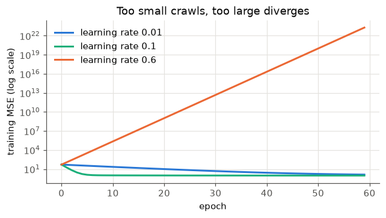
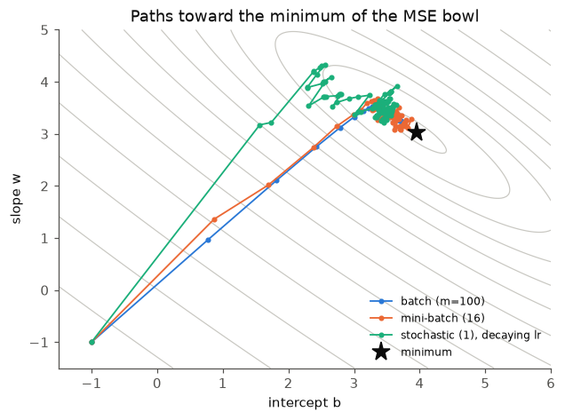
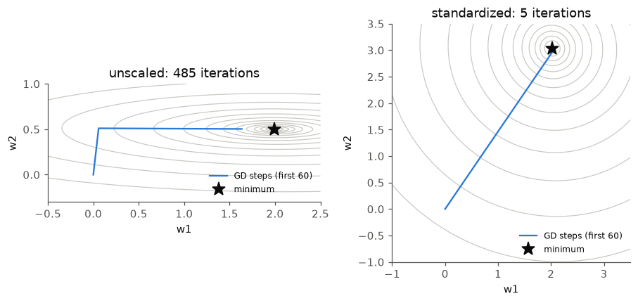
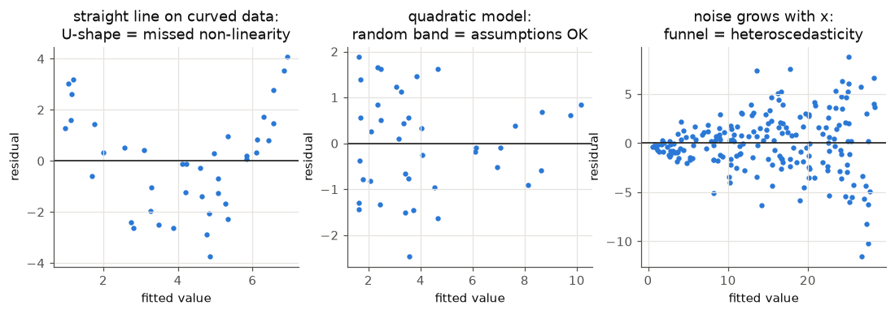
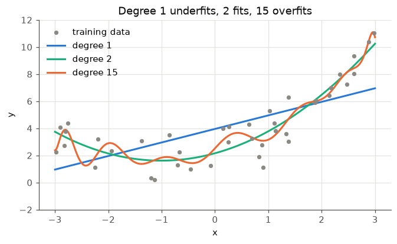
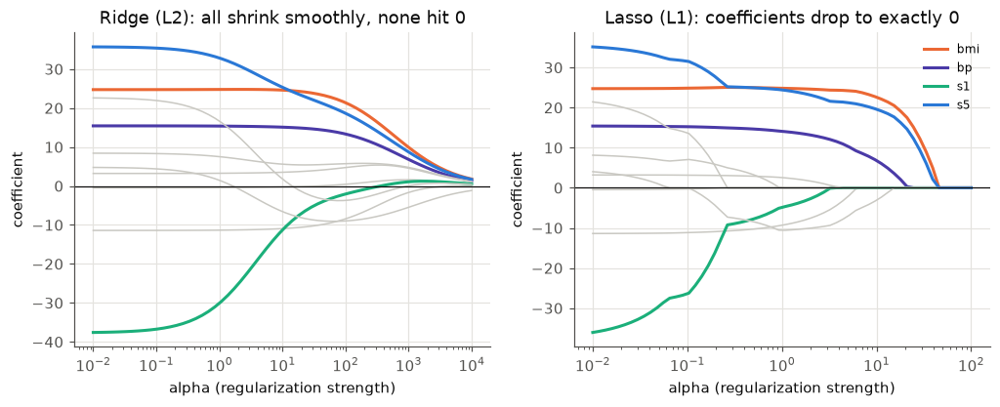
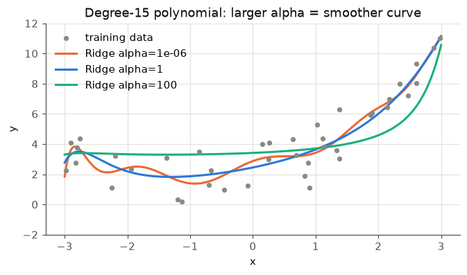
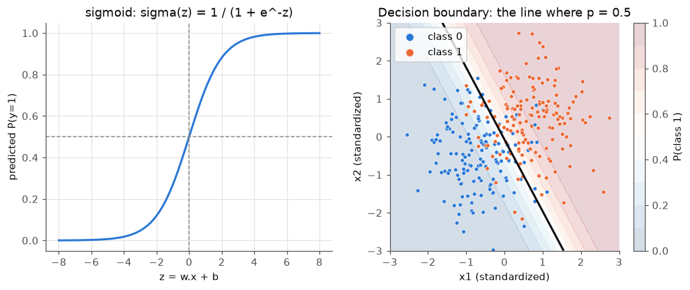
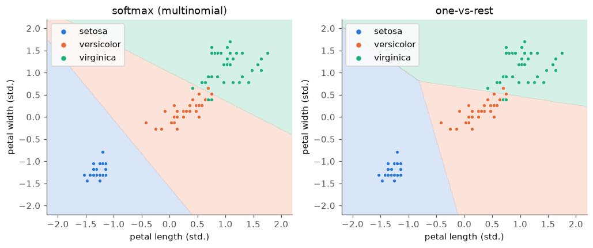

# Chapter 5 — Linear and Logistic Regression

Linear regression and logistic regression are the "hello world" of machine learning — and they are still everywhere in production: as baselines, as the final layer of neural networks, as click-through-rate models, credit scores and A/B-test analyses. They are also the best place to learn the machinery every other model uses: a **model**, a **loss function**, and an **optimizer** (gradient descent) that lowers the loss.

**What you'll learn**

1. The supervised-learning workflow end to end, on a small real dataset.
2. Linear regression: the model, the MSE loss, and two ways to fit it — the normal equation and gradient descent — both written in NumPy and checked against scikit-learn.
3. Gradient descent in practice: learning rate, batch vs mini-batch vs stochastic, and why feature scaling changes everything.
4. The assumptions of linear regression and how to check them with residual plots.
5. Polynomial regression and how model complexity leads to under- and over-fitting.
6. Regularization: Ridge (L2), Lasso (L1), ElasticNet — with coefficient-path plots.
7. Logistic regression: sigmoid, log-loss, decision boundary, gradient descent from scratch vs scikit-learn.
8. Multiclass: one-vs-rest and softmax.
9. How to interpret coefficients (and when not to trust them).

All code is in `code/` and runs with the shared environment (Python 3.14, scikit-learn 1.9, NumPy 2.5). Outputs are real; timings will differ on your machine.

---

## 5.1 The supervised-learning workflow

### What it is
**Supervised learning** means learning from **labeled data** — examples where the correct answer is attached (an email marked "spam", a house with its sale price). The model studies these examples, finds the pattern linking inputs to answers, and then predicts answers for new, **unseen** examples. It's called "supervised" because the answer key guides training, like a student checking homework against a teacher's marked solutions.

- **Regression** = the answer is a number (price, temperature, petal length).
- **Classification** = the answer is a category (spam / not spam, species).

### How it works — the steps
1. **Get data.** Download a public dataset (Kaggle, UCI, `sklearn.datasets`) or collect your own; it may arrive as CSV, Excel, database tables or text.
2. **Inspect and clean.** Look for missing values (`NaN`, blanks). Drop rows or columns that are mostly empty and unimportant, or **impute** (fill in) with the mean, median, mode or a default. Some models refuse missing values entirely; others just get worse.
3. **Encode categories.** Models need numbers. **Label (integer) encoding** maps Red → 0, Blue → 1, Green → 2 — fine for trees, but it tells a linear model that Green > Blue > Red, which is meaningless. **One-hot encoding** creates `is_Red`, `is_Blue`, `is_Green` 0/1 columns and avoids the fake order. (Chapter 4 covers all encoders.)
4. **Split** into training and test sets — commonly 80/20 or 70/30 — so you measure performance on data the model has never seen.
5. **Choose a model**, fit it on the training set.
6. **Evaluate** on the test set with a suitable metric, and compare with a trivial baseline.
7. **Iterate** — features, model, hyperparameters (Chapter 6).

### Choosing between linear regression and a decision tree

| | Linear regression | Decision tree |
|---|---|---|
| Task | Regression (logistic regression for classification) | Regression and classification |
| How it works | Fits a line / plane / **hyperplane** (a flat surface in many dimensions) that minimises squared error | Splits the data with if-then questions into groups with similar outcomes |
| Strengths | Simple, fast, interpretable coefficients, extrapolates a trend | Captures non-linear patterns and interactions, handles mixed feature types, easy to visualise |
| Weaknesses | Misses non-linear patterns unless you engineer features | Overfits if grown too deep; can't extrapolate beyond training range |
| Pick it when | The relationship looks roughly linear (e.g. weight vs height) | The data has clear thresholds or if-then structure |

(Chapter 7 covers trees in depth.)

### The workflow in code
Predict **petal length** from the other iris measurements plus the species (one-hot encoded):

```python
# code/supervised_walkthrough.py
iris = load_iris(as_frame=True)                          # bundled with sklearn, no download
df = iris.frame.rename(columns=lambda c: c.replace(" (cm)", "").replace(" ", "_"))
df["species"] = iris.target_names[df.pop("target")]
print(df.head(3).to_string(), "\n")
print("missing values (total):", df.isna().sum().sum())

X = pd.get_dummies(df.drop(columns="petal_length"), columns=["species"], dtype=int)
y = df["petal_length"]
X_tr, X_te, y_tr, y_te = train_test_split(X, y, test_size=0.2, random_state=42)   # 80/20

lin = LinearRegression().fit(X_tr, y_tr)
print("coefficients:", {c: round(float(w), 3) for c, w in zip(X.columns, lin.coef_)})
print("intercept:", round(float(lin.intercept_), 3))
for name, m in [("linear regression", lin),
                ("tree, no depth limit", DecisionTreeRegressor(random_state=0)),
                ("tree, max_depth=3", DecisionTreeRegressor(max_depth=3, random_state=0))]:
    m.fit(X_tr, y_tr)
    print(name, mean_squared_error(y_tr, m.predict(X_tr)), mean_squared_error(y_te, m.predict(X_te)))
```

Output:
```
   sepal_length  sepal_width  petal_length  petal_width species
0           5.1          3.5           1.4          0.2  setosa
1           4.9          3.0           1.4          0.2  setosa
2           4.7          3.2           1.3          0.2  setosa 

missing values (total): 0
model inputs: ['sepal_length', 'sepal_width', 'petal_width', 'species_setosa', 'species_versicolor', 'species_virginica']

coefficients: {'sepal_length': 0.585, 'sepal_width': -0.145, 'petal_width': 0.64, 'species_setosa': -1.144, 'species_versicolor': 0.315, 'species_virginica': 0.829}
intercept: 0.019

y range: 1.0 to 6.9 cm, std 1.77
model                        train MSE  test MSE
baseline (predict mean)                    3.302
linear regression                0.061     0.088
tree, no depth limit             0.001     0.142
tree, max_depth=3                0.078     0.121
```

**Interpreting the result.** **MSE** (mean squared error) is in squared units (cm²), and "lower is better" only means something against the target's scale and a baseline. Petal length spans 1–6.9 cm; predicting the mean gives MSE 3.3, so 0.088 (an average error of roughly √0.088 ≈ 0.3 cm) is good, while an MSE of 5 would be worse than guessing the mean. The unlimited tree scores almost 0 on training data but worse on test: it **overfit** (memorised the training set). Limiting `max_depth` (or raising `min_samples_split`) trades a bit of training accuracy for better generalisation.

One subtlety: the three species columns always sum to 1, which duplicates the intercept (the **dummy-variable trap**). `LinearRegression` still works — it returns the minimum-norm solution, which is why the three species coefficients sum to 0 — but the individual species coefficients are then only meaningful relative to each other. Use `drop="first"` in `OneHotEncoder` (or `drop_first=True` in `get_dummies`) if you want each one read against a reference species.

### Self-check
1. Test MSE 0.088 — good or bad? → Only meaningful against the target's scale and a baseline: the mean-predictor scores 3.3, so it's good.
2. Train MSE 0.001, test MSE 0.142 — what happened? → Overfitting: the model memorised the training set.
3. Why one-hot rather than integer-encode `species` for linear regression? → Integers impose a fake order and equal spacing.

### TL;DR
Get data → clean → encode → split → fit → evaluate against a baseline → iterate. Linear models for roughly linear trends; trees for thresholds and interactions, with depth limits against overfitting.

---

## 5.2 Linear regression: model and loss

### What it is
**Linear regression** predicts a number as a weighted sum of the features plus a constant:

ŷ = w₁x₁ + w₂x₂ + … + w_d x_d + b = **w·x + b**

- ŷ ("y-hat") — the prediction.
- x = (x₁ … x_d) — the **feature vector** for one example.
- w — the **weights** (coefficients): how much ŷ changes when that feature increases by 1, holding the others fixed.
- b — the **bias** or **intercept**: the prediction when all features are 0.

With one feature it's a line; with two, a plane; with more, a hyperplane. A trick used in all the maths: add a constant feature x₀ = 1 to every example, so b becomes weight w₀ and the model is just ŷ = θᵀx (θ = all parameters).

### The loss: mean squared error
Training means choosing θ to make predictions close to the targets. For m training examples, the **mean squared error** is:

MSE(θ) = (1/m) Σᵢ (ŷᵢ − yᵢ)²

*Worked example:* targets y = (3, 5, 7), predictions ŷ = (2.5, 5, 8). Errors = (−0.5, 0, 1). Squared = (0.25, 0, 1). MSE = 1.25/3 = **0.417**. RMSE = √0.417 = 0.65 (back in the target's units).

Why squares? They make every error positive, punish big errors more than small ones, and give a smooth bowl-shaped (convex) function with a single minimum that calculus can find. Minimising MSE is also what you get from **maximum likelihood** if the noise is Gaussian.

### Self-check
1. Errors (1, −1, 2): MSE? → (1 + 1 + 4)/3 = 2.
2. What does the intercept b mean? → The prediction when every feature is 0.
3. Why is the MSE "bowl" easy to minimise? → It's convex: one minimum, no local traps.

### TL;DR
ŷ = w·x + b; fit by minimising the average squared error, a convex bowl with one minimum.

---

## 5.3 Fitting it: the normal equation vs gradient descent

### What it is
Two ways to find the bottom of the MSE bowl:
1. **Normal equation** — solve for θ directly in one step with linear algebra.
2. **Gradient descent (GD)** — start somewhere, repeatedly step downhill until you reach the bottom.

Analogy: the normal equation is reading the lowest point off a map; gradient descent is walking downhill in fog, feeling the slope under your feet.

### How it works

**Normal equation.** At the bottom of the bowl the slope is zero. The gradient of MSE is (2/m) Xᵀ(Xθ − y) (derived just below); setting it to zero gives XᵀXθ = Xᵀy — the "normal equations" — and, if XᵀX is invertible:

θ = (XᵀX)⁻¹ Xᵀy

where X is the m × (d+1) matrix of examples (with the column of 1s) and y the vector of targets. In code, never compute the inverse explicitly; solve the linear system XᵀX θ = Xᵀy (`np.linalg.solve`) or use a least-squares routine (`np.linalg.lstsq`, which uses the SVD and also works when XᵀX is not invertible). scikit-learn's `LinearRegression` calls SciPy's least-squares solver.

**Gradient descent.** The gradient (vector of slopes) of MSE is:

∇MSE(θ) = (2/m) Xᵀ(Xθ − y)

Why: MSE = (1/m) Σᵢ (θᵀxᵢ − yᵢ)². By the chain rule, the derivative of one squared term with respect to weight θⱼ is 2(θᵀxᵢ − yᵢ)·xᵢⱼ — "twice the error times that feature". Averaging over the m examples and stacking all j gives (2/m) Xᵀ(error vector).

Then repeat: **θ ← θ − η ∇MSE(θ)**, where η (eta) is the **learning rate** (step size). Each full pass over the training data is an **epoch**.

*Worked single step* on one feature, data x = (1, 2), y = (2, 4), starting at w = 0, b = 0, η = 0.1:
- predictions (0, 0); errors (−2, −4)
- ∂/∂b = (2/2)(−2 − 4) = −6; ∂/∂w = (2/2)(1·−2 + 2·−4) = −10
- new b = 0 − 0.1·(−6) = 0.6; new w = 0 − 0.1·(−10) = 1.0 → already heading toward the true line y = 2x.

```python
# code/linreg_from_scratch.py (key parts)
def add_bias(X):
    return np.c_[np.ones(len(X)), X]                    # column of ones -> intercept is w0

def normal_equation(X, y):
    Xb = add_bias(X)
    return np.linalg.solve(Xb.T @ Xb, Xb.T @ y)         # solves (X^T X) theta = X^T y

def batch_gd(X, y, lr=0.1, epochs=1000):
    Xb = add_bias(X)
    theta = np.zeros(Xb.shape[1])
    for _ in range(epochs):
        err = Xb @ theta - y
        theta -= lr * (2 / len(y)) * Xb.T @ err         # gradient step on MSE
    return theta

x = 2 * rng.random((100, 1)); y = 4 + 3 * x[:, 0] + rng.normal(0, 1, 100)    # truth: b=4, w=3
# ... then the 10-feature diabetes dataset, standardized, compared with sklearn
```

Output:
```
normal equation  [b, w]: [3.949 3.038]
batch GD         [b, w]: [3.949 3.038] (MSE 51.39 -> 0.959)
sklearn          [b, w]: [3.949 3.038]

method            test MSE   max |diff vs sklearn|      time
normal eq.          3424.3                1.46e-12    0.07ms
batch GD            3424.6                2.68e-01   35.06ms
sklearn             3424.3                0.00e+00
baseline (predict train mean) test MSE: 5134.8
GD after 5000 epochs, coef for s1, s2 (correlated pair): [-31.   15.1] exact: [-31.2  15.3]

largest standardized effects (+1 std in feature -> change in disease score):
    s5:   +35.8
    s1:   -31.2
   bmi:   +27.5
    s2:   +15.3
intercept = mean training target: 151.6 = 151.6
```

All three methods agree on the toy problem (3.949, 3.038 — close to the true 4 and 3; the gap is noise). On the diabetes data the normal equation matches scikit-learn to 12 decimal places. Gradient descent is close but still slightly off after 5,000 epochs on the coefficients of `s1` and `s2` — two strongly correlated blood-serum measurements that create a long, narrow valley in the loss surface where GD crawls (section 5.4 shows why). Because the features are standardized (mean 0), the intercept equals the mean training target.

### Trade-offs

| | Normal equation / least squares | Gradient descent |
|---|---|---|
| Result | Exact, one shot | Approximate, iterative |
| Hyperparameters | None | Learning rate, epochs (and batch size) |
| Cost | About O(m·d²) to form XᵀX plus O(d³) to solve — fine for d up to a few thousand | O(m·d) per epoch; scales to huge m and d |
| Memory | Needs XᵀX (d × d) | Can stream mini-batches from disk |
| Feature scaling | Not needed | Needed for fast convergence |
| Works for other losses | Only squared error (and Ridge) | Any differentiable loss — logistic regression, neural networks |

### When not to use each
- Don't use the normal equation when d is very large (tens of thousands of features) or data doesn't fit in memory.
- Don't hand-roll GD when a closed form or a well-tuned library solver exists — use it for learning and for losses without closed forms.

### Common mistakes
- Computing `np.linalg.inv(X.T @ X)` explicitly — slower and numerically less stable than `solve`/`lstsq`.
- Forgetting the column of ones (no intercept).
- Running GD on unscaled features and concluding "GD doesn't work".

### Real-world examples
- `LinearRegression` in scikit-learn (least squares via SciPy); `statsmodels` OLS for statistical inference (p-values, confidence intervals).
- `SGDRegressor` / `SGDClassifier` and Vowpal Wabbit fit linear models one small batch at a time with SGD, so the dataset never has to fit in RAM.
- Every neural network is trained by variants of gradient descent (SGD with momentum, Adam).

### In the interview
**30 seconds:** *"Linear regression minimises MSE. You can solve it exactly with the normal equation, θ = (XᵀX)⁻¹Xᵀy — in practice with a least-squares solver — which is cheap when there are few features. Gradient descent iterates θ ← θ − η·(2/m)Xᵀ(Xθ − y); it scales to huge data, works for any differentiable loss, but needs a learning rate and scaled features."*

- *"When would the normal equation fail?"* — XᵀX singular (duplicate or perfectly collinear features, or more features than rows); use the pseudo-inverse (SVD) or Ridge, which makes XᵀX + αI invertible.
- *"Is the MSE loss convex?"* — Yes, for linear regression; GD with a small enough learning rate reaches the global minimum.

### Self-check
1. Write the GD update for linear regression. → θ ← θ − η (2/m) Xᵀ(Xθ − y).
2. Why add a column of ones? → So the intercept is learned as an ordinary weight.
3. Which scales better to 10 million features: normal equation or GD? → GD.
4. Why did GD lag on `s1`/`s2`? → Correlated features make a narrow valley; GD needs many steps along it.

### TL;DR
Normal equation: exact, no tuning, O(d³) — great for small d. Gradient descent: iterative, scalable, general — needs a learning rate and scaled features.

---

## 5.4 Gradient descent in practice

### What it is
Gradient descent comes in three flavours, differing only in **how many examples are used to compute each gradient**:

| Variant | Examples per update | Updates per epoch (m = 100) | Behaviour |
|---|---|---|---|
| **Batch GD** | All m | 1 | Smooth, exact gradient; slow per step on big data |
| **Mini-batch GD** | A batch, e.g. 16–512 | m / batch size (100/16 → 7) | Noisy but efficient; uses vectorised hardware (GPUs); the default in deep learning |
| **Stochastic GD (SGD)** | 1 | m (100) | Very noisy, cheap steps; noise can escape shallow local minima; never settles unless the learning rate decays |

### How it works
1. Shuffle the training data at the start of each epoch.
2. For each batch, compute the gradient on that batch only and take a step.
3. Optionally decay the learning rate over time (a **learning-rate schedule**), e.g. η_t = η₀ / (1 + k·t), so the noisy steps shrink and the parameters settle.

```python
# code/gd_variants.py (key parts)
def run(Xb, y, lr, epochs, batch_size, seed=0, lr_decay=False):
    rng = np.random.default_rng(seed)
    theta, step = np.array([-1.0, -1.0]), 0
    for epoch in range(epochs):
        idx = rng.permutation(len(y))                     # reshuffle every epoch
        for start in range(0, len(y), batch_size):
            b = idx[start:start + batch_size]
            eta = lr / (1 + 0.05 * step) if lr_decay else lr
            theta = theta - eta * mse_grad(Xb[b], y[b], theta)
            step += 1
    return theta

run(Xb, y, lr=0.1, epochs=50, batch_size=100)             # batch
run(Xb, y, lr=0.1, epochs=8,  batch_size=16)              # mini-batch
run(Xb, y, lr=0.1, epochs=1,  batch_size=1, lr_decay=True)  # stochastic
```

Output:
```
lr=0.01  MSE after 60 epochs: 1.37
lr=0.1   MSE after 60 epochs: 0.963
lr=0.6   MSE after 60 epochs: 1.92e+23

exact (normal eq.): [3.949 3.038]
batch (m=100)                updates=  50  final=[3.762 3.203]
mini-batch (16)              updates=  56  final=[3.814 3.109]
stochastic (1), decaying lr  updates= 100  final=[3.574 3.434]
unscaled      condition number        36  lr=1.36e-02  iterations to converge: 485
standardized  condition number         1  lr=4.86e-01  iterations to converge: 5
```

### The learning rate
- **Too small** (0.01): steady but slow — still at MSE 1.37 after 60 epochs.
- **Good** (0.1): reaches the minimum (≈ 0.96, the noise level).
- **Too large** (0.6): every step overshoots further; the loss explodes to 10²³ — **divergence**.

For MSE the rule is concrete: GD converges if η < 2/λ_max, where λ_max is the largest eigenvalue of the loss's curvature matrix (the **Hessian**, here (2/m)XᵀX). In practice you try values on a log scale (0.001, 0.01, 0.1, …) and watch the loss curve.





Batch GD moves in a smooth line; mini-batch wiggles; SGD bounces around the minimum and only settles because its learning rate decays. With equal numbers of updates, batch GD saw 50× more data than SGD — in terms of *compute*, SGD and mini-batch are far cheaper per unit of progress on large datasets, which is why they dominate.

### Why feature scaling matters for GD
If one feature has a much larger spread than another, the MSE bowl becomes a long, narrow valley. The learning rate must be small enough for the steep direction (or it diverges), which makes progress along the flat direction painfully slow. The **condition number** (λ_max / λ_min) measures how stretched the bowl is: GD's number of steps grows roughly in proportion to it.



Here a feature with 6× the spread of the other gives a condition number of 36 and needs **485** iterations; after standardizing both features the bowl is round (condition number ≈ 1) and GD converges in **5**. With 100× spread the unscaled version needs well over 100,000 iterations. Correlated features (like `s1`/`s2` in the diabetes data) stretch the bowl too — scaling doesn't fully fix that; regularization helps.

### Trade-offs / common mistakes
- Batch size: larger batches give smoother gradients and better hardware use, but fewer updates per epoch; very large batches may need a larger learning rate or warm-up.
- Forgetting to shuffle — batches become unrepresentative (e.g. sorted by class).
- Judging SGD by its final iterate without a decaying learning rate — it keeps bouncing.
- Stopping by a fixed number of epochs instead of monitoring validation loss (**early stopping**, Chapter 6).

### In the interview
**30 seconds:** *"Batch GD uses all data per step — smooth but expensive; SGD uses one example — cheap and noisy, needs a decaying learning rate; mini-batch is the practical middle ground and fits GPUs. The learning rate is the key hyperparameter: too small is slow, too large diverges. Scale features first — otherwise the loss surface is a narrow valley and GD zig-zags or crawls."*

- *"Why does SGD sometimes generalise better?"* — Its noise acts like a regularizer and can escape sharp minima; this is an empirical observation in deep learning, not a guarantee.
- *"How do you pick a learning rate?"* — Log-scale search, look at the training-loss curve; or a learning-rate range test; then add a schedule.

### Self-check
1. With m = 1,000 and batch size 50, how many updates per epoch? → 20.
2. What happens with η above 2/λ_max on MSE? → Divergence.
3. Why does scaling speed up GD? → It makes the loss bowl rounder (lower condition number), so one learning rate suits all directions.

### TL;DR
Batch = exact and slow, SGD = noisy and cheap, mini-batch = the default. Tune the learning rate on a log scale, decay it for SGD, and always scale features.

---

## 5.5 Assumptions of linear regression

### What it is
Linear regression will always return *some* line. Whether that line's **predictions** are good and its **coefficients and p-values** are trustworthy depends on assumptions:

| Assumption | Meaning | If violated |
|---|---|---|
| **Linearity** | y is a linear function of the (possibly transformed) features | Systematic errors; add polynomial/log terms or use a non-linear model |
| **Independence** | Errors of different rows are unrelated | Typical with time series or repeated measures; standard errors too small |
| **Homoscedasticity** | Error spread is constant across predictions | "Funnel" residuals; coefficients still unbiased but standard errors wrong; try log(y) or weighted least squares |
| **Normal errors** | Residuals roughly normal | Matters mainly for small-sample confidence intervals and p-values |
| **No (perfect) multicollinearity** | Features aren't (near-)copies of each other | Coefficients unstable and hard to interpret (predictions can still be fine) |

For pure prediction, linearity and a stable data distribution matter most; the others matter most when you interpret coefficients or report statistical significance.

### How to check: residual plots
A **residual** is yᵢ − ŷᵢ. Plot residuals against fitted values: a good model leaves a structureless horizontal band around 0.

```python
# code/polynomial_and_assumptions.py (residual part)
lin = LinearRegression().fit(x[:, None], y)            # straight line on quadratic data
resid = y - lin.predict(x[:, None])
ax.scatter(lin.predict(x[:, None]), resid); ax.axhline(0)
```



- **U-shape** (left): the straight line misses curvature — add x², or transform.
- **Random band** (middle): the quadratic model captures the pattern.
- **Funnel** (right): noise grows with x — heteroscedasticity. Log-transform y, use weighted least squares, or report robust standard errors.

### Common mistakes
- Checking only R² and never plotting residuals.
- Interpreting coefficients causally ("raising x by 1 *causes* y to rise by w"). Regression finds associations in observational data.

### In the interview
**30 seconds:** *"Linear regression assumes a linear relationship, independent errors with constant variance, roughly normal errors, and no strong multicollinearity. For prediction, linearity and a stable distribution matter most; the rest matter when you interpret coefficients or p-values. I check with a residuals-vs-fitted plot."*

- *"What does a funnel-shaped residual plot mean?"* — Heteroscedasticity: error variance grows with the prediction; log-transform y, use weighted least squares or robust standard errors.

### Self-check
1. Residuals form a U shape — what's wrong? → The model misses curvature; add x² or transform.
2. Does heteroscedasticity bias the coefficients? → No, it makes their standard errors wrong.
3. Can multicollinearity hurt predictions? → Usually not much; it makes individual coefficients unstable.

### TL;DR
Plot residuals vs fitted values: a U means missing non-linearity, a funnel means non-constant variance, and correlated features make coefficients unreliable.

---

## 5.6 Polynomial regression

### What it is
**Polynomial regression** is linear regression on polynomial features. For one feature x and degree 2: ŷ = w₂x² + w₁x + b. It is still "linear" — linear in the *weights* — so the same solvers work; only the inputs are expanded (`PolynomialFeatures`).

### Why it matters
It is the simplest way to fit curves, and the clearest demonstration of **underfitting vs overfitting**:
- **Underfitting** — the model is too simple to capture the pattern: high error on training *and* test data (high **bias**).
- **Overfitting** — the model is so flexible that it fits the noise: low training error, higher test error (high **variance**).

```python
# code/polynomial_and_assumptions.py (key parts) — truth: y = 0.5x² + x + 2 + noise, 40 training points
for deg in [1, 2, 15]:
    model = make_pipeline(PolynomialFeatures(deg, include_bias=False), StandardScaler(), LinearRegression())
    model.fit(x[:, None], y)
```

Output:
```
degree  train MSE  test MSE
     1       3.73      2.83
     2       1.14      1.04
    15       0.90      1.35
degree-2 learned: y = 0.54 x^2 + 1.08 x + 2.16   (truth 0.5, 1, 2)
```



Degree 2 recovers the true coefficients (0.54, 1.08, 2.16 vs 0.5, 1, 2). Degree 15 has the *lowest training error* but a higher test error, and its curve wiggles between points and shoots off at the edges. (Here the test points lie inside the training range; outside it, a degree-15 polynomial is wildly wrong.) The noise level is 1.0 (variance of the added noise), so a test MSE ≈ 1.0 is the best any model can do.

### Trade-offs / when not to use it
- Features explode with degree and number of inputs: d features at degree k gives C(d+k, k) − 1 columns (10 features at degree 2 → 65; at degree 3 → 285).
- High-degree polynomials are unstable at the edges and extrapolate badly. For smooth curves prefer low degrees, **splines** (`SplineTransformer`) or tree/boosting models.
- Always scale after expanding: x¹⁵ dwarfs x.

### In the interview
**30 seconds:** *"Polynomial regression expands the inputs with powers and products and fits an ordinary linear model — linear in the weights. The degree is a complexity knob: too low underfits, too high overfits and extrapolates wildly. I'd choose the degree, or add Ridge, using validation data."*

### Self-check
1. Is polynomial regression a linear model? → Yes, linear in its parameters.
2. Degree-15 has the lowest training MSE — why not use it? → It fits noise; test error is higher.
3. How many degree-2 features from 3 inputs (no bias)? → 3 + 3 squares + 3 pairwise = 9.

### TL;DR
Expand features with powers and products, then fit a linear model. Too low a degree underfits; too high overfits — pick the degree (or regularize) using validation data.

---

## 5.7 Regularization: Ridge, Lasso, ElasticNet

### What it is
**Regularization** adds a penalty on the size of the weights to the loss, so the model prefers simpler explanations. It's like a budget: the model can still use features, but each unit of weight costs something, so it only spends where the data strongly justifies it.

| Model | Penalty | scikit-learn objective | Effect |
|---|---|---|---|
| **Ridge** (L2) | α Σ wⱼ² | ‖y − Xw‖² + α‖w‖₂² | Shrinks all weights smoothly toward 0; never exactly 0; splits weight among correlated features |
| **Lasso** (L1) | α Σ \|wⱼ\| | (1/2m)‖y − Xw‖² + α‖w‖₁ | Sets some weights **exactly 0** → automatic feature selection; picks one of a correlated group |
| **ElasticNet** | mix of both | (1/2m)‖y − Xw‖² + α·r‖w‖₁ + ½α(1 − r)‖w‖₂² | Sparse *and* stable with correlated features; r = `l1_ratio` |

Notes:
- **α** (alpha) is the regularization strength: α = 0 is plain least squares; large α pushes weights toward 0. Note that Ridge's and Lasso's α are on different scales in scikit-learn (Ridge's squared-error term is a sum, Lasso's is divided by 2m), so the same α means different amounts of shrinkage.
- The **intercept is not penalized**.
- **Scale features first.** The penalty treats all weights equally, so it only makes sense if features are on the same scale.
- In logistic regression and SVMs, scikit-learn uses **C = 1/regularization strength** instead: *smaller* C means *stronger* regularization.

### Why it matters
- Reduces overfitting when there are many features relative to rows, or correlated features.
- Makes XᵀX + αI always invertible, so Ridge has a closed form: θ = (XᵀX + αI)⁻¹Xᵀy (with the intercept left unpenalized).
- Lasso gives compact, interpretable models.

Why does L1 produce exact zeros and L2 doesn't? Geometrically, the L1 "budget" region is a diamond with corners on the axes; the loss contours usually first touch it at a corner, where some weights are 0. The L2 region is a circle with no corners. Computationally, the L1 penalty's slope is a constant ±α however small the weight, so it keeps pushing a weight all the way to 0; the L2 penalty's slope 2αw fades as w shrinks.

```python
# code/regularization.py (key parts) — diabetes data, standardized
ridge_path = np.array([Ridge(alpha=a).fit(X, y).coef_ for a in np.logspace(-2, 4, 60)])
lasso_path = np.array([Lasso(alpha=a, max_iter=50_000).fit(X, y).coef_ for a in np.logspace(-2, 2, 60)])

X_dup = np.c_[X[:, [2]], X[:, [2]] + rng.normal(0, 0.01, (len(X), 1))]    # bmi twice (near-copy)

poly = PolynomialFeatures(2, include_bias=False)                         # 65 features, ~330 rows
models = {"OLS": make_pipeline(poly, StandardScaler(), LinearRegression()),
          "RidgeCV": make_pipeline(poly, StandardScaler(), RidgeCV(alphas=np.logspace(-3, 3, 50))),
          "LassoCV": make_pipeline(poly, StandardScaler(), LassoCV(cv=5, random_state=0)),
          "ElasticNetCV": make_pipeline(poly, StandardScaler(),
                                        ElasticNetCV(l1_ratio=[0.2, 0.5, 0.8], cv=5, random_state=0))}
```

Output:
```
Lasso alpha=0.1 :  9 of 10 coefficients non-zero
Lasso alpha=1   :  7 of 10 coefficients non-zero
Lasso alpha=5   :  5 of 10 coefficients non-zero
Lasso alpha=20  :  3 of 10 coefficients non-zero

bmi duplicated -> OLS: [ 434.3 -389.1]  Ridge(1): [31.5 13.5]  Lasso(1): [44.2  0. ]

model          test MSE    alpha l1_ratio non-zero
OLS                4112      nan      nan       65
RidgeCV            3291   59.636      nan       65
LassoCV            3113    4.256      nan       11
ElasticNetCV       3178    0.754      0.8       41
```



What the numbers show:
- **Sparsity:** as Lasso's α grows, coefficients drop out: 9 → 7 → 5 → 3 non-zero. The last survivors (`bmi`, `s5`) are the strongest predictors.
- **Correlated features:** with `bmi` duplicated, plain least squares produces absurd, opposite-signed weights (+434, −389) that nearly cancel. Ridge shares the weight (31.5 + 13.5 ≈ 45); Lasso keeps one (44.2) and zeroes the other.
- **Generalisation:** with 65 polynomial features and ~330 training rows, unregularized OLS overfits (test MSE 4112). Ridge, Lasso and ElasticNet with α chosen by cross-validation all do much better (≈ 3100–3300); Lasso keeps only 11 of the 65 features. (Honest footnote: on this split plain OLS on the *original* 10 features scores about 2900 — regularization rescues an over-expanded model, but it doesn't make needless features useful.)



### Trade-offs

| | Ridge | Lasso | ElasticNet |
|---|---|---|---|
| Feature selection | No | Yes | Yes (less aggressive) |
| Correlated features | Shares weight — stable | Picks one arbitrarily — unstable | Groups them — stable |
| Closed form | Yes | No (coordinate descent) | No |
| When p > n | Works | Selects at most n features | Works |
| Good default when | Many small effects | Few features truly matter | Correlated groups + want sparsity |

### When not to use it
Regularization matters little when you have plenty of rows per feature (diabetes with its raw 10 features: OLS, Ridge, Lasso and ElasticNet all score within about 2% of each other, test MSE ≈ 2900–2950). Don't use Lasso's selected set as "the true causes" — with correlated features its choice can flip between resamples.

### Common mistakes
- Regularizing unscaled features.
- Choosing α on the test set — use `RidgeCV`/`LassoCV`/`GridSearchCV`.
- Forgetting that C in `LogisticRegression` is the *inverse* of the strength.

### Real-world examples
- Ridge is the classic fix for multicollinearity in econometrics; L2 "weight decay" is standard when training neural networks.
- L1-regularized logistic regression is used for sparse, high-dimensional text and click models (e.g. Google's FTRL-Proximal ad click model from 2013 used L1 to keep models sparse).
- In genomics (thousands of genes, few patients), Lasso and ElasticNet are standard tools for selecting predictive genes.

### In the interview
**30 seconds:** *"Regularization adds a weight penalty to fight overfitting. Ridge (L2) shrinks all weights smoothly and handles correlated features; Lasso (L1) zeroes some weights, doing feature selection; ElasticNet mixes both. Scale features first and tune α with cross-validation."*

- *"Why does Lasso give zeros?"* — The L1 penalty's constant slope pushes small weights all the way to 0; geometrically, the diamond-shaped constraint has corners on the axes.
- *"Ridge vs Lasso with two identical features?"* — Ridge splits the weight equally; Lasso picks one.
- *"Effect of regularization on bias and variance?"* — More regularization → more bias, less variance.

### Self-check
1. Large α in Ridge does what? → Shrinks all weights toward 0 (more bias, less variance).
2. Which penalty can do feature selection? → L1 (Lasso, ElasticNet).
3. In `LogisticRegression`, does C = 0.01 mean strong or weak regularization? → Strong.
4. Why scale before regularizing? → The penalty is on raw weights, whose size depends on feature units.

### TL;DR
Penalize big weights: L2 shrinks, L1 selects, ElasticNet does both. Scale first, tune α (or C) by cross-validation.

---

## 5.8 Logistic regression

### What it is
**Logistic regression** is a linear model for **binary classification**. It computes the same weighted sum z = w·x + b (called the **logit**), then squashes it into a probability with the **sigmoid** (logistic) function:

p = P(y = 1 | x) = σ(z) = 1 / (1 + e^−z)

Despite the name, it's a classifier. The name comes from the logistic function it uses.

### How it works

**1. Sigmoid.** σ maps any real number to (0, 1): σ(−2) = 0.119, σ(0) = 0.5, σ(2) = 0.881. Large positive z → close to 1; large negative → close to 0.

**2. Log-odds interpretation.** Inverting the sigmoid: z = ln(p / (1 − p)). The quantity p/(1 − p) is the **odds** (p = 0.8 → odds 4, "4 to 1"). So logistic regression is linear in the **log-odds**. Each weight wⱼ says: increasing xⱼ by 1 adds wⱼ to the log-odds, i.e. **multiplies the odds by e^wⱼ** (the **odds ratio**).

**3. Decision rule and boundary.** Predict class 1 when p ≥ threshold (default 0.5). Since p = 0.5 exactly when z = 0, the **decision boundary** is the set of points where w·x + b = 0 — a straight line (in 2-D) or a hyperplane. Changing the threshold shifts the boundary parallel to itself (Chapter 6 covers choosing thresholds).

**4. Loss: log-loss (binary cross-entropy).** Squared error would make the optimisation non-convex, so logistic regression uses:

Loss = −(1/m) Σ [ yᵢ ln pᵢ + (1 − yᵢ) ln(1 − pᵢ) ]

Only one term is active per example: −ln p if y = 1, −ln(1 − p) if y = 0.

| True y | Predicted p | Loss | Reading |
|---|---|---|---|
| 1 | 0.9 | −ln 0.9 = 0.105 | confident and right: tiny loss |
| 1 | 0.5 | −ln 0.5 = 0.693 | unsure |
| 1 | 0.1 | −ln 0.1 = 2.303 | confident and wrong: big loss |
| 0 | 0.1 | −ln 0.9 = 0.105 | confident and right |

It is the negative log-likelihood of the data under a Bernoulli model, so minimising it is maximum likelihood. It's convex in the weights, so gradient descent finds the global minimum. There's no closed-form solution, so it must be solved iteratively.

**5. Gradient.** Remarkably, the gradient has the same form as linear regression's:

∇Loss = (1/m) Xᵀ(σ(Xθ) − y)   — "features × (prediction − truth)".

Why, in three steps for one example (p = σ(z), z = θᵀx):
1. dLoss/dp = −y/p + (1 − y)/(1 − p).
2. The sigmoid's derivative is dp/dz = p(1 − p).
3. Multiply: dLoss/dz = −y(1 − p) + (1 − y)p = **p − y**, and dz/dθⱼ = xⱼ, so dLoss/dθⱼ = (p − y)xⱼ. Averaging over examples gives the formula. (No factor 2 here, because there is no square.)

```python
# code/logreg_from_scratch.py (key parts)
def sigmoid(z):
    return 1 / (1 + np.exp(-z))

def fit_logreg_gd(X, y, lr=0.5, epochs=5000):
    Xb = np.c_[np.ones(len(X)), X]
    theta = np.zeros(Xb.shape[1])
    for _ in range(epochs):
        p = sigmoid(Xb @ theta)
        theta -= lr * Xb.T @ (p - y) / len(y)             # gradient of mean log-loss
    return theta

X, y = make_blobs(n_samples=400, centers=[[-1, -0.5], [1, 0.8]], cluster_std=1.1, random_state=0)
# ... stratified split, StandardScaler fitted on train
theta = fit_logreg_gd(X_tr, y_tr)
sk = LogisticRegression(C=np.inf).fit(X_tr, y_tr)         # C=inf -> no penalty (sklearn >= 1.8)
```

Output:
```
sigmoid(-2) = 0.119
sigmoid(+0) = 0.500
sigmoid(+2) = 0.881
y=1, p=0.9: loss = 0.105
y=1, p=0.5: loss = 0.693
y=1, p=0.1: loss = 2.303
y=0, p=0.1: loss = 0.105

from scratch [b, w1, w2]: [0.092 2.454 1.297]
sklearn      [b, w1, w2]: [0.092 2.454 1.298]
test log-loss scratch 0.4048 | sklearn 0.4048
test accuracy scratch 0.850 | sklearn 0.850
w1 = 2.454: +1 std in x1 multiplies the odds of class 1 by e^w1 = 11.64
```

Our 10-line gradient descent matches scikit-learn's L-BFGS solver to about three decimals.



The probability changes smoothly across the boundary; points near the line get probabilities near 0.5. That's the model being honestly uncertain about overlapping classes.

**scikit-learn details (version 1.8+).** `LogisticRegression` is L2-regularized by default with `C=1.0`. The old `penalty=` argument is deprecated: use `C=np.inf` for no penalty, `l1_ratio=1` (with `solver="saga"` or `"liblinear"`) for L1, and a value between 0 and 1 for ElasticNet. The default solver is `lbfgs`.

### Trade-offs

| Strengths | Weaknesses |
|---|---|
| Fast to train and serve, tiny model | Linear boundary only (needs feature engineering or kernels for curves) |
| Outputs probabilities that are often reasonably calibrated | Sensitive to correlated features and outliers in X |
| Coefficients interpretable as odds ratios | On perfectly separable data, unregularized weights grow without bound |
| Convex: one global optimum | Usually beaten by gradient boosting on complex tabular data |

### When not to use it
Strongly non-linear boundaries without good features (use trees/boosting or neural nets); very high-cardinality interactions you can't enumerate.

### Common mistakes
- Using `LinearRegression` for a 0/1 target — predictions fall outside [0, 1] and the fit is dominated by easy points.
- Forgetting that the default is regularized (C = 1) — compare coefficients across models only with the same C and scaling.
- Assuming 0.5 is the right threshold for imbalanced data.

### Real-world examples
- **Credit scoring** scorecards are traditionally logistic regression, because regulators and loan officers need to read the coefficients.
- **Ad click-through-rate** prediction at Google and Facebook used large-scale logistic regression (Facebook's 2014 paper fed boosted-tree features into a logistic regression).
- Medical risk scores and the final layer of every neural-network binary classifier (a sigmoid on a linear layer).

### In the interview
**30 seconds:** *"Logistic regression computes a linear score z = w·x + b, turns it into a probability with the sigmoid, and is trained by minimising log-loss — convex, so gradient descent finds the global optimum. The decision boundary is the hyperplane w·x + b = 0. Each coefficient is a change in log-odds, so e^w is an odds ratio."*

- *"Why not MSE for classification?"* — With a sigmoid, MSE is non-convex and gives weak gradients for confidently wrong predictions; log-loss is convex and punishes them hard.
- *"What happens on perfectly separable data?"* — The unregularized loss keeps decreasing as weights grow, so they diverge; regularization keeps them finite.
- *"Is logistic regression's output calibrated?"* — Often roughly, because log-loss is a proper scoring rule, but check with a reliability curve (Chapter 6).

### Self-check
1. σ(0)? → 0.5.
2. Loss for y = 1, p = 0.25? → −ln 0.25 = 1.386.
3. Coefficient w = 0.7: effect on odds? → Multiplied by e^0.7 ≈ 2.01 per unit increase.
4. What does the decision boundary look like in 2-D? → A straight line.

### TL;DR
Linear score → sigmoid → probability; train with log-loss (convex, gradient = Xᵀ(p − y)/m); boundary is w·x + b = 0; coefficients are log-odds.

---

## 5.9 Multiclass classification: one-vs-rest and softmax

### What it is
Two ways to extend logistic regression to K > 2 classes:

1. **One-vs-rest (OvR)** — train K separate binary classifiers ("class k vs everything else"); predict the class whose classifier is most confident.
2. **Softmax (multinomial) regression** — one model with a weight vector per class, producing K scores zₖ = wₖ·x + bₖ, turned into probabilities that sum to 1 by the **softmax** function:

P(y = k | x) = e^zₖ / Σⱼ e^zⱼ

*Worked example:* scores (2, 1, 0.1) → e² = 7.39, e¹ = 2.72, e^0.1 = 1.11, total 11.21 → probabilities **(0.659, 0.242, 0.099)**. The largest score wins, and the probabilities sum to 1.

The loss is **cross-entropy**: −(1/m) Σᵢ ln P(yᵢ | xᵢ) — the negative log-probability of the correct class. With K = 2 it reduces exactly to binary logistic regression. Its gradient again has the form Xᵀ(P − Y)/m, with Y the one-hot labels.

```python
# code/multiclass.py (key parts)
def softmax(Z):
    Z = Z - Z.max(axis=1, keepdims=True)                  # subtract row max: avoids overflow
    E = np.exp(Z)
    return E / E.sum(axis=1, keepdims=True)

def fit_softmax_gd(X, y, k, lr=0.5, epochs=3000, l2=0.0):
    Xb = np.c_[np.ones(len(X)), X]
    W = np.zeros((Xb.shape[1], k)); Y = np.eye(k)[y]      # one-hot targets
    for _ in range(epochs):
        grad = Xb.T @ (softmax(Xb @ W) - Y) / len(y)
        grad[1:] += l2 * W[1:]
        W -= lr * grad
    return W

softmax_sk = LogisticRegression(C=10).fit(X_tr, y_tr)                  # multinomial by default
ovr = OneVsRestClassifier(LogisticRegression(C=10)).fit(X_tr, y_tr)     # 3 binary models
```

Output:
```
softmax([2, 1, 0.1]) = [[0.659 0.242 0.099]]  sum = 1.0

test accuracy  softmax(sklearn) 0.978 | OvR 0.978 | softmax(scratch) 0.978
one flower, P(setosa, versicolor, virginica):
  softmax sklearn : [[0.    0.001 0.999]]
  softmax scratch : [0.    0.001 0.999]
  OvR raw scores  : [0.    0.175 0.998] (sum 1.174) -> normalized [[0.    0.149 0.851]]
sklearn softmax coef_ shape: (3, 2) (one weight vector per class)
```



Both reach 97.8% accuracy here, but their probabilities differ: the OvR classifiers are trained independently, so their raw scores don't sum to 1 (1.174) and scikit-learn simply rescales them, giving 0.851 for virginica where softmax says 0.999. The regions differ too — OvR's boundaries come from three separate problems.

### Trade-offs

| | One-vs-rest | Softmax |
|---|---|---|
| Models | K binary models | One joint model |
| Probabilities | Not naturally normalised | Sum to 1, jointly trained — better calibrated |
| Parallel training / per-class tuning | Easy | No |
| Use with | Any binary classifier (e.g. SVMs); multi-label problems | Mutually exclusive classes; neural-network output layers |

Also: **one-vs-one** trains K(K−1)/2 pairwise classifiers (used internally by `SVC`). For **multi-label** problems (an item can have several labels at once, e.g. photo tags), use independent sigmoids (OvR), not softmax.

Current scikit-learn (1.9 here) has no `multi_class` argument any more: `LogisticRegression` fits the multinomial (softmax) model for K > 2, and you wrap it in `OneVsRestClassifier` if you want OvR.

### In the interview
**30 seconds:** *"For K classes you can train K one-vs-rest binary models, or one softmax model that outputs K scores and normalises them with e^z / Σe^z, trained with cross-entropy. Softmax gives coherent probabilities for mutually exclusive classes and is the output layer of neural classifiers; OvR works with any binary model and suits multi-label problems."*

- *"Why subtract the max in softmax?"* — Numerical stability: e^1000 overflows, and subtracting a constant from all scores doesn't change the result.
- *"Softmax with 2 classes?"* — Equivalent to logistic regression on the score difference.

### Self-check
1. softmax(0, 0, 0)? → (1/3, 1/3, 1/3).
2. Multi-label tagging: softmax or sigmoids? → Independent sigmoids.
3. How many classifiers does OvR train for 10 classes? → 10 (one-vs-one: 45).

### TL;DR
OvR = K binary models; softmax = one model with normalised probabilities and cross-entropy loss. Use softmax for exclusive classes, sigmoids for multi-label.

---

## 5.10 Interpreting coefficients

### What it is
A linear model's coefficients are its explanation. Reading them correctly depends on units, scaling and correlations.

### How it works
- **Raw units:** wⱼ = change in ŷ per 1-unit increase in xⱼ, **holding all other features fixed**. Change the unit (m² → km²) and the number changes by a factor of a million — the model doesn't.
- **Standardized features:** wⱼ = change in ŷ per 1 standard deviation of xⱼ. Now magnitudes are comparable across features — a rough importance ranking.
- **Logistic regression:** wⱼ is a change in log-odds; e^wⱼ is the **odds ratio**. e^w > 1 raises the odds, < 1 lowers them.
- **Intercept:** the prediction when all features are 0 (with standardized features: at the average feature values).

```python
# code/interpret_coefficients.py (key parts)
price = 50 + 3.0 * size - 1.5 * age + rng.normal(0, 20, n)     # $1000s, size in m², age in years
LinearRegression().fit(np.c_[size, age], price)
LinearRegression().fit(np.c_[size / 1e6, age], price)            # size in km²
make_pipeline(StandardScaler(), LinearRegression()).fit(np.c_[size, age], price)

clf = make_pipeline(StandardScaler(), LogisticRegression(C=0.1, max_iter=5000)).fit(cancer.data, cancer.target)

x2 = x1 + rng.normal(0, 0.05, 300)                                # near-duplicate feature
# fit on 3 bootstrap resamples
```

Output:
```
raw units      : price = 52.6 + 2.98*size_m2 -1.49*age_years
size in km^2   : coef for size = 2984148  (same model, different units -> different number)
standardized   : +1 std of size -> +137.6, +1 std of age -> -20.8  (comparable importance)

breast cancer (target 1 = benign), standardized features, C=0.1:
  worst texture            coef -0.60  odds ratio e^coef = 0.55
  worst radius             coef -0.54  odds ratio e^coef = 0.58
  worst concave points     coef -0.53  odds ratio e^coef = 0.59
  fractal dimension error  coef +0.27  odds ratio e^coef = 1.31
  compactness error        coef +0.27  odds ratio e^coef = 1.31

bootstrap coefficients for two near-duplicate features (true: 1.0 and 1.0):
  resample 0: w1 = +1.07, w2 = +0.95, sum = 2.02
  resample 1: w1 = +2.91, w2 = -0.92, sum = 2.00
  resample 2: w1 = -1.03, w2 = +3.04, sum = 2.01
```

Reading it:
- Each extra m² adds about $2,980 and each year of age subtracts about $1,490 (the price unit is $1000s). In raw units, age's coefficient looks half as big as size's; standardized, size matters about 6.6× more (137.6 vs 20.8), because sizes vary much more than ages.
- In the cancer model, one standard deviation more "worst texture" multiplies the odds of *benign* by 0.55 (about halves them).
- With near-duplicate features, individual coefficients swing wildly between resamples (even flipping sign), while their **sum** stays stable at ≈ 2. Predictions are fine; the individual numbers are meaningless. Diagnose with correlations or the **variance inflation factor (VIF)**; fix by dropping/combining features or using Ridge.

### Common mistakes
- Comparing raw coefficients across features with different units.
- Reading coefficients causally from observational data.
- Interpreting one coefficient of a correlated group in isolation.
- Forgetting that regularization shrinks coefficients (they are biased toward 0).

### In the interview
**30 seconds:** *"A coefficient is the change in prediction per unit of that feature, holding the others constant. Standardize features to compare magnitudes; in logistic regression exponentiate to get odds ratios. Coefficients are unstable under multicollinearity and are associations, not causal effects."*

### Self-check
1. Logistic coefficient −0.69: effect on odds? → ×e^−0.69 ≈ 0.5, halves the odds.
2. Why are coefficients of correlated features unstable? → Many weight combinations give nearly the same predictions; small data changes flip between them.
3. How to make coefficient magnitudes comparable? → Standardize the features.

### TL;DR
Coefficients = effect per unit (or per std if standardized), holding others fixed; exponentiate logistic coefficients for odds ratios; don't trust individual coefficients of correlated features or read them causally.

---

## Chapter TL;DR

- **Workflow:** data → clean → encode (one-hot for nominal) → split (80/20) → fit → evaluate against a baseline → iterate. MSE only means something relative to the target's scale and a baseline.
- **Linear regression:** ŷ = w·x + b, minimise MSE (convex). **Normal equation** θ = (XᵀX)⁻¹Xᵀy (use a solver, not an explicit inverse) — exact, O(d³), no scaling needed. **Gradient descent** θ ← θ − η(2/m)Xᵀ(Xθ − y) — scalable and general, needs a learning rate and scaled features.
- **GD variants:** batch (smooth, costly), stochastic (noisy, needs a decaying learning rate), mini-batch (default). Too-large η diverges (for MSE, η < 2/λ_max). Unscaled features → elongated loss bowl → many more iterations.
- **Assumptions:** linearity, independent errors, constant variance, roughly normal errors, no strong multicollinearity. Check residual plots (U = missing curvature, funnel = heteroscedasticity).
- **Polynomial regression:** linear model on expanded features; degree controls under/overfitting.
- **Regularization:** Ridge (L2, shrink, stable with correlated features), Lasso (L1, exact zeros, feature selection), ElasticNet (both). Scale first; tune α (or C = 1/strength) by CV.
- **Logistic regression:** p = σ(w·x + b), log-loss (convex, gradient Xᵀ(p − y)/m), boundary w·x + b = 0, coefficients are log-odds (e^w = odds ratio). In sklearn ≥ 1.8, `C=np.inf` means no penalty.
- **Multiclass:** OvR (K binary models) vs softmax (e^zₖ/Σe^zⱼ + cross-entropy; coherent probabilities).
- **Coefficients:** per-unit effects holding others fixed; standardize to compare; unstable under multicollinearity; associations, not causes.
