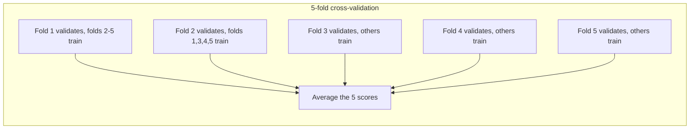

# Chapter 6 — Evaluation and Tuning

Training is the easy part. The hard questions come after: *Is it any good? At what? Compared to what? Will it hold on next month's data? Could other settings do better?* This chapter covers the right metric for the job, reliable performance estimates, over- and underfitting, and systematic **hyperparameter tuning** (searching for the best settings chosen before training).

**What you'll learn:** baselines and offline vs business metrics; regression metrics (MAE, MSE, RMSE, R², percentile and per-cohort errors); classification metrics and threshold choice; ranking metrics (precision@k, recall@k, MAP, MRR, NDCG); calibration; cross-validation (k-fold, stratified, time-series, group, nested); bias–variance, learning and validation curves; grid, random, successive halving and Bayesian (Optuna) tuning; early stopping.

All code is in `code/` (scikit-learn 1.9). Outputs are real.

---

## 6.1 Baselines, and offline vs business metrics

### What it is
An **evaluation metric** summarises how well predictions match reality. A **baseline** is the score of a trivially simple predictor. An **offline metric** is computed on **held-out** (never trained on) historical data; an **online** or **business metric** is what the product cares about (revenue, retention, fraud losses, delivery promises kept), measured on live traffic.

### Why it matters
A metric alone is meaningless. "MAE of 6 minutes" says nothing until you know the naive and current production scores: if "same as last week" gives 8, 6 is a real gain; if it gives 6.2, the model is an expensive way to save 12 seconds.

### How it works — baselines to always compute

| Task | Naive baseline | scikit-learn |
|---|---|---|
| Classification | Majority class; random at class rates | `DummyClassifier(strategy="most_frequent" / "prior" / "stratified")` |
| Regression | Mean or median of training target | `DummyRegressor(strategy="mean" / "median")` |
| Time series | Last value; same hour last week (seasonal naive) | pandas `shift` |
| Ranking / recommendation | Most popular items | `value_counts()` |
| Any | Current production model; a simple rule or linear model | — |

### Offline metric vs business metric
Offline metrics are cheap, repeatable **proxies** for comparing candidates and deciding what deserves a live test, but can disagree with the business outcome when:
- The label is a proxy (clicks ≠ satisfaction; chargebacks ≠ all fraud).
- The test set no longer resembles live traffic (**drift**, new users, new items).
- Serving differs from training (feature delays, timeouts, fallbacks to default values).
- The metric ignores costs: latency (see [System Design Fundamentals](../../../system-design-patterns/modules/00-system-design-fundamentals/README.md)), review workload, fairness across groups.

Hence two gates ([Chapter 16, section 16.7](../16-ml-in-production/README.md)): **offline evaluation** to shortlist, then an **online experiment** (A/B test: random users get the new vs old model; [Chapter 16](../16-ml-in-production/README.md)) to confirm business impact. Pick an offline metric whose improvement *likely* improves the business metric; report it with the dataset, base rate and threshold.


*Figure — mapping problem types to metric families (course diagram)*

### In the interview
**30 seconds:** *"I'd pick the offline metric from the task and the cost of each kind of error — precision/recall and PR-AUC for rare-event classification, recall@k and NDCG for ranking, MAE or RMSE plus tail and per-segment errors for regression — check calibration separately if scores are used as probabilities, and always compare against a naive baseline and the production model before going to an A/B test."*

- *"Offline improved, A/B flat — why?"* — The proxy drifted from the goal: proxy labels, stale test set, training/serving differences. Also check the experiment's **statistical power** (chance of detecting a real effect of the expected size) and logging.

### Self-check
1. Churn PR-AUC 0.41 — good? → Unknown until compared: no-skill scores the churn rate (e.g. 0.12), and production scores something too.

### TL;DR
No number means anything without a baseline and the production model beside it. Offline metrics shortlist; online experiments decide.

---

## 6.2 Regression metrics

### What it is
Summaries of errors eᵢ = ŷᵢ − yᵢ.

| Metric | Formula | Units | Reads as |
|---|---|---|---|
| **MAE** (mean absolute error) | (1/n) Σ \|eᵢ\| | y | Typical error size |
| **MSE** (mean squared error) | (1/n) Σ eᵢ² | y² | Average squared error; usual training loss |
| **RMSE** (root MSE) | √MSE | y | Like MAE, big errors weigh more |
| **R²** (coefficient of determination) | 1 − Σeᵢ² / Σ(yᵢ − ȳ)² | none | Share of target variance explained; 1 perfect, 0 = predicting the mean, < 0 worse |
| **MAPE** (mean absolute % error) | (100/n) Σ \|eᵢ / yᵢ\| | % | Relative error; breaks near y = 0 |
| **Percentile error** (e.g. p90) | 90th percentile of \|eᵢ\| | y | 90% of predictions at least this good |

### How it works — a worked example
Delivery times y = (30, 25, 40, 35, 50), ŷ = (28, 27, 35, 35, 60): e = (−2, 2, −5, 0, 10). MAE = **3.8** min; MSE = 133/5 = **26.6** min², RMSE = **5.16**; ȳ = 36, Σ(y − ȳ)² = 370, R² = 1 − 133/370 = **0.641**.

```python
# code/regression_metrics.py (key parts)
from sklearn.metrics import mean_absolute_error, mean_squared_error, root_mean_squared_error, r2_score
y, yhat = np.array([30, 25, 40, 35, 50]), np.array([28, 27, 35, 35, 60])
print(mean_absolute_error(y, yhat), mean_squared_error(y, yhat), root_mean_squared_error(y, yhat), r2_score(y, yhat))

base = np.full(10, 10.0); one_big = base.copy(); one_big[0] = 40      # one miss grows from 10 to 40 min
# ... then diabetes data: Ridge vs mean/median DummyRegressor, p50/p90 error, error per cohort
```

Output:
```
errors: [-2  2 -5  0 10]
MAE  = mean(|e|)      = 3.80   sklearn 3.80
MSE  = mean(e^2)      = 26.60  sklearn 26.60
RMSE = sqrt(MSE)      = 5.16   sklearn 5.16
R^2  = 1 - 133/370 = 0.641  sklearn 0.641
ten 10-min errors        MAE  10.0   RMSE  10.0
one of them is 40 min    MAE  13.0   RMSE  15.8

model                     MAE   RMSE    R^2
mean baseline            59.5   71.4 -0.000
median baseline          59.1   72.5 -0.029
Ridge                    44.3   55.2  0.402
p50 abs error 40.6 | p90 abs error 90.6
cohort A: n= 74  MAE 47.8
cohort B: n= 59  MAE 39.9
```

**MAE vs RMSE — how much should a big miss count?** Squared, a 40-minute miss weighs 16× a 10-minute one in MSE (1600 vs 100); in MAE just 4×. Turning one of ten 10-minute errors into 40 lifts MAE 30% (10 → 13) but RMSE 58% (10 → 15.8) (not 16× — the root and averaging dampen it).
- **RMSE** when large misses are disproportionately bad (a very late delivery loses the customer).
- **MAE** when cost grows linearly, or label outliers shouldn't dominate.
- The constant minimising MSE is the **mean**; minimising MAE, the **median**.

**Averages hide things — add two views.**
1. **Tail percentiles:** median error 41 but p90 91 — one prediction in ten is off by 90+. Products often promise on the tail ("on time for 90%+ of orders").
2. **Cohorts:** error per business segment (city, device, customer type, new vs mature market). Cohort A's MAE is 20% worse than B's; a model can look fine on average while failing a new region.

The mean baseline has R² ≈ 0 by construction (slightly negative on test, since the training mean isn't the test mean). Ridge (penalised linear regression, Chapter 5) explains 40% of the variance and cuts MAE 26% — real but modest, the honest way to report it.

### Common mistakes
- R² alone — it depends on the test set's target variance, so it isn't comparable across datasets.
- MAPE with targets near zero, or ignoring its asymmetry (penalises over-prediction more for positive targets).
- Comparing RMSE across targets in different units.

### In the interview
**30 seconds:** *"MAE is the typical error in the target's units; RMSE squares errors first, so big misses count more — use it when large misses are disproportionately costly. R² compares against predicting the mean. I'd add a tail percentile like p90 and per-segment errors, because averages hide the failures that matter."*

- *"Why might RMSE ≫ MAE?"* — A few large errors inflate RMSE; the gap signals **heavy-tailed** errors (mostly small plus a few huge).

### Self-check
1. Errors (1, −1, 4): MAE, RMSE? → 2; √(18/3) = 2.45.
2. R² = −0.2? → Worse than always predicting the mean.

### TL;DR
MAE = typical error; RMSE = punishes big misses; R² = variance explained vs the mean. Add p90 and per-cohort errors; compare with a baseline.

---

## 6.3 Classification metrics

### What it is
Every binary prediction lands in one cell of the **confusion matrix**:

| | Predicted positive | Predicted negative |
|---|---|---|
| **Actually positive** | **TP** — true positive (caught) | **FN** — false negative (missed) |
| **Actually negative** | **FP** — false positive (false alarm) | **TN** — true negative |

| Metric | Formula | Question it answers |
|---|---|---|
| **Accuracy** | (TP + TN) / all | What fraction is right? |
| **Precision** | TP / (TP + FP) | Of flagged items, how many are really positive? |
| **Recall** (sensitivity, true-positive rate) | TP / (TP + FN) | Of real positives, how many did I catch? |
| **F1** | 2·P·R / (P + R) | **Harmonic mean** of P and R — high only if both are |
| **Specificity** (true-negative rate) | TN / (TN + FP) | Of real negatives, how many left alone? |
| **FPR** (false-positive rate) | FP / (FP + TN) = 1 − specificity | Share of negatives wrongly flagged |
| **Fβ** | (1 + β²)·P·R / (β²·P + R) | Recall weighted β times precision (F2 favours recall, F0.5 precision) |

### How it works — a worked example
1,000 transactions, 100 fraud; the model flags 80, 60 truly fraud: TP = 60, FP = 20, FN = 40, TN = 880. Accuracy **0.94**; precision 60/80 = **0.75** (three in four alerts real); recall **0.60** (40% slips through); F1 = 0.9/1.35 = **0.667**; FPR = 20/900 = **0.022**.

The trap: flagging *nothing* scores accuracy **0.90** with zero recall; at a 0.2% fraud rate "never fraud" is 99.8% accurate. **Accuracy misleads whenever classes are imbalanced.**

Tiny tutorial case: y_true = [0, 1, 0, 1], y_pred = [0, 1, 1, 1] → accuracy 0.75, precision 0.667, recall 1.0, F1 0.8.

```python
# code/classification_metrics.py (key parts)
from sklearn.metrics import (accuracy_score, precision_score, recall_score, f1_score, confusion_matrix,
                             roc_auc_score, average_precision_score, roc_curve, precision_recall_curve)
y    = np.r_[np.ones(100), np.zeros(900)].astype(int)
pred = np.r_[np.ones(60), np.zeros(40), np.ones(20), np.zeros(880)].astype(int)
tn, fp, fn, tp = confusion_matrix(y, pred).ravel()        # sklearn's layout: [[TN FP] [FN TP]]
```

Output:
```
tiny: acc 0.75  precision 0.667  recall 1.00  F1 0.80

confusion matrix [[TN FP] [FN TP]] =
[[880  20]
 [ 40  60]]
TP=60 FP=20 FN=40 TN=880
accuracy  (TP+TN)/N      = 0.940
precision TP/(TP+FP)     = 0.750
recall    TP/(TP+FN)     = 0.600
F1        2PR/(P+R)      = 0.667
FPR       FP/(FP+TN)     = 0.022   specificity = 0.978
always-'legit' baseline accuracy = 0.900
```

### Thresholds: the model gives scores, you choose the operating point
A **threshold** turns a score into yes/no. Raising it flags fewer items: recall falls, precision *usually* rises (not necessarily at every step). One model thus offers many **operating points**; quote precision and recall *at a stated threshold* ("90% precision at 70% recall"), or summarise across thresholds:

- **ROC curve** — recall (TPR) vs FPR. **ROC-AUC** = probability a random positive scores above a random negative (ties half): 0.5 random, 1.0 perfect ranking.
- **Precision–recall (PR) curve** — precision vs recall; **PR-AUC**, usually **average precision (AP)**. No-skill PR-AUC = the positive rate.

*ROC-AUC by hand:* positives (0.9, 0.7, 0.4), negatives (0.8, 0.3, 0.2): positives win 7 of 9 pairs → **0.778**.

**Why PR-AUC for rare positives?** FPR divides false positives by *all* negatives; with 10 million legitimate transactions, thousands of extra false alarms barely move it, so ROC stays flattering while analysts drown. Precision has false positives directly in its denominator.

```python
pos = rng.normal(1.5, 1, 1000)                          # the SAME score model for positives
for n_neg in [1000, 99_000]:                            # 50% vs 1% positives
    neg = rng.normal(0, 1, n_neg)
    roc_auc_score(yy, ss), average_precision_score(yy, ss)
```

Output:
```
ROC-AUC by pair counting: 7/9 = 0.778  sklearn 0.778
positives  50.0%: ROC-AUC 0.850 | PR-AUC (avg precision) 0.846 | no-skill PR-AUC 0.500
positives   1.0%: ROC-AUC 0.853 | PR-AUC (avg precision) 0.099 | no-skill PR-AUC 0.010
```


Same model, same ROC-AUC (0.85), but at 1% positives AP drops from 0.85 to 0.10: at 50% recall precision is below 0.1, more than nine false alarms per real positive. Report the base rate with every precision number — precision shifts whenever the traffic's positive mix does.

### Choosing the threshold by cost
The threshold prices a missed positive against a false alarm, so the cost owner (product, risk, operations) should own it. With **calibrated** probabilities (6.5), flag when p · cost(FN) > (1 − p) · cost(FP), i.e.

p > cost(FP) / (cost(FP) + cost(FN))

*Example:* missed fraud $100, reviewing a false alarm $5 → flag when p > 5/105 = **0.048**.

```python
# 20,000 transactions, 5% fraud, calibrated probabilities p
for t in [0.01, 0.025, 0.048, 0.1, 0.2, 0.5]:
    cost = 100 * missed + 5 * false_alarms
```

Output:
```
threshold  precision  recall  flagged   cost($)
     0.01      0.075   0.970    13006    63,180
    0.025      0.107   0.894     8361    47,935
    0.048      0.151   0.784     5195    43,655
      0.1      0.219   0.573     2611    52,890
      0.2      0.335   0.367     1095    66,940
      0.5      0.595   0.103      173    90,050
cheapest threshold: 0.048  (theory for calibrated p: flag if p > 5/(5+100) = 0.048)
```

The default 0.5 costs twice the optimum. Mature fraud systems use **two thresholds**: below the low one approve, above the high one block, in between send to human review — the band's width set by reviewer capacity.


*Figure — two thresholds on one score (course diagram)*

### Which metric when?

| Situation | Use | Why |
|---|---|---|
| Balanced classes, equal error costs | Accuracy (plus confusion matrix) | Meaningful when no class dominates |
| False positives expensive (hiding real mail, blocking good customers) | Precision (at a recall floor) | Every alert must be trustworthy |
| Misses expensive (cancer screening, fraud, safety) | Recall (at a precision floor) | Catch as many as possible |
| One number balancing both, imbalanced | F1 or Fβ | Harmonic mean punishes a weak side |
| Compare rankers, moderate imbalance | ROC-AUC | Threshold-free, base-rate-insensitive |
| Rare positives (fraud, ads, disease) | PR-AUC / AP, plus P & R at the chosen threshold | Shows the false-alarm burden |
| Probabilities feed decisions (bids, expected cost) | Log-loss (punishes confident wrong probabilities), Brier score (mean squared probability error), calibration plot | Rewards honest probabilities |
| Multiclass | Per-class P/R/F1 with **macro** (unweighted class mean) or **weighted** averages; `classification_report` | Macro exposes weak minority classes |

### Common mistakes
- Accuracy on imbalanced data; precision without threshold and base rate; tuning the threshold on test (use validation); comparing F1 across different base rates.

### Real-world examples
Spam filters (Gmail) favour very high precision (losing real mail is worse than some spam); medical screening favours recall, then a more precise second test; card-fraud systems tune approve/review/block bands to reviewer capacity and fraud losses.

### In the interview
**30 seconds:** *"Start from the confusion matrix. Precision is 'how many alerts are real', recall 'how many positives we caught'; the threshold trades one for the other, and the right point comes from the cost of each error. For rare positives I'd report PR-AUC plus precision and recall at the chosen threshold, not accuracy or only ROC-AUC, because the flood of easy negatives hides extra false alarms inside ROC's FPR denominator."*

- *"PR-AUC or ROC-AUC at 0.2% base rate?"* — PR-AUC: it keeps precision, what reviewers and customers experience, on the axis.
- *"What threshold would you ship?"* — Not purely a modeling decision: present the PR curve as a menu for the cost owner; derive from expected cost if calibrated; for fraud, two thresholds with a review band.
- *"Why harmonic mean?"* — Stays low if either is low (P = 1, R = 0.01 → F1 ≈ 0.02 vs arithmetic 0.5).

### Self-check
1. TP = 30, FP = 10, FN = 20? → P 0.75, R 0.6, F1 0.667.
2. ROC-AUC 0.8 means? → A random positive outranks a random negative 80% of the time.
3. FN $50, FP $10; threshold for calibrated p? → 10/60 = 0.167.

### TL;DR
Confusion matrix → precision, recall, F1. The threshold sets the trade-off; choose it from error costs. ROC-AUC measures ranking; PR-AUC exposes false alarms for rare positives. Accuracy only for balanced problems.

---

## 6.4 Ranking metrics (an introduction)

### What it is
Search, recommendation and feeds return an **ordered list**; ranking metrics reward relevant items **near the top**, usually in the first **k**. Relevance labels come from **judged sets** (raters score results against a rubric) or **behavioural signals** (clicks, purchases: cheaper but biased by what was shown and where).

| Metric | Definition | Use when |
|---|---|---|
| **Precision@k** | Relevant in top k ÷ k | User sees exactly k slots |
| **Recall@k** | Relevant in top k ÷ all relevant | Candidate generation: did good items survive? |
| **AP** (average precision) | Mean of precision@i at each relevant item's rank (÷ all relevant) | Binary relevance, whole list |
| **MAP** | Mean AP over queries | Standard IR (information retrieval) benchmark |
| **MRR** (mean reciprocal rank) | Mean of 1/rank of first relevant (0 if none) | One good answer fast (Q&A, navigation) |
| **NDCG@k** | DCG@k ÷ ideal DCG@k, DCG = Σ relᵢ / log₂(i + 1) | Graded relevance, position matters |

### How it works — worked example
Query A returns grades [3, 0, 2, 1, 0, 0] (3 = perfect … 0 = bad); the collection holds 4 relevant documents, one (grade 2) not returned.
- Precision@3 = 0.667; recall@3 = 0.5.
- AP: relevant at ranks 1, 3, 4 with precision 1, 2/3, 3/4 → (1 + 0.667 + 0.75)/4 = **0.604** (the missing one adds 0).
- Reciprocal rank = 1.
- DCG@5 = 3 + 2/log₂4 + 1/log₂5 = 3 + 1 + 0.431 = **4.431**; ideal [3, 2, 2, 1] = 5.693 → **NDCG@5 = 0.778**.

```python
# code/ranking_metrics.py (key parts)
def average_precision(rels, n_relevant):
    hits, total = 0, 0.0
    for i, r in enumerate(rels, start=1):
        if r > 0:
            hits += 1
            total += hits / i                  # precision at this relevant item's rank
    return total / n_relevant

def dcg(rels, k):
    rels = np.asarray(rels[:k], dtype=float)
    return np.sum(rels / np.log2(np.arange(2, len(rels) + 2)))
```

Output:
```
query A graded list: [3, 0, 2, 1, 0, 0] | relevant in collection: 4
  precision@3 = 0.667   recall@3 = 0.500
  precision@5 = 0.600   recall@5 = 0.750
  AP  = (1/1 + 2/3 + 3/4) / 4 = 0.604
  RR  = 1/rank of first relevant = 1.000
  DCG@5 = 4.431, ideal DCG@5 = 5.693, NDCG@5 = 0.778

query B list: [0, 0, 1, 1, 0, 0] AP = 0.417  RR = 0.333
MAP over A and B = 0.510   MRR = 0.667

sklearn ndcg_score@5 on the returned list only: 0.930  (ours, same ideal): 0.930
note: sklearn builds the ideal ordering from the returned items only; with the unreturned grade-2
document included in the ideal list, NDCG@5 drops to 0.778
```

`sklearn.metrics.ndcg_score` builds the ideal ordering from the items you pass, so an unretrieved relevant document doesn't lower the score (0.930 vs 0.778). Some libraries use exponential gain (2^rel − 1); always state which NDCG you report.

### The funnel assigns the metric
Recommenders narrow millions of items in stages: **candidate generation** (retrieval) is judged by **recall@k** (did the user's eventual choices survive the cut to, say, 500?); **ranking** by **NDCG** or MRR. If later stages re-score every candidate, retrieval's internal order matters little; if they truncate, it matters.


*Figure — metrics per recommendation-funnel stage (course diagram)*

Full treatment: [Chapter 13 (recommenders)](../13-recommenders-and-embeddings/README.md) and [Chapter 17 (search and feed ranking)](../17-ml-case-studies-1/README.md).

### Common mistakes
- Comparing NDCG with different gains or different "ideal" lists.
- Evaluating only on items the old system showed (**exposure bias**: only shown items could get clicks — [Chapter 13, sections 13.11–13.12](../13-recommenders-and-embeddings/README.md)).

### In the interview
**30 seconds:** *"For a ranked list I'd use recall@k for the retrieval stage — did good items survive the cut — and NDCG@k or MRR for the ranking stage, because position matters. NDCG handles graded relevance with a log discount; MRR fits tasks with one right answer. Labels come from judged sets or clicks, and clicks carry position bias (items placed higher get more clicks just because of where they sit)."*

- *"MAP or NDCG?"* — MAP for binary labels; NDCG for graded relevance.

### Self-check
1. First relevant at rank 4: reciprocal rank? → 0.25.
2. What does log₂(i + 1) do in DCG? → Discounts lower positions: rank 1 counts fully, rank 3 half.

### TL;DR
Precision@k/recall@k for set quality, MAP for binary relevance, MRR for the first good answer, NDCG for graded relevance with position discount. Retrieval → recall@k; ranking → NDCG.

---

## 6.5 Calibration

### What it is
A model is **calibrated** if its probabilities match reality: of cases scored 0.8, ~80% are positive. **Ranking well and being calibrated are different properties**: ROC-AUC depends only on score order (squaring every score leaves it unchanged), so a 0.95-AUC model can say "0.9" for events that happen 50% of the time.

### Why it matters
Needed whenever downstream logic does arithmetic with the score rather than sorting: ad auctions (bid = value × predicted click probability), expected-cost thresholds (6.3), risk scores shown to people, combining models. After class re-weighting or negative downsampling, scores are systematically inflated and must be corrected (closed-form fix for downsampling: section 4.9; Platt vs isotonic at production scale: [Chapter 16, section 16.3](../16-ml-in-production/README.md)).

### How it works
1. **Measure** with a **reliability diagram**: bin predictions (e.g. 10 bins), plot mean predicted probability vs observed positive fraction; perfect = diagonal. Summaries: **Brier score** = mean((p − y)²) and **log-loss**, both *proper scoring rules* (minimised by the true probabilities).
2. **Fix** with a score → probability map learned on held-out data:
   - **Platt scaling** (`method="sigmoid"`) — logistic regression on the score, p = σ(a·s + b). Two parameters, little data needed; assumes S-shaped distortion.
   - **Isotonic regression** (`method="isotonic"`) — any non-decreasing step function. More flexible; needs roughly ≥ 1,000 calibration examples or it overfits.
   - `CalibratedClassifierCV` uses cross-validation so the calibrator never sees the base model's training rows.
3. **Re-check** when the serving population changes — calibration drifts with the base rate.

*Brier by hand:* y = (1, 0, 1, 1), p = (0.9, 0.2, 0.6, 0.3) → (0.01 + 0.04 + 0.16 + 0.49)/4 = **0.175**.

```python
# code/calibration.py (key parts)
models = {"logistic regression": LogisticRegression(max_iter=1000), "Gaussian naive Bayes": GaussianNB(),
          "random forest": RandomForestClassifier(n_estimators=100, random_state=0),
          "naive Bayes + isotonic": CalibratedClassifierCV(GaussianNB(), method="isotonic", cv=5),
          "naive Bayes + Platt (sigmoid)": CalibratedClassifierCV(GaussianNB(), method="sigmoid", cv=5)}
frac_pos, mean_pred = calibration_curve(y_te, p, n_bins=10, strategy="quantile")
```

Output:
```
model                           ROC-AUC   Brier log-loss
logistic regression               0.980   0.048    0.176
Gaussian naive Bayes              0.975   0.069    0.335
random forest                     0.992   0.020    0.173
naive Bayes + isotonic            0.975   0.060    0.201
naive Bayes + Platt (sigmoid)     0.975   0.068    0.246

Brier by hand: mean((p - y)^2) = 0.175  sklearn 0.175
```


Naive Bayes (assumes features independent given the class; Chapter 8) ranks almost as well as logistic regression (0.975 vs 0.980) but its independence assumption double-counts redundant features, pushing scores toward 0 and 1 (log-loss 0.335 vs 0.176). Isotonic calibration keeps ROC-AUC and cuts log-loss to 0.201. Logistic regression, trained on log-loss, is near-calibrated out of the box. Random forests (averaged trees, Chapter 7) often show the opposite distortion (averaging pulls probabilities away from 0 and 1); boosted trees and neural nets can drift either way.

### Common mistakes
Calibrating on training data (learns the overconfidence on memorised data); isotonic with a few hundred examples; assuming high AUC means trustworthy probabilities.

### Real-world examples
Ad click prediction (Google, Meta): predicted CTRs enter the auction, so calibration errors cost money. Weather: "70% chance of rain" is the textbook calibrated forecast; the Brier score was invented for weather forecasts.

### In the interview
**30 seconds:** *"Calibration means predicted probabilities match observed frequencies — separate from ranking quality. I'd check it with a reliability diagram and Brier or log-loss on held-out data, and fix it with Platt scaling or isotonic regression fitted on a separate calibration set, especially after resampling or class weighting, and recheck it when the population shifts."*

### Self-check
1. Does calibration change ROC-AUC? → Not with a strictly increasing map (Platt); isotonic can create ties and change it slightly.
2. Brier for p = 0.5 everywhere? → 0.25.

### TL;DR
Calibration = probabilities you can take literally. Measure with reliability diagrams and Brier/log-loss; fix with Platt (small data) or isotonic (more data) on held-out data.

---

## 6.6 Cross-validation

### What it is
**Cross-validation (CV)** trains and validates several times on different splits and averages. In **k-fold CV** the training data is cut into k **folds**; each takes one turn validating while the other k − 1 train.



### Why it matters
- **One split is noisy:** 20 different 80/20 splits here give accuracy 0.947–0.991 — 4 points from the split alone.
- Several estimates: the mean is more reliable, the spread says how much to trust model differences.
- Every row trains and validates — important for small data.

### How it works — the variants

| Splitter | Folds | Use for |
|---|---|---|
| `KFold(k, shuffle=True)` | Random equal folds | Regression, **i.i.d.** data (independent rows from one distribution) |
| `StratifiedKFold` | Each fold keeps class proportions | Classification — `cross_val_score`'s default for classifiers |
| `GroupKFold` / `StratifiedGroupKFold` | All rows of a group (user, patient) in one fold | Correlated rows; new entities |
| `TimeSeriesSplit(gap=…)` | Train on the past, validate on the next block; optional gap | Time-ordered data; gap mimics label delay |
| `RepeatedStratifiedKFold` | Repeat with different shuffles | Small data, stabler estimates |
| `LeaveOneOut` | k = n | Tiny datasets only (expensive, high-variance estimate) |

Typical k = 5 or 10: larger k → more training data per fold (less pessimistic) but more compute and more correlated estimates.

```python
# code/cross_validation.py (key parts)
model = make_pipeline(StandardScaler(), LogisticRegression(max_iter=1000))   # preprocessing inside!
scores = cross_val_score(model, X, y, cv=5)
KFold(5)                                                  # on label-sorted data: badly unbalanced folds
StratifiedKFold(5, shuffle=True, random_state=0)
TimeSeriesSplit(n_splits=3, gap=2, test_size=3)
cross_validate(model, X, y, cv=..., scoring=["accuracy", "roc_auc", "f1"], return_train_score=True)
inner = GridSearchCV(model, {"logisticregression__C": [0.01, 0.1, 1, 10, 100]}, cv=...)
outer = cross_val_score(inner, X, y, cv=...)              # nested CV
```

Output:
```
20 different 80/20 splits: accuracy from 0.947 to 0.991
5-fold CV scores: [0.982 0.982 0.974 0.974 0.991] mean 0.981 +/- 0.007
KFold (no shuffle), sorted y   positive rate per fold [0.   0.14 1.   1.   1.  ]  accuracy 0.968
StratifiedKFold                positive rate per fold [0.62 0.62 0.63 0.63 0.63]  accuracy 0.974
time split: train 0..3  (gap)  validate 6..8
time split: train 0..6  (gap)  validate 9..11
time split: train 0..9  (gap)  validate 12..14
accuracy  train 0.988 | validation 0.979
roc_auc   train 0.998 | validation 0.995
f1        train 0.991 | validation 0.983
non-nested best CV score 0.979 (optimistic) | nested CV 0.975
```

- Report **mean ± standard deviation** (0.981 ± 0.007); means differing by less than ~one std are not clearly different.
- Unshuffled `KFold` on label-sorted data gives 0%- or 100%-positive folds — nonsense; stratification gives ~63% everywhere.
- `return_train_score=True` exposes the train–validation gap (small here: little overfitting).
- **Nested CV:** the *best* CV score from tuning is optimistic (the maximum of several noisy estimates). Nested CV wraps tuning in an outer loop to estimate "tune then train" on new data (0.975 vs 0.979; the gap grows with search size). A test set used once serves the same purpose.

### Common mistakes
- Preprocessing (scaling, imputation, feature selection, target encoding) outside the CV loop → leakage (Chapter 4); use a `Pipeline`.
- Shuffled k-fold on time series; reporting the selection CV score as final performance.

### In the interview
**30 seconds:** *"k-fold CV trains k models, each validated on a different fold, and averages the scores — a lower-variance estimate than one split, with an error bar. I use stratified folds for classification, group folds when rows share an entity, and forward-in-time splits with a gap for temporal data. All preprocessing goes inside the pipeline, and a final untouched test set — or nested CV — gives the unbiased number."*

- *"Why not always leave-one-out?"* — n fits and a high-variance estimate; 5–10 folds is the sweet spot.
- *"CV on 100 million rows?"* — Usually unnecessary: one large well-designed (e.g. time-based) validation set already has low variance.

### Self-check
1. 5-fold CV: fraction training each model? → 80%.
2. What does nested CV estimate? → The whole tuning-plus-training procedure.

### TL;DR
k-fold CV = k train/validate rounds, averaged, with a spread. Stratify for classes, group for entities, forward in time for temporal data; preprocessing inside the folds.

---

## 6.7 The bias–variance trade-off

### What it is
**Expected test error = Bias² + Variance + Irreducible noise**

- **Bias** — how far the *average* model (over many training sets) is from the truth. High bias = **underfitting**.
- **Variance** — how much the model changes with a different training sample. High variance = **overfitting** (chasing noise).
- **Irreducible noise** — label randomness no model removes.

Darts: high bias = tight cluster off-centre; high variance = scattered, centred on average.

### How it works — a simulation you can run
**k-nearest-neighbours regression** (predict the average y of the k closest training points) on 300 training sets of 50 noisy points from y = sin(2πx) + noise (σ = 0.3, σ² = 0.09):

```python
# code/bias_variance.py (key parts)
for k in [40, 25, 15, 10, 6, 4, 2, 1]:
    preds = []
    for _ in range(300):
        x = rng.uniform(0, 1, 50); y = true_f(x) + rng.normal(0, sigma, 50)
        preds.append(KNeighborsRegressor(n_neighbors=k).fit(x[:, None], y).predict(x_test[:, None]))
    preds = np.array(preds)
    bias2 = ((preds.mean(0) - true_f(x_test)) ** 2).mean()   # average model vs truth
    var = preds.var(0).mean()                                 # spread across training sets
```

Output:
```
   k   bias^2  variance  expected test MSE
  40    0.375     0.021              0.486
  25    0.069     0.017              0.176
  15    0.021     0.015              0.127
  10    0.007     0.018              0.115
   6    0.001     0.020              0.111
   4    0.000     0.028              0.118
   2    0.000     0.047              0.137
   1    0.000     0.095              0.185
```


k = 40 is almost flat (huge bias); k = 1 copies the nearest noisy point (zero bias, highest variance); total error is lowest at k ≈ 6–10. Every model family has such a **complexity knob**: tree depth, polynomial degree, regularization strength (inverse), number of boosting rounds, network size.

### Over- and underfitting: symptoms and remedies

| | Underfitting (high bias) | Overfitting (high variance) |
|---|---|---|
| Symptom | Training **and** validation both poor and close | Training much better than validation |
| More data helps? | No | Yes |
| Remedies | More flexible model (deeper trees, more features, polynomial/interaction terms, a neural net); **less** regularization; train longer; better features | More data; **more** regularization (L1/L2, dropout, weight decay); simpler model; early stopping; bagging/ensembles; data augmentation; leakage-free feature selection |

Terms: *regularization* = any penalty/constraint against overly complex fits; *dropout* randomly switches off network units in training; *weight decay* = L2 penalty; *early stopping* halts when validation error stops improving (6.10); *bagging* averages models trained on random resamples; an *ensemble* combines several models; *data augmentation* creates examples by modifying existing ones (flipping images); *capacity* = how complex a pattern a model can represent.

### Common mistakes
- Adding data to a high-bias model; judging overfitting from training score alone; assuming more complex = better.

### In the interview
**30 seconds:** *"Test error = bias² + variance + noise. Simple models have high bias and underfit — both scores bad; flexible models have high variance and overfit — training much better than validation. I diagnose with learning curves: if the curves have converged at a low score, add capacity or features; if there's a big gap, add data or regularization."*

- *"Bagging: bias or variance?"* — Mainly variance. **Boosting** (sequential models fixing predecessors' errors) mainly reduces bias.
- *"More regularization?"* — Bias up, variance down.

### Self-check
1. Train 99%, validation 80%? → Overfitting.
2. Train 70%, validation 69%, target 90%? → More capacity / features / less regularization.

### TL;DR
Bias = systematically wrong; variance = unstable across samples; error is U-shaped in complexity. Big gap → regularize or add data; both low → add capacity.

---

## 6.8 Learning curves and validation curves

### What it is
- **Learning curve:** train and validation score vs **training-set size** — *would more data help?*
- **Validation curve:** train and validation score vs **one hyperparameter** — *where is the sweet spot?*

```python
# code/bias_variance.py (curves)
sizes, tr, va = learning_curve(model, X, y, cv=cv, train_sizes=np.linspace(0.1, 1.0, 6))
tr, va = validation_curve(make_pipeline(StandardScaler(), SVC()), X, y,
                          param_name="svc__gamma", param_range=np.logspace(-6, -1, 11), cv=cv)
```

Output:
```
Gaussian naive Bayes (high bias)         n=1437: train 0.860  validation 0.851
unpruned decision tree (high variance)   n=1437: train 1.000  validation 0.859

validation curve: best gamma = 3e-02, validation acc 0.981
  gamma 1e-06: train 0.151  validation 0.149
  gamma 1e-05: train 0.151  validation 0.149
  gamma 1e-04: train 0.693  validation 0.692
  gamma 1e-03: train 0.959  validation 0.947
  gamma 1e-02: train 0.995  validation 0.979
  gamma 1e-01: train 1.000  validation 0.948
```


- **Naive Bayes:** both scores meet at ~0.85 and flatten — high bias; more data won't help; change model or features.
- **Unpruned tree** (splits until every leaf is pure): training always 1.0, validation climbs slowly — big gap = high variance. More data, pruning (`max_depth`, `min_samples_leaf`) or a random forest would help.


**gamma** sets the RBF kernel's reach (the SVM's similarity measure, falling off with distance; larger gamma = each point influences a tinier neighbourhood = wigglier boundary). Tiny gamma: both scores ~0.15 (near the 0.10 chance level for 10 digits) — underfit. Past ~0.03 training stays at 1.0 while validation falls — overfit. Pick the validation peak.

### Common mistakes
- Plotting only the training curve; reading a small final gap as "no overfitting" while both curves still rise; trusting one noisy point (show the CV band).

### In the interview
**30 seconds:** *"A learning curve plots train and validation score against training-set size: if both have converged low, the model is biased and more data won't help; if there's a big gap that narrows with more data, it's variance and more data or regularization will. A validation curve sweeps one hyperparameter to find the peak between under- and overfitting."*

### TL;DR
Learning curve (score vs data size): will more data help? Validation curve (score vs hyperparameter): where is the sweet spot?

---

## 6.9 Hyperparameter tuning

### What it is
**Parameters** are learned (weights, split thresholds); **hyperparameters** are set **before** training (`max_depth`, k in k-NN, C or α, learning rate, number of trees). **Tuning** searches for the best *validation* performance — CV or a validation set, never the test set.

### How it works — the main strategies

**1. Grid search** (`GridSearchCV`) — try **every combination** of listed values with CV.
- *Pros:* systematic; finds the best point *on the grid*; easy to parallelise across cores.
- *Cons:* cost multiplies (3 × 3 values × 5 folds = 45 fits; 5 hyperparameters × 5 values = 3,125 combinations); the grid may miss the good region.

**2. Random search** (`RandomizedSearchCV`) — sample a fixed number of combinations from **distributions** (`randint` for integers, `loguniform` for log-scale values).
- *Pros:* budget control (`n_iter`); more distinct values per hyperparameter; usually as good as grid in far fewer trials when few hyperparameters matter (Bergstra & Bengio, 2012).
- *Cons:* seed-dependent; no guarantee of the exact optimum.

**3. Successive halving / Hyperband** (`HalvingGridSearchCV`, `HalvingRandomSearchCV` — experimental in scikit-learn 1.9: first `from sklearn.experimental import enable_halving_search_cv`) — evaluate many candidates cheaply (few samples or iterations), keep the best fraction, give survivors more resources, repeat. `factor=2`: keep half, double samples.

**4. Bayesian optimisation** — fit a **surrogate model** of hyperparameters → score from past trials (a Gaussian process, which predicts a value and its uncertainty, or **TPE**, Tree-structured Parzen Estimator), then pick the next trial by maximising an **acquisition function** such as **expected improvement**, balancing *exploiting* promising regions and *exploring* uncertain ones. Best when trials are expensive (minutes to hours). Tools: **Optuna** (TPE default, plus **pruning** of unpromising trials), Hyperopt, scikit-optimize, Ray Tune.

Search learning rates, C, α and gamma on a **log scale** (`loguniform(1e-4, 1e1)`).

```python
# code/tuning.py (key parts)
grid = GridSearchCV(DecisionTreeClassifier(random_state=0),
                    {"max_depth": [3, 5, 7], "min_samples_split": [2, 5, 10]}, cv=3, scoring="f1")
rnd = RandomizedSearchCV(DecisionTreeClassifier(random_state=0),
                         {"max_depth": randint(3, 10), "min_samples_split": randint(2, 20),
                          "min_samples_leaf": randint(1, 10)}, n_iter=10, cv=3, scoring="f1", random_state=0)

svm = make_pipeline(StandardScaler(), SVC())
GridSearchCV(svm, {"svc__C": [0.1, 1, 10], "svc__gamma": [1e-4, 1e-3, 1e-2]}, cv=cv)
RandomizedSearchCV(svm, {"svc__C": loguniform(1e-2, 1e3), "svc__gamma": loguniform(1e-5, 1e-1)}, n_iter=9, cv=cv)
HalvingRandomSearchCV(svm, {...same distributions...}, n_candidates=32, factor=2, cv=cv)

# Tiny Bayesian optimisation over log10(gamma): GP surrogate + expected improvement
gp = GaussianProcessRegressor(Matern(nu=2.5) + WhiteKernel(1e-4), normalize_y=True).fit(xs, ys)
mu, sd = gp.predict(grid_pts, return_std=True)
z = (mu - max(ys)) / sd
ei = (mu - max(ys)) * norm.cdf(z) + sd * norm.pdf(z)       # expected improvement
next_x = grid_pts[ei.argmax()]
```

Output:
```
grid   best params: {'max_depth': 5, 'min_samples_split': 2} CV F1 0.942 | test F1 0.920
random best params: {'max_depth': 6, 'min_samples_leaf': 6, 'min_samples_split': 17} CV F1 0.937 | test F1 0.939

SVM, 9 evaluations each: grid best 0.9866 {'svc__C': 10, 'svc__gamma': 0.01}
                         random best 0.9844 {'svc__C': 1.22, 'svc__gamma': 0.00761}
halving: [32, 16, 8, 4, 2] candidates per round, samples per round [60, 120, 240, 480, 960] -> best 0.9698

Bayesian optimisation of gamma (9 evaluations):
  eval 1: gamma = 1e-2.45  CV accuracy 0.9861  (random start)
  eval 2: gamma = 1e-3.92  CV accuracy 0.9510  (random start)
  eval 3: gamma = 1e-4.84  CV accuracy 0.7284  (random start)
  eval 4: gamma = 1e-2.37  CV accuracy 0.9878
  eval 5: gamma = 1e-3.31  CV accuracy 0.9777
  eval 6: gamma = 1e-1.18  CV accuracy 0.9688
  eval 7: gamma = 1e-1.78  CV accuracy 0.9850
  eval 8: gamma = 1e-2.09  CV accuracy 0.9861
  eval 9: gamma = 1e-3.57  CV accuracy 0.9672
```

- **Grid vs random (trees):** best CV scores differ by 0.005 — noise — and random's pick tests better. Small differences between tuned configurations rarely matter; don't over-tune.
- **SVM:** 9 trials each, within 0.2%; random search's edge grows with more (especially unimportant) hyperparameters.
- **Halving** tried 32 candidates, most on only 60–240 rows; 2 finalists got 960. Its `best_score_` is on the last round's subsample, not comparable.
- **Bayesian:** after 3 random starts the first guided trial improves (0.9878), then expected improvement alternates refining and exploring (evals 6, 7, 9).

**Optuna** *(not installed in this book's environment — snippet not run)*:

```python
import optuna

def objective(trial):
    params = {
        "learning_rate": trial.suggest_float("learning_rate", 1e-3, 0.3, log=True),
        "max_leaf_nodes": trial.suggest_int("max_leaf_nodes", 8, 128, log=True),
        "l2_regularization": trial.suggest_float("l2_regularization", 1e-6, 10, log=True),
    }
    model = HistGradientBoostingClassifier(**params, random_state=0)
    return cross_val_score(model, X_train, y_train, cv=5, scoring="roc_auc").mean()

study = optuna.create_study(direction="maximize")      # TPE sampler by default
study.optimize(objective, n_trials=50)                 # then study.best_params, study.best_value
```

### Trade-offs

| Method | Budget control | Many hyperparameters | Uses past results | Best for |
|---|---|---|---|---|
| Grid | No (product of grid sizes) | Poorly | No | 1–2 hyperparameters, cheap models |
| Random | Yes (`n_iter`) | Well | No | Default for 3+ |
| Successive halving | Yes | Well | Yes (early elimination) | Many candidates; scalable resource (rows, epochs) |
| Bayesian (Optuna, GP) | Yes | Moderately (tens of dims) | Yes (surrogate) | Expensive trials: boosting on big data, deep nets |

**Practical recipe**
1. Start from library defaults and a baseline.
2. Tune the few hyperparameters that matter (learning rate + tree size for boosting; C for linear models/SVMs; depth/leaf size for trees).
3. Random search or Optuna on log scales, 20–100 trials, with CV.
4. If the best value sits at a range **edge**, extend the range.
5. Refit on all training data (`refit=True`), evaluate **once** on test.

### Common mistakes
- Tuning on test, or reporting the best CV score as final (optimistic — use a test set or nested CV).
- Linear ranges for scale-type hyperparameters; grids so fine you fit CV noise.
- Tuning before fixing data and features — usually the bigger win.

### In the interview
**30 seconds:** *"Hyperparameters are set before training, so I tune them with cross-validation: grid search for one or two parameters, random search for more — it's budget-controlled and explores each dimension better — and Bayesian optimisation like Optuna when each trial is expensive; successive halving to discard bad configurations early. Log-scale ranges, tune on validation folds only, and evaluate the winner once on the test set."*

- *"Why is random often better than grid?"* — Same budget, but a new value of every hyperparameter each trial, so important dimensions are explored more finely.
- *"How does Bayesian optimisation choose the next trial?"* — Maximises an acquisition function (e.g. expected improvement) on a surrogate, trading predicted score against uncertainty.

### Self-check
1. 4 × 5 grid, 5-fold CV: fits before refit? → 100.
2. Distribution for a learning rate in 1e-4…1? → Log-uniform.

### TL;DR
Grid for tiny spaces, random for most, halving to prune early, Bayesian (Optuna) for expensive trials. Log scales, CV only, test once.

---

## 6.10 Early stopping

### What it is
For iteratively trained models (gradient boosting, neural networks, SGD), **early stopping** tracks a validation score and stops after it fails to improve for **patience** iterations — tuning the iteration count almost for free.

### Why it matters
Training loss falls forever; validation loss bottoms out then rises as the model fits noise. Stopping near the bottom is a cheap regularizer that also saves compute.

```python
# code/tuning.py (early stopping)
full = HistGradientBoostingClassifier(max_iter=400, learning_rate=0.2, early_stopping=True,
                                      n_iter_no_change=400, validation_fraction=0.2, random_state=0).fit(Xc, yc)
stop = HistGradientBoostingClassifier(max_iter=400, learning_rate=0.2, early_stopping=True,
                                      n_iter_no_change=10, validation_fraction=0.2, random_state=0).fit(Xc, yc)
```

Output:
```
full run: best validation loss at iteration 25 of 400
early stopping (patience 10) stopped after 35 iterations
```


Validation loss bottoms at 25; with patience 10 training stops at 35 instead of 400 (later rounds only overfit — validation loss doubles by the end). scikit-learn's `HistGradientBoosting*` keeps all iterations up to the stop; Keras's `EarlyStopping(restore_best_weights=True)` and XGBoost/LightGBM best-iteration tracking roll back to the best.

### How to use it
- scikit-learn: `HistGradientBoosting*(early_stopping=True, validation_fraction=0.1, n_iter_no_change=10)` (on by default when n_samples > 10,000), `GradientBoosting*(n_iter_no_change=…)`, `SGDClassifier(early_stopping=True)`, `MLPClassifier(early_stopping=True)`.
- XGBoost / LightGBM: an evaluation set plus early-stopping rounds; Keras: the `EarlyStopping` callback (called by the training loop, e.g. after every epoch).
- Set a generous maximum and small learning rate; let early stopping choose the count.

### Common mistakes
- Early-stopping on the **test** set (it becomes training).
- Patience too small on noisy curves (stops on a random bump).
- A randomly sampled internal validation split for a time-series problem.

### In the interview
**30 seconds:** *"Early stopping holds out a validation set, tracks its loss each iteration or epoch, and stops once it hasn't improved for `patience` rounds — tuning the number of iterations for free and acting as a regularizer. Set a generous maximum, keep or restore the best iteration, and never early-stop on the test set."*

### Self-check
1. Why is early stopping regularization? → It limits how far the model fits the training data, like limiting complexity.

### TL;DR
Watch validation loss; stop after `patience` rounds without improvement. Cheap regularization and compute savings — on validation, never test.

---

## 6.11 Putting it together: from ML metric to business decision

1. **Define the business goal and error costs** (fraud losses vs customer friction; late deliveries vs over-cautious promises).
2. **Pick the offline metric** tracking it (6.3 table; PR-AUC plus P/R at the operating point for rare events; recall@k/NDCG for ranking; MAE/RMSE + p90 + cohorts for regression), plus a **calibration** check if scores are probabilities.
3. **Split correctly** (stratified / group / time) and **cross-validate** the training part.
4. **Baselines:** naive + current production.
5. **Tune** with random search or Bayesian optimisation; early stopping for iterative models.
6. **Diagnose** with learning and validation curves.
7. **Evaluate once on test**; report metric with base rate, threshold, cohorts and uncertainty.
8. **Choose the threshold** with the cost owner.
9. **Confirm online** with an A/B test ([Chapter 16](../16-ml-in-production/README.md)), then monitor.

### In the interview
- *"Which metric would you use?"* — Name the metric family, base rate and cost asymmetry; give an operating-point metric (precision at recall X) plus a threshold-free one (PR-AUC or NDCG); mention calibration if probabilities are consumed; compare with naive and production; confirm online.

---

## Chapter TL;DR

- **Baselines first** (majority / mean / last value / most popular, plus production). Offline metrics are proxies; confirm online.
- **Regression:** MAE (typical error, median-optimal), RMSE (punishes big misses, mean-optimal), R² (variance explained vs the mean); add p90 and per-cohort errors.
- **Classification:** precision TP/(TP+FP), recall TP/(TP+FN), F1 (harmonic mean); accuracy only when balanced. Threshold from error costs (calibrated p > C_FP/(C_FP + C_FN)); fraud uses approve/review/block bands.
- **ROC-AUC vs PR-AUC:** ROC-AUC = P(positive outranks negative), base-rate-insensitive; PR-AUC exposes false alarms, the choice for rare positives (no-skill = base rate).
- **Ranking:** precision@k, recall@k (retrieval), MAP, MRR, NDCG — check which "ideal" your library uses.
- **Calibration:** separate from ranking; reliability diagram, Brier, log-loss; Platt (small data) or isotonic (more data) on held-out data.
- **Cross-validation:** k-fold mean ± std; stratified, group, time-series with gap; preprocessing inside; nested CV or a test set for final numbers.
- **Bias–variance:** error = bias² + variance + noise. Underfit → capacity/features, less regularization; overfit → data, regularization, simpler model, early stopping, ensembles.
- **Curves:** learning (score vs data size), validation (score vs hyperparameter).
- **Tuning:** grid (small), random (default), successive halving (prune early), Bayesian/Optuna (expensive). Log scales; never tune on test.
- **Early stopping:** stop when validation loss hasn't improved for `patience` rounds.
