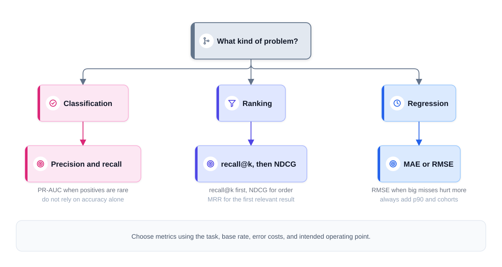
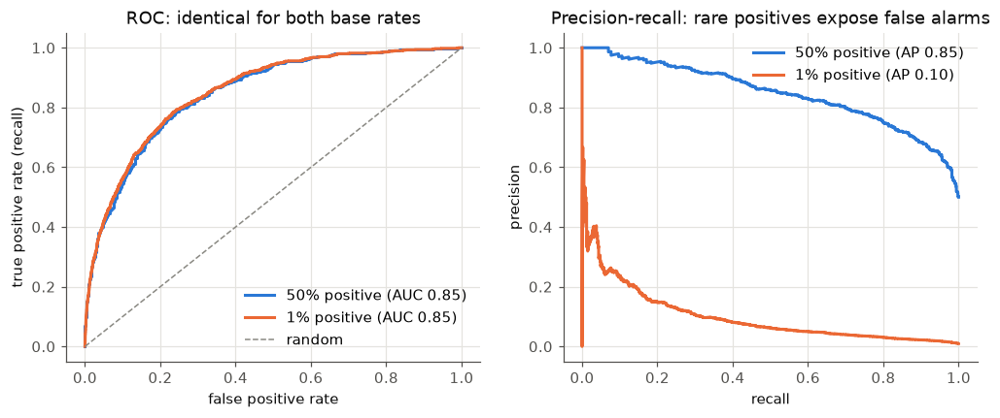
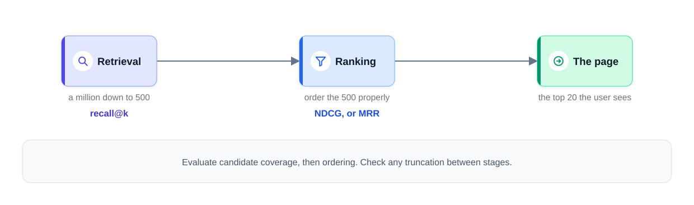
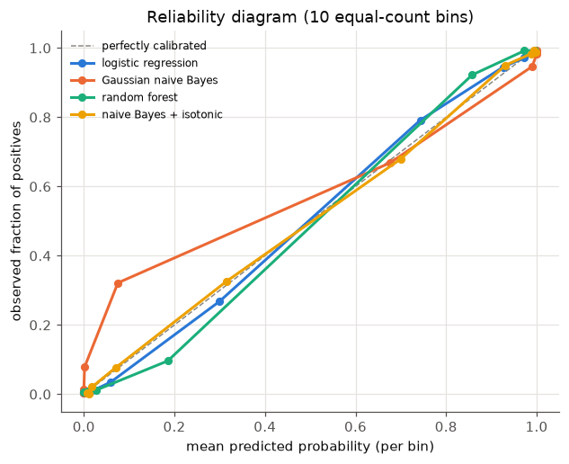
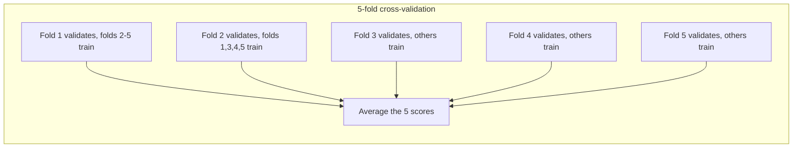
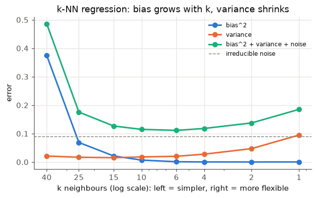
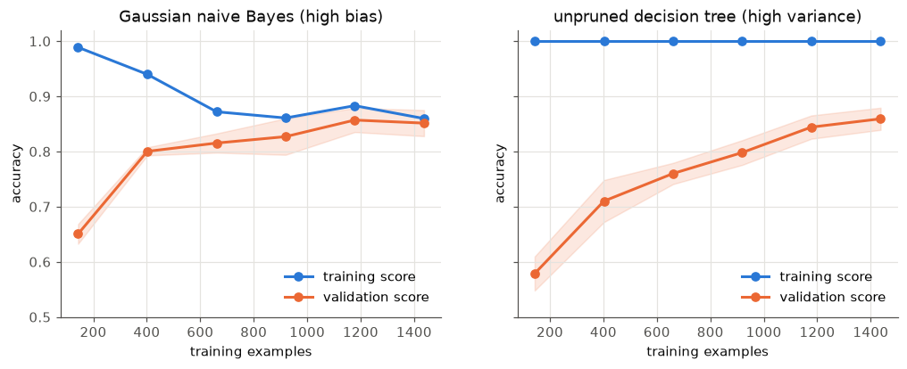
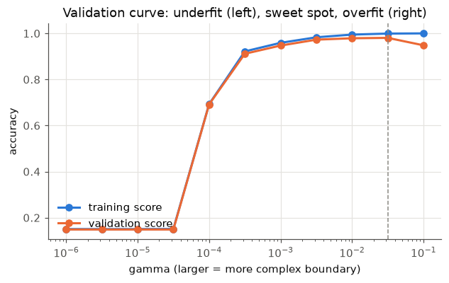
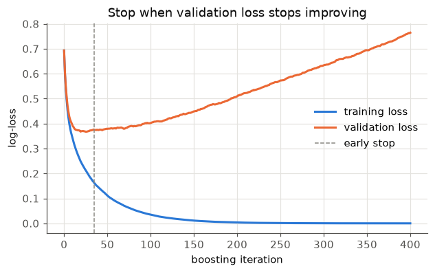

# Chapter 6 — Evaluation and Tuning

Training a model is the easy part. The hard questions come after: *Is it any good? Good at what? Compared to what? Will it still be good on next month's data? Could different settings make it better?* This chapter gives you the tools to answer them honestly — the right metric for the job, reliable ways to estimate performance, a clear picture of over- and underfitting, and systematic hyperparameter tuning (searching for the best values of the settings you choose before training).

**What you'll learn**

1. Why every number needs a baseline, and how offline metrics relate to business metrics.
2. Regression metrics: MAE, MSE, RMSE, R², percentile and per-cohort errors.
3. Classification metrics: confusion matrix, accuracy, precision, recall, F1, ROC-AUC, PR-AUC — with a worked example — and how to choose a threshold.
4. Ranking metrics: precision@k, recall@k, MAP, MRR, NDCG.
5. Calibration: when a probability of 0.8 should really mean 80%.
6. Cross-validation: k-fold, stratified, time-series, group, and nested.
7. The bias–variance trade-off, learning curves and validation curves, and what to do about over- and underfitting.
8. Hyperparameter tuning: grid, random, successive halving, Bayesian optimisation (Optuna), and early stopping.

All code is in `code/` and runs with the shared environment (scikit-learn 1.9). Outputs shown are real.

---

## 6.1 Baselines, and offline vs business metrics

### What it is
An **evaluation metric** is a number that summarises how well predictions match reality. A **baseline** is the score of a trivially simple predictor. An **offline metric** is computed on held-out (set aside, never used for training) historical data; an **online** or **business metric** is what the product actually cares about (revenue, retention, i.e. how many customers stay, fraud losses, delivery promises kept), measured on live traffic (real requests from real users).

### Why it matters
A metric on its own is meaningless. "MAE of 6 minutes" or "PR-AUC 0.41" says nothing until you know what a naive approach scores and what the current production system (the version serving real users today) scores. If predicting "same as last week" already gives an MAE of 8 minutes, a model at 6 is a real gain; if the naive approach gives 6.2, the model is an expensive way to save 12 seconds.

### How it works — baselines to always compute

| Task | Naive baseline | scikit-learn |
|---|---|---|
| Classification | Majority class; or random guessing at the class rates | `DummyClassifier(strategy="most_frequent" / "prior" / "stratified")` |
| Regression | Mean or median of the training target | `DummyRegressor(strategy="mean" / "median")` |
| Time series | Last value; same hour last week (seasonal naive) | a one-liner in pandas (`shift`) |
| Ranking / recommendation | Most popular items | a `value_counts()` |
| Any | The model currently in production; a simple rule or a linear model | — |

### Offline metric vs business metric
Offline metrics are **proxies**. They're cheap, fast and repeatable, so you use them to compare candidates, debug, and decide what deserves a live test. But they can disagree with the business outcome:
- The label is a proxy (clicks ≠ satisfaction; a chargeback ≠ all fraud).
- The test set no longer resembles live traffic (drift, i.e. live data gradually changing, new users, new items).
- Serving differs from training (feature delays, timeouts where a lookup gives up after a time limit, fallbacks where a default value is used instead).
- The metric ignores costs the business cares about (latency, the time a prediction takes to return, see [System Design Fundamentals](../../../system-design-patterns/modules/00-system-design-fundamentals/README.md); review-team workload; fairness across groups).

So the pattern in practice is two gates (the production view of metric choice is in [Chapter 16, section 16.7](../16-ml-in-production/README.md)): **offline evaluation** to shortlist, then an **online experiment** (A/B test: randomly sending some users to the new model and some to the old one and comparing the business metric; covered in [Chapter 16](../16-ml-in-production/README.md)) to confirm business impact. Choose the offline metric so that improving it is *likely* to improve the business metric, and report it together with the dataset, base rate and threshold used.


*Figure — mapping problem types to metric families (course diagram)*

### In the interview
**30 seconds:** *"I'd pick the offline metric from the task and the cost of each kind of error — precision/recall and PR-AUC for rare-event classification, recall@k and NDCG for ranking, MAE or RMSE plus tail and per-segment errors for regression — check calibration separately if scores are used as probabilities, and always compare against a naive baseline and the production model before going to an A/B test."*

- *"Offline metric improved, A/B test flat — why?"* — The offline metric is a proxy that drifted from the goal: proxy labels, a stale test set, or training/serving differences. Also check the experiment's statistical power (its chance of detecting a real effect of the expected size) and logging before blaming the metric.

### Self-check
1. Your churn model has PR-AUC 0.41. Is that good? → Unknown until you compare: a no-skill model scores the churn rate (e.g. 0.12), and the production model scores something too.
2. Name two reasons an offline gain may not show up online. → Proxy labels, drift between test set and live traffic, training/serving differences, ignored costs (latency, workload).

### TL;DR
No number means anything without a baseline and the production model next to it. Offline metrics shortlist; online experiments decide.

---

## 6.2 Regression metrics

### What it is
Regression metrics summarise the **errors** eᵢ = ŷᵢ − yᵢ between predictions and true values.

| Metric | Formula | Units | Reads as |
|---|---|---|---|
| **MAE** (mean absolute error) | (1/n) Σ \|eᵢ\| | same as y | typical size of an error |
| **MSE** (mean squared error) | (1/n) Σ eᵢ² | y² | average squared error; the usual training loss |
| **RMSE** (root MSE) | √MSE | same as y | like MAE but big errors weigh more |
| **R²** (coefficient of determination) | 1 − Σeᵢ² / Σ(yᵢ − ȳ)² | none | share of the target's variance explained; 1 = perfect, 0 = no better than predicting the mean, < 0 = worse than the mean |
| **MAPE** (mean absolute % error) | (100/n) Σ \|eᵢ / yᵢ\| | % | relative error; breaks when y is near 0 |
| **Percentile error** (e.g. p90) | 90th percentile of \|eᵢ\| | same as y | 90% of predictions are at least this good |

### How it works — a worked example
Delivery times (minutes): y = (30, 25, 40, 35, 50), predictions ŷ = (28, 27, 35, 35, 60).

1. Errors e = (−2, 2, −5, 0, 10).
2. MAE = (2 + 2 + 5 + 0 + 10)/5 = **3.8** min.
3. MSE = (4 + 4 + 25 + 0 + 100)/5 = **26.6** min²; RMSE = √26.6 = **5.16** min.
4. R²: ȳ = 36, Σ(y − ȳ)² = 36 + 121 + 16 + 1 + 196 = 370, Σe² = 133 → R² = 1 − 133/370 = **0.641**.

```python
# code/regression_metrics.py (key parts)
from sklearn.metrics import mean_absolute_error, mean_squared_error, root_mean_squared_error, r2_score
y, yhat = np.array([30, 25, 40, 35, 50]), np.array([28, 27, 35, 35, 60])
print(mean_absolute_error(y, yhat), mean_squared_error(y, yhat), root_mean_squared_error(y, yhat), r2_score(y, yhat))

base = np.full(10, 10.0); one_big = base.copy(); one_big[0] = 40      # one miss grows from 10 to 40 min
# ... then diabetes data: Ridge vs mean/median DummyRegressor, p50/p90 error, error per cohort
```

Output:
```
errors: [-2  2 -5  0 10]
MAE  = mean(|e|)      = 3.80   sklearn 3.80
MSE  = mean(e^2)      = 26.60  sklearn 26.60
RMSE = sqrt(MSE)      = 5.16   sklearn 5.16
R^2  = 1 - 133/370 = 0.641  sklearn 0.641
ten 10-min errors        MAE  10.0   RMSE  10.0
one of them is 40 min    MAE  13.0   RMSE  15.8

model                     MAE   RMSE    R^2
mean baseline            59.5   71.4 -0.000
median baseline          59.1   72.5 -0.029
Ridge                    44.3   55.2  0.402
p50 abs error 40.6 | p90 abs error 90.6
cohort A: n= 74  MAE 47.8
cohort B: n= 59  MAE 39.9
```

**MAE vs RMSE — how much should a big miss count?** Because errors are squared, a 40-minute miss weighs 16× a 10-minute miss inside MSE (1600 vs 100), whereas inside MAE it weighs just 4× (40 vs 10). In the output, turning one of ten 10-minute errors into a 40-minute error lifts MAE by 30% (10 → 13) but RMSE by 58% (10 → 15.8). (The final RMSE is not 16× larger — the square root and averaging dampen it.) Choose:
- **RMSE** when large misses are disproportionately bad (a very late delivery loses the customer).
- **MAE** when cost grows linearly with error size, or when outliers in the labels shouldn't dominate.
- Also note: the constant that minimises MSE is the **mean**; the one that minimises MAE is the **median**.

**Averages hide things — add two views.**
1. **Tail percentiles.** The median error here is 41 but the p90 is 91: one prediction in ten is off by more than 90 points. Products often promise on the tail (e.g. "delivered within the promised window" for 90%+ of orders).
2. **Cohorts.** Report error per segment the business cares about (city, device, customer type, new vs mature market). Here cohort A's MAE is 20% worse than cohort B's; a model can look fine on average while failing a new region entirely.

The mean baseline has R² ≈ 0 by construction (slightly negative on a test set, because the training mean isn't exactly the test mean). The Ridge model (linear regression with a penalty on large weights, Chapter 5) explains 40% of the variance (the spread of the target) and cuts MAE by 26% — a real but modest improvement, which is the honest way to report it.

### Common mistakes
- Reporting R² alone — it depends on the target's variance in the test set, so it isn't comparable across datasets.
- Using MAPE with targets near zero (division blows up) or asymmetrically (it penalises over-prediction more than under-prediction for positive targets).
- Comparing RMSE across targets in different units.

### In the interview
**30 seconds:** *"MAE is the typical error in the target's units; RMSE squares errors first, so big misses count more — use it when large misses are disproportionately costly. R² compares against predicting the mean. I'd add a tail percentile like p90 and per-segment errors, because averages hide the failures that matter."*

- *"Why might RMSE be much larger than MAE?"* — A few large errors: RMSE is inflated by the tail, MAE isn't. The gap itself is a signal of heavy-tailed errors (mostly small errors plus a few very large ones).

### Self-check
1. MAE of errors (1, −1, 4)? → 2. RMSE? → √(18/3) = 2.45.
2. Which constant minimises MAE? → The median.
3. What does R² = −0.2 mean? → Worse than always predicting the mean.

### TL;DR
MAE = typical error; RMSE = punishes big misses; R² = variance explained vs the mean. Add p90 error and per-cohort errors, and compare with a baseline.

---

## 6.3 Classification metrics

### What it is
For a binary classifier, every prediction lands in one of four cells of the **confusion matrix**:

| | Predicted positive | Predicted negative |
|---|---|---|
| **Actually positive** | **TP** — true positive (caught) | **FN** — false negative (missed) |
| **Actually negative** | **FP** — false positive (false alarm) | **TN** — true negative |

All the common metrics are ratios of these four counts.

| Metric | Formula | Question it answers |
|---|---|---|
| **Accuracy** | (TP + TN) / all | What fraction of predictions are right? |
| **Precision** | TP / (TP + FP) | Of the items I flagged, how many were really positive? |
| **Recall** (sensitivity, true-positive rate) | TP / (TP + FN) | Of the real positives, how many did I catch? |
| **F1** | 2·P·R / (P + R) | The **harmonic mean** of precision and recall — high only if both are high |
| **Specificity** (true-negative rate) | TN / (TN + FP) | Of the real negatives, how many did I leave alone? |
| **FPR** (false-positive rate) | FP / (FP + TN) = 1 − specificity | What share of negatives did I wrongly flag? |
| **Fβ** | (1 + β²)·P·R / (β²·P + R) | F1 with recall weighted β times as much as precision (F2 favours recall, F0.5 precision) |

### How it works — a worked example
1,000 card transactions, 100 of them fraud. The model flags 80; 60 of those are fraud.
- TP = 60, FP = 80 − 60 = 20, FN = 100 − 60 = 40, TN = 900 − 20 = 880.
- Accuracy = (60 + 880)/1000 = **0.94**
- Precision = 60/80 = **0.75** — three in four alerts are real.
- Recall = 60/100 = **0.60** — 40% of fraud slips through.
- F1 = 2·0.75·0.6/(0.75 + 0.6) = 0.9/1.35 = **0.667**
- FPR = 20/900 = **0.022**

And the trap: a model that flags *nothing* scores accuracy 900/1000 = **0.90** with zero recall. At a 0.2% fraud rate, "never fraud" is 99.8% accurate and catches nothing. **Accuracy is misleading whenever classes are imbalanced.**

A smaller illustration, as in many tutorials: y_true = [0, 1, 0, 1], y_pred = [0, 1, 1, 1] → one false positive, no misses: accuracy 0.75, precision 2/3 = 0.667, recall 1.0, F1 0.8.

```python
# code/classification_metrics.py (key parts)
from sklearn.metrics import (accuracy_score, precision_score, recall_score, f1_score, confusion_matrix,
                             roc_auc_score, average_precision_score, roc_curve, precision_recall_curve)
y    = np.r_[np.ones(100), np.zeros(900)].astype(int)
pred = np.r_[np.ones(60), np.zeros(40), np.ones(20), np.zeros(880)].astype(int)
tn, fp, fn, tp = confusion_matrix(y, pred).ravel()        # sklearn's layout: [[TN FP] [FN TP]]
```

Output:
```
tiny: acc 0.75  precision 0.667  recall 1.00  F1 0.80

confusion matrix [[TN FP] [FN TP]] =
[[880  20]
 [ 40  60]]
TP=60 FP=20 FN=40 TN=880
accuracy  (TP+TN)/N      = 0.940
precision TP/(TP+FP)     = 0.750
recall    TP/(TP+FN)     = 0.600
F1        2PR/(P+R)      = 0.667
FPR       FP/(FP+TN)     = 0.022   specificity = 0.978
always-'legit' baseline accuracy = 0.900
```

### Thresholds: the model gives scores, you choose the operating point
Most classifiers output a **score** or probability; a **threshold** turns it into yes/no. Raising the threshold flags fewer items: recall goes down, and precision *usually* goes up (not necessarily at every step on a finite dataset). One model therefore supports many **operating points** (threshold choices, each with its own precision and recall), and you should quote precision and recall *at a stated threshold* ("90% precision at 70% recall"), or summarise across all thresholds with an area under a curve:

- **ROC curve** — recall (TPR) against FPR as the threshold sweeps. **ROC-AUC** = the probability that a randomly chosen positive gets a higher score than a randomly chosen negative (ties count half). 0.5 = random, 1.0 = perfect ranking.
- **Precision–recall (PR) curve** — precision against recall. **PR-AUC**, usually computed as **average precision (AP)**, summarises it. A no-skill model's PR-AUC equals the positive rate.

*ROC-AUC by hand:* positives score (0.9, 0.7, 0.4), negatives (0.8, 0.3, 0.2). Of the 9 positive–negative pairs, the positive wins 7 (0.9 beats all three; 0.7 beats 0.3 and 0.2; 0.4 beats 0.3 and 0.2) → AUC = 7/9 = **0.778**.

**Why PR-AUC for rare positives?** FPR divides false positives by *all* negatives. With 10 million legitimate transactions, even thousands of extra false alarms barely move FPR, so the ROC curve stays flattering even as analysts are buried under bogus alerts. Precision has false positives in its denominator directly, so the PR curve shows that pain.

```python
pos = rng.normal(1.5, 1, 1000)                          # the SAME score model for positives
for n_neg in [1000, 99_000]:                            # 50% vs 1% positives
    neg = rng.normal(0, 1, n_neg)
    roc_auc_score(yy, ss), average_precision_score(yy, ss)
```

Output:
```
ROC-AUC by pair counting: 7/9 = 0.778  sklearn 0.778
positives  50.0%: ROC-AUC 0.850 | PR-AUC (avg precision) 0.846 | no-skill PR-AUC 0.500
positives   1.0%: ROC-AUC 0.853 | PR-AUC (avg precision) 0.099 | no-skill PR-AUC 0.010
```



Identical model, identical ROC-AUC (0.85) — but at a 1% base rate the average precision drops from 0.85 to 0.10: at 50% recall, precision is below 0.1 — more than nine false alarms for every real positive. Report the base rate with every precision number: the same model yields a different precision whenever the mix of positives in the traffic shifts.

### Choosing the threshold by cost
The threshold is a business decision: it prices a missed positive against a false alarm, so someone who owns those costs (product, risk, operations) should own it. With **calibrated** probabilities (section 6.5) the cost-minimising rule is simple: flag when p · cost(FN) > (1 − p) · cost(FP), i.e. when

p > cost(FP) / (cost(FP) + cost(FN))

*Example:* a missed fraud costs $100, reviewing a false alarm costs $5 → flag when p > 5/105 = **0.048**.

```python
# 20,000 transactions, 5% fraud, calibrated probabilities p
for t in [0.01, 0.025, 0.048, 0.1, 0.2, 0.5]:
    cost = 100 * missed + 5 * false_alarms
```

Output:
```
threshold  precision  recall  flagged   cost($)
     0.01      0.075   0.970    13006    63,180
    0.025      0.107   0.894     8361    47,935
    0.048      0.151   0.784     5195    43,655
      0.1      0.219   0.573     2611    52,890
      0.2      0.335   0.367     1095    66,940
      0.5      0.595   0.103      173    90,050
cheapest threshold: 0.048  (theory for calibrated p: flag if p > 5/(5+100) = 0.048)
```

The default 0.5 would cost twice as much as the best threshold. Mature fraud systems go one step further and use **two thresholds**: below the low one → approve automatically; above the high one → block; in between → send to a human reviewer. The review band's width is set by the team's capacity.


*Figure — two thresholds on one score (course diagram)*

### Which metric when?

| Situation | Use | Why |
|---|---|---|
| Balanced classes, equal error costs | Accuracy (plus the confusion matrix) | Simple and meaningful when neither class dominates |
| False positives are expensive (spam filter hiding real mail, blocking good customers) | Precision (at a recall floor) | Every alert must be trustworthy |
| Missing a positive is expensive (cancer screening, fraud, safety) | Recall (at a precision floor) | Catch as many as possible |
| Need one number balancing both, imbalanced data | F1 or Fβ | Harmonic mean punishes a weak side |
| Compare rankers across thresholds, moderate imbalance | ROC-AUC | Threshold-free, base-rate-insensitive ranking quality |
| Rare positives (fraud, ads, disease) | PR-AUC / average precision, plus precision & recall at the chosen threshold | Shows the false-alarm burden |
| Probabilities feed decisions (bids, expected cost) | Log-loss (punishes confident wrong probabilities), Brier score (mean squared probability error), calibration plot | Rewards honest probabilities |
| Multiclass | Per-class P/R/F1 with **macro** (unweighted mean over classes) or **weighted** averages; `classification_report` | Macro exposes weak minority classes |

### Common mistakes
- Reporting accuracy on imbalanced data.
- Quoting precision without the threshold and base rate.
- Tuning the threshold on the test set (tune it on validation data).
- Comparing F1 across datasets with different base rates.

### Real-world examples
- Spam filters (Gmail and others) favour very high precision — losing a real email is worse than seeing some spam.
- Medical screening tests favour recall (sensitivity) and follow up with a more precise second test.
- Card-fraud systems run on precision–recall trade-offs with approve/review/block bands, tuned to review-team capacity and fraud losses.

### In the interview
**30 seconds:** *"Start from the confusion matrix. Precision is 'how many alerts are real', recall 'how many positives we caught'; the threshold trades one for the other, and the right point comes from the cost of each error. For rare positives I'd report PR-AUC plus precision and recall at the chosen threshold, not accuracy or only ROC-AUC, because the flood of easy negatives hides extra false alarms inside ROC's FPR denominator."*

- *"PR-AUC or ROC-AUC at a 0.2% base rate?"* — PR-AUC: it keeps precision — what reviewers and customers actually experience — on the axis.
- *"What threshold would you ship?"* — Not a pure modeling decision: present the precision–recall curve as a menu and let the cost owner pick; derive it from expected cost if probabilities are calibrated; for fraud, two thresholds with a review band.
- *"Why harmonic mean for F1?"* — It stays low if either precision or recall is low (P = 1, R = 0.01 → F1 ≈ 0.02, whereas the arithmetic mean would be 0.5).

### Self-check
1. TP = 30, FP = 10, FN = 20: precision, recall, F1? → 0.75, 0.6, 0.667.
2. What does ROC-AUC = 0.8 mean? → A random positive outranks a random negative 80% of the time.
3. PR-AUC of a random model at 2% positives? → About 0.02.
4. FN costs $50, FP costs $10; threshold for calibrated p? → 10/60 = 0.167.

### TL;DR
Confusion matrix → precision, recall, F1. Threshold sets the trade-off; choose it from error costs. ROC-AUC measures ranking; PR-AUC exposes false alarms when positives are rare. Accuracy only for balanced problems.

---

## 6.4 Ranking metrics (an introduction)

### What it is
Search, recommendation and feeds return an **ordered list**. Ranking metrics reward putting relevant items **near the top**, usually looking only at the first **k** results. Relevance labels come from **judged sets** (trained raters score each query and result against a rubric) or **behavioural signals** (clicks, purchases), which are cheaper but biased by what was shown and where.

| Metric | Definition | Use when |
|---|---|---|
| **Precision@k** | Relevant items in the top k ÷ k | The user sees exactly k slots |
| **Recall@k** | Relevant items in the top k ÷ all relevant items | Candidate generation: did the good items survive? |
| **AP** (average precision) | Mean of precision@i at each rank i holding a relevant item (divided by all relevant items) | Binary relevance, whole list |
| **MAP** | Mean of AP over queries | Standard IR (information retrieval, i.e. search) benchmark metric |
| **MRR** (mean reciprocal rank) | Mean of 1/rank of the first relevant item (0 if none) | Finding one good answer fast (Q&A, navigation search) |
| **NDCG@k** | DCG@k ÷ ideal DCG@k, with DCG = Σ relᵢ / log₂(i + 1) | Graded relevance (perfect/good/fair/bad), position matters |

### How it works — worked example
Query A returns 6 results with graded relevance [3, 0, 2, 1, 0, 0] (3 = perfect … 0 = bad). The collection (all documents the system could have returned) holds 4 relevant documents; one (grade 2) wasn't returned.
- Precision@3 = 2/3 = 0.667; recall@3 = 2/4 = 0.5.
- AP: relevant items sit at ranks 1, 3, 4 with precision 1/1, 2/3, 3/4 → (1 + 0.667 + 0.75)/4 = **0.604** (the missing one contributes 0).
- Reciprocal rank = 1/1 = 1.
- DCG@5 = 3/log₂2 + 0 + 2/log₂4 + 1/log₂5 + 0 = 3 + 1 + 0.431 = **4.431**. The ideal order of all relevant documents [3, 2, 2, 1] gives 3 + 1.262 + 1 + 0.431 = 5.693, so **NDCG@5 = 0.778**.

```python
# code/ranking_metrics.py (key parts)
def average_precision(rels, n_relevant):
    hits, total = 0, 0.0
    for i, r in enumerate(rels, start=1):
        if r > 0:
            hits += 1
            total += hits / i                  # precision at this relevant item's rank
    return total / n_relevant

def dcg(rels, k):
    rels = np.asarray(rels[:k], dtype=float)
    return np.sum(rels / np.log2(np.arange(2, len(rels) + 2)))
```

Output:
```
query A graded list: [3, 0, 2, 1, 0, 0] | relevant in collection: 4
  precision@3 = 0.667   recall@3 = 0.500
  precision@5 = 0.600   recall@5 = 0.750
  AP  = (1/1 + 2/3 + 3/4) / 4 = 0.604
  RR  = 1/rank of first relevant = 1.000
  DCG@5 = 4.431, ideal DCG@5 = 5.693, NDCG@5 = 0.778

query B list: [0, 0, 1, 1, 0, 0] AP = 0.417  RR = 0.333
MAP over A and B = 0.510   MRR = 0.667

sklearn ndcg_score@5 on the returned list only: 0.930  (ours, same ideal): 0.930
note: sklearn builds the ideal ordering from the returned items only; with the unreturned grade-2
document included in the ideal list, NDCG@5 drops to 0.778
```

Watch the definition: `sklearn.metrics.ndcg_score` computes the ideal ordering from the items you pass it, so a relevant document the system never retrieved doesn't lower the score (0.930 vs 0.778). Some libraries also use the exponential gain (2^rel − 1) instead of rel; always state which NDCG you report.

### The funnel assigns the metric
Large recommenders narrow millions of items to a page in stages, and each stage gets its own metric: **candidate generation** (retrieval) is judged by **recall@k** — did the items the user would have chosen survive the cut from millions to, say, 500? — while the **ranking** stage is judged by ordering metrics like **NDCG** or MRR. If a later stage re-scores every candidate, the retrieval stage's internal order matters little; if later stages truncate, it matters.


*Figure — metrics per recommendation-funnel stage (course diagram)*

Full treatment with case studies: [Chapter 13 (recommenders)](../13-recommenders-and-embeddings/README.md) and [Chapter 17 (search and feed ranking)](../17-ml-case-studies-1/README.md).

### Common mistakes
- Comparing NDCG numbers computed with different gains (rel vs 2^rel − 1) or different "ideal" lists.
- Evaluating a ranking only on items the old system showed (exposure bias: only items that were shown could collect clicks — see [Chapter 13, sections 13.11–13.12](../13-recommenders-and-embeddings/README.md)).

### In the interview
**30 seconds:** *"For a ranked list I'd use recall@k for the retrieval stage — did good items survive the cut — and NDCG@k or MRR for the ranking stage, because position matters. NDCG handles graded relevance with a log discount; MRR fits tasks with one right answer. Labels come from judged sets or clicks, and clicks carry position bias (items placed higher get more clicks just because of where they sit)."*

- *"MAP or NDCG?"* — MAP for binary relevant/not-relevant labels; NDCG when relevance is graded (perfect/good/fair).

### Self-check
1. First relevant result at rank 4: reciprocal rank? → 0.25.
2. Why is recall@k the retrieval-stage metric? → Retrieval's job is not to lose good candidates; ordering is fixed later.
3. What does the log₂(i + 1) do in DCG? → Discounts lower positions: rank 1 counts fully, rank 3 half, and so on.

### TL;DR
Precision@k/recall@k for set quality, MAP for binary relevance over the list, MRR for "first good answer", NDCG for graded relevance with position discounts. Retrieval → recall@k; ranking → NDCG.

---

## 6.5 Calibration

### What it is
A model is **calibrated** if its probabilities match reality: among all cases it scores 0.8, about 80% are positive. **Ranking well and being calibrated are different properties.** ROC-AUC only depends on the order of scores — you could square every score and AUC wouldn't change — so a model with ROC-AUC 0.95 can still say "0.9" for events that happen 50% of the time.

### Why it matters
You need calibration whenever downstream logic (later code or decisions that consume the score) does arithmetic with the score instead of merely sorting by it: ad auctions (bid = value × predicted click probability), expected-cost thresholds (section 6.3), risk scores shown to people, and combining models. After class re-weighting (making rare-class errors count more in the loss) or negative downsampling (training on only a fraction of the negative examples), scores are systematically inflated and must be corrected (section 4.9 gives the closed-form fix for downsampling; [Chapter 16, section 16.3](../16-ml-in-production/README.md) compares it with Platt and isotonic on a production-sized example).

### How it works
1. **Measure** with a **reliability diagram**: bin predictions (e.g. 10 bins), plot the mean predicted probability against the observed fraction of positives per bin. Perfect calibration is the diagonal. Summaries: **Brier score** = mean((p − y)²) (lower is better) and **log-loss**; both are *proper scoring rules* — they are minimised by the true probabilities.
2. **Fix** by learning a mapping from raw score to probability on held-out data:
   - **Platt scaling** (`method="sigmoid"`) — fit a logistic regression on the score: p = σ(a·s + b). Two parameters; works with little data; assumes an S-shaped distortion.
   - **Isotonic regression** (`method="isotonic"`) — fit any non-decreasing step function (a staircase-shaped curve that never goes down). More flexible; needs more data (roughly ≥ 1,000 calibration examples) or it overfits.
   - `CalibratedClassifierCV` does this with cross-validation so the calibrator never sees the base model's own training rows.
3. **Re-check** when the serving population changes — calibration drifts with the base rate.

*Brier by hand:* y = (1, 0, 1, 1), p = (0.9, 0.2, 0.6, 0.3) → ((0.1)² + (0.2)² + (0.4)² + (0.7)²)/4 = (0.01 + 0.04 + 0.16 + 0.49)/4 = **0.175**.

```python
# code/calibration.py (key parts)
models = {"logistic regression": LogisticRegression(max_iter=1000), "Gaussian naive Bayes": GaussianNB(),
          "random forest": RandomForestClassifier(n_estimators=100, random_state=0),
          "naive Bayes + isotonic": CalibratedClassifierCV(GaussianNB(), method="isotonic", cv=5),
          "naive Bayes + Platt (sigmoid)": CalibratedClassifierCV(GaussianNB(), method="sigmoid", cv=5)}
frac_pos, mean_pred = calibration_curve(y_te, p, n_bins=10, strategy="quantile")
```

Output:
```
model                           ROC-AUC   Brier log-loss
logistic regression               0.980   0.048    0.176
Gaussian naive Bayes              0.975   0.069    0.335
random forest                     0.992   0.020    0.173
naive Bayes + isotonic            0.975   0.060    0.201
naive Bayes + Platt (sigmoid)     0.975   0.068    0.246

Brier by hand: mean((p - y)^2) = 0.175  sklearn 0.175
```



Naive Bayes (a simple probabilistic classifier that assumes features are independent once you know the class; Chapter 8) ranks nearly as well as logistic regression (ROC-AUC 0.975 vs 0.980) but its probabilities are badly off: its "naive" independence assumption double-counts the many redundant features in this data, pushing scores toward 0 and 1 (log-loss 0.335 vs 0.176). Isotonic calibration leaves ROC-AUC essentially unchanged (it is a non-decreasing map) and cuts log-loss to 0.201. Logistic regression, trained on log-loss, is close to calibrated out of the box. Random forests (averages of many decision trees, Chapter 7) often have the opposite distortion (averaging many trees pulls probabilities away from 0 and 1); boosted trees (trees added one after another, each correcting the last) and neural nets can drift either way.

### Common mistakes
- Calibrating on the training data (the calibrator learns the model's overconfidence on data it memorised).
- Using isotonic regression with a few hundred examples.
- Assuming high AUC means trustworthy probabilities.

### Real-world examples
- Ad click prediction (Google, Meta) — predicted click-through rates enter the auction directly; calibration errors translate into money.
- Weather forecasting — "70% chance of rain" is the textbook calibrated forecast; forecasters are scored with the Brier score (which was invented for weather forecasts).

### In the interview
**30 seconds:** *"Calibration means predicted probabilities match observed frequencies — separate from ranking quality. I'd check it with a reliability diagram and Brier or log-loss on held-out data, and fix it with Platt scaling or isotonic regression fitted on a separate calibration set, especially after resampling or class weighting, and recheck it when the population shifts."*

### Self-check
1. Does calibration change ROC-AUC? → Not with a strictly increasing map (Platt); isotonic can create ties, which may change it slightly.
2. Platt or isotonic with 300 calibration examples? → Platt.
3. Brier score for p = 0.5 on every example? → 0.25.

### TL;DR
Calibration = probabilities you can take literally. Measure with reliability diagrams and Brier/log-loss; fix with Platt (small data) or isotonic (more data) on held-out data.

---

## 6.6 Cross-validation

### What it is
**Cross-validation (CV)** estimates performance by training and validating several times on different splits and averaging. In **k-fold CV**, you cut the training data into k equal **folds**; each fold takes one turn as the validation set while the other k − 1 train the model.



### Why it matters
- **One split is noisy.** Here, 20 different 80/20 splits of the same data give accuracies from 0.947 to 0.991 — the choice of split alone moves the result by 4 points.
- CV gives **several estimates**: their mean is more reliable and their spread tells you how much to trust differences between models.
- Every row is used for both training and validation, which matters for small datasets.

### How it works — the variants

| Splitter | How folds are formed | Use for |
|---|---|---|
| `KFold(k, shuffle=True)` | Random equal folds | Regression, i.i.d. data (independent rows all drawn from the same distribution) |
| `StratifiedKFold` | Each fold keeps the class proportions | Classification — the default in `cross_val_score` for classifiers |
| `GroupKFold` / `StratifiedGroupKFold` | All rows of a group (user, patient) in one fold | Correlated rows; generalising to new entities |
| `TimeSeriesSplit(gap=…)` | Train on the past, validate on the next block; optional gap | Anything time-ordered; the gap mimics label delay (the wait before the true outcome is known) |
| `RepeatedStratifiedKFold` | Repeat k-fold with different shuffles | Small data, more stable estimates |
| `LeaveOneOut` | k = n | Tiny datasets only (expensive, high variance: the estimate jumps around) |

Typical k is 5 or 10. Larger k → more training data per fold (less pessimistic) but more compute and more correlated estimates.

```python
# code/cross_validation.py (key parts)
model = make_pipeline(StandardScaler(), LogisticRegression(max_iter=1000))   # preprocessing inside!
scores = cross_val_score(model, X, y, cv=5)
KFold(5)                                                  # on label-sorted data: badly unbalanced folds
StratifiedKFold(5, shuffle=True, random_state=0)
TimeSeriesSplit(n_splits=3, gap=2, test_size=3)
cross_validate(model, X, y, cv=..., scoring=["accuracy", "roc_auc", "f1"], return_train_score=True)
inner = GridSearchCV(model, {"logisticregression__C": [0.01, 0.1, 1, 10, 100]}, cv=...)
outer = cross_val_score(inner, X, y, cv=...)              # nested CV
```

Output:
```
20 different 80/20 splits: accuracy from 0.947 to 0.991
5-fold CV scores: [0.982 0.982 0.974 0.974 0.991] mean 0.981 +/- 0.007
KFold (no shuffle), sorted y   positive rate per fold [0.   0.14 1.   1.   1.  ]  accuracy 0.968
StratifiedKFold                positive rate per fold [0.62 0.62 0.63 0.63 0.63]  accuracy 0.974
time split: train 0..3  (gap)  validate 6..8
time split: train 0..6  (gap)  validate 9..11
time split: train 0..9  (gap)  validate 12..14
accuracy  train 0.988 | validation 0.979
roc_auc   train 0.998 | validation 0.995
f1        train 0.991 | validation 0.983
non-nested best CV score 0.979 (optimistic) | nested CV 0.975
```

Notes on the output:
- Report CV as **mean ± standard deviation** (0.981 ± 0.007; the standard deviation shows how spread out the fold scores are). Two models whose means differ by less than about one standard deviation are not clearly different.
- Unshuffled `KFold` on data sorted by label produces folds that are 0% or 100% positive — nonsense evaluation. Stratification fixes the class mix (~63% in every fold).
- `cross_validate` with `return_train_score=True` shows the train–validation gap (here small: little overfitting).
- **Nested CV.** If you tune hyperparameters with CV and report the *best* CV score, that score is optimistically biased — you picked the maximum of several noisy estimates. Nested CV wraps the whole tuning procedure in an outer CV loop to estimate how well "tune then train" will do on new data (0.975 vs 0.979 here; the gap grows with the size of the search). In practice a held-out test set used once serves the same purpose.

### Common mistakes
- Preprocessing (scaling, imputation, feature selection, target encoding) outside the CV loop → leakage (validation-fold information sneaking into training; Chapter 4). Put it in a `Pipeline`.
- Shuffled k-fold on time series.
- Using CV for model *selection* and then reporting the same CV score as the final performance.

### In the interview
**30 seconds:** *"k-fold CV trains k models, each validated on a different fold, and averages the scores — a lower-variance estimate than one split, with an error bar. I use stratified folds for classification, group folds when rows share an entity, and forward-in-time splits with a gap for temporal data. All preprocessing goes inside the pipeline, and a final untouched test set — or nested CV — gives the unbiased number."*

- *"Why not always use leave-one-out?"* — n model fits, and its estimate has high variance; 5–10 folds is the usual sweet spot.
- *"CV on a 100-million-row dataset?"* — Usually unnecessary: one large, well-designed (e.g. time-based) validation set already has low variance.

### Self-check
1. With 5-fold CV, what fraction of data trains each model? → 80%.
2. Why stratify? → So every fold has the same class mix, especially for rare classes.
3. What does nested CV estimate? → The performance of the whole tuning-plus-training procedure.

### TL;DR
k-fold CV = k train/validate rounds, averaged, with a spread. Stratify for classes, group for entities, go forward in time for temporal data, keep preprocessing inside the folds.

---

## 6.7 The bias–variance trade-off

### What it is
A model's expected error on new data splits into three parts:

**Expected test error = Bias² + Variance + Irreducible noise**

- **Bias** — error from wrong assumptions: how far the *average* model (averaged over many possible training sets) is from the truth. High bias = **underfitting** (a straight line through a curve).
- **Variance** — how much the model changes when trained on a different sample. High variance = **overfitting** (the model chases noise that won't be there next time).
- **Irreducible noise** — randomness in the labels themselves; no model can remove it.

Analogy: darts. High bias = all darts land close together but off-centre. High variance = darts scattered all over, centred on the bullseye on average.

### How it works — a simulation you can run
Train **k-nearest-neighbours regression** (predict the average y of the k closest training points) on 300 independent training sets of 50 noisy points from y = sin(2πx) + noise (noise σ = 0.3, so σ² = 0.09), then measure bias² and variance of the predictions:

```python
# code/bias_variance.py (key parts)
for k in [40, 25, 15, 10, 6, 4, 2, 1]:
    preds = []
    for _ in range(300):
        x = rng.uniform(0, 1, 50); y = true_f(x) + rng.normal(0, sigma, 50)
        preds.append(KNeighborsRegressor(n_neighbors=k).fit(x[:, None], y).predict(x_test[:, None]))
    preds = np.array(preds)
    bias2 = ((preds.mean(0) - true_f(x_test)) ** 2).mean()   # average model vs truth
    var = preds.var(0).mean()                                 # spread across training sets
```

Output:
```
   k   bias^2  variance  expected test MSE
  40    0.375     0.021              0.486
  25    0.069     0.017              0.176
  15    0.021     0.015              0.127
  10    0.007     0.018              0.115
   6    0.001     0.020              0.111
   4    0.000     0.028              0.118
   2    0.000     0.047              0.137
   1    0.000     0.095              0.185
```



With k = 40 (averaging 40 of 50 points) the prediction is almost flat: huge bias. With k = 1 it copies the nearest noisy point: zero bias, highest variance. The total is lowest around k = 6–10. Every model family has a "complexity knob" like this: tree depth, polynomial degree, regularization strength (inverse), number of boosting rounds (trees added one after another in gradient boosting), network size.

### Over- and underfitting: symptoms and remedies

| | Underfitting (high bias) | Overfitting (high variance) |
|---|---|---|
| Symptom | Training **and** validation scores both poor, and close to each other | Training score much better than validation score |
| More data helps? | No — the model can't use it | Yes |
| Remedies | More flexible model (deeper trees, more features, polynomial/interaction terms, a neural net); **less** regularization; train longer; better features | More data; **more** regularization (L1/L2, dropout, weight decay); simpler model (shallower trees, fewer features); early stopping; bagging/ensembles; data augmentation; fix leakage-free feature selection |

Terms in the table: *regularization* is any penalty or constraint that discourages an overly complex fit; *dropout* randomly switches off neural-network units during training; *weight decay* is an L2 penalty on weights; *early stopping* halts training when validation error stops improving (§6.10); *bagging* trains many models on random resamples of the data and averages them, and an *ensemble* is any combination of several models; *data augmentation* creates extra training examples by modifying existing ones (e.g. flipping images). A model's *capacity* is how complex a pattern it is able to represent.

### Common mistakes
- Adding data to a high-bias model and expecting improvement.
- Judging overfitting from the training score alone — always compare with validation.
- Thinking "more complex model = better": only until variance takes over.

### In the interview
**30 seconds:** *"Test error = bias² + variance + noise. Simple models have high bias and underfit — both scores bad; flexible models have high variance and overfit — training much better than validation. I diagnose with learning curves: if the curves have converged at a low score, add capacity or features; if there's a big gap, add data or regularization."*

- *"Does bagging reduce bias or variance?"* — Mainly variance (averaging unstable models). Boosting (adding models one after another, each fixing the previous ones' errors) mainly reduces bias.
- *"What happens to bias and variance as you increase regularization?"* — Bias up, variance down.

### Self-check
1. Training accuracy 99%, validation 80%: which problem? → Overfitting (high variance).
2. Training 70%, validation 69%, target 90%: remedy? → More capacity / better features / less regularization.
3. Can any model beat the irreducible noise? → No.

### TL;DR
Bias = systematically wrong; variance = unstable across samples. Total error is U-shaped in model complexity. Big train–validation gap → regularize or add data; both scores low → add capacity.

---

## 6.8 Learning curves and validation curves

### What it is
Two diagnostic plots:
- A **learning curve** plots training and validation scores against **training-set size**. It answers: *would more data help?*
- A **validation curve** plots training and validation scores against **one hyperparameter**. It answers: *where is the sweet spot between under- and overfitting?*

```python
# code/bias_variance.py (curves)
sizes, tr, va = learning_curve(model, X, y, cv=cv, train_sizes=np.linspace(0.1, 1.0, 6))
tr, va = validation_curve(make_pipeline(StandardScaler(), SVC()), X, y,
                          param_name="svc__gamma", param_range=np.logspace(-6, -1, 11), cv=cv)
```

Output:
```
Gaussian naive Bayes (high bias)         n=1437: train 0.860  validation 0.851
unpruned decision tree (high variance)   n=1437: train 1.000  validation 0.859

validation curve: best gamma = 3e-02, validation acc 0.981
  gamma 1e-06: train 0.151  validation 0.149
  gamma 1e-05: train 0.151  validation 0.149
  gamma 1e-04: train 0.693  validation 0.692
  gamma 1e-03: train 0.959  validation 0.947
  gamma 1e-02: train 0.995  validation 0.979
  gamma 1e-01: train 1.000  validation 0.948
```



How to read learning curves:
- **Naive Bayes (left):** training and validation scores meet at about 0.85 and flatten. The model is too simple for the data (high bias); more data won't help — change the model or features.
- **Unpruned tree (right):** an unpruned tree is one allowed to keep splitting until every leaf is pure. Training accuracy is always 1.0 (memorisation) and validation climbs slowly — a big gap = high variance. More data would help; so would pruning (`max_depth`, `min_samples_leaf`) or a random forest.



How to read the validation curve: with tiny **gamma** (the RBF kernel's reach; the RBF kernel is the SVM's similarity measure, which falls off with distance between points — larger gamma = each training point influences only a tiny neighbourhood = wigglier boundary) both scores are low (underfit: 0.15, close to the 0.10 chance level for 10 digits). As gamma grows both rise; past about 0.03 the training score stays at 1.0 while validation falls (overfit). Pick the peak of the validation curve.

### Common mistakes
- Plotting only the training curve.
- Reading a learning curve's small final gap as "no overfitting" when both curves are still rising — you may just need more data.
- Drawing conclusions from one noisy point — show the CV spread (the shaded band).

### In the interview
**30 seconds:** *"A learning curve plots train and validation score against training-set size: if both have converged low, the model is biased and more data won't help; if there's a big gap that narrows with more data, it's variance and more data or regularization will. A validation curve sweeps one hyperparameter to find the peak between under- and overfitting."*

### Self-check
1. Learning curves converge at a low score: more data or more capacity? → More capacity (or better features).
2. Big persistent gap: remedy? → More data, regularization, or a simpler model.
3. What's on the x-axis of a validation curve? → A hyperparameter's values.

### TL;DR
Learning curve (score vs data size) tells you whether more data will help; validation curve (score vs hyperparameter) finds the under/overfitting sweet spot.

---

## 6.9 Hyperparameter tuning

### What it is
**Parameters** are learned from data (weights, split thresholds). **Hyperparameters** are settings you choose **before** training: tree `max_depth`, k in k-NN, regularization strength C or α, learning rate, number of trees. **Tuning** searches for the hyperparameters that give the best *validation* performance — always with cross-validation or a validation set, never the test set.

### How it works — the main strategies

**1. Grid search** (`GridSearchCV`) — list values for each hyperparameter; try **every combination** with CV; keep the best.
- *Pros:* systematic; guaranteed to find the best point *on the grid*; easy to parallelise (run many fits at the same time on different processor cores).
- *Cons:* cost multiplies: 3 values × 3 values × 5 folds = 45 fits; 5 hyperparameters × 5 values = 3,125 combinations. And the grid may miss the good region entirely.

**2. Random search** (`RandomizedSearchCV`) — sample a fixed number of combinations from **distributions** (e.g. `randint`, whole numbers drawn evenly from a range, and `loguniform`, values spread evenly on a log scale).
- *Pros:* you control the budget (`n_iter`); explores more distinct values of each hyperparameter; usually as good as grid search in far fewer trials when only a few hyperparameters really matter (Bergstra & Bengio, 2012).
- *Cons:* results vary with the random seed (the starting number of the random generator); no guarantee of hitting the exact optimum.

**3. Successive halving / Hyperband** (`HalvingGridSearchCV`, `HalvingRandomSearchCV` — still experimental in scikit-learn 1.9, so first run `from sklearn.experimental import enable_halving_search_cv`) — evaluate many candidates cheaply (few samples or few iterations), keep the best fraction, give survivors more resources, repeat. With `factor=2`, each round keeps half the candidates and doubles the samples per candidate.

**4. Bayesian optimisation** — build a **surrogate model** of "hyperparameters → score" from the trials so far (a Gaussian process, a model that predicts both a value and how uncertain it is; or TPE — Tree-structured Parzen Estimator), then choose the next trial with an **acquisition function** such as **expected improvement**, which balances *exploiting* promising regions and *exploring* uncertain ones. It shines when each trial is expensive (minutes to hours). Tools: **Optuna** (TPE by default, plus pruning, i.e. stopping unpromising trials early), Hyperopt, scikit-optimize, Ray Tune.

Scale matters: search learning rates, C, α and gamma on a **log scale** (`loguniform(1e-4, 1e1)`), not linearly.

```python
# code/tuning.py (key parts)
grid = GridSearchCV(DecisionTreeClassifier(random_state=0),
                    {"max_depth": [3, 5, 7], "min_samples_split": [2, 5, 10]}, cv=3, scoring="f1")
rnd = RandomizedSearchCV(DecisionTreeClassifier(random_state=0),
                         {"max_depth": randint(3, 10), "min_samples_split": randint(2, 20),
                          "min_samples_leaf": randint(1, 10)}, n_iter=10, cv=3, scoring="f1", random_state=0)

svm = make_pipeline(StandardScaler(), SVC())
GridSearchCV(svm, {"svc__C": [0.1, 1, 10], "svc__gamma": [1e-4, 1e-3, 1e-2]}, cv=cv)
RandomizedSearchCV(svm, {"svc__C": loguniform(1e-2, 1e3), "svc__gamma": loguniform(1e-5, 1e-1)}, n_iter=9, cv=cv)
HalvingRandomSearchCV(svm, {...same distributions...}, n_candidates=32, factor=2, cv=cv)

# Tiny Bayesian optimisation over log10(gamma): GP surrogate + expected improvement
gp = GaussianProcessRegressor(Matern(nu=2.5) + WhiteKernel(1e-4), normalize_y=True).fit(xs, ys)
mu, sd = gp.predict(grid_pts, return_std=True)
z = (mu - max(ys)) / sd
ei = (mu - max(ys)) * norm.cdf(z) + sd * norm.pdf(z)       # expected improvement
next_x = grid_pts[ei.argmax()]
```

Output:
```
grid   best params: {'max_depth': 5, 'min_samples_split': 2} CV F1 0.942 | test F1 0.920
random best params: {'max_depth': 6, 'min_samples_leaf': 6, 'min_samples_split': 17} CV F1 0.937 | test F1 0.939

SVM, 9 evaluations each: grid best 0.9866 {'svc__C': 10, 'svc__gamma': 0.01}
                         random best 0.9844 {'svc__C': 1.22, 'svc__gamma': 0.00761}
halving: [32, 16, 8, 4, 2] candidates per round, samples per round [60, 120, 240, 480, 960] -> best 0.9698

Bayesian optimisation of gamma (9 evaluations):
  eval 1: gamma = 1e-2.45  CV accuracy 0.9861  (random start)
  eval 2: gamma = 1e-3.92  CV accuracy 0.9510  (random start)
  eval 3: gamma = 1e-4.84  CV accuracy 0.7284  (random start)
  eval 4: gamma = 1e-2.37  CV accuracy 0.9878
  eval 5: gamma = 1e-3.31  CV accuracy 0.9777
  eval 6: gamma = 1e-1.18  CV accuracy 0.9688
  eval 7: gamma = 1e-1.78  CV accuracy 0.9850
  eval 8: gamma = 1e-2.09  CV accuracy 0.9861
  eval 9: gamma = 1e-3.57  CV accuracy 0.9672
```

Reading it:
- **Grid vs random on trees:** the best CV scores differ by 0.005 — within noise — and the random search's pick happens to score better on the test set. Small differences between tuned configurations are usually not meaningful; don't over-tune.
- **SVM:** with 9 trials each, a well-placed grid and random search land within 0.2% of each other. Random search's advantage grows with more hyperparameters, especially unimportant ones.
- **Halving** tried 32 candidates, but most only on 60–240 rows; only 2 finalists were trained on 960. (Its `best_score_` is measured on the last round's subsample, so it isn't directly comparable with the others.)
- **Bayesian optimisation:** after 3 random starts, the first guided trial immediately improves on them (0.9878), then the expected-improvement rule alternates between refining near the best and exploring uncertain regions (evals 6, 7, 9).

**Optuna, the popular Bayesian-optimisation library** *(Optuna isn't installed in this book's environment — snippet not run)*:

```python
import optuna
from sklearn.model_selection import cross_val_score

def objective(trial):
    params = {
        "learning_rate": trial.suggest_float("learning_rate", 1e-3, 0.3, log=True),
        "max_leaf_nodes": trial.suggest_int("max_leaf_nodes", 8, 128, log=True),
        "l2_regularization": trial.suggest_float("l2_regularization", 1e-6, 10, log=True),
    }
    model = HistGradientBoostingClassifier(**params, random_state=0)
    return cross_val_score(model, X_train, y_train, cv=5, scoring="roc_auc").mean()

study = optuna.create_study(direction="maximize")      # TPE sampler by default
study.optimize(objective, n_trials=50)
print(study.best_params, study.best_value)
```

### Trade-offs

| Method | Budget control | Scales to many hyperparameters | Uses past results | Best for |
|---|---|---|---|---|
| Grid | No (product of grid sizes) | Poorly | No | 1–2 hyperparameters, cheap models |
| Random | Yes (`n_iter`) | Well | No | Default for 3+ hyperparameters |
| Successive halving | Yes | Well | Yes (early elimination) | Many candidates, resource can be scaled (rows, epochs) |
| Bayesian (Optuna, GP) | Yes | Moderately (tens of dims) | Yes (surrogate model) | Expensive trials: boosting on large data, deep nets |

**Practical recipe**
1. Start from library defaults and a baseline.
2. Tune the few hyperparameters that matter most (learning rate + tree size for boosting; C for linear models/SVMs; depth/leaf size for trees).
3. Random search (or Optuna) on log scales, 20–100 trials, with CV.
4. If the best value sits at the **edge** of a range, extend the range.
5. Refit on all training data with the chosen values (`refit=True` does this), then evaluate **once** on the test set.

### Common mistakes
- Tuning on the test set, or reporting the best CV score as the final performance (optimistic — use a test set or nested CV).
- Linear ranges for scale-type hyperparameters.
- Grids so fine that you're fitting noise in the CV estimate.
- Tuning before fixing data problems and features — usually a much bigger win.

### In the interview
**30 seconds:** *"Hyperparameters are set before training, so I tune them with cross-validation: grid search for one or two parameters, random search for more — it's budget-controlled and explores each dimension better — and Bayesian optimisation like Optuna when each trial is expensive; successive halving to discard bad configurations early. Log-scale ranges, tune on validation folds only, and evaluate the winner once on the test set."*

- *"Why is random search often better than grid search?"* — With the same budget, grid search tests only a few distinct values of each hyperparameter; random search tests a new value in every trial, so it explores the important dimensions more finely.
- *"How does Bayesian optimisation choose the next trial?"* — It fits a surrogate of score vs hyperparameters and maximises an acquisition function (e.g. expected improvement) that trades off predicted score against uncertainty.

### Self-check
1. Grid of 4 × 5 values with 5-fold CV: how many fits (before refit)? → 100.
2. Which distribution for a learning rate between 1e-4 and 1? → Log-uniform.
3. Why is the best CV score from a search optimistic? → It's the maximum of many noisy estimates.

### TL;DR
Grid for tiny spaces, random for most, halving to prune early, Bayesian (Optuna) for expensive trials. Log scales, CV only, test set once.

---

## 6.10 Early stopping

### What it is
For models trained iteratively (gradient boosting, neural networks, SGD, i.e. stochastic gradient descent), **early stopping** monitors a validation score during training and stops when it hasn't improved for a set number of iterations (the **patience**). The number of iterations becomes a hyperparameter tuned automatically and almost for free.

### Why it matters
Training loss keeps falling forever; validation loss falls, bottoms out, then rises as the model starts fitting noise. Stopping near the bottom is a cheap, effective regularizer (anything that limits overfitting) — and saves compute.

```python
# code/tuning.py (early stopping)
full = HistGradientBoostingClassifier(max_iter=400, learning_rate=0.2, early_stopping=True,
                                      n_iter_no_change=400, validation_fraction=0.2, random_state=0).fit(Xc, yc)
stop = HistGradientBoostingClassifier(max_iter=400, learning_rate=0.2, early_stopping=True,
                                      n_iter_no_change=10, validation_fraction=0.2, random_state=0).fit(Xc, yc)
```

Output:
```
full run: best validation loss at iteration 25 of 400
early stopping (patience 10) stopped after 35 iterations
```



The validation loss is lowest at iteration 25; with patience 10, training stops at 35 instead of running all 400 iterations, whose later rounds only overfit (validation loss doubles by the end). Note: scikit-learn's `HistGradientBoosting*` keeps all iterations up to the stop, while Keras's `EarlyStopping(restore_best_weights=True)` and XGBoost/LightGBM's best-iteration tracking can roll back to the best one.

### How to use it
- scikit-learn: `HistGradientBoosting*(early_stopping=True, validation_fraction=0.1, n_iter_no_change=10)` (on by default when n_samples > 10,000), `GradientBoosting*(n_iter_no_change=…)`, `SGDClassifier(early_stopping=True)`, `MLPClassifier(early_stopping=True)`.
- XGBoost / LightGBM: pass an evaluation set and early-stopping rounds; Keras: the `EarlyStopping` callback (a function the training loop calls automatically, e.g. after every epoch, a full pass over the training data).
- Set a generous maximum (iterations/epochs) and a small learning rate; let early stopping choose the count.

### Common mistakes
- Early-stopping on the **test** set — it then becomes part of training.
- Patience too small on noisy validation curves (stops on a random bump).
- Using an internal validation split for a time-series problem that is randomly sampled.

### In the interview
**30 seconds:** *"Early stopping holds out a validation set, tracks its loss each iteration or epoch, and stops once it hasn't improved for `patience` rounds — tuning the number of iterations for free and acting as a regularizer. Set a generous maximum, keep or restore the best iteration, and never early-stop on the test set."*

### Self-check
1. Validation loss is lowest at iteration 25, patience = 10: when does training stop? → Around iteration 35 (if nothing improves in between).
2. Why is early stopping a form of regularization? → It limits how far the model can fit the training data, like limiting complexity.

### TL;DR
Watch validation loss while training; stop after `patience` rounds without improvement. Cheap regularization and compute savings — on a validation set, never the test set.

---

## 6.11 Putting it together: from ML metric to business decision

A complete evaluation plan, in order:

1. **Define the business goal and error costs** (e.g. fraud losses vs customer friction; late deliveries vs over-cautious promises).
2. **Pick the offline metric** that best tracks it (section 6.3 table; PR-AUC plus precision/recall at the operating point for rare events; recall@k/NDCG for ranking; MAE/RMSE + p90 + cohorts for regression), and a **calibration** check if scores are used as probabilities.
3. **Split correctly** (stratified / group / time-based) and use **cross-validation** on the training part.
4. **Baselines**: naive + current production model.
5. **Tune** with random search or Bayesian optimisation, early stopping for iterative models.
6. **Diagnose** with learning and validation curves; fix under/overfitting.
7. **Evaluate once on the test set**; report the metric with its base rate, threshold, cohorts and uncertainty.
8. **Choose the threshold** with the cost owner.
9. **Confirm online** with an A/B test on the business metric ([Chapter 16](../16-ml-in-production/README.md)), then monitor.

### In the interview
- *"Which metric would you use?"* — Name the task's metric family, the base rate, and the cost asymmetry; give an operating-point metric (precision at recall X) plus a threshold-free one (PR-AUC or NDCG); mention calibration if probabilities are consumed; compare with a naive baseline and production; confirm online.

---

## Chapter TL;DR

- **Baselines first**: majority class / mean / last value / most popular, and the production model. Offline metrics are proxies; confirm with online experiments.
- **Regression**: MAE (typical error, median-optimal), RMSE (punishes big misses, mean-optimal), R² (variance explained vs the mean). Add p90 error and per-cohort breakdowns.
- **Classification**: confusion matrix → precision TP/(TP+FP), recall TP/(TP+FN), F1 (harmonic mean). Accuracy only for balanced data. The threshold sets the operating point; pick it from error costs (calibrated p > C_FP/(C_FP + C_FN)); fraud uses approve/review/block bands.
- **ROC-AUC vs PR-AUC**: ROC-AUC = probability a positive outranks a negative, insensitive to base rate; PR-AUC exposes false alarms and is the choice for rare positives (no-skill value = base rate).
- **Ranking**: precision@k, recall@k (retrieval), MAP, MRR (first good answer), NDCG (graded relevance with position discount) — check which "ideal" your library uses.
- **Calibration**: probabilities matching frequencies, separate from ranking. Reliability diagram, Brier, log-loss; fix with Platt (small data) or isotonic (more data) on held-out data.
- **Cross-validation**: k-fold with mean ± std; stratified for classes, group for entities, time-series with gap for temporal data; preprocessing inside the pipeline; nested CV or a test set for unbiased final numbers.
- **Bias–variance**: error = bias² + variance + noise. Underfit → more capacity/features, less regularization. Overfit → more data, more regularization, simpler model, early stopping, ensembles.
- **Curves**: learning curves (score vs data size) say whether more data helps; validation curves (score vs hyperparameter) locate the sweet spot.
- **Tuning**: grid (small spaces), random (default, budgeted), successive halving (prune early), Bayesian/Optuna (expensive trials). Log scales; never tune on the test set.
- **Early stopping**: stop when validation loss stops improving for `patience` rounds.
