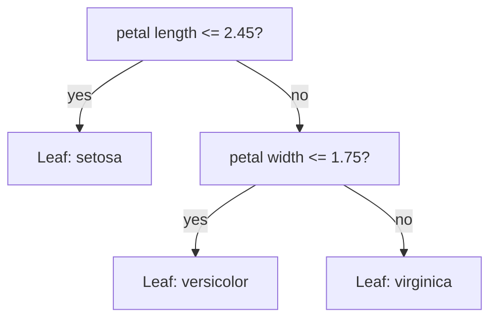
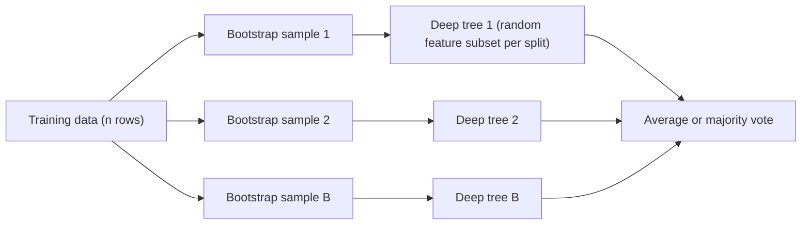
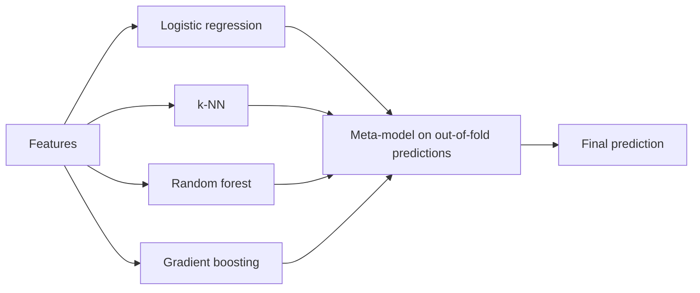

# Chapter 7 — Decision Trees and Ensembles

Decision trees are the most "human" ML model: a chain of yes/no questions you can print and read. On their own they overfit (memorise the training data, noise included, and then do worse on new data) easily, but when you combine many of them — by **averaging** (Random Forests) or by **correcting each other's mistakes** (gradient boosting) — you get the models that win most real-world problems on **tabular data** (rows and columns, like a spreadsheet or SQL table, i.e. a table in a relational database).

**What you'll learn**

1. How a decision tree picks each question (Gini, entropy, information gain — with a worked example).
2. Depth, pruning, and regression trees.
3. Why a single tree has high variance, and how bagging and Random Forests fix it (bootstrap, feature subsampling, out-of-bag score).
4. Feature importance — and why the default one can lie (permutation importance).
5. Boosting: AdaBoost intuition and gradient boosting step by step on residuals, with learning rate.
6. XGBoost vs LightGBM vs CatBoost.
7. Voting and stacking.
8. Why trees still beat neural nets on tabular data, and a hyperparameter cheat sheet.

All code lives in `code/` and runs with the shared environment (scikit-learn 1.9). Outputs below are real.

---

## 7.1 Decision trees

### What it is
A **decision tree** is a model that predicts by asking a sequence of questions about the features, like "Is petal length ≤ 2.45 cm?". Each question is a **node**; each answer sends you down a **branch**; when there are no more questions you reach a **leaf**, which holds the prediction (a class for classification, a number for regression).

Analogy: the game "20 Questions". A good player asks the question that rules out the most possibilities first. A tree-learning algorithm does exactly that, greedily, one question at a time.



### Why it matters
- **Interpretable**: a shallow tree is a flowchart a doctor or loan officer can check.
- **No scaling needed**: a split "x ≤ 3.2" does not care whether x is in metres or millimetres.
- **Handles mixed data and non-linear effects and interactions** automatically ("high income AND young" can be its own branch).
- It is the **building block** of Random Forests, XGBoost, LightGBM and CatBoost.

### How it works — growing a tree (CART)
scikit-learn implements **CART** (Classification And Regression Trees), which always makes **binary** splits.

1. Start with all training rows at the root (the top node).
2. For every feature and every candidate threshold (midpoints between sorted unique values), split the rows into left (≤ threshold) and right (> threshold).
3. Score each split by how much it reduces **impurity** (how mixed the labels are). Pick the best one.
4. Recurse on each child (apply the same procedure again to each new node).
5. Stop when a stopping rule fires: node is pure, `max_depth` reached, too few samples (`min_samples_split`, `min_samples_leaf`), or no split improves impurity enough.
6. Each leaf predicts the majority class (classification; it also stores class proportions, which become `predict_proba`) or the mean target value (regression).

This is **greedy**: the best split now, never revisited. Finding the globally optimal tree is NP-hard (in a class of problems with no known fast exact algorithm), so greedy is the practical choice.

### Impurity measures
For a node where class k has proportion pₖ:

| Measure | Formula | Pure node | 50/50 binary node |
|---|---|---|---|
| **Gini impurity** | G = 1 − Σ pₖ² | 0 | 0.5 |
| **Entropy** | H = − Σ pₖ log₂ pₖ | 0 | 1.0 bit |
| **Misclassification error** | 1 − maxₖ pₖ | 0 | 0.5 (rarely used for growing — not sensitive enough) |

- **Gini** = the probability you mislabel a random sample if you label it randomly according to the node's class mix.
- **Entropy** = average number of bits (yes/no answers) needed to identify the class. From information theory.
- **Information gain** = entropy(parent) − weighted average entropy(children). The weights are the fraction of rows that go to each child. The "Gini version" is simply called Gini decrease.

### Worked example: Gini vs entropy
Ten loan applicants, label 1 = defaulted. Candidate split: *income < 40k?*

| Node | Labels | Gini | Entropy |
|---|---|---|---|
| Parent | 4 defaults, 6 repaid | 1 − 0.4² − 0.6² = **0.480** | −0.4·log₂0.4 − 0.6·log₂0.6 = **0.971** |
| Left (income < 40k) | 3 defaults, 1 repaid | 1 − 0.75² − 0.25² = 0.375 | 0.811 |
| Right (income ≥ 40k) | 1 default, 5 repaid | 1 − (1/6)² − (5/6)² = 0.278 | 0.650 |

Weighted children: Gini = 0.4·0.375 + 0.6·0.278 = 0.317 → **Gini decrease 0.163**. Entropy = 0.4·0.811 + 0.6·0.650 = 0.715 → **information gain 0.256**.

The tree does not only test 40k — it tests every midpoint. `code/split_math.py`:

```python
def gini(labels):
    n = len(labels)
    return 1 - sum((c / n) ** 2 for c in Counter(labels).values())

def entropy(labels):
    n = len(labels)
    return -sum((c / n) * math.log2(c / n) for c in Counter(labels).values())

def weighted(children, fn):          # impurity of a split
    n = sum(len(c) for c in children)
    return sum(len(c) / n * fn(c) for c in children)
# ... loop over every midpoint threshold and print both scores
```

Output:
```
parent [1, 1, 1, 0, 0, 0, 0, 0, 1, 0]  -> gini=0.480  entropy=0.971
left   [1, 1, 1, 0]         -> gini=0.375  entropy=0.811
right  [0, 0, 0, 0, 1, 0]     -> gini=0.278  entropy=0.650
weighted child gini    = 0.317  -> gini decrease   = 0.163
weighted child entropy = 0.715  -> information gain = 0.256

threshold  gini_decrease  info_gain
     27.5          0.080      0.144
     32.5          0.180      0.322
     36.5          0.309      0.557
     41.5          0.163      0.256
     ...
     85.0          0.036      0.079
```

The best threshold is **36.5**, by both measures: the left side (25, 30, 35) is pure. This is typical — Gini and entropy almost always rank splits the same way. Gini is the scikit-learn default because it avoids a logarithm and is slightly faster. Do not spend tuning time on this choice.

### Reading a fitted tree
`code/decision_tree_demo.py` fits a depth-2 tree on the Iris flowers and prints its rules with `export_text`:

```python
tree = DecisionTreeClassifier(max_depth=2, random_state=42).fit(iris.data, iris.target)
print(export_text(tree, feature_names=list(iris.feature_names)))
```
```
|--- petal length (cm) <= 2.45
|   |--- class: 0
|--- petal length (cm) >  2.45
|   |--- petal width (cm) <= 1.75
|   |   |--- class: 1
|   |--- petal width (cm) >  1.75
|   |   |--- class: 2
```
Two questions classify ~96% of the flowers correctly. That is the interpretability selling point.

### Depth and overfitting
A tree with no limits keeps splitting until each leaf is pure — it can memorise the training set. Same script, breast-cancer dataset (30 features, 569 patients):

```
depth  train  test
    1  0.932  0.889
    2  0.942  0.906
    3  0.980  0.901
    4  0.990  0.906
    6  1.000  0.906
   10  1.000  0.906
   15  1.000  0.906
```


Training accuracy hits 100% at depth 6, but test accuracy is stuck around 0.90: the extra splits fit noise, not signal.

### Pruning
Two ways to keep a tree small:

| Kind | How | scikit-learn knobs |
|---|---|---|
| **Pre-pruning** (early stopping) | Stop growing early | `max_depth`, `min_samples_split`, `min_samples_leaf`, `max_leaf_nodes`, `min_impurity_decrease` |
| **Post-pruning** (cost-complexity pruning) | Grow a full tree, then cut back branches that don't pay for themselves | `ccp_alpha` |

**Cost-complexity pruning** minimises  R_α(T) = R(T) + α·|leaves(T)|, where R(T) is total training impurity (error) and α is a price per leaf. α = 0 keeps the full tree; larger α removes the weakest branches first. `cost_complexity_pruning_path` lists the α values at which a branch disappears; you choose α by cross-validation (training and scoring on several different splits of the training data and averaging).

```
full tree: 16 leaves, test acc 0.906
ccp_alpha=0.0    leaves= 16  test acc=0.906
ccp_alpha=0.005  leaves=  7  test acc=0.918
ccp_alpha=0.01   leaves=  5  test acc=0.918
ccp_alpha=0.02   leaves=  4  test acc=0.901
ccp_alpha=0.05   leaves=  2  test acc=0.889
```
A 5-leaf tree beats the 16-leaf tree: simpler *and* better. Pruning too hard (2 leaves) underfits.

### Regression trees
Same algorithm, different impurity: a regression tree picks the split that most reduces the **squared error** (equivalently, the variance: the average squared distance from the mean) of the target in the children, and each leaf predicts the **mean** of its training targets. (`criterion="absolute_error"` uses the median instead and is more robust to outliers.) The result is a **step function** (flat pieces joined by sudden jumps):


```
|--- x <= 3.13
|   |--- x <= 0.44
|   |   |--- value: [0.24]
|   |--- x >  0.44
|   |   |--- value: [0.74]
|--- x >  3.13
|   |--- x <= 3.98
|   |   |--- value: [-0.39]
|   |--- x >  3.98
|   |   |--- value: [-0.95]
```
Depth 2 = 4 flat steps (underfit); depth 5 chases individual noisy points (overfit). A key consequence: **a tree cannot extrapolate** — outside the training range it predicts the value of the last leaf, forever flat.

### Trade-offs

| Strengths | Weaknesses |
|---|---|
| Readable rules, easy to explain | High variance: small data change → very different tree |
| No feature scaling; handles non-linearity and interactions | Overfits without depth limits or pruning |
| Fast prediction: O(depth) (time grows only with depth) | Axis-aligned splits (each split tests one feature): a diagonal boundary needs a staircase of many splits |
| Works with numeric + categorical data (scikit-learn ≥ 1.3 trees also handle missing values natively) | Cannot extrapolate beyond the training range |
| | Greedy — may miss the best overall tree |

### When not to use it
- When accuracy matters more than a readable model — use a forest or boosting instead.
- For smooth or linear relationships (a linear model needs 2 parameters; a tree needs a staircase).
- For forecasting values outside the range seen in training (e.g. prices that keep rising).

### Common mistakes
- Leaving `max_depth=None` and reporting training accuracy (it is ~100% and meaningless).
- Scaling features "for the tree" — harmless but pointless.
- Over-reading a single tree's structure: retrain on a slightly different sample and the top split may change.
- One-hot encoding a categorical with thousands of levels into a single tree — each split can only isolate one level; prefer target encoding (replace each category with its average target) or ordinal encoding (one integer per category), or a library with native categorical support.

### Real-world examples
- Credit scoring and medical triage rules, where regulators or clinicians must read the logic.
- As the weak learner (a simple model only slightly better than guessing; §7.4) inside every gradient-boosting library.

### In the interview
**30-second answer:** "A decision tree recursively splits the data on the feature/threshold that most reduces impurity — Gini or entropy for classification, variance for regression. Leaves predict the majority class or the mean. Trees are interpretable and need no scaling, but they have high variance and overfit unless you limit depth or prune with cost-complexity pruning, which is why we usually use them inside ensembles."

- *Gini or entropy?* They agree on almost all splits; Gini is default because it's cheaper (no log). Not worth tuning.
- *Why is tree learning greedy?* Finding the optimal tree is NP-hard; greedy top-down splitting is fast and works well in practice.
- *How does a tree handle a feature that's 1000× larger in scale?* It doesn't care — splits depend only on the order of values.

### Self-check
1. A node has 8 cats and 2 dogs. Gini? → 1 − 0.8² − 0.2² = **0.32**.
2. What does a regression-tree leaf predict? → The mean target of the training rows in that leaf.
3. What does increasing `ccp_alpha` do? → Prunes more branches (smaller tree, higher bias, lower variance).
4. Why can't a tree predict a house price higher than any it has seen? → Leaves are averages of training targets; no leaf can exceed the maximum.

### TL;DR
Trees ask the best yes/no question at each step (max impurity decrease), are readable and scale-free, but overfit — control them with depth limits or cost-complexity pruning.

---

## 7.2 Bias–variance of trees

### What it is
Recall: **bias** = error from wrong assumptions (model too simple); **variance** = error from sensitivity to the particular training sample (model too flexible). Test error ≈ bias² + variance + irreducible noise.

- A **shallow** tree (stump) = high bias, low variance.
- A **deep** tree = low bias, **very high variance** — retrain on a bootstrap sample (a random resample of the rows; §7.3) and you get a noticeably different tree.

### Why it matters
Deep trees have exactly the property that averaging can fix: they are accurate *on average* but noisy. If you average B models, each with variance σ² and pairwise correlation ρ (how alike their errors are, from 0 = unrelated to 1 = identical), the variance of the average is:

  **Var(average) = ρσ² + (1 − ρ)σ²/B**

As B grows, the second term vanishes — but the first term, ρσ², stays. So **averaging helps only as much as the models disagree**. Two ideas follow:
- **Bagging** attacks variance by averaging many deep trees (lowers the second term).
- **Random Forests** additionally **de-correlate** the trees (lowers ρ, so the first term shrinks too).
- **Boosting** does the opposite: it starts from high-bias shallow trees and adds them sequentially to **reduce bias**.

| Method | Base trees | Mainly reduces | Trees built |
|---|---|---|---|
| Bagging / Random Forest | Deep (low bias, high variance) | Variance | Independently, in parallel |
| Boosting | Shallow (high bias, low variance) | Bias (and some variance via shrinkage, i.e. a small learning rate) | Sequentially |

### TL;DR
Deep trees = low bias, high variance → average them (bagging/RF). Shallow trees = high bias → chain them (boosting).

---

## 7.3 Bagging and Random Forests

### What it is
**Bagging** (Bootstrap AGGregatING, Breiman 1996) trains many copies of the same model on different **bootstrap samples** and averages them (majority vote or averaged probabilities for classification, mean for regression).

A **bootstrap sample** is n rows drawn **with replacement** from the n training rows: some rows appear twice or more, others not at all.

A **Random Forest** (Breiman 2001) = bagged decision trees **plus** a twist: at every split, the tree may only choose from a **random subset of the features** (`max_features`).

Analogy: asking 500 doctors for a diagnosis. If they all trained at the same school and read the same chart (correlated), polling them adds little. If each saw a slightly different set of tests (bootstrap) and focuses on different symptoms (feature subsampling), their majority vote is far more reliable.



### How it works
1. For b = 1..B (`n_estimators`, e.g. 100–500):
   1. Draw a bootstrap sample of n rows.
   2. Grow a deep tree on it (usually unpruned). At each node, pick `max_features` features at random and search for the best split **only among those**.
2. Predict: average the trees' predicted probabilities (scikit-learn does soft voting, averaging probabilities rather than counting votes) or values.

**Why feature subsampling helps:** if one feature is very strong, each bagged tree chooses it for the first split, so the trees end up nearly identical (high ρ). Hiding it from some splits forces other trees to find other useful patterns, making trees less correlated.

**Defaults (scikit-learn):** `max_features="sqrt"` for classification (√p features per split) and `1.0` (all features, i.e. plain bagging) for regression. The classic textbook suggestion for regression is p/3; try a few values.

### Out-of-bag (OOB) evaluation
The chance a given row is **never** picked in n draws with replacement is (1 − 1/n)ⁿ ≈ 1/e ≈ **36.8%**. So each tree never sees about a third of the rows — its **out-of-bag** rows. Predict each row using only the trees that didn't train on it, and you get a free validation score without a hold-out set (rows kept back purely for evaluation) (`oob_score=True`).

### Code — single tree vs bagging vs Random Forest
`code/forest_demo.py`:

```python
models = {
    "single tree": DecisionTreeClassifier(random_state=0),
    "bagged trees (100)": BaggingClassifier(DecisionTreeClassifier(), n_estimators=100, random_state=0),
    "random forest (100)": RandomForestClassifier(n_estimators=100, random_state=0),
}
for name, m in models.items():
    s = cross_val_score(m, X, y, cv=5)

rf = RandomForestClassifier(n_estimators=300, oob_score=True, random_state=0, n_jobs=-1)
rf.fit(X_tr, y_tr)
print(rf.oob_score_, rf.score(X_te, y_te))
```
Output:
```
5-fold CV accuracy (mean +/- std)
  single tree          0.917 +/- 0.016
  bagged trees (100)   0.958 +/- 0.029
  random forest (100)  0.963 +/- 0.022

OOB accuracy  = 0.967  (free validation estimate, no hold-out used)
test accuracy = 0.953
expected out-of-bag fraction per tree = 0.367  (1/e = 0.368)
```
Averaging lifts accuracy by ~4 points; feature subsampling adds a little more. The OOB estimate is close to the true test score.

### Feature importance and its pitfalls
**Impurity-based importance** (Mean Decrease in Impurity, **MDI**; `feature_importances_`): for each feature, sum the impurity decrease of every split that uses it, weighted by the fraction of samples reaching that node, averaged over trees, normalised to sum to 1.

Pitfalls:
1. **Biased toward high-cardinality features** (features with many distinct values) — a continuous feature (or an ID column) offers many thresholds, so it can find chance splits. A pure-noise continuous column gets non-zero importance.
2. **Computed on training data** — it rewards features the model used to *overfit*, not features that help on new data.
3. **Correlated features share credit** — if radius, perimeter and area carry the same information, importance is split among them unpredictably, so each looks less important than the concept really is.

**Permutation importance** fixes the first two: on a **held-out set**, shuffle one column (breaking its link to the target) and measure how much the score drops. Repeat several times. A feature the model truly relies on causes a big drop; a noise feature causes ~0. It is model-agnostic (works for any model). Caveat: with correlated features, shuffling one leaves its twin intact, so **both** can look unimportant — group or drop correlated features first.

```python
X = np.hstack([X, noise_cont, noise_bin])   # add a random continuous and a random binary column
rf = RandomForestClassifier(n_estimators=300, random_state=0, n_jobs=-1).fit(X_tr, y_tr)
perm = permutation_importance(rf, X_te, y_te, n_repeats=20, random_state=0, n_jobs=-1)
```
```
feature              impurity(MDI)  permutation(test)
  mean perimeter            0.278     0.063 +/- 0.017
  mean area                 0.258     0.023 +/- 0.017
  mean radius               0.212     0.012 +/- 0.008
  mean texture              0.112     0.039 +/- 0.010
  mean smoothness           0.100     0.041 +/- 0.014
  RANDOM continuous         0.034    -0.005 +/- 0.006
  RANDOM binary             0.006     0.003 +/- 0.006
```


Two lessons in one table: (1) MDI gives the random continuous column ~6× more importance than the random binary one — pure cardinality bias; permutation importance correctly puts both at ≈ 0. (2) Radius, perimeter and area are nearly the same measurement; MDI ranks them top-3, but permutation importance ranks texture and smoothness above radius and area because shuffling one of the three size features barely hurts while its twins remain.

**Better still:** SHAP values (Shapley-value-based per-prediction attributions; Shapley values come from game theory and split credit fairly among the features; `shap` library, with a fast exact algorithm for trees) explain individual predictions and aggregate to global importance.

### Trade-offs

| Strengths | Weaknesses |
|---|---|
| Strong accuracy with almost no tuning | Larger, slower model than one tree; not readable |
| Hard to overfit by adding trees (more trees never hurts accuracy, only time) | Usually a bit less accurate than well-tuned boosting |
| Trees train in parallel (`n_jobs=-1`) | Cannot extrapolate (average of step functions) |
| OOB score for free, robust to outliers and noisy features | Memory heavy with deep trees on big data |

### When not to use it
- Very high-dimensional (very many features) sparse (mostly zeros, like word counts) data (text) — linear models are faster and often better.
- Latency-critical (where the time each prediction takes matters; see [System Design Fundamentals](../../../system-design-patterns/modules/00-system-design-fundamentals/README.md)) or memory-critical deployment with hundreds of deep trees.
- When you need the last percent of accuracy — try gradient boosting.

### Common mistakes
- Treating `feature_importances_` as causal or as "true" importance.
- Tuning `n_estimators` as if more trees overfits — it doesn't; stop when the score plateaus.
- Forgetting `n_jobs=-1` and waiting on one core (one of the processor's parallel workers).
- Using OOB score with `bootstrap=False` (there are no OOB rows then; scikit-learn raises an error).

### Real-world examples
- Microsoft's Kinect body-part recognition used randomized decision forests on depth-image features (Shotton et al., 2011).
- A standard, strong baseline in credit risk, fraud, churn and bioinformatics (gene-expression) pipelines.

### In the interview
**30-second answer:** "A Random Forest trains many deep trees on bootstrap samples and, at each split, considers only a random subset of features. Averaging reduces variance; feature subsampling de-correlates the trees so averaging helps more. About 37% of rows are out-of-bag for each tree, which gives a free validation score. It works well out of the box and rarely overfits by adding trees."

- *Bagging vs Random Forest?* RF = bagging + random feature subset at each split, to reduce correlation between trees.
- *Why can MDI importance mislead?* It's computed on training data and favours high-cardinality features; use permutation importance on held-out data, or SHAP.
- *Does adding trees overfit?* No — the test error converges as trees are added; depth and leaf size control overfitting.

### Self-check
1. What fraction of rows does a bootstrap sample leave out, on average? → ≈ 36.8% (1/e).
2. Default `max_features` for `RandomForestClassifier`? → `"sqrt"`.
3. Which term of ρσ² + (1 − ρ)σ²/B does feature subsampling target? → ρσ² (it lowers ρ).
4. Two features are near-duplicates. What happens to their permutation importances? → Both can look small, because the model can still use the unshuffled twin.

### TL;DR
Random Forest = many de-correlated deep trees, averaged. Great default, free OOB score. Use permutation importance or SHAP, not raw MDI, to explain it.

---

## 7.4 Boosting

### What it is
**Boosting** builds an ensemble **sequentially**: each new weak model focuses on what the ensemble so far gets wrong. A **weak learner** is a model only slightly better than guessing — typically a shallow tree (a depth-1 tree is a **stump**).

Analogy: a student doing practice exams. After each exam they study only the questions they got wrong. Many small corrections add up to mastery.


### AdaBoost (intuition)
**AdaBoost** (Adaptive Boosting, Freund & Schapire 1997) re-weights *samples*:

1. Give every training sample weight 1/n.
2. Fit a stump using those weights. Compute its weighted error ε.
3. Give the stump a vote α = ½·ln((1 − ε)/ε) — accurate stumps get bigger votes; ε = 0.5 (coin flip) gets α = 0.
4. Multiply the weight of each **misclassified** sample by e^α and each correct one by e^−α; renormalise so weights sum to 1.
5. Repeat. Final prediction = sign of Σ α_m · h_m(x) (a weighted vote).

Worked numbers: ε = 0.2 → α = ½·ln 4 ≈ 0.693, so wrong samples ×2 and right samples ×0.5. Total weight on the wrong ones becomes 0.2·2 = 0.4, on the right ones 0.8·0.5 = 0.4 → after renormalising, the next stump sees the previously misclassified 20% as **half** of the problem.

(scikit-learn's `AdaBoostClassifier` uses the multi-class **SAMME** variant: its vote is α = ln((1 − ε)/ε) + ln(K − 1) for K classes (so exactly twice the α above when K = 2), scaled by a `learning_rate`; the idea is identical.) AdaBoost can be shown to be gradient boosting with an **exponential loss**, which also makes it sensitive to outliers and label noise (wrongly labelled training rows): a mislabelled point keeps getting heavier.

### Gradient boosting, step by step on residuals
**Gradient boosting** (Friedman 2001) re-fits *targets* rather than re-weighting samples. For squared error it is wonderfully simple:

1. F₀(x) = mean(y) — the best constant.
2. For m = 1..M:
   1. Residuals rᵢ = yᵢ − F_{m−1}(xᵢ).
   2. Fit a small regression tree hₘ to predict r from x.
   3. Update Fₘ(x) = F_{m−1}(x) + η·hₘ(x), where η is the **learning rate** (shrinkage), e.g. 0.1.
3. Predict with F_M.

**Why "gradient"?** For loss L = ½(y − F)², the negative gradient with respect to the prediction F is exactly y − F, the residual. For other losses you fit the tree to the **negative gradient** (the direction that lowers the loss fastest; "pseudo-residuals") instead — e.g. for log-loss (the standard classification loss) in classification, it is y − p (label minus predicted probability). So gradient boosting is gradient descent in *function space*: each tree is one step downhill.

**Worked example** (4 houses, size in 100 m² → price in k$, η = 0.5, stumps), from `code/boosting_demo.py`:

```
round 0: predict mean = 295.0 for every house
round 1: residuals [-95. -35.   5. 125.] -> new preds [274.2 274.2 274.2 357.5]  MSE=2568.8
round 2: residuals [-74.2 -14.2  25.8  62.5] -> new preds [252.1 252.1 296.2 379.6]  MSE=1105.7
round 3: residuals [-52.1   7.9   3.8  40.4] -> new preds [226.  260.8 304.9 388.3]  MSE=427.6
```
Round 1: the stump splits size ≤ 2.5; the left group's mean residual is (−95 − 35 + 5)/3 = −41.7, the right's is 125. Half of each (η = 0.5) is added: 295 − 20.8 = 274.2, 295 + 62.5 = 357.5. Each round the residuals shrink and the MSE falls.

The whole algorithm in ~15 lines:

```python
class TinyGradientBoosting:
    def fit(self, X, y):
        self.f0 = y.mean()                       # step 0: constant prediction
        pred = np.full(len(y), self.f0)
        self.trees = []
        for _ in range(self.n):
            residual = y - pred                  # = negative gradient of 1/2 (y - pred)^2
            t = DecisionTreeRegressor(max_depth=self.depth, random_state=0).fit(X, residual)
            pred += self.lr * t.predict(X)       # take a small step toward the residuals
            self.trees.append(t)
        return self

    def predict(self, X):
        return self.f0 + self.lr * sum(t.predict(X) for t in self.trees)
```
```
from-scratch GB test RMSE = 50.86
sklearn GB      test RMSE = 51.01
```
Our toy matches scikit-learn's `GradientBoostingRegressor` with the same settings.

### Learning rate and number of trees
The learning rate η and the number of trees M trade off: smaller η means each tree corrects less, so you need more trees, but the final model usually generalises better (does better on new data; shrinkage is a form of regularisation, i.e. anything that restrains overfitting).


- η = 1.0: fast drop, then overfits and stalls at a poor RMSE (98).
- η = 0.3: good quickly, plateaus at 55.
- η = 0.1: best result here (49.9) by 400 trees.
- η = 0.03: still improving at 400 trees — would need more.

Practical recipe: fix η around 0.05–0.1, set a large M, and use **early stopping** on a validation set (stop when the validation score hasn't improved for, say, 50 rounds). scikit-learn: `n_iter_no_change` + `validation_fraction` (`GradientBoostingClassifier`) or `early_stopping=True` (`HistGradientBoosting*`; it's on automatically above 10,000 samples); XGBoost/LightGBM: `early_stopping_rounds` / an early-stopping callback (a function the library calls during training). Other regularisers: shallow trees (depth 3–8 or `num_leaves` ≤ 31–255), **row subsampling** (`subsample` < 1 = *stochastic* gradient boosting), column subsampling, min samples per leaf, L1/L2 penalties on leaf values.

### Comparison on a real dataset
```python
models = {
    "AdaBoost (stumps)": AdaBoostClassifier(n_estimators=200, random_state=0),
    "RandomForest": RandomForestClassifier(n_estimators=200, random_state=0, n_jobs=-1),
    "HistGradientBoosting": HistGradientBoostingClassifier(random_state=0),
}
```
```
5-fold CV accuracy
  AdaBoost (stumps)      0.977 +/- 0.009
  RandomForest           0.960 +/- 0.019
  HistGradientBoosting   0.965 +/- 0.018
```
On a small, clean dataset all three are within ~2 points and the ranking can change with the seed (the random starting number) — the difference between ensemble families shows more clearly on larger, messier data.

### XGBoost vs LightGBM vs CatBoost (and scikit-learn)
All four are gradient-boosted decision trees (**GBDT**). They differ in engineering and defaults:

| | XGBoost (2014) | LightGBM (Microsoft, 2017) | CatBoost (Yandex, 2017) | scikit-learn `HistGradientBoosting` |
|---|---|---|---|---|
| Split finding | Histogram (`tree_method="hist"`, default since 2.0); exact also available | Histogram | Histogram | Histogram (≤ 255 bins), inspired by LightGBM |
| Tree growth | Level-wise (depth-wise) by default; `grow_policy="lossguide"` for leaf-wise | **Leaf-wise** (split the leaf with the biggest gain) — often faster and more accurate, can overfit small data | **Symmetric (oblivious)** trees: same split for a whole level → very fast prediction, strong regularisation | Leaf-wise (`max_leaf_nodes=31`) |
| Regularisation | Built into objective: γ per leaf, L1/L2 on leaf weights; uses 1st + 2nd derivatives (Newton step) | L1/L2, min gain, min data in leaf; GOSS (keep large-gradient rows, sample small ones) and EFB (bundle exclusive sparse features) for speed | **Ordered boosting** to reduce target leakage | L2, min samples per leaf |
| Categorical features | Native support (`enable_categorical=True`) | Native support | **Best-in-class**: ordered target statistics, feature combinations | Native (`categorical_features="from_dtype"` default) |
| Missing values | Native (learns default direction) | Native | Native | Native |
| GPU | Yes | Yes | Yes | No |
| Best when | Solid all-rounder, huge ecosystem | Large datasets, speed | Many categorical features, good defaults with little tuning | Mid-size data, no extra dependency |

> **Key terms — reading this table:** *Histogram* split finding first buckets each feature into at most a few hundred bins, so only bin edges need testing as thresholds — much faster than testing every value. *Level-wise* growth splits every node at the current depth before going deeper; *leaf-wise* growth always splits whichever single leaf gives the biggest loss reduction. A *Newton step* uses second derivatives (the curvature of the loss) as well as first derivatives to size each update. *Target leakage* here means a row's own label influencing its features. A *GPU* is a graphics chip that runs many calculations in parallel and speeds up training; a *dependency* is an extra library you must install.

XGBoost's regularised objective, for the curious: minimise Σ loss(yᵢ, ŷᵢ) + Σ_trees (γ·T + ½λ·‖w‖²), where T = number of leaves and w = leaf values. With gradients G and second derivatives H summed over a leaf, the optimal leaf value is w* = −G/(H + λ).

The APIs are all scikit-learn-compatible (not run here — packages not installed in the book environment):

```python
# pip install xgboost lightgbm catboost   (not run)
from xgboost import XGBClassifier
from lightgbm import LGBMClassifier
from catboost import CatBoostClassifier

xgb = XGBClassifier(n_estimators=2000, learning_rate=0.05, max_depth=6,
                    subsample=0.8, colsample_bytree=0.8, early_stopping_rounds=100)
xgb.fit(X_tr, y_tr, eval_set=[(X_val, y_val)])

lgbm = LGBMClassifier(n_estimators=2000, learning_rate=0.05, num_leaves=31)
cat = CatBoostClassifier(iterations=2000, learning_rate=0.05, cat_features=["city", "device"])
```

### Trade-offs: bagging vs boosting

| | Random Forest | Gradient boosting |
|---|---|---|
| Accuracy on tabular data | Very good | Usually best |
| Tuning needed | Little | Moderate (η, trees, depth/leaves, subsampling) |
| Overfits by adding trees? | No | **Yes** — use early stopping |
| Training | Parallel across trees | Sequential across trees (parallel within a tree) |
| Sensitivity to noise/outliers | Low | Higher (esp. AdaBoost) |

### When not to use it
- Unstructured data (images, audio, raw text) — deep learning wins.
- Tiny datasets with strong domain priors — a regularised linear model may be as good and more explainable.
- When you need predictions outside the training range (trees cannot extrapolate — combine with a linear model or model the trend separately).

### Common mistakes
- Tuning `n_estimators` without early stopping → overfitting.
- Learning rate 1.0 "because it's faster".
- Leaking the validation set: using the same set for early stopping *and* final reporting (keep a separate test set).
- Using AdaBoost on noisy labels.
- Deep trees in boosting (depth 15) — boosting wants weak learners.

### Real-world examples
- GBDT dominates Kaggle (a website that hosts public ML competitions) tabular competitions; XGBoost's 2016 paper noted it was used in 17 of 29 winning Kaggle solutions published in 2015.
- Web search ranking: LambdaMART (gradient-boosted trees for learning-to-rank, i.e. training a model to put search results in the best order, from Microsoft Research) was used in Bing's ranker, and an ensemble of LambdaMART models won the 2010 Yahoo! Learning to Rank Challenge.
- Fraud detection, credit scoring, click-through-rate (share of shown items that get clicked) and demand forecasting across the industry; Yandex uses CatBoost in search and recommendation.

### In the interview
**30-second answer:** "Boosting builds trees sequentially, each one correcting the current ensemble. In gradient boosting, you start from a constant, and each new shallow tree is fitted to the negative gradient of the loss — for squared error that's just the residuals — and added with a small learning rate. It mainly reduces bias. It's usually the most accurate model on tabular data but it can overfit as you add trees, so you use a small learning rate with early stopping."

- *AdaBoost vs gradient boosting?* AdaBoost re-weights misclassified samples (exponential loss); gradient boosting fits trees to the negative gradient of any differentiable loss. AdaBoost is a special case.
- *Why a small learning rate?* Shrinkage: smaller steps mean each tree fixes only part of the error, which regularises and usually generalises better, at the cost of more trees.
- *LightGBM vs XGBoost?* LightGBM grows trees leaf-wise and uses GOSS/EFB for speed; XGBoost is depth-wise by default with a regularised second-order objective. Both are histogram-based today; results are often similar after tuning.

### Self-check
1. In gradient boosting with squared error, what does tree m fit? → The residuals y − F_{m−1}(x).
2. What's the negative gradient for log-loss? → y − p.
3. AdaBoost stump with ε = 0.5 gets what vote? → α = 0.
4. Learning rate 0.1 → 0.01: what else must change? → Roughly 10× more trees (use early stopping).
5. Which library uses symmetric (oblivious) trees? → CatBoost.

### TL;DR
Boosting = shallow trees in sequence, each fixing the last one's errors (residuals/gradients), scaled by a learning rate. Most accurate on tabular data; always use early stopping.

---

## 7.5 Voting and stacking

### What it is
Ensembles of **different** model families:
- **Hard voting**: each model votes a class; majority wins.
- **Soft voting**: average the predicted probabilities; pick the highest. Usually better when models are well calibrated (their probabilities match how often things really happen).
- **Stacking** (stacked generalisation, Wolpert 1992): train a **meta-model** (often logistic/linear regression) on the base models' predictions. To avoid leakage (the meta-model seeing information it would not have on new data), the meta-model is trained on **out-of-fold** predictions — each base prediction comes from a model that did not see that row (scikit-learn does this with the `cv` argument).



### Why it matters
Different families make **different errors** (low correlation → averaging helps, same math as §7.2). Stacking learns *how much to trust* each model.

### Code
`code/voting_stacking.py`:
```python
base = [
    ("lr", make_pipeline(StandardScaler(), LogisticRegression(max_iter=1000))),
    ("knn", make_pipeline(StandardScaler(), KNeighborsClassifier(n_neighbors=7))),
    ("rf", RandomForestClassifier(n_estimators=200, random_state=0, n_jobs=-1)),
    ("hgb", HistGradientBoostingClassifier(random_state=0)),
]
models["soft voting"] = VotingClassifier(base, voting="soft")
models["stacking (meta = LR)"] = StackingClassifier(
    base, final_estimator=LogisticRegression(max_iter=1000), cv=5)
```
```
10-fold CV accuracy
  lr                     0.981 +/- 0.015
  knn                    0.967 +/- 0.020
  rf                     0.965 +/- 0.028
  hgb                    0.968 +/- 0.022
  hard voting            0.977 +/- 0.021
  soft voting            0.975 +/- 0.016
  stacking (meta = LR)   0.979 +/- 0.019
```
An honest result: the ensembles beat three of the four base models but **not** the best single one (scaled logistic regression, since this dataset is nearly linearly separable, i.e. a flat boundary splits the classes almost perfectly). Ensembles reduce risk — you don't need to know in advance which model is best — but they are not guaranteed to win.

### Trade-offs / when not to use it
- More models = more training time, latency, and maintenance. Netflix famously did not deploy the full Prize-winning blend of 100+ models because the extra accuracy did not justify the engineering cost.
- Gains are small when base models are highly correlated (e.g. five boosting libraries on the same features).

### Common mistakes
- Training the meta-model on in-sample base predictions (predictions made on the same rows the base models trained on) (leakage — the meta-model learns to trust overfit models).
- Soft voting with poorly calibrated models (e.g. SVM, support vector machine, scores) without calibration.

### In the interview
**30-second answer:** "Voting averages diverse models' predictions — hard voting by majority, soft voting by averaged probability. Stacking trains a meta-model on out-of-fold predictions of the base models so it learns how to weight them. It helps when base models make different errors."

- *Why out-of-fold?* In-sample predictions of an overfit model look perfect, so the meta-model would over-trust it.

### Self-check
1. Soft vs hard voting? → Averaged probabilities vs majority of labels.
2. What prevents leakage in stacking? → Out-of-fold (cross-validated) base predictions.

### TL;DR
Combine diverse models; use soft voting for simplicity, stacking with out-of-fold predictions for the last bit of accuracy.

---

## 7.6 When trees beat neural networks

On **tabular data**, tree ensembles (especially GBDT) are still the default winner over deep learning for typical dataset sizes. Grinsztajn, Oyallon and Varoquaux (NeurIPS, a leading ML research conference, 2022, *"Why do tree-based models still outperform deep learning on typical tabular data?"*) benchmarked 45 medium-sized datasets (~10K samples) and identified reasons:

| Property of tabular data | Why trees handle it well | Why neural nets struggle |
|---|---|---|
| Target functions are **irregular** (sharp jumps, thresholds) | Splits create sharp steps naturally | Networks are biased toward smooth functions |
| Many **uninformative features** | Splits simply ignore useless features | MLPs (multi-layer perceptrons, the basic fully connected neural network) are hurt by them |
| Features have individual meaning (not rotation-invariant) | Axis-aligned splits respect each column | MLPs are rotation-invariant (unchanged if columns are blended into new combinations) — they mix columns, which wastes that structure |
| Mixed types, skewed distributions, missing values | No scaling, native categoricals/missing | Need careful normalisation and encoding |

Practical factors add up too: GBDTs train in minutes on a CPU (an ordinary processor, no graphics card needed), need far less tuning, and are easier to explain (SHAP). Neural nets win when the data is **unstructured** (images, text, audio), when there is a huge amount of data, or when you need end-to-end learning (one model learning everything from raw input to output) with embeddings (learned vectors that represent IDs, words or images) (e.g. recommender systems with millions of IDs, or combining tabular + text + images). Newer tabular foundation models (large models pre-trained on many datasets and reused on new ones; e.g. TabPFN for small datasets) are narrowing the gap, but a tuned GBDT remains the baseline to beat.

**Rule of thumb:** tabular problem → start with a GBDT (LightGBM/XGBoost/CatBoost/`HistGradientBoosting`) and a Random Forest baseline.

---

## 7.7 Hyperparameter cheat sheet

| Goal | Decision tree (sklearn) | Random Forest (sklearn) | GBDT (sklearn `HistGradientBoosting`) | XGBoost | LightGBM |
|---|---|---|---|---|---|
| Number of trees | — | `n_estimators` (100–500; more never hurts accuracy) | `max_iter` (use early stopping) | `n_estimators` | `n_estimators` / `num_iterations` |
| Step size | — | — | `learning_rate` (0.1) | `learning_rate`/`eta` (0.3) | `learning_rate` (0.1) |
| Tree size | `max_depth`, `max_leaf_nodes` | `max_depth` (None) | `max_leaf_nodes` (31), `max_depth` | `max_depth` (6) | `num_leaves` (31), `max_depth` (−1 = no limit) |
| Min data per leaf | `min_samples_leaf` | `min_samples_leaf` | `min_samples_leaf` (20) | `min_child_weight` (1) | `min_child_samples` (20) |
| Row sampling | — | `bootstrap`, `max_samples` | — | `subsample` (1.0) | `bagging_fraction` / `subsample` (1.0) |
| Feature sampling | `max_features` | `max_features` ("sqrt") | `max_features` | `colsample_bytree` | `feature_fraction` / `colsample_bytree` |
| Penalties | `ccp_alpha`, `min_impurity_decrease` | `ccp_alpha` | `l2_regularization` | `reg_alpha`, `reg_lambda`, `gamma` | `reg_alpha`, `reg_lambda`, `min_split_gain` |
| Class imbalance | `class_weight` | `class_weight` | `class_weight` | `scale_pos_weight` | `is_unbalance` / `scale_pos_weight` |

(Defaults in parentheses, as of scikit-learn 1.9, XGBoost 2.x and LightGBM 4.x.)

**Tuning order for GBDT:** (1) set learning rate 0.05–0.1 and early stopping; (2) tune tree size (depth/leaves) and min samples per leaf; (3) tune subsampling; (4) add L1/L2 if still overfitting; (5) finally lower the learning rate and let early stopping add trees.

---

## Chapter TL;DR
- **Decision tree**: greedy yes/no splits that maximise impurity decrease (Gini ≈ entropy); leaves predict majority/mean. Readable, scale-free, but high variance — limit depth or prune with `ccp_alpha`. Cannot extrapolate.
- **Bagging/Random Forest**: average many deep trees on bootstrap samples; RF also samples features per split to de-correlate trees. ~37% OOB rows give a free validation score. Robust default.
- **Feature importance**: MDI is biased (training data, high cardinality, correlated features) — prefer permutation importance on held-out data or SHAP.
- **Boosting**: add shallow trees sequentially, each fitting the residuals/negative gradient, scaled by a learning rate. Best tabular accuracy; use early stopping. AdaBoost = re-weighting, exponential loss.
- **XGBoost/LightGBM/CatBoost**: all histogram GBDTs; differ in tree growth (depth-wise / leaf-wise / symmetric) and categorical handling (CatBoost best).
- **Voting/stacking**: combine diverse models; stacking needs out-of-fold predictions.
- **Tabular data → start with gradient-boosted trees.**
