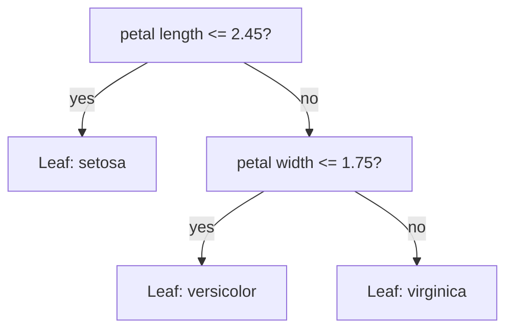
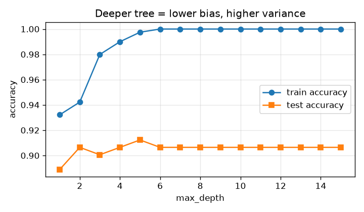
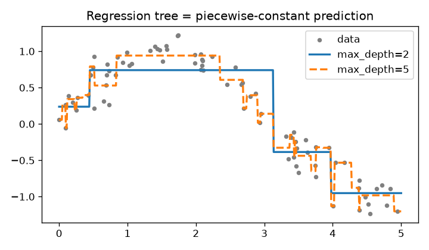
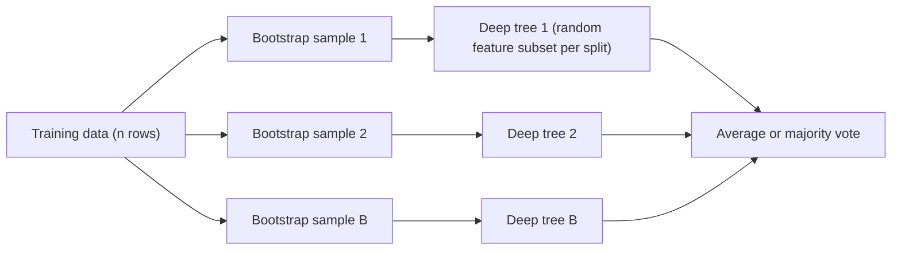
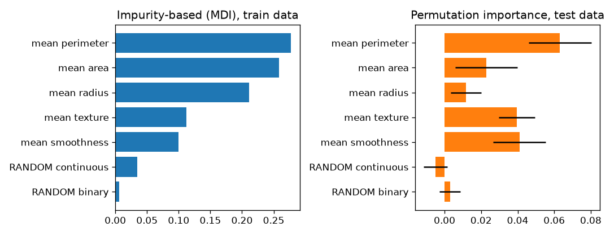
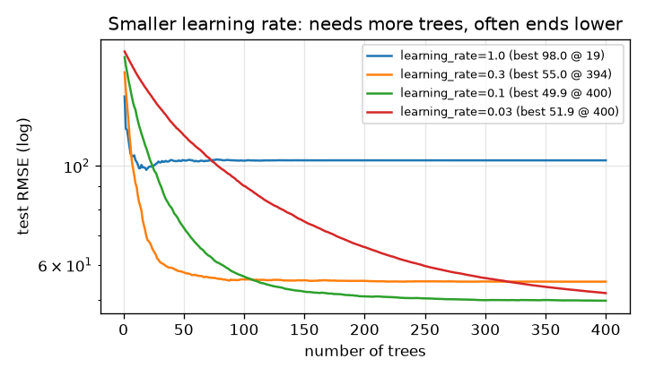
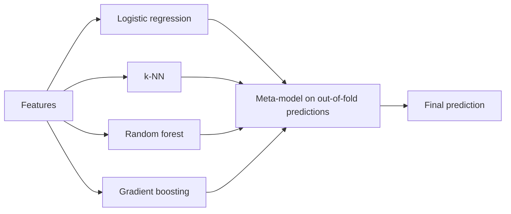

# Chapter 7 — Decision Trees and Ensembles

Decision trees are the most "human" model: a chain of yes/no questions you can print and read. Alone they overfit easily, but combined — by **averaging** (Random Forests) or by **correcting each other's mistakes** (gradient boosting) — they win most real-world problems on **tabular data** (rows and columns, like a spreadsheet or SQL table).

**What you'll learn:** how a tree picks each split (Gini, entropy, information gain); depth, pruning, regression trees; bagging and Random Forests (bootstrap, feature subsampling, out-of-bag score); feature importance and its pitfalls (permutation importance); AdaBoost and gradient boosting on residuals; XGBoost vs LightGBM vs CatBoost; voting and stacking; why trees beat neural nets on tables; a hyperparameter cheat sheet.

All code is in `code/` (scikit-learn 1.9). Outputs are real.

---

## 7.1 Decision trees

### What it is
A **decision tree** predicts by asking questions about features ("Is petal length ≤ 2.45 cm?"). Each question is a **node**, each answer a **branch**, and a **leaf** holds the prediction (class or number). Like "20 Questions", the learning algorithm greedily asks whichever question rules out the most first.



### Why it matters
- **Interpretable:** a shallow tree is a flowchart a doctor or loan officer can check.
- **No scaling needed:** "x ≤ 3.2" doesn't care about units.
- **Mixed data, non-linear effects and interactions** handled automatically ("high income AND young" is its own branch).
- The **building block** of Random Forests, XGBoost, LightGBM and CatBoost.

### How it works — growing a tree (CART)
scikit-learn implements **CART** (Classification And Regression Trees), always with **binary** splits:

1. All training rows start at the root.
2. For every feature and candidate threshold (midpoints between sorted unique values), split rows left (≤) and right (>).
3. Score each split by how much it reduces **impurity** (label mixing); take the best.
4. Recurse on each child.
5. Stop when the node is pure, `max_depth` is reached, too few samples (`min_samples_split`, `min_samples_leaf`), or no split helps enough.
6. Leaves predict the majority class (storing class proportions for `predict_proba`) or the mean target.

This is **greedy** (best split now, never revisited); finding the optimal tree is **NP-hard** (no known fast exact algorithm).

### Impurity measures
For class proportions pₖ in a node:

| Measure | Formula | Pure node | 50/50 binary node |
|---|---|---|---|
| **Gini impurity** | G = 1 − Σ pₖ² | 0 | 0.5 |
| **Entropy** | H = − Σ pₖ log₂ pₖ | 0 | 1.0 bit |
| **Misclassification error** | 1 − maxₖ pₖ | 0 | 0.5 (not sensitive enough for growing) |

- **Gini** = probability of mislabelling a random sample labelled randomly by the node's class mix.
- **Entropy** = average bits (yes/no answers) to identify the class (information theory).
- **Information gain** = entropy(parent) − weighted average entropy(children), weights = share of rows per child. The Gini version is called Gini decrease.

### Worked example: Gini vs entropy
Ten loan applicants (1 = defaulted); split *income < 40k?*

| Node | Labels | Gini | Entropy |
|---|---|---|---|
| Parent | 4 defaults, 6 repaid | 1 − 0.4² − 0.6² = **0.480** | **0.971** |
| Left (income < 40k) | 3 defaults, 1 repaid | 0.375 | 0.811 |
| Right (income ≥ 40k) | 1 default, 5 repaid | 0.278 | 0.650 |

Weighted children: Gini 0.4·0.375 + 0.6·0.278 = 0.317 → **Gini decrease 0.163**; entropy 0.715 → **information gain 0.256**. The tree tests every midpoint (`code/split_math.py`):

```python
def gini(labels):
    n = len(labels)
    return 1 - sum((c / n) ** 2 for c in Counter(labels).values())

def entropy(labels):
    n = len(labels)
    return -sum((c / n) * math.log2(c / n) for c in Counter(labels).values())

def weighted(children, fn):          # impurity of a split
    n = sum(len(c) for c in children)
    return sum(len(c) / n * fn(c) for c in children)
# ... loop over every midpoint threshold and print both scores
```

Output:
```
parent [1, 1, 1, 0, 0, 0, 0, 0, 1, 0]  -> gini=0.480  entropy=0.971
left   [1, 1, 1, 0]         -> gini=0.375  entropy=0.811
right  [0, 0, 0, 0, 1, 0]     -> gini=0.278  entropy=0.650
weighted child gini    = 0.317  -> gini decrease   = 0.163
weighted child entropy = 0.715  -> information gain = 0.256

threshold  gini_decrease  info_gain
     27.5          0.080      0.144
     32.5          0.180      0.322
     36.5          0.309      0.557
     41.5          0.163      0.256
     ...
     85.0          0.036      0.079
```

Both measures pick **36.5** (left side 25, 30, 35 is pure). Gini and entropy almost always rank splits the same; Gini is scikit-learn's default because it skips the logarithm. Don't spend tuning time on it.

### Reading a fitted tree
`code/decision_tree_demo.py` prints a depth-2 Iris tree with `export_text`:

```python
tree = DecisionTreeClassifier(max_depth=2, random_state=42).fit(iris.data, iris.target)
print(export_text(tree, feature_names=list(iris.feature_names)))
```
```
|--- petal length (cm) <= 2.45
|   |--- class: 0
|--- petal length (cm) >  2.45
|   |--- petal width (cm) <= 1.75
|   |   |--- class: 1
|   |--- petal width (cm) >  1.75
|   |   |--- class: 2
```
Two questions classify ~96% of flowers — the interpretability selling point.

### Depth and overfitting
Unlimited, a tree splits until leaves are pure and memorises training data. Breast-cancer dataset (30 features, 569 patients):

```
depth  train  test
    1  0.932  0.889
    2  0.942  0.906
    3  0.980  0.901
    4  0.990  0.906
    6  1.000  0.906
   10  1.000  0.906
   15  1.000  0.906
```



Training hits 100% at depth 6 while test stays ~0.90: extra splits fit noise.

### Pruning

| Kind | How | scikit-learn knobs |
|---|---|---|
| **Pre-pruning** (early stopping) | Stop growing early | `max_depth`, `min_samples_split`, `min_samples_leaf`, `max_leaf_nodes`, `min_impurity_decrease` |
| **Post-pruning** (cost-complexity pruning) | Grow fully, cut back branches that don't pay | `ccp_alpha` |

**Cost-complexity pruning** minimises R_α(T) = R(T) + α·|leaves(T)| (R = training impurity, α = price per leaf). α = 0 keeps the full tree; larger α removes the weakest branches first. `cost_complexity_pruning_path` lists the α values where branches vanish; choose α by cross-validation.

```
full tree: 16 leaves, test acc 0.906
ccp_alpha=0.0    leaves= 16  test acc=0.906
ccp_alpha=0.005  leaves=  7  test acc=0.918
ccp_alpha=0.01   leaves=  5  test acc=0.918
ccp_alpha=0.02   leaves=  4  test acc=0.901
ccp_alpha=0.05   leaves=  2  test acc=0.889
```
A 5-leaf tree beats the 16-leaf one — simpler *and* better; 2 leaves underfits.

### Regression trees
Splits minimise the **squared error** (equivalently the variance) of the target in the children; leaves predict the **mean** (`criterion="absolute_error"` uses the median, more outlier-robust). The result is a **step function**:



```
|--- x <= 3.13
|   |--- x <= 0.44
|   |   |--- value: [0.24]
|   |--- x >  0.44
|   |   |--- value: [0.74]
|--- x >  3.13
|   |--- x <= 3.98
|   |   |--- value: [-0.39]
|   |--- x >  3.98
|   |   |--- value: [-0.95]
```
Depth 2 = 4 flat steps (underfit); depth 5 chases noisy points (overfit). **A tree cannot extrapolate**: outside the training range it predicts the last leaf's value, flat forever.

### Trade-offs

| Strengths | Weaknesses |
|---|---|
| Readable rules | High variance: small data change → very different tree |
| No scaling; non-linearity and interactions | Overfits without depth limits or pruning |
| Fast prediction: O(depth) | **Axis-aligned** splits (one feature each): a diagonal boundary needs a staircase |
| Numeric + categorical data (scikit-learn ≥ 1.3 trees handle missing values natively) | Cannot extrapolate |
| | Greedy — may miss the best overall tree |

### When not to use it
- Accuracy over readability → forest or boosting.
- Smooth or linear relationships (a line needs 2 parameters; a tree a staircase).
- Forecasting beyond the training range (ever-rising prices).

### Common mistakes
- `max_depth=None` and reporting training accuracy (~100%, meaningless).
- Scaling "for the tree" (harmless, pointless); over-reading one tree's structure (a resample may change the top split).
- One-hot encoding a thousands-level categorical into a tree (each split isolates one level); prefer target encoding (category → average target), ordinal encoding, or native categorical support.

### Real-world examples
- Credit-scoring and medical-triage rules that regulators or clinicians must read.
- The **weak learner** (model only slightly better than guessing; 7.4) inside every gradient-boosting library.

### In the interview
**30-second answer:** "A decision tree recursively splits the data on the feature/threshold that most reduces impurity — Gini or entropy for classification, variance for regression. Leaves predict the majority class or the mean. Trees are interpretable and need no scaling, but they have high variance and overfit unless you limit depth or prune with cost-complexity pruning, which is why we usually use them inside ensembles."

- *Gini or entropy?* Agree on almost all splits; Gini is default (no log). Not worth tuning.
- *Why greedy?* The optimal tree is NP-hard; greedy top-down splitting is fast and works well.
- *A feature 1000× larger in scale?* Irrelevant — splits depend only on value order.

### Self-check
1. 8 cats, 2 dogs: Gini? → 1 − 0.8² − 0.2² = **0.32**.
2. Increasing `ccp_alpha`? → Prunes more (smaller tree, higher bias, lower variance).
3. Why can't a tree predict a price above any seen? → Leaves are averages of training targets.

### TL;DR
Trees ask the best yes/no question each step (max impurity decrease), are readable and scale-free, but overfit — limit depth or prune by cost complexity.

---

## 7.2 Bias–variance of trees

### What it is
(Bias–variance in general: [Chapter 6, section 6.7](../06-evaluation-and-tuning/README.md).) A **shallow** tree (a depth-1 **stump**) has high bias, low variance; a **deep** tree has low bias and **very high variance** — a different **bootstrap sample** (random resample of rows; 7.3) gives a noticeably different tree.

### Why it matters
Deep trees are accurate *on average* but noisy — exactly what averaging fixes. Averaging B models, each with variance σ² and pairwise error correlation ρ (0 = unrelated, 1 = identical):

  **Var(average) = ρσ² + (1 − ρ)σ²/B**

As B grows the second term vanishes but ρσ² stays: **averaging helps only as much as the models disagree**.
- **Bagging** averages many deep trees (shrinks the second term).
- **Random Forests** also **de-correlate** trees (lower ρ, shrinking the first).
- **Boosting** starts from high-bias shallow trees and adds them sequentially to **reduce bias**.

| Method | Base trees | Mainly reduces | Trees built |
|---|---|---|---|
| Bagging / Random Forest | Deep (low bias, high variance) | Variance | Independently, in parallel |
| Boosting | Shallow (high bias, low variance) | Bias (some variance via **shrinkage**, a small learning rate) | Sequentially |

### TL;DR
Deep trees = low bias, high variance → average them (bagging/RF). Shallow trees = high bias → chain them (boosting).

---

## 7.3 Bagging and Random Forests

### What it is
**Bagging** (Bootstrap AGGregatING, Breiman 1996) trains copies of one model on different **bootstrap samples** — n rows drawn **with replacement** from n (some repeat, some missing) — and averages them (majority vote or averaged probabilities; mean for regression).

A **Random Forest** (Breiman 2001) = bagged decision trees **plus** a **random subset of features** considered at each split (`max_features`).

Analogy: 500 doctors from the same school reading the same chart add little; if each saw different tests (bootstrap) and focused on different symptoms (feature subsampling), their vote is far more reliable.



### How it works
1. For b = 1..B (`n_estimators`, e.g. 100–500): draw a bootstrap sample; grow a deep (usually unpruned) tree, searching each split **only among** `max_features` random features.
2. Predict by averaging the trees' probabilities (scikit-learn uses **soft voting**) or values.

**Why feature subsampling helps:** one very strong feature would top every bagged tree, making them nearly identical (high ρ); hiding it from some splits forces other trees to find other patterns.

**Defaults (scikit-learn):** `max_features="sqrt"` (√p) for classification, `1.0` (all features = plain bagging) for regression; the textbook regression suggestion is p/3 — try a few.

### Out-of-bag (OOB) evaluation
A row is **never** drawn in n draws with probability (1 − 1/n)ⁿ ≈ 1/e ≈ **36.8%**, so each tree misses about a third of rows — its **out-of-bag** rows. Predicting each row with only the trees that didn't see it gives a free validation score without a hold-out set (`oob_score=True`).

### Code — single tree vs bagging vs Random Forest
`code/forest_demo.py`:

```python
models = {
    "single tree": DecisionTreeClassifier(random_state=0),
    "bagged trees (100)": BaggingClassifier(DecisionTreeClassifier(), n_estimators=100, random_state=0),
    "random forest (100)": RandomForestClassifier(n_estimators=100, random_state=0),
}
for name, m in models.items():
    s = cross_val_score(m, X, y, cv=5)

rf = RandomForestClassifier(n_estimators=300, oob_score=True, random_state=0, n_jobs=-1)
rf.fit(X_tr, y_tr)
print(rf.oob_score_, rf.score(X_te, y_te))
```
Output:
```
5-fold CV accuracy (mean +/- std)
  single tree          0.917 +/- 0.016
  bagged trees (100)   0.958 +/- 0.029
  random forest (100)  0.963 +/- 0.022

OOB accuracy  = 0.967  (free validation estimate, no hold-out used)
test accuracy = 0.953
expected out-of-bag fraction per tree = 0.367  (1/e = 0.368)
```
Averaging adds ~4 points; feature subsampling a little more; OOB is close to the test score.

### Feature importance and its pitfalls
**Impurity-based importance** (Mean Decrease in Impurity, **MDI**; `feature_importances_`): sum each feature's impurity decreases over its splits, weighted by the share of samples reaching the node, averaged over trees, normalised to 1. Pitfalls:
1. **Biased toward high-cardinality features** (many distinct values): continuous features or IDs offer many thresholds and find chance splits; pure noise gets non-zero importance.
2. **Computed on training data** — rewards features used to *overfit*.
3. **Correlated features share credit** unpredictably (radius, perimeter, area each look less important than the concept).

**Permutation importance** fixes the first two: on a **held-out set**, shuffle one column (breaking its link to the target), measure the score drop, repeat. Model-agnostic. Caveat: with correlated features the unshuffled twin remains, so **both** can look unimportant — group or drop correlated features first.

```python
X = np.hstack([X, noise_cont, noise_bin])   # add a random continuous and a random binary column
rf = RandomForestClassifier(n_estimators=300, random_state=0, n_jobs=-1).fit(X_tr, y_tr)
perm = permutation_importance(rf, X_te, y_te, n_repeats=20, random_state=0, n_jobs=-1)
```
```
feature              impurity(MDI)  permutation(test)
  mean perimeter            0.278     0.063 +/- 0.017
  mean area                 0.258     0.023 +/- 0.017
  mean radius               0.212     0.012 +/- 0.008
  mean texture              0.112     0.039 +/- 0.010
  mean smoothness           0.100     0.041 +/- 0.014
  RANDOM continuous         0.034    -0.005 +/- 0.006
  RANDOM binary             0.006     0.003 +/- 0.006
```



(1) MDI gives the random continuous column ~6× the random binary one — pure cardinality bias; permutation puts both ≈ 0. (2) Radius, perimeter and area are nearly one measurement: MDI ranks them top-3, but permutation ranks texture and smoothness above radius and area, since shuffling one size feature barely hurts while its twins remain.

**Better still:** **SHAP** values (per-prediction attributions from game-theory Shapley values, which split credit fairly among features; `shap` library with a fast exact tree algorithm) explain individual predictions and aggregate to global importance.

### Trade-offs

| Strengths | Weaknesses |
|---|---|
| Strong accuracy, almost no tuning | Larger, slower than one tree; not readable |
| More trees never hurt accuracy, only time | Usually slightly below well-tuned boosting |
| Trees train in parallel (`n_jobs=-1`) | Cannot extrapolate |
| Free OOB score; robust to outliers and noisy features | Memory-heavy with deep trees on big data |

### When not to use it
- Very high-dimensional **sparse** data (mostly zeros, e.g. word counts) — linear models are faster and often better.
- Latency- or memory-critical deployment (see [System Design Fundamentals](../../../system-design-patterns/modules/00-system-design-fundamentals/README.md)) with hundreds of deep trees.
- When you need the last percent — try gradient boosting.

### Common mistakes
- Treating `feature_importances_` as causal or "true".
- Tuning `n_estimators` as if more trees overfit (they don't; stop when the score plateaus).
- Forgetting `n_jobs=-1` (one core); OOB with `bootstrap=False` (no OOB rows; scikit-learn errors).

### Real-world examples
- Microsoft Kinect body-part recognition used randomized decision forests on depth-image features (Shotton et al., 2011).
- Standard strong baseline in credit risk, fraud, churn and bioinformatics (gene expression).

### In the interview
**30-second answer:** "A Random Forest trains many deep trees on bootstrap samples and, at each split, considers only a random subset of features. Averaging reduces variance; feature subsampling de-correlates the trees so averaging helps more. About 37% of rows are out-of-bag for each tree, which gives a free validation score. It works well out of the box and rarely overfits by adding trees."

- *Bagging vs Random Forest?* RF = bagging + random feature subset per split, to reduce tree correlation.
- *Why can MDI mislead?* Training-data based and favours high cardinality; use permutation importance on held-out data, or SHAP.
- *Does adding trees overfit?* No — test error converges; depth and leaf size control overfitting.

### Self-check
1. Which term of ρσ² + (1 − ρ)σ²/B does feature subsampling target? → ρσ².
2. Two near-duplicate features: permutation importances? → Both can look small (the twin remains).

### TL;DR
Random Forest = many de-correlated deep trees, averaged. Great default, free OOB score. Explain with permutation importance or SHAP, not raw MDI.

---

## 7.4 Boosting

### What it is
**Boosting** builds an ensemble **sequentially**, each new **weak learner** (typically a shallow tree or stump) focusing on what the ensemble gets wrong — like a student who re-studies only the questions missed on each practice exam.


### AdaBoost (intuition)
**AdaBoost** (Adaptive Boosting, Freund & Schapire 1997) re-weights *samples*:

1. Every sample gets weight 1/n.
2. Fit a stump on the weights; compute weighted error ε.
3. Its vote α = ½·ln((1 − ε)/ε): accurate stumps vote more; ε = 0.5 (coin flip) → α = 0.
4. Multiply weights of **misclassified** samples by e^α, correct ones by e^−α; renormalise.
5. Repeat; predict sign of Σ α_m · h_m(x).

Worked: ε = 0.2 → α ≈ 0.693, so wrong samples ×2, right ×0.5; total weight 0.4 vs 0.4 → the misclassified 20% become **half** of the next stump's problem.

(scikit-learn's `AdaBoostClassifier` uses multi-class **SAMME**: α = ln((1 − ε)/ε) + ln(K − 1) for K classes — twice the above when K = 2 — scaled by `learning_rate`.) AdaBoost equals gradient boosting with **exponential loss**, making it sensitive to outliers and label noise: a mislabelled point keeps getting heavier.

### Gradient boosting, step by step on residuals
**Gradient boosting** (Friedman 2001) re-fits *targets* instead of re-weighting samples. For squared error:

1. F₀(x) = mean(y).
2. For m = 1..M: residuals rᵢ = yᵢ − F_{m−1}(xᵢ); fit a small regression tree hₘ to r; update Fₘ(x) = F_{m−1}(x) + η·hₘ(x), with **learning rate** (shrinkage) η, e.g. 0.1.
3. Predict with F_M.

**Why "gradient"?** For L = ½(y − F)² the negative gradient w.r.t. F is exactly the residual. For other losses fit the tree to the **negative gradient** ("pseudo-residuals"; for log-loss: y − p). Gradient boosting is gradient descent in *function space*: each tree is one downhill step.

**Worked example** (4 houses, size in 100 m² → price k$, η = 0.5, stumps; `code/boosting_demo.py`):

```
round 0: predict mean = 295.0 for every house
round 1: residuals [-95. -35.   5. 125.] -> new preds [274.2 274.2 274.2 357.5]  MSE=2568.8
round 2: residuals [-74.2 -14.2  25.8  62.5] -> new preds [252.1 252.1 296.2 379.6]  MSE=1105.7
round 3: residuals [-52.1   7.9   3.8  40.4] -> new preds [226.  260.8 304.9 388.3]  MSE=427.6
```
Round 1's stump splits size ≤ 2.5: left mean residual (−95 − 35 + 5)/3 = −41.7, right 125; half of each is added (295 − 20.8 = 274.2, 295 + 62.5 = 357.5). Residuals and MSE shrink each round.

The whole algorithm:

```python
class TinyGradientBoosting:
    def fit(self, X, y):
        self.f0 = y.mean()                       # step 0: constant prediction
        pred = np.full(len(y), self.f0)
        self.trees = []
        for _ in range(self.n):
            residual = y - pred                  # = negative gradient of 1/2 (y - pred)^2
            t = DecisionTreeRegressor(max_depth=self.depth, random_state=0).fit(X, residual)
            pred += self.lr * t.predict(X)       # take a small step toward the residuals
            self.trees.append(t)
        return self

    def predict(self, X):
        return self.f0 + self.lr * sum(t.predict(X) for t in self.trees)
```
```
from-scratch GB test RMSE = 50.86
sklearn GB      test RMSE = 51.01
```
It matches scikit-learn's `GradientBoostingRegressor` with the same settings.

### Learning rate and number of trees
Smaller η corrects less per tree, needing more trees, but usually generalises better (shrinkage is regularisation).



- η = 1.0: fast drop, then overfits and stalls (RMSE 98).
- η = 0.3: good quickly, plateaus at 55.
- η = 0.1: best (49.9) by 400 trees.
- η = 0.03: still improving at 400.

Recipe: η ≈ 0.05–0.1, large M, **early stopping** on validation (e.g. stop after 50 rounds without improvement). scikit-learn: `n_iter_no_change` + `validation_fraction` (`GradientBoostingClassifier`) or `early_stopping=True` (`HistGradientBoosting*`, automatic above 10,000 samples); XGBoost/LightGBM: `early_stopping_rounds` / an early-stopping callback. Other regularisers: shallow trees (depth 3–8 or `num_leaves` ≤ 31–255), **row subsampling** (`subsample` < 1 = *stochastic* gradient boosting), column subsampling, min samples per leaf, L1/L2 on leaf values.

### Comparison on a real dataset
```python
models = {
    "AdaBoost (stumps)": AdaBoostClassifier(n_estimators=200, random_state=0),
    "RandomForest": RandomForestClassifier(n_estimators=200, random_state=0, n_jobs=-1),
    "HistGradientBoosting": HistGradientBoostingClassifier(random_state=0),
}
```
```
5-fold CV accuracy
  AdaBoost (stumps)      0.977 +/- 0.009
  RandomForest           0.960 +/- 0.019
  HistGradientBoosting   0.965 +/- 0.018
```
On a small clean dataset all are within ~2 points and the ranking changes with the seed; family differences show on larger, messier data.

### XGBoost vs LightGBM vs CatBoost (and scikit-learn)
All are gradient-boosted decision trees (**GBDT**), differing in engineering and defaults:

| | XGBoost (2014) | LightGBM (Microsoft, 2017) | CatBoost (Yandex, 2017) | scikit-learn `HistGradientBoosting` |
|---|---|---|---|---|
| Split finding | Histogram (`tree_method="hist"`, default since 2.0); exact available | Histogram | Histogram | Histogram (≤ 255 bins), LightGBM-inspired |
| Tree growth | Level-wise by default; `grow_policy="lossguide"` for leaf-wise | **Leaf-wise** — often faster/more accurate, can overfit small data | **Symmetric (oblivious)** trees: one split per level → very fast prediction, strong regularisation | Leaf-wise (`max_leaf_nodes=31`) |
| Regularisation | In the objective: γ per leaf, L1/L2 on leaf weights; 1st + 2nd derivatives (Newton step) | L1/L2, min gain, min data in leaf; **GOSS** (keep large-gradient rows, sample small) and **EFB** (bundle mutually exclusive sparse features) for speed | **Ordered boosting** against target leakage | L2, min samples per leaf |
| Categorical features | Native (`enable_categorical=True`) | Native | **Best-in-class**: ordered target statistics, feature combinations | Native (`categorical_features="from_dtype"` default) |
| Missing values | Native (learns default direction) | Native | Native | Native |
| GPU | Yes | Yes | Yes | No |
| Best when | All-rounder, huge ecosystem | Large data, speed | Many categoricals, good defaults | Mid-size data, no extra dependency |

> **Key terms:** *Histogram* split finding buckets each feature into a few hundred bins so only bin edges are tested — much faster. *Level-wise* growth splits every node at a depth before going deeper; *leaf-wise* always splits the single leaf with the biggest loss reduction. A *Newton step* uses second derivatives (curvature) as well as first to size updates. *Target leakage* here = a row's own label influencing its features. A *GPU* runs many calculations in parallel; a *dependency* is an extra library to install.

XGBoost's objective: minimise Σ loss(yᵢ, ŷᵢ) + Σ_trees (γ·T + ½λ·‖w‖²) (T = leaves, w = leaf values); with gradient sum G and second-derivative sum H in a leaf, the optimal leaf value is w* = −G/(H + λ).

All have scikit-learn-compatible APIs (not run — packages not installed here):

```python
# pip install xgboost lightgbm catboost   (not run)
from xgboost import XGBClassifier
from lightgbm import LGBMClassifier
from catboost import CatBoostClassifier

xgb = XGBClassifier(n_estimators=2000, learning_rate=0.05, max_depth=6,
                    subsample=0.8, colsample_bytree=0.8, early_stopping_rounds=100)
xgb.fit(X_tr, y_tr, eval_set=[(X_val, y_val)])

lgbm = LGBMClassifier(n_estimators=2000, learning_rate=0.05, num_leaves=31)
cat = CatBoostClassifier(iterations=2000, learning_rate=0.05, cat_features=["city", "device"])
```

### Trade-offs: bagging vs boosting

| | Random Forest | Gradient boosting |
|---|---|---|
| Accuracy on tabular data | Very good | Usually best |
| Tuning needed | Little | Moderate (η, trees, depth/leaves, subsampling) |
| Overfits by adding trees? | No | **Yes** — use early stopping |
| Training | Parallel across trees | Sequential across trees (parallel within) |
| Sensitivity to noise/outliers | Low | Higher (esp. AdaBoost) |

### When not to use it
- Unstructured data (images, audio, raw text) — deep learning wins.
- Tiny datasets with strong domain priors — a regularised linear model may match it, more explainably.
- Predictions outside the training range — combine with a linear model or model the trend separately.

### Common mistakes
- `n_estimators` without early stopping; learning rate 1.0 "because it's faster".
- Same set for early stopping *and* final reporting (keep a separate test set).
- AdaBoost on noisy labels; deep trees (depth 15) in boosting — it wants weak learners.

### Real-world examples
- GBDT dominates Kaggle tabular competitions; XGBoost's 2016 paper noted it in 17 of 29 winning Kaggle solutions published in 2015.
- Web search: **LambdaMART** (gradient-boosted trees for **learning-to-rank**, Microsoft Research) powered Bing's ranker, and a LambdaMART ensemble won the 2010 Yahoo! Learning to Rank Challenge.
- Fraud, credit scoring, click-through rate, demand forecasting; Yandex uses CatBoost in search and recommendation.

### In the interview
**30-second answer:** "Boosting builds trees sequentially, each one correcting the current ensemble. In gradient boosting, you start from a constant, and each new shallow tree is fitted to the negative gradient of the loss — for squared error that's just the residuals — and added with a small learning rate. It mainly reduces bias. It's usually the most accurate model on tabular data but it can overfit as you add trees, so you use a small learning rate with early stopping."

- *AdaBoost vs gradient boosting?* AdaBoost re-weights misclassified samples (exponential loss); gradient boosting fits the negative gradient of any differentiable loss — AdaBoost is a special case.
- *Why a small learning rate?* Each tree fixes only part of the error, which regularises and generalises better, at the cost of more trees.
- *LightGBM vs XGBoost?* LightGBM: leaf-wise, GOSS/EFB for speed; XGBoost: depth-wise by default, regularised second-order objective. Both histogram-based; often similar after tuning.

### Self-check
1. Negative gradient for log-loss? → y − p.
2. Learning rate 0.1 → 0.01: what else changes? → ~10× more trees (early stopping).
3. Which library uses symmetric (oblivious) trees? → CatBoost.

### TL;DR
Boosting = shallow trees in sequence, each fitting the previous errors (residuals/gradients), scaled by a learning rate. Most accurate on tabular data; always early-stop.

---

## 7.5 Voting and stacking

### What it is
Ensembles of **different** model families:
- **Hard voting:** majority of predicted classes.
- **Soft voting:** average predicted probabilities; usually better with **calibrated** models (probabilities match observed frequencies).
- **Stacking** (stacked generalisation, Wolpert 1992): a **meta-model** (often logistic/linear regression) trained on the base models' **out-of-fold** predictions (each from a model that didn't see that row), avoiding leakage; scikit-learn does this via `cv`.



### Why it matters
Different families make **different errors** (low ρ → averaging helps, as in 7.2); stacking learns *how much to trust* each.

### Code
`code/voting_stacking.py`:
```python
base = [
    ("lr", make_pipeline(StandardScaler(), LogisticRegression(max_iter=1000))),
    ("knn", make_pipeline(StandardScaler(), KNeighborsClassifier(n_neighbors=7))),
    ("rf", RandomForestClassifier(n_estimators=200, random_state=0, n_jobs=-1)),
    ("hgb", HistGradientBoostingClassifier(random_state=0)),
]
models["soft voting"] = VotingClassifier(base, voting="soft")
models["stacking (meta = LR)"] = StackingClassifier(
    base, final_estimator=LogisticRegression(max_iter=1000), cv=5)
```
```
10-fold CV accuracy
  lr                     0.981 +/- 0.015
  knn                    0.967 +/- 0.020
  rf                     0.965 +/- 0.028
  hgb                    0.968 +/- 0.022
  hard voting            0.977 +/- 0.021
  soft voting            0.975 +/- 0.016
  stacking (meta = LR)   0.979 +/- 0.019
```
Honest result: ensembles beat three of four base models but **not** the best (scaled logistic regression — the data is nearly **linearly separable**). Ensembles reduce the risk of picking wrong; they aren't guaranteed to win.

### Trade-offs / when not to use it
- More models = more training time, latency and maintenance; Netflix didn't deploy the full Prize-winning blend of 100+ models because the gain didn't justify the engineering cost.
- Little gain when base models are highly correlated (five boosting libraries on the same features).

### Common mistakes
- Meta-model on in-sample base predictions (it learns to trust overfit models).
- Soft voting with uncalibrated scores (e.g. SVM) without calibration.

### In the interview
**30-second answer:** "Voting averages diverse models' predictions — hard voting by majority, soft voting by averaged probability. Stacking trains a meta-model on out-of-fold predictions of the base models so it learns how to weight them. It helps when base models make different errors."

- *Why out-of-fold?* An overfit model's in-sample predictions look perfect, so the meta-model would over-trust it.

### TL;DR
Combine diverse models: soft voting for simplicity, stacking on out-of-fold predictions for the last bit of accuracy.

---

## 7.6 When trees beat neural networks

On **tabular data**, tree ensembles (especially GBDT) remain the default winner over deep learning at typical sizes. Grinsztajn, Oyallon and Varoquaux (NeurIPS 2022, *"Why do tree-based models still outperform deep learning on typical tabular data?"*) benchmarked 45 medium-sized datasets (~10K samples):

| Property of tabular data | Why trees handle it | Why neural nets struggle |
|---|---|---|
| **Irregular** targets (sharp jumps, thresholds) | Splits make sharp steps | Networks are biased toward smooth functions |
| Many **uninformative features** | Splits ignore them | **MLPs** (basic fully connected networks) are hurt by them |
| Columns have individual meaning (not rotation-invariant) | Axis-aligned splits respect each column | MLPs are rotation-invariant (they blend columns), wasting that structure |
| Mixed types, skew, missing values | No scaling; native categoricals/missing | Need careful normalisation and encoding |

GBDTs also train in minutes on a CPU, need less tuning and are easier to explain (SHAP). Neural nets win on **unstructured** data, huge datasets, or end-to-end learning with **embeddings** (learned vectors for IDs, words, images) — e.g. recommenders with millions of IDs, or tabular + text + images. Tabular foundation models (pre-trained on many datasets; e.g. TabPFN for small data) are narrowing the gap, but a tuned GBDT is the baseline to beat.

**Rule of thumb:** tabular → start with a GBDT (LightGBM/XGBoost/CatBoost/`HistGradientBoosting`) and a Random Forest baseline.

---

## 7.7 Hyperparameter cheat sheet

| Goal | Decision tree (sklearn) | Random Forest (sklearn) | GBDT (sklearn `HistGradientBoosting`) | XGBoost | LightGBM |
|---|---|---|---|---|---|
| Number of trees | — | `n_estimators` (100–500; more never hurts accuracy) | `max_iter` (use early stopping) | `n_estimators` | `n_estimators` / `num_iterations` |
| Step size | — | — | `learning_rate` (0.1) | `learning_rate`/`eta` (0.3) | `learning_rate` (0.1) |
| Tree size | `max_depth`, `max_leaf_nodes` | `max_depth` (None) | `max_leaf_nodes` (31), `max_depth` | `max_depth` (6) | `num_leaves` (31), `max_depth` (−1 = no limit) |
| Min data per leaf | `min_samples_leaf` | `min_samples_leaf` | `min_samples_leaf` (20) | `min_child_weight` (1) | `min_child_samples` (20) |
| Row sampling | — | `bootstrap`, `max_samples` | — | `subsample` (1.0) | `bagging_fraction` / `subsample` (1.0) |
| Feature sampling | `max_features` | `max_features` ("sqrt") | `max_features` | `colsample_bytree` | `feature_fraction` / `colsample_bytree` |
| Penalties | `ccp_alpha`, `min_impurity_decrease` | `ccp_alpha` | `l2_regularization` | `reg_alpha`, `reg_lambda`, `gamma` | `reg_alpha`, `reg_lambda`, `min_split_gain` |
| Class imbalance | `class_weight` | `class_weight` | `class_weight` | `scale_pos_weight` | `is_unbalance` / `scale_pos_weight` |

(Defaults in parentheses: scikit-learn 1.9, XGBoost 2.x, LightGBM 4.x.)

**GBDT tuning order:** (1) learning rate 0.05–0.1 + early stopping; (2) tree size and min samples per leaf; (3) subsampling; (4) L1/L2 if still overfitting; (5) lower the learning rate and let early stopping add trees.

---

## Chapter TL;DR
- **Decision tree:** greedy splits maximising impurity decrease (Gini ≈ entropy); leaves predict majority/mean. Readable, scale-free, high variance — limit depth or prune with `ccp_alpha`. Cannot extrapolate.
- **Bagging/Random Forest:** average deep trees on bootstrap samples; RF also samples features per split to de-correlate. ~37% OOB rows give a free validation score. Robust default.
- **Feature importance:** MDI is biased (training data, high cardinality, correlated features) — prefer permutation importance on held-out data or SHAP.
- **Boosting:** shallow trees in sequence fitting residuals/negative gradients, scaled by a learning rate. Best tabular accuracy; early-stop. AdaBoost = re-weighting, exponential loss.
- **XGBoost/LightGBM/CatBoost:** histogram GBDTs differing in tree growth (depth-wise / leaf-wise / symmetric) and categorical handling (CatBoost best).
- **Voting/stacking:** combine diverse models; stacking needs out-of-fold predictions.
- **Tabular data → start with gradient-boosted trees.**
