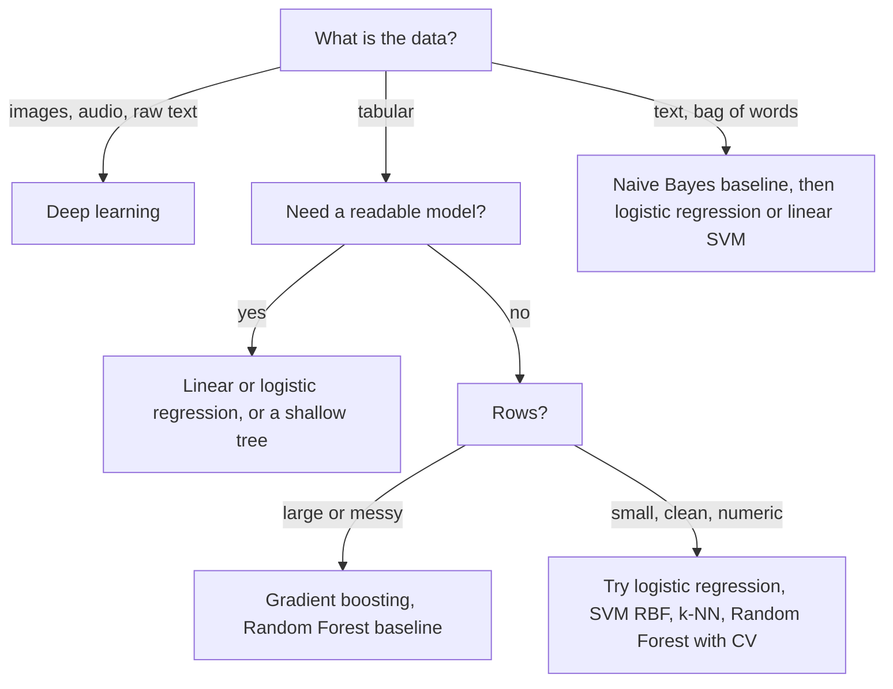

# Chapter 8 — k-Nearest Neighbours, Support Vector Machines, Naive Bayes

Three classic algorithms, three different ideas of "learning":

- **k-NN** builds no model — it remembers the training data and asks "what did similar examples look like?"
- **SVM** draws the boundary staying as far as possible from both classes, and with the **kernel trick** draws curved boundaries without computing curved features.
- **Naive Bayes** counts: Bayes' theorem (updating a probability after evidence) plus a bold simplifying assumption — surprisingly good at text.

The chapter ends with a table comparing **every classic supervised algorithm** in the book.

**What you'll learn:** k-NN distance metrics, scaling, choosing k, the curse of dimensionality; SVM margin, support vectors, soft margin and C, kernels and the kernel trick, SVR; Naive Bayes variants and a spam filter by hand; when to use which classic algorithm.

Code is in `code/`; every output is real (scikit-learn 1.9).

---

## 8.1 k-Nearest Neighbours (k-NN)

### What it is
**k-NN** finds the k training points closest to a new point and takes a **majority vote** of their labels (classification) or the **average** of their targets (regression) — like pricing a flat from the 5 most similar recent sales.

It is a **lazy** (instance-based) learner — "training" just stores the data, all work happens at prediction — and **non-parametric**: no fixed weights; the model *is* the dataset.

### Why it matters
- Zero training time, one **hyperparameter**, no assumption about the **decision boundary** (the line between predicted classes), which can be arbitrarily curved.
- The idea behind **similarity search** ("customers like you", "similar products") and **vector search** in modern retrieval, e.g. finding documents closest to a query **embedding** (a list of numbers representing meaning) in **RAG** systems (retrieval-augmented generation: a chatbot looks up relevant documents, then answers from them).
- Cover & Hart (1967): with infinite data, 1-NN's error is at most twice the best possible (Bayes) error. Simple ≠ weak.

### How it works
1. Choose k and a distance metric.
2. Store the training set (optionally in a **KD-tree** or **ball tree**, indexes that partition space so most points can be skipped).
3. For a query, compute distances to all training points; keep the k smallest.
4. Classification: majority vote (odd k avoids ties in binary problems). Regression: mean of the k targets.
5. Optional `weights="distance"`: weight = 1/distance.

### Distance metrics
For a = (1, 2, 3), b = (4, 6, 3) — `code/knn_demo.py`:

| Metric | Formula | Value | Use it for |
|---|---|---|---|
| **Euclidean (L2)** | √Σ(aᵢ − bᵢ)² | **5.000** | Default, continuous features |
| **Manhattan (L1)** | Σ\|aᵢ − bᵢ\| | **7.000** | Grid-like movement; more robust to one large difference |
| **Chebyshev (L∞)** | maxᵢ \|aᵢ − bᵢ\| | **4.000** | "Worst single feature" matters |
| **Minkowski (Lp)** | (Σ\|aᵢ − bᵢ\|ᵖ)^(1/p) | p=1 → L1, p=2 → L2 | scikit-learn default: `metric="minkowski", p=2` |
| **Cosine distance** | 1 − (a·b)/(‖a‖‖b‖) | 1 − 0.855 = **0.145** | Text/embeddings, direction over length |
| **Hamming** | Fraction of differing positions | — | Binary or categorical vectors |

### Scaling is mandatory
Distances add raw differences, so large-unit features **drown out** the others. In Wine, proline has standard deviation 314 vs 0.12 for another feature:

```
wine feature ranges: min std 0.12, max std 314.0 (proline)
k-NN (k=5) CV accuracy  raw features: 0.691   standardized: 0.949
```
Standardising lifts accuracy from 69% to 95%. Put the scaler **inside a pipeline** so it is fitted on training folds only:

```python
make_pipeline(StandardScaler(), KNeighborsClassifier(5))
```

### Choosing k
- **Small k** (k = 1): jagged boundary, noise-sensitive → low bias, high variance.
- **Large k**: smooth, can blur real structure → high bias, low variance; k = n always predicts the majority.
- Choose by **cross-validation**; odd k for binary; k ≈ √n is a starting guess only.

```python
ks = list(range(1, 41, 2))
scores = [cross_val_score(make_pipeline(StandardScaler(), KNeighborsClassifier(k)), X, y, cv=5).mean()
          for k in ks]
```
```
best k by 5-fold CV = 7 (accuracy 0.967);  k=1: 0.950, k=39: 0.966
```


### The curse of dimensionality
As the number of features d grows, distance-based methods break:

1. **Space empties out.** Capturing 10% of uniform data in a unit hypercube needs a sub-cube of edge 0.1^(1/d): 0.1 in 1-D, **0.79** in 10-D — the "neighbourhood" spans nearly every feature's whole range.
2. **Distances concentrate.** Nearest and farthest points become almost equally far (500 random points, `curse_of_dimensionality()`):

```
dim  (farthest - nearest) / nearest distance, 500 uniform points
    1   615.806
    2    82.019
   10     2.190
  100     0.432
 1000     0.104
```
In 1000-D the farthest point is only ~10% farther than the nearest.


3. **Data needed grows exponentially** to keep the same density.

Remedies: feature selection, dimensionality reduction (PCA, Chapter 9), learned embeddings where data lies on a lower-dimensional surface, or a non-distance model.

### Trade-offs

| Strengths | Weaknesses |
|---|---|
| No training; add data instantly | Slow, memory-hungry prediction: brute force is O(n·d) per query |
| Any boundary shape; naturally multi-class | Needs scaling and a good metric |
| One intuitive hyperparameter | Bad in high dimensions and with irrelevant features |
| Classification and regression | Sensitive to class imbalance (majority floods the vote) |

KD-trees and ball trees speed exact search in low dimensions; for millions of high-dimensional vectors production uses **approximate nearest neighbour (ANN)** indexes such as **HNSW** graphs (layered neighbour graphs that search hops through) or **FAISS** (Meta's open-source similarity-search library).

### When not to use it
Large datasets needing fast predictions, many features (> ~20–50 raw without reduction), many irrelevant features, or when you need a compact model or explanations beyond "these examples were similar".

### Common mistakes
- Not scaling, or scaling before the train/test split (leakage).
- Even k in binary problems; ID-like or irrelevant columns adding noise to every distance.
- Euclidean on one-hot or text counts where Hamming or cosine fit better.

### Real-world examples
- "Similar items" / "users like you" (item-based **collaborative filtering** — recommending from similar users' or items' behaviour — is nearest-neighbour).
- **Vector databases** and semantic search (approximate k-NN over embeddings) — the retrieval step in RAG.
- `KNNImputer` fills missing values from the nearest rows.

### In the interview
**30-second answer:** "k-NN stores the training set and predicts by majority vote or average of the k closest points under a distance metric. It has no training cost but prediction is O(n·d) without an index. You must scale features, pick k by cross-validation — small k overfits, large k underfits — and it degrades in high dimensions because distances concentrate."

- *Why "lazy"?* All computation is deferred to query time.
- *Speed it up?* KD-tree/ball tree in low dimensions; ANN (HNSW, FAISS) at scale; reduce dimensions first.
- *k-NN regression?* (Distance-weighted) average of the neighbours' targets.

### Self-check
1. Why scale for k-NN but not trees? → k-NN adds raw feature differences; trees compare values within one feature.
2. k = 1 on noisy data? → Memorises noise (100% training accuracy, high variance).

### TL;DR
k-NN predicts from the k most similar examples. Scale, tune k by CV; avoid in high dimensions or when predictions must be fast.

---

## 8.2 Support Vector Machines (SVM)

### What it is
A **Support Vector Machine** finds the separating **hyperplane** (line in 2-D, plane in 3-D, …) with the **largest margin** — the widest "street" between classes. Points on the street's edge are **support vectors**; they alone define the boundary. Like building the widest possible road between two villages, so a slightly shifted house doesn't land on the wrong side.

### Why it matters
- A large margin generalises well, especially with many features and few samples.
- **Kernels** let the same algorithm learn curved boundaries.
- Before deep learning (~1995–2012) SVMs led text classification, image recognition and bioinformatics; still a strong small-to-medium baseline.

### How it works — the margin
Predict with the sign of f(x) = w·x + b; the boundary is f(x) = 0.

1. Scale w, b so the closest points of each class have f(x) = ±1 (the support vectors).
2. The gap between f = +1 and f = −1 is **2/‖w‖**.
3. **Hard-margin SVM:** minimise ½‖w‖² subject to yᵢ(w·xᵢ + b) ≥ 1, yᵢ ∈ {−1, +1}.
4. A **convex** quadratic optimisation (squared objective, linear constraints): one global optimum.

### Soft margin and C
Real data overlap, and one outlier can force a narrow margin. **Soft-margin** SVM adds a slack ξᵢ ≥ 0 per point (how far it breaks the margin):

  minimise  ½‖w‖² + **C** · Σ ξᵢ  subject to  yᵢ(w·xᵢ + b) ≥ 1 − ξᵢ

Equivalently: **hinge loss** max(0, 1 − yᵢ·f(xᵢ)) plus an L2 penalty on w. Correct points beyond the margin cost nothing; points inside it or misclassified cost linearly.

- **Large C** → violations expensive → narrow margin, tight fit (low bias, higher variance).
- **Small C** → wide margin, more support vectors, smoother (higher bias, lower variance).

C is the inverse of a regularisation strength (as in logistic regression). `code/svm_demo.py`:

```python
for C in (100, 0.01):
    m = SVC(kernel="linear", C=C).fit(X, y)
    w = m.coef_[0]
    print(len(m.support_), 2 / np.linalg.norm(w), m.score(X, y))
```
```
linear SVM on 2 blobs
  C=100    support vectors=  2  margin width 2/||w|| = 1.85  train acc=1.000
  C=0.01   support vectors= 24  margin width 2/||w|| = 4.94  train acc=1.000
```


C = 100: 2 points define the boundary; C = 0.01: a 2.7× wider street resting on 24 points.

### Kernels and the kernel trick
Some data (one class inside a ring of the other) can't be split by a line. Map points to a higher-dimensional space φ(x) where a hyperplane *does* separate them — the ring becomes separable with feature x₁² + x₂².

**Why only dot products appear.** Solving with Lagrange multipliers (folding constraints into the objective, one weight per constraint — the **dual form**) gives a weight αᵢ per training point, 0 ≤ αᵢ ≤ C, and w = Σ αᵢ yᵢ xᵢ, so

  f(x) = Σᵢ αᵢ yᵢ (xᵢ · x) + b

Most αᵢ are exactly 0; points with αᵢ > 0 are the support vectors. Data enter only through dot products.

**The kernel trick.** Replace each xᵢ·xⱼ by a **kernel** K(x, z) = φ(x)·φ(z) computed **without building φ**: f(x) = Σᵢ αᵢ yᵢ K(xᵢ, x) + b — the power of a huge (even infinite) feature space at the cost of computing K.

Check (`kernel_trick_check()`): for 2-D points, K(x, z) = (x·z)² equals the dot product in φ(v) = (v₁², √2·v₁v₂, v₂²):

```
(x.z)^2 = 121.0   phi(x).phi(z) = 121.0
```
x = (1, 2), z = (3, 4): x·z = 11, 11² = 121 — without building the 3-D vectors.

| Kernel | Formula | Hyperparameters | Use |
|---|---|---|---|
| Linear | x·z | C | Many features (text), linearly separable data |
| Polynomial | (γ·x·z + r)ᵈ | C, degree d, γ, r (`coef0`) | Interactions of known order |
| **RBF (Gaussian)** | exp(−γ‖x − z‖²) | C, γ | **Default** non-linear |
| Sigmoid | tanh(γ·x·z + r) (S-shaped) | C, γ, r | Rarely used |

**RBF intuition:** K = 1 at x = z, decaying with distance; predictions are weighted "bumps" on the support vectors. **γ** sets bump width: small γ = wide bumps, smooth boundary; large γ = narrow bumps, wiggly boundary that can memorise.

```
5-fold CV accuracy      moons   circles
  linear              0.845   0.555
  poly (degree 3)     0.940   0.995
  RBF                 0.940   1.000
```


γ = 0.1 underfits (nearly linear), γ = 1 follows the moons, γ = 50 draws islands around points (100% train accuracy — overfit). Tune **C and γ together** on a log grid:

```python
grid = GridSearchCV(make_pipeline(StandardScaler(), SVC()),
                    {"svc__C": [0.1, 1, 10, 100], "svc__gamma": [0.01, 0.1, 1, 10]}, cv=5)
```
```
grid search best params {'svc__C': 0.1, 'svc__gamma': 10}  CV acc 0.960
```
(A large γ is balanced by a small C — the knobs interact.)

### SVR — Support Vector Regression
SVR fits a function with a tube of half-width **ε**: points **inside cost nothing** (**ε-insensitive loss**); only points outside are penalised (weighted by C) and become support vectors.

```
SVR epsilon=0.1: 22 of 60 points are support vectors
SVR epsilon=0.4: 4 of 60 points are support vectors
```


A wider tube ignores more noise with fewer support vectors, but ε = 0.4 is too loose and flattens the curve.

### Practical notes
- **Always scale** — RBF and polynomial kernels use distances/dot products.
- `SVC` training scales at least quadratically in samples (2× rows → ~4× slower or worse; impractical beyond tens of thousands). Large linear problems: `LinearSVC` or `SGDClassifier(loss="hinge")`; large non-linear: kernel approximation (`Nystroem`, `RBFSampler`) + a linear model.
- SVMs output **scores** (signed distances), not probabilities. Wrap in `CalibratedClassifierCV(SVC(), ensemble=False)` to fit **Platt scaling** (a small logistic regression on scores; `method="sigmoid"`, default) on cross-validated scores. `SVC(probability=True)` did this internally but is deprecated since scikit-learn 1.9 (removal planned for 1.11). From `svm_probabilities()`:
  ```python
  svc = make_pipeline(StandardScaler(), SVC())
  cal = CalibratedClassifierCV(svc, method="sigmoid", ensemble=False).fit(X_tr, y_tr)
  cal.predict_proba(X_te[:3])[:, 1]
  ```
  Output:
  ```
  scores  [-1.33  1.12  1.48]
  P(y=1)  [0.04 0.92 0.96]
  calibrated SVC test accuracy 0.900
  ```
  Calibration: [§6.5](../06-evaluation-and-tuning/README.md).
- Multi-class: `SVC` uses one-vs-one internally; `LinearSVC` one-vs-rest. Imbalance: `class_weight="balanced"`.

### Trade-offs

| Strengths | Weaknesses |
|---|---|
| Maximum margin → good generalisation, strong with many features / few samples | Slow on large n (≥ ~100k) |
| Convex: unique optimum, no random restarts | Needs scaling and joint C/γ tuning |
| Kernels give flexible boundaries | No native probabilities; hard to interpret with kernels |
| Only support vectors matter → compact | Struggles with heavy noise and overlap |

### When not to use it
Very large datasets; need for calibrated probabilities or explanations; raw images/audio/text sequences (deep learning); messy mixed-type tabular data (gradient boosting).

### Common mistakes
- Not scaling; tuning C and γ separately.
- RBF on high-dimensional sparse text, where linear is faster and usually as good.
- Treating `decision_function` values as probabilities.

### Real-world examples
- Linear SVMs led document and spam classification (Joachims, 1998).
- Bioinformatics with specialised kernels (string kernels compare letter sequences directly).
- 2000s face detection and handwriting recognition, often on **HOG** (histogram of oriented gradients, hand-crafted edge-direction features) or pixel features.

### In the interview
**30-second answer:** "An SVM finds the hyperplane with the largest margin between classes; only the support vectors — points on or inside the margin — determine it. The soft-margin version uses C to trade margin width against violations: large C fits tightly, small C regularises. Kernels like RBF implicitly map data into a higher-dimensional space through the kernel trick, since the algorithm only needs dot products. Scale features and tune C and γ together."

- *Kernel trick?* Replace φ(x)·φ(z) by K(x, z) computed in the original space.
- *γ in RBF?* Reach of each support vector: high → local, wiggly (overfit); low → smooth (underfit).
- *SVM vs logistic regression?* Both linear with L2 penalties; SVM's hinge loss ignores well-classified points (max margin), LR's log-loss uses every point and gives probabilities.

### Self-check
1. Why only support vectors matter? → Others have zero hinge loss (αᵢ = 0).
2. A point inside the SVR ε-tube? → Zero loss; not a support vector.

### TL;DR
SVM = widest-street classifier; C trades width for errors; kernels (RBF default) bend the street via the kernel trick. Scale, tune C and γ jointly, avoid on huge data.

---

## 8.3 Naive Bayes

### What it is
**Naive Bayes** is a family of probabilistic classifiers applying **Bayes' theorem** with the "naive" assumption that **features are independent given the class**.

### Bayes' theorem
  **P(class | data) = P(data | class) · P(class) / P(data)**

| Term | Name | Meaning |
|---|---|---|
| P(class) | Prior | How common the class is beforehand |
| P(data \| class) | Likelihood | How typical the data is for the class |
| P(data) | Evidence | Same for every class — normalises |
| P(class \| data) | Posterior | What we want |

The worked medical-test example (1% prevalence, 90% sensitivity, 5% false positives → P(sick | positive) = **0.154**, the base-rate effect) is in [Chapter 2, section 2.7](../02-math-for-ml/README.md); `bayes_theorem()` in the code reproduces it:

```
P(disease | positive) = 0.0090 / 0.0585 = 0.154
```

### The naive assumption
The exact likelihood P(x₁, …, x_d | class) needs a probability for every combination of values — impossible to estimate. Assuming independence given the class:

  P(x₁, …, x_d | c) ≈ P(x₁ | c) · P(x₂ | c) · … · P(x_d | c)

  **ŷ = argmax_c  P(c) · Π P(xᵢ | c)**  (argmax_c = the class making this largest; Π = product)

In practice **sum logs** (log P(c) + Σ log P(xᵢ | c)): multiplying hundreds of small probabilities **underflows** to 0 in floating point.

**Gaussian NB, worked.** `GaussianNB` models a continuous feature with the class's normal density N(x; μ_c, σ_c²) = exp(−(x − μ_c)²/(2σ_c²)) / √(2πσ_c²). Petal length μ = 1.5, σ = 0.2 (class A) vs μ = 4.5, σ = 0.5 (class B), equal priors, flower length 2.0:
- A: z = 2.5 → e^(−3.125)/(0.2·√(2π)) ≈ 0.0439/0.501 ≈ 0.088
- B: z = −5 → e^(−12.5)/(0.5·√(2π)) ≈ 3.7×10⁻⁶/1.253 ≈ 3.0×10⁻⁶

A wins overwhelmingly; with several features, add one log-density per feature.

The assumption is almost always false ("free" and "cash" co-occur in spam), yet NB classifies well because only the *ranking* of classes must be right. Side effect: **over-confident** probabilities — calibrate if you need real ones.

### The three main variants

| Variant | Feature type | P(xᵢ \| c) modelled as | Typical use |
|---|---|---|---|
| `GaussianNB` | Continuous | Normal with per-class mean, variance | Sensor readings, quick numeric baseline |
| `MultinomialNB` | Counts (word counts; TF-IDF also works in practice) | Word frequency within the class | Text classification, topic labelling |
| `BernoulliNB` | Binary (present/absent) | Probability the feature is present | Short texts, binary flags; also penalises *absent* words |
| (`ComplementNB`) | Counts | Statistics from all *other* classes | Imbalanced text — often beats Multinomial |
| (`CategoricalNB`) | Categories | Per-category frequency | Categorical tabular data |

### Worked example — a spam filter by hand
Training data:

| Spam | Ham |
|---|---|
| win cash now | meeting at noon |
| win free prize now | lunch meeting tomorrow |
| free cash offer | project update at noon |

("Ham" = legitimate email.) Vocabulary 13 words; 10 words per class. New message: **"free cash for the meeting"**.

1. **Priors:** P(spam) = P(ham) = 0.5.
2. **Laplace (add-one) smoothing:** P(word | c) = (count in c + 1) / (words in c + vocabulary size); without it one unseen word gives 0 and wipes out the product.
   - Spam: free 3/23, cash 3/23, meeting 1/23
   - Ham: free 1/23, cash 1/23, meeting 3/23
   - "for", "the" never seen → ignored (as scikit-learn's vectoriser does).
3. **Scores:** spam ∝ 0.5 · 9/23³, ham ∝ 0.5 · 3/23³ → 9 : 3.
4. **Normalise:** P(spam | message) = **0.75**.

`code/naive_bayes_demo.py`:

```python
vec = CountVectorizer()
X = vec.fit_transform(texts)
nb = MultinomialNB(alpha=1.0).fit(X, labels)       # alpha = Laplace smoothing
proba = nb.predict_proba(vec.transform([message]))[0]
```
```
vocabulary size = 13
by hand : P(spam|'free cash for the meeting') = 0.750, P(ham) = 0.250
sklearn : P(spam|'free cash for the meeting') = 0.750, P(ham) = 0.250
```
On numeric data:
```
GaussianNB on iris, 5-fold CV accuracy = 0.953
BernoulliNB on binarised iris          = 0.753
```
Matching the variant to the feature type matters: binarising throws away detail and costs 20 points.

### Trade-offs

| Strengths | Weaknesses |
|---|---|
| Extremely fast: one counting pass; millions of documents | Poor probability estimates |
| Works with little data and very many features | Can't learn interactions ("not good") |
| Multi-class, incremental (`partial_fit`) | Usually beaten by logistic regression / linear SVM with enough data |
| Robust to irrelevant features | Gaussian variant assumes bell-shaped features |

### When not to use it
Strongly dependent features with enough data for a **discriminative** model (learns P(class | features) directly, e.g. logistic regression); need for calibrated probabilities; interactions matter.

### Common mistakes
- No smoothing (`alpha=0` → zero probabilities); multiplying raw probabilities (underflow).
- Negative values into `MultinomialNB` (counts must be ≥ 0; standardised features break it).
- Trusting `predict_proba` as real probabilities.

### Real-world examples
- Spam filtering: Paul Graham's 2002 *A Plan for Spam* popularised it; SpamAssassin includes a Bayesian component.
- Baselines for sentiment analysis, topic tagging, ticket routing, language detection.

### In the interview
**30-second answer:** "Naive Bayes applies Bayes' theorem — posterior ∝ prior × likelihood — and assumes features are independent given the class, so the likelihood is a product of per-feature probabilities. Multinomial NB for word counts, Bernoulli for binary features, Gaussian for continuous. Use Laplace smoothing and log probabilities. It's fast and strong on text with little data, but its probabilities are over-confident."

- *Why does it work if the assumption is wrong?* Only the argmax must be right; probability errors often don't change the ranking.
- *Laplace smoothing?* Add α (usually 1) to every count so unseen words don't give zero.
- *Generative vs discriminative?* NB is **generative** (models P(x | y) and P(y)); logistic regression is discriminative (P(y | x)). NB learns faster from little data; LR usually wins with more.

### Self-check
1. Word seen 0 times in spam; α = 1, spam has 10 words, vocabulary 13: P(word | spam)? → 1/23.

### TL;DR
Naive Bayes = Bayes' theorem + "features independent given class". Counting-fast, great text baseline; smooth, use logs, don't trust its probabilities.

---

## 8.4 Choosing a classic supervised algorithm

Every classic classifier in the book on four datasets, defaults, 5-fold CV accuracy (`code/compare_classifiers.py`):

```
model                     breast_cancer               wine             digits  moons (nonlinear)
LogisticRegression                0.981              0.983              0.920              0.844
k-NN (k=5)                        0.965              0.949              0.944              0.886
SVM (RBF)                         0.974              0.983              0.946              0.898
GaussianNB                        0.939              0.966              0.807              0.840
DecisionTree                      0.917              0.888              0.786              0.850
RandomForest                      0.963              0.983              0.938              0.876
HistGradBoosting                  0.965              0.955              0.935              0.872
```
No single winner ("no free lunch": no algorithm is best everywhere). Logistic regression wins the nearly linear breast-cancer data; RBF SVM wins curved moons and digits; a single tree is last almost everywhere; ensembles stay near the top. On small clean data the gaps are a few points; on large messy tabular data gradient boosting usually pulls ahead.

### The comparison table

| Algorithm | Type | Scale features? | Interpretable? | Training speed | Prediction speed | Non-linear? | Best for | Avoid when |
|---|---|---|---|---|---|---|---|---|
| **Linear regression** | Regression | Yes (if regularised) | High (coefficients) | Very fast | Very fast | No (unless features added) | Baselines, linear relationships, explaining effects | Strong non-linearity, outliers (use robust loss) |
| **Logistic regression** | Classification | Yes | High | Very fast | Very fast | No | Baseline classifier, calibrated probabilities, high-dim sparse text | Complex interactions without feature engineering |
| **k-NN** | Both | **Yes** | Medium (show neighbours) | None | **Slow** (O(n·d)) | Yes | Small low-dim data, similarity search, recommendations | Many features, big data, real-time latency ([System Design Fundamentals](../../../system-design-patterns/modules/00-system-design-fundamentals/README.md)) |
| **SVM (RBF)** | Both (SVC/SVR) | **Yes** | Low | Slow for large n | Medium (∝ support vectors) | Yes (kernels) | Small/medium data, many features, clear margins | > ~100k rows, need probabilities |
| **Linear SVM** | Classification | Yes | High | Very fast | Very fast | No | Text classification at scale | Non-linear problems |
| **Naive Bayes** | Classification | No | Medium | **Fastest** | Very fast | No (per-feature only) | Text, tiny data, streaming, baseline | Dependent features, need probabilities |
| **Decision tree** | Both | No | **High** (rules) | Fast | Very fast | Yes | Explainable rules, quick look at data | Accuracy matters (high variance) |
| **Random Forest** | Both | No | Low–medium (importances) | Medium (parallel) | Medium | Yes | Strong default, little tuning, robust | Tight latency/memory, extrapolation |
| **Gradient boosting** | Both | No | Low–medium (SHAP per-feature contributions) | Medium (sequential) | Fast | Yes | **Best accuracy on tabular data** | Unstructured data, tiny data, no time to tune |
| **Neural network (MLP)** (multi-layer perceptron) | Both | **Yes** | Low | Slow | Fast | Yes | Huge data, images/text/audio (CNNs, Transformers; Chapter 10) | Small tabular data |

### A decision flow



**Practical rule:** start with a simple baseline (logistic/linear regression, or Naive Bayes for text), then a Random Forest and a gradient-boosting model, compared with cross-validation.

---

## Chapter TL;DR
- **k-NN:** predict from the k closest examples. Scale, choose k by CV, cosine for text/embeddings. Lazy: free training, slow prediction. Breaks in high dimensions (distances concentrate).
- **SVM:** maximise margin 2/‖w‖; support vectors define it. C = strictness (large → tight fit). Kernel trick = dot products in a hidden space; RBF default, γ = each point's reach. Scale; tune C and γ together; SVR uses an ε-tube. Slow beyond tens of thousands of rows.
- **Naive Bayes:** posterior ∝ prior × product of per-feature likelihoods. Multinomial (counts), Bernoulli (binary), Gaussian (continuous). Laplace smoothing + logs. Fast, good for text; over-confident probabilities.
- **Choosing:** no universal winner — baseline first, compare with CV; gradient boosting for tabular, deep learning for unstructured data.
