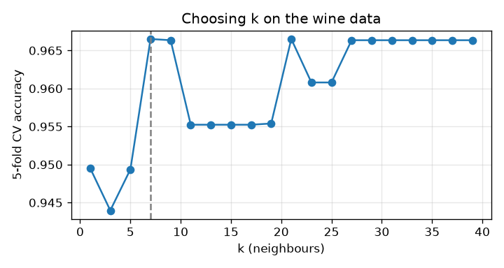
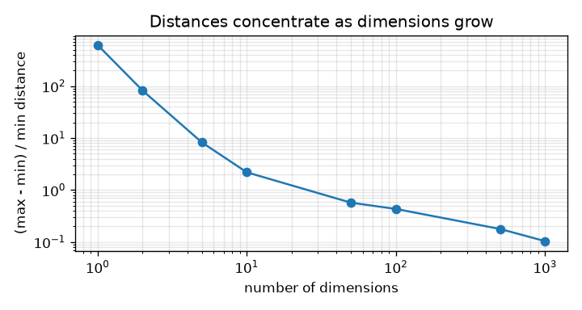
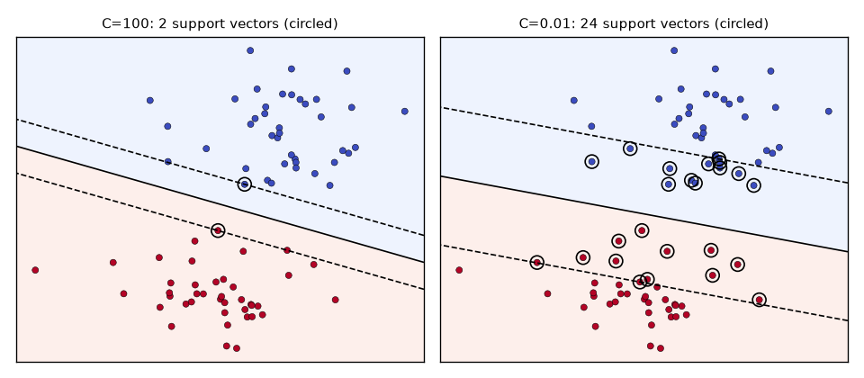
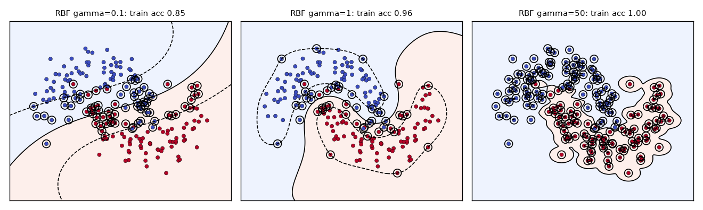
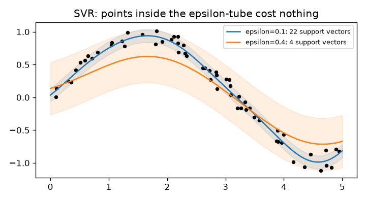
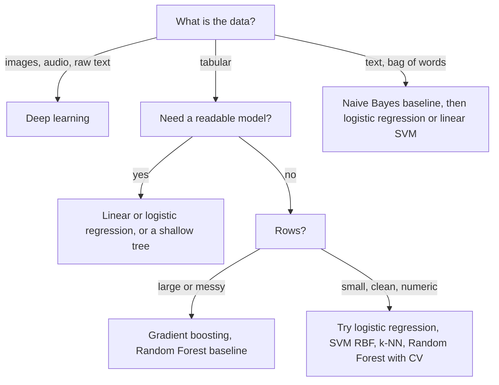

# Chapter 8 — k-Nearest Neighbours, Support Vector Machines, Naive Bayes

Three classic algorithms, three completely different ideas of what "learning" means:

- **k-NN** does not build a model at all — it remembers the training data and answers "what did similar examples look like?"
- **SVM** draws the boundary that stays as far as possible from both classes, and with the **kernel trick** can draw curved boundaries without ever computing curved features.
- **Naive Bayes** counts: it applies Bayes' theorem with a bold simplifying assumption and ends up surprisingly good at text.

The chapter ends with a table comparing **every classic supervised algorithm** in this book, so you know which one to reach for.

**What you'll learn**
1. k-NN: distance metrics, why scaling is mandatory, choosing k, the curse of dimensionality.
2. SVM: margin, support vectors, soft margin and C, kernels (RBF, polynomial) and the kernel trick, SVR for regression.
3. Naive Bayes: Bayes' theorem, Gaussian / Multinomial / Bernoulli variants, a spam filter by hand, the independence assumption.
4. When to use which classic algorithm.

Code lives in `code/`; every output below is real (scikit-learn 1.9).

---

## 8.1 k-Nearest Neighbours (k-NN)

### What it is
To classify a new point, **k-NN** finds the k training points closest to it and takes a **majority vote** of their labels (classification) or the **average** of their targets (regression).

Analogy: to guess the price of a flat, you look up the 5 most similar flats that sold recently and average their prices. That is k-NN with k = 5.

k-NN is a **lazy** (instance-based) learner: "training" just stores the data; all the work happens at prediction time. It is also **non-parametric**: it has no fixed set of weights — the model *is* the dataset.

### Why it matters
- Zero training time, one hyperparameter, no assumptions about the shape of the decision boundary — it can be arbitrarily curved.
- It is the idea behind **similarity search**: "customers like you", "similar products", and the **vector search** used in modern retrieval (e.g. finding the documents closest to a query embedding in RAG systems).
- A classic theory result (Cover & Hart, 1967): with infinite data, the 1-NN error rate is at most twice the best possible (Bayes) error rate. Simple does not mean weak.

### How it works
1. Choose k and a distance metric.
2. Store the training set (optionally in a KD-tree or ball tree for faster search).
3. For a query point x: compute its distance to every training point, keep the k smallest.
4. Classification: majority vote (ties broken by the classifier's rules; odd k avoids ties in binary problems). Regression: mean of the k targets.
5. Optional `weights="distance"`: closer neighbours count more (weight = 1/distance).

### Distance metrics
For a = (1, 2, 3), b = (4, 6, 3) — `code/knn_demo.py`:

| Metric | Formula | Value | Use it for |
|---|---|---|---|
| **Euclidean (L2)** | √Σ(aᵢ − bᵢ)² | √(9 + 16 + 0) = **5.000** | Default, continuous features |
| **Manhattan (L1)** | Σ\|aᵢ − bᵢ\| | 3 + 4 + 0 = **7.000** | Grid-like movement, more robust to one large difference |
| **Chebyshev (L∞)** | maxᵢ \|aᵢ − bᵢ\| | **4.000** | "Worst single feature" matters |
| **Minkowski (Lp)** | (Σ\|aᵢ − bᵢ\|ᵖ)^(1/p) | p=1 → L1, p=2 → L2 | scikit-learn default: `metric="minkowski", p=2` |
| **Cosine distance** | 1 − (a·b)/(‖a‖‖b‖) | 1 − 0.855 = **0.145** | Text/embeddings, where direction matters more than length |
| **Hamming** | fraction of positions that differ | — | Binary or categorical vectors |

### Scaling is mandatory
Distances add up raw feature differences, so a feature measured in large units **drowns out** the others. In the Wine dataset one feature (proline) has a standard deviation of 314 while another has 0.12. Output:

```
wine feature ranges: min std 0.12, max std 314.0 (proline)
k-NN (k=5) CV accuracy  raw features: 0.691   standardized: 0.949
```
Standardising (each feature → mean 0, std 1) lifts accuracy from 69% to 95%. Always put the scaler **inside a pipeline** so it is fitted only on training folds:

```python
make_pipeline(StandardScaler(), KNeighborsClassifier(5))
```

### Choosing k
- **Small k** (k = 1): very flexible, jagged boundary, sensitive to noise → low bias, high variance.
- **Large k**: smooth boundary, can blur real structure → high bias, low variance. With k = n you always predict the majority class.
- Choose k by **cross-validation**; odd k for binary tasks. A common starting guess is k ≈ √n, but always validate.

```python
ks = list(range(1, 41, 2))
scores = [cross_val_score(make_pipeline(StandardScaler(), KNeighborsClassifier(k)), X, y, cv=5).mean()
          for k in ks]
```
```
best k by 5-fold CV = 7 (accuracy 0.967);  k=1: 0.950, k=39: 0.966
```


### The curse of dimensionality
As the number of features d grows, three things go wrong for any distance-based method:

1. **Space empties out.** To capture 10% of uniformly spread data in a unit hypercube, a sub-cube needs edge length 0.1^(1/d): 0.1 in 1-D, but **0.79** in 10-D. Your "local neighbourhood" covers almost the full range of every feature — it is not local any more.
2. **Distances concentrate.** The nearest and farthest points end up almost the same distance away, so "nearest" loses meaning. Measured on 500 random points (`curse_of_dimensionality()`):

```
dim  (farthest - nearest) / nearest distance, 500 uniform points
    1   615.806
    2    82.019
   10     2.190
  100     0.432
 1000     0.104
```
In 1000 dimensions the farthest point is only ~10% farther than the nearest one.



3. **Data needed grows exponentially** to keep the same density.

Remedies: feature selection, dimensionality reduction (PCA — Chapter 9), learned embeddings where the real data lies on a lower-dimensional surface, or a model that does not rely on distances.

### Trade-offs

| Strengths | Weaknesses |
|---|---|
| No training; add new data instantly | Slow, memory-hungry prediction: brute force is O(n·d) per query |
| Any boundary shape; naturally multi-class | Needs scaling and a good metric |
| One intuitive hyperparameter | Suffers badly in high dimensions and with irrelevant features |
| Works for classification and regression | Sensitive to class imbalance (majority floods the vote) |

KD-trees and ball trees speed up exact search in low dimensions; for millions of high-dimensional vectors, production systems use **approximate nearest neighbour** (ANN) indexes such as HNSW graphs or FAISS.

### When not to use it
Large datasets needing fast predictions, many features (> ~20–50 raw features without reduction), lots of irrelevant features, or when you need a compact model or explanations beyond "these examples were similar".

### Common mistakes
- Forgetting to scale (or scaling on the full dataset before the train/test split — leakage).
- Using even k in binary problems (ties).
- Including ID-like or irrelevant columns — they add noise to every distance.
- Using Euclidean distance on one-hot categorical data or text counts where Hamming or cosine fit better.

### Real-world examples
- "Similar items" and "users like you" recommendations (item-based collaborative filtering is a nearest-neighbour method).
- Vector databases and semantic search (approximate k-NN over embeddings) — the retrieval step in RAG.
- Imputation: `KNNImputer` fills a missing value with the average of the nearest rows.

### In the interview
**30-second answer:** "k-NN stores the training set and predicts by majority vote or average of the k closest points under a distance metric. It has no training cost but prediction is O(n·d) without an index. You must scale features, pick k by cross-validation — small k overfits, large k underfits — and it degrades in high dimensions because distances concentrate."

- *Why is k-NN called lazy?* It defers all computation to query time; there is no fitted model.
- *How to speed it up?* KD-tree/ball tree in low dimensions; approximate NN (HNSW, FAISS) at scale; reduce dimensions first.
- *k-NN regression?* Average (or distance-weighted average) of the k neighbours' targets.

### Self-check
1. Euclidean distance between (0, 0) and (3, 4)? → 5.
2. Why must you scale for k-NN but not for trees? → k-NN adds raw feature differences; trees only compare values within one feature.
3. What happens with k = 1 on noisy data? → It memorises the noise (training accuracy 100%, high variance).
4. What does the curse of dimensionality do to nearest neighbours? → Nearest and farthest distances become nearly equal, so neighbours are not meaningfully "near".

### TL;DR
k-NN predicts from the k most similar training examples. Scale features, tune k by CV, and avoid it in high dimensions or when predictions must be fast.

---

## 8.2 Support Vector Machines (SVM)

### What it is
A **Support Vector Machine** is a classifier that finds the separating boundary (a **hyperplane**: a line in 2-D, a plane in 3-D, …) with the **largest margin** — the widest "street" between the two classes. The points that sit on the edge of the street are the **support vectors**; they alone define the boundary.

Analogy: building a road between two villages. You don't just want a road that separates them — you want the widest possible road, so small shifts in where a house stands don't put it on the wrong side.

### Why it matters
- A large margin gives good generalisation, especially with many features and few samples.
- With **kernels**, the same algorithm learns curved boundaries.
- Before deep learning (roughly 1995–2012), SVMs were a top choice for text classification, image recognition and bioinformatics, and they remain a strong baseline for small-to-medium datasets.

### How it works — the margin
A linear classifier predicts with the sign of f(x) = w·x + b. The boundary is where f(x) = 0.

1. Scale w and b so the closest points of each class satisfy f(x) = +1 or −1. These are the support vectors.
2. The distance between the two lines f = +1 and f = −1 is **2/‖w‖**, where ‖w‖ is the length of the weight vector.
3. **Hard-margin SVM**: maximise 2/‖w‖ (equivalently, minimise ½‖w‖²) subject to every point being on the correct side: yᵢ(w·xᵢ + b) ≥ 1 for labels yᵢ ∈ {−1, +1}.
4. This is a **convex** quadratic optimisation problem — it has one global optimum, no local minima.

### Soft margin and C
Real data overlap, and a single outlier can force a terrible narrow margin. The **soft-margin** SVM allows violations with slack variables ξᵢ ≥ 0:

  minimise  ½‖w‖² + **C** · Σ ξᵢ  subject to  yᵢ(w·xᵢ + b) ≥ 1 − ξᵢ

Equivalently, it minimises the **hinge loss** max(0, 1 − yᵢ·f(xᵢ)) plus an L2 penalty on w. Points beyond the margin on the correct side cost nothing; points inside the margin or misclassified cost linearly.

- **Large C** → violations are expensive → narrow margin, fits training data tightly (low bias, higher variance).
- **Small C** → violations are cheap → wide margin, more support vectors, smoother (higher bias, lower variance).

C behaves like the inverse of a regularisation strength (like `C` in logistic regression). From `code/svm_demo.py`:

```python
for C in (100, 0.01):
    m = SVC(kernel="linear", C=C).fit(X, y)
    w = m.coef_[0]
    print(len(m.support_), 2 / np.linalg.norm(w), m.score(X, y))
```
```
linear SVM on 2 blobs
  C=100    support vectors=  2  margin width 2/||w|| = 1.85  train acc=1.000
  C=0.01   support vectors= 24  margin width 2/||w|| = 4.94  train acc=1.000
```


With C = 100 only 2 points define the boundary; with C = 0.01 the street is 2.7× wider and 24 points lean on it.

### Kernels and the kernel trick
Some data can't be split by any straight line (e.g. one class inside a ring of the other). Idea: map each point to a higher-dimensional feature space φ(x) where a flat hyperplane *does* separate them. The ring becomes separable once you add the feature x₁² + x₂².

**Why only dot products appear.** Solving the soft-margin problem with Lagrange multipliers (the so-called **dual form**) gives one weight αᵢ per training point, with 0 ≤ αᵢ ≤ C. The solution is w = Σ αᵢ yᵢ xᵢ, so the prediction becomes

  f(x) = Σᵢ αᵢ yᵢ (xᵢ · x) + b

Most αᵢ come out exactly 0; the points with αᵢ > 0 are the support vectors, which is why only they matter. Notice that the data enter this formula (and the training problem) only through dot products xᵢ · x.

**The kernel trick.** Because the SVM's optimisation and prediction only ever use **dot products** between points, you can swap each xᵢ·xⱼ for a kernel value: f(x) = Σᵢ αᵢ yᵢ K(xᵢ, x) + b. A **kernel** K(x, z) is a function that returns φ(x)·φ(z) **without computing φ**. So you get the power of a huge (even infinite) feature space at the cost of computing K.

Worked check (`kernel_trick_check()`): for 2-D points, the polynomial kernel K(x, z) = (x·z)² equals the dot product in the 3-D space φ(v) = (v₁², √2·v₁v₂, v₂²):

```
(x.z)^2 = 121.0   phi(x).phi(z) = 121.0
```
With x = (1, 2), z = (3, 4): x·z = 11, 11² = 121. Same answer, but the kernel never built the 3-D vectors.

| Kernel | Formula | Hyperparameters | Use |
|---|---|---|---|
| Linear | x·z | C | Many features (text), linearly separable data |
| Polynomial | (γ·x·z + r)ᵈ | C, degree d, γ, r (`coef0`) | Feature interactions of known order |
| **RBF (Gaussian)** | exp(−γ‖x − z‖²) | C, γ | **Default** for non-linear problems |
| Sigmoid | tanh(γ·x·z + r) | C, γ, r | Rarely used |

**RBF intuition:** K is 1 when x = z and decays towards 0 with distance. The prediction is a weighted sum of "bumps" centred on the support vectors. **γ** sets bump width: small γ = wide bumps, smooth boundary; large γ = narrow bumps around each point, wiggly boundary that can memorise the data.

```
5-fold CV accuracy      moons   circles
  linear              0.845   0.555
  poly (degree 3)     0.940   0.995
  RBF                 0.940   1.000
```


γ = 0.1 underfits (nearly linear), γ = 1 follows the moons, γ = 50 draws islands around individual points (100% train accuracy — overfit). Tune **C and γ together** with a grid on a log scale:

```python
grid = GridSearchCV(make_pipeline(StandardScaler(), SVC()),
                    {"svc__C": [0.1, 1, 10, 100], "svc__gamma": [0.01, 0.1, 1, 10]}, cv=5)
```
```
grid search best params {'svc__C': 0.1, 'svc__gamma': 10}  CV acc 0.960
```
(Here a large γ is balanced by a small C — the two knobs interact, which is why you search them jointly.)

### SVR — Support Vector Regression
SVR flips the idea: fit a function with a tube of half-width **ε** around it. Points **inside the tube cost nothing** (ε-insensitive loss); only points outside are penalised (weighted by C) and become support vectors.

```
SVR epsilon=0.1: 22 of 60 points are support vectors
SVR epsilon=0.4: 4 of 60 points are support vectors
```


A wider tube ignores more noise and uses fewer support vectors, but here ε = 0.4 is too loose and flattens the curve.

### Practical notes
- **Always scale** features: RBF and polynomial kernels use distances/dot products.
- Training `SVC` scales at least quadratically with the number of samples (scikit-learn docs note it becomes impractical beyond tens of thousands of samples). For large, linear problems use `LinearSVC` or `SGDClassifier(loss="hinge")`; for large non-linear ones consider kernel approximation (`Nystroem`, `RBFSampler`) + a linear model.
- SVMs output **scores** (signed distances from the boundary), not probabilities. To get probabilities, wrap the model in `CalibratedClassifierCV(SVC(), ensemble=False)`, which fits Platt scaling (`method="sigmoid"`, the default) on cross-validated scores. The older `SVC(probability=True)` did the same internally but is deprecated since scikit-learn 1.9 (removal planned for 1.11). From `svm_probabilities()` in `code/svm_demo.py`:
  ```python
  svc = make_pipeline(StandardScaler(), SVC())
  cal = CalibratedClassifierCV(svc, method="sigmoid", ensemble=False).fit(X_tr, y_tr)
  cal.predict_proba(X_te[:3])[:, 1]
  ```
  Output:
  ```
  scores  [-1.33  1.12  1.48]
  P(y=1)  [0.04 0.92 0.96]
  calibrated SVC test accuracy 0.900
  ```
  Negative scores map to low probabilities and positive ones to high; calibration is covered in [§6.5](../06-evaluation-and-tuning/README.md).
- Multi-class: `SVC` uses one-vs-one internally; `LinearSVC` uses one-vs-rest.
- Imbalanced classes: `class_weight="balanced"`.

### Trade-offs

| Strengths | Weaknesses |
|---|---|
| Maximum margin → good generalisation, strong with many features / few samples | Slow on large n (≥ ~100k) |
| Convex: unique optimum, no random restarts | Needs scaling and careful C/γ tuning |
| Kernels give flexible boundaries | No native probabilities; hard to interpret with kernels |
| Only support vectors matter → compact | Struggles with heavy noise and overlapping classes |

### When not to use it
Very large datasets, when calibrated probabilities or explanations are required, raw images/audio/text sequences (deep learning), and messy tabular data with mixed types (gradient boosting).

### Common mistakes
- Not scaling → one feature dominates the kernel.
- Tuning C and γ separately instead of jointly.
- Using RBF on high-dimensional sparse text, where a linear kernel is faster and usually as good.
- Treating `decision_function` values as probabilities.

### Real-world examples
- Text categorisation: linear SVMs were a leading method for document and spam classification (Joachims, 1998).
- Bioinformatics: protein and gene-expression classification with specialised kernels (string kernels).
- Face detection and handwriting recognition pipelines in the 2000s (often on HOG or pixel features).

### In the interview
**30-second answer:** "An SVM finds the hyperplane with the largest margin between classes; only the support vectors — points on or inside the margin — determine it. The soft-margin version uses C to trade margin width against violations: large C fits tightly, small C regularises. Kernels like RBF implicitly map data into a higher-dimensional space through the kernel trick, since the algorithm only needs dot products. Scale features and tune C and γ together."

- *What is the kernel trick?* Replacing dot products φ(x)·φ(z) with K(x, z), computed directly in the original space, so you never build the high-dimensional features.
- *What does γ do in RBF?* Controls the reach of each support vector: high γ → very local, wiggly boundary (overfit); low γ → smooth (underfit).
- *SVM vs logistic regression?* Both linear classifiers with L2 penalties; SVM uses hinge loss (ignores well-classified points, max margin), LR uses log-loss (every point matters, gives probabilities).

### Self-check
1. Margin width formula? → 2/‖w‖.
2. Effect of increasing C? → Fewer margin violations allowed → narrower margin, risk of overfitting.
3. Why only support vectors matter? → Other points have zero hinge loss and don't appear in the solution's weights.
4. In SVR, what happens to a point inside the ε-tube? → Zero loss; it's not a support vector.

### TL;DR
SVM = widest-street classifier; C trades width for errors; kernels (RBF by default) bend the street via the kernel trick. Scale, tune C and γ jointly, avoid for huge datasets.

---

## 8.3 Naive Bayes

### What it is
**Naive Bayes** is a family of probabilistic classifiers that apply **Bayes' theorem** with the "naive" assumption that **features are independent of each other given the class**.

### Bayes' theorem
  **P(class | data) = P(data | class) · P(class) / P(data)**

| Term | Name | Meaning |
|---|---|---|
| P(class) | Prior | How common the class is before seeing the data |
| P(data \| class) | Likelihood | How typical the data is for that class |
| P(data) | Evidence | Same for every class — just normalises |
| P(class \| data) | Posterior | What we want |

Worked example (`bayes_theorem()`): a disease affects 1% of people; the test catches 90% of cases and gives a false positive 5% of the time. You test positive — are you sick?

P(positive) = 0.90·0.01 + 0.05·0.99 = 0.0585, so P(sick | positive) = 0.009 / 0.0585 = **0.154**.

```
P(disease | positive) = 0.0090 / 0.0585 = 0.154
```
Only 15%! The low prior dominates. This "base-rate" effect matters in fraud and medical ML too.

### The naive assumption
For features x₁…x_d, the exact likelihood P(x₁, …, x_d | class) needs a probability for every combination of feature values — impossible to estimate. Assuming independence given the class:

  P(x₁, …, x_d | c) ≈ P(x₁ | c) · P(x₂ | c) · … · P(x_d | c)

So the classifier is:  **ŷ = argmax_c  P(c) · Π P(xᵢ | c)**

In practice you **sum logs** instead of multiplying: log P(c) + Σ log P(xᵢ | c). Multiplying hundreds of small probabilities underflows to 0 in floating point.

**Gaussian NB, worked.** For a continuous feature, `GaussianNB` models P(xᵢ | c) with the normal density N(x; μ_c, σ_c²) = exp(−(x − μ_c)²/(2σ_c²)) / √(2πσ_c²), using the class's own mean and variance. Suppose petal length has μ = 1.5, σ = 0.2 for class A and μ = 4.5, σ = 0.5 for class B, with equal priors. For a flower with length 2.0:
- class A: z = (2.0 − 1.5)/0.2 = 2.5 → density = e^(−3.125)/(0.2·√(2π)) ≈ 0.0439/0.501 ≈ 0.088
- class B: z = (2.0 − 4.5)/0.5 = −5 → density = e^(−12.5)/(0.5·√(2π)) ≈ 3.7×10⁻⁶/1.253 ≈ 3.0×10⁻⁶
Class A wins overwhelmingly. With several features, you multiply (add the logs of) one such density per feature.

The assumption is almost always false ("free" and "cash" co-occur in spam), yet NB classifies well because it only needs the *ranking* of classes to be right, not the probabilities. The side effect: its probabilities are often **over-confident** — calibrate them if you need real probabilities.

### The three main variants

| Variant | Feature type | P(xᵢ \| c) modelled as | Typical use |
|---|---|---|---|
| `GaussianNB` | Continuous | Normal distribution with per-class mean and variance | Sensor readings, quick baseline on numeric data |
| `MultinomialNB` | Counts (word counts, TF-IDF also works in practice) | Word frequency within the class | Text classification, topic labelling |
| `BernoulliNB` | Binary (present / absent) | Probability the feature is present | Short texts, binary flags; it also penalises *absent* words |
| (`ComplementNB`) | Counts | Statistics from all *other* classes | Imbalanced text classes — often beats Multinomial |
| (`CategoricalNB`) | Categories | Per-category frequency | Categorical tabular data |

### Worked example — a spam filter by hand
Training data (6 messages):

| Spam | Ham |
|---|---|
| win cash now | meeting at noon |
| win free prize now | lunch meeting tomorrow |
| free cash offer | project update at noon |

Vocabulary: 13 distinct words. Each class has 10 words in total. New message: **"free cash for the meeting"**.

1. **Priors**: P(spam) = P(ham) = 3/6 = 0.5.
2. **Likelihoods with Laplace (add-one) smoothing**: P(word | c) = (count of word in c + 1) / (total words in c + vocabulary size). Without smoothing, one unseen word gives probability 0 and wipes out the whole product.
   - Spam: free (2+1)/23, cash (2+1)/23, meeting (0+1)/23
   - Ham: free (0+1)/23, cash (0+1)/23, meeting (2+1)/23
   - "for" and "the" never appeared in training → ignored (same as scikit-learn's vectoriser).
3. **Scores**: spam ∝ 0.5 · 3·3·1 / 23³, ham ∝ 0.5 · 1·1·3 / 23³ → ratio 9 : 3.
4. **Normalise**: P(spam | message) = 9 / 12 = **0.75**.

`code/naive_bayes_demo.py` computes it by hand and with scikit-learn:

```python
vec = CountVectorizer()
X = vec.fit_transform(texts)
nb = MultinomialNB(alpha=1.0).fit(X, labels)       # alpha = Laplace smoothing
proba = nb.predict_proba(vec.transform([message]))[0]
```
```
vocabulary size = 13
by hand : P(spam|'free cash for the meeting') = 0.750, P(ham) = 0.250
sklearn : P(spam|'free cash for the meeting') = 0.750, P(ham) = 0.250
```
And on numeric data:
```
GaussianNB on iris, 5-fold CV accuracy = 0.953
BernoulliNB on binarised iris          = 0.753
```
Picking the variant that matches the feature type matters: throwing away detail by binarising costs 20 points.

### Trade-offs

| Strengths | Weaknesses |
|---|---|
| Extremely fast: one pass of counting; trains on millions of documents | Independence assumption → poor probability estimates |
| Works with very little data and very many features | Can't learn feature interactions ("not good") |
| Naturally multi-class, easy to update incrementally (`partial_fit`) | Usually beaten by logistic regression / linear SVM with enough data |
| Robust to irrelevant features | Gaussian variant assumes bell-shaped features |

### When not to use it
When features are strongly dependent and you have enough data for a discriminative model, when you need calibrated probabilities, or when interactions matter.

### Common mistakes
- Forgetting smoothing (`alpha=0` → zero probabilities).
- Multiplying raw probabilities instead of adding logs (underflow).
- Feeding negative values to `MultinomialNB` (counts must be ≥ 0; standardised features break it).
- Trusting `predict_proba` values as real probabilities.

### Real-world examples
- Email spam filtering: Paul Graham's 2002 essay *A Plan for Spam* popularised Bayesian filtering, and SpamAssassin includes a Bayesian classifier component.
- Quick baselines for sentiment analysis, news topic tagging, support-ticket routing, and language detection.

### In the interview
**30-second answer:** "Naive Bayes applies Bayes' theorem — posterior ∝ prior × likelihood — and assumes features are independent given the class, so the likelihood is a product of per-feature probabilities. Multinomial NB for word counts, Bernoulli for binary features, Gaussian for continuous. Use Laplace smoothing and log probabilities. It's fast and strong on text with little data, but its probabilities are over-confident."

- *Why does it work if the assumption is wrong?* Classification only needs the argmax to be correct; errors in the probabilities often cancel or don't change the ranking.
- *What is Laplace smoothing?* Add α (usually 1) to every count so unseen words don't produce zero probability.
- *Generative vs discriminative?* NB is generative — it models P(x | y) and P(y). Logistic regression is discriminative — it models P(y | x) directly. NB learns faster from little data; LR usually wins with more.

### Self-check
1. Prior 1%, sensitivity 90%, false-positive rate 5%: P(disease | +)? → ≈ 0.15.
2. Which NB for word counts? → `MultinomialNB`.
3. Why add logs? → Products of many small numbers underflow to zero.
4. A word appears 0 times in spam; α = 1, spam has 10 words, vocabulary 13. P(word | spam)? → 1/23.

### TL;DR
Naive Bayes = Bayes' theorem + "features independent given class". Counting-fast, great text baseline; smooth, use logs, don't trust its probabilities.

---

## 8.4 Choosing a classic supervised algorithm

We ran every classic classifier in the book on four datasets with default settings (`code/compare_classifiers.py`, 5-fold CV accuracy):

```
model                     breast_cancer               wine             digits  moons (nonlinear)
LogisticRegression                0.981              0.983              0.920              0.844
k-NN (k=5)                        0.965              0.949              0.944              0.886
SVM (RBF)                         0.974              0.983              0.946              0.898
GaussianNB                        0.939              0.966              0.807              0.840
DecisionTree                      0.917              0.888              0.786              0.850
RandomForest                      0.963              0.983              0.938              0.876
HistGradBoosting                  0.965              0.955              0.935              0.872
```
Observations: no single winner (the "no free lunch" idea in practice). Logistic regression wins on the nearly linear breast-cancer data; the RBF SVM wins on the curved moons and on digits; a single decision tree is last almost everywhere; ensembles are consistently near the top. On small clean datasets like these, the differences are a few points — on large, messy tabular data, gradient boosting usually pulls ahead.

### The comparison table

| Algorithm | Type | Scale features? | Interpretable? | Training speed | Prediction speed | Non-linear? | Best for | Avoid when |
|---|---|---|---|---|---|---|---|---|
| **Linear regression** | Regression | Yes (if regularised) | High (coefficients) | Very fast | Very fast | No (unless you add features) | Baselines, linear relationships, explaining effects | Strong non-linearity, outliers (use robust loss) |
| **Logistic regression** | Classification | Yes | High | Very fast | Very fast | No | Baseline classifier, calibrated probabilities, high-dim sparse text | Complex interactions without feature engineering |
| **k-NN** | Both | **Yes** | Medium (show neighbours) | None | **Slow** (O(n·d)) | Yes | Small low-dimensional data, similarity search, recommendations | Many features, big data, real-time latency |
| **SVM (RBF)** | Both (SVC/SVR) | **Yes** | Low | Slow for large n | Medium (∝ support vectors) | Yes (kernels) | Small/medium data, many features, clear margins | > ~100k rows, need probabilities |
| **Linear SVM** | Classification | Yes | High | Very fast | Very fast | No | Text classification at scale | Non-linear problems |
| **Naive Bayes** | Classification | No | Medium | **Fastest** | Very fast | No (per-feature only) | Text, tiny data, streaming, baseline | Dependent features, need probabilities |
| **Decision tree** | Both | No | **High** (rules) | Fast | Very fast | Yes | Explainable rules, quick look at data | Accuracy matters (high variance) |
| **Random Forest** | Both | No | Low–medium (importances) | Medium (parallel) | Medium | Yes | Strong default, little tuning, robust | Tight latency/memory, extrapolation |
| **Gradient boosting** | Both | No | Low–medium (SHAP) | Medium (sequential) | Fast | Yes | **Best accuracy on tabular data** | Unstructured data, tiny data, no time to tune |
| **Neural network (MLP)** | Both | **Yes** | Low | Slow | Fast | Yes | Huge data, images/text/audio (with CNNs, Transformers) | Small tabular data |

### A decision flow



**Practical rule:** always start with a simple baseline (logistic/linear regression or Naive Bayes for text), then try a Random Forest and a gradient-boosting model, and compare with cross-validation.

---

## Chapter TL;DR
- **k-NN**: predict from the k closest examples. Scale features, choose k by CV, prefer cosine for text/embeddings. Lazy: free training, slow prediction. Breaks down in high dimensions (distances concentrate).
- **SVM**: maximise the margin 2/‖w‖; support vectors define it. C = strictness (large C → tight fit). Kernel trick = dot products in a hidden feature space; RBF default, γ = reach of each point. Scale; tune C and γ together; SVR uses an ε-tube. Slow beyond tens of thousands of rows.
- **Naive Bayes**: posterior ∝ prior × product of per-feature likelihoods. Multinomial (counts), Bernoulli (binary), Gaussian (continuous). Laplace smoothing + log probabilities. Fast and good for text; probabilities over-confident.
- **Choosing**: no universal winner — baseline first, compare with CV; gradient boosting for tabular, deep learning for unstructured data.
