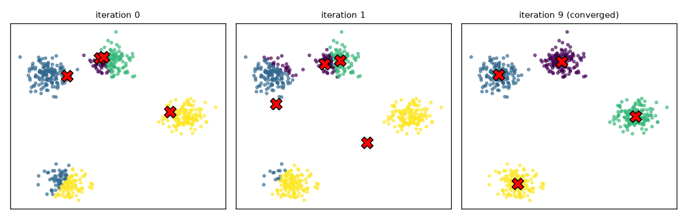
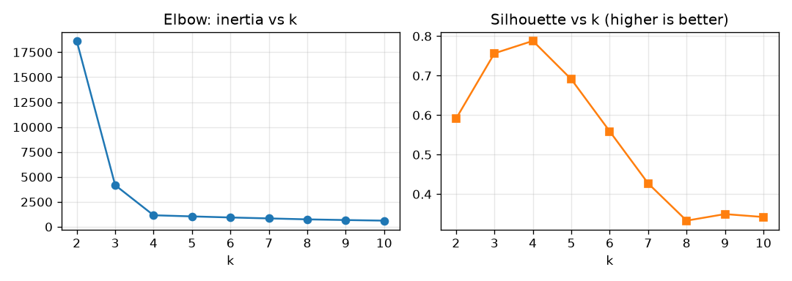
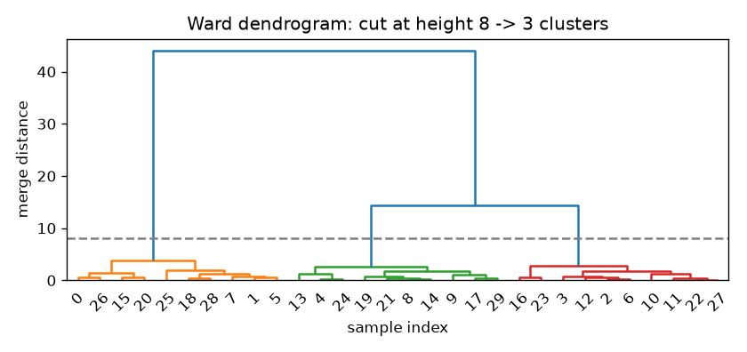
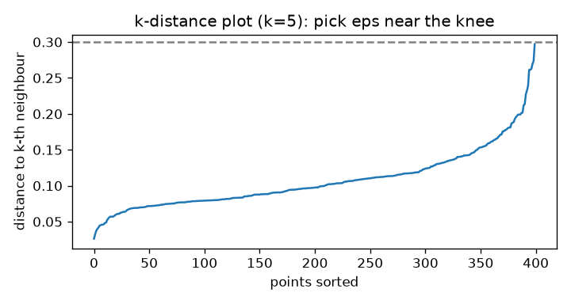
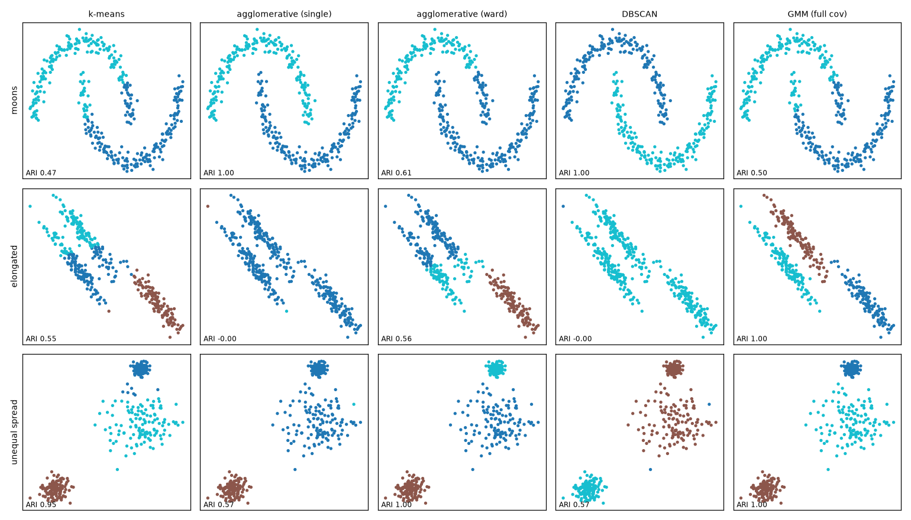
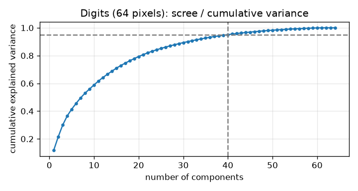
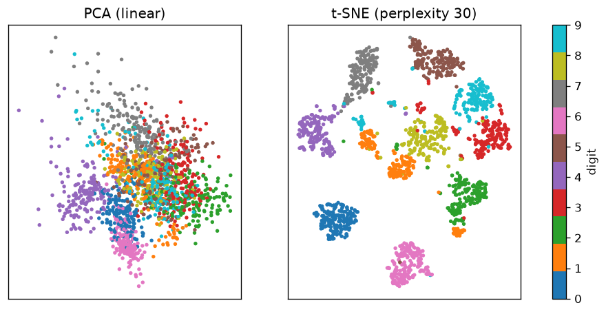
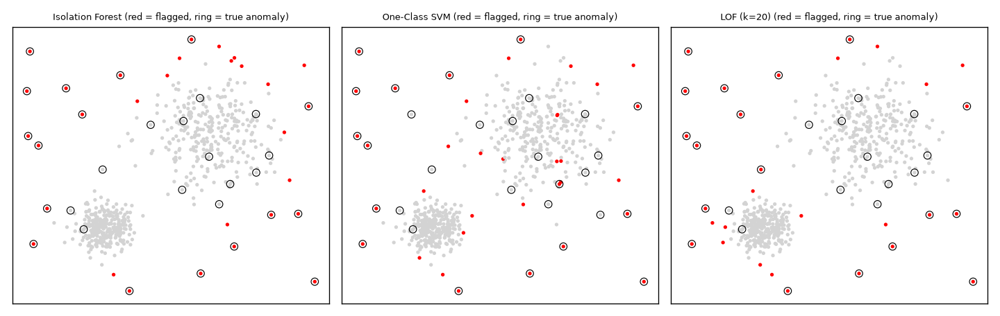

# Chapter 9 — Unsupervised Learning

In supervised learning every example came with an answer (a label). **Unsupervised learning** works with **no labels**: the goal is to find structure in the data itself. The four big jobs:

| Job | Question it answers | Main algorithms |
|---|---|---|
| **Clustering** | Which examples belong together? | k-means, hierarchical, DBSCAN, Gaussian mixtures |
| **Dimensionality reduction** | Can I describe the data with fewer numbers, or see it in 2-D? | PCA, t-SNE, UMAP |
| **Anomaly detection** | Which examples don't fit? | z-score, Isolation Forest, One-Class SVM, LOF |
| **Association rules** | Which items occur together? | Apriori, FP-Growth |

Don't worry about the algorithm names yet; each one is explained in its own section below.

The hard part is always **evaluation**: without labels, what does "good" mean? We finish with that.

**What you'll learn**
1. k-means step by step, k-means++, choosing k with the elbow and silhouette, and where k-means fails.
2. Hierarchical (agglomerative) clustering and dendrograms; DBSCAN; Gaussian mixture models and the EM idea.
3. PCA with the maths made concrete; t-SNE and UMAP and when to use which.
4. Anomaly detection from simple statistics to Isolation Forest, One-Class SVM and LOF.
5. Association rules with Apriori.
6. How to evaluate unsupervised models.

All code is in `code/`, all figures in `img/`; outputs are real (scikit-learn 1.9, SciPy 1.18).

---

## 9.1 k-means clustering

### What it is
**k-means** splits the data into k groups (**clusters**) so that each point belongs to the cluster with the nearest **centroid** (the cluster's mean point). You choose k.

Analogy: placing k pizza shops in a town so every household walks to its nearest shop and total walking is as small as possible. Then you move each shop to the middle of its customers, reassign customers, and repeat.

### Why it matters
It is simple, fast (roughly O(n·k·d) per iteration: time grows with points × clusters × features), scales to millions of points, and is the default first clustering method: customer segmentation (splitting customers into groups that behave alike), grouping documents, compressing colours in an image (colour quantisation), building "visual words" or codebooks (a fixed list of representative patterns), and initialising other models.

### How it works (Lloyd's algorithm)
k-means minimises the **inertia** (within-cluster sum of squares, WCSS): the sum of squared distances from each point to its centroid.

1. **Initialise** k centroids (randomly chosen points, or k-means++ — below).
2. **Assign** each point to its nearest centroid.
3. **Update** each centroid to the mean of its assigned points.
4. **Repeat** 2–3 until assignments stop changing.

Each step can only lower (or keep) the inertia, so it always converges — but to a **local** minimum (a solution no small change can improve, though a better one may exist elsewhere) that depends on the starting centroids.

**Worked example (1-D).** Points 1, 2, 3, 10, 11, 12; k = 2; start with centroids 1 and 2.
- Assign: {1} → c₁; {2, 3, 10, 11, 12} → c₂. Update: c₁ = 1, c₂ = (2+3+10+11+12)/5 = 7.6.
- Assign: 3 is 2 from c₁ and 4.6 from c₂ → {1, 2, 3} and {10, 11, 12}. Update: c₁ = 2, c₂ = 11.
- Assign again: nothing changes → converged. Inertia = (1² + 0 + 1²) + (1² + 0 + 1²) = **4**.

From scratch in NumPy (`code/kmeans_demo.py`):

```python
def kmeans_scratch(X, k, rng, max_iter=100):
    centroids = X[rng.choice(len(X), k, replace=False)]          # 1. random init
    for it in range(max_iter):
        d = np.linalg.norm(X[:, None, :] - centroids[None, :, :], axis=2)
        labels = d.argmin(axis=1)                                 # 2. assign to nearest centroid
        new = np.array([X[labels == j].mean(axis=0) for j in range(k)])  # 3. move centroids to means
        if np.allclose(new, centroids):                           # 4. stop when nothing moves
            break
        centroids = new
    inertia = ((X - centroids[labels]) ** 2).sum()
    return labels, centroids, inertia
```
```
from scratch: converged in 9 iterations, inertia = 1160
sklearn     : inertia = 1160
```


In this run, two starting centroids fell into the same blob and the bottom blob had none; the algorithm still recovered in 9 iterations. It is not always that lucky.

### k-means++ initialisation
Bad starts give bad local minima. **k-means++** (Arthur & Vassilvitskii, 2007) spreads the initial centroids out:

1. Pick the first centroid uniformly at random from the data.
2. For each point, compute D(x) = distance to the nearest centroid chosen so far.
3. Pick the next centroid at random with probability **proportional to D(x)²** — far points are much more likely.
4. Repeat until k centroids; then run normal k-means.

It comes with a guarantee: the expected result is within O(log k) (a factor that grows only with the logarithm of k) of the optimal inertia. On 8 well-separated blobs, with a single run per seed (the starting number of the random generator):

```
init          inertia over 20 single-run seeds, 8 true clusters (min / mean / max)
random            1673 /     9002 /    32908
k-means++          704 /      704 /      704
```
Random init never found the right answer in 20 tries; k-means++ found it every time. scikit-learn uses `init="k-means++"` by default, and `n_init` restarts keep the best run.

### Choosing k: elbow and silhouette
**Elbow method:** plot inertia against k. Inertia always falls as k grows (k = n gives 0), so look for the "elbow" where adding a cluster stops helping much.

**Silhouette score:** for each point,
- a = mean distance to the other points in its own cluster (cohesion),
- b = mean distance to the points of the **nearest other** cluster (separation),
- s = (b − a) / max(a, b), between −1 and 1.

s ≈ 1: well inside its cluster; s ≈ 0: on a border; s < 0: probably in the wrong cluster. The **silhouette score** is the average over all points. In the 1-D example, point 3 has a = (2 + 1)/2 = 1.5, b = (7 + 8 + 9)/3 = 8, so s = (8 − 1.5)/8 = 0.81.

On 4 true blobs:
```
 k   inertia   silhouette
 2     18638   0.591
 3      4179   0.757
 4      1160   0.788
 5      1046   0.691
 6       938   0.559
```


Both point to k = 4: the inertia curve bends sharply there and the silhouette peaks. On real data the elbow is often vague — then prefer silhouette, domain knowledge (e.g. "marketing can handle 5 segments"), and stability across runs.

### Limits of k-means
k-means implicitly assumes clusters are **round (spherical), similar in size and spread, and separated by straight-line boundaries** (each point goes to the nearest mean). It fails on:
- **Non-convex shapes** (moons, rings) — see the comparison in §9.4.
- **Elongated or differently-spread clusters** — a big diffuse cluster gets cut up.
- **Outliers** — they drag the means.
- **Unscaled features** — distance-based, so always standardise (rescale each feature to mean 0, standard deviation 1).
- **Categorical data** — means are meaningless (use k-modes or k-prototypes, k-means variants that handle categories).
- You must choose k.

### Common mistakes
- Not scaling features.
- Trusting one run with random init.
- Using the elbow on data that has no clusters — k-means will always return k groups, even from uniform noise.

### In the interview
**30-second answer:** "k-means picks k centroids, assigns each point to the nearest, moves each centroid to the mean of its points, and repeats until nothing changes. It minimises within-cluster squared distance and converges to a local minimum, so we use k-means++ initialisation and multiple restarts. We choose k with the elbow or silhouette score. It assumes round, similar-sized clusters and needs scaled features."

- *Why k-means++?* It spreads initial centroids (probability ∝ squared distance), giving faster convergence and better, more consistent results.
- *Complexity?* O(n·k·d) per iteration; Mini-Batch k-means (updates centroids from small random batches of points) for very large data.
- *Does k-means always converge?* Yes (inertia never increases and there are finitely many assignments), but only to a local optimum.

### Self-check
1. What does k-means minimise? → Sum of squared distances from points to their cluster centroid (inertia).
2. Why does inertia always drop as k grows? → More centroids can only sit closer to points; k = n gives 0.
3. Silhouette with a = 2, b = 6? → (6 − 2)/6 = 0.67.
4. Name two shapes k-means handles badly. → Moons/rings (non-convex) and elongated clusters.

### TL;DR
k-means = assign to nearest mean, move means, repeat. Scale data, use k-means++ with restarts, pick k with silhouette/elbow, and remember it assumes round clusters.

---

## 9.2 Hierarchical (agglomerative) clustering

### What it is
**Agglomerative clustering** builds a hierarchy bottom-up: start with every point as its own cluster, then repeatedly **merge the two closest clusters** until one remains. The full merge history is drawn as a **dendrogram** — a tree whose vertical axis shows the distance at which clusters merged. Cut the tree at a height to get clusters.

### How it works
1. Compute pairwise distances; each point is a cluster.
2. Merge the two clusters with the smallest **linkage** distance.
3. Update distances between the new cluster and the rest; repeat until one cluster.
4. Choose clusters by cutting the dendrogram at a height (or asking for n clusters).

| Linkage | Distance between clusters A and B | Behaviour |
|---|---|---|
| **Single** | Closest pair of points | Follows chains — finds snakes and moons, but a thin bridge of noise merges clusters ("chaining") |
| **Complete** | Farthest pair of points | Compact clusters of similar diameter |
| **Average** | Mean of all pairwise distances | Compromise |
| **Ward** (default in scikit-learn) | Increase in total within-cluster variance (spread) caused by the merge | Similar to k-means: round, balanced clusters |

```python
Z = linkage(X, method="ward")          # SciPy: the full merge history
dendrogram(Z, color_threshold=8)
```
```
last 3 merge heights: [ 3.74 14.37 44.1 ]  (big jump before the final merges = natural cut)
```


Merges below height ~4 are within groups; the jump to 14.37 and 44.1 shows those merges join genuinely different groups. Cutting in the big gap (e.g. at 8) gives 3 clusters.

### Trade-offs
| Strengths | Weaknesses |
|---|---|
| No need to fix k in advance — one tree, any number of clusters | O(n²) memory (grows with the square of the number of points) for the distance matrix; slow beyond ~10–20k points |
| Dendrogram is an interpretable picture of nested structure | Merges are greedy (each is the best choice at that moment) and never undone |
| Any distance metric; linkage choice adapts to shapes | Sensitive to noise (single) or biased to round shapes (Ward) |

### Real-world examples
Phylogenetic trees (evolutionary family trees of species) in biology, gene-expression heatmaps (clustered rows/columns), organising documents or products into taxonomies (category hierarchies).

### In the interview
**30-second answer:** "Agglomerative clustering starts with each point alone and repeatedly merges the closest pair of clusters, where 'closest' is defined by the linkage — single, complete, average or Ward. The dendrogram records the merges; cutting it at a height gives the clusters. It's great for small data and nested structure, but it's O(n²) in memory."

- *Which linkage for moon-shaped clusters?* Single linkage (it chains), as long as there's little noise between them.

### Self-check
1. What does the height of a dendrogram merge mean? → The linkage distance at which the two clusters were joined.
2. Which linkage behaves most like k-means? → Ward.

### TL;DR
Merge closest clusters bottom-up; read the dendrogram; cut at a big gap. Linkage decides the cluster shapes. Small data only.

---

## 9.3 DBSCAN — density-based clustering

### What it is
**DBSCAN** (Density-Based Spatial Clustering of Applications with Noise, Ester et al. 1996) defines clusters as **dense regions separated by sparse regions**. It finds clusters of any shape, figures out how many there are, and labels isolated points as **noise** (label −1).

Analogy: people at a festival. Crowds are clusters — however oddly shaped — and the lone wanderers between them are noise.

### How it works
Two parameters: **eps** (neighbourhood radius) and **min_samples** (points needed to be "dense"; in scikit-learn this count includes the point itself).

1. A **core point** has at least `min_samples` points within distance eps.
2. A **border point** is within eps of a core point but is not core itself.
3. A **noise point** is neither.
4. Start at an unvisited core point; its cluster is everything **density-reachable** from it (chains of core points each within eps of the next, plus their border points). Repeat for unvisited core points.

### Choosing eps: the k-distance plot
Compute each point's distance to its k-th nearest neighbour (k = min_samples), sort, plot. The "knee" where the curve shoots up separates points inside dense regions from outliers; pick eps near it.



```
DBSCAN on moons (min_samples=5)
  eps=0.1  clusters=28  noise points=84
  eps=0.2  clusters=2  noise points=1
  eps=0.3  clusters=2  noise points=0
  eps=0.5  clusters=2  noise points=0
  eps=1.0  clusters=1  noise points=0
```
Too small an eps shatters the data into 28 fragments plus noise; too large merges everything into one cluster. A rule of thumb for min_samples is about 2 × number of features (at least 3–5), larger for noisy data.

### Trade-offs
| Strengths | Weaknesses |
|---|---|
| Any cluster shape; no k needed | One global density: fails when clusters have **different densities** |
| Built-in noise/outlier detection | Sensitive to eps; eps hard to choose in high dimensions |
| Deterministic (same result every run) for core points | Distance-based: needs scaling, suffers from curse of dimensionality (distances lose meaning with many features; Chapter 8) |

**HDBSCAN** (available as `sklearn.cluster.HDBSCAN` since 1.3) extends the idea to varying densities and removes eps, needing mainly `min_cluster_size` — often the better modern choice. **OPTICS** is a related alternative.

### Real-world examples
Clustering GPS points into places of interest, grouping geospatial events (crime, taxi pickups), spotting outliers in sensor data.

### In the interview
**30-second answer:** "DBSCAN groups points in dense regions: a core point has at least min_samples neighbours within eps; clusters are chains of core points plus their border points; everything else is noise. It finds arbitrary shapes and the number of clusters automatically, but struggles with clusters of different densities — HDBSCAN addresses that."

### Self-check
1. What label does DBSCAN give noise? → −1.
2. Increasing eps a lot does what? → Merges clusters, eventually into one.
3. Why might DBSCAN fail with a tight cluster next to a diffuse one? → A single eps can't fit both densities.

### TL;DR
DBSCAN = clusters are dense regions; noise is labelled. Choose eps from a k-distance plot; use HDBSCAN for mixed densities.

---

## 9.4 Gaussian mixture models (GMM) and EM

### What it is
A **Gaussian mixture model** assumes the data was generated by k Gaussian (bell-shaped) distributions, each with its own **mean** (centre), **covariance** (shape and orientation — can be stretched and tilted ellipses) and **weight** (share of the data). Clustering = figuring out which Gaussian probably produced each point.

Unlike k-means' hard assignment, GMM gives **soft assignments**: "this point is 43% cluster A, 35% cluster C, 21% cluster B".

### How it works — Expectation-Maximisation (EM), intuitively
We don't know the Gaussians' parameters, and we don't know which Gaussian each point came from. If we knew one, the other would be easy. EM alternates:

1. **Initialise** means, covariances and weights (scikit-learn uses k-means by default).
2. **E-step (Expectation):** for every point, compute its **responsibility** under each Gaussian — the probability it came from that component, given current parameters (Bayes' rule: weight × density, normalised).
3. **M-step (Maximisation):** re-estimate each Gaussian using all points **weighted by responsibility**: weighted mean, weighted covariance, and weight = average responsibility.
4. Repeat until the log-likelihood (the log of how probable the data is under the current model) stops improving.

EM never decreases the likelihood, but like k-means it finds a local optimum (use `n_init` > 1). In fact, k-means is a limiting case of GMM with hard assignments and identical round (spherical) covariances.

### Choosing k: BIC
GMMs are probabilistic models, so you can use the **Bayesian Information Criterion** (BIC) — likelihood penalised by the number of parameters; **lower is better**. (`gmm.bic(X)`, also `aic`, the Akaike Information Criterion, a similar score with a lighter penalty.)

```
GMM model selection by BIC (lower is better)
  k=1  BIC=  4797.3
  k=2  BIC=  4514.9
  k=3  BIC=  4513.3
  k=4  BIC=  4550.7
soft assignments: 103 of 500 points have max membership < 0.9, e.g. [0.43 0.21 0.35]
EM converged in 4 iterations; mixing weights [0.33 0.4  0.27]
```
BIC picks k = 3 (the truth), but only narrowly over k = 2 because two of the three generated blobs overlap — and ~20% of points are genuinely ambiguous, which the soft assignments reveal honestly.

`covariance_type` controls flexibility: `"full"` (any ellipse per component), `"tied"` (all share one), `"diag"` (axis-aligned ellipses), `"spherical"` (circles, like k-means).

### Comparing all four clusterers
`code/clustering_shapes.py` runs each method on three awkward datasets and scores against the true grouping with the **Adjusted Rand Index** (ARI: 1 = perfect agreement, ≈ 0 = random):

```
Adjusted Rand Index                moons       elongated  unequal spread
k-means                             0.47            0.55            0.95
agglomerative (single)              1.00           -0.00            0.57
agglomerative (ward)                0.61            0.56            1.00
DBSCAN                              1.00           -0.00            0.57
GMM (full cov)                      0.50            1.00            1.00
```


- **Moons** (non-convex: shapes with dents, where a straight line between two points of a cluster can leave the cluster): only density/chaining methods (DBSCAN, single linkage) succeed.
- **Elongated** clusters close together: only GMM with full covariance models the stretched ellipses; DBSCAN and single linkage merge everything through the dense bridge.
- **Unequal spread**: GMM and Ward are perfect; DBSCAN's one eps can't fit both the tight and diffuse clusters.

No algorithm wins everywhere — pick based on the shapes you expect, and look at the result.

### When to use which clustering algorithm

| Algorithm | Needs k? | Cluster shapes | Noise handling | Scales to | Pick it when |
|---|---|---|---|---|---|
| k-means | Yes | Round, similar size | None (outliers distort) | Millions (Mini-Batch) | Fast default, compact clusters |
| Agglomerative | Yes or cut height | Depends on linkage | Poor | ~10k | Small data, want a hierarchy |
| DBSCAN / HDBSCAN | No | Any | Labels noise | ~100k+ (with index) | Odd shapes, outliers, unknown k |
| GMM | Yes (choose by BIC) | Ellipses, overlapping | None | ~100k | Need soft probabilities, elongated clusters |

### In the interview
**30-second answer:** "A GMM models the data as a weighted mix of Gaussians, each with its own mean and covariance, and fits them with EM: the E-step computes each point's probability of belonging to each component, the M-step re-estimates the parameters with those weights. It gives soft assignments and elliptical clusters; you choose k with BIC. k-means is a special case with hard assignments and spherical clusters."

### Self-check
1. What does the E-step compute? → Responsibilities: P(component | point) for every point and component.
2. Lower or higher BIC is better? → Lower.
3. When would you choose GMM over k-means? → Elliptical or overlapping clusters, or when you need membership probabilities.

### TL;DR
GMM = mixture of Gaussians fitted with EM; soft, elliptical clusters; choose k with BIC.

---

## 9.5 Dimensionality reduction: PCA

### What it is
**Principal Component Analysis** finds new axes — **principal components** — that are straight-line (linear) combinations of the original features, ordered so the first captures the **most variance** (spread) in the data, the second the most of what's left while being perpendicular to the first, and so on. Keep the top few and you compress the data with minimal loss.

Analogy: photographing a teapot. From some angles the photo shows almost everything about its shape; from others (straight down the spout) you lose a lot. PCA finds the most informative "camera angle".

### Why it matters
- **Compression / speed**: fewer features → faster training, less memory.
- **Noise reduction**: the small-variance directions are often noise.
- **Visualisation**: project to 2-D or 3-D.
- **Removing correlation** (multicollinearity: features that are near-copies of one another): components are uncorrelated.
- Fights the **curse of dimensionality** before distance-based methods (k-NN, clustering).

### How it works — the maths made concrete
1. **Centre** each feature (subtract its mean). **Standardise** too if features have different units.
2. Compute the **covariance matrix** C (d × d): how each pair of features varies together.
3. Find C's **eigenvectors** (directions) and **eigenvalues** (variance along each direction). An eigenvector v satisfies C·v = λ·v — C only stretches it.
4. Sort by eigenvalue; the **explained variance ratio** of component i is λᵢ / Σλ.
5. **Project**: new coordinates Z = X_centred · V_k (the top-k eigenvectors as columns).

(In practice libraries compute the same thing with the **singular value decomposition** (SVD, a standard way of factoring any matrix into rotations and stretches) of the centred data, which is more numerically stable (less affected by rounding errors); scikit-learn does this.)

**Worked example** — hours studied vs exam score for 5 students (`code/dim_reduction.py`):

```python
X = np.array([[2, 50], [4, 60], [6, 70], [8, 85], [10, 95]], dtype=float)
Xs = (X - X.mean(axis=0)) / X.std(axis=0, ddof=1)   # centre and scale
C = np.cov(Xs, rowvar=False)                          # covariance matrix
vals, vecs = np.linalg.eigh(C)                        # eigen-decomposition
z = Xs @ vecs[:, 0]                                   # project onto PC1
```
```
covariance (standardised):
 [[1.    0.997]
 [0.997 1.   ]]
eigenvalues: [1.997 0.003]  explained variance ratio: [0.999 0.001]
PC1 direction: [0.707 0.707]
students on PC1: [-1.75 -0.91 -0.08  0.95  1.79]
sklearn explained_variance_ratio_: [0.999 0.001]
```
For two standardised features with correlation r, the eigenvalues are always 1 + r and 1 − r, with directions (1, 1)/√2 and (1, −1)/√2. Here r = 0.997, so PC1 ("overall diligence") holds 99.9% of the variance: two columns compress to one number per student with almost no loss. (The sign of an eigenvector is arbitrary; we flipped it so bigger = more.)

### How many components? Explained variance
On the 8×8 digit images (64 pixel features):
```
components for 50% variance:  8 of 64
components for 80% variance: 21 of 64
components for 90% variance: 31 of 64
components for 95% variance: 40 of 64
components for 99% variance: 54 of 64
PCA(n_components=0.95) keeps 40 components, reconstruction MSE = 0.047
```


Common choices: keep enough components for 90–99% of variance (`PCA(n_components=0.95)` does it for you), look for an elbow in the **scree plot** (eigenvalues vs component number), or tune the number by cross-validating the downstream model (the model that will use these components as features). `inverse_transform` maps back to the original space; the **reconstruction error** tells you what was lost.

### Variants
- **Incremental PCA**: data that doesn't fit in memory (mini-batches: small chunks of rows processed one at a time).
- **Randomized PCA** (`svd_solver="randomized"`): fast approximate top components for large matrices.
- **Kernel PCA**: non-linear PCA via the kernel trick (Chapter 8).
- **TruncatedSVD**: PCA-like for sparse matrices (mostly zeros, e.g. word counts in text), without centring.

### Trade-offs / when not to use it
- Only captures **linear** structure — curved manifolds (curved surfaces the data lies on, like a rolled-up "Swiss roll") need non-linear methods.
- Components are mixtures of all features → harder to interpret.
- Sensitive to scaling and outliers.
- Max variance ≠ most useful for prediction: a low-variance direction may be the one that separates classes (for supervised reduction, see LDA, linear discriminant analysis, which picks directions that best separate known classes).

### Common mistakes
- Forgetting to standardise features with different units (the large-unit feature becomes PC1).
- Fitting PCA on the full dataset before splitting (leakage: test-set information sneaking into training) — put it in the pipeline.
- Reading t-SNE-like meaning into a 2-component PCA plot that explains only 20% of the variance.

### Real-world examples
Eigenfaces for face recognition (Turk & Pentland, 1991); compressing embeddings (learned vectors that represent items or text) before vector search (finding the nearest stored vectors to a query); population-structure plots in genetics; removing correlated features before regression; image compression.

### In the interview
**30-second answer:** "PCA centres (and usually scales) the data, computes the covariance matrix, and takes its eigenvectors ordered by eigenvalue. Each eigenvalue is the variance along that direction, so the explained-variance ratio tells you how much information each component keeps. You project onto the top k — chosen for, say, 95% variance — to compress, denoise or visualise. It's linear, unsupervised, and sensitive to scaling."

- *PCA vs SVD?* PCA is usually computed via SVD of the centred data matrix; the right singular vectors are the principal directions and squared singular values/(n−1) are the eigenvalues.
- *Does PCA help every model?* No — trees don't need it, and it can discard low-variance but predictive directions.

### Self-check
1. What do eigenvalues represent in PCA? → Variance along each principal component.
2. Two standardised features with correlation 0.8 — PC1's explained variance ratio? → (1 + 0.8)/2 = 0.9.
3. Why scale before PCA? → Otherwise the feature with the largest units dominates the variance.

### TL;DR
PCA rotates the data onto uncorrelated axes of decreasing variance; keep the top ones. Scale first; choose k by explained variance; linear only.

---

## 9.6 t-SNE and UMAP — non-linear visualisation

### What they are
**t-SNE** (t-distributed Stochastic Neighbor Embedding, van der Maaten & Hinton, 2008) and **UMAP** (Uniform Manifold Approximation and Projection, McInnes et al., 2018) are **non-linear** methods designed mainly for **visualising** high-dimensional data in 2-D or 3-D. They try to keep **neighbours as neighbours**: points close in the original space should land close in the map.

### How t-SNE works (intuition)
1. In the original space, turn distances into probabilities: for each point, nearby points get high "I'd pick you as a neighbour" probability (Gaussian kernel). **Perplexity** (typically 5–50) sets roughly how many neighbours each point considers.
2. In 2-D, define similar probabilities using a heavy-tailed **Student-t** distribution — the heavy tails let moderately distant points be pushed far apart, avoiding everything crowding into the middle.
3. Move the 2-D points by gradient descent (repeated small steps that reduce the mismatch) to make the two sets of probabilities match (minimise KL divergence, a measure of how different two probability distributions are).

**UMAP** builds a weighted k-nearest-neighbour graph (a network linking each point to its closest neighbours) of the data (`n_neighbors`), then optimises a low-dimensional layout whose graph matches it (`min_dist` controls how tightly points pack). It is typically faster than t-SNE on large datasets, tends to keep more of the global arrangement, and can `transform` new points.

### Code — PCA vs t-SNE on digits
```python
Z_pca = PCA(n_components=2, random_state=0).fit_transform(Xs)
Z_tsne = TSNE(n_components=2, perplexity=30, init="pca", random_state=0).fit_transform(
    PCA(n_components=30, random_state=0).fit_transform(Xs))   # common trick: PCA to ~30-50 dims first
print(trustworthiness(Xs, Z, n_neighbors=5))
```
```
trustworthiness (k=5) PCA  : 0.818
trustworthiness (k=5) t-SNE: 0.992
```


PCA's best linear 2-D view mixes most digits; t-SNE separates all ten into distinct islands — without ever seeing the labels (colour is added only for the plot). **Trustworthiness** (0–1) measures how many of each point's neighbours in the 2-D map were also true neighbours in the original space.

UMAP code (the `umap-learn` package is not installed in the book environment — not run):
```python
# pip install umap-learn   (not run)
import umap
reducer = umap.UMAP(n_neighbors=15, min_dist=0.1, random_state=0)
Z = reducer.fit_transform(Xs)
Z_new = reducer.transform(X_new_scaled)   # UMAP can embed new points; sklearn's TSNE cannot
```

### Reading t-SNE/UMAP plots safely
- **Cluster sizes mean nothing** — t-SNE expands dense clusters and contracts sparse ones.
- **Distances between clusters mean little** — two islands far apart are not necessarily "more different".
- **Results change with perplexity/n_neighbors and the random seed** — try several.
- **Don't cluster on t-SNE output** or use it as model features — it's for looking, not measuring. (UMAP is more often used as a pre-processing step for clustering, with care.)

### PCA vs t-SNE vs UMAP

| | PCA | t-SNE | UMAP |
|---|---|---|---|
| Type | Linear | Non-linear | Non-linear |
| Preserves | Global variance | Local neighbourhoods | Local, and more global structure than t-SNE |
| Speed | Very fast | Slow on big data (Barnes-Hut approximation, O(n log n)) | Fast |
| New points | `transform` | No (in scikit-learn) | `transform` |
| Deterministic | Yes | No (seed) | No (seed) |
| Use for | Compression, pre-processing, denoising, quick look | 2-D visualisation of clusters | Visualisation, sometimes pre-processing for clustering |
| Key knobs | n_components | perplexity | n_neighbors, min_dist |

**Rule of thumb:** PCA first, always (fast, interpretable, and a good pre-step to reduce to ~50 dimensions). Use t-SNE or UMAP to **look** at the structure; prefer UMAP for large datasets or when you need to embed new points.

### In the interview
**30-second answer:** "PCA is a linear projection that keeps global variance — good for compression and pre-processing. t-SNE and UMAP are non-linear and keep local neighbourhoods, so they're great for 2-D visualisation of clusters, but cluster sizes and inter-cluster distances in the plot aren't meaningful and the output depends on hyperparameters. UMAP is faster and can transform new data."

### Self-check
1. What does perplexity control? → Roughly the effective number of neighbours each point considers.
2. Can you trust the gap between two t-SNE clusters as a distance? → No.
3. Which of the three can embed new points out of the box in scikit-learn/umap-learn? → PCA and UMAP.

### TL;DR
PCA to compress; t-SNE/UMAP to see. Only local neighbourhoods in t-SNE/UMAP plots are trustworthy.

---

## 9.7 Anomaly detection

### What it is
**Anomaly (outlier) detection** finds data points that differ markedly from the majority: fraudulent transactions, failing machines, network intrusions, data-entry errors. Usually anomalies are **rare and unlabelled**, so this is mostly unsupervised.

Two settings (scikit-learn terms): **outlier detection** — the training data itself contains outliers to find; **novelty detection** — train on clean data, flag new points that look different.

### Statistical baseline: z-score and robust z-score
**z-score**: z = (x − mean) / std (standard deviation, the typical spread); flag |z| > 3. Simple — but the outlier itself inflates the mean and std (**masking**). A more robust version uses the median and the **MAD** (median absolute deviation): modified z = 0.6745·(x − median)/MAD, flag |modified z| > 3.5 (Iglewicz & Hoaglin). The box-plot **IQR rule** (flag outside Q1 − 1.5·IQR, Q3 + 1.5·IQR, where Q1 and Q3 are the 25th and 75th percentiles and IQR = Q3 − Q1 is the spread of the middle half) is another robust option.

```
amount   z-score   robust z
    42     -0.32      -0.54
    ...
    60     -0.25       1.89
   950      3.32     121.95  <- anomaly
mean=121.7 (dragged up by the outlier), median=46.0
```
The $950 payment only just passes z = 3. In fact, with population standard deviation (dividing by n rather than n − 1), no point in a sample of n can ever have |z| above √(n − 1) — here √11 = 3.32 — so with small samples the plain z-score **cannot** flag extreme values reliably. The robust z-score says 122. Statistical rules work for one feature at a time; for many features, use the methods below.

### Isolation Forest
**Idea** (Liu, Ting & Zhou, 2008): anomalies are **few and different, so they are easy to isolate**. Build many random trees: at each node pick a random feature and a random split value between its min and max. A normal point in a dense region needs many splits before it's alone in a leaf; an anomaly gets isolated in a few.

1. Build ~100–200 **isolation trees**, each on a small random subsample (default 256 rows).
2. For each point, measure the average **path length** from root to its leaf.
3. Convert to an anomaly score in (0, 1): close to 1 = anomaly, around 0.5 or below = normal.

```
anomaly score of (6,6): 0.82   typical point (median): 0.43
```
(scikit-learn's `score_samples` returns the *negative* of this score: lower = more abnormal.) Fast (linear time: work grows in proportion to the data size), scales to large, high-dimensional data, no distance computations, no scaling needed. Weakness: axis-parallel splits (each split tests a single feature) can miss anomalies that are only unusual in a *combination* of features.

### One-Class SVM
Learns a boundary around the normal data (Schölkopf et al., 2001): with an RBF kernel (a similarity measure that decays with distance) it finds a smooth region containing most points; points outside are anomalies. **ν** (`nu`) is an upper bound on the fraction of training points treated as outliers (and a lower bound on the fraction of support vectors, the training points that define the boundary). Good for **novelty detection** with clean training data; sensitive to γ (how far each point's influence reaches) and ν; needs scaling; doesn't scale well past tens of thousands of points (`SGDOneClassSVM` is a linear, scalable alternative).

### Local Outlier Factor (LOF)
Compares a point's **local density** with the density of its k neighbours (Breunig et al., 2000). LOF ≈ 1: as dense as its neighbours (normal); LOF ≫ 1: much sparser than its neighbours (outlier). Because it's **local**, it catches a point slightly outside a *tight* cluster even if that point would look normal next to a *diffuse* cluster. By default it only scores the training data; use `novelty=True` to score new points.

### Comparison
Synthetic data: a tight cluster, a diffuse cluster and 30 uniformly scattered anomalies (`code/anomaly_detection.py`):

```python
detectors = {
    "Isolation Forest": IsolationForest(n_estimators=200, contamination=30 / 630, random_state=0),
    "One-Class SVM": OneClassSVM(kernel="rbf", gamma=0.3, nu=0.05),
    "LOF (k=20)": LocalOutlierFactor(n_neighbors=20, contamination=30 / 630),
}
pred = det.fit_predict(X)            # +1 inlier, -1 outlier
```
```
detector            ROC-AUC   avg precision   flagged   true anomalies caught
Isolation Forest      0.920           0.628        30   17 / 30
One-Class SVM         0.813           0.522        36   16 / 30
LOF (k=20)            0.886           0.617        30   18 / 30
```


Roughly a third of the "anomalies" were generated uniformly and happened to land **inside** the normal clusters — no method can (or should) find those; that's why recall tops out near 18/30. The `contamination` parameter sets the expected fraction of outliers, which fixes the score threshold; in real projects you rarely know it, so rank by score and review the top cases. When a few labelled anomalies exist, evaluate with **precision–recall** metrics (average precision; precision is the share of flagged points that are real anomalies, recall the share of real anomalies caught), because anomalies are rare and ROC-AUC (a score of how well the model ranks anomalies above normal points) looks flattering under heavy imbalance.

| Method | Idea | Strengths | Weaknesses |
|---|---|---|---|
| z-score / MAD / IQR | Distance from centre in std/MAD units | Trivial, explainable | One feature at a time; assumes one "normal" centre |
| Isolation Forest | Anomalies isolate in few random splits | Fast, scales, high-dim, no scaling | Misses anomalies only visible in feature combinations |
| One-Class SVM | Boundary around normal data | Flexible shapes, good for novelty | Slow on big n; tuning γ, ν; needs scaling |
| LOF | Density vs neighbours' density | Handles clusters of different density | O(n²)-ish neighbour search; choice of k; needs scaling |

Other tools worth knowing: **autoencoders** (flag high reconstruction error; covered with neural networks later in the book), Elliptic Envelope (robust Gaussian fit), and time-series methods for seasonal data (data with repeating daily, weekly or yearly patterns).

### Real-world examples
Card-fraud scoring, detecting failing disks or turbines from sensor logs, intrusion detection on network traffic, flagging data-quality problems before training a model.

### In the interview
**30-second answer:** "For one feature, a robust z-score or IQR rule is enough. For multivariate data, Isolation Forest is my default: anomalies get isolated by random splits in fewer steps, so short average path length means anomaly — it's fast and scales. LOF compares local density to neighbours and handles clusters of different density. One-Class SVM learns a boundary around clean data for novelty detection. Evaluate with precision–recall on whatever labels exist, and set the threshold from business cost."

- *Why not plain z-scores?* The outlier inflates mean and std (masking), and it's univariate (looks at one feature at a time).
- *Isolation Forest intuition?* Few-and-different points are separated by random cuts quickly.

### Self-check
1. Isolation Forest: short or long path means anomaly? → Short.
2. LOF of 1.0 means? → Same density as its neighbours — normal.
3. Why is ROC-AUC misleading for rare anomalies? → With huge numbers of negatives, a small false-positive *rate* can still mean many false alarms; precision–recall shows it.

### TL;DR
Robust statistics for one feature; Isolation Forest as the multivariate default; LOF for varying densities; One-Class SVM for novelty on clean data. Rank by score and judge with precision–recall.

---

## 9.8 Association rules (Apriori)

### What it is
**Association rule mining** finds "if-then" patterns in transactions: *{diapers} → {beer}* means baskets with diapers often contain beer. Classic use: **market-basket analysis**.

| Measure | Formula | Meaning |
|---|---|---|
| **Support**(A) | fraction of baskets containing A | How common |
| **Confidence**(A → B) | support(A ∪ B) / support(A) | How often B appears when A does |
| **Lift**(A → B) | confidence(A → B) / support(B) | > 1: A makes B more likely than usual; = 1: independent; < 1: less likely |

### How Apriori works
**Key property (anti-monotone / "Apriori principle"):** every subset of a frequent itemset (a set of items that often appear together) must also be frequent. So if {beer} is rare, no set containing beer need be counted.

1. Count single items; keep those with support ≥ min_support (L1).
2. **Join**: combine frequent (k−1)-itemsets into k-item candidates. **Prune**: drop any candidate with an infrequent (k−1)-subset.
3. Count candidates in one pass over the data; keep frequent ones (Lk). Repeat until none remain.
4. From each frequent itemset, generate rules A → B and keep those with confidence ≥ min_confidence. Rank by lift.

`code/apriori.py` on five baskets (min_support 0.6, min_confidence 0.7):
```
L1: {beer}=0.6, {bread}=0.8, {diapers}=0.8, {milk}=0.8
L2: {beer,diapers}=0.6, {bread,diapers}=0.6, {bread,milk}=0.6, {diapers,milk}=0.6

rule                         support  confidence  lift
            beer -> diapers       0.6       1.00   1.25
         diapers -> beer          0.6       0.75   1.25
           bread -> diapers       0.6       0.75   0.94
           bread -> milk          0.6       0.75   0.94
           ...
```
Every beer basket has diapers (confidence 1.0) and lift 1.25 > 1: a real association. But bread → milk, despite 75% confidence, has lift 0.94: milk is in 80% of all baskets anyway, so bread makes it slightly *less* likely. **High confidence alone can mislead — check lift.** (The only 3-item candidate, {bread, diapers, milk}, has support 0.4 and is dropped.)

**FP-Growth** finds the same itemsets without generating candidates (compresses the data into a prefix tree, which stores shared beginnings of baskets only once) and is usually faster; libraries such as `mlxtend` (a Python add-on library for ML utilities) provide both.

### Real-world examples and limits
Product placement and "frequently bought together" bundles, cross-selling, co-occurring symptoms or web-page visits. (The famous beer-and-diapers supermarket story is often retold but its details are partly legend.) Limits: many rules, most trivial; thresholds are arbitrary; association is not causation; modern recommenders mostly use collaborative filtering (recommending from the behaviour of similar users) and learned embeddings instead.

### In the interview
**30-second answer:** "Association rules find co-occurrence patterns like A → B. Support is how common an itemset is, confidence is P(B | A), and lift is confidence divided by B's base rate — lift above 1 means a genuine positive association. Apriori finds frequent itemsets level by level and prunes candidates using the fact that all subsets of a frequent set must be frequent."

### Self-check
1. Support(A∪B) = 0.2, support(A) = 0.4, support(B) = 0.5: confidence and lift? → 0.5 and 1.0 (independent).
2. What does the Apriori principle let you skip? → Any candidate containing an infrequent subset.

### TL;DR
Support, confidence, lift; Apriori prunes by "subsets of frequent sets are frequent". Always check lift.

---

## 9.9 Evaluating unsupervised models

### The problem
There is no ground-truth (known correct) answer to compare against — and clustering algorithms **always return clusters**, even from pure noise. So evaluate from several angles.

### Metrics

| Kind | Metric | Range / better | Notes |
|---|---|---|---|
| **Internal** (no labels) | Silhouette | −1 to 1, higher | Cohesion vs separation; favours round, well-separated clusters |
| | Davies–Bouldin | ≥ 0, **lower** | Average similarity of each cluster to its most similar one |
| | Calinski–Harabasz | ≥ 0, higher | Between-cluster vs within-cluster dispersion |
| | Inertia / BIC | lower | Only to compare k for the same algorithm |
| **External** (some labels exist) | Adjusted Rand Index (ARI) | ≈ 0 random, 1 perfect | Pair-counting agreement, corrected for chance |
| | Normalized Mutual Information (NMI) | 0 to 1, higher | Shared information between labelings |
| **Dimensionality reduction** | Explained variance, reconstruction error | higher / lower | PCA-type methods |
| | Trustworthiness | 0 to 1, higher | Are map neighbours true neighbours? |
| **Anomaly detection** | Precision@k (share of real anomalies in the top k flagged), average precision (on a small labelled set) | higher | Rank-based; matches how analysts review alerts |

### Internal metrics can disagree with reality
`code/evaluate_clustering.py`:
```
iris (true k = 3 species)
  k-means k=2          silhouette= 0.582  DB= 0.59  CH=  251.3  ARI= 0.57  NMI= 0.73
  k-means k=3          silhouette= 0.460  DB= 0.83  CH=  241.9  ARI= 0.62  NMI= 0.66
  k-means k=4          silhouette= 0.387  DB= 0.87  CH=  207.3  ARI= 0.47  NMI= 0.60

moons (true k = 2, non-convex)
  k-means k=2          silhouette= 0.497  DB= 0.81  CH=  556.6  ARI= 0.47  NMI= 0.38
  DBSCAN eps=0.3       silhouette= 0.385  DB= 1.03  CH=  342.5  ARI= 1.00  NMI= 1.00
```
- On iris, all three internal metrics prefer **k = 2** — two of the species overlap heavily in measurement space, so "2 blobs" is the geometrically cleaner answer. Biology says 3.
- On moons, internal metrics prefer k-means' wrong split over DBSCAN's perfect one, because silhouette, DB and CH all reward **convex** clusters.

### A practical evaluation checklist
1. **Look at it**: plot clusters on a PCA/UMAP projection; read samples from each cluster.
2. **Internal metrics** to compare settings of the *same* algorithm (k, eps), knowing their shape bias.
3. **Stability**: re-run with different seeds or bootstrap samples (random resamples of the rows, drawn with replacement) — do the clusters persist (measure with ARI between runs)?
4. **External check**: a small labelled sample, or known categories, via ARI/NMI.
5. **Downstream value** — the real test: do the segments lead to better campaigns, do PCA features improve the model, do flagged anomalies turn out to be fraud when investigated?

### In the interview
**30-second answer:** "Without labels I use internal metrics like silhouette, Davies–Bouldin and Calinski–Harabasz to compare settings — but they favour convex clusters. If some labels exist, ARI or NMI. I check stability across seeds and, most importantly, whether the result is useful for the downstream task. For dimensionality reduction: explained variance, reconstruction error, trustworthiness; for anomalies: precision on a reviewed sample."

### Self-check
1. Davies–Bouldin: higher or lower is better? → Lower.
2. Why can silhouette prefer the wrong answer on moons? → It rewards compact, convex, well-separated clusters.
3. ARI of 0 means? → Agreement no better than random labelling.

### TL;DR
Unsupervised evaluation = internal metrics (with their biases) + external labels when available + stability + downstream usefulness. Always look at the results.

---

## Chapter TL;DR
- **k-means**: assign to nearest centroid, recompute means, repeat; k-means++ init + restarts; choose k by silhouette/elbow; assumes round, similar clusters; scale features.
- **Hierarchical**: merge closest clusters bottom-up; dendrogram shows structure; linkage (single/complete/average/Ward) sets the shape; small data.
- **DBSCAN**: dense regions = clusters, sparse points = noise; any shape, no k; eps from a k-distance plot; HDBSCAN for varying density.
- **GMM + EM**: soft, elliptical clusters; E-step responsibilities, M-step weighted updates; choose k with BIC.
- **PCA**: eigenvectors of the covariance matrix = directions of max variance; keep enough for ~95% variance; linear; scale first.
- **t-SNE / UMAP**: non-linear 2-D maps preserving neighbourhoods; for visualisation — don't read cluster sizes or gaps. UMAP is faster and can transform new data.
- **Anomalies**: robust z/IQR for one feature; Isolation Forest default; LOF for local density; One-Class SVM for novelty. Evaluate with precision–recall.
- **Apriori**: support, confidence, lift; prune with "subsets of frequent sets are frequent"; trust lift over confidence.
- **Evaluation**: internal metrics are shape-biased — combine with external labels, stability, and downstream usefulness.
