# Chapter 10 — Neural Networks and Deep Learning

A **neural network** is a function built from many tiny, identical pieces — "neurons" — each of which does something almost trivially simple: multiply its inputs by some numbers, add them up, and bend the result. Stack thousands of these pieces in layers, tune their numbers on data with calculus, and you get systems that recognise faces, transcribe speech and write text. **Deep learning** is simply the practice of training neural networks with many layers.

This chapter builds the idea from zero: one neuron, a network, how it learns (backpropagation, every number worked out), the engineering that makes deep networks train (optimizers, schedules, initialization, normalization, regularization), and the practical habits that save days of debugging — first in NumPy (Python's core library for number arrays; no magic), then in PyTorch (the most popular deep-learning library).

**What you'll learn**

1. Perceptron → multi-layer perceptron (MLP); why depth matters.
2. Activation functions and when to use each.
3. The forward pass and loss functions.
4. Backpropagation, worked with numbers, and a from-scratch NumPy network.
5. Optimizers (SGD, momentum, RMSProp, Adam/AdamW) and learning-rate schedules.
6. Initialization and vanishing/exploding gradients.
7. Regularization: dropout, weight decay, BatchNorm, early stopping, augmentation.
8. Practical training and debugging: normalization, mini-batches, class imbalance, loss curves, overfitting one batch, the LR finder.
9. PyTorch basics: tensors, autograd, `nn.Module`, `DataLoader`, the training loop.

All code is in `code/`, runs on CPU (an ordinary processor, no graphics card needed) in seconds (PyTorch 2.x, scikit-learn), and every output shown is real.

---

## 10.1 From the perceptron to the multi-layer perceptron

### What it is
An **artificial neuron** turns several numbers into one, in two steps:

1. **Weighted sum.** Each input xᵢ is multiplied by a **weight** wᵢ (how much that input matters, and in which direction), and a **bias** b (a baseline that shifts the result) is added: z = w₁x₁ + w₂x₂ + … + wₙxₙ + b = w·x + b. The value z is called the **pre-activation** or **logit**.
2. **Activation.** A fixed function f bends z into the output a = f(z) — for example ReLU, which keeps positive values and turns negatives into 0.

The output a feeds the next layer or is the final prediction.

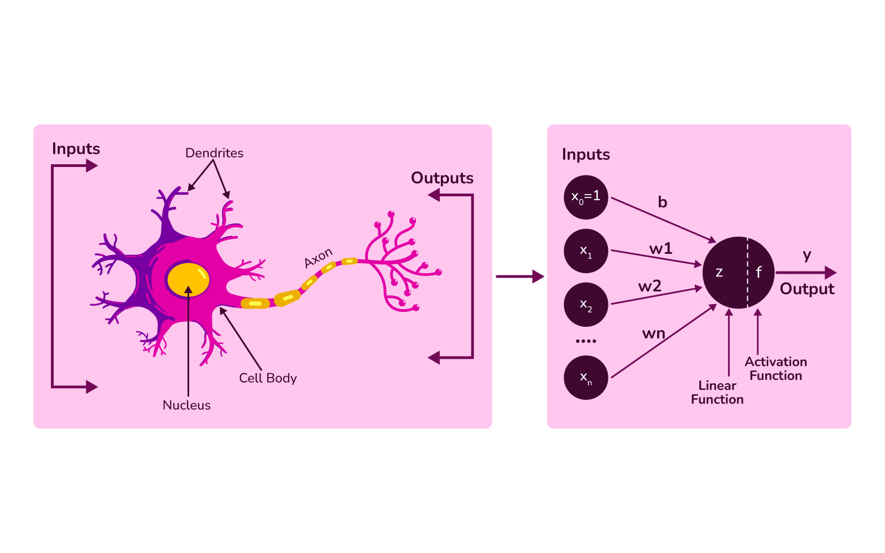
*Figure — Left: a biological neuron (dendrites collect signals, the axon sends one out). Right: the artificial version — inputs x₁…xₙ times weights, plus bias b (drawn as a constant input x₀ = 1), summed into z, then passed through activation f (course diagram).*

Analogy: a **committee vote**. Members (inputs) speak; some get more say (weights); the chair has a standing lean (bias); a simple rule turns the tally into the announcement (activation). The biology is only inspiration — artificial neurons are just differentiable arithmetic (smooth enough that slopes can be computed for every number).

**Glossary for this chapter**

| Term | Meaning |
|---|---|
| Parameters | The numbers the network learns: all weights and biases |
| Layer | Neurons reading the same inputs; a **dense** (fully connected, linear) layer links every input to every neuron |
| Input / hidden / output layer | The raw features / any layer in between (its values never appear in the data) / the layer producing the prediction |
| Hyperparameters | Choices you make, not learned: depth, width, learning rate, batch size… |
| Epoch | One full pass over the training set |
| Batch / mini-batch | The subset of examples used for one weight update |

### The perceptron (1958) and its limit
Frank Rosenblatt's **perceptron** is one neuron with a **step** activation: output 1 if w·x + b > 0, else 0. Learning rule: when a prediction is wrong, nudge the weights towards the right answer, w ← w + η(y − ŷ)x and b ← b + η(y − ŷ), where η is the learning rate.

A single neuron draws a **straight line** (in higher dimensions a flat **hyperplane**) through feature space (the space in which each feature is one axis and each example is a point): fine for AND, impossible for **XOR** ("exactly one input is 1"), whose classes no single line separates. Minsky and Papert's 1969 book *Perceptrons* made this limit famous.

```python
# code/perceptron.py (core)
for epoch in range(epochs):                         # w = zeros, b = 0, lr = 1.0
    for xi, yi in zip(X, y):
        pred = 1 if xi @ w + b > 0 else 0           # step activation
        update = lr * (yi - pred)                   # 0 if correct, +-1 if wrong
        w += update * xi; b += update
    # ... stop ("converged") after an epoch with no errors
```

Output:
```
AND: converged=True after 6 epochs, w=[2. 1.], b=-2.0, preds=[0 0 0 1], target=[0 0 0 1]
XOR: converged=False after 20 epochs, w=[-1.  0.], b=1.0, preds=[1 1 0 0], target=[0 1 1 0]
```

### The multi-layer perceptron (MLP)
The fix is to **stack** neurons: a **hidden layer** of several neurons transforms the inputs into new features, and the output neuron works on those. With one hidden layer of two neurons, XOR becomes easy: one hidden neuron learns "x₁ OR x₂", another "x₁ AND x₂", and the output computes "OR but not AND".

A network where every layer feeds the next with no loops is a **feed-forward network**; when all layers are dense it is called a **multi-layer perceptron (MLP)** — the name stuck even though modern MLPs use ReLU-like activations, not the step function.

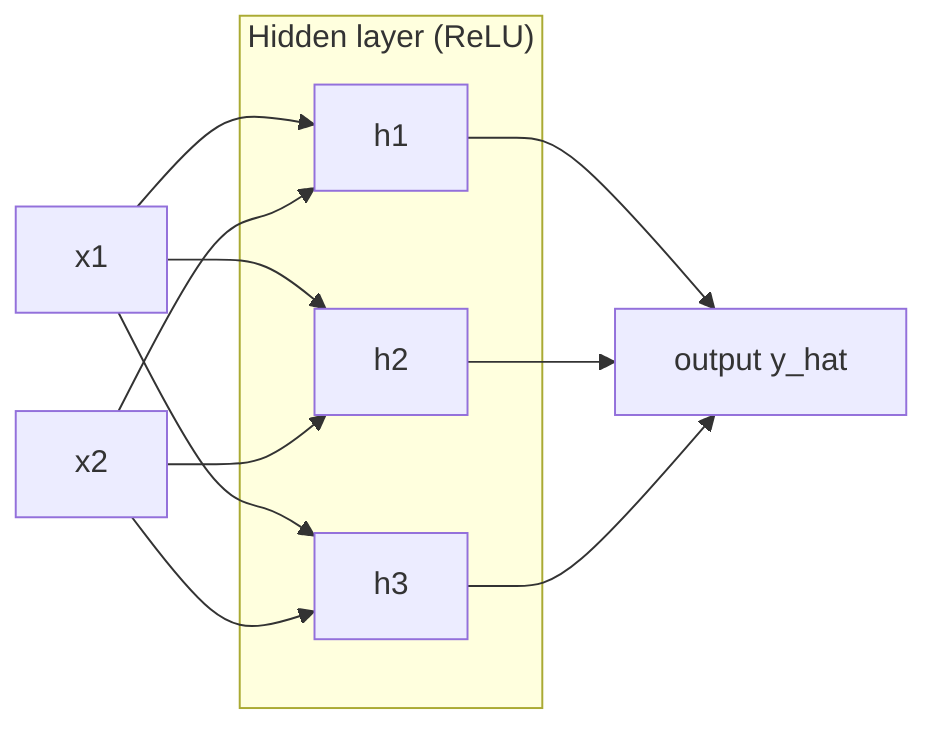

In matrix form, a whole layer is one line: **h = f(W x + b)**, where W has one row per neuron. For a batch of examples stored as rows of X: H = f(X Wᵀ + b). Parameter count of a dense layer = (inputs × outputs) + outputs. A 2 → 3 → 1 network has (2·3 + 3) + (3·1 + 1) = 13 parameters.

### Why nonlinearity is essential
Without an activation function, stacking layers is pointless: W₂(W₁x + b₁) + b₂ = (W₂W₁)x + (W₂b₁ + b₂) — still one linear function. The bend introduced by f is what lets each extra layer add expressive power. The **universal approximation theorem** (Cybenko 1989, Hornik 1991) says an MLP with one hidden layer and enough neurons can approximate any continuous function on a bounded region as closely as you like — but it says nothing about how many neurons you need or whether training will find the weights.

### Why depth matters (hidden layers and "deep" networks)
Hidden layers turn raw inputs into progressively more **abstract representations**: in an image network, early layers respond to edges and colour blobs, middle layers to textures and parts (an eye, a wheel), late layers to whole objects. This **hierarchy of features** reuses lower-level pieces, so a deep network usually needs far fewer neurons than a wide shallow one for the same task.

"Deep" just means many hidden layers. Depth costs computation, data and harder optimization (gradients, the slopes that tell each weight which way to move, must travel through every layer — §10.6). ReLU, careful initialization, normalization and residual connections (shortcuts that add a layer's input to its output; Chapter 11), together with GPUs (graphics chips that do thousands of calculations in parallel) and large datasets such as ImageNet (over a million labelled photos), are what made deep networks trainable after about 2010.

### Trade-offs

| | Neural networks (MLP and beyond) | Gradient-boosted trees / linear models |
|---|---|---|
| Best data type | Images, audio, text, sequences — raw, high-dimensional, unstructured | Tabular rows and columns |
| Feature engineering | Learned automatically | Mostly manual |
| Data needed | Usually a lot | Works on small data |
| Compute | High (GPUs for real sizes) | Low |
| Interpretability | Low | Medium–high |
| Tuning effort | Many hyperparameters | Fewer |

### When not to use it
- Small tabular datasets: gradient-boosted trees (Chapter 7) usually win and train in seconds.
- When each decision must be explained to a regulator and a simple model is accurate enough, or there is no compute budget.

### Common mistakes
- Forgetting the activation between layers (the network collapses to linear).
- Believing "more layers is always better" — deeper nets overfit and are harder to train without the tricks below.

### Real-world examples
Google Photos search, Face ID and self-driving perception (deep CNNs, convolutional networks for images, and transformers, attention-based networks for sequences; Chapters 11–12); speech recognition in voice assistants; recommenders at YouTube and Meta, which run MLPs on learned embeddings (vectors of numbers learned to represent each user or item) (e.g. Meta's open-source DLRM).

### In the interview
**30-second answer:** "A neuron computes a weighted sum plus bias and applies a nonlinear activation. An MLP stacks layers; hidden layers learn intermediate features and depth composes simple features into complex ones. Without nonlinearities the stack collapses to one linear map. A single perceptron draws one hyperplane, so it can't learn XOR; one hidden layer can."

- *Q: How many parameters in a dense layer from 256 to 128 units?* A: 256·128 + 128 = 32,896.
- *Q: What does the universal approximation theorem guarantee?* A: That a one-hidden-layer network approximating a continuous function exists — not that it is small or that training finds it.

### Self-check
1. Why can't a perceptron learn XOR? → XOR's classes are not linearly separable; one neuron draws one hyperplane.
2. Remove all activations from a 5-layer MLP? → It becomes equivalent to a single linear layer.
3. What does a bias do? → Shifts the threshold, so the neuron can fire when all inputs are 0 (or stay quiet when they are large).

### TL;DR
Neuron = weighted sum + bias + nonlinearity; MLP = layers of them. Hidden layers learn features, depth builds a hierarchy, nonlinearity makes stacking useful.

---

## 10.2 Activation functions

### What it is
The **activation function** f is the nonlinearity applied to each pre-activation z. It governs how well gradients flow and, at the output layer, what values the network can produce.

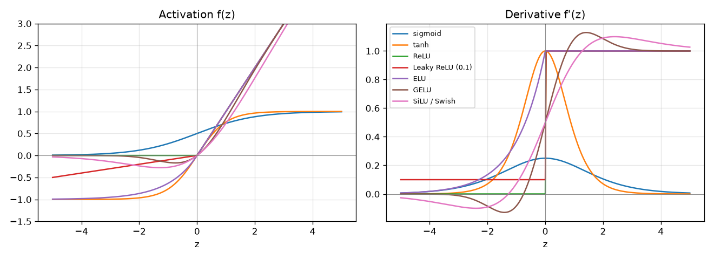
*Figure — Common activations (left) and their derivatives (right), computed with PyTorch autograd (its automatic derivative calculator, §10.4) by `code/activations.py`. Note the sigmoid's derivative never exceeds 0.25 and both sigmoid and tanh flatten to 0 for large |z| ("saturation").*

### The table

| Name | Formula | Output range | Derivative | Where used | Pros | Cons |
|---|---|---|---|---|---|---|
| **Sigmoid** σ | 1 / (1 + e^−z) | (0, 1) | σ(z)(1 − σ(z)), max 0.25 | Binary / multi-label outputs; LSTM gates | Reads as a probability | Saturates; not zero-centred |
| **Tanh** | (e^z − e^−z)/(e^z + e^−z) | (−1, 1) | 1 − tanh²(z), max 1 | RNN/LSTM hidden states | Zero-centred | Still saturates for large \|z\| |
| **ReLU** | max(0, z) | [0, ∞) | 1 if z > 0, else 0 | Default hidden layer | Cheap, no saturation for z > 0 | "Dying ReLU": stuck at z < 0, zero gradient forever |
| **Leaky ReLU** (PReLU if α is learned) | z if z > 0 else αz (α≈0.01) | (−∞, ∞) | 1 or α | Hidden layers when ReLUs die | Never exactly zero gradient | Extra hyperparameter α |
| **ELU** | z if z > 0 else α(e^z − 1) | (−α, ∞) | 1 or αe^z | Hidden layers | Smooth, mean closer to 0 | exp is slower |
| **GELU** | z·Φ(z) (Φ = standard normal CDF) | ≈(−0.17, ∞) | smooth | Transformers (BERT, GPT) | Smooth ReLU-like | More compute |
| **SiLU / Swish** | z·σ(z) | ≈(−0.28, ∞) | smooth | EfficientNet; LLM feed-forward (SwiGLU) | Smooth | More compute |
| **Softmax** | softmaxᵢ(z) = e^zᵢ / Σⱼ e^zⱼ | each (0,1), sum = 1 | — | Single-label multi-class output | Probability distribution | Output layer only |
| **Identity (linear)** | z | (−∞, ∞) | 1 | Output for regression | Unbounded | — |

> **Key terms — names in this table:** *RNNs* (recurrent neural networks) and *LSTMs* (a type of RNN with "gates" that decide what to remember) process sequences step by step (Chapter 12). *Transformers* are the attention-based networks behind *BERT* and *GPT*; an *LLM* (large language model) is a very large transformer trained on text; *EfficientNet* is a family of image networks. *Zero-centred* means outputs are spread around 0 rather than all positive. *Saturates* means the curve goes flat, so its slope (and the learning signal) is near 0. Φ, the standard normal *CDF* (cumulative distribution function), gives the probability that a bell-curve value is below z. *SwiGLU* is a gated variant of SiLU used in modern LLMs.

Numbers worth remembering (from `code/activations.py`):
```
sigmoid  f(-2,0,2)=[0.119 0.5   0.881]  f'=[0.105 0.25  0.105]
tanh     f(-2,0,2)=[-0.964  0.     0.964]  f'=[0.071 1.    0.071]
ReLU     f(-2,0,2)=[0. 0. 2.]  f'=[0. 0. 1.]
softmax([2,1,0.1]) = [0.659 0.242 0.099]
```

**Softmax worked example.** z = (2, 1, 0.1): e² = 7.389, e¹ = 2.718, e^0.1 = 1.105, sum 11.212 → (0.659, 0.242, 0.099). Adding a constant to every score changes nothing, so libraries subtract max(z) first to avoid overflow (numbers too large for the computer to store).

### How to choose
1. **Hidden layers:** **ReLU** (Leaky ReLU if many units die); **GELU/SiLU** in transformers; tanh/sigmoid only inside recurrent gates (Chapter 12).
2. **Output layer:** match the task —

| Task | Output activation | Loss |
|---|---|---|
| Regression | none (identity) | MSE / MAE / Huber |
| Binary classification | sigmoid (1 unit) | binary cross-entropy |
| Multi-class, one label | softmax (K units) | categorical cross-entropy |
| Multi-label (several can be true) | sigmoid per label | binary cross-entropy per label |

In PyTorch, the output layer usually emits **raw logits** and the loss applies the sigmoid/softmax internally (`BCEWithLogitsLoss`, `CrossEntropyLoss`) — this is more numerically stable (less prone to rounding errors and overflow).

### Common mistakes
- Putting `softmax` in the model and then using `nn.CrossEntropyLoss` (which already applies log-softmax) — the network trains poorly.
- Using sigmoid in every hidden layer of a deep network → vanishing gradients.
- Using ReLU on the output of a regression model that must predict negative values.

### Real-world examples
AlexNet (2012) popularised ReLU, reporting about 6× faster training than tanh on CIFAR-10; BERT and GPT-2/3 use GELU; EfficientNet uses SiLU; LLaMA uses SwiGLU (a gated SiLU) in its feed-forward blocks.

### In the interview
**30-second answer:** "Activations add nonlinearity. ReLU is the hidden-layer default — cheap, no saturation for positive inputs — with dead units as its weakness (Leaky ReLU helps). Sigmoid and tanh saturate, so they live at outputs and in RNN gates. GELU/SiLU are the smooth transformer defaults. Output: identity for regression, sigmoid for binary/multi-label, softmax for multi-class."

- *Q: Why is ReLU's gradient at 0 not a problem?* A: z is exactly 0 with essentially zero probability; frameworks just define the derivative there (PyTorch uses 0).
- *Q: Softmax vs sigmoid for 3 classes?* A: Softmax if exactly one class is true (probabilities compete); independent sigmoids if several can be true.

### Self-check
1. What is a "dead" ReLU? → A unit whose pre-activation is negative for all inputs, so its output and gradient are always 0 and it stops learning.
2. tanh's advantage over sigmoid? → Zero-centred output and a larger maximum gradient (1 vs 0.25).
3. softmax(z + 5) vs softmax(z)? → Identical.

### TL;DR
ReLU (or GELU in transformers) for hidden layers; identity / sigmoid / softmax at the output depending on the task; sigmoid and tanh saturate and cause vanishing gradients in deep stacks.

---

## 10.3 The forward pass and loss functions

### What it is
The **forward pass** runs the network: a batch of inputs flows through the layers, each computing h = f(W h_prev + b), until the last layer produces a **prediction** ŷ (or raw logits), e.g. "probability this photo is a cat: 0.92". The **loss function** compares ŷ with the truth y and returns one number — how wrong the network is — averaged over the batch. Training searches for parameters that make the average training loss small.

### Loss functions

| Loss | Formula (one example) | Task | Notes |
|---|---|---|---|
| **MSE** (mean squared error) | (ŷ − y)² | Regression | Punishes big errors heavily; sensitive to outliers. `nn.MSELoss` |
| **MAE / L1** | \|ŷ − y\| | Regression | Robust to outliers; gradient constant size. `nn.L1Loss` |
| **Huber / Smooth L1** | ½(ŷ−y)² if \|ŷ−y\| ≤ δ else δ(\|ŷ−y\| − ½δ) | Regression | Quadratic near 0, linear far away. `nn.HuberLoss` |
| **Binary cross-entropy (BCE)** | −[y log p + (1−y) log(1−p)] | Binary / multi-label | p = σ(logit). `nn.BCEWithLogitsLoss` takes logits |
| **Categorical cross-entropy** | −log p_true | Multi-class | p = softmax(logits). `nn.CrossEntropyLoss` takes logits + integer labels |
| **Hinge** | max(0, 1 − y·s), y ∈ {−1, +1} | Max-margin classification | SVM loss; rare in deep learning |

**Worked cross-entropy.** A 3-class model outputs probabilities (0.7, 0.2, 0.1) and the true class is 0: loss = −ln 0.7 = 0.357. If the true class were 2: −ln 0.1 = 2.303. Confident wrong answers are punished hardest. A model that guesses uniformly over K classes has loss ln K (ln 10 = 2.303 for digits) — a useful sanity check for the first training step.

Why cross-entropy rather than MSE for classification? With sigmoid/softmax outputs its gradient at the logits is simply **p − y** (§10.4), large when the model is confidently wrong; MSE through a sigmoid is multiplied by σ′, tiny when the sigmoid saturates — learning stalls exactly when most needed. Cross-entropy is also the maximum-likelihood loss (the one you get by choosing parameters that make the observed labels most probable) for a Bernoulli (yes/no) or categorical (one-of-K) model.

### Common mistakes
- Passing probabilities to `CrossEntropyLoss` or `BCEWithLogitsLoss` (they expect logits).
- Mixing target formats: `CrossEntropyLoss` takes integer class indices (`long`, shape N) *or* class probabilities (`float`, shape N×K) — not a mix.
- Using accuracy as a training loss — it has zero gradient almost everywhere.

### Self-check
1. Loss for "predict house price"? → MSE (or Huber if there are outliers).
2. Probabilities (0.7, 0.2, 0.1), true class 1 — cross-entropy? → −ln 0.2 = 1.609.
3. First-step loss on a 4-class problem with a sensible init? → About ln 4 = 1.386.

### TL;DR
Forward pass = compute predictions layer by layer. Pick the loss by task: MSE/MAE/Huber for regression, BCE for binary or multi-label, cross-entropy for multi-class. Feed logits to PyTorch's combined losses.

---

## 10.4 Backpropagation

### What it is
**Backpropagation** ("backprop") is the algorithm that computes the **gradient** of the loss with respect to every weight — that is, for each parameter, "if I increase this a tiny bit, how much does the loss change?" It does so efficiently by applying the **chain rule** of calculus from the output backwards, reusing intermediate results, so the cost is only about 2–3× a forward pass regardless of how many parameters there are. It was popularised for neural networks by Rumelhart, Hinton and Williams in 1986.

Backprop only computes gradients. **Gradient descent** then uses them: each parameter moves a small step in the direction that reduces the loss, θ ← θ − η·∂L/∂θ (∂L/∂θ is the *partial derivative*: the slope of the loss with respect to θ alone, holding everything else fixed), where η (eta) is the **learning rate**.

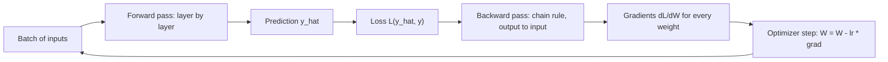

This forward → loss → backward → update loop, repeated over many mini-batches and epochs, is **how every neural network learns**.

### The chain rule in one line
If L depends on a through b (L = g(b), b = h(a)), then ∂L/∂a = ∂L/∂b · ∂b/∂a. A network is a long chain of such steps; backprop multiplies the local derivatives from the loss back to each weight. Each layer only needs to know (1) the gradient arriving from above and (2) its own local derivative.

### Worked example with numbers
Network: 2 inputs → 2 hidden units (ReLU) → 1 output (sigmoid), binary cross-entropy loss.

- Input x = (1, 2), true label y = 1.
- W₁ = [[0.5, −0.2], [0.3, 0.4]] (row j = weights into hidden unit j), b₁ = (0.1, −0.5).
- w₂ = (0.7, −0.6), b₂ = 0.2. Learning rate η = 0.1.

**Forward pass**

| Step | Computation | Value |
|---|---|---|
| z₁ (hidden unit 1) | 0.5·1 + (−0.2)·2 + 0.1 | 0.2 |
| z₁ (hidden unit 2) | 0.3·1 + 0.4·2 − 0.5 | 0.6 |
| h = ReLU(z₁) | both positive, unchanged | (0.2, 0.6) |
| z₂ | 0.7·0.2 + (−0.6)·0.6 + 0.2 | −0.02 |
| ŷ = σ(z₂) | 1/(1 + e^0.02) | 0.4950 |
| L = −ln ŷ | (since y = 1) | 0.7032 |

**Backward pass** (each line = previous gradient × local derivative)

| Gradient | Rule | Value |
|---|---|---|
| ∂L/∂z₂ | for sigmoid + BCE this simplifies to ŷ − y | 0.4950 − 1 = −0.5050 |
| ∂L/∂w₂ | ∂L/∂z₂ · h (because z₂ = w₂·h + b₂) | (−0.101, −0.303) |
| ∂L/∂b₂ | ∂L/∂z₂ · 1 | −0.5050 |
| ∂L/∂h | ∂L/∂z₂ · w₂ | (−0.3535, 0.303) |
| ∂L/∂z₁ | ∂L/∂h · ReLU′(z₁), and ReLU′ = 1 because both z₁ > 0 | (−0.3535, 0.303) |
| ∂L/∂W₁ | ∂L/∂z₁ (column) × xᵀ (row) — outer product | [[−0.3535, −0.707], [0.303, 0.606]] |
| ∂L/∂b₁ | ∂L/∂z₁ | (−0.3535, 0.303) |

Why ŷ − y? For BCE, ∂L/∂ŷ = −y/ŷ + (1−y)/(1−ŷ), and σ′(z) = ŷ(1 − ŷ). Multiply them and everything cancels to ŷ − y. (The same simplification holds for softmax + cross-entropy: ∂L/∂logits = p − one_hot(y), where one_hot(y) is a vector with 1 at the true class and 0 elsewhere.)

**Reading the gradients.** ∂L/∂w₂ is negative, so gradient descent *increases* w₂, pushing ŷ towards the label 1. Hidden unit 2 has a negative outgoing weight (−0.6), so the network wants its activation *smaller*: its incoming weights get positive gradients and shrink.

**Update (one step of gradient descent, η = 0.1):** for example w₂ ← (0.7, −0.6) − 0.1·(−0.101, −0.303) = (0.7101, −0.5697). After updating all parameters, the same input gives ŷ = 0.5756 and loss 0.5523 — down from 0.7032.

The script checks the hand-derived gradients against PyTorch's automatic differentiation:

```python
# code/backprop_by_hand.py (backward part)
dz2 = y_hat - y                  # dL/dz2 for sigmoid + BCE
dw2 = dz2 * h;  db2 = dz2
dh  = dz2 * w2
dz1 = dh * (z1 > 0)              # ReLU'(z1)
dW1 = np.outer(dz1, x);  db1 = dz1
# ... then the same network in torch, loss.backward(), and np.allclose on every gradient
```

Output (last lines; the rest repeats the tables above):
```
autograd agrees with hand-derived gradients: True
after one SGD step (lr=0.1): y_hat 0.4950 -> 0.5756, loss 0.7032 -> 0.5523
```

### A 2-layer network from scratch in NumPy
`code/numpy_mlp.py` implements the same ideas for a whole batch (rows = examples), with tanh hidden units and a sigmoid output, and trains it by full-batch gradient descent (every update uses the whole training set). In the code, *fan_in* is the number of inputs feeding a layer (and *fan_out* the number of outputs).

```python
class TwoLayerNet:
    """x -> tanh(x W1 + b1) -> sigmoid(h W2 + b2). Rows of X are examples."""
    # __init__: W1, W2 ~ N(0, 1/fan_in) (LeCun-style scale), biases 0
    def forward(self, X):
        self.X = X
        self.H = np.tanh(X @ self.W1 + self.b1)
        self.P = 1 / (1 + np.exp(-(self.H @ self.W2 + self.b2)))
        return self.P

    def backward(self, y):
        n = len(y)
        dZ2 = (self.P - y[:, None]) / n                  # BCE + sigmoid, averaged over batch
        dW2 = self.H.T @ dZ2;  db2 = dZ2.sum(0)
        dH = dZ2 @ self.W2.T
        dZ1 = dH * (1 - self.H ** 2)                      # tanh'(z) = 1 - tanh(z)^2
        dW1 = self.X.T @ dZ1;  db1 = dZ1.sum(0)
        return dW1, db1, dW2, db2

    def step(self, grads, lr):
        for p, g in zip((self.W1, self.b1, self.W2, self.b2), grads):
            p -= lr * g
```

`forward` stores X, H and P because backward needs them (why training uses more memory than inference, i.e. just using the trained model to predict). `backward` walks the chain rule in reverse; a weight matrix's gradient is always (layer input)ᵀ @ (gradient at the layer's output). The script also runs a **numerical gradient check** — nudge one weight by ±ε, measure the loss change — the standard test for a hand-written backward pass.

Output:
```
XOR  loss 0.687 -> 0.0012, probs = [0.    0.999 0.999 0.002]
Moons loss 0.682 -> 0.0363, train acc 0.986, test acc 0.956
gradient check  numerical: [-0.02769  -0.015654 -0.024803]  analytical: [-0.02769  -0.015654 -0.024803]
```

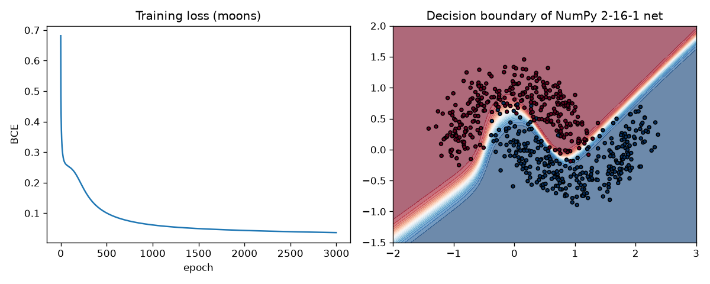
*Figure — Left: training loss falls smoothly. Right: the 16-hidden-unit network has learned a curved boundary no linear model could draw.*

### Computational graphs and autograd
Frameworks record every tensor (PyTorch's name for a multi-dimensional array) operation in a **computational graph**; `loss.backward()` walks it in reverse and accumulates gradients into each parameter's `.grad`. This is **reverse-mode automatic differentiation** — exact, and cheap when one scalar (single-number) output (the loss) depends on many inputs (the parameters). Karpathy's *micrograd* builds such an engine in about 100 lines.

### Common mistakes
- Forgetting to zero gradients between steps in PyTorch — they **accumulate** by default.
- Summing instead of averaging the batch loss — the effective learning rate then changes with batch size.
- Writing your own backward pass without a gradient check.

### In the interview
**30-second answer:** "Backprop applies the chain rule from the loss backwards through the computational graph, getting ∂L/∂θ for every parameter for a small constant multiple of a forward pass. Each layer multiplies the incoming gradient by its local derivative. An optimizer then steps against the gradient. For sigmoid+BCE or softmax+cross-entropy, the gradient at the logits is prediction minus target."

- *Q: Why reverse mode, not forward mode?* A: One scalar output, millions of inputs — one backward sweep gets every partial derivative; forward mode needs one sweep per input.
- *Q: What must the forward pass store?* A: The activations the local derivatives need — so training memory grows with batch size and depth (gradient checkpointing trades recompute for memory).

### Self-check
1. For sigmoid output + BCE, what is ∂L/∂z at the output? → ŷ − y.
2. Gradient of a dense layer's weights? → (layer input)ᵀ @ (gradient at the layer's pre-activation output).
3. Why must activations be stored? → The backward pass needs them to compute local derivatives (for example h in ∂L/∂w₂ = ∂L/∂z₂·h).

### TL;DR
Forward pass computes the loss; backward pass applies the chain rule layer by layer to get every gradient; gradient descent subtracts learning-rate × gradient. Autograd automates the backward pass.

---

## 10.5 Optimizers and learning-rate schedules

### What it is
An **optimizer** decides how to turn gradients into parameter updates. The **learning rate** (step size) is the single most important hyperparameter in deep learning.

Analogy: tuning a radio dial. Huge jerks keep jumping past the station (oscillation or divergence); millimetre turns take forever. A good tuner turns fast at first and slowly near the station — what schedules and adaptive optimizers do.

### How the main optimizers work
Notation: g = gradient of the mini-batch loss, η = learning rate, θ = a parameter.

| Optimizer | Update rule (per parameter) | Idea | PyTorch defaults |
|---|---|---|---|
| **SGD** (stochastic gradient descent) | θ ← θ − η g | Step downhill using a mini-batch estimate of the gradient | `SGD(lr=…)` — always set lr explicitly |
| **SGD + momentum** | v ← μ v + g; θ ← θ − η v | Keep a running "velocity": consistent directions accelerate, zig-zags cancel | momentum μ typically 0.9 |
| **Nesterov momentum** | gradient evaluated at the look-ahead point | Slightly better-behaved momentum | `nesterov=True` |
| **AdaGrad** | s ← s + g²; θ ← θ − η g/(√s + ε) | Per-parameter step size, shrinks for frequently-updated params | Good for sparse (mostly zero) features; step decays too much for deep nets |
| **RMSProp** | s ← ρ s + (1−ρ) g²; θ ← θ − η g/(√s + ε) | Like AdaGrad but with a moving average (an average that gives recent values more weight), so steps don't vanish | lr 0.01, ρ (`alpha`) 0.99 |
| **Adam** | m ← β₁m + (1−β₁)g; s ← β₂s + (1−β₂)g²; bias-correct: m̂ = m/(1−β₁ᵗ), ŝ = s/(1−β₂ᵗ); θ ← θ − η m̂/(√ŝ + ε) | Momentum + RMSProp + bias correction for the zero start | lr 1e-3, β = (0.9, 0.999), ε = 1e-8 |
| **AdamW** | Adam, plus θ ← θ − η λ θ applied separately from the gradient | "Decoupled" weight decay (shrinking every weight slightly toward 0 at each step; §10.7) — the correct way to do L2-style shrinkage with Adam | weight_decay 0.01 |

Key ideas in plain words:
- **Stochastic:** each mini-batch gives a noisy gradient estimate — cheap, and the noise can help escape sharp minima.
- **Momentum** is a heavy ball rolling downhill: it speeds up along a consistent slope and damps zig-zags in narrow valleys ("ravines").
- **Adaptive methods** (RMSProp, Adam) give each parameter its own effective step size, dividing by the recent gradient magnitude: parameters with steep, noisy gradients take smaller steps; flat directions take bigger ones.
- **Adam's first step, in numbers** (g = 0.5, β₁ = 0.9, β₂ = 0.999): m = 0.1·0.5 = 0.05, s = 0.001·0.25 = 0.00025; bias-corrected m̂ = 0.05/0.1 = 0.5, ŝ = 0.00025/0.001 = 0.25; step = η·0.5/√0.25 = η. Without correction the step would be η·0.05/0.0158 ≈ 3.2η — distorted. Note the step is ≈η whatever the gradient's size: Adam's steps are scale-free.

`code/optimizers.py` runs all four with `torch.optim` on (a) a 2-D ravine, f(x, y) = 0.05x² + 2y² — 40× steeper in y than in x — starting at (−10, 2), and (b) an MLP on two moons. Each learning rate (SGD 0.45, momentum 0.05, RMSProp 0.3, Adam 0.5) is near the largest that behaves well:

```python
p = torch.tensor([-10.0, 2.0], requires_grad=True)
opt = torch.optim.SGD([p], lr=0.05, momentum=0.9)   # or RMSprop / Adam
for _ in range(60):
    opt.zero_grad(); ravine(p).backward(); opt.step()
```

Output:
```
(a) ravine f = 0.05 x^2 + 2 y^2, start (-10, 2), 60 steps
  SGD                final point [-0.631  0.   ]  loss 1.99e-02
  SGD+momentum(0.9)  final point [ 0.358 -0.073]  loss 1.71e-02
  RMSProp            final point [-0.  0.]  loss 3.77e-14
  Adam               final point [-0.215  0.045]  loss 6.42e-03
(b) MLP 2-32-32-1 on moons, 200 full-batch epochs
  SGD                loss after 20 epochs 0.639, after 200 0.265
  SGD+momentum(0.9)  loss after 20 epochs 0.310, after 200 0.083
  RMSProp            loss after 20 epochs 0.171, after 200 0.080
  Adam               loss after 20 epochs 0.274, after 200 0.075
```

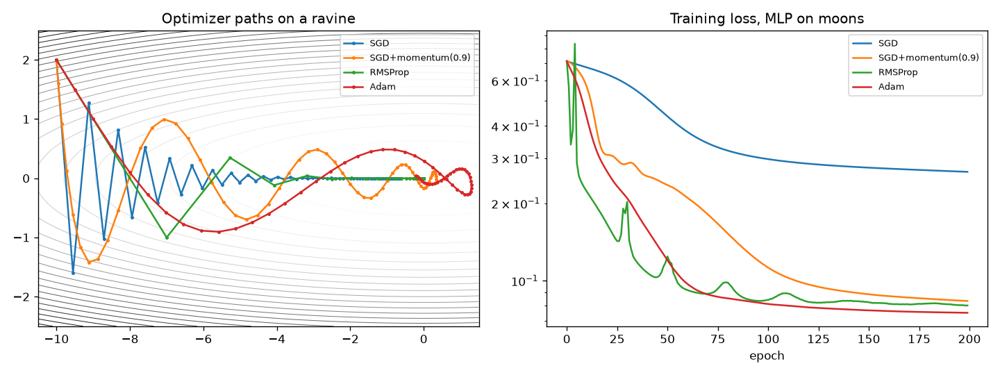
*Figure — Left: plain SGD's learning rate is capped by the steep y-direction, so it crawls in x; momentum overshoots but travels fast along the valley; RMSProp and Adam rescale each coordinate and head almost straight for the minimum. Right: on a tiny network, momentum and adaptive methods reach low loss far sooner than plain SGD.*

RMSProp looks spectacular here because its per-coordinate scaling exactly undoes this axis-aligned ravine. Don't over-read toys: in practice **Adam/AdamW** is the default for transformers and most new models, while **SGD with momentum** plus a schedule remains competitive (sometimes generalising slightly better) for CNN image classifiers.

### Learning-rate schedules
A **schedule** changes η during training: big steps early, small steps late to settle.

| Schedule | Shape | PyTorch | Typical use |
|---|---|---|---|
| Constant | flat | — | Baselines, small problems with Adam |
| Step decay | ×γ every k epochs | `StepLR`, `MultiStepLR` | Classic ResNet (a landmark deep image network, Chapter 11) recipe (÷10 at epochs 30, 60, 90) |
| Exponential decay | ×γ every step/epoch | `ExponentialLR` | Simple smooth decay |
| Reduce on plateau | drop when validation metric stalls | `ReduceLROnPlateau` | When you don't know the right epoch count |
| Cosine annealing | half cosine from η_max to ~0 | `CosineAnnealingLR` | Modern default for vision and LLMs (large language models) |
| Linear warmup + decay | ramp from ~0 over the first steps, then cosine/linear decay | `LinearLR` + `SequentialLR` | Transformers (warmup avoids early instability with Adam) |
| One-cycle | warm up to max, then anneal far below the start | `OneCycleLR` | Fast training (Leslie Smith's "super-convergence") |

```python
# code/lr_schedules.py (warmup + cosine) - each step: opt.step() THEN sched.step()
sched = S.SequentialLR(opt, [S.LinearLR(opt, start_factor=0.01, total_iters=10),
                             S.CosineAnnealingLR(opt, T_max=90)], milestones=[10])
```

Output:
```
Constant                 lr at steps 0/10/50/99: 0.1000 0.1000 0.1000 0.10000
StepLR (x0.5 every 25)   lr at steps 0/10/50/99: 0.1000 0.1000 0.0250 0.01250
ExponentialLR (0.97)     lr at steps 0/10/50/99: 0.1000 0.0737 0.0218 0.00490
CosineAnnealingLR        lr at steps 0/10/50/99: 0.1000 0.0976 0.0500 0.00002
Warmup 10 + cosine       lr at steps 0/10/50/99: 0.0010 0.1000 0.0587 0.00003
OneCycleLR               lr at steps 0/10/50/99: 0.0040 0.0295 0.0794 0.00000
```

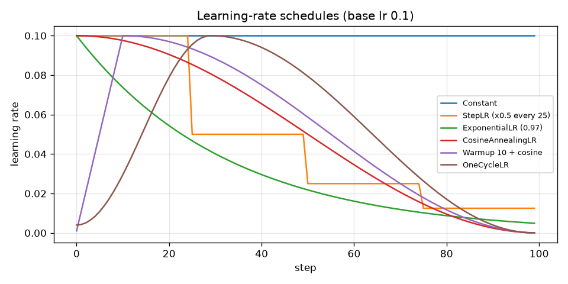
*Figure — The six schedules over 100 steps.*

### Trade-offs

| | SGD + momentum | Adam / AdamW |
|---|---|---|
| Tuning | LR and schedule matter a lot | Works well near lr=1e-3 out of the box |
| Speed of convergence | Slower early | Fast early |
| Generalization | Often excellent on CNNs | Excellent on transformers (with AdamW) |
| Memory | 1 extra buffer per parameter | 2 extra buffers per parameter |

### Common mistakes
- Expecting AdamW behaviour from `Adam(weight_decay=…)` — there the decay is added to the gradient (L2) and distorted by adaptive scaling; use `AdamW`.
- Calling `scheduler.step()` before `optimizer.step()` (PyTorch warns; the first LR value is skipped).
- Changing the batch size without revisiting the LR (heuristic, i.e. rule of thumb, for SGD: scale LR roughly linearly with batch size, plus warmup).

### Real-world examples
GPT-3 and LLaMA: Adam/AdamW with linear warmup and cosine decay. The original ResNet: SGD, momentum 0.9, LR ÷10 when error plateaued. fast.ai popularised one-cycle training and the LR finder.

### In the interview
**30-second answer:** "SGD steps against the mini-batch gradient; momentum accumulates a velocity so consistent directions speed up and oscillations cancel; RMSProp divides each step by a running RMS (root mean square, a typical size) of that parameter's gradients; Adam combines both with bias correction, and AdamW decouples weight decay. A schedule — typically warmup then cosine decay — gives big steps early and fine steps late."

- *Q: Why warmup with Adam?* A: Early second-moment estimates are poor and gradients large; a small initial LR prevents destructive first updates.
- *Q: Why is Adam's bias correction needed?* A: m and s start at 0, so early averages are biased towards 0; dividing by 1 − βᵗ fixes this.

### Self-check
1. What does momentum 0.9 roughly mean? → The velocity is an exponentially weighted sum of past gradients, covering about 1/(1−0.9) = 10 recent steps.
2. Adam + L2 vs AdamW? → AdamW shrinks weights directly, independent of the adaptive scaling.
3. A schedule used for LLMs? → Linear warmup, then cosine decay.

### TL;DR
Learning rate first. Adam/AdamW (lr ≈ 3e-4 to 1e-3) is the safe default; SGD+momentum with a schedule is strong for CNNs; warmup + cosine or one-cycle.

---

## 10.6 Initialization and vanishing/exploding gradients

### The problem it solves
The gradient reaching layer 1 is a **product** of one factor per layer above it. Factors typically below 1 shrink it exponentially with depth — **vanishing gradients** (early layers barely learn); factors above 1 grow it exponentially — **exploding gradients** (huge updates, NaN loss; NaN, "not a number", is what invalid arithmetic such as infinity minus infinity produces). Forward activations can likewise fade to 0 or blow up.

Two sources:
1. **Activation derivatives.** The sigmoid derivative is at most 0.25, so ten sigmoid layers scale the gradient by at most 0.25¹⁰ ≈ 9.5 × 10⁻⁷.
2. **Weight scale.** Each layer multiplies by W; badly scaled weights shrink or grow the signal's variance by a constant factor per layer.

### How initialization fixes it
Goal: keep the **variance** of activations (forward) and gradients (backward) roughly constant from layer to layer. Why 1/fan_in? A pre-activation z = Σ wᵢxᵢ sums fan_in independent terms, so with zero-mean weights and inputs, Var(z) = fan_in · Var(w) · Var(x). Choosing Var(w) = 1/fan_in makes Var(z) = Var(x). With fan_in = 256: std = 1/16 = 0.0625. Xavier also balances the backward pass (fan_out); He doubles the variance for ReLU:

| Scheme | Weight variance | Designed for | PyTorch |
|---|---|---|---|
| **Xavier / Glorot** (2010) | 2 / (fan_in + fan_out) (normal version) | tanh, sigmoid, linear | `nn.init.xavier_normal_` / `xavier_uniform_` |
| **He / Kaiming** (2015) | 2 / fan_in | ReLU family (ReLU zeroes half the signal, so double the variance) | `nn.init.kaiming_normal_(w, nonlinearity="relu")` |
| **LeCun** | 1 / fan_in | SELU (a self-normalising activation), linear | `kaiming_normal_(w, nonlinearity="linear")` |

Biases usually start at 0. **Never give all weights the same value** (e.g. zeros): every neuron in a layer would compute the same thing and get the same gradient forever — the **symmetry** is never broken. PyTorch's `nn.Linear` default (Kaiming-uniform with a = √5, i.e. U(−1/√fan_in, 1/√fan_in), a uniform distribution where every value in that range is equally likely) is fine for small nets; explicit He init is common for deep ReLU nets.

`code/init_and_gradients.py` pushes random data through a **20-layer, 256-wide MLP** and measures the spread of activations and the gradient reaching layer 1:

```
tanh  + small N(0, 0.01)  activation std layer1=0.163 layer20=1.22e-16   |grad W1|=7.05e-18
tanh  + large N(0, 1)     activation std layer1=0.975 layer20=0.974   |grad W1|=8.04e+07
tanh  + Xavier            activation std layer1=0.63 layer20=0.16   |grad W1|=0.0255
...
ReLU  + large N(0, 1)     activation std layer1=14.6 layer20=8.73e+20   |grad W1|=inf
ReLU  + Xavier            activation std layer1=0.911 layer20=0.000722   |grad W1|=9.78e-06
ReLU  + He (Kaiming)      activation std layer1=1.29 layer20=0.739   |grad W1|=0.292
```

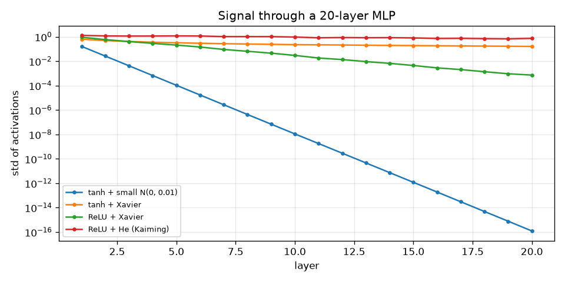
*Figure — With too-small weights the signal dies within a few layers; ReLU with Xavier init shrinks by about half per layer; ReLU with He init keeps it steady.*

Reading it: too-small weights → signal and gradient vanish (10⁻¹⁸); too-large → tanh saturates and gradients explode through the big weights, ReLU overflows to infinity; He for ReLU keeps everything near 1. (Xavier with tanh still decays slowly because tanh squashes; PyTorch's tanh gain 5/3, `nn.init.calculate_gain("tanh")`, compensates.)

### The full toolbox against vanishing/exploding gradients

| Fix | How it helps |
|---|---|
| ReLU-family activations | Derivative is exactly 1 for positive inputs — no shrinking factor |
| Good initialization (He/Xavier) | Keeps variance ≈ constant across layers at the start |
| Normalization layers (BatchNorm, LayerNorm — §10.7) | Re-centre and re-scale activations at every layer |
| Residual (skip) connections (Chapter 11) | Give gradients an identity "highway": y = x + F(x) |
| Gradient clipping | Caps the gradient norm (its overall length) (`clip_grad_norm_(params, 1.0)`); standard for RNNs and transformers |
| Gated units (LSTM/GRU — Chapter 12) | Additive memory paths through time |

### Common mistakes
- All-zero initialization for hidden weights.
- Very deep custom nets with default init and no normalization or residuals.
- Not monitoring per-layer gradient norms — they diagnose most "the loss won't move" bugs.

### In the interview
**30-second answer:** "Gradients are products of per-layer factors, so in deep nets they shrink or grow exponentially — caused by saturating activations (sigmoid′ ≤ 0.25) and badly scaled weights. Fixes: ReLU, variance-preserving init (Xavier for tanh, He for ReLU), normalization, residual connections, and clipping for explosions."

- *Q: Why He init has a factor 2?* A: ReLU zeroes about half the inputs, halving the variance; doubling the weight variance compensates.
- *Q: Why not zero init?* A: Symmetry — identical neurons get identical gradients and never differentiate.

### Self-check
1. Max derivative of sigmoid? → 0.25.
2. He init variance for fan_in = 256? → 2/256 ≈ 0.0078 (std ≈ 0.088).
3. Two fixes for exploding gradients? → Gradient clipping; a lower LR or better init/normalization.

### TL;DR
Many multiplied factors → vanishing/exploding gradients. ReLU + He init (tanh + Xavier), normalization, residuals, clipping.

---

## 10.7 Regularization: fighting overfitting

### The problem it solves
A big network can **memorise** a small training set, noise included, and fail on new data — **overfitting** (Chapter 1): training loss keeps falling while validation loss rises. **Regularization** is any technique that improves generalisation (performance on new, unseen data), usually by limiting how freely the model fits the training data.

`code/regularization.py` deliberately overfits a 3-hidden-layer, 256-unit MLP (~133k parameters) on only **80** noisy two-moons points (validated on 2,000 fresh ones), then tries each remedy.

```python
for epoch in range(EPOCHS):
    model.train()                                   # dropout ON, BN uses batch stats
    for idx in torch.randperm(len(Xtr)).split(16):
        xb = Xtr[idx] + noise * torch.randn_like(Xtr[idx])   # augmentation: jitter inputs
        loss = lossf(model(xb).squeeze(1), ytr[idx])
        opt.zero_grad(); loss.backward(); opt.step()
    model.eval()                                    # dropout OFF, BN uses running stats
    # ... record val loss; early stopping keeps the best weights, stops after `patience` bad epochs
```

Output:
```
No regularization            epochs=400  train acc=1.000  val acc=0.831  val loss=2.296
Dropout p=0.5                epochs=400  train acc=0.975  val acc=0.840  val loss=1.290
Weight decay 1.0 (AdamW)     epochs=400  train acc=1.000  val acc=0.826  val loss=0.792
BatchNorm                    epochs=400  train acc=0.938  val acc=0.858  val loss=0.399
Input-noise augmentation     epochs=400  train acc=0.925  val acc=0.858  val loss=0.422
Early stopping (patience 30) epochs= 48  train acc=0.887  val acc=0.872  val loss=0.317
```

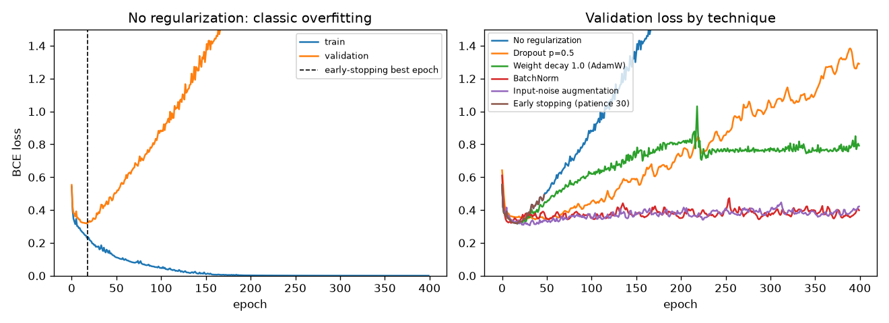
*Figure — Left: without regularization, validation loss bottoms out around epoch 18 and then climbs while training loss goes to 0 — textbook overfitting. Right: each technique flattens the validation curve.*

Every method improves validation **loss** (less over-confidence), but accuracy gains are modest; early stopping, augmentation and BatchNorm help most here. Real projects combine several.

### Dropout
During training, each unit's output is zeroed with probability p (0.5 for large dense layers, 0.1–0.3 elsewhere), independently on every forward pass, so a different random "thinned" network trains at each step. Units can't rely on specific partners, so they can't form fragile **co-adaptations** and learn redundant, robust features — roughly an ensemble (a combination of many models) of many sub-networks. PyTorch's `nn.Dropout(p)` is **inverted dropout**: survivors are multiplied by 1/(1 − p) during training so the expected value is unchanged, and in `model.eval()` dropout does nothing. Example: p = 0.5 and activations (2, 4, 6, 8) might become (0, 8, 12, 0).

### Weight decay (L2 regularization)
Adds a penalty λ·Σw² to the loss — for SGD, equivalent to shrinking every weight by the factor (1 − 2ηλ) each step, since the penalty's gradient is 2λw. Smaller weights give a smoother function less able to chase noise. With Adam use **AdamW** (decay applied directly, not through the adaptive scaling). Typical λ: 1e-4 to 1e-2 for SGD-style L2, 0.01–0.1 for AdamW; biases and normalization parameters are often excluded.

### Batch normalization
**What it is.** A layer (Ioffe & Szegedy, 2015) that, for each feature, normalizes the activations over the current **mini-batch** to mean 0 and variance 1, then applies a learnable scale γ and shift β:

x̂ = (x − μ_batch) / √(σ²_batch + ε),  y = γ x̂ + β

Worked numbers: one feature has batch values (2, 4, 6). μ = 4, σ² = (4 + 0 + 4)/3 = 2.667, √(σ² + ε) ≈ 1.633, so x̂ = (−1.225, 0, 1.225). With γ = 2, β = 0.5: y = (−1.95, 0.5, 2.95). γ and β let the network undo the normalization if that helps.

At training time it uses batch statistics and updates **running averages** of μ and σ²; at evaluation it uses the running averages (so single-example inference works).

**Benefits.** Faster, more stable training, **higher usable learning rates**, less sensitivity to initialization, and a mild **regularizing** noise (each example is normalised with the statistics of a random batch). The original paper credited reducing "internal covariate shift" (layer inputs changing distribution as earlier layers learn); Santurkar et al. (2018) argue the main effect is a smoother loss landscape. The practical benefits are not in doubt.

**Limits.** Noisy with very small batches and awkward for variable-length sequences. **LayerNorm** (normalize across the features of each single example) is standard in transformers and RNNs; **GroupNorm** suits small-batch vision.

### Early stopping
Evaluate validation loss every epoch, keep a copy of the best weights, stop after `patience` epochs without improvement and restore the best copy. Free and simple — the best single method in the demo. Because the validation set now drives a decision, report final numbers on a separate test set.

### Data augmentation
Create extra training examples with label-preserving transformations: flips, crops, small rotations and colour jitter for images; time shifts and noise for audio; synonym swaps or back-translation (translating to another language and back to get a reworded sentence) for text. In the demo, small Gaussian (bell-curve-shaped random) noise on the 2-D inputs plays this role; Chapter 11 covers image augmentation.

### Trade-offs

| Technique | Knob | Cost / watch out |
|---|---|---|
| Dropout | p | Slower convergence; needs `eval()`; less used with BatchNorm in CNNs |
| Weight decay | λ | Free; use AdamW with Adam |
| BatchNorm | momentum, eps | Small batches; train/eval differences |
| Early stopping | patience | Needs a validation set; restore the best weights |
| Data augmentation | strength | CPU time; must not change the label (a rotated "6" becomes "9") |
| Smaller model / more data | — | Often the most effective of all |

### Common mistakes
- Evaluating in `train()` mode; randomly augmenting validation/test data; early-stopping on training loss.

### Real-world examples
AlexNet (2012): dropout 0.5 in its dense layers plus heavy augmentation. ResNets: BatchNorm after every convolution (the sliding-filter operation at the heart of image networks, Chapter 11). Transformers: LayerNorm, dropout, AdamW weight decay.

### In the interview
**30-second answer:** "Dropout randomly zeroes units so the net can't rely on co-adapted features; weight decay penalises large weights; BatchNorm normalises per mini-batch, allowing higher learning rates and adding mild noise; early stopping halts when validation loss stops improving; augmentation adds label-preserving variants. More data is the best regularizer."

- *Q: What does dropout do at test time?* A: Nothing — inverted dropout already scaled during training, so eval uses the full network.
- *Q: BatchNorm at inference?* A: Uses the running mean/variance collected during training, not batch statistics.

### Self-check
1. Dropout p = 0.3 in PyTorch: surviving activations during training? → Scaled by 1/0.7.
2. Which normalization do transformers use? → LayerNorm (or its cheaper cousin RMSNorm).
3. Early stopping patience 10? → Stop after 10 epochs without validation improvement; restore the best weights.

### TL;DR
Overfitting = train loss ↓, val loss ↑. Combine early stopping, weight decay (AdamW), dropout, normalization and augmentation; more data beats all of them.

---

## 10.8 Practical training habits

### Normalize the inputs
Features on wildly different scales (pixels 0–255 next to incomes in the hundreds of thousands) stretch the loss surface into a ravine (see the optimizer figure), making training slow and unstable:

| Method | Formula | When |
|---|---|---|
| **Min-max scaling** | x′ = (x − min)/(max − min) → [0, 1] (or rescale to [−1, 1]) | Bounded data such as pixels (divide by 255) |
| **Standardization (z-score)** | x′ = (x − mean)/std → mean 0, std 1 | Most tabular features; per-channel for images (ImageNet mean/std) |

**Rule:** compute the statistics on the **training set only** and apply the same numbers to validation and test data; using all data leaks test information (Chapter 4).

### Mini-batches
One example per update is slow and noisy; the whole dataset per update is memory-hungry and gives few updates. **Mini-batches** are the compromise.

| Batch size | Gradient estimate | Updates per epoch | Memory | Notes |
|---|---|---|---|---|
| Small (e.g. 16–64) | Noisy | Many | Low | Noise often helps generalisation |
| Large (e.g. 256–4096) | Smooth | Few | High | GPU-efficient; needs larger LR + warmup |

Start around 32–256. Erratic training → larger batch or smaller LR; out of GPU memory → smaller batch, or **gradient accumulation** (sum gradients over several small batches before one `step()`).

### Class imbalance
When one class is rare (fraud, disease, defects), always predicting the majority class scores high accuracy — and is useless.

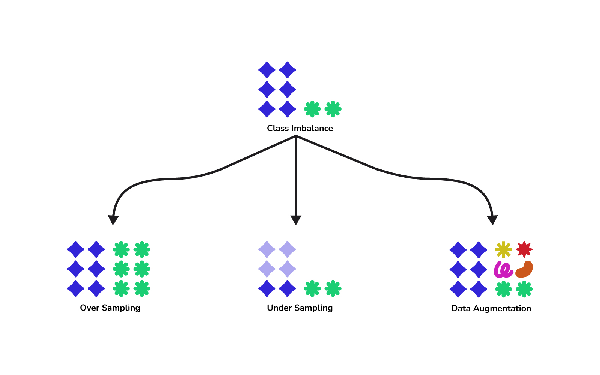
*Figure — An imbalanced dataset (top) and three remedies: oversampling the minority class, undersampling the majority class, and augmentation to create new minority examples (course diagram).*

| Method | How | Risk |
|---|---|---|
| **Oversampling** | Repeat minority examples or synthesise new ones (SMOTE interpolates between minority neighbours; augmentation for images); `WeightedRandomSampler` | Overfitting to repeats |
| **Undersampling** | Randomly drop majority examples | Throws away information |
| **Class weights** | Minority mistakes cost more: `CrossEntropyLoss(weight=…)`, `BCEWithLogitsLoss(pos_weight=…)` | Probabilities no longer calibrated (no longer match real frequencies) |
| **Threshold tuning / better metrics** | Evaluate with precision, recall, F1, PR-AUC (Chapter 6); tune the decision threshold | — |

From `code/practical_tips.py` (95% / 5% synthetic data). The weight for class c is n / (k · n_c) — n examples, k classes, n_c examples of class c: here 2000/(2·112) ≈ 8.9 for the minority and 2000/(2·1888) ≈ 0.53 for the majority:
```
  class counts in train: [1888, 112]  (minority = 5.6%)
  plain cross-entropy          accuracy=0.957  minority recall=0.369
  class-weighted (n/(k*n_c))   accuracy=0.939  minority recall=0.640
  (always predicting the majority class would score accuracy 0.945)
```
Accuracy barely moves (and sits near the useless "always majority" baseline), but the weighted loss finds 64% of the rare cases instead of 37%.

### Reading loss curves

| What you see | Likely cause | What to try |
|---|---|---|
| Loss flat from step 0, near ln(K) | LR far too small, or a bug (shuffled labels, missing `optimizer.step()`) | Overfit one batch; check the pipeline |
| Loss goes up / NaN / wild spikes | LR too high, exploding gradients, log(0) | Lower LR, gradient clipping, use logit-based losses |
| Training ↓, validation ↓ then ↑ | Overfitting | Regularization, early stopping, more data |
| Training and validation both high and close | Underfitting | Bigger model, train longer, higher LR, better features |
| Validation better than training | Dropout/augmentation only active in training, or an easier validation set | Usually fine — check the split |
| Noisy, jagged curve | Small batch or high LR | Larger batch, lower LR, smooth the plot |

### Overfit a small batch first
Before a long run, train on **one mini-batch** repeatedly; a correct model and pipeline drive its loss almost to zero within a few hundred steps. If not, there's a bug (wrong labels or loss, no gradients flowing) that no tuning will fix. Also check the **first** loss matches chance (ln 10 = 2.303 for 10 classes).

```
1) Overfit one batch of 32 examples
  step   0  loss on the single batch = 2.3176
  step  50  loss on the single batch = 0.0008
  step 200  loss on the single batch = 0.0002
  expected start ~ ln(10) = 2.303 (uniform guess over 10 classes)
```

### The learning-rate finder (LR range test)
Leslie Smith's trick, popularised by fast.ai: start with a tiny LR, **multiply it by a constant after every mini-batch** (exponential growth, e.g. 1e-5 → 10), and record the smoothed loss. It is flat while the LR is too small, drops once it is useful, and explodes when it is too large. Pick a value on the steep descent — commonly **one-tenth of the LR at the loss minimum**.

In `code/practical_tips.py` the multiplier is (10 / 1e-5)^(1/149) over 150 batches, the loss is smoothed with an exponential moving average (0.9·old + 0.1·new), and the test stops once the smoothed loss exceeds 4× its best. Output:
```
2) LR range test (SGD+momentum, lr grows 1e-5 -> 10)
  lowest smoothed loss at lr=0.619; loss blew up by lr=2.27; rule of thumb: pick ~1/10 of the minimum -> 0.062
3) Training curves for three learning rates (SGD+momentum, 30 epochs)
  lr=0.0001 final train loss 2.252  val loss 2.250
  lr=0.05   final train loss 0.035  val loss 0.111
  lr=3      final train loss 2.443  val loss 2.444
```

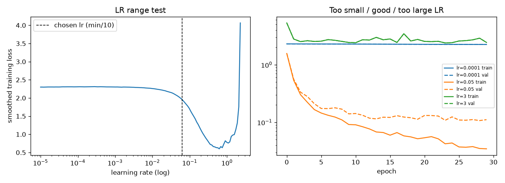
*Figure — Left: LR range test on the digits MLP. Right: the LR the test suggests (≈0.05) trains well; 1e-4 barely moves in 30 epochs; 3.0 bounces around chance level.*

### A debugging checklist
Inspect raw examples and labels after the pipeline → check chance-level first loss → overfit one batch → LR finder (or Adam 1e-3) → train with validation curves → only then regularize and tune; keep a simple baseline (logistic regression, gradient boosting) to know what "good" means. This is the spirit of Karpathy's "A Recipe for Training Neural Networks": know the data, start simple, verify each piece, then scale.

### In the interview
**30-second answer:** "Normalise inputs with training-set statistics, start from a known-good architecture and Adam, check the initial loss equals chance, overfit one batch to rule out bugs, pick the LR with a range test, then read train/validation curves for under- vs overfitting. For imbalance, use class weights or resampling and judge by recall/precision/PR-AUC, not accuracy."

### Self-check
1. Initial loss 8.0 on a 10-class problem? → Far above ln 10 ≈ 2.3: bad init/scale, wrong labels or loss — investigate first.
2. How does the LR finder choose a value? → Grow LR exponentially per batch, plot loss vs LR, pick about one-tenth of the LR at the minimum.
3. Three class-imbalance remedies? → Oversampling (or SMOTE), undersampling, class-weighted loss.

### TL;DR
Train-set normalisation; batches of 32–256; weights/resampling plus proper metrics for imbalance; chance-level first loss, overfit one batch, LR finder, read the curves.

---

## 10.9 PyTorch basics

### What it is
**PyTorch** (created at Meta AI, now governed by the PyTorch Foundation) is the most widely used deep-learning framework in research and common in production. Its core pieces:

| Piece | What it does |
|---|---|
| `torch.Tensor` | N-dimensional array like NumPy's, but can live on a GPU and track gradients |
| **autograd** | Records operations on tensors with `requires_grad=True`; `.backward()` fills `.grad` |
| `nn.Module` | Base class for models/layers; registers parameters and sub-modules; you write `forward()` |
| `nn.Linear`, `nn.Conv2d`, `nn.ReLU`, `nn.Dropout`… | Ready-made layers (`torch.nn.functional` has stateless versions, i.e. plain functions that hold no parameters) |
| `torch.optim` | Optimizers (SGD, Adam, AdamW…) and `lr_scheduler` |
| `Dataset` / `DataLoader` | Index into data; batch, shuffle and (optionally) load in parallel worker processes (separate helper programs running at the same time) |

### How it works — the training loop
Five lines per mini-batch: **forward → loss → zero_grad → backward → step.**

```python
# code/pytorch_basics.py (core)
class WineNet(nn.Module):
    def __init__(self, n_in, n_hidden, n_classes):
        super().__init__()                           # registers sub-modules and parameters
        self.net = nn.Sequential(nn.Linear(n_in, n_hidden), nn.ReLU(),
                                 nn.Linear(n_hidden, n_classes))   # logits, no softmax
    def forward(self, x):
        return self.net(x)

mean, std = Xtr.mean(0), Xtr.std(0)                  # standardize with TRAIN statistics only
Xtr, Xte = (Xtr - mean) / std, (Xte - mean) / std
train_ds = TensorDataset(torch.tensor(Xtr, dtype=torch.float32), torch.tensor(ytr, dtype=torch.long))
train_dl = DataLoader(train_ds, batch_size=32, shuffle=True)

model = WineNet(13, 32, 3)
loss_fn = nn.CrossEntropyLoss()                      # = log-softmax + negative log-likelihood
opt = torch.optim.Adam(model.parameters(), lr=1e-2)

for epoch in range(1, 31):
    model.train()
    for xb, yb in train_dl:
        logits = model(xb)                           # 1. forward
        loss = loss_fn(logits, yb)                   # 2. loss
        opt.zero_grad()                              # 3. clear old gradients
        loss.backward()                              # 4. backprop
        opt.step()                                   # 5. update weights

    model.eval()
    with torch.no_grad(): ...                        # evaluate: no graph building

torch.save(model.state_dict(), "wine.pt")            # save weights; the script reloads them into a fresh WineNet
```

Output (tensor demos and the model printout trimmed):
```
...
autograd dy/dx at x=2: 7.0
...
trainable parameters: 547
epoch  1  train loss 0.702 acc 0.944 | test loss 0.684 acc 0.907
epoch  5  train loss 0.092 acc 0.992 | test loss 0.083 acc 0.981
epoch 10  train loss 0.022 acc 1.000 | test loss 0.031 acc 0.981
epoch 30  train loss 0.003 acc 1.000 | test loss 0.018 acc 0.981
reloaded model test acc: 0.9814814814814815
...
```

Checks: y = x² + 3x at x = 2 gives dy/dx = 2·2 + 3 = 7, exactly what `.backward()` put in `x.grad`; parameters = 13·32 + 32 + 32·3 + 3 = 547. `model.train()`/`model.eval()` switch dropout and BatchNorm behaviour; `torch.no_grad()` saves memory and time when gradients aren't needed; `state_dict()` (an ordered dict of parameter and buffer tensors) is the recommended way to save and load.

**GPU:** `device = "cuda" if torch.cuda.is_available() else "cpu"` (Apple Silicon: `"mps"`); move the model and every batch with `.to(device)`. Mixed precision (`torch.autocast`: using 16-bit numbers where it is safe, to save memory and time) and `torch.compile(model)` (turns the model into optimised compiled code) speed up real workloads.

**Custom Dataset:** for data on disk, subclass `Dataset` with `__len__` and `__getitem__(i)` returning one (x, y) pair; `DataLoader(ds, batch_size=64, shuffle=True, num_workers=4)` batches, shuffles and loads in parallel.

### Common mistakes
- Forgetting `optimizer.zero_grad()`, or `model.eval()` / `torch.no_grad()` at evaluation.
- dtype mismatches: `CrossEntropyLoss` wants `long` class labels; `BCEWithLogitsLoss` wants float targets shaped like the logits.
- Calling `.item()`/`.numpy()` every step on a GPU — it forces a synchronisation (the CPU must stop and wait for the GPU to finish).
- Not shuffling the training loader.

### Real-world examples
PyTorch underlies Meta's production models, OpenAI's research code and most Hugging Face (a popular hub and library of pre-trained models) models. Wrappers — PyTorch Lightning, Hugging Face `Trainer`, fastai — hide the loop but run exactly these five steps.

### In the interview
**30-second answer:** "Subclass nn.Module and write forward; wrap a Dataset in a DataLoader for batching and shuffling; each step is forward, loss, zero_grad, backward, optimizer.step. Switch model.train()/eval() for dropout and BatchNorm, use torch.no_grad() for inference, and save the state_dict."

- *Q: Why must you call zero_grad?* A: `.backward()` adds into `.grad`; without zeroing you'd sum gradients from several batches (sometimes done on purpose: gradient accumulation).
- *Q: Difference between `nn.ReLU` and `F.relu`?* A: Same maths; the module form can sit in `nn.Sequential`, the functional form is called inside `forward`.

### Self-check
1. The five lines of a training step? → forward, loss, zero_grad, backward, step.
2. What does `model.eval()` change? → Dropout off; BatchNorm uses running statistics.
3. Parameters of `nn.Linear(100, 10)`? → 100·10 + 10 = 1,010.

### TL;DR
Tensors + autograd + nn.Module + DataLoader + optimizer. Loop: forward → loss → zero_grad → backward → step. train()/eval(), no_grad(), save state_dict.

---

## Chapter TL;DR
- **Neuron** = weighted sum + bias + activation; **MLP** = stacked layers building a feature hierarchy; one hidden layer solves XOR.
- **Activations/losses:** ReLU/GELU inside; identity/sigmoid/softmax out; MSE, BCE, cross-entropy on logits.
- **Backprop** = chain rule to every weight; then θ ← θ − η∇L with SGD/momentum/Adam(W) and a warmup + cosine schedule.
- **Deep-net stability:** ReLU, He/Xavier init, normalization, residuals, clipping. **Regularization:** dropout, weight decay, early stopping, augmentation, more data.
- **Practice:** chance-level first loss, overfit one batch, LR finder, read the curves; PyTorch's forward/loss/zero_grad/backward/step loop.

Next: Chapter 11 applies these ideas to images with convolutional networks; Chapter 12 to sequences with RNNs and attention.
