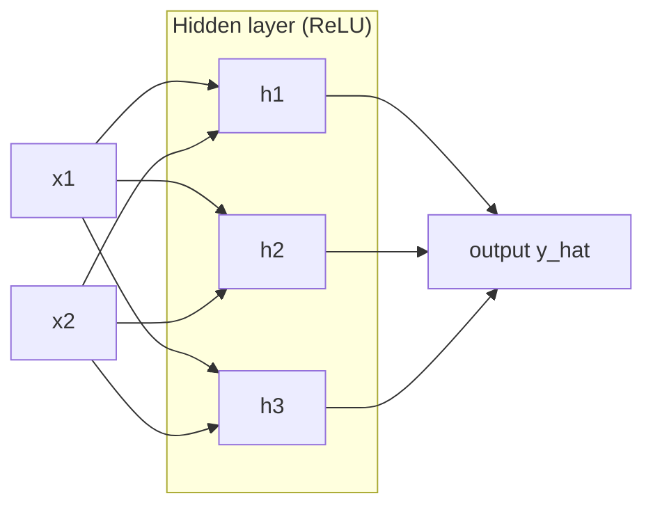
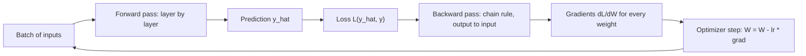

# Chapter 10 — Neural Networks and Deep Learning

A **neural network** is a function built from many tiny identical "neurons", each multiplying its inputs by numbers, adding them up and bending the result. Stack thousands in layers, tune the numbers on data with calculus, and you get systems that recognise faces, transcribe speech and write text. **Deep learning** is training networks with many layers.

This chapter builds it from zero — one neuron, a network, backpropagation with every number worked out, the engineering that makes deep nets train (optimizers, schedules, initialization, normalization, regularization), practical debugging habits — first in NumPy, then in PyTorch (the most popular deep-learning library).

All code is in `code/` and runs on CPU in seconds (PyTorch 2.x, scikit-learn); every output is real.

---

## 10.1 From the perceptron to the multi-layer perceptron

### What it is
An **artificial neuron** turns several numbers into one:

1. **Weighted sum:** each input xᵢ times a **weight** wᵢ (how much and in which direction it matters), plus a **bias** b (a baseline shift): z = w·x + b, the **pre-activation** or **logit**.
2. **Activation:** a fixed function bends z into a = f(z) — e.g. ReLU keeps positives and zeroes negatives.

The output feeds the next layer or is the prediction.


*Figure — Left: a biological neuron (dendrites collect signals, the axon sends one out). Right: the artificial version — inputs x₁…xₙ times weights, plus bias b (drawn as a constant input x₀ = 1), summed into z, then passed through activation f (course diagram).*

Biology is only inspiration — neurons are differentiable arithmetic (slopes computable for every number).

**Glossary for this chapter**

| Term | Meaning |
|---|---|
| Parameters | All learned weights and biases |
| Layer | Neurons reading the same inputs; a **dense** (fully connected, linear) layer links every input to every neuron |
| Input / hidden / output layer | Raw features / any layer between (values never in the data) / the layer producing the prediction |
| Hyperparameters | Choices you make: depth, width, learning rate, batch size… |
| Epoch | One full pass over the training set |
| Batch / mini-batch | The examples used for one weight update |

### The perceptron (1958) and its limit
Frank Rosenblatt's **perceptron** is one neuron with a **step** activation (1 if w·x + b > 0, else 0). When wrong, nudge toward the answer: w ← w + η(y − ŷ)x, b ← b + η(y − ŷ) (η = learning rate).

One neuron draws a **straight line** (a **hyperplane** in higher dimensions) through feature space: fine for AND, impossible for **XOR** ("exactly one input is 1"), whose classes no single line separates — made famous by Minsky and Papert's 1969 book *Perceptrons*.

```python
# code/perceptron.py (core)
for epoch in range(epochs):                         # w = zeros, b = 0, lr = 1.0
    for xi, yi in zip(X, y):
        pred = 1 if xi @ w + b > 0 else 0           # step activation
        update = lr * (yi - pred)                   # 0 if correct, +-1 if wrong
        w += update * xi; b += update
    # ... stop ("converged") after an epoch with no errors
```

Output:
```
AND: converged=True after 6 epochs, w=[2. 1.], b=-2.0, preds=[0 0 0 1], target=[0 0 0 1]
XOR: converged=False after 20 epochs, w=[-1.  0.], b=1.0, preds=[1 1 0 0], target=[0 1 1 0]
```

### The multi-layer perceptron (MLP)
**Stack** neurons: a **hidden layer** transforms inputs into new features for the output neuron. With two hidden neurons XOR is easy: one learns "x₁ OR x₂", another "x₁ AND x₂", the output "OR but not AND".

A network feeding forward with no loops is a **feed-forward network**; with all-dense layers it is a **multi-layer perceptron (MLP)** — the name stuck though modern MLPs use ReLU-like activations.



In matrix form a layer is **h = f(W x + b)** (one row of W per neuron); for a batch in rows of X, H = f(X Wᵀ + b). Dense-layer parameters = inputs × outputs + outputs; a 2 → 3 → 1 network has (2·3 + 3) + (3·1 + 1) = 13.

### Why nonlinearity is essential
Without activations, W₂(W₁x + b₁) + b₂ = (W₂W₁)x + (W₂b₁ + b₂) — still one linear function. The **universal approximation theorem** (Cybenko 1989, Hornik 1991): one hidden layer with enough neurons can approximate any continuous function on a bounded region arbitrarily well — saying nothing about how many neurons or whether training finds them.

### Why depth matters (hidden layers and "deep" networks)
Hidden layers build progressively more **abstract representations** (edges → textures and parts → objects). This **feature hierarchy** reuses lower-level pieces, so a deep net needs far fewer neurons than a wide shallow one. Depth costs computation, data and harder optimization (**gradients** — slopes telling each weight which way to move — must cross every layer; §10.6); ReLU, careful init, normalization, **residual connections** (adding a layer's input to its output; Chapter 11), GPUs and big datasets like ImageNet made deep nets trainable after ~2010.

### Trade-offs

| | Neural networks (MLP and beyond) | Gradient-boosted trees / linear models |
|---|---|---|
| Best data type | Images, audio, text, sequences — raw, high-dimensional, unstructured | Tabular rows and columns |
| Feature engineering | Learned automatically | Mostly manual |
| Data needed | Usually a lot | Works on small data |
| Compute | High (GPUs at real sizes) | Low |
| Interpretability | Low | Medium–high |
| Tuning effort | Many hyperparameters | Fewer |

### When not to use it
- Small tabular datasets: gradient-boosted trees (Chapter 7) usually win in seconds.
- Decisions that must be explained to a regulator when a simple model suffices, or no compute budget.

### Common mistakes
- Forgetting activations between layers (collapses to linear).
- "More layers is always better" — deeper nets overfit and train harder without the tricks below.

### Real-world examples
Google Photos search, Face ID, self-driving perception (CNNs — convolutional networks for images — and transformers — attention-based sequence networks; Chapters 11–12); voice-assistant speech recognition; YouTube and Meta recommenders running MLPs on learned **embeddings** (vectors representing each user or item; e.g. Meta's open-source DLRM).

### In the interview
**30-second answer:** "A neuron computes a weighted sum plus bias and applies a nonlinear activation. An MLP stacks layers; hidden layers learn intermediate features and depth composes simple features into complex ones. Without nonlinearities the stack collapses to one linear map. A single perceptron draws one hyperplane, so it can't learn XOR; one hidden layer can."

- *Parameters in a dense 256 → 128 layer?* 256·128 + 128 = 32,896.
- *What does universal approximation guarantee?* That a one-hidden-layer approximator exists — not that it's small or trainable.

### Self-check
1. What does a bias do? → Shifts the threshold, so a neuron can fire with all-zero inputs (or stay quiet with large ones).

### TL;DR
Neuron = weighted sum + bias + nonlinearity; MLP = layers of them. Hidden layers learn features, depth builds a hierarchy, nonlinearity makes stacking useful.

---

## 10.2 Activation functions

### What it is
The **activation function** is the nonlinearity applied to each pre-activation; it governs gradient flow and, at the output, what values the network can produce.


*Figure — Common activations (left) and their derivatives (right), computed with PyTorch autograd (§10.4) by `code/activations.py`. The sigmoid's derivative never exceeds 0.25, and sigmoid and tanh flatten to 0 for large |z| ("saturation").*

### The table

| Name | Formula | Output range | Derivative | Where used | Pros | Cons |
|---|---|---|---|---|---|---|
| **Sigmoid** σ | 1 / (1 + e^−z) | (0, 1) | σ(z)(1 − σ(z)), max 0.25 | Binary / multi-label outputs; LSTM gates | Reads as a probability | Saturates; not zero-centred |
| **Tanh** | (e^z − e^−z)/(e^z + e^−z) | (−1, 1) | 1 − tanh²(z), max 1 | RNN/LSTM hidden states | Zero-centred | Saturates for large \|z\| |
| **ReLU** | max(0, z) | [0, ∞) | 1 if z > 0, else 0 | Default hidden layer | Cheap, no saturation for z > 0 | "Dying ReLU": stuck at z < 0, zero gradient forever |
| **Leaky ReLU** (PReLU if α is learned) | z if z > 0 else αz (α≈0.01) | (−∞, ∞) | 1 or α | Hidden layers when ReLUs die | Never exactly zero gradient | Extra hyperparameter α |
| **ELU** | z if z > 0 else α(e^z − 1) | (−α, ∞) | 1 or αe^z | Hidden layers | Smooth, mean nearer 0 | exp is slower |
| **GELU** | z·Φ(z) (Φ = standard normal CDF) | ≈(−0.17, ∞) | Smooth | Transformers (BERT, GPT) | Smooth ReLU-like | More compute |
| **SiLU / Swish** | z·σ(z) | ≈(−0.28, ∞) | Smooth | EfficientNet; LLM feed-forward (SwiGLU) | Smooth | More compute |
| **Softmax** | softmaxᵢ(z) = e^zᵢ / Σⱼ e^zⱼ | each (0,1), sum = 1 | — | Single-label multi-class output | Probability distribution | Output layer only |
| **Identity (linear)** | z | (−∞, ∞) | 1 | Regression output | Unbounded | — |

> **Key terms:** *RNNs*/*LSTMs* (recurrent networks; LSTMs have "gates" deciding what to remember) process sequences step by step (Chapter 12). *Transformers* are the attention networks behind *BERT*, *GPT* and *LLMs* (large language models); *EfficientNet* is an image-network family. *Zero-centred* = outputs spread around 0; *saturates* = curve goes flat, slope ≈ 0. Φ (standard normal *CDF*) = probability a bell-curve value is below z. *SwiGLU* = gated SiLU.

From `code/activations.py`:
```
sigmoid  f(-2,0,2)=[0.119 0.5   0.881]  f'=[0.105 0.25  0.105]
tanh     f(-2,0,2)=[-0.964  0.     0.964]  f'=[0.071 1.    0.071]
ReLU     f(-2,0,2)=[0. 0. 2.]  f'=[0. 0. 1.]
softmax([2,1,0.1]) = [0.659 0.242 0.099]
```

**Softmax** (worked in [Chapter 5, section 5.9](../05-linear-and-logistic-regression/README.md)): z = (2, 1, 0.1) → (0.659, 0.242, 0.099). Adding a constant to all scores changes nothing, so libraries subtract max(z) first to avoid overflow.

### How to choose
1. **Hidden layers:** **ReLU** (Leaky ReLU if many units die); **GELU/SiLU** in transformers; tanh/sigmoid only inside recurrent gates (Chapter 12).
2. **Output layer** by task:

| Task | Output activation | Loss |
|---|---|---|
| Regression | None (identity) | MSE / MAE / Huber |
| Binary classification | Sigmoid (1 unit) | Binary cross-entropy |
| Multi-class, one label | Softmax (K units) | Categorical cross-entropy |
| Multi-label (several true) | Sigmoid per label | Binary cross-entropy per label |

In PyTorch the output layer usually emits **raw logits** and the loss applies sigmoid/softmax internally (`BCEWithLogitsLoss`, `CrossEntropyLoss`) — more numerically stable.

### Common mistakes
- `softmax` in the model plus `nn.CrossEntropyLoss` (which already applies log-softmax) — trains poorly.
- Sigmoid in every hidden layer of a deep net → vanishing gradients.
- ReLU on a regression output that must go negative.

### Real-world examples
AlexNet (2012) popularised ReLU (~6× faster training than tanh on CIFAR-10); BERT and GPT-2/3 use GELU; EfficientNet SiLU; LLaMA SwiGLU in its feed-forward blocks.

### In the interview
**30-second answer:** "Activations add nonlinearity. ReLU is the hidden-layer default — cheap, no saturation for positive inputs — with dead units as its weakness (Leaky ReLU helps). Sigmoid and tanh saturate, so they live at outputs and in RNN gates. GELU/SiLU are the smooth transformer defaults. Output: identity for regression, sigmoid for binary/multi-label, softmax for multi-class."

- *ReLU's gradient at 0?* z is exactly 0 with ~zero probability; frameworks define it (PyTorch: 0).
- *Softmax vs sigmoid for 3 classes?* Softmax if exactly one is true; independent sigmoids if several can be.

### TL;DR
ReLU (GELU in transformers) inside; identity / sigmoid / softmax at the output by task; sigmoid and tanh saturate and cause vanishing gradients in deep stacks.

---

## 10.3 The forward pass and loss functions

### What it is
The **forward pass** runs a batch through the layers (h = f(W h_prev + b)) to a **prediction** ŷ or raw logits ("P(cat) = 0.92"). The **loss function** compares ŷ with y, returning one number averaged over the batch; training minimises the average training loss.

### Loss functions

| Loss | Formula (one example) | Task | Notes |
|---|---|---|---|
| **MSE** | (ŷ − y)² | Regression | Punishes big errors; outlier-sensitive. `nn.MSELoss` |
| **MAE / L1** | \|ŷ − y\| | Regression | Outlier-robust; constant gradient size. `nn.L1Loss` |
| **Huber / Smooth L1** | ½(ŷ−y)² if \|ŷ−y\| ≤ δ else δ(\|ŷ−y\| − ½δ) | Regression | Quadratic near 0, linear far away. `nn.HuberLoss` |
| **Binary cross-entropy (BCE)** | −[y log p + (1−y) log(1−p)] | Binary / multi-label | p = σ(logit). `nn.BCEWithLogitsLoss` takes logits |
| **Categorical cross-entropy** | −log p_true | Multi-class | p = softmax(logits). `nn.CrossEntropyLoss` takes logits + integer labels |
| **Hinge** | max(0, 1 − y·s), y ∈ {−1, +1} | Max-margin classification | SVM loss; rare in deep learning |

**Worked cross-entropy.** Probabilities (0.7, 0.2, 0.1), true class 0: −ln 0.7 = 0.357; true class 2: −ln 0.1 = 2.303 — confident wrong answers punished hardest. A uniform guess over K classes has loss ln K (ln 10 = 2.303 for digits) — a sanity check for the first step.

Why not MSE for classification? Cross-entropy's gradient at the logits is **p − y** (§10.4), large when confidently wrong; MSE through a sigmoid is multiplied by σ′, tiny when saturated — learning stalls when most needed. Cross-entropy is also the maximum-likelihood loss for a Bernoulli or categorical model.

### Common mistakes
- Probabilities into `CrossEntropyLoss` / `BCEWithLogitsLoss` (they expect logits).
- Mixed target formats: `CrossEntropyLoss` takes integer indices (`long`, shape N) *or* class probabilities (`float`, N×K).
- Accuracy as a training loss — zero gradient almost everywhere.

### Self-check
1. First-step loss, 4 classes, sensible init? → ~ln 4 = 1.386.

### TL;DR
Forward pass = predictions layer by layer. MSE/MAE/Huber for regression, BCE for binary/multi-label, cross-entropy for multi-class — fed logits in PyTorch.

---

## 10.4 Backpropagation

### What it is
**Backpropagation** computes the **gradient** of the loss for every weight ("nudge this up a bit — how does the loss change?") by applying the **chain rule** from the output backwards, reusing intermediate results, at only ~2–3× the cost of a forward pass regardless of parameter count. Popularised for neural nets by Rumelhart, Hinton and Williams (1986). Fundamentals: [Chapter 2, section 2.4](../02-math-for-ml/README.md).

Backprop only computes gradients; **gradient descent** uses them: θ ← θ − η·∂L/∂θ (∂L/∂θ = **partial derivative**, the slope w.r.t. θ alone; η = **learning rate**).



This forward → loss → backward → update loop over mini-batches and epochs is **how every neural network learns**.

### The chain rule in one line
If L = g(b) and b = h(a), then ∂L/∂a = ∂L/∂b · ∂b/∂a. Backprop multiplies local derivatives from the loss back to each weight; each layer needs only the incoming gradient and its own local derivative.

### Worked example with numbers
2 inputs → 2 hidden (ReLU) → 1 output (sigmoid), BCE loss. x = (1, 2), y = 1; W₁ = [[0.5, −0.2], [0.3, 0.4]] (row j = weights into hidden unit j), b₁ = (0.1, −0.5); w₂ = (0.7, −0.6), b₂ = 0.2; η = 0.1.

**Forward pass**

| Step | Computation | Value |
|---|---|---|
| z₁ (hidden unit 1) | 0.5·1 + (−0.2)·2 + 0.1 | 0.2 |
| z₁ (hidden unit 2) | 0.3·1 + 0.4·2 − 0.5 | 0.6 |
| h = ReLU(z₁) | Both positive, unchanged | (0.2, 0.6) |
| z₂ | 0.7·0.2 + (−0.6)·0.6 + 0.2 | −0.02 |
| ŷ = σ(z₂) | 1/(1 + e^0.02) | 0.4950 |
| L = −ln ŷ | (y = 1) | 0.7032 |

**Backward pass** (previous gradient × local derivative)

| Gradient | Rule | Value |
|---|---|---|
| ∂L/∂z₂ | Sigmoid + BCE simplifies to ŷ − y | −0.5050 |
| ∂L/∂w₂ | ∂L/∂z₂ · h | (−0.101, −0.303) |
| ∂L/∂b₂ | ∂L/∂z₂ · 1 | −0.5050 |
| ∂L/∂h | ∂L/∂z₂ · w₂ | (−0.3535, 0.303) |
| ∂L/∂z₁ | ∂L/∂h · ReLU′(z₁), ReLU′ = 1 (both z₁ > 0) | (−0.3535, 0.303) |
| ∂L/∂W₁ | ∂L/∂z₁ (column) × xᵀ (row) — outer product | [[−0.3535, −0.707], [0.303, 0.606]] |
| ∂L/∂b₁ | ∂L/∂z₁ | (−0.3535, 0.303) |

Why ŷ − y? ∂L/∂ŷ = −y/ŷ + (1−y)/(1−ŷ) and σ′(z) = ŷ(1 − ŷ); their product cancels to ŷ − y. Softmax + cross-entropy likewise gives ∂L/∂logits = p − one_hot(y) (1 at the true class, 0 elsewhere).

**Reading the gradients.** ∂L/∂w₂ < 0, so descent *increases* w₂, pushing ŷ toward 1. Hidden unit 2 has a negative outgoing weight, so the network wants it *smaller*: its incoming weights get positive gradients and shrink.

**Update** (η = 0.1): w₂ ← (0.7, −0.6) − 0.1·(−0.101, −0.303) = (0.7101, −0.5697). After updating everything, ŷ = 0.5756 and loss 0.5523 (from 0.7032).

The script checks the hand gradients against PyTorch's automatic differentiation:

```python
# code/backprop_by_hand.py (backward part)
dz2 = y_hat - y                  # dL/dz2 for sigmoid + BCE
dw2 = dz2 * h;  db2 = dz2
dh  = dz2 * w2
dz1 = dh * (z1 > 0)              # ReLU'(z1)
dW1 = np.outer(dz1, x);  db1 = dz1
# ... then the same network in torch, loss.backward(), and np.allclose on every gradient
```

Output (last lines; the rest repeats the tables):
```
autograd agrees with hand-derived gradients: True
after one SGD step (lr=0.1): y_hat 0.4950 -> 0.5756, loss 0.7032 -> 0.5523
```

### A 2-layer network from scratch in NumPy
`code/numpy_mlp.py` does this for a whole batch (rows = examples), tanh hidden units, sigmoid output, **full-batch** gradient descent (each update uses the whole training set). *fan_in* = inputs feeding a layer (*fan_out* = its outputs).

```python
class TwoLayerNet:
    """x -> tanh(x W1 + b1) -> sigmoid(h W2 + b2). Rows of X are examples."""
    # __init__: W1, W2 ~ N(0, 1/fan_in) (LeCun-style scale), biases 0
    def forward(self, X):
        self.X = X
        self.H = np.tanh(X @ self.W1 + self.b1)
        self.P = 1 / (1 + np.exp(-(self.H @ self.W2 + self.b2)))
        return self.P

    def backward(self, y):
        n = len(y)
        dZ2 = (self.P - y[:, None]) / n                  # BCE + sigmoid, averaged over batch
        dW2 = self.H.T @ dZ2;  db2 = dZ2.sum(0)
        dH = dZ2 @ self.W2.T
        dZ1 = dH * (1 - self.H ** 2)                      # tanh'(z) = 1 - tanh(z)^2
        dW1 = self.X.T @ dZ1;  db1 = dZ1.sum(0)
        return dW1, db1, dW2, db2

    def step(self, grads, lr):
        for p, g in zip((self.W1, self.b1, self.W2, self.b2), grads):
            p -= lr * g
```

`forward` stores X, H, P because backward needs them (why training uses more memory than **inference**, i.e. just predicting). A weight matrix's gradient is always (layer input)ᵀ @ (gradient at the layer's output). The script also runs a **numerical gradient check** (nudge a weight by ±ε, measure the loss change) — the standard test for a hand-written backward pass.

Output:
```
XOR  loss 0.687 -> 0.0012, probs = [0.    0.999 0.999 0.002]
Moons loss 0.682 -> 0.0363, train acc 0.986, test acc 0.956
gradient check  numerical: [-0.02769  -0.015654 -0.024803]  analytical: [-0.02769  -0.015654 -0.024803]
```


*Figure — Left: training loss falls smoothly. Right: the 16-hidden-unit network has learned a curved boundary no linear model could draw.*

### Computational graphs and autograd
Frameworks record every **tensor** (multi-dimensional array) operation in a **computational graph**; `loss.backward()` walks it in reverse, accumulating into each parameter's `.grad`. This is **reverse-mode automatic differentiation** — exact, and cheap when one scalar output (the loss) depends on many inputs. Karpathy's *micrograd* builds such an engine in ~100 lines.

### Common mistakes
- Not zeroing gradients between PyTorch steps (they **accumulate**); summing instead of averaging the batch loss (effective LR then scales with batch size); hand-written backward passes without a gradient check.

### In the interview
**30-second answer:** "Backprop applies the chain rule from the loss backwards through the computational graph, getting ∂L/∂θ for every parameter for a small constant multiple of a forward pass. Each layer multiplies the incoming gradient by its local derivative. An optimizer then steps against the gradient. For sigmoid+BCE or softmax+cross-entropy, the gradient at the logits is prediction minus target."

- *Why reverse mode?* One scalar output, millions of inputs: one backward sweep gets every partial; forward mode needs one sweep per input.
- *What must the forward pass store?* Activations the local derivatives need — so training memory grows with batch size and depth (**gradient checkpointing** trades recompute for memory).

### TL;DR
Forward computes the loss; backward applies the chain rule layer by layer; gradient descent subtracts LR × gradient. Autograd automates the backward pass.

---

## 10.5 Optimizers and learning-rate schedules

### What it is
An **optimizer** turns gradients into updates. The **learning rate** is the single most important deep-learning hyperparameter: too big overshoots, too small crawls; schedules and adaptive optimizers move fast first and slowly near the target.

### How the main optimizers work
g = mini-batch gradient, η = learning rate, θ = a parameter. (Plain GD and its batch/mini-batch/stochastic variants: [Chapter 2, section 2.5](../02-math-for-ml/README.md).)

| Optimizer | Update rule (per parameter) | Idea | PyTorch defaults |
|---|---|---|---|
| **SGD** (stochastic gradient descent) | θ ← θ − η g | Step on a mini-batch gradient estimate | `SGD(lr=…)` — always set lr |
| **SGD + momentum** | v ← μ v + g; θ ← θ − η v | Running "velocity": consistent directions accelerate, zig-zags cancel | μ typically 0.9 |
| **Nesterov momentum** | Gradient at the look-ahead point | Better-behaved momentum | `nesterov=True` |
| **AdaGrad** | s ← s + g²; θ ← θ − η g/(√s + ε) | Per-parameter step, shrinking for frequently updated params | Good for sparse features; step decays too much for deep nets |
| **RMSProp** | s ← ρ s + (1−ρ) g²; θ ← θ − η g/(√s + ε) | AdaGrad with a **moving average** (recent values weighted more), so steps don't vanish | lr 0.01, ρ (`alpha`) 0.99 |
| **Adam** | m ← β₁m + (1−β₁)g; s ← β₂s + (1−β₂)g²; m̂ = m/(1−β₁ᵗ), ŝ = s/(1−β₂ᵗ); θ ← θ − η m̂/(√ŝ + ε) | Momentum + RMSProp + bias correction for the zero start | lr 1e-3, β = (0.9, 0.999), ε = 1e-8 |
| **AdamW** | Adam plus θ ← θ − η λ θ, separate from the gradient | "Decoupled" **weight decay** (shrink every weight toward 0 each step; §10.7) — the correct L2-style shrinkage with Adam | weight_decay 0.01 |

- **Momentum:** a heavy ball speeding along consistent slopes and damping zig-zags in narrow "ravines".
- **Adaptive methods** (RMSProp, Adam) divide each parameter's step by its recent gradient magnitude: steep, noisy directions take smaller steps, flat ones bigger; mini-batch noise can also help escape sharp minima.
- **Adam's first step** (g = 0.5, β₁ = 0.9, β₂ = 0.999): m = 0.05, s = 0.00025; m̂ = 0.5, ŝ = 0.25; step = η·0.5/√0.25 = η. Without correction: η·0.05/0.0158 ≈ 3.2η — distorted. The step is ≈η whatever the gradient's size: Adam's steps are scale-free.

`code/optimizers.py` runs four optimizers via `torch.optim` on (a) a 2-D ravine f(x, y) = 0.05x² + 2y² (40× steeper in y), from (−10, 2), and (b) an MLP on two moons, each near its largest well-behaved LR (SGD 0.45, momentum 0.05, RMSProp 0.3, Adam 0.5):

```python
p = torch.tensor([-10.0, 2.0], requires_grad=True)
opt = torch.optim.SGD([p], lr=0.05, momentum=0.9)   # or RMSprop / Adam
for _ in range(60):
    opt.zero_grad(); ravine(p).backward(); opt.step()
```

Output:
```
(a) ravine f = 0.05 x^2 + 2 y^2, start (-10, 2), 60 steps
  SGD                final point [-0.631  0.   ]  loss 1.99e-02
  SGD+momentum(0.9)  final point [ 0.358 -0.073]  loss 1.71e-02
  RMSProp            final point [-0.  0.]  loss 3.77e-14
  Adam               final point [-0.215  0.045]  loss 6.42e-03
(b) MLP 2-32-32-1 on moons, 200 full-batch epochs
  SGD                loss after 20 epochs 0.639, after 200 0.265
  SGD+momentum(0.9)  loss after 20 epochs 0.310, after 200 0.083
  RMSProp            loss after 20 epochs 0.171, after 200 0.080
  Adam               loss after 20 epochs 0.274, after 200 0.075
```


*Figure — Left: SGD's LR is capped by the steep y-direction, so it crawls in x; momentum overshoots but travels fast; RMSProp and Adam rescale each coordinate and head almost straight in. Right: momentum and adaptive methods reach low loss far sooner.*

RMSProp shines because its per-coordinate scaling exactly undoes this axis-aligned ravine — don't over-read toys. In practice **Adam/AdamW** is the default for transformers and most new models; **SGD with momentum** plus a schedule stays competitive (sometimes generalising slightly better) for CNN image classifiers.

### Learning-rate schedules
A **schedule** changes η during training: big steps early, small late.

| Schedule | Shape | PyTorch | Typical use |
|---|---|---|---|
| Constant | Flat | — | Baselines, small problems with Adam |
| Step decay | ×γ every k epochs | `StepLR`, `MultiStepLR` | Classic ResNet (landmark image network, Chapter 11) recipe: ÷10 at epochs 30, 60, 90 |
| Exponential decay | ×γ every step/epoch | `ExponentialLR` | Simple smooth decay |
| Reduce on plateau | Drop when validation stalls | `ReduceLROnPlateau` | Unknown epoch count |
| Cosine annealing | Half cosine from η_max to ~0 | `CosineAnnealingLR` | Modern default for vision and LLMs |
| Linear warmup + decay | Ramp from ~0, then cosine/linear decay | `LinearLR` + `SequentialLR` | Transformers (warmup avoids early Adam instability) |
| One-cycle | Warm up to max, anneal far below start | `OneCycleLR` | Fast training (Leslie Smith's "super-convergence") |

```python
# code/lr_schedules.py (warmup + cosine) - each step: opt.step() THEN sched.step()
sched = S.SequentialLR(opt, [S.LinearLR(opt, start_factor=0.01, total_iters=10),
                             S.CosineAnnealingLR(opt, T_max=90)], milestones=[10])
```

Output:
```
Constant                 lr at steps 0/10/50/99: 0.1000 0.1000 0.1000 0.10000
StepLR (x0.5 every 25)   lr at steps 0/10/50/99: 0.1000 0.1000 0.0250 0.01250
ExponentialLR (0.97)     lr at steps 0/10/50/99: 0.1000 0.0737 0.0218 0.00490
CosineAnnealingLR        lr at steps 0/10/50/99: 0.1000 0.0976 0.0500 0.00002
Warmup 10 + cosine       lr at steps 0/10/50/99: 0.0010 0.1000 0.0587 0.00003
OneCycleLR               lr at steps 0/10/50/99: 0.0040 0.0295 0.0794 0.00000
```


*Figure — The six schedules over 100 steps.*

### Trade-offs

| | SGD + momentum | Adam / AdamW |
|---|---|---|
| Tuning | LR and schedule matter a lot | Works near lr=1e-3 out of the box |
| Convergence speed | Slower early | Fast early |
| Generalization | Often excellent on CNNs | Excellent on transformers (AdamW) |
| Memory | 1 extra buffer per parameter | 2 extra buffers per parameter |

### Common mistakes
- `Adam(weight_decay=…)` expecting AdamW — there decay is added to the gradient (L2) and distorted by adaptive scaling; use `AdamW`.
- `scheduler.step()` before `optimizer.step()` (PyTorch warns; first LR skipped).
- Changing batch size without revisiting LR (SGD heuristic: scale LR roughly linearly with batch size, plus warmup).

### Real-world examples
GPT-3 and LLaMA use Adam/AdamW with linear warmup + cosine decay; the original ResNet SGD, momentum 0.9, LR ÷10 on plateaus; fast.ai popularised one-cycle and the LR finder.

### In the interview
**30-second answer:** "SGD steps against the mini-batch gradient; momentum accumulates a velocity so consistent directions speed up and oscillations cancel; RMSProp divides each step by a running RMS (root mean square, a typical size) of that parameter's gradients; Adam combines both with bias correction, and AdamW decouples weight decay. A schedule — typically warmup then cosine decay — gives big steps early and fine steps late."

- *Why warmup with Adam?* Early second-moment estimates are poor and gradients large; a small initial LR prevents destructive first updates.
- *Why bias correction?* m and s start at 0, biasing early averages toward 0; dividing by 1 − βᵗ fixes it.

### TL;DR
Learning rate first. Adam/AdamW (lr ≈ 3e-4 to 1e-3) is the safe default; SGD+momentum with a schedule is strong for CNNs; warmup + cosine or one-cycle.

---

## 10.6 Initialization and vanishing/exploding gradients

### The problem it solves
The gradient reaching layer 1 is a **product** of one factor per layer above. Factors below 1 shrink it exponentially with depth — **vanishing gradients** (early layers barely learn); above 1 grow it — **exploding gradients** (huge updates, NaN loss). Forward activations can likewise fade or blow up. Two sources:
1. **Activation derivatives:** sigmoid′ ≤ 0.25, so ten sigmoid layers scale the gradient by at most 0.25¹⁰ ≈ 9.5 × 10⁻⁷.
2. **Weight scale:** badly scaled W shrinks or grows the signal's variance by a constant factor per layer.

### How initialization fixes it
Keep the **variance** of activations (forward) and gradients (backward) roughly constant across layers. z = Σ wᵢxᵢ sums fan_in independent terms, so Var(z) = fan_in · Var(w) · Var(x); Var(w) = 1/fan_in keeps Var(z) = Var(x) (fan_in = 256 → std 0.0625). Xavier also balances the backward pass (fan_out); He doubles the variance for ReLU:

| Scheme | Weight variance | Designed for | PyTorch |
|---|---|---|---|
| **Xavier / Glorot** (2010) | 2 / (fan_in + fan_out) (normal version) | tanh, sigmoid, linear | `nn.init.xavier_normal_` / `xavier_uniform_` |
| **He / Kaiming** (2015) | 2 / fan_in | ReLU family (ReLU zeroes half the signal, so double the variance) | `nn.init.kaiming_normal_(w, nonlinearity="relu")` |
| **LeCun** | 1 / fan_in | SELU (self-normalising activation), linear | `kaiming_normal_(w, nonlinearity="linear")` |

Biases usually start at 0. **Never give all weights one value** (e.g. zeros): every neuron in a layer computes the same thing with the same gradient forever — **symmetry** never breaks. PyTorch's `nn.Linear` default (Kaiming-uniform with a = √5, i.e. U(−1/√fan_in, 1/√fan_in)) is fine for small nets; explicit He init is common for deep ReLU nets.

`code/init_and_gradients.py` pushes random data through a **20-layer, 256-wide MLP**, measuring activation spread and the gradient at layer 1:

```
tanh  + small N(0, 0.01)  activation std layer1=0.163 layer20=1.22e-16   |grad W1|=7.05e-18
tanh  + large N(0, 1)     activation std layer1=0.975 layer20=0.974   |grad W1|=8.04e+07
tanh  + Xavier            activation std layer1=0.63 layer20=0.16   |grad W1|=0.0255
...
ReLU  + large N(0, 1)     activation std layer1=14.6 layer20=8.73e+20   |grad W1|=inf
ReLU  + Xavier            activation std layer1=0.911 layer20=0.000722   |grad W1|=9.78e-06
ReLU  + He (Kaiming)      activation std layer1=1.29 layer20=0.739   |grad W1|=0.292
```


*Figure — With too-small weights the signal dies within a few layers; ReLU with Xavier init shrinks by about half per layer; ReLU with He init keeps it steady.*

Too-small weights → signal and gradient vanish (10⁻¹⁸); too-large → tanh saturates and gradients explode, ReLU overflows to infinity; He for ReLU keeps everything near 1. (Xavier + tanh still decays because tanh squashes; PyTorch's tanh gain 5/3, `nn.init.calculate_gain("tanh")`, compensates.)

### The full toolbox against vanishing/exploding gradients

| Fix | How it helps |
|---|---|
| ReLU-family activations | Derivative exactly 1 for positive inputs |
| Good initialization (He/Xavier) | Variance ≈ constant across layers at the start |
| Normalization layers (BatchNorm, LayerNorm — §10.7) | Re-centre and re-scale activations every layer |
| Residual (skip) connections (Chapter 11) | Identity "highway" for gradients: y = x + F(x) |
| Gradient clipping | Caps the gradient **norm** (overall length) (`clip_grad_norm_(params, 1.0)`); standard for RNNs and transformers |
| Gated units (LSTM/GRU — Chapter 12) | Additive memory paths through time |

### Common mistakes
- All-zero hidden-weight init; very deep custom nets with default init, no normalization or residuals.
- Not monitoring per-layer gradient norms — they diagnose most "loss won't move" bugs.

### In the interview
**30-second answer:** "Gradients are products of per-layer factors, so in deep nets they shrink or grow exponentially — caused by saturating activations (sigmoid′ ≤ 0.25) and badly scaled weights. Fixes: ReLU, variance-preserving init (Xavier for tanh, He for ReLU), normalization, residual connections, and clipping for explosions."

- *Why He's factor 2?* ReLU zeroes about half the inputs, halving variance.
- *Why not zero init?* Symmetry — identical neurons get identical gradients.

### Self-check
1. He variance for fan_in = 256? → 2/256 ≈ 0.0078 (std ≈ 0.088).

### TL;DR
Multiplied factors → vanishing/exploding gradients. ReLU + He (tanh + Xavier), normalization, residuals, clipping.

---

## 10.7 Regularization: fighting overfitting

### The problem it solves
A big network can **memorise** a small training set — **overfitting** (training loss falls, validation loss rises; bias–variance in [Chapter 6, section 6.7](../06-evaluation-and-tuning/README.md)). **Regularization** is anything improving generalisation, usually by limiting how freely the model fits.

`code/regularization.py` deliberately overfits a 3-hidden-layer, 256-unit MLP (~133k parameters) on only **80** noisy two-moons points (validated on 2,000), then tries each remedy (each epoch: `model.train()` — dropout on, BatchNorm on batch statistics — with optional input jitter; then `model.eval()` for validation; early stopping keeps the best weights). Output:
```
No regularization            epochs=400  train acc=1.000  val acc=0.831  val loss=2.296
Dropout p=0.5                epochs=400  train acc=0.975  val acc=0.840  val loss=1.290
Weight decay 1.0 (AdamW)     epochs=400  train acc=1.000  val acc=0.826  val loss=0.792
BatchNorm                    epochs=400  train acc=0.938  val acc=0.858  val loss=0.399
Input-noise augmentation     epochs=400  train acc=0.925  val acc=0.858  val loss=0.422
Early stopping (patience 30) epochs= 48  train acc=0.887  val acc=0.872  val loss=0.317
```


*Figure — Left: unregularized, validation loss bottoms near epoch 18 then climbs while training loss → 0. Right: each technique flattens the validation curve.*

Every method improves validation **loss**; accuracy gains are modest (early stopping, augmentation and BatchNorm help most). Real projects combine several.

### Dropout
In training each unit's output is zeroed with probability p (0.5 for large dense layers, 0.1–0.3 elsewhere), independently per forward pass, so a different "thinned" network trains each step. Units can't form fragile **co-adaptations** and learn redundant robust features — roughly an ensemble of sub-networks. PyTorch's `nn.Dropout(p)` is **inverted dropout**: survivors are scaled by 1/(1 − p) in training so the expectation is unchanged, and `model.eval()` disables it. E.g. p = 0.5: (2, 4, 6, 8) → (0, 8, 12, 0).

### Weight decay (L2 regularization)
Adds λ·Σw² to the loss — for SGD, shrinking each weight by (1 − 2ηλ) per step (the penalty's gradient is 2λw). Smaller weights give smoother functions less able to chase noise. With Adam use **AdamW**. Typical λ: 1e-4 to 1e-2 (SGD L2), 0.01–0.1 (AdamW); biases and normalization parameters often excluded.

### Batch normalization
**What it is.** A layer (Ioffe & Szegedy, 2015) normalising each feature over the **mini-batch** to mean 0, variance 1, then applying learnable scale γ and shift β:

x̂ = (x − μ_batch) / √(σ²_batch + ε),  y = γ x̂ + β

Worked: batch values (2, 4, 6): μ = 4, σ² = 2.667, √(σ² + ε) ≈ 1.633, x̂ = (−1.225, 0, 1.225); γ = 2, β = 0.5 → y = (−1.95, 0.5, 2.95). γ, β let the network undo the normalization if useful.

Training uses batch statistics and updates **running averages** of μ, σ²; evaluation uses the running averages (so single-example inference works).

**Benefits:** faster, more stable training, **higher usable learning rates**, less init sensitivity, mild **regularizing** noise (each example normalised with a random batch's statistics). The paper credited reducing "internal covariate shift" (layer inputs changing distribution as earlier layers learn); Santurkar et al. (2018) argue it mainly smooths the loss landscape.

**Limits:** noisy with tiny batches, awkward for variable-length sequences. **LayerNorm** (normalise across one example's features) is standard in transformers and RNNs; **GroupNorm** suits small-batch vision.

### Early stopping
Evaluate validation loss each epoch, keep the best weights, stop after `patience` epochs without improvement and restore them — free, and the best single method in the demo. The validation set now drives a decision, so report final numbers on a separate test set. (General treatment: [Chapter 6, section 6.10](../06-evaluation-and-tuning/README.md).)

### Data augmentation
Extra examples via label-preserving transformations: flips, crops, small rotations, colour jitter (images); time shifts, noise (audio); synonym swaps or **back-translation** (translate to another language and back) for text. Here, small Gaussian noise on the 2-D inputs; image augmentation in Chapter 11.

### Trade-offs

| Technique | Knob | Cost / watch out |
|---|---|---|
| Dropout | p | Slower convergence; needs `eval()`; less used with BatchNorm in CNNs |
| Weight decay | λ | Free; AdamW with Adam |
| BatchNorm | momentum, eps | Small batches; train/eval differences |
| Early stopping | patience | Needs a validation set; restore best weights |
| Data augmentation | strength | CPU time; must not change the label (a rotated "6" becomes "9") |
| Smaller model / more data | — | Often the most effective of all |

### Common mistakes
- Evaluating in `train()` mode; augmenting validation/test data; early-stopping on training loss.

### Real-world examples
AlexNet (2012): dropout 0.5 in dense layers plus heavy augmentation. ResNets: BatchNorm after every **convolution** (the sliding-filter operation of image networks, Chapter 11). Transformers: LayerNorm, dropout, AdamW weight decay.

### In the interview
**30-second answer:** "Dropout randomly zeroes units so the net can't rely on co-adapted features; weight decay penalises large weights; BatchNorm normalises per mini-batch, allowing higher learning rates and adding mild noise; early stopping halts when validation loss stops improving; augmentation adds label-preserving variants. More data is the best regularizer."

- *Dropout at test time?* Nothing — inverted dropout already scaled in training.
- *BatchNorm at inference?* Running mean/variance from training, not batch statistics.

### Self-check
1. Transformer normalization? → LayerNorm (or the cheaper RMSNorm).

### TL;DR
Overfitting = train loss ↓, val loss ↑. Combine early stopping, weight decay (AdamW), dropout, normalization and augmentation; more data beats them all.

---

## 10.8 Practical training habits

### Normalize the inputs
Wildly different scales (pixels 0–255 beside incomes in the hundreds of thousands) stretch the loss surface into a ravine. **Min-max scaling** to [0, 1] (or [−1, 1]) suits bounded data such as pixels (÷255); **standardization (z-score)** to mean 0, std 1 suits most tabular features, per-channel for images (ImageNet mean/std). Compute statistics on the **training set only** (scalers in detail: [Chapter 4, section 4.5](../04-data-eda-feature-engineering/README.md)).

### Mini-batches
One example per update is slow and noisy; the full dataset is memory-hungry with few updates; **mini-batches** compromise.

| Batch size | Gradient estimate | Updates per epoch | Memory | Notes |
|---|---|---|---|---|
| Small (16–64) | Noisy | Many | Low | Noise often helps generalisation |
| Large (256–4096) | Smooth | Few | High | GPU-efficient; needs larger LR + warmup |

Start at 32–256. Erratic training → larger batch or smaller LR; out of GPU memory → smaller batch or **gradient accumulation** (sum gradients over several small batches before one `step()`).

### Class imbalance
With a rare class (fraud, disease, defects), always predicting the majority scores high accuracy and is useless (full treatment: [Chapter 4, section 4.9](../04-data-eda-feature-engineering/README.md)).


*Figure — An imbalanced dataset (top) and three remedies: oversampling the minority class, undersampling the majority class, and augmentation to create new minority examples (course diagram).*

| Method | How | Risk |
|---|---|---|
| **Oversampling** | Repeat or synthesise minority examples (SMOTE interpolates between minority neighbours; augmentation for images); `WeightedRandomSampler` | Overfitting to repeats |
| **Undersampling** | Drop majority examples | Throws away information |
| **Class weights** | Minority mistakes cost more: `CrossEntropyLoss(weight=…)`, `BCEWithLogitsLoss(pos_weight=…)` | Probabilities no longer calibrated |
| **Threshold tuning / better metrics** | Precision, recall, F1, PR-AUC (Chapter 6); tune the threshold | — |

`code/practical_tips.py` (95% / 5% synthetic data); class weight = n / (k · n_c) (n examples, k classes, n_c in class c): 2000/(2·112) ≈ 8.9 minority, 2000/(2·1888) ≈ 0.53 majority:
```
  class counts in train: [1888, 112]  (minority = 5.6%)
  plain cross-entropy          accuracy=0.957  minority recall=0.369
  class-weighted (n/(k*n_c))   accuracy=0.939  minority recall=0.640
  (always predicting the majority class would score accuracy 0.945)
```
Accuracy barely moves (near the useless baseline) but the weighted loss finds 64% of rare cases instead of 37%.

### Reading loss curves

| What you see | Likely cause | What to try |
|---|---|---|
| Loss flat from step 0, near ln(K) | LR far too small, or a bug (shuffled labels, missing `optimizer.step()`) | Overfit one batch; check the pipeline |
| Loss up / NaN / wild spikes | LR too high, exploding gradients, log(0) | Lower LR, clipping, logit-based losses |
| Training ↓, validation ↓ then ↑ | Overfitting | Regularization, early stopping, more data |
| Both high and close | Underfitting | Bigger model, longer, higher LR, better features |
| Validation better than training | Dropout/augmentation only in training, or easier validation set | Usually fine — check the split |
| Noisy, jagged curve | Small batch or high LR | Larger batch, lower LR, smooth the plot |

### Overfit a small batch first
Train repeatedly on **one mini-batch**: a correct pipeline drives its loss near zero within a few hundred steps; if not, a bug (wrong labels or loss, no gradient flow) no tuning will fix. Also check the **first** loss ≈ chance (ln 10 = 2.303 for 10 classes).

```
1) Overfit one batch of 32 examples
  step   0  loss on the single batch = 2.3176
  step  50  loss on the single batch = 0.0008
  step 200  loss on the single batch = 0.0002
  expected start ~ ln(10) = 2.303 (uniform guess over 10 classes)
```

### The learning-rate finder (LR range test)
Leslie Smith's trick, popularised by fast.ai: start tiny, **multiply the LR by a constant after every mini-batch** (e.g. 1e-5 → 10), record the smoothed loss — flat while too small, dropping once useful, exploding when too large. Pick a point on the steep descent, commonly **one-tenth of the LR at the loss minimum**.

In `code/practical_tips.py` the multiplier is (10 / 1e-5)^(1/149) over 150 batches, loss smoothed by an exponential moving average (0.9·old + 0.1·new), stopping once smoothed loss exceeds 4× its best:
```
2) LR range test (SGD+momentum, lr grows 1e-5 -> 10)
  lowest smoothed loss at lr=0.619; loss blew up by lr=2.27; rule of thumb: pick ~1/10 of the minimum -> 0.062
3) Training curves for three learning rates (SGD+momentum, 30 epochs)
  lr=0.0001 final train loss 2.252  val loss 2.250
  lr=0.05   final train loss 0.035  val loss 0.111
  lr=3      final train loss 2.443  val loss 2.444
```


*Figure — Left: LR range test on the digits MLP. Right: the LR the test suggests (≈0.05) trains well; 1e-4 barely moves in 30 epochs; 3.0 bounces around chance level.*

### A debugging checklist
Inspect examples and labels after the pipeline → chance-level first loss → overfit one batch → LR finder (or Adam 1e-3) → train with validation curves → then regularize and tune, against a simple baseline (logistic regression, gradient boosting). This is Karpathy's "A Recipe for Training Neural Networks": know the data, start simple, verify each piece, then scale.

### In the interview
**30-second answer:** "Normalise inputs with training-set statistics, start from a known-good architecture and Adam, check the initial loss equals chance, overfit one batch to rule out bugs, pick the LR with a range test, then read train/validation curves for under- vs overfitting. For imbalance, use class weights or resampling and judge by recall/precision/PR-AUC, not accuracy."

### Self-check
1. Initial loss 8.0 on 10 classes? → Far above ln 10 ≈ 2.3: bad init/scale, wrong labels or loss — investigate first.

### TL;DR
Train-set normalisation; batches of 32–256; weights/resampling plus proper metrics for imbalance; chance-level first loss, overfit one batch, LR finder, read the curves.

---

## 10.9 PyTorch basics

### What it is
**PyTorch** (created at Meta AI, now governed by the PyTorch Foundation) is the most widely used deep-learning framework in research and common in production:

| Piece | What it does |
|---|---|
| `torch.Tensor` | N-dimensional array like NumPy's, but can live on a GPU and track gradients |
| **autograd** | Records operations on tensors with `requires_grad=True`; `.backward()` fills `.grad` |
| `nn.Module` | Base class for models/layers; registers parameters and sub-modules; you write `forward()` |
| `nn.Linear`, `nn.Conv2d`, `nn.ReLU`, `nn.Dropout`… | Ready-made layers (`torch.nn.functional` has stateless, parameter-free versions) |
| `torch.optim` | Optimizers (SGD, Adam, AdamW…) and `lr_scheduler` |
| `Dataset` / `DataLoader` | Index into data; batch, shuffle and optionally load in parallel worker processes |

### How it works — the training loop
Five lines per mini-batch: **forward → loss → zero_grad → backward → step.**

```python
# code/pytorch_basics.py (core)
class WineNet(nn.Module):
    def __init__(self, n_in, n_hidden, n_classes):
        super().__init__()                           # registers sub-modules and parameters
        self.net = nn.Sequential(nn.Linear(n_in, n_hidden), nn.ReLU(),
                                 nn.Linear(n_hidden, n_classes))   # logits, no softmax
    def forward(self, x):
        return self.net(x)

mean, std = Xtr.mean(0), Xtr.std(0)                  # standardize with TRAIN statistics only
Xtr, Xte = (Xtr - mean) / std, (Xte - mean) / std
train_ds = TensorDataset(torch.tensor(Xtr, dtype=torch.float32), torch.tensor(ytr, dtype=torch.long))
train_dl = DataLoader(train_ds, batch_size=32, shuffle=True)

model = WineNet(13, 32, 3)
loss_fn = nn.CrossEntropyLoss()                      # = log-softmax + negative log-likelihood
opt = torch.optim.Adam(model.parameters(), lr=1e-2)

for epoch in range(1, 31):
    model.train()
    for xb, yb in train_dl:
        logits = model(xb)                           # 1. forward
        loss = loss_fn(logits, yb)                   # 2. loss
        opt.zero_grad()                              # 3. clear old gradients
        loss.backward()                              # 4. backprop
        opt.step()                                   # 5. update weights

    model.eval()
    with torch.no_grad(): ...                        # evaluate: no graph building

torch.save(model.state_dict(), "wine.pt")            # save weights; the script reloads them into a fresh WineNet
```

Output (tensor demos and model printout trimmed):
```
...
autograd dy/dx at x=2: 7.0
...
trainable parameters: 547
epoch  1  train loss 0.702 acc 0.944 | test loss 0.684 acc 0.907
epoch  5  train loss 0.092 acc 0.992 | test loss 0.083 acc 0.981
epoch 10  train loss 0.022 acc 1.000 | test loss 0.031 acc 0.981
epoch 30  train loss 0.003 acc 1.000 | test loss 0.018 acc 0.981
reloaded model test acc: 0.9814814814814815
...
```

Checks: y = x² + 3x → dy/dx at 2 = 7; parameters = 13·32 + 32 + 32·3 + 3 = 547. `model.train()`/`model.eval()` switch dropout and BatchNorm; `torch.no_grad()` saves memory and time; `state_dict()` (ordered dict of parameter and buffer tensors) is the recommended save/load format.

**GPU:** `device = "cuda" if torch.cuda.is_available() else "cpu"` (Apple Silicon: `"mps"`); move model and every batch with `.to(device)`. Mixed precision (`torch.autocast`: 16-bit numbers where safe) and `torch.compile(model)` (compiles to optimised code) speed up real workloads.

**Custom Dataset:** subclass `Dataset` with `__len__` and `__getitem__(i)` returning one (x, y); `DataLoader(ds, batch_size=64, shuffle=True, num_workers=4)` batches, shuffles and loads in parallel.

### Common mistakes
- Missing `optimizer.zero_grad()`, `model.eval()` or `torch.no_grad()`; an unshuffled training loader.
- dtype mismatches: `CrossEntropyLoss` wants `long` labels; `BCEWithLogitsLoss` float targets shaped like the logits.
- `.item()`/`.numpy()` every step on a GPU (forces the CPU to wait for the GPU).

### Real-world examples
PyTorch underlies Meta's production models, OpenAI's research code and most Hugging Face (hub of pre-trained models) models. PyTorch Lightning, Hugging Face `Trainer` and fastai hide the loop but run these five steps.

### In the interview
**30-second answer:** "Subclass nn.Module and write forward; wrap a Dataset in a DataLoader for batching and shuffling; each step is forward, loss, zero_grad, backward, optimizer.step. Switch model.train()/eval() for dropout and BatchNorm, use torch.no_grad() for inference, and save the state_dict."

- *Why zero_grad?* `.backward()` adds into `.grad`; without zeroing, gradients from several batches sum (done on purpose in gradient accumulation).
- *`nn.ReLU` vs `F.relu`?* Same maths; the module fits in `nn.Sequential`, the function is called in `forward`.

### Self-check
1. Parameters of `nn.Linear(100, 10)`? → 1,010.

### TL;DR
Tensors + autograd + nn.Module + DataLoader + optimizer. Loop: forward → loss → zero_grad → backward → step. train()/eval(), no_grad(), save state_dict.

---

## Chapter TL;DR
- **Neuron** = weighted sum + bias + activation; **MLP** = stacked layers building a feature hierarchy; one hidden layer solves XOR.
- **Activations/losses:** ReLU/GELU inside; identity/sigmoid/softmax out; MSE, BCE, cross-entropy on logits.
- **Backprop** = chain rule to every weight; then θ ← θ − η∇L with SGD/momentum/Adam(W) and a warmup + cosine schedule.
- **Deep-net stability:** ReLU, He/Xavier init, normalization, residuals, clipping. **Regularization:** dropout, weight decay, early stopping, augmentation, more data.
- **Practice:** chance-level first loss, overfit one batch, LR finder, read the curves; PyTorch's forward/loss/zero_grad/backward/step loop.

Next: Chapter 11 applies these ideas to images with convolutional networks; Chapter 12 to sequences with RNNs and attention.
