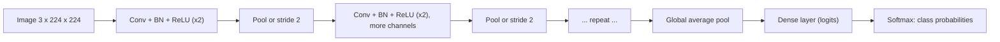
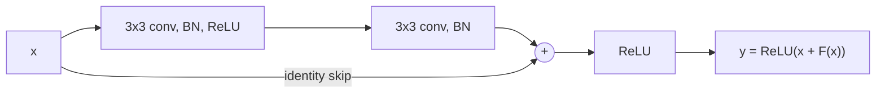
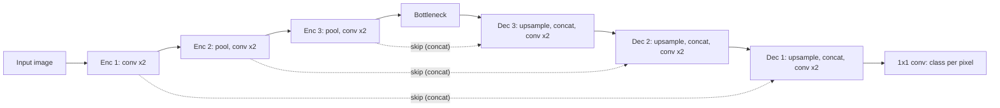

# Chapter 11 — CNNs and Computer Vision

An image is just a grid of numbers — a 224×224 colour photo is 224 × 224 × 3 = 150,528 numbers. Feeding that into the dense networks of Chapter 10 works badly: far too many weights, and no notion that neighbouring pixels belong together or that a cat is still a cat when it moves ten pixels to the left. **Convolutional neural networks (CNNs)** fix both problems with one idea: slide a small learnable filter across the image and reuse it everywhere. That idea, plus depth, took computer vision from "barely works" to superhuman on some benchmarks within a decade.

**What you'll learn**

1. Convolution: kernels, stride, padding, channels, output-size formula — with a worked 3×3 example.
2. Pooling, and how conv + pool + dense layers make a CNN architecture.
3. Receptive field and why stacks of 3×3 convolutions work.
4. The famous architectures: LeNet → AlexNet → VGG → Inception → ResNet (skip connections) → MobileNet/EfficientNet → Vision Transformer.
5. Transfer learning and fine-tuning.
6. Data augmentation for images.
7. Vision tasks beyond classification: object detection (IoU, NMS, the YOLO idea) and segmentation (the U-Net idea).
8. A small PyTorch CNN on scikit-learn's 8×8 digits, trained on CPU in seconds.

Prerequisites: Chapter 10 (neurons, backprop, optimizers, BatchNorm, dropout, PyTorch training loop). All code is in `code/`; outputs are real.

---

## 11.1 Convolution

### What it is
A **convolutional layer** slides a small grid of weights — a **kernel** or **filter**, typically 3×3 — over the image. At each position it multiplies the kernel element-wise with the patch of pixels underneath and sums the result into a single number. Doing this at every position produces a new grid called a **feature map** (or activation map). A layer has many kernels, each producing its own feature map, each detecting a different pattern.

Analogy: a flashlight with a stencil. You sweep the same stencil across the whole picture; wherever the picture matches the stencil's pattern, the light shines bright.

### The problem it solves

| Problem with dense layers on images | How convolution fixes it |
|---|---|
| Huge parameter counts (150k inputs × 1,000 units = 150M weights for one layer) | **Weight sharing**: one 3×3×3 kernel has 27 weights (+1 bias) regardless of image size |
| Ignores spatial structure — pixel order could be shuffled | **Local connectivity**: each output only looks at a small neighbourhood |
| A pattern learned in one place must be re-learned in every other place | **Translation equivariance**: shift the input, and the feature map shifts the same way — the same detector works everywhere |

Parameter comparison from `code/conv_by_hand.py`:
```
Conv2d(3->16, 3x3) params: 448  vs Linear(32*32*3 -> 16) params: 49168
```
(3·3·3 + 1) · 16 = 448 versus (3,072 + 1) · 16 = 49,168 — and the conv layer's count doesn't change with image size.

### How it works — worked 3×3 example
Input X (5×5, one channel) and a vertical-edge kernel K:

```
X =  1 2 0 1 3        K =  1 0 -1
     0 1 3 2 1             1 0 -1
     2 1 0 1 0             1 0 -1
     1 0 2 3 1
     0 2 1 0 2
```

1. Place K on the top-left 3×3 patch [[1,2,0],[0,1,3],[2,1,0]]. Multiply element by element and add: left column (1+0+2)·1 + middle column ·0 + right column (0+3+0)·(−1) = 3 − 3 = **0**.
2. Slide one step right and repeat; at the end of the row move one step down.
3. The patch centred on the middle pixel is [[1,3,2],[1,0,1],[0,2,3]]: left column 1+1+0 = 2, right column 2+1+3 = 6, so the output is 2 − 6 = **−4** — a strong response: it's brighter on the right than on the left, a vertical edge.
4. Add the bias (0 here) and, in a real network, apply an activation such as ReLU.

The full output with stride 1 and no padding is 3×3:
```
stride=1 padding=0 -> output (3, 3) (formula 3), matches torch: True
[[ 0.  0. -1.]
 [-2. -4.  3.]
 [ 0. -1.  0.]]
```

Strictly, deep-learning "convolution" is **cross-correlation** — the kernel isn't flipped as in the mathematical definition. Since kernels are learned, the distinction doesn't matter; PyTorch's `F.conv2d` does exactly what the loop below does.

```python
# code/conv_by_hand.py (core)
def conv2d(x, k, stride=1, padding=0):
    x = np.pad(x, padding)
    kh, kw = k.shape
    oh = (x.shape[0] - kh) // stride + 1
    ow = (x.shape[1] - kw) // stride + 1
    out = np.zeros((oh, ow))
    for i in range(oh):
        for j in range(ow):
            patch = x[i * stride:i * stride + kh, j * stride:j * stride + kw]
            out[i, j] = np.sum(patch * k)          # element-wise multiply, then sum
    return out
```

### Stride and padding
- **Stride** s: how many pixels the kernel jumps each move. Stride 2 halves the output's height and width — a cheap way to downsample.
- **Padding** p: extra border (usually zeros) around the input. Without it, every 3×3 conv shrinks the image by 2 pixels and edge pixels are under-used. **"Same" padding** (p = 1 for a 3×3 kernel, p = 2 for 5×5) keeps the size unchanged at stride 1. **"Valid"** means no padding.

**Output size formula** (per spatial dimension):

  **out = ⌊(n + 2p − k) / s⌋ + 1**

| n | k | s | p | out | Check |
|---|---|---|---|---|---|
| 5 | 3 | 1 | 0 | (5 − 3)/1 + 1 = 3 | valid conv shrinks by 2 |
| 5 | 3 | 2 | 0 | ⌊2/2⌋ + 1 = 2 | stride 2 downsamples |
| 5 | 3 | 1 | 1 | (5 + 2 − 3)/1 + 1 = 5 | same padding |
| 224 | 7 | 2 | 3 | ⌊(224 + 6 − 7)/2⌋ + 1 = 112 | ResNet's first layer |

```
stride=2 padding=0 -> output (2, 2) (formula 2), matches torch: True
[[ 0. -1.]
 [ 0.  0.]]

stride=1 padding=1 -> output (5, 5) (formula 5), matches torch: True
[[-3. -2.  0. -1.  3.]
 [-4.  0.  0. -1.  4.]
 [-2. -2. -4.  3.  6.]
 [-3.  0. -1.  0.  4.]
 [-2. -2. -1.  0.  3.]]
```

### Channels
Real images have 3 **channels** (red, green, blue), and hidden feature maps have many (64, 128, 512…). A kernel always spans **all input channels**: a 3×3 kernel on a 64-channel input is really 3×3×64 = 576 weights, producing one output channel. A layer with C_out kernels produces C_out channels.

- Weights in a conv layer: **k × k × C_in × C_out** (+ C_out biases).
- PyTorch tensor layout: **N × C × H × W** (batch, channels, height, width). `nn.Conv2d(in_channels, out_channels, kernel_size, stride=1, padding=0)`.
- A **1×1 convolution** mixes channels at each pixel without looking at neighbours — used to cheaply change the number of channels (Inception, ResNet bottlenecks).
- A **depthwise-separable convolution** splits a conv into a per-channel k×k spatial conv plus a 1×1 conv that mixes channels (MobileNet, Xception, EfficientNet). Cost per output pixel: standard = k²·C_in·C_out; separable = k²·C_in + C_in·C_out. The ratio is 1/C_out + 1/k² — for k = 3, C_in = C_out = 256: 1/256 + 1/9 ≈ 0.115, about 8.7× cheaper.

### What do kernels detect?
`code/edge_filters.py` applies classic hand-designed kernels to a digit. A CNN **learns** kernels like these — first-layer filters of trained networks look like edge, colour-blob and stripe detectors.


*Figure — A "0" digit and the feature maps from Sobel vertical/horizontal edge detectors (red = positive response, blue = negative), a blur and a sharpen kernel.*

### Common mistakes
- Mixing up N×C×H×W (PyTorch) and N×H×W×C (TensorFlow/Keras default, NumPy images) — transpose with `permute(0, 3, 1, 2)`.
- Forgetting padding and being surprised when the image shrinks layer after layer.
- Computing the flatten size by hand wrongly — pass a dummy tensor through the conv part and print its shape, or use `nn.LazyLinear`.

### In the interview
**30-second answer:** "A conv layer slides small learned kernels, each spanning all input channels, across the image and sums the element-wise products into a feature map. Weight sharing makes the parameter count independent of image size, and locality plus sharing give translation equivariance. Output size is ⌊(n + 2p − k)/s⌋ + 1; stride downsamples, padding preserves size; 1×1 convs mix channels cheaply."

- *Q: Output of a 224×224×3 image through `Conv2d(3, 64, 7, stride=2, padding=3)`?* A: 64 × 112 × 112; weights 7·7·3·64 + 64 = 9,472.
- *Q: Is convolution translation invariant?* A: Equivariant — the feature map shifts with the input; pooling and global pooling add (approximate) invariance.

### Self-check
1. 5×5 input, 3×3 kernel, stride 1, padding 0 — output size? → 3×3.
2. Weights in a 3×3 conv from 64 to 64 channels (no bias)? → 3·3·64·64 = 36,864.
3. Why is "convolution" in deep learning really cross-correlation? → The kernel isn't flipped; since it is learned, it makes no difference.

### TL;DR
A conv layer slides shared k×k×C_in kernels over the input; out = ⌊(n + 2p − k)/s⌋ + 1; weights = k·k·C_in·C_out. Weight sharing + locality = far fewer parameters and translation equivariance.

---

## 11.2 Pooling and the CNN architecture

### What it is
A **pooling layer** downsamples each feature map independently by summarising small windows:
- **Max pooling** (most common, 2×2 window, stride 2): keep the largest value — "was the feature present anywhere in this window?"
- **Average pooling**: take the mean.
- **Global average pooling (GAP)**: average each whole feature map to a single number — used at the end of modern CNNs instead of big dense layers.

Pooling has **no learnable parameters**. It shrinks H and W (2×2/2 halves them), cutting compute, growing the receptive field, and adding a little tolerance to small shifts (**local translation invariance**).

Max-pool 2×2 stride 2 of the 5×5 padded-conv output above (the last row and column are dropped because the 2×2 windows don't fit):
```
max-pool 2x2/2 of the padded-conv output (5x5 -> 2x2):
 [[0. 0.]
 [0. 3.]]
avg-pool via torch:
 [[-2.25 -0.5 ]
 [-1.75 -0.5 ]]
```
Top-left window [[−3, −2], [−4, 0]] → max 0, mean −2.25.

Many modern networks replace pooling with **stride-2 convolutions** (learned downsampling) and use pooling only at the very end (GAP).

### The standard CNN architecture



1. **Feature extractor ("backbone")**: repeated blocks of conv → normalization → activation, with periodic downsampling. As you go deeper, spatial size **shrinks** and the number of channels **grows** (e.g. 64 → 128 → 256 → 512): fewer, more abstract, more numerous features.
2. **Classifier ("head")**: flatten or global-average-pool, then one or more dense layers producing class logits; softmax + cross-entropy for training.

The learned features form a hierarchy (Zeiler & Fergus visualised this in 2013): **edges and colours → textures and corners → object parts → whole objects**.

### Receptive field
The **receptive field (RF)** of a unit is the region of the input image that can influence it. A 3×3 conv has RF 3. Stacking layers grows it. Track two numbers per layer — the RF and the **jump** (how many input pixels one step in this layer's output corresponds to, i.e. the product of all strides so far):

  RF_new = RF_old + (k − 1) · jump_old,  jump_new = jump_old · s

Worked through the VGG pattern below: conv3 → 1 + 2·1 = 3; conv3 → 3 + 2·1 = 5; maxpool 2/2 → 5 + 1·1 = 6, jump becomes 2; conv3 → 6 + 2·2 = 10; conv3 → 10 + 2·2 = 14.

`code/receptive_field.py`:
```
Three 3x3 convs (stride 1) vs one 7x7 conv, on a 32x32 input
layer                  out size   RF  jump
conv3x3                      32    3     1
conv3x3                      32    5     1
conv3x3                      32    7     1
layer                  out size   RF  jump
conv7x7                      32    7     1
weights (C=64 channels in and out, no bias): three 3x3 = 110,592  vs one 7x7 = 200,704

VGG-style block pattern: conv, conv, pool, ... on 224x224
layer                  out size   RF  jump
conv3x3                     224    3     1
conv3x3                     224    5     1
maxpool2                    112    6     2
conv3x3                     112   10     2
conv3x3                     112   14     2
maxpool2                     56   16     4
conv3x3                      56   24     4
conv3x3                      56   32     4
maxpool2                     28   36     8
```
**Key insight (VGG, 2014):** three stacked 3×3 convs see the same 7×7 region as one 7×7 conv, but use 27C² instead of 49C² weights and add two extra nonlinearities. That's why almost every modern CNN uses 3×3 kernels. Downsampling makes the RF grow much faster ("jump" doubles after each pool), which is how deep layers come to "see" the whole object. (The *effective* receptive field — where influence is actually strong — is smaller and roughly Gaussian-shaped.)

### Self-check
1. Output size of a 32×32 input after conv(k=5, s=1, p=0)? → 28×28.
2. Parameters of `Conv2d(64, 128, 3)`? → 3·3·64·128 + 128 = 73,856.
3. Why do channel counts grow as spatial size shrinks? → To keep representational capacity (and roughly the compute per layer) while features become more abstract and numerous.
4. RF of two 3×3 convs (stride 1)? → 5×5.

### TL;DR
Pooling (usually 2×2 max) halves H and W with no parameters. CNN = backbone of conv-BN-ReLU blocks with downsampling + head of GAP and dense layers. Stacked 3×3 convs grow the receptive field cheaply.

---

## 11.3 A small CNN on 8×8 digits (PyTorch, CPU)

scikit-learn's `load_digits` has 1,797 grayscale 8×8 images of handwritten digits (pixel values 0–16). It's tiny, so a CNN trains on a laptop CPU in a few seconds.

```python
# code/digits_cnn.py (core)
class SmallCNN(nn.Module):
    def __init__(self):
        super().__init__()
        self.features = nn.Sequential(
            nn.Conv2d(1, 16, kernel_size=3, padding=1),   # 1x8x8  -> 16x8x8
            nn.BatchNorm2d(16), nn.ReLU(),
            nn.MaxPool2d(2),                              # 16x8x8 -> 16x4x4
            nn.Conv2d(16, 32, kernel_size=3, padding=1),  # -> 32x4x4
            nn.BatchNorm2d(32), nn.ReLU(),
            nn.MaxPool2d(2),                              # -> 32x2x2
        )
        self.classifier = nn.Sequential(
            nn.Flatten(),                                 # -> 128
            nn.Dropout(0.3),
            nn.Linear(32 * 2 * 2, 10),                    # 10 class logits
        )
    def forward(self, x):
        return self.classifier(self.features(x))

X = (X / 16.0).reshape(-1, 1, 8, 8).astype(np.float32)   # N x C x H x W, scaled to [0, 1]
# ... stratified 70/30 split, DataLoader(batch_size=64, shuffle=True)
opt = torch.optim.AdamW(model.parameters(), lr=3e-3, weight_decay=1e-3)
sched = torch.optim.lr_scheduler.OneCycleLR(opt, max_lr=3e-3, total_steps=epochs * len(train_dl))
# ... standard loop: forward, cross_entropy, zero_grad, backward, step, sched.step()
```

The script trains three models for 40 epochs — an MLP with a similar parameter budget, the CNN, and the CNN with **shift augmentation** (each training image randomly moved up to 1 pixel) — then tests all three on the normal test set and on the test set **shifted 1 pixel right**.

Output:
```
train (1257, 1, 8, 8)  test (540, 1, 8, 8)
MLP                        params= 7210  test accuracy=0.9759
CNN                        params= 6186  test accuracy=0.9907
CNN + shift augmentation   params= 6186  test accuracy=0.9852
MLP                        accuracy on test images shifted 1px right = 0.4722
CNN                        accuracy on test images shifted 1px right = 0.8574
CNN + shift augmentation   accuracy on test images shifted 1px right = 0.9796
misclassified (count, true, predicted): [(2, 8, 1), (2, 3, 9), (1, 9, 7), (1, 9, 1), (1, 8, 9)]
```


*Figure — Left: test accuracy per epoch. Middle: the 16 first-layer kernels the CNN learned. Right: confusion matrix — nearly everything on the diagonal; the few errors are 8↔1 and 3↔9 type confusions.*

What it shows:
- **Fewer parameters, higher accuracy**: the CNN (6.2k parameters) beats the MLP (7.2k) — 99.1% vs 97.6%.
- **Built-in spatial bias**: shift every test image by one pixel and the MLP collapses to 47% (every "pixel feature" moved), while the CNN keeps 86% thanks to shared kernels and pooling.
- **Augmentation buys robustness**: trained with random shifts, the CNN keeps 98% on shifted images — at the cost of half a point on the unshifted test set here (a small, typical trade-off on a tiny dataset).

### TL;DR
On tiny 8×8 digits a two-block CNN beats a larger MLP (99.1% vs 97.6%) and is far more robust to shifts; shift augmentation makes it nearly shift-proof.

For real images (28×28 MNIST, 32×32 CIFAR-10, 224×224 ImageNet), the same code works with more blocks and channels; you'd load data with `torchvision.datasets` and run on a GPU.

### Common mistakes
- Forgetting the channel dimension (8×8 images must be reshaped to 1×8×8).
- Evaluating with the model still in `train()` mode (BatchNorm and dropout behave differently).
- Too much downsampling for small images: 8×8 can only be halved three times.

---

## 11.4 Famous architectures — a timeline

### What it is
A handful of architectures, most of them winners of the **ImageNet Large Scale Visual Recognition Challenge (ILSVRC)** — 1.28 million training images across 1,000 classes — each introduced an idea that is still in use.

| Year | Model | Depth / params | Key idea | Result |
|---|---|---|---|---|
| 1998 | **LeNet-5** (LeCun et al.) | 7 layers, ~60k | Conv → pool → conv → pool → dense; trained with backprop | Read handwritten digits on bank cheques in production |
| 2012 | **AlexNet** (Krizhevsky, Sutskever, Hinton) | 8 layers, ~60M | ReLU, dropout, heavy augmentation, trained on 2 GPUs | ILSVRC top-5 error 15.3% vs 26.2% runner-up — started the deep-learning boom |
| 2014 | **VGG-16/19** (Simonyan & Zisserman) | 16–19 layers, ~138M (VGG-16) | Only 3×3 convs, stacked; very uniform | ILSVRC 2014 runner-up, 7.3% top-5; still a popular feature extractor |
| 2014 | **GoogLeNet / Inception** (Szegedy et al.) | 22 layers, ~7M | Inception module: parallel 1×1, 3×3, 5×5 convs; 1×1 bottlenecks; GAP instead of big dense layers | ILSVRC 2014 winner, 6.7% top-5 |
| 2015 | **ResNet** (He et al.) | 18–152 layers (ResNet-50 ≈ 25.6M) | **Residual (skip) connections** + BatchNorm | ILSVRC 2015 winner, 3.57% top-5 (ensemble); made 100+ layer nets trainable |
| 2017 | **MobileNet** (Howard et al.) | small | Depthwise-separable convs for phones | Efficient on-device vision |
| 2019 | **EfficientNet** (Tan & Le) | B0–B7 (5.3M–66M) | **Compound scaling**: grow depth, width and input resolution together with fixed ratios; SiLU, MBConv blocks | B7: 84.3% top-1 ImageNet, 8.4× smaller than the previous best (GPipe) |
| 2020 | **Vision Transformer (ViT)** (Dosovitskiy et al.) | 86M+ (ViT-Base) | Split the image into 16×16 patches, treat them as tokens, apply a transformer | Beats CNNs when pre-trained on very large datasets |
| 2022 | **ConvNeXt** (Liu et al.) | ResNet-sized | A ResNet modernised with transformer-era design choices | Matches ViTs, showing CNNs remain competitive |

### ResNet and skip connections
**The problem.** Before 2015, making plain CNNs deeper beyond ~20 layers made them *worse* — even on the **training** set. This "degradation" isn't overfitting; very deep plain stacks are simply hard to optimise (signals and gradients get distorted through many layers).

**The idea.** Instead of asking a block to learn a mapping H(x) directly, let it learn the **residual** F(x) = H(x) − x and add the input back:

  **y = ReLU(x + F(x))**,  where F = conv → BN → ReLU → conv → BN

If the best thing a block can do is nothing, it just learns F ≈ 0 — easy. And in backprop, ∂y/∂x includes an identity term, so gradients have a direct **highway** back to early layers. When the shapes differ (stride 2 or more channels), the skip path uses a 1×1 conv to match them.



```python
# code/resnet_block.py (core)
class ResidualBlock(nn.Module):
    def __init__(self, c):
        super().__init__()
        self.f = nn.Sequential(
            nn.Conv2d(c, c, 3, padding=1, bias=False), nn.BatchNorm2d(c), nn.ReLU(),
            nn.Conv2d(c, c, 3, padding=1, bias=False), nn.BatchNorm2d(c))
    def forward(self, x):
        return torch.relu(x + self.f(x))                 # the skip connection
```

Output — gradient norm reaching the first conv, and a 30-conv-layer plain net vs a 30-conv-layer residual net trained on digits for 5 epochs:
```
conv layers  plain |grad|  residual |grad|
          2      2.58e-02         4.78e-02
         10      1.11e-01         1.18e-01
         30      3.54e+00         4.14e-01
         60      3.08e+02         9.41e-01

Training 30-conv-layer nets on digits (SGD+momentum lr 0.05, 5 epochs):
  plain    training accuracy 0.575  training loss 1.121
  residual training accuracy 0.957  training loss 0.159
```
With BatchNorm, the plain net's gradients don't vanish here — they become erratic and **explode** as depth grows (3 × 10² at 60 layers), while the residual net's stay near 1. Trained with identical settings, the plain net reaches only 58% **training** accuracy (the degradation problem) while the residual net reaches 96%. Skip connections are now everywhere: DenseNet, U-Net, and every transformer block.

### EfficientNet in one paragraph
If you have more compute, how should you grow a CNN — deeper, wider (more channels), or with higher-resolution inputs? EfficientNet found that scaling all three together with a fixed ratio (depth × α^φ, width × β^φ, resolution × γ^φ) gives far better accuracy per FLOP than scaling any one. The base network B0 was found by neural architecture search; B1–B7 are compound-scaled versions.

### Vision Transformer (brief)
ViT cuts an image into fixed-size patches (e.g. 16×16 pixels → a 224×224 image becomes 14 × 14 = 196 patches), flattens and linearly projects each patch into a vector (a "token"), adds position embeddings and a learnable [CLS] token, and runs a standard transformer encoder (self-attention: Chapter 12). With no built-in locality or translation equivariance, ViTs need much more data (the original used 300M-image pre-training) but scale extremely well. Hybrid and hierarchical designs (Swin Transformer) and modern CNNs (ConvNeXt) now compete closely; for small datasets, a pretrained CNN or pretrained ViT fine-tuned is the practical choice.

### Trade-offs

| Need | Good choice |
|---|---|
| Strong, well-understood baseline | ResNet-50 (or ResNet-18 for speed) |
| Mobile / edge devices | MobileNetV3, EfficientNet-B0 |
| Best accuracy with large pretraining | ViT / Swin / ConvNeXt, EfficientNetV2 |
| Tiny dataset | Any pretrained backbone, fine-tuned |

### In the interview
**30-second answer:** "LeNet showed conv-pool stacks work; AlexNet scaled them with ReLU, dropout and GPUs and won ImageNet 2012; VGG showed stacks of 3×3 convs are enough; Inception used parallel branches and 1×1 bottlenecks; ResNet added identity skip connections so 100+ layer networks train — each block learns a residual and gradients flow through the identity path; EfficientNet scales depth, width and resolution together; ViT applies a transformer to image patches and wins with large-scale pretraining."

- *Q: Why do residual connections help?* A: They make the identity easy to represent (F = 0) and give gradients a direct path, fixing the degradation problem of deep plain nets.
- *Q: What is a 1×1 convolution for?* A: Mixing channels and changing channel count cheaply (bottlenecks).
- *Q: Why does ViT need more data than a CNN?* A: It lacks the CNN's built-in inductive biases (locality, weight sharing across positions), so it must learn them from data.

### Self-check
1. Which architecture introduced skip connections? → ResNet (2015).
2. What three dimensions does EfficientNet scale? → Depth, width, input resolution.
3. How many patches does ViT make from a 224×224 image with 16×16 patches? → 196.
4. Name two ideas AlexNet popularised. → ReLU activations and dropout (also GPU training and heavy augmentation).

### TL;DR
LeNet → AlexNet (ReLU, dropout, GPUs) → VGG (3×3 stacks) → Inception (1×1, multi-branch) → ResNet (skip connections: y = x + F(x)) → MobileNet/EfficientNet (efficiency, compound scaling) → ViT (patches + transformer).

---

## 11.5 Transfer learning and fine-tuning

### What it is
**Transfer learning** reuses a model trained on a large **source** task (typically ImageNet classification) as the starting point for your **target** task. The early layers of any vision model learn general features — edges, textures, shapes — that are useful for almost every image problem, so you don't have to learn them again from a few hundred images.

Analogy: hiring an experienced photographer to sort your product photos. They already know how to see; you only teach them your categories.

### Why it matters
Training a ResNet-50 from scratch on ImageNet takes days of GPU time and 1.28M labelled images. Fine-tuning a pretrained one on 2,000 of your own images takes minutes and usually gives far better accuracy than training from scratch on those 2,000. It's the default for almost every practical vision project.

### How it works — the two strategies
1. **Feature extraction (frozen backbone).** Load pretrained weights, **freeze** the backbone (`requires_grad = False`), replace the final layer with a new head for your classes, and train only the head. Fast, needs little data, low risk of overfitting.
2. **Fine-tuning.** Start from the pretrained weights and also update some or all backbone layers with a **small learning rate** (often 10× smaller than for the head, "discriminative learning rates"), so useful features are adjusted rather than destroyed. A common recipe: train the new head first with the backbone frozen, then unfreeze the top blocks (or all) and continue with a low LR.

| Your data | Similar to ImageNet | Very different (X-rays, satellite, spectrograms) |
|---|---|---|
| **Small** | Feature extraction | Feature extraction from earlier layers, or fine-tune gently; augment heavily |
| **Large** | Fine-tune all layers | Fine-tune all layers (pretraining still usually helps convergence) |

The real code with torchvision (needs a download of weights — not run here):
```python
import torch
from torch import nn
from torchvision import models

model = models.resnet18(weights=models.ResNet18_Weights.DEFAULT)   # ImageNet-pretrained
for p in model.parameters():
    p.requires_grad = False                                         # 1) freeze backbone
model.fc = nn.Linear(model.fc.in_features, num_classes)             # new head (trainable)
opt = torch.optim.AdamW(model.fc.parameters(), lr=1e-3)
# ... train a few epochs, then 2) unfreeze and fine-tune with a smaller lr:
for p in model.parameters():
    p.requires_grad = True
opt = torch.optim.AdamW([{"params": model.fc.parameters(), "lr": 1e-3},
                         {"params": [p for n, p in model.named_parameters() if not n.startswith("fc.")], "lr": 1e-4}])
# Inputs must be preprocessed like the pretraining data: resize/crop to 224 and normalise with
# ImageNet mean (0.485, 0.456, 0.406) and std (0.229, 0.224, 0.225) - the weights object's
# .transforms() gives the exact pipeline.
```

### A runnable demonstration (no downloads)
`code/transfer_learning.py` mimics the setting on digits: pretrain a CNN on **clean** digits (half the dataset), then adapt it to the other half **"scanned by a different device"** (Gaussian noise added), using only k labelled images per class.

```python
def make_model(strategy, pretrained):
    bb, head = backbone(), nn.Linear(128, 10)
    model = nn.Sequential(bb, head)
    if strategy == "frozen backbone":                    # pretrained backbone, NEW head
        bb.load_state_dict({k[2:]: v for k, v in pretrained.items() if k.startswith("0.")})
    elif strategy == "fine-tune all":                    # start from the whole source model
        model.load_state_dict(pretrained)
    if strategy == "frozen backbone":
        for p in bb.parameters():
            p.requires_grad = False                      # freeze: no gradients, no updates
        return model, head.parameters()
    if strategy == "fine-tune all":
        return model, [{"params": model.parameters(), "lr": 1e-4}]   # small lr: nudge, don't overwrite
    return model, model.parameters()
```

Output:
```
source model: train acc on clean digits 0.996, acc on noisy target digits with NO adaptation 0.839

labels/class     from scratch  frozen backbone    fine-tune all   (mean test acc over 3 seeds)
           2            0.530            0.650            0.840
           5            0.673            0.766            0.834
          10            0.738            0.779            0.847
          30            0.810            0.824            0.857

trainable params: from scratch / fine-tune = 6090 | frozen backbone = 1290
```

Reading it:
- With **2 labels per class**, from-scratch gets 53%; a frozen pretrained backbone with a new head gets 65%; gently fine-tuning the full pretrained model gets 84%.
- The advantage **shrinks as target data grows** (30 per class: 81% vs 86%) — transfer matters most when labels are scarce.
- **Always measure the pretrained model before adapting it**: here the source model already scores 83.9% on the target with no training. Fine-tuning with a *large* learning rate or a randomly re-initialised head can easily do *worse* than that baseline — which is why fine-tuning uses small learning rates.
- Transfer is not magic: in a variant of this experiment (not included in the script) where the target classes were *different digits* (pretrain on 0–4, adapt to 5–9) on these tiny 8×8 images, pretraining did not help — the features weren't general enough. Real ImageNet backbones, trained on 1,000 diverse classes, transfer far more broadly.

### When not to use it
- When your inputs are nothing like natural images *and* you have plenty of data (pretraining may still help convergence, but check).
- When the license of the pretrained weights forbids your use.

### Common mistakes
- Forgetting to preprocess inputs exactly like the pretraining data (size, normalisation).
- Fine-tuning everything with a large learning rate on a small dataset — "catastrophic forgetting" of the useful features.
- Leaving BatchNorm layers updating their running statistics on tiny batches during fine-tuning (often better kept in eval mode / frozen).

### Real-world examples
Most production vision models start from pretrained backbones: medical-imaging classifiers fine-tuned from ImageNet models, retail product recognition, defect detection on factory lines. Detection models (YOLO, Faster R-CNN) use pretrained classification backbones. The same pattern — pretrain big, fine-tune small — is how LLMs are adapted (AI Handbook, [Chapter 8](../../../ai/chapters/08-prompting-vs-finetuning-vs-rag-and-llm-evaluation/README.md)).

### In the interview
**30-second answer:** "Take a model pretrained on a large dataset like ImageNet, replace its head, and either freeze the backbone and train only the head (feature extraction — small data) or fine-tune some or all layers with a small learning rate (more data or a different domain). Preprocess inputs like the pretraining data. It beats training from scratch whenever labelled data is limited."

- *Q: Which layers transfer best?* A: Early layers (generic edges/textures); later layers are more task-specific, so they're the first to unfreeze.
- *Q: Why a smaller LR for the backbone?* A: To adjust, not overwrite, useful pretrained features.

### Self-check
1. What does freezing do in PyTorch? → `requires_grad = False` — no gradients, so the optimizer doesn't change those weights.
2. Small dataset similar to ImageNet — which strategy? → Feature extraction (frozen backbone, new head), maybe light fine-tuning later.
3. Why did transfer help less with 30 labels per class than with 2? → With more target data, a model trained from scratch catches up; pretraining matters most when data is scarce.

### TL;DR
Start from pretrained weights; new head; freeze then fine-tune with a small LR; preprocess like the pretraining data; biggest gains when labels are scarce.

---

## 11.6 Data augmentation for images

### What it is
Generating new training images from existing ones by applying transformations that **don't change the label**: a flipped, slightly rotated or recoloured cat is still a cat. The network sees more variety, so it memorises less and becomes robust to the variations it will meet in the real world.

### How it works — common transforms (torchvision.transforms.v2)

| Transform | What it does | Watch out |
|---|---|---|
| `RandomResizedCrop(224)` | Random crop of random size/aspect, resized | The standard ImageNet training transform |
| `RandomHorizontalFlip()` | Mirror left-right | Not for text, digits, or where left/right matters |
| `RandomRotation(15)` | Small rotations | Large rotations turn 6 into 9 |
| `ColorJitter(0.4, 0.4, 0.4)` | Brightness, contrast, saturation changes | Not if colour is the label (ripe vs unripe fruit) |
| `RandomErasing()` / Cutout | Blank a random rectangle | Forces use of several parts of the object |
| `GaussianBlur`, noise | Blur or noise | Mimic camera quality |
| **Mixup** / **CutMix** | Blend two images (or paste a patch) and blend their labels | Strong regularizers for large models |
| **RandAugment / AutoAugment / TrivialAugment** | Automatically chosen policies of transforms | Good defaults in modern training recipes |

```python
from torchvision.transforms import v2 as T   # (torchvision not needed for the rest of this chapter)
train_tf = T.Compose([T.RandomResizedCrop(224), T.RandomHorizontalFlip(), T.ColorJitter(0.2, 0.2, 0.2),
                      T.ToImage(), T.ToDtype(torch.float32, scale=True),
                      T.Normalize(mean=[0.485, 0.456, 0.406], std=[0.229, 0.224, 0.225])])
test_tf = T.Compose([T.Resize(256), T.CenterCrop(224), T.ToImage(), T.ToDtype(torch.float32, scale=True),
                     T.Normalize(mean=[0.485, 0.456, 0.406], std=[0.229, 0.224, 0.225])])
```
Augmentation happens **on the fly** in the training `Dataset`/`DataLoader`, differently every epoch — only for training data. Validation/test use a fixed deterministic resize/crop. **Test-time augmentation (TTA)** — averaging predictions over a few flipped/cropped versions — can add a little accuracy at inference cost.

In §11.3, shift augmentation raised accuracy on shifted digits from 86% to 98%.

For **detection and segmentation**, geometric transforms must be applied to the boxes/masks too (torchvision v2 transforms and the Albumentations library handle this).

### Common mistakes
- Augmenting validation/test data randomly.
- Augmentations that change the label (flipping digits, rotating road signs that mean different things when mirrored).
- Forgetting that augmentation slows each epoch (CPU-bound) — use `num_workers` in `DataLoader`.

### In the interview
**30-second answer:** "Augmentation applies random, label-preserving transforms — crops, flips, colour jitter, small rotations, Mixup/CutMix — to training images on the fly, so the model sees more variety and overfits less. Validation and test use a fixed resize and crop. For detection and segmentation the same geometric transform must be applied to boxes and masks."

### Self-check
1. Why not horizontally flip digit images? → Mirrored digits (e.g. a mirrored 2 or 7) aren't valid digits — the label no longer holds.
2. What does Mixup do to the label? → Blends the two one-hot labels with the same ratio as the images.
3. Is test-time augmentation training or inference? → Inference: average predictions over a few transformed copies.

### TL;DR
Random label-preserving transforms on training images only; flips, crops, colour jitter, rotations, Mixup/CutMix; the cheapest regularizer in vision.

---

## 11.7 Vision tasks: classification, detection, segmentation

### What it is

| Task | Question | Output | Typical models |
|---|---|---|---|
| **Image classification** | What is in this image? | One label (or a label per image) | ResNet, EfficientNet, ViT |
| **Object detection** | What objects are where? | A box (x, y, w, h) + class + confidence per object | YOLO, SSD, Faster R-CNN, DETR |
| **Semantic segmentation** | Which class is each pixel? | A class per pixel | U-Net, DeepLab, FCN |
| **Instance segmentation** | Which object does each pixel belong to? | A mask per object | Mask R-CNN, YOLO-seg, SAM (promptable) |

### Object detection

**IoU (Intersection over Union)** measures box overlap: area of intersection ÷ area of union. It's used to match predictions to ground truth (e.g. a detection counts as correct if IoU ≥ 0.5) and in NMS.

Worked example (`code/iou_nms.py`): ground truth (50, 50)–(150, 150) and prediction (70, 60)–(170, 160), boxes as (x1, y1)–(x2, y2). Each area = 100 × 100 = 10,000. Intersection = (150 − 70) × (150 − 60) = 80 × 90 = 7,200. Union = 10,000 + 10,000 − 7,200 = 12,800. **IoU = 7,200 / 12,800 = 0.5625.**

**NMS (non-maximum suppression)** removes duplicate detections of the same object:
1. Sort boxes by confidence.
2. Keep the highest-scoring box; delete every remaining box whose IoU with it exceeds a threshold (e.g. 0.5).
3. Repeat with the next remaining box.

```python
def my_nms(boxes, scores, thr):
    order = sorted(range(len(boxes)), key=lambda i: -scores[i])
    keep = []
    while order:
        best = order.pop(0)
        keep.append(best)
        order = [i for i in order if iou(boxes[best], boxes[i]) < thr]   # drop heavy overlaps
    return keep
```
Output:
```
IoU worked example: 0.562
pairwise IoU of the 5 boxes:
[[1.   0.89 0.65 0.   0.  ]
 [0.89 1.   0.69 0.   0.  ]
 [0.65 0.69 1.   0.   0.  ]
 [0.   0.   0.   1.   0.74]
 [0.   0.   0.   0.74 1.  ]]
NMS (IoU threshold 0.5) keeps boxes [0, 3] with scores [0.9, 0.8]
```
Five raw boxes around two objects → two final detections.

**Two families of detectors:**
- **Two-stage** (R-CNN → Fast R-CNN → **Faster R-CNN**, 2015): a Region Proposal Network suggests candidate boxes, then a second stage classifies and refines each. Accurate, slower.
- **One-stage** (**YOLO**, SSD, RetinaNet): predict all boxes in a single forward pass. Fast enough for real-time video.

**The YOLO idea** ("You Only Look Once", Redmon et al., 2016): divide the image into an S × S grid. Each grid cell predicts a few bounding boxes (x, y, w, h, and an objectness confidence) and class probabilities for an object whose **centre** falls in that cell — all as one tensor from one CNN pass. Then threshold on confidence and run NMS. The original ran at about 45 frames per second. Later versions (YOLOv3 onward, and today's Ultralytics YOLO releases) added multi-scale predictions, anchor boxes (and later anchor-free heads) and better backbones, and remain the go-to for real-time detection. **DETR** (2020) reframed detection with a transformer that predicts a set of boxes directly, removing NMS. For a full system built on a detector — blurring faces and plates in street imagery, where recall per person matters more than mAP — see case study [18.7](../18-ml-case-studies-2/README.md).

**Metric:** **mAP** (mean average precision) — area under the precision–recall curve per class, averaged over classes; PASCAL VOC uses IoU ≥ 0.5, COCO averages over IoU thresholds 0.5 to 0.95.

### Segmentation — the U-Net idea
Segmentation needs a prediction for **every pixel**, so the network must go down to a compact representation (to understand *what*) and back up to full resolution (to say exactly *where*).

**U-Net** (Ronneberger et al., 2015, for biomedical images):
1. **Encoder (contracting path)**: conv blocks + downsampling — spatial size shrinks, channels grow (like a classifier backbone).
2. **Decoder (expanding path)**: upsampling (transposed convolutions) back to the input resolution.
3. **Skip connections**: at each level, the encoder's feature map is **concatenated** onto the decoder's — giving back the fine spatial detail lost during downsampling.
4. A final 1×1 conv outputs class scores per pixel; train with per-pixel cross-entropy (often plus Dice loss for imbalanced masks).



It's shaped like a "U", hence the name. U-Net-style networks also sit at the core of image-generation diffusion models (e.g. Stable Diffusion v1/v2 use a U-Net denoiser).

### Real-world examples
- **Classification**: Google Photos search, product recognition in retail apps, content moderation.
- **Detection**: self-driving perception (cars, pedestrians, signs), warehouse robots, retail shelf auditing, face detection in phone cameras.
- **Segmentation**: medical imaging (tumour and organ outlines), background removal in video calls, satellite land-use maps, portrait mode.

### In the interview
**30-second answer:** "Classification gives one label per image; detection gives boxes plus classes; segmentation gives a label per pixel. Detection uses IoU to match boxes and NMS to remove duplicates; two-stage detectors like Faster R-CNN propose regions then classify them, one-stage detectors like YOLO predict all boxes in one pass over a grid, which makes them real-time. Segmentation uses encoder-decoder networks like U-Net, whose skip connections restore spatial detail. Metrics: accuracy/top-k, mAP at IoU thresholds, and IoU/Dice for masks."

- *Q: Why is NMS needed?* A: Detectors output many overlapping boxes for the same object; NMS keeps the most confident and removes overlaps above an IoU threshold.
- *Q: Semantic vs instance segmentation?* A: Semantic labels pixels by class (all people are "person"); instance separates each object (person 1, person 2).

### Self-check
1. IoU of two identical boxes? Of disjoint boxes? → 1 and 0.
2. In YOLO, which grid cell is responsible for an object? → The cell containing the object's centre.
3. What do U-Net's skip connections carry? → High-resolution encoder feature maps, concatenated onto the decoder to recover spatial detail.

### TL;DR
Classification → label; detection → boxes (IoU, NMS, YOLO = one pass over a grid, Faster R-CNN = propose then classify); segmentation → per-pixel labels (U-Net = encoder-decoder + skip connections).

---

## 11.8 Putting it together — trade-offs, mistakes, interview

### When not to use a CNN
- Tabular data (use gradient-boosted trees).
- Very small image datasets **without** a pretrained model — collect more data or use classical features.
- When a pretrained ViT/CLIP-style foundation model with zero-shot prompts already solves the problem.

### Common mistakes (whole chapter)
- Training from scratch when a pretrained backbone is available.
- Wrong tensor layout or normalisation.
- Label-changing augmentations.
- Judging a detector by accuracy instead of mAP.

### In the interview — big picture
**30-second answer:** "CNNs slide shared small kernels over the image, giving far fewer parameters and translation equivariance. Stacked 3×3 convs with downsampling build a hierarchy of features and a growing receptive field; a head of global pooling plus a dense layer classifies. ResNet's skip connections enable very deep networks. In practice I'd start from a pretrained backbone, fine-tune with augmentation, and choose the head by task — classification, YOLO-style detection or U-Net-style segmentation."

### Self-check
1. Two properties of convolution that make it suit images? → Weight sharing (few parameters) and local connectivity/translation equivariance.
2. What does global average pooling replace? → The large flattened dense layers at the end of older CNNs.
3. What's the first thing to try for a new 5,000-image classification problem? → Fine-tune a pretrained backbone (e.g. ResNet-50 or EfficientNet) with augmentation.

---

## Chapter TL;DR
- **Convolution**: shared k×k kernels over all input channels; out = ⌊(n + 2p − k)/s⌋ + 1; params = k·k·C_in·C_out + C_out. Stride downsamples; padding preserves size.
- **Pooling**: 2×2 max-pool halves H and W, no parameters; global average pooling before the classifier.
- **Architecture**: conv-BN-ReLU blocks, shrinking space and growing channels, then GAP + dense. Stacked 3×3 convs grow the receptive field cheaply.
- **History**: LeNet → AlexNet (ReLU, dropout, GPU) → VGG → Inception → **ResNet (skip connections)** → MobileNet/EfficientNet → ViT.
- **Our CNN**: 99.1% on 8×8 digits with fewer parameters than an MLP; far more robust to shifts, especially with augmentation.
- **Transfer learning**: pretrained backbone + new head; freeze, then fine-tune with a small LR; biggest gains with few labels.
- **Augmentation**: label-preserving random transforms, training only.
- **Detection**: IoU, NMS, YOLO (one pass, grid), Faster R-CNN (two-stage), mAP. **Segmentation**: U-Net (encoder-decoder + skip connections).

Next: Chapter 12 moves from grids of pixels to sequences — RNNs, LSTMs and attention.
