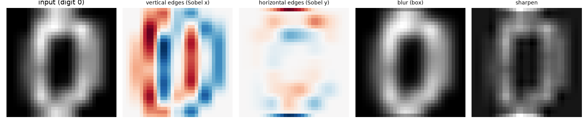
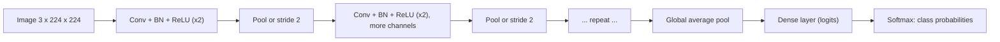
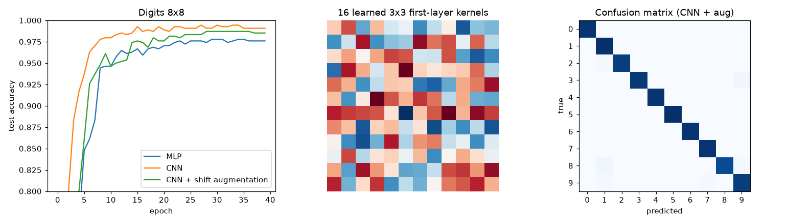
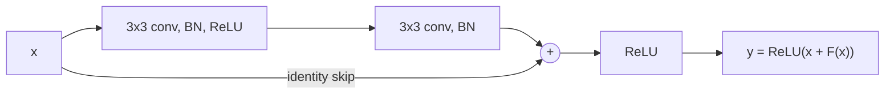
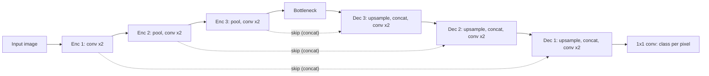

# Chapter 11 — CNNs and Computer Vision

An image is a grid of numbers — a 224×224 colour photo is 224 × 224 × 3 = 150,528 of them. Dense networks (Chapter 10) handle that badly: far too many weights, and no notion that neighbouring pixels belong together or that a cat shifted ten pixels is still a cat. **Convolutional neural networks (CNNs)** fix both with one idea: slide a small learnable filter across the image and reuse it everywhere. That idea plus depth took vision from "barely works" to superhuman on some **benchmarks** (standard shared datasets and scoring rules) within a decade.

**What you'll learn:** convolution (kernels, stride, padding, channels, output size); pooling and CNN architecture; receptive field; the famous architectures LeNet → ViT; transfer learning; augmentation; detection (IoU, NMS, YOLO) and segmentation (U-Net); a small PyTorch CNN on scikit-learn's 8×8 digits, trained on CPU in seconds.

Prerequisites: Chapter 10 — backprop/gradients, optimizers (SGD, Adam), BatchNorm, dropout, the PyTorch training loop. All code is in `code/`; outputs are real.

---

## 11.1 Convolution

### What it is
A **convolutional layer** slides a small grid of weights — a **kernel** or **filter**, typically 3×3 — over the image. At each position it multiplies the kernel element-wise with the pixel patch underneath and sums to one number; doing this everywhere produces a **feature map** (activation map). A layer has many kernels, each producing its own feature map and detecting a different pattern.

### The problem it solves

| Problem with dense layers on images | How convolution fixes it |
|---|---|
| Huge parameter counts (150k inputs × 1,000 units = 150M weights for one layer) | **Weight sharing**: one 3×3×3 kernel has 27 weights (+1 bias) regardless of image size |
| Ignores spatial structure — pixel order could be shuffled | **Local connectivity**: each output looks only at a small neighbourhood |
| A pattern learned in one place must be re-learned everywhere | **Translation equivariance**: shift the input and the feature map shifts the same way |

From `code/conv_by_hand.py`:
```
Conv2d(3->16, 3x3) params: 448  vs Linear(32*32*3 -> 16) params: 49168
```
(3·3·3 + 1) · 16 = 448 versus (3,072 + 1) · 16 = 49,168 — and the conv count doesn't change with image size.

### How it works — worked 3×3 example
Input X (5×5, one channel) and a vertical-edge kernel K:

```
X =  1 2 0 1 3        K =  1 0 -1
     0 1 3 2 1             1 0 -1
     2 1 0 1 0             1 0 -1
     1 0 2 3 1
     0 2 1 0 2
```

1. Top-left patch [[1,2,0],[0,1,3],[2,1,0]]: left column (1+0+2)·1 + middle ·0 + right column (0+3+0)·(−1) = 3 − 3 = **0**.
2. Slide one step right; at the end of the row move one down.
3. Centre patch [[1,3,2],[1,0,1],[0,2,3]]: left column 2, right column 6 → **−4** — brighter on the right than the left: a vertical edge.
4. Add the bias (0 here) and, in a real network, apply an activation such as ReLU.

Full output, stride 1, no padding:
```
stride=1 padding=0 -> output (3, 3) (formula 3), matches torch: True
[[ 0.  0. -1.]
 [-2. -4.  3.]
 [ 0. -1.  0.]]
```

Strictly, deep-learning "convolution" is **cross-correlation** — the kernel isn't flipped. Since kernels are learned, it doesn't matter; PyTorch's `F.conv2d` does exactly this loop:

```python
# code/conv_by_hand.py (core)
def conv2d(x, k, stride=1, padding=0):
    x = np.pad(x, padding)
    kh, kw = k.shape
    oh = (x.shape[0] - kh) // stride + 1
    ow = (x.shape[1] - kw) // stride + 1
    out = np.zeros((oh, ow))
    for i in range(oh):
        for j in range(ow):
            patch = x[i * stride:i * stride + kh, j * stride:j * stride + kw]
            out[i, j] = np.sum(patch * k)          # element-wise multiply, then sum
    return out
```

### Stride and padding
- **Stride** s: pixels the kernel jumps per move. Stride 2 halves height and width — a cheap way to **downsample**.
- **Padding** p: extra (usually zero) border. Without it each 3×3 conv shrinks the image by 2 and under-uses edge pixels. **"Same"** padding (p = 1 for 3×3, p = 2 for 5×5) keeps size at stride 1; **"valid"** = no padding.

**Output size** (per spatial dimension): **out = ⌊(n + 2p − k) / s⌋ + 1**

| n | k | s | p | out | Check |
|---|---|---|---|---|---|
| 5 | 3 | 1 | 0 | (5 − 3)/1 + 1 = 3 | valid conv shrinks by 2 |
| 5 | 3 | 2 | 0 | ⌊2/2⌋ + 1 = 2 | stride 2 downsamples |
| 5 | 3 | 1 | 1 | (5 + 2 − 3)/1 + 1 = 5 | same padding |
| 224 | 7 | 2 | 3 | ⌊(224 + 6 − 7)/2⌋ + 1 = 112 | ResNet's first layer |

```
stride=2 padding=0 -> output (2, 2) (formula 2), matches torch: True
[[ 0. -1.]
 [ 0.  0.]]

stride=1 padding=1 -> output (5, 5) (formula 5), matches torch: True
[[-3. -2.  0. -1.  3.]
 [-4.  0.  0. -1.  4.]
 [-2. -2. -4.  3.  6.]
 [-3.  0. -1.  0.  4.]
 [-2. -2. -1.  0.  3.]]
```

### Channels
Images have 3 **channels** (RGB); hidden feature maps have many (64, 128, 512…). A kernel always spans **all input channels**: a 3×3 kernel on 64 channels is 3×3×64 = 576 weights producing one output channel; C_out kernels give C_out channels.

- Conv weights: **k × k × C_in × C_out** (+ C_out biases).
- PyTorch tensor layout: **N × C × H × W** (batch, channels, height, width). `nn.Conv2d(in_channels, out_channels, kernel_size, stride=1, padding=0)`.
- A **1×1 convolution** mixes channels at each pixel without looking at neighbours — cheaply changes channel count (Inception, ResNet **bottlenecks**: layers that temporarily squeeze to fewer channels to save compute).
- A **depthwise-separable convolution** = per-channel k×k spatial conv + 1×1 channel-mixing conv (MobileNet, Xception, EfficientNet). Cost per output pixel: standard k²·C_in·C_out vs separable k²·C_in + C_in·C_out; ratio 1/C_out + 1/k² — for k = 3, C_in = C_out = 256: ≈ 0.115, about 8.7× cheaper.

### What do kernels detect?
`code/edge_filters.py` applies classic hand-designed kernels to a digit. A CNN **learns** kernels like these — trained first-layer filters look like edge, colour-blob and stripe detectors.


*Figure — A "0" digit and the feature maps from Sobel vertical/horizontal edge detectors (red = positive, blue = negative), a blur and a sharpen kernel.*

### Common mistakes
- Mixing up N×C×H×W (PyTorch) and N×H×W×C (TensorFlow/Keras, NumPy images) — fix with `permute(0, 3, 1, 2)`.
- Forgetting padding, then wondering why the image shrinks layer after layer.
- Computing the **flatten** size (C×H×W unrolled into one vector for a dense layer) wrongly by hand — pass a dummy tensor through and print the shape, or use `nn.LazyLinear`.

### In the interview
**30-second answer:** "A conv layer slides small learned kernels, each spanning all input channels, across the image and sums element-wise products into a feature map. Weight sharing makes the parameter count independent of image size; locality plus sharing give translation equivariance. Output size is ⌊(n + 2p − k)/s⌋ + 1; stride downsamples, padding preserves size; 1×1 convs mix channels cheaply."

- *Q: 224×224×3 through `Conv2d(3, 64, 7, stride=2, padding=3)`?* A: 64 × 112 × 112; weights 7·7·3·64 + 64 = 9,472.
- *Q: Is convolution translation invariant?* A: Equivariant — the feature map shifts with the input; pooling and global pooling add (approximate) invariance.
- *Q: Weights in a 3×3 conv, 64 → 64 channels, no bias?* A: 3·3·64·64 = 36,864.

### TL;DR
Shared k×k×C_in kernels slide over the input; out = ⌊(n + 2p − k)/s⌋ + 1; weights = k·k·C_in·C_out. Weight sharing + locality = few parameters and translation equivariance.

---

## 11.2 Pooling and the CNN architecture

### What it is
A **pooling layer** downsamples each feature map independently by summarising small windows:
- **Max pooling** (usually 2×2, stride 2): keep the largest value — "was the feature present in this window?"
- **Average pooling**: the mean.
- **Global average pooling (GAP)**: average each whole feature map to one number — used at the end of modern CNNs instead of big dense layers.

Pooling has **no parameters**. It halves H and W (2×2/2), cutting compute, growing the receptive field, and adding tolerance to small shifts (**local translation invariance**).

Max-pool 2×2/2 of the 5×5 padded-conv output above (last row/column dropped — windows don't fit):
```
max-pool 2x2/2 of the padded-conv output (5x5 -> 2x2):
 [[0. 0.]
 [0. 3.]]
avg-pool via torch:
 [[-2.25 -0.5 ]
 [-1.75 -0.5 ]]
```
Top-left window [[−3, −2], [−4, 0]] → max 0, mean −2.25. Many modern networks use **stride-2 convolutions** (learned downsampling) instead and pool only at the end (GAP).

### The standard CNN architecture



1. **Backbone (feature extractor)**: repeated conv → BatchNorm → activation blocks with periodic downsampling. Deeper = spatial size **shrinks**, channels **grow** (64 → 128 → 256 → 512) — keeping capacity and roughly constant compute per layer while features become more abstract and numerous.
2. **Head (classifier)**: flatten or GAP, then dense layer(s) producing class **logits**; softmax + cross-entropy for training.

Learned features form a hierarchy (Zeiler & Fergus, 2013): **edges and colours → textures and corners → object parts → whole objects**.

### Receptive field
The **receptive field (RF)** of a unit is the input region that can influence it. Track RF and the **jump** (product of strides so far — input pixels per output step):

  RF_new = RF_old + (k − 1) · jump_old,  jump_new = jump_old · s

VGG pattern: conv3 → 3; conv3 → 5; maxpool 2/2 → 6, jump 2; conv3 → 10; conv3 → 14. `code/receptive_field.py`:
```
Three 3x3 convs (stride 1) vs one 7x7 conv, on a 32x32 input
layer                  out size   RF  jump
conv3x3                      32    3     1
conv3x3                      32    5     1
conv3x3                      32    7     1
layer                  out size   RF  jump
conv7x7                      32    7     1
weights (C=64 channels in and out, no bias): three 3x3 = 110,592  vs one 7x7 = 200,704

VGG-style block pattern: conv, conv, pool, ... on 224x224
layer                  out size   RF  jump
conv3x3                     224    3     1
conv3x3                     224    5     1
maxpool2                    112    6     2
conv3x3                     112   10     2
conv3x3                     112   14     2
maxpool2                     56   16     4
conv3x3                      56   24     4
conv3x3                      56   32     4
maxpool2                     28   36     8
```
**Key insight (VGG, 2014):** three stacked 3×3 convs see the same 7×7 region as one 7×7 conv but use 27C² instead of 49C² weights and add two extra nonlinearities — hence 3×3 kernels everywhere. Downsampling makes the RF grow much faster (jump doubles per pool), which is how deep layers "see" whole objects. The *effective* RF (where influence is actually strong) is smaller and roughly Gaussian.

### Self-check
1. 32×32 input, conv(k=5, s=1, p=0)? → 28×28.
2. Parameters of `Conv2d(64, 128, 3)`? → 3·3·64·128 + 128 = 73,856.
3. RF of two stacked 3×3 convs (stride 1)? → 5×5.

### TL;DR
2×2 max-pool halves H and W with no parameters. CNN = backbone of conv-BN-ReLU blocks with downsampling + head of GAP and dense layers. Stacked 3×3 convs grow the receptive field cheaply.

---

## 11.3 A small CNN on 8×8 digits (PyTorch, CPU)

scikit-learn's `load_digits`: 1,797 grayscale 8×8 handwritten digits (pixel values 0–16) — trains on a laptop CPU in seconds.

```python
# code/digits_cnn.py (core)
class SmallCNN(nn.Module):
    def __init__(self):
        super().__init__()
        self.features = nn.Sequential(
            nn.Conv2d(1, 16, kernel_size=3, padding=1),   # 1x8x8  -> 16x8x8
            nn.BatchNorm2d(16), nn.ReLU(),
            nn.MaxPool2d(2),                              # 16x8x8 -> 16x4x4
            nn.Conv2d(16, 32, kernel_size=3, padding=1),  # -> 32x4x4
            nn.BatchNorm2d(32), nn.ReLU(),
            nn.MaxPool2d(2),                              # -> 32x2x2
        )
        self.classifier = nn.Sequential(
            nn.Flatten(),                                 # -> 128
            nn.Dropout(0.3),
            nn.Linear(32 * 2 * 2, 10),                    # 10 class logits
        )
    def forward(self, x):
        return self.classifier(self.features(x))

X = (X / 16.0).reshape(-1, 1, 8, 8).astype(np.float32)   # N x C x H x W, scaled to [0, 1]
# ... stratified 70/30 split, DataLoader(batch_size=64, shuffle=True)
opt = torch.optim.AdamW(model.parameters(), lr=3e-3, weight_decay=1e-3)
sched = torch.optim.lr_scheduler.OneCycleLR(opt, max_lr=3e-3, total_steps=epochs * len(train_dl))
# ... standard loop: forward, cross_entropy, zero_grad, backward, step, sched.step()
```

**AdamW** = Adam with decoupled weight decay; **OneCycleLR** ramps the learning rate up then down over training. The script trains for 40 epochs an **MLP** with a similar parameter budget, the CNN, and the CNN with **shift augmentation** (each training image randomly moved up to 1 pixel), then tests on the normal test set and on the test set **shifted 1 pixel right**.

```
train (1257, 1, 8, 8)  test (540, 1, 8, 8)
MLP                        params= 7210  test accuracy=0.9759
CNN                        params= 6186  test accuracy=0.9907
CNN + shift augmentation   params= 6186  test accuracy=0.9852
MLP                        accuracy on test images shifted 1px right = 0.4722
CNN                        accuracy on test images shifted 1px right = 0.8574
CNN + shift augmentation   accuracy on test images shifted 1px right = 0.9796
misclassified (count, true, predicted): [(2, 8, 1), (2, 3, 9), (1, 9, 7), (1, 9, 1), (1, 8, 9)]
```


*Figure — Left: test accuracy per epoch. Middle: the 16 learned first-layer kernels. Right: confusion matrix — nearly all on the diagonal; errors are 8↔1 and 3↔9 type.*

- **Fewer parameters, higher accuracy**: CNN (6.2k) beats MLP (7.2k), 99.1% vs 97.6%.
- **Built-in spatial bias**: shift every test image one pixel and the MLP collapses to 47% (every "pixel feature" moved); the CNN keeps 86% thanks to shared kernels and pooling.
- **Augmentation buys robustness**: with random shifts the CNN keeps 98% on shifted images, at a half-point cost on unshifted test — a typical trade-off on a tiny dataset.

For real images (28×28 MNIST, 32×32 CIFAR-10, 224×224 ImageNet) the same code works with more blocks and channels, `torchvision.datasets` for loading, and a GPU.

### Common mistakes
- Forgetting the channel dimension (8×8 must become 1×8×8).
- Evaluating in `train()` mode — call `model.eval()`: dropout off, BatchNorm uses its stored running averages.
- Too much downsampling for small images: 8×8 can only be halved three times.

### TL;DR
On 8×8 digits a two-block CNN beats a larger MLP (99.1% vs 97.6%) and is far more shift-robust; shift augmentation makes it nearly shift-proof.

---

## 11.4 Famous architectures — a timeline

### What it is
Most are winners of the **ImageNet Large Scale Visual Recognition Challenge (ILSVRC)** — 1.28M training images, 1,000 classes — each introducing an idea still in use. **Top-5 error** = true class not in the model's 5 best guesses.

| Year | Model | Depth / params | Key idea | Result |
|---|---|---|---|---|
| 1998 | **LeNet-5** (LeCun et al.) | 7 layers, ~60k | Conv → pool → conv → pool → dense; backprop | Read handwritten digits on bank cheques in production |
| 2012 | **AlexNet** (Krizhevsky, Sutskever, Hinton) | 8 layers, ~60M | ReLU, dropout, heavy augmentation, 2 GPUs | Top-5 error 15.3% vs 26.2% runner-up — started the deep-learning boom |
| 2014 | **VGG-16/19** (Simonyan & Zisserman) | 16–19 layers, ~138M (VGG-16) | Only stacked 3×3 convs; very uniform | ILSVRC 2014 runner-up, 7.3% top-5; still a popular feature extractor |
| 2014 | **GoogLeNet / Inception** (Szegedy et al.) | 22 layers, ~7M | Parallel 1×1, 3×3, 5×5 branches; 1×1 bottlenecks; GAP instead of big dense layers | ILSVRC 2014 winner, 6.7% top-5 |
| 2015 | **ResNet** (He et al.) | 18–152 layers (ResNet-50 ≈ 25.6M) | **Residual (skip) connections** + BatchNorm | ILSVRC 2015 winner, 3.57% top-5 (ensemble); 100+ layer nets trainable |
| 2017 | **MobileNet** (Howard et al.) | small | Depthwise-separable convs for phones | Efficient on-device vision |
| 2019 | **EfficientNet** (Tan & Le) | B0–B7 (5.3M–66M) | **Compound scaling** of depth, width, resolution; SiLU (smooth ReLU-like) activation, MBConv (mobile inverted-bottleneck) blocks | B7: 84.3% top-1, 8.4× smaller than previous best (GPipe) |
| 2020 | **Vision Transformer (ViT)** (Dosovitskiy et al.) | 86M+ (ViT-Base) | 16×16 patches as tokens into a transformer (Chapter 12) | Beats CNNs when pre-trained on very large datasets |
| 2022 | **ConvNeXt** (Liu et al.) | ResNet-sized | ResNet modernised with transformer-era design choices | Matches ViTs — CNNs remain competitive |

### ResNet and skip connections
**The problem.** Before 2015, plain CNNs deeper than ~20 layers got *worse* — even on the **training** set. This "degradation" isn't overfitting (that hurts only test accuracy); very deep plain stacks are just hard to optimise.

**The idea.** Let a block learn the **residual** F(x) = H(x) − x and add the input back:

  **y = ReLU(x + F(x))**,  where F = conv → BN → ReLU → conv → BN

If doing nothing is best, the block learns F ≈ 0 — easy. In backprop ∂y/∂x includes an identity term, so gradients get a direct **highway** to early layers. When shapes differ (stride 2 or more channels) the skip path uses a 1×1 conv.



```python
# code/resnet_block.py (core)
class ResidualBlock(nn.Module):
    def __init__(self, c):
        super().__init__()
        self.f = nn.Sequential(
            nn.Conv2d(c, c, 3, padding=1, bias=False), nn.BatchNorm2d(c), nn.ReLU(),
            nn.Conv2d(c, c, 3, padding=1, bias=False), nn.BatchNorm2d(c))
    def forward(self, x):
        return torch.relu(x + self.f(x))                 # the skip connection
```

Gradient norm reaching the first conv, and 30-conv-layer plain vs residual nets trained on digits for 5 epochs:
```
conv layers  plain |grad|  residual |grad|
          2      2.58e-02         4.78e-02
         10      1.11e-01         1.18e-01
         30      3.54e+00         4.14e-01
         60      3.08e+02         9.41e-01

Training 30-conv-layer nets on digits (SGD+momentum lr 0.05, 5 epochs):
  plain    training accuracy 0.575  training loss 1.121
  residual training accuracy 0.957  training loss 0.159
```
With BatchNorm the plain net's gradients don't vanish here — they become erratic and **explode** with depth (3 × 10² at 60 layers), while the residual net's stay near 1. Same settings: plain reaches 58% **training** accuracy (degradation), residual 96%. Skip connections are now everywhere: DenseNet, U-Net, every transformer block.

### EfficientNet in one paragraph
Given more compute, grow deeper, wider, or higher-resolution? EfficientNet scales all three together with fixed ratios (depth × α^φ, width × β^φ, resolution × γ^φ), giving far better accuracy per FLOP than scaling any one. Base B0 came from **neural architecture search** (automated search over candidate designs); B1–B7 are compound-scaled.

### Vision Transformer (brief)
ViT cuts an image into patches (16×16 → a 224×224 image gives 14 × 14 = 196), linearly projects each into a token, adds learned **position embeddings** and a learnable [CLS] token (whose final vector summarises the image), and runs a standard transformer encoder (Chapter 12). Lacking locality and translation equivariance, ViTs need much more data (the original used 300M-image pre-training) but scale extremely well. Hierarchical designs (Swin) and modern CNNs (ConvNeXt) compete closely; for small datasets, fine-tune a pretrained CNN or ViT.

### Trade-offs

| Need | Good choice |
|---|---|
| Strong, well-understood baseline | ResNet-50 (ResNet-18 for speed) |
| Mobile / edge devices (phones, cameras, embedded chips) | MobileNetV3, EfficientNet-B0 |
| Best accuracy with large pretraining | ViT / Swin / ConvNeXt, EfficientNetV2 |
| Tiny dataset | Any pretrained backbone, fine-tuned |

### In the interview
**30-second answer:** "LeNet showed conv-pool stacks work; AlexNet scaled them with ReLU, dropout and GPUs and won ImageNet 2012; VGG showed stacked 3×3 convs suffice; Inception used parallel branches and 1×1 bottlenecks; ResNet's identity skips let 100+ layer nets train — each block learns a residual and gradients flow through the identity; EfficientNet scales depth, width and resolution together; ViT applies a transformer to patches and wins with large-scale pretraining."

- *Q: Why do residual connections help?* A: Identity is easy to represent (F = 0) and gradients get a direct path — fixing degradation of deep plain nets.
- *Q: What is a 1×1 convolution for?* A: Mixing channels and changing channel count cheaply (bottlenecks).
- *Q: Why does ViT need more data than a CNN?* A: It lacks the CNN's **inductive biases** (built-in assumptions: locality, weight sharing), so it must learn them from data.

### TL;DR
LeNet → AlexNet (ReLU, dropout, GPUs) → VGG (3×3 stacks) → Inception (1×1, multi-branch) → ResNet (y = x + F(x)) → MobileNet/EfficientNet (efficiency, compound scaling) → ViT (patches + transformer).

---

## 11.5 Transfer learning and fine-tuning

### What it is
**Transfer learning** reuses a model trained on a large **source** task (typically ImageNet) as the starting point for your **target** task. Early layers learn general features — edges, textures, shapes — so you needn't relearn them from a few hundred images.

### Why it matters
Training ResNet-50 from scratch on ImageNet takes days of GPU time and 1.28M labels. Fine-tuning a pretrained one on 2,000 of your images takes minutes and usually beats training from scratch on those 2,000 by far. It's the default for practical vision.

### How it works — the two strategies
1. **Feature extraction (frozen backbone).** Load pretrained weights, **freeze** the backbone (`requires_grad = False`), replace the final layer with a new head, train only the head. Fast, little data, low overfitting risk.
2. **Fine-tuning.** Also update some or all backbone layers with a **small learning rate** (often 10× smaller than the head's — "discriminative learning rates") so features are adjusted, not destroyed. Common recipe: train the head with the backbone frozen, then unfreeze the top blocks (or all) at a low LR.

| Your data | Similar to ImageNet | Very different (X-rays, satellite, spectrograms) |
|---|---|---|
| **Small** | Feature extraction | Features from earlier layers, or gentle fine-tune; augment heavily |
| **Large** | Fine-tune all layers | Fine-tune all layers (pretraining still usually helps convergence) |

With torchvision (needs a weights download — not run here):
```python
import torch
from torch import nn
from torchvision import models

model = models.resnet18(weights=models.ResNet18_Weights.DEFAULT)   # ImageNet-pretrained
for p in model.parameters():
    p.requires_grad = False                                         # 1) freeze backbone
model.fc = nn.Linear(model.fc.in_features, num_classes)             # new head (trainable)
opt = torch.optim.AdamW(model.fc.parameters(), lr=1e-3)
# ... train a few epochs, then 2) unfreeze and fine-tune with a smaller lr:
for p in model.parameters():
    p.requires_grad = True
opt = torch.optim.AdamW([{"params": model.fc.parameters(), "lr": 1e-3},
                         {"params": [p for n, p in model.named_parameters() if not n.startswith("fc.")], "lr": 1e-4}])
# Inputs must be preprocessed like the pretraining data: resize/crop to 224 and normalise with
# ImageNet mean (0.485, 0.456, 0.406) and std (0.229, 0.224, 0.225) - the weights object's
# .transforms() gives the exact pipeline.
```

### A runnable demonstration (no downloads)
`code/transfer_learning.py`: pretrain a CNN on **clean** digits (half the dataset), then adapt to the other half **"scanned by a different device"** (Gaussian noise on every pixel) using only k labels per class; averaged over 3 seeds. The script's `make_model(strategy, pretrained)` loads the backbone only (new head) for "frozen backbone" and freezes it, or loads the whole source model for "fine-tune all" with lr 1e-4.

```
source model: train acc on clean digits 0.996, acc on noisy target digits with NO adaptation 0.839

labels/class     from scratch  frozen backbone    fine-tune all   (mean test acc over 3 seeds)
           2            0.530            0.650            0.840
           5            0.673            0.766            0.834
          10            0.738            0.779            0.847
          30            0.810            0.824            0.857

trainable params: from scratch / fine-tune = 6090 | frozen backbone = 1290
```

- With **2 labels per class**: scratch 53%, frozen backbone + new head 65%, gentle full fine-tune 84%.
- The advantage **shrinks as target data grows** (30/class: 81% vs 86%) — transfer matters most when labels are scarce.
- **Measure the pretrained model before adapting**: it already scores 83.9% with no training. Fine-tuning with a *large* LR or a randomly re-initialised head can do *worse* than that baseline — hence small LRs.
- Not magic: in a variant (not in the script) pretraining on digits 0–4 and adapting to 5–9, pretraining didn't help on these tiny images. Real ImageNet backbones, trained on 1,000 diverse classes, transfer far more broadly.

### When not to use it
- Inputs nothing like natural images *and* plenty of data (pretraining may still help convergence — check).
- The weights' license forbids your use.

### Common mistakes
- Not preprocessing exactly like the pretraining data (size, normalisation).
- Fine-tuning everything with a large LR on a small dataset → **catastrophic forgetting** (overwriting learned features).
- Letting BatchNorm update running statistics on tiny fine-tuning batches (often better frozen / eval mode).

### Real-world examples
Medical-imaging classifiers, retail product recognition, factory defect detection; detectors (YOLO, Faster R-CNN) use pretrained classification backbones. LLMs (GPT, Claude) follow the same pretrain-big, fine-tune-small pattern (AI Handbook, [Chapter 8](../../../ai/chapters/08-prompting-vs-finetuning-vs-rag-and-llm-evaluation/README.md)).

### In the interview
**30-second answer:** "Take a model pretrained on something like ImageNet, replace its head, and either freeze the backbone and train only the head (small data) or fine-tune some or all layers with a small learning rate (more data or a different domain). Preprocess like the pretraining data. It beats training from scratch whenever labels are limited."

- *Q: Which layers transfer best?* A: Early layers (generic edges/textures); later layers are task-specific, so unfreeze them first.
- *Q: Why a smaller LR for the backbone?* A: To adjust, not overwrite, pretrained features.
- *Q: Why did transfer help less with 30 labels/class than with 2?* A: With more target data, from-scratch catches up.

### TL;DR
Pretrained weights; new head; freeze then fine-tune with a small LR; preprocess like pretraining; biggest gains when labels are scarce.

---

## 11.6 Data augmentation for images

### What it is
Creating new training images by **label-preserving** transformations — a flipped, slightly rotated or recoloured cat is still a cat. More variety → less memorisation, more robustness to real-world variation.

### How it works — common transforms (`torchvision.transforms.v2`)

| Transform | What it does | Watch out |
|---|---|---|
| `RandomResizedCrop(224)` | Random crop of random size/aspect, resized | The standard ImageNet training transform |
| `RandomHorizontalFlip()` | Mirror left-right | Not for text, digits, or where left/right matters |
| `RandomRotation(15)` | Small rotations | Large rotations turn 6 into 9 |
| `ColorJitter(0.4, 0.4, 0.4)` | Brightness, contrast, saturation | Not if colour is the label (ripe vs unripe fruit) |
| `RandomErasing()` / Cutout | Blank a random rectangle | Forces use of several object parts |
| `GaussianBlur`, noise | Blur or noise | Mimic camera quality |
| **Mixup** / **CutMix** | Blend two images (or paste a patch) and blend their one-hot labels in the same ratio | Strong regularizers for large models |
| **RandAugment / AutoAugment / TrivialAugment** | Automatically chosen transform policies | Good defaults in modern recipes |

```python
from torchvision.transforms import v2 as T   # (torchvision not needed for the rest of this chapter)
train_tf = T.Compose([T.RandomResizedCrop(224), T.RandomHorizontalFlip(), T.ColorJitter(0.2, 0.2, 0.2),
                      T.ToImage(), T.ToDtype(torch.float32, scale=True),
                      T.Normalize(mean=[0.485, 0.456, 0.406], std=[0.229, 0.224, 0.225])])
test_tf = T.Compose([T.Resize(256), T.CenterCrop(224), T.ToImage(), T.ToDtype(torch.float32, scale=True),
                     T.Normalize(mean=[0.485, 0.456, 0.406], std=[0.229, 0.224, 0.225])])
```
Augmentation runs **on the fly** in the training `Dataset`/`DataLoader`, differently each epoch — training only. Validation/test use a fixed deterministic resize/crop. **Test-time augmentation (TTA)** — averaging predictions over a few flipped/cropped copies — adds a little accuracy at extra inference cost. In §11.3, shift augmentation lifted shifted-digit accuracy from 86% to 98%. For **detection and segmentation**, geometric transforms must be applied to boxes/masks too (torchvision v2, Albumentations).

### Common mistakes
- Randomly augmenting validation/test data.
- Label-changing augmentations (flipping digits — a mirrored 2 isn't a digit; mirroring road signs).
- Ignoring that augmentation is CPU-bound — use `num_workers` in `DataLoader` (parallel batch-preparing processes).

### In the interview
**30-second answer:** "Random label-preserving transforms — crops, flips, colour jitter, small rotations, Mixup/CutMix — applied on the fly to training images so the model sees more variety and overfits less. Validation and test use a fixed resize and crop. For detection and segmentation the same geometric transform must hit the boxes and masks."

### TL;DR
Random label-preserving transforms on training images only — the cheapest regularizer in vision.

---

## 11.7 Vision tasks: classification, detection, segmentation

### What it is

| Task | Question | Output | Typical models |
|---|---|---|---|
| **Image classification** | What is in this image? | One label per image | ResNet, EfficientNet, ViT |
| **Object detection** | What objects are where? | Box (x, y, w, h) + class + confidence per object | YOLO, SSD, Faster R-CNN, DETR |
| **Semantic segmentation** | Which class is each pixel? | A class per pixel (all people = "person") | U-Net, DeepLab, FCN |
| **Instance segmentation** | Which object does each pixel belong to? | A mask per object (person 1, person 2) | Mask R-CNN, YOLO-seg, SAM (promptable) |

### Object detection

**IoU (Intersection over Union)** = intersection area ÷ union area. Used to match predictions to ground truth (e.g. correct if IoU ≥ 0.5) and in NMS.

Worked example (`code/iou_nms.py`): ground truth (50, 50)–(150, 150), prediction (70, 60)–(170, 160). Each area 10,000. Intersection 80 × 90 = 7,200. Union 20,000 − 7,200 = 12,800. **IoU = 0.5625.**

**NMS (non-maximum suppression)** removes duplicate detections: sort by confidence; keep the top box; delete remaining boxes with IoU above a threshold (e.g. 0.5) with it; repeat.

```python
def my_nms(boxes, scores, thr):
    order = sorted(range(len(boxes)), key=lambda i: -scores[i])
    keep = []
    while order:
        best = order.pop(0)
        keep.append(best)
        order = [i for i in order if iou(boxes[best], boxes[i]) < thr]   # drop heavy overlaps
    return keep
```
```
IoU worked example: 0.562
pairwise IoU of the 5 boxes:
[[1.   0.89 0.65 0.   0.  ]
 [0.89 1.   0.69 0.   0.  ]
 [0.65 0.69 1.   0.   0.  ]
 [0.   0.   0.   1.   0.74]
 [0.   0.   0.   0.74 1.  ]]
NMS (IoU threshold 0.5) keeps boxes [0, 3] with scores [0.9, 0.8]
```
Five raw boxes around two objects → two detections.

**Two families of detectors:**
- **Two-stage** (R-CNN → Fast R-CNN → **Faster R-CNN**, 2015): a Region Proposal Network suggests candidate boxes; a second stage classifies and refines each. Accurate, slower.
- **One-stage** (**YOLO**, SSD, RetinaNet): all boxes in one forward pass. Real-time capable.

**The YOLO idea** ("You Only Look Once", Redmon et al., 2016): divide the image into an S × S grid; each cell predicts a few boxes (x, y, w, h, objectness confidence) and class probabilities for an object whose **centre** falls in that cell — one tensor from one CNN pass. Then threshold and NMS. The original ran at ~45 fps. Later versions (YOLOv3 onward, today's Ultralytics releases) added multi-scale predictions, **anchor boxes** (preset shapes that predictions adjust; later anchor-free heads) and better backbones — still the go-to for real-time detection. **DETR** (2020) uses a transformer to predict a set of boxes directly, removing NMS. Full detector-based system (face/plate blurring, where per-person **recall** matters more than mAP): case study [18.7](../18-ml-case-studies-2/README.md).

**Metric — mAP** (mean average precision): area under the precision–recall curve per class, averaged over classes. PASCAL VOC uses IoU ≥ 0.5; COCO averages over IoU thresholds 0.5 to 0.95.

### Segmentation — the U-Net idea
Per-pixel prediction needs to go down to a compact representation (*what*) and back up to full resolution (*where*). **U-Net** (Ronneberger et al., 2015, biomedical):
1. **Encoder (contracting path)**: conv blocks + downsampling — space shrinks, channels grow.
2. **Decoder (expanding path)**: **upsampling** with transposed convolutions (learned upsampling, roughly conv in reverse) back to input resolution.
3. **Skip connections**: each encoder feature map is **concatenated** onto the decoder's at the same level, restoring fine spatial detail lost in downsampling.
4. Final 1×1 conv gives per-pixel class scores; train with per-pixel cross-entropy, often plus **Dice loss** (overlap-based; copes with objects covering few pixels).



U-Nets also power image-generation **diffusion models** (generate by starting from noise and removing it step by step), e.g. Stable Diffusion v1/v2's denoiser.

### Real-world examples
- **Classification**: photo search, retail product recognition, content moderation.
- **Detection**: self-driving perception, warehouse robots, shelf auditing, phone-camera face detection.
- **Segmentation**: tumour/organ outlines, video-call background removal, satellite land-use maps, portrait mode.

### In the interview
**30-second answer:** "Classification gives one label per image; detection gives boxes plus classes; segmentation a label per pixel. Detection uses IoU to match boxes and NMS to remove duplicates; two-stage detectors like Faster R-CNN propose regions then classify, one-stage ones like YOLO predict all boxes in one pass over a grid — real-time. Segmentation uses encoder-decoders like U-Net whose skip connections restore spatial detail. Metrics: accuracy/top-k, mAP at IoU thresholds, IoU/Dice for masks."

- *Q: Why is NMS needed?* A: Detectors emit many overlapping boxes per object; NMS keeps the most confident and removes overlaps above an IoU threshold.
- *Q: In YOLO, which cell owns an object?* A: The cell containing its centre.

### TL;DR
Detection → boxes (IoU, NMS; YOLO = one pass over a grid, Faster R-CNN = propose then classify; mAP). Segmentation → per-pixel labels (U-Net = encoder-decoder + skip connections).

---

## 11.8 Putting it together — trade-offs, mistakes, interview

### When not to use a CNN
- Tabular data — use gradient-boosted trees (Chapter 7).
- Very small image datasets **without** a pretrained model — collect more data or use classical features.
- When a pretrained **foundation model** (large, broadly pretrained, reused for many tasks — e.g. a ViT or CLIP-style model; CLIP matches images to text) already solves it **zero-shot** (classes described in words, no task-specific training examples).

### Common mistakes (whole chapter)
Training from scratch when a pretrained backbone exists; wrong tensor layout or normalisation; label-changing augmentations; judging a detector by accuracy instead of mAP.

### In the interview — big picture
**30-second answer:** "CNNs slide shared small kernels over the image — far fewer parameters and translation equivariance. Stacked 3×3 convs with downsampling build a feature hierarchy and a growing receptive field; global pooling plus a dense layer classifies. ResNet's skips enable very deep nets. In practice: start from a pretrained backbone, fine-tune with augmentation, and pick the head by task — classification, YOLO-style detection, or U-Net-style segmentation."

- *Q: First thing to try for a new 5,000-image classification problem?* A: Fine-tune a pretrained backbone (ResNet-50, EfficientNet) with augmentation.
- *Q: What does global average pooling replace?* A: The large flattened dense layers at the end of older CNNs.

---

## Chapter TL;DR
- **Convolution**: shared k×k kernels over all input channels; out = ⌊(n + 2p − k)/s⌋ + 1; params = k·k·C_in·C_out + C_out.
- **Pooling**: 2×2 max-pool halves H and W, no parameters; GAP before the classifier.
- **Architecture**: conv-BN-ReLU blocks, shrinking space and growing channels, then GAP + dense; stacked 3×3 convs grow the RF cheaply.
- **History**: LeNet → AlexNet → VGG → Inception → **ResNet (skip connections)** → MobileNet/EfficientNet → ViT.
- **Transfer learning**: pretrained backbone + new head; freeze, then fine-tune with a small LR.
- **Augmentation**: label-preserving random transforms, training only.
- **Detection**: IoU, NMS, YOLO, Faster R-CNN, mAP. **Segmentation**: U-Net.

Next: Chapter 12 — sequences: RNNs, LSTMs and attention.
