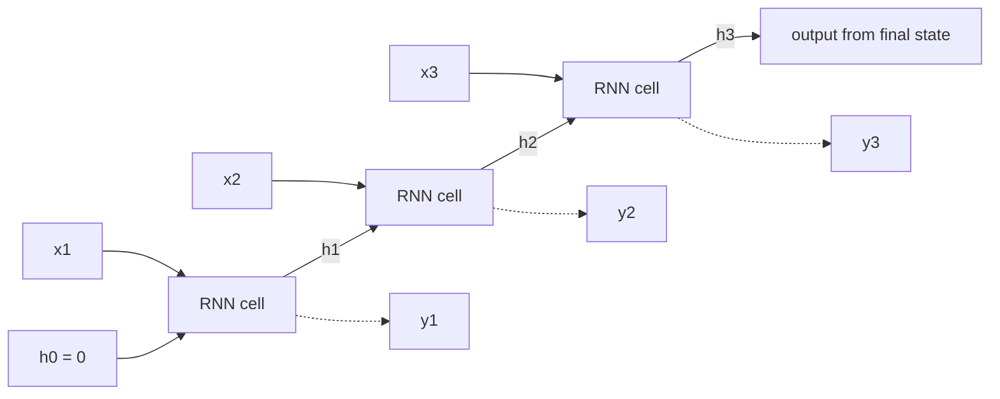
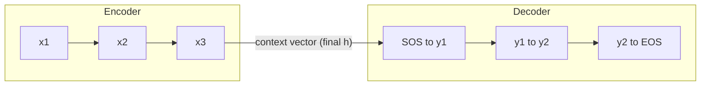
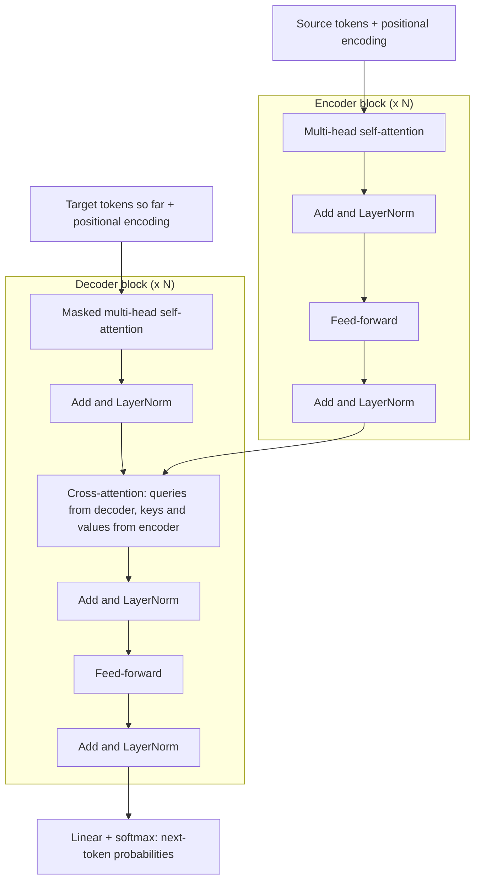

# Chapter 12 — Sequences: RNNs, LSTMs and Attention

Text, speech, prices, sensor readings, click streams, DNA — much data comes as **sequences**, where order carries meaning ("dog bites man" ≠ "man bites dog"). Chapters 10–11 take a fixed-size input at once; sequence models read **step by step** (RNNs) or compare **all positions against each other** (attention), handling variable lengths and dependencies across time.

The chapter follows history, each step fixing the last one's weakness: RNNs → vanishing gradients → LSTM/GRU gates → seq2seq → the bottleneck → attention → self-attention and the transformer. Plus tokenization, word embeddings and an introduction to time-series forecasting. Runnable PyTorch: an LSTM on two toy tasks, seq2seq with and without attention, a tiny word2vec. The step-by-step transformer is in the AI Handbook, [Chapter 3 — Transformers and Embeddings](../../../ai/chapters/03-transformers-and-embeddings/README.md).

All code is in `code/`, runs on CPU in seconds; every output shown is real.

---

## 12.1 Sequence data

### What it is
A **sequence** is an ordered list x₁, x₂, …, x_T where position matters and T varies. Each element (**time step** or **token**) may be a number, a vector (a video frame's features) or a symbol (a word).

| Data | Element | Typical task |
|---|---|---|
| Text | word / subword token | classification, translation, generation |
| Speech | audio frame (10–25 ms) | speech recognition |
| Time series | measurement per time unit | forecasting, anomaly detection |
| User events | click, purchase | next-item recommendation, churn |
| Biology | nucleotide / amino acid | structure and function prediction |

### Why ordinary networks struggle
- **Variable length**: an MLP needs a fixed input size.
- **Order and context**: "bank" depends on nearby words; a bag of features loses order.
- **Parameter sharing across time**: "not good" should be recognised wherever it appears, like a CNN kernel shared across positions.

### Input/output patterns

| Pattern | Example |
|---|---|
| One-to-many | Image captioning |
| Many-to-one | Sentiment classification, "is this transaction sequence fraud?", next-value forecast |
| Many-to-many, aligned | Part-of-speech tagging, per-frame video labels |
| Many-to-many, not aligned (seq2seq) | Translation, summarisation, speech-to-text |

### TL;DR
Ordered, variable-length data; models must share parameters across positions and carry context along.

---

## 12.2 Recurrent neural networks (RNNs)

### What it is
A **recurrent neural network** reads one step at a time and keeps a **hidden state** h_t — a vector summarising everything read so far — updated with the **same weights** at every step:

  **h_t = tanh(W_xh x_t + W_hh h_{t−1} + b_h)**
  **ŷ_t = W_hy h_t + b_y**  (an output, if the task needs one at this step)

tanh squashes into (−1, 1); ŷ is the prediction.

### How it works — unrolling
"Unrolling" draws the loop as a chain of cell copies, one per step, all sharing W_xh, W_hh, b_h (Elman, 1990, the "simple RNN").



Worked numbers (`code/rnn_by_hand.py`) — 1 input, 2 hidden units, W_xh = [0.5, −0.3]ᵀ, W_hh = [[0.4, 0.1], [−0.2, 0.3]], b = 0, inputs 1.0, 0.5, −1.0:

| t | x_t | W_xh x_t + W_hh h_{t−1} | h_t = tanh(…) |
|---|---|---|---|
| 1 | 1.0 | (0.5, −0.3) + 0 | (0.4621, −0.2913) |
| 2 | 0.5 | (0.25, −0.15) + (0.4·0.4621 + 0.1·(−0.2913), −0.2·0.4621 + 0.3·(−0.2913)) = (0.4057, −0.3298) | (0.3848, −0.3184) |
| 3 | −1.0 | (−0.3779, 0.1275) | (−0.3609, 0.1268) |

```
  torch.nn.RNN final hidden: [-0.3609  0.1268]
```
PyTorch's `nn.RNN` with the same weights agrees. **Parameters don't grow with length**: 2 + 4 + 2 = 8 numbers handle sequences of any length (1,000 steps too).

### Backpropagation through time (BPTT)
Unroll over the sequence, sum the loss over steps with targets, and run ordinary backprop through the unrolled graph. Because weights are shared, each weight's gradient is the **sum** over time steps: ∂L/∂W_hh = Σₜ (∂L/∂h_t · local derivative at t), where ∂L/∂h_t collects contributions from all later steps. **Truncated BPTT** backpropagates only k steps (e.g. 100) while still carrying the hidden state forward — cheaper, but can't learn dependencies longer than k.

### Variants
- **Stacked (deep) RNNs**: one layer's hidden-state sequence is the next layer's input (`num_layers=2`).
- **Bidirectional RNNs**: one RNN left-to-right, one right-to-left, states concatenated — each position sees past and future. Good for tagging/classification; impossible for real-time generation (the future isn't known).

PyTorch: `nn.RNN(input_size, hidden_size, num_layers=1, batch_first=True, bidirectional=False)`; input (batch, time, features); returns `output` (every step's top-layer h) and `h_n` (final state per layer).

### TL;DR
Same cell at every step carrying a hidden state; unroll and backprop through time; shared weights = fixed parameter count for any length.

---

## 12.3 Vanishing and exploding gradients through time

### The problem
The gradient of a late loss w.r.t. an early hidden state is a **product of T Jacobians** (matrix of how each output changes with each input), one per step: ∂h_T/∂h_0 = ∏ₜ diag(tanh′(·)) · W_hh. Like depth in Chapter 10, but "depth" is sequence length — often hundreds. If W_hh's largest singular value (how much it stretches vectors) combined with tanh′ ≤ 1 is below 1, gradients shrink **exponentially** with distance; above 1 they can grow exponentially (Bengio, Simard & Frasconi, 1994). In practice a simple RNN struggles beyond a few tens of steps.

`code/rnn_by_hand.py` measures ‖∂h_T/∂h_0‖ in a 32-unit tanh RNN for different recurrent-weight scales:
```
scale 0.5: |d h_T / d h_0| at T=1: 2.64e+00  T=10: 6.51e-03  T=60: 3.54e-17
scale 1.0: |d h_T / d h_0| at T=1: 5.13e+00  T=10: 5.22e+00  T=60: 2.58e+01
scale 1.5: |d h_T / d h_0| at T=1: 9.44e+00  T=10: 2.15e+01  T=60: 1.90e+02
scale 3.0: |d h_T / d h_0| at T=1: 1.60e+01  T=10: 3.90e+02  T=60: 1.29e+07
```


*Figure — Small recurrent weights: the gradient from 60 steps back is ~10⁻¹⁷ (vanished); large: 10⁷ (exploded). Only a narrow band between is usable, and training rarely stays there.*

### Fixes

| Problem | Fix |
|---|---|
| Exploding | **Gradient clipping**: rescale the gradient when its norm exceeds a threshold — `torch.nn.utils.clip_grad_norm_(params, 1.0)`. Standard for recurrent models and transformers. Does **not** fix vanishing. |
| Vanishing | **Gated cells (LSTM, GRU)** with an additive memory path; careful init (orthogonal W_hh, which preserves vector lengths); shorter paths via **attention** or skip connections. |

### In the interview
**30-second answer:** "BPTT multiplies one Jacobian per time step, so gradients from distant steps shrink or grow exponentially — vanishing or exploding, exactly like depth. Exploding is fixed by gradient clipping. Vanishing is fixed architecturally: LSTM/GRU gates create an additive path, and attention connects every position directly."

### TL;DR
Gradients through time are products of per-step factors → vanish or explode. Clip for exploding; gates or attention for vanishing.

---

## 12.4 LSTM and GRU

### What it is
**Long Short-Term Memory** (Hochreiter & Schmidhuber, 1997; forget gate added by Gers et al., 2000) adds a separate **cell state** c_t — a memory "conveyor belt" — and three **gates** deciding what to erase, write and reveal. A **gate** is a vector in (0, 1) (from a sigmoid) multiplied element-wise into another vector: 0 = block, 1 = pass — a soft switch.

### How it works — LSTM equations
[h_{t−1}, x_t] = previous hidden state and current input stacked; σ = sigmoid; ⊙ = element-wise product.

| Step | Equation | Meaning |
|---|---|---|
| Forget gate | f_t = σ(W_f [h_{t−1}, x_t] + b_f) | Which memory entries to keep (1) or erase (0) |
| Input gate | i_t = σ(W_i [h_{t−1}, x_t] + b_i) | Which entries to update |
| Candidate | c̃_t = tanh(W_c [h_{t−1}, x_t] + b_c) | Proposed new content, in (−1, 1) |
| **Cell update** | **c_t = f_t ⊙ c_{t−1} + i_t ⊙ c̃_t** | Keep part of old memory, add part of new |
| Output gate | o_t = σ(W_o [h_{t−1}, x_t] + b_o) | Which parts of memory to expose |
| Hidden state | h_t = o_t ⊙ tanh(c_t) | What the rest of the network sees |

**Why it fixes vanishing gradients:** the cell update is **additive**. Along the cell path ∂c_t/∂c_{t−1} = f_t — no repeated tanh′ squashing or W_hh multiplication. With f near 1, information and gradients flow across many steps almost unchanged (the "constant error carousel"); the network *learns* when to remember and forget.

One unit: previous c = 2.0; f = 0.9, i = 0.2, c̃ = 0.5 → c_new = 0.9·2.0 + 0.2·0.5 = 1.9 (mostly kept). With o = 0.7, h = 0.7·tanh(1.9) = 0.7·0.956 = 0.669.

An LSTM has **4 weight blocks** (f, i, c̃, o) — about 4× a simple RNN's parameters at the same width.

### GRU
The **Gated Recurrent Unit** (Cho et al., 2014) merges cell and hidden state, with two gates:

| Step | Equation | Meaning |
|---|---|---|
| Update gate | z_t = σ(W_z [h_{t−1}, x_t] + b_z) | How much to replace the old state |
| Reset gate | r_t = σ(W_r [h_{t−1}, x_t] + b_r) | How much old state to use when proposing new content |
| Candidate | h̃_t = tanh(W_h [r_t ⊙ h_{t−1}, x_t] + b_h) | Proposed new state |
| New state | h_t = (1 − z_t) ⊙ h_{t−1} + z_t ⊙ h̃_t | Interpolate old and new |

(Cho et al. and PyTorch swap z and 1 − z — same model, gate meaning flipped; PyTorch also applies r after multiplying h_{t−1} by its weights.) 3 weight blocks — fewer parameters than an LSTM, often similar accuracy.

### Code — an LSTM on two toy tasks
`code/lstm_toy.py`.

**A) Forecasting a noisy signal.** Read the last 30 values of two summed sine waves plus noise; predict the next (many-to-one regression). Train on the first 900 windows, test on the **later** part (never shuffle time across the train/test boundary).

```python
class Forecaster(nn.Module):
    def __init__(self, hidden=32):
        super().__init__()
        self.lstm = nn.LSTM(input_size=1, hidden_size=hidden, batch_first=True)  # (batch, time, feat)
        self.head = nn.Linear(hidden, 1)

    def forward(self, x):                       # x: (batch, 30, 1)
        out, (h_n, c_n) = self.lstm(x)          # out: every step's h; h_n/c_n: final hidden & cell state
        return self.head(out[:, -1])            # predict from the last hidden state
```

**B) Long memory.** Read T random symbols (1–8) and output the **first** — the answer must survive T steps of distraction, isolating vanishing gradients. Each model embeds symbols (`nn.Embedding`, a learned id → vector table), runs a 32-unit RNN/LSTM/GRU, classifies from the last hidden state; gradients clipped at norm 1. The LSTM's forget-gate bias is initialised to 1 ("remember by default", Jozefowicz et al., 2015) — f ≈ 0.73 at start, so memory and gradients persist early in training.

```python
if cell == "LSTM":                                         # forget-gate bias = 1: "remember by default"
    with torch.no_grad():                                  # PyTorch gate order: input, forget, cell, output
        self.rnn.bias_ih_l0[hidden:2 * hidden].fill_(1.0)
        self.rnn.bias_hh_l0[hidden:2 * hidden].fill_(0.0)
```

```
A) LSTM test MSE 0.0190  vs naive last-value MSE 0.0442  (noise variance = 0.0100)
B) recall the first of T symbols (test accuracy, chance 0.125)
    T     RNN    LSTM     GRU
    5   1.000   1.000   1.000
   15   0.505   1.000   1.000
recurrent-layer parameters (hidden 32): {'RNN': 1600, 'LSTM': 6400, 'GRU': 4800}
saved img/lstm_sine_forecast.png
```


*Figure — One-step-ahead LSTM forecasts on the held-out future. MSE 0.019 is under half the naive "next = last" baseline and approaches the noise floor (0.010), which no model can beat.*

Part B: at 5 steps all three cells solve it; at 15 the plain RNN stalls near 50% (the gradient back to the first symbol vanished) while LSTM and GRU hit 100%. With much longer gaps even gated cells need more training — where attention shines. Parameter counts confirm the 1 : 4 : 3 ratio (16·32 + 32·32 + 2·32 = 1,600 for the RNN).

### Trade-offs

| | Simple RNN | LSTM | GRU | Transformer (12.7) |
|---|---|---|---|---|
| Long-range memory | Poor (a few tens of steps) | Good | Good | Excellent (direct connections) |
| Parameters (same width) | 1× | 4× | 3× | Different design |
| Training parallelism across time | None | None | None | Full |
| Inference memory, long sequences | Constant | Constant | Constant | Grows with length (KV cache) |
| Typical use today | Teaching | Small/streaming, time series, on-device | Same as LSTM | NLP, vision, audio, most large models |

### When not to use it
- Large-scale NLP: transformers win on quality and trainability (parallel over time).
- Tabular time series with good lag features: gradient-boosted trees are often better and simpler (12.10).

### Common mistakes
- Forgetting `batch_first=True` and feeding (batch, time, features) to a layer expecting (time, batch, features).
- `out[:, -1]` on **padded** batches — the last position may be padding. Pack (`nn.utils.rnn.pack_padded_sequence`) or index each sequence's real final step.
- Not clipping gradients.
- Shuffling time series across the train/test boundary (**leakage**: future information inflates scores).

### Real-world examples
LSTMs powered Google voice-search recognition (2015), Google Neural Machine Translation (2016) and handwriting recognition before transformers; still common on-device, in streaming, and in industrial forecasting and anomaly detection.

### In the interview
**30-second answer:** "An LSTM adds a cell state updated additively — c_t = f ⊙ c_{t−1} + i ⊙ c̃ — controlled by sigmoid forget, input and output gates. The cell path isn't repeatedly squashed or multiplied by the recurrent matrix, so gradients survive many steps. A GRU does the same with update and reset gates and no separate cell — lighter. Both are sequential, which is why transformers replaced them for large-scale NLP."

- *Q: Forget gate, and why bias 1?* A: It scales the old cell state; bias 1 gives f ≈ 0.73 so memory persists by default early on.
- *Q: LSTM vs GRU?* A: GRU is simpler (3 vs 4 blocks), faster; accuracy usually similar — try both.
- *Q: Why can't you parallelise an RNN over time?* A: h_t depends on h_{t−1}.

### TL;DR
LSTM = cell state + forget/input/output gates, additive memory → long-range dependencies. GRU = update/reset gates, lighter. Clip gradients; forget-bias 1.

---

## 12.5 Sequence-to-sequence (encoder-decoder) models

### What it is
**Seq2seq** (Sutskever, Vinyals & Le; Cho et al.; both 2014) maps an input sequence to an output of *different* length:
1. **Encoder**: an RNN reads the input, ending in a fixed-size hidden state — the **context vector**.
2. **Decoder**: another RNN initialised with it generates output tokens one at a time, each step fed the previous token, until end-of-sequence.



### How it works
- **Teacher forcing** (training): the decoder input at step t is the **true** previous token (target shifted right, starting with SOS), not its own prediction — fast, stable. Cross-entropy loss at every output step.
- **Decoding** (inference) feeds back the model's own predictions:
  - **Greedy**: most likely token each step.
  - **Beam search**: keep the k most probable partial sequences, extend, keep the best k. Finds higher-probability outputs; standard in translation. k = 1 is greedy.
  - **Sampling** (temperature, top-k, top-p): for creative generation (AI Handbook, [Chapter 4](../../../ai/chapters/04-large-language-models/README.md)).
- **Exposure bias**: trained on perfect prefixes, tested on its own possibly wrong ones — errors compound. Scheduled sampling (gradually feeding its own predictions in training) mitigates.

### The bottleneck problem
The whole input is squeezed into one fixed-size vector; early information is lost and quality drops sharply with sentence length. Sutskever et al. found **reversing the source** helped (shorter distance between first source and first target words) — a hint that short paths matter. The real fix is attention.

### In the interview
**30-second answer:** "An encoder RNN reads the input into a context vector; a decoder RNN generates the output token by token from it. Training uses teacher forcing; inference uses greedy or beam search on the model's own outputs. The weakness is the fixed-size bottleneck, which attention removes."

### TL;DR
Encoder → context vector → decoder; teacher forcing to train, greedy/beam to decode; the bottleneck motivates attention.

---

## 12.6 The attention mechanism

### What it is
**Attention** (Bahdanau, Cho & Bengio, 2014) lets the decoder, at every output step, **look back at all encoder states** and take a relevance-weighted average — a fresh, targeted context vector per step instead of one summary.

### How it works — queries, keys and values
A soft dictionary lookup:
- **Query (q)**: what I'm looking for (the decoder's current state).
- **Keys (k)**: a label per findable item (one per encoder position).
- **Values (v)**: the content returned (often the same encoder states).

1. **Score** each key against the query. Dot-product (Luong, 2015): q·k. Additive (Bahdanau): vᵀ tanh(W₁q + W₂k). Transformers: **scaled dot-product** q·k / √d_k.
2. **Softmax** scores into positive weights summing to 1.
3. **Output** = Σ weightᵢ · vᵢ.

Matrix form: **Attention(Q, K, V) = softmax(Q Kᵀ / √d_k) V**, d_k = key length.

### Worked example with small numbers
Three tokens ("the", "cat", "sat"), d_k = 2 (in a real model Q, K, V = token vectors × learned W_Q, W_K, W_V; here picked directly). Q = K = [[1, 0], [0, 1], [1, 1]], V = [[1, 2], [3, 4], [5, 6]].

**Query 1 (q = [1, 0]):** dot products (1, 0, 1); ÷√2 → (0.707, 0, 0.707); softmax: e^0.707 = 2.028, e^0 = 1, sum 5.056 → (0.401, 0.198, 0.401); output = 0.401·[1, 2] + 0.198·[3, 4] + 0.401·[5, 6] = [3.0, 4.0].

All three queries (`code/attention_by_hand.py`):
```
scores = Q K^T / sqrt(2):
 [[0.707 0.    0.707]
 [0.    0.707 0.707]
 [0.707 0.707 1.414]]
attention weights (softmax per row):
 [[0.401 0.198 0.401]
 [0.198 0.401 0.401]
 [0.248 0.248 0.503]]
output = weights @ V:
 [[3.    4.   ]
 [3.407 4.407]
 [3.51  4.51 ]]
matches torch.nn.functional.scaled_dot_product_attention: True
```

```python
def attention(Q, K, V, mask=None):
    d_k = Q.shape[-1]
    scores = Q @ K.T / np.sqrt(d_k)                  # similarity of every query with every key
    if mask is not None:
        scores = np.where(mask, scores, -np.inf)     # hide disallowed positions
    weights = softmax(scores)                        # each row sums to 1
    return weights @ V, scores, weights              # weighted average of values
```

**Why divide by √d_k?** For random unit-variance vectors, the dot product's standard deviation grows like √d_k. Large scores push softmax into a nearly one-hot, **saturated** regime where score changes barely move the output and gradients are tiny. Scaling keeps scores near unit variance:
```
d_k=  4: std of q.k =   1.99   std after / sqrt(d_k) = 1.00
d_k= 64: std of q.k =   8.05   std after / sqrt(d_k) = 1.01
d_k=512: std of q.k =  22.44   std after / sqrt(d_k) = 0.99
```

### Attention fixes seq2seq — runnable demo
`code/seq2seq_attention.py` trains two GRU encoder-decoders (1,500 steps, teacher forcing) to **reverse a 12-digit sequence**; one decoder sees only the final encoder state, the other also attends over all encoder states (query = decoder state, keys = values = encoder states).

```python
def forward(self, src, tgt_in):
    enc_out, h = self.encoder(self.src_emb(src))                # enc_out: (B, L, H) - one vector per input token
    dec_out, _ = self.decoder(self.tgt_emb(tgt_in), h)          # decoder starts from the encoder's summary h
    if not self.use_attention:
        return self.out(dec_out), None
    scores = dec_out @ enc_out.transpose(1, 2) / H ** 0.5       # (B, L_tgt, L_src): query=decoder, keys=encoder
    weights = scores.softmax(-1)
    context = weights @ enc_out                                 # weighted sum of encoder states
    return self.out(torch.cat([dec_out, context], -1)), weights
```

```
no attention  : token accuracy 0.669, whole-sequence accuracy 0.156
   source [7, 7, 5, 1, 0, 0, 0, 3, 6, 9, 0, 0]
   output [0, 0, 9, 6, 0, 3, 0, 3, 1, 5, 0, 7]
with attention: token accuracy 0.991, whole-sequence accuracy 0.980
   source [7, 7, 5, 1, 0, 0, 0, 3, 6, 9, 0, 0]
   output [0, 0, 9, 6, 3, 0, 0, 0, 1, 5, 7, 7]
   where each output step looks (argmax of attention over source positions): [11, 11, 10, 9, 8, 7, 6, 6, 4, 3, 2, 1]
```
Without attention the first few outputs (recent inputs) are right, then garbled — the bottleneck. With attention 98% of sequences are perfect, and the pattern is interpretable: the peak moves from source position 11 toward 0, a reversed diagonal — the model **learned to read backwards**. It isn't always exactly on the copied digit: identical neighbours (the 0s at 10–11 and 4–6) are interchangeable, and in the last steps it sits one position right (looks at 4, 3, 2, 1 while copying 3, 2, 1, 0) — fine, because a left-to-right GRU's state at j + 1 has just read x_j.

### In the interview
**30-second answer:** "Attention scores a query against every key, softmaxes the scores into weights, and returns the weighted average of the values: softmax(QKᵀ/√d_k)V. In seq2seq the decoder state is the query and encoder states are keys and values, so each output step gets its own context. Dividing by √d_k keeps scores at unit variance so softmax doesn't saturate."

- *Q: Additive vs dot-product attention?* A: Additive scores with a small MLP; dot-product is a matrix multiply — faster and, scaled, as good.

### TL;DR
Attention = softmax(QKᵀ/√d_k)·V — a learned, **differentiable** weighted lookup. It removes the seq2seq bottleneck and gives interpretable alignments.

---

## 12.7 Self-attention and the transformer (high level)

### What it is
In **self-attention**, Q, K and V come from the **same** sequence (three learned projections): every token attends to every token of its own sentence ("…because **it** was too tired" — "it" draws from "animal"). The **transformer** (Vaswani et al., 2017, "Attention Is All You Need") drops recurrence and stacks self-attention with position-wise **feed-forward** layers.

### Why it matters
- **Parallel** over positions — trains efficiently on GPUs over huge data.
- **Short paths**: any two positions are one step apart — no vanishing through time.
- **Scales**: BERT, GPT, T5, Claude, Gemini, LLaMA, Whisper (speech), ViT (Chapter 11).

### How it works — the building blocks
1. **Token embeddings** of size d_model (512 originally).
2. **Positional encoding**: self-attention is **permutation-equivariant** (shuffle inputs → outputs shuffle the same way), so without positions "dog bites man" = "man bites dog". Original: fixed sinusoids PE(pos, 2i) = sin(pos / 10000^(2i/d)), PE(pos, 2i+1) = cos(pos / 10000^(2i/d)); later learned positions or **RoPE** (rotate query/key vectors by position).
3. **Multi-head attention**: h heads in parallel, each projecting to d_model/h dims with its own W_Q, W_K, W_V; outputs concatenated and projected. Each head captures different relations in its own subspace, at the same total cost as one full-width head.
4. **Feed-forward network**: 2-layer MLP per position (typically 4× wider inside).
5. **Residual connections + layer normalization** (each token's vector rescaled to zero mean, unit variance) around each sub-layer (the ResNet skip idea, Chapter 11).
6. Stack N blocks (original: 6 encoder + 6 decoder, 8 heads).

Each piece is worked through with code in the AI Handbook, [Chapter 3](../../../ai/chapters/03-transformers-and-embeddings/README.md) (§3.3 positions, §3.5 multi-head, §3.6 the block, §3.7 causal masking, §3.8 the three families).



- **Encoder**: bidirectional — each token sees the whole input.
- **Decoder**: **masked (causal)** self-attention — token i attends only to ≤ i; needed because training processes all positions at once and must not peek at the tokens being predicted — plus **cross-attention** (queries from decoder, keys/values from encoder: the 12.6 seq2seq attention).
- Families: **encoder-only** (BERT — understanding), **decoder-only** (GPT, Claude, LLaMA — generation), **encoder-decoder** (original, T5, Whisper — translation, summarisation, speech-to-text).

Causal masking on the worked example (upper triangle → −∞ before softmax):
```
causal (decoder) weights:
 [[1.    0.    0.   ]
 [0.33  0.67  0.   ]
 [0.248 0.248 0.503]]
causal output matches torch (is_causal=True): True
MultiheadAttention: input (2, 5, 16) -> output (2, 5, 16) | averaged attention weights (2, 5, 5)
positional encoding rows 0 and 1 (first 4 dims): [0. 1. 0. 1.] [0.841 0.54  0.682 0.732]
```


*Figure — Left: sinusoidal encodings, 50 positions × 64 dims; low dims vary fast, high ones slowly. Right: the worked example's attention weights.*

### Trade-offs
| | RNN/LSTM | Transformer |
|---|---|---|
| Compute per layer (big-O) | O(n · d²) | O(n² · d) for attention — quadratic in length n |
| Parallel over sequence | No | Yes |
| Path length between distant tokens | O(n) | O(1) |
| Memory at inference | Constant state | Key/value cache grows with context |

Long contexts are expensive (n²): FlashAttention computes exact attention faster with less memory; sparse/linear attention and **state-space models** (recurrent-style, fixed-size state; e.g. Mamba) trade off differently.

**Where next:** AI Handbook [Chapter 3](../../../ai/chapters/03-transformers-and-embeddings/README.md) builds the transformer step by step; [Chapter 4](../../../ai/chapters/04-large-language-models/README.md) covers training objectives, scaling, fine-tuning and **RLHF** (reinforcement learning from human feedback). This book stops at ML foundations.

### In the interview
**30-second answer:** "Self-attention lets each token take a weighted average of all tokens' values, weights from softmax of query-key dot products scaled by √d. A transformer stacks multi-head self-attention and position-wise feed-forward layers with residuals and layer norm, adding positional encodings because attention is order-agnostic. Encoders attend bidirectionally; decoders use causal masks and cross-attention. It replaced RNNs because it's parallel and connects any two positions in one step; cost is quadratic in length."

- *Q: Complexity in sequence length n?* A: O(n²) time and memory for the score matrix.
- *Q: GPT? BERT?* A: Decoder-only; encoder-only.

### TL;DR
Embeddings + positional encoding + N × (multi-head self-attention + feed-forward, each with residual + LayerNorm). Encoder bidirectional; decoder causal + cross-attention. Parallel, short paths, O(n²).

---

## 12.8 Text preprocessing and tokenization

### What it is
**Tokenization** splits text into **tokens** and maps each to an integer id from a **vocabulary**; an embedding layer then maps ids to vectors.

### How it works — a classic pipeline
1. **Normalise**: lowercase (sometimes), Unicode normalisation, replace URLs/numbers with placeholders, strip markup (e.g. HTML tags).
2. **Tokenize**.
3. **Build a vocabulary** from training data (frequency cut-off) plus special tokens `<pad>`, `<unk>` (out-of-vocabulary), and `<sos>`/`<eos>` for seq2seq.
4. **Encode** tokens → ids; unknowns → `<unk>`.
5. **Pad/truncate** to a fixed length for batching; mask the padding.

Classic NLP also used **stop-word removal** ("the", "a") and **stemming/lemmatization** ("running" → "run"). These help **bag-of-words** models (word counts, order ignored) such as **TF-IDF** (counts down-weighted for words common in every document) + logistic regression, but usually **not** neural models — and "not" is a stop word you must keep for sentiment.

```python
def normalize(text):
    text = text.lower()
    text = re.sub(r"https?://\S+", "<url>", text)           # replace URLs with a placeholder
    return re.findall(r"<url>|[a-z0-9]+(?:'[a-z]+)?|[.,!?]", text)

def encode(tokens, stoi, max_len):
    ids = [stoi.get(t, stoi["<unk>"]) for t in tokens][:max_len]   # unknown words -> <unk>, truncate
    return ids + [stoi["<pad>"]] * (max_len - len(ids))            # pad to a fixed length
```

Output (`code/text_and_embeddings.py`):
```
'The cat sat on the mat!'                          -> ['the', 'cat', 'sat', 'on', 'the', 'mat', '!']
"Dogs don't like cats, see https://example.com"    -> ['dogs', "don't", 'like', 'cats', ',', 'see', '<url>']
'The mat is red.'                                  -> ['the', 'mat', 'is', 'red', '.']
vocab size 18 | encode('the dog sat') = [17, 1, 15, 0, 0, 0]
characters of 'mat': ['m', 'a', 't'] | bytes of 'café' (UTF-8): [99, 97, 102, 195, 169]
```
"dog" was never seen (only "dogs") → id 1 = `<unk>`: the weakness of word-level vocabularies.

### Word vs character vs subword tokens

| Level | Vocabulary | Sequence length | Unknown words | Used by |
|---|---|---|---|---|
| Word | Huge (100k+), still misses rare words and typos | Short | `<unk>` problem | Classic NLP, word2vec |
| Character / byte | Tiny (≈100 chars, 256 bytes) | Very long | None | Some specialised models (ByT5) |
| **Subword** (BPE, WordPiece, Unigram) | Medium (≈30k–200k) | Medium | Rare words split into known pieces | Essentially all modern LLMs |

**Byte-Pair Encoding (BPE)** (for NLP: Sennrich et al., 2016): start from characters; repeatedly merge the **most frequent adjacent pair** in the training corpus into a new symbol; stop after a set number of merges (= vocabulary size). Frequent words become single tokens; rare words split into pieces ("lowest" → "low" + "est").

```
BPE merges learned: ['lo', 'low', 'er', 'er</w>', 'low</w>', 'es']
words as subword tokens: ['low er</w>', 'low es t </w>', 'low</w>', 'n e w er</w>', 'n e w es t </w>', 'w i d er</w>', 'w i d es t </w>']
```
(`</w>` = end of word.) After six merges "low" is one token and "er", "es" are emerging. GPT-2 onward use **byte-level BPE**: start from the 256 byte values 0–255 (UTF-8 encodes each character as 1–4 bytes), so any string — any language, emoji, code — encodes with no `<unk>`. BERT uses **WordPiece**; T5 and many multilingual models **SentencePiece** (Unigram or BPE). Rule of thumb: one token ≈ ¾ of an English word (≈4 characters) — why API prices and **context windows** (max tokens a model reads at once) are quoted in tokens.

### Common mistakes
- Building the vocabulary (or fitting a tokenizer) on validation/test text.
- A different tokenizer at inference than training — with a pretrained model always load its own.
- Removing stop words/negations for neural sentiment models.
- Forgetting attention/padding masks, so the model "reads" padding.

### TL;DR
Normalise → tokenize → vocabulary with `<pad>`/`<unk>` → ids → pad. Modern models use subword tokenizers (BPE/WordPiece/SentencePiece) — no out-of-vocabulary problem.

---

## 12.9 Word embeddings

### What it is
A **word embedding** is a dense vector (100–300 numbers) such that words used in similar contexts get similar vectors. It replaces **one-hot encoding** (a 50,000-long vector with one 1) — huge, sparse, and every word equally different ("cat" as far from "kitten" as from "carburettor").

**Distributional hypothesis**: "you shall know a word by the company it keeps" (J. R. Firth, 1957).

### How word2vec works (Mikolov et al., 2013)
Shallow networks trained on raw text:
- **Skip-gram**: from the centre word, predict each word in a window around it.
- **CBOW** (continuous bag of words): from the surrounding words, predict the centre.

Skip-gram with **negative sampling**:
1. Slide a window (±2 words); every (centre, context) pair is a positive.
2. Per positive, draw k random "negative" words (frequency^0.75 distribution).
3. Each word has an input and a context vector; train σ(v_centre · u_context) → 1 for real pairs, → 0 for negatives (binary cross-entropy). This replaces an expensive full-vocabulary softmax with k+1 cheap binary classifications.
4. Keep the input vectors.

Words sharing contexts get similar updates and converge. Side effect on large corpora: vec("king") − vec("man") + vec("woman") ≈ vec("queen").

```python
class SkipGram(nn.Module):
    def __init__(self, n_words, dim=16):
        super().__init__()
        self.inp = nn.Embedding(n_words, dim)      # the word vectors we keep
        self.ctx = nn.Embedding(n_words, dim)      # separate vectors for words used as context
    def forward(self, center, context, negatives):
        c = self.inp(center)                                               # (B, d)
        pos = (c * self.ctx(context)).sum(-1)                              # score for the real pair
        neg = torch.bmm(self.ctx(negatives), c.unsqueeze(-1)).squeeze(-1)  # scores for random pairs
        return -(nn.functional.logsigmoid(pos) + nn.functional.logsigmoid(-neg).sum(-1)).mean()
```

On a synthetic 3,000-sentence corpus where royal, animal and fruit nouns each appear with their own context words:
```
word2vec: 3000 sentences, vocab 31, final batch loss 1.709
  nearest to 'king': [('kingdom', 0.78), ('throne', 0.6), ('queen', 0.59)]
  nearest to 'dog': [('chases', 0.7), ('pet', 0.68), ('cat', 0.55)]
  nearest to 'mango': [('apple', 0.72), ('cherry', 0.71), ('banana', 0.7)]
  mean cosine: same-group nouns 0.50  vs  different-group nouns 0.20
```
(**Cosine similarity**: 1 = same direction, 0 = unrelated.) Never told the groups, the model puts "king" near "queen", "dog" near "cat", fruits together, purely from co-occurrence. Topical words ("kingdom") also rank high — embeddings capture relatedness as well as similarity.

### Other embeddings

| Method | Idea | Note |
|---|---|---|
| **GloVe** (Stanford, 2014) | Factorise global word co-occurrence statistics | Similar quality to word2vec |
| **fastText** (Facebook, 2016) | Word vector = sum of character n-gram vectors | Handles rare/misspelled/unseen words |
| **Contextual embeddings** (ELMo 2018, BERT 2018, all transformers) | Vector depends on the sentence — "bank" (river) ≠ "bank" (money) | word2vec gives one vector per word regardless of sense |
| **Sentence/document embeddings** | One vector per text | Semantic search and RAG (AI Handbook, [Chapter 7](../../../ai/chapters/07-embeddings-vector-databases-and-rag/README.md)) |

Every PyTorch NLP model starts with `nn.Embedding(vocab_size, dim)` — e.g. `nn.Embedding(10000, 128)` is a 10,000 × 128 trainable table, one row per id — learned with the model, optionally initialised from pretrained vectors.

### Real-world examples
Embeddings of words, products, users and songs drive recommendation (Airbnb's listing embeddings learned word2vec-style from browsing sessions, KDD 2018), search ranking, and **vector databases** (fast nearest-vector search) for **retrieval-augmented generation** (fetching documents for an LLM to answer from).

### In the interview
**30-second answer:** "Embeddings map discrete tokens to dense vectors where geometry reflects meaning. word2vec learns them by predicting context words from a centre word (skip-gram) or vice versa (CBOW), with negative sampling instead of a full softmax; similar contexts → similar vectors. Static embeddings give one vector per word; transformers produce contextual embeddings."

- *Q: Limitation of word2vec?* A: One vector per word regardless of sense; none for unseen words (fastText helps).

### TL;DR
Learned dense vectors; similar contexts → similar vectors (skip-gram/CBOW + negative sampling). Modern models learn contextual embeddings.

---

## 12.10 Time-series forecasting — an introduction

### What it is
**Forecasting** predicts future values of a time-indexed series (sales, energy demand, server load). Observations are **ordered and dependent**, and the future may not resemble the past.

- **Trend**: long-term rise/fall. **Seasonality**: repeating patterns (weekly, yearly). **Noise**: the unpredictable rest.
- **Lag**: a past value; lag_7 at day t is the value at t − 7.
- **Horizon**: how far ahead (one-step vs multi-step).
- **Stationarity**: mean and variance don't change over time — assumed by many classical methods; **differencing** (y_t − y_{t−1}) removes trends.

### How it works — forecasting as supervised learning
1. Each row is a time t; features use **only past information**: lags, rolling means (shifted so the current value doesn't leak), calendar features.
2. Target = value at t (or t + h).
3. Split **chronologically**. **Cross-validation** (scoring on several train/validation splits) must use expanding/rolling windows (`sklearn.model_selection.TimeSeriesSplit`), never random K-fold.
4. Always compare with **baselines**: naive (last value) and seasonal naive (value one season ago).

`code/time_series.py` — a synthetic daily series with upward trend, weekly cycle and noise (std 2):
```python
def lag_features(s, lags=(1, 2, 3, 7, 14)):
    df = pd.DataFrame({"y": s})
    for L in lags:
        df[f"lag_{L}"] = s.shift(L)                       # value L days earlier (only past info!)
    df["rolling_mean_7"] = s.shift(1).rolling(7).mean()   # shift first so today's value doesn't leak
    df["dayofweek"] = s.index.dayofweek
    return df.dropna()
```
Output (**MAE** = mean absolute error, in the series' units):
```
feature table (first 3 rows):
                y  lag_1  lag_2  lag_3  lag_7  lag_14  rolling_mean_7  dayofweek
2024-01-15   98.9   93.0   86.8   96.8  102.6   100.3            99.8          0
2024-01-16  107.9   98.9   93.0   86.8  107.2   107.7            99.3          1
2024-01-17  110.3  107.9   98.9   93.0  108.1   111.2            99.4          2

one-step-ahead MAE on the last 60 days (noise std = 2.0):
  naive (yesterday)                            5.94
  seasonal naive (same weekday last week)      2.20
  linear AR on lag features                    1.80
  gradient boosting on lag features            2.77
  gradient boosting on differences             1.90
train target range 91-154, test range 134-160
```


*Figure — Last 150 days with one-step-ahead forecasts over the 60-day test period (dashed line = start of test).*

- **Seasonal naive** is already strong (2.20); naive is poor — it ignores the weekly cycle.
- **Linear autoregression** (value as a weighted sum of its own past values) wins (1.80, near the noise floor ≈1.6 = MAE of pure N(0, 2) noise) — the data is linear.
- **Gradient boosting on raw levels loses to the baseline** (2.77): trees can't **extrapolate** — test values (to 160) exceed most of the training range and a tree only outputs values it saw. Modelling **differences** fixes it (1.90). A classic trap.

### ARIMA vs ML — brief
Classical families: **ARIMA** and **exponential smoothing** (weighted averages of past values, weights fading with age). GBM = gradient-boosting machine.

| | ARIMA / exponential smoothing | ML with lag features (GBM, linear) | Deep learning (LSTM, transformers, N-BEATS…) |
|---|---|---|---|
| Model | ARIMA(p, d, q): **AR** — regression on p own lags; **I** — difference d times for stationarity; **MA** — regression on q past forecast errors. SARIMA adds seasonal terms. ETS/Holt-Winters smooth level, trend, season | Any regressor on engineered lag/calendar features | Learn features from raw windows |
| Series handled | One at a time (univariate) | Many series in one **global model** | Many series, global |
| Extra features (price, promotions, weather) | Limited (ARIMAX) | Easy | Easy |
| Data needed | Small (dozens–hundreds of points) | Medium | Large |
| Uncertainty | Built-in prediction intervals | Needs quantile loss or conformal methods | Needs extra work |
| Tools | `statsmodels` (ARIMA, ETS), `pmdarima`, Prophet | scikit-learn, LightGBM, XGBoost | PyTorch, `darts`, `neuralforecast` |

Practice: start with seasonal-naive and ETS/ARIMA baselines; for many related series with extra features, a global gradient-boosting model on lags is usually strongest (LightGBM-based approaches dominated the M5 retail competition, 2020); deep models pay off with lots of data (M4, 2018, was won by an exponential-smoothing + RNN hybrid). Pretrained forecasting **foundation models** (Amazon's Chronos, Google's TimesFM) are emerging.

### Common mistakes
- Random splits or K-fold on time series (future leaks into training).
- Rolling features that include the current value.
- Skipping baselines — fancy models losing to seasonal naive is common.
- Trees on trending levels — difference or detrend first.
- Evaluating one-step-ahead when the business needs 30 days ahead (multi-step errors compound).

### In the interview
**30-second answer:** "I frame forecasting as supervised learning with only past information as features — lags, shifted rolling stats, calendar effects — and split chronologically with rolling-origin validation (train up to a date, test the next period, move forward). I beat naive and seasonal-naive baselines first. ARIMA models a single series with autoregressive, differencing and moving-average terms and gives intervals; LightGBM handles many series and external features but can't extrapolate trends unless I model differences. Deep models help with lots of data."

- *Q: What does the I in ARIMA do?* A: Differencing to remove trends, making the series closer to stationary.

### TL;DR
Past-only features, chronological splits, strong baselines. ARIMA for single series; GBMs on lags for many series (model differences for trend); deep models with lots of data.

---

## Chapter TL;DR
- **RNN**: h_t = tanh(W_xh x_t + W_hh h_{t−1} + b); train with **BPTT**; gradients through time **vanish/explode** (clip for explosions).
- **LSTM**: c_t = f ⊙ c_{t−1} + i ⊙ c̃ — additive gradient path. **GRU**: update/reset gates, lighter. Toy task: RNN failed at 15 steps; LSTM/GRU 100%.
- **Seq2seq**: encoder → context → decoder; teacher forcing; greedy/beam search; fixed-size bottleneck.
- **Attention**: softmax(QKᵀ/√d_k)V; reversal task went from 16% to 98% perfect sequences.
- **Transformer**: self-attention + feed-forward with residuals and LayerNorm; positional encodings; encoder bidirectional, decoder causal + cross-attention; parallel, O(n²).
- **Text**: normalise → subword tokenize → ids → embeddings; **word2vec** (skip-gram/CBOW + negative sampling); transformers give contextual embeddings.
- **Time series**: lag features, chronological splits, seasonal-naive baselines; ARIMA, GBMs on lags (watch extrapolation), deep models with lots of data.
