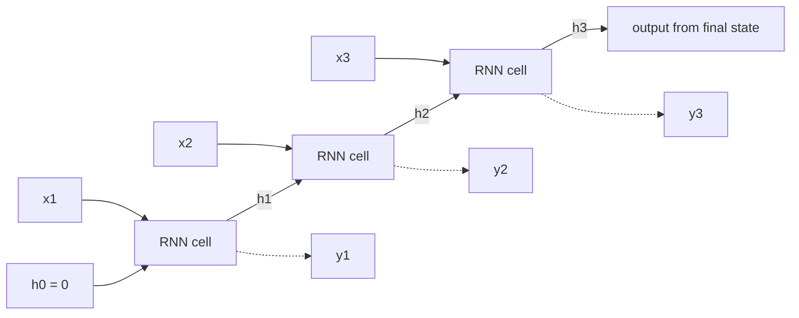
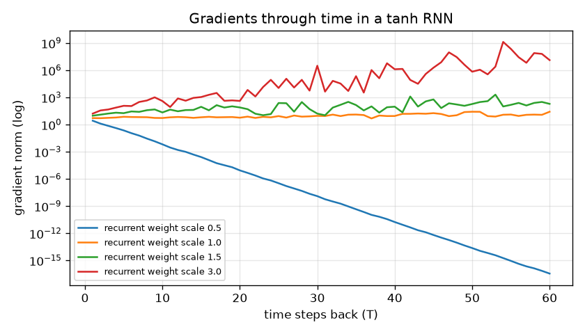
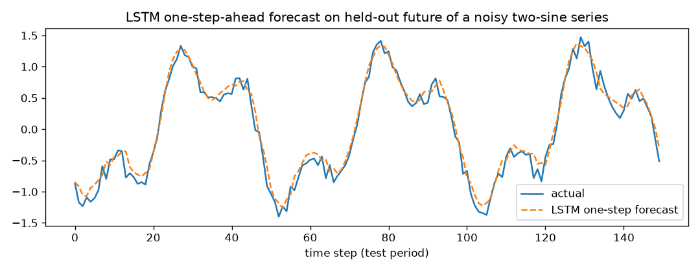
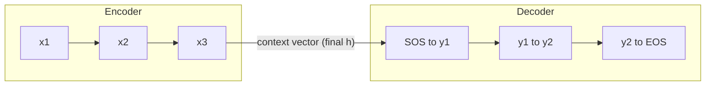
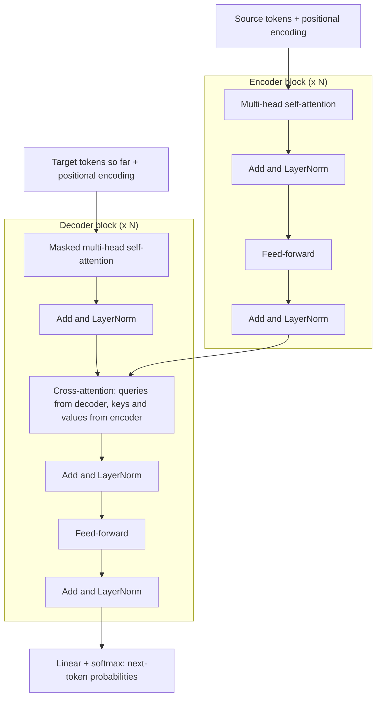
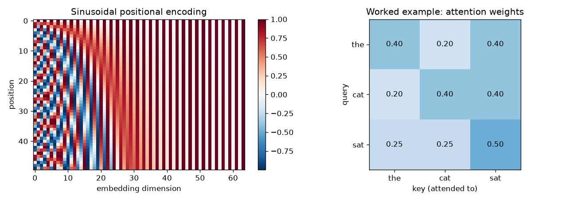
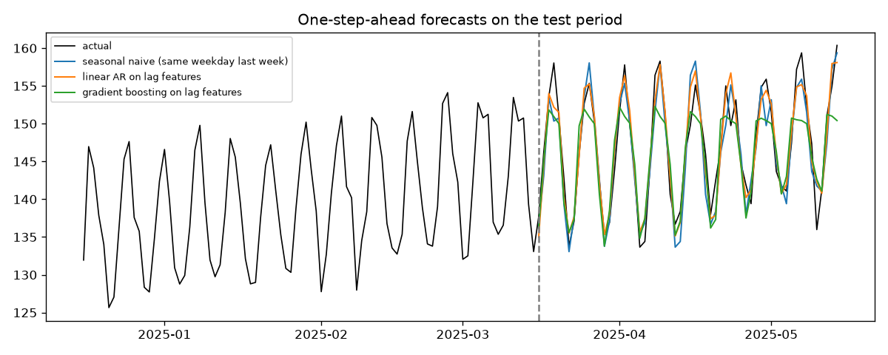

# Chapter 12 — Sequences: RNNs, LSTMs and Attention

Text, speech, stock prices, sensor readings, click streams, DNA — much of the world's data comes as **sequences**, where order carries meaning. "Dog bites man" and "man bites dog" contain the same words. The networks of Chapters 10 and 11 take a fixed-size input all at once; sequence models read data **step by step** (RNNs) or **all positions against each other** (attention), so they can handle variable lengths and dependencies across time.

This chapter follows the historical path, because each step fixes the previous one's weakness: RNNs → vanishing gradients (training signals that shrink to almost nothing as they travel back through many steps) → LSTM/GRU gates → seq2seq encoder-decoders → the bottleneck problem → attention → self-attention and the transformer. Along the way we cover how text becomes numbers (tokenization and word embeddings) and a short introduction to time-series forecasting.

**What you'll learn**

1. What makes sequence data special, and the input/output patterns (one-to-many, many-to-one, many-to-many).
2. Recurrent neural networks: the recurrence, unrolling, backpropagation through time (BPTT).
3. Why gradients vanish or explode through time.
4. LSTM and GRU: gate intuition and equations.
5. Sequence-to-sequence (encoder-decoder) models, teacher forcing, greedy and beam decoding.
6. The attention mechanism — worked with small numbers.
7. Self-attention and the transformer at a high level. The step-by-step treatment is in the AI Handbook, [Chapter 3 — Transformers and Embeddings](../../../ai/chapters/03-transformers-and-embeddings/README.md).
8. Text preprocessing and tokenization (word, character, subword/BPE) and word embeddings (word2vec intuition).
9. Time-series forecasting: lags, baselines, ARIMA vs ML.
10. Runnable PyTorch (the Python deep-learning library used throughout): an LSTM on two toy sequence tasks, a seq2seq model with and without attention, a tiny word2vec.

All code is in `code/`, runs on CPU (the computer's ordinary processor — no **GPU**, the graphics chip that does thousands of calculations at once, needed) in seconds, and every output shown is real.

---

## 12.1 Sequence data

### What it is
A **sequence** is an ordered list x₁, x₂, …, x_T where position matters and T can vary. Each element (a **time step** or **token**) may be a number (temperature), a **vector** (an ordered list of numbers — e.g. a video frame's features), or a symbol (a word).

| Data | Element | Typical task |
|---|---|---|
| Text | word / subword token | classification, translation, generation |
| Speech | audio frame (e.g. 10–25 ms) | speech recognition |
| Time series | measurement per time unit | forecasting, anomaly detection (spotting unusual values) |
| User events | click, purchase | next-item recommendation, churn (a customer leaving) |
| Biology | nucleotide / amino acid | structure and function prediction |

### Why ordinary networks struggle
- **Variable length**: an MLP (multi-layer perceptron — the plain fully connected network of Chapter 10) needs a fixed input size.
- **Order and context**: the meaning of "bank" depends on nearby words; a "bag" of features (an unordered collection) loses order.
- **Parameter sharing across time**: a pattern ("not good") should be recognised wherever it appears, just as a CNN kernel is shared across image positions.

### Input/output patterns

| Pattern | Example |
|---|---|
| One-to-many | Image captioning (image in, word sequence out) |
| Many-to-one | Sentiment classification (is this text positive or negative?), "is this transaction sequence fraud?", next-value forecast |
| Many-to-many, aligned | Part-of-speech tagging (labelling each word noun, verb, …), per-frame video labels |
| Many-to-many, not aligned (seq2seq) | Machine translation, summarisation, speech-to-text |

### TL;DR
Sequences are ordered and variable-length; models must share parameters across positions and carry context along.

---

## 12.2 Recurrent neural networks (RNNs)

### What it is
A **recurrent neural network** reads a sequence one step at a time and keeps a **hidden state** h_t — a vector summarising everything read so far. At each step it combines the new input with the previous hidden state using the **same weights**:

  **h_t = tanh(W_xh x_t + W_hh h_{t−1} + b_h)**
  **ŷ_t = W_hy h_t + b_y**  (an output, if the task needs one at this step)

Here the W's are learned **weight matrices**, the b's are learned **bias** vectors (constant offsets), **tanh** (hyperbolic tangent) squashes every number into the range −1 to 1, and ŷ ("y-hat") is the model's prediction.

Analogy: reading a novel and keeping a running mental summary. Each new sentence updates the summary; you never re-read the whole book — you carry the summary forward.

### How it works — unrolling
"Unrolling" draws the loop as a chain with one copy of the cell per time step; all copies share W_xh, W_hh and b_h (Elman, 1990, popularised this "simple RNN").



Worked numbers from `code/rnn_by_hand.py` — 1 input, 2 hidden units, W_xh = [0.5, −0.3]ᵀ, W_hh = [[0.4, 0.1], [−0.2, 0.3]], b = 0, inputs 1.0, 0.5, −1.0:

| t | x_t | W_xh x_t + W_hh h_{t−1} | h_t = tanh(…) |
|---|---|---|---|
| 1 | 1.0 | (0.5, −0.3) + 0 | (0.4621, −0.2913) |
| 2 | 0.5 | (0.25, −0.15) + (0.4·0.4621 + 0.1·(−0.2913), −0.2·0.4621 + 0.3·(−0.2913)) = (0.4057, −0.3298) | (0.3848, −0.3184) |
| 3 | −1.0 | (−0.3779, 0.1275) | (−0.3609, 0.1268) |

```
  torch.nn.RNN final hidden: [-0.3609  0.1268]
```
PyTorch's `nn.RNN` with the same weights gives the same final state.

**Parameters don't grow with sequence length**: here 2 + 4 + 2 = 8 numbers process sequences of any length.

### Backpropagation through time (BPTT)
To train, unroll the network over the sequence, compute the **loss** (a single number measuring how wrong the predictions are), summed over steps that have targets, and run ordinary **backprop** (backpropagation: working out each weight's **gradient**, i.e. how the loss would change if that weight changed slightly) through the unrolled graph (the chain of computations). Because the weights are shared, each weight's gradient is the **sum** of its gradients from every time step: ∂L/∂W_hh = Σₜ (∂L/∂h_t · local derivative at step t), where ∂L/∂h_t itself collects contributions from all later steps. This is **backpropagation through time**. For long sequences, **truncated BPTT** backpropagates only k steps (e.g. 100) at a time while still carrying the hidden state forward — cheaper, but it can't learn dependencies longer than k.

### Variants
- **Stacked (deep) RNNs**: the hidden-state sequence of one RNN layer is the input sequence of the next (`num_layers=2`).
- **Bidirectional RNNs**: one RNN reads left-to-right, another right-to-left, and their states are concatenated (joined end to end) — each position sees both past and future context. Good for tagging and classification; impossible for real-time generation (the future isn't known yet).

In PyTorch: `nn.RNN(input_size, hidden_size, num_layers=1, batch_first=True, bidirectional=False)`; input shape (batch, time, features) — a **batch** is a group of sequences processed together; it returns `output` (every step's top-layer h) and `h_n` (final state per layer).

### Self-check
1. What does the hidden state h_t hold? → A fixed-size summary of everything read up to step t.
2. How many parameters does an RNN with input size 1 and hidden size 2 (one bias) need for a 1,000-step sequence? → Still 8 — weights are shared across steps.
3. Why can't a bidirectional RNN do live generation? → Its backward half needs future inputs that don't exist yet.

### TL;DR
RNN = the same cell applied at every step, carrying a hidden state; unroll it and backprop through time; shared weights mean fixed parameter count for any length.

---

## 12.3 Vanishing and exploding gradients through time

### The problem
The gradient of a late loss with respect to an early hidden state is a **product of T Jacobians** (a Jacobian is the matrix of how every output number changes with every input number), one per step: ∂h_T/∂h_0 = ∏ₜ diag(tanh′(·)) · W_hh. Like depth in Chapter 10, but now "depth" is sequence length — often hundreds of steps. If the recurrent weights' largest singular value (roughly: how much W_hh stretches vectors) combined with tanh′ ≤ 1 is below 1, gradients shrink **exponentially** with distance; above 1, they can grow exponentially. Bengio, Simard and Frasconi analysed this in 1994; in practice a simple RNN struggles to learn dependencies more than a few tens of steps apart.

`code/rnn_by_hand.py` measures ‖∂h_T/∂h_0‖ in a 32-unit tanh RNN for different recurrent-weight scales:
```
scale 0.5: |d h_T / d h_0| at T=1: 2.64e+00  T=10: 6.51e-03  T=60: 3.54e-17
scale 1.0: |d h_T / d h_0| at T=1: 5.13e+00  T=10: 5.22e+00  T=60: 2.58e+01
scale 1.5: |d h_T / d h_0| at T=1: 9.44e+00  T=10: 2.15e+01  T=60: 1.90e+02
scale 3.0: |d h_T / d h_0| at T=1: 1.60e+01  T=10: 3.90e+02  T=60: 1.29e+07
```


*Figure — With small recurrent weights the gradient from 60 steps back is ~10⁻¹⁷ (vanished); with large weights it grows to 10⁷ (exploded). Only a narrow band in between is usable, and it's hard to stay there during training.*

### Fixes

| Problem | Fix |
|---|---|
| Exploding | **Gradient clipping**: rescale the gradient if its **norm** (its overall size, the length of the gradient vector) exceeds a threshold — `torch.nn.utils.clip_grad_norm_(params, 1.0)`. Standard for all recurrent models (and transformers). |
| Vanishing | **Gated cells (LSTM, GRU)** with an additive memory path; careful init (e.g. orthogonal W_hh — a rotation-like matrix that keeps vector lengths unchanged); shorter paths via **attention** or skip connections. |

### In the interview
**30-second answer:** "BPTT multiplies one Jacobian per time step, so gradients from distant steps shrink or grow exponentially with the distance — vanishing or exploding. Exploding is fixed by gradient clipping. Vanishing is fixed architecturally: LSTM/GRU gates create an additive path for information and gradients, and attention gives every position a direct connection to every other."

### Self-check
1. Why is a long sequence like a deep network? → Backprop multiplies one factor per time step, just as it does per layer.
2. What does gradient clipping do? → Scales the whole gradient down when its norm exceeds a threshold, preventing huge updates.
3. Does clipping fix vanishing gradients? → No — it only caps large gradients.

### TL;DR
Gradients through time are products of per-step factors → vanish or explode. Clip for exploding; use gates or attention for vanishing.

---

## 12.4 LSTM and GRU

### What it is
**Long Short-Term Memory** (Hochreiter & Schmidhuber, 1997; the forget gate was added by Gers et al., 2000) adds a separate **cell state** c_t — a memory "conveyor belt" — and three **gates** that decide what to erase, what to write, and what to reveal. A **gate** is a vector of numbers between 0 and 1 (from a **sigmoid**, an S-shaped function that maps any number into the range 0 to 1) that multiplies another vector element-wise: 0 = block, 1 = let through.

Analogy: a notebook you carry through a lecture. At each moment you decide what to **cross out** (forget gate), what **new notes** to add (input gate), and which parts of your notes to **say aloud** right now (output gate).

### How it works — LSTM equations
Let [h_{t−1}, x_t] be the previous hidden state and current input stacked into one vector; σ = sigmoid; ⊙ = element-wise product.

| Step | Equation | Meaning |
|---|---|---|
| Forget gate | f_t = σ(W_f [h_{t−1}, x_t] + b_f) | Which memory entries to keep (1) or erase (0) |
| Input gate | i_t = σ(W_i [h_{t−1}, x_t] + b_i) | Which entries to update |
| Candidate | c̃_t = tanh(W_c [h_{t−1}, x_t] + b_c) | Proposed new content, in (−1, 1) |
| **Cell update** | **c_t = f_t ⊙ c_{t−1} + i_t ⊙ c̃_t** | Keep part of the old memory, add part of the new |
| Output gate | o_t = σ(W_o [h_{t−1}, x_t] + b_o) | Which parts of memory to expose |
| Hidden state | h_t = o_t ⊙ tanh(c_t) | What the rest of the network sees |

**Why it fixes vanishing gradients:** the cell update is **additive**. Along the cell path, ∂c_t/∂c_{t−1} = f_t (element-wise) — no repeated squashing by tanh′ or multiplication by W_hh. When the forget gate is near 1, information and gradients flow across many steps almost unchanged (the "constant error carousel"). The network *learns* when to remember and when to forget.

Tiny numeric example for one memory unit: previous c = 2.0; the gates output f = 0.9, i = 0.2, and the candidate is c̃ = 0.5. Then c_new = 0.9·2.0 + 0.2·0.5 = 1.9 — mostly kept, slightly updated. With o = 0.7, h = 0.7·tanh(1.9) = 0.7·0.956 = 0.669.

An LSTM has **4 weight blocks** (f, i, c̃, o), so about 4× the parameters of a simple RNN of the same width.

### GRU
The **Gated Recurrent Unit** (Cho et al., 2014) merges cell and hidden state and uses two gates:

| Step | Equation | Meaning |
|---|---|---|
| Update gate | z_t = σ(W_z [h_{t−1}, x_t] + b_z) | How much to replace the old state |
| Reset gate | r_t = σ(W_r [h_{t−1}, x_t] + b_r) | How much of the old state to use when proposing new content |
| Candidate | h̃_t = tanh(W_h [r_t ⊙ h_{t−1}, x_t] + b_h) | Proposed new state |
| New state | h_t = (1 − z_t) ⊙ h_{t−1} + z_t ⊙ h̃_t | Interpolate old and new |

(Cho et al. and PyTorch write the last line with z and 1 − z swapped — the same model with the gate's meaning flipped. PyTorch also applies r after multiplying h_{t−1} by its weight matrix, a minor variant.) A GRU has 3 weight blocks — fewer parameters than an LSTM, often similar accuracy.

### Code — an LSTM on two toy tasks
`code/lstm_toy.py`.

**A) Forecasting a noisy signal.** The LSTM reads the last 30 values of a sum of two sine waves plus noise and predicts the next value (many-to-one **regression** — predicting a number rather than a class). Training uses the first 900 **windows** (fixed-length slices of the series); testing uses the **later** part of the series (never shuffle time across the train/test boundary).

```python
class Forecaster(nn.Module):
    def __init__(self, hidden=32):
        super().__init__()
        self.lstm = nn.LSTM(input_size=1, hidden_size=hidden, batch_first=True)  # (batch, time, feat)
        self.head = nn.Linear(hidden, 1)

    def forward(self, x):                       # x: (batch, 30, 1)
        out, (h_n, c_n) = self.lstm(x)          # out: every step's h; h_n/c_n: final hidden & cell state
        return self.head(out[:, -1])            # predict from the last hidden state
```

**B) Long memory.** Read T random symbols (1–8) and output the **first** one. The answer must survive T steps of distracting input, which isolates the vanishing-gradient problem. Each model embeds symbols (`nn.Embedding` — a learned lookup table that turns each symbol id into a vector), runs a 32-unit RNN / LSTM / GRU, and classifies from the last hidden state; gradients are clipped at norm 1. The LSTM's forget-gate bias is initialised to 1 ("remember by default") — a widely used trick (Jozefowicz et al., 2015) that noticeably helps LSTMs start learning long dependencies.

```python
if cell == "LSTM":                                         # forget-gate bias = 1: "remember by default"
    with torch.no_grad():                                  # PyTorch gate order: input, forget, cell, output
        self.rnn.bias_ih_l0[hidden:2 * hidden].fill_(1.0)
        self.rnn.bias_hh_l0[hidden:2 * hidden].fill_(0.0)
```

Output:
```
A) LSTM test MSE 0.0190  vs naive last-value MSE 0.0442  (noise variance = 0.0100)
B) recall the first of T symbols (test accuracy, chance 0.125)
    T     RNN    LSTM     GRU
    5   1.000   1.000   1.000
   15   0.505   1.000   1.000
recurrent-layer parameters (hidden 32): {'RNN': 1600, 'LSTM': 6400, 'GRU': 4800}
saved img/lstm_sine_forecast.png
```


*Figure — One-step-ahead LSTM forecasts on the held-out (not used for training) future. The error (MSE — mean squared error, the average of squared prediction errors — 0.019) is less than half the naive "next = last" baseline and approaches the noise floor (0.010), which no model can beat.*

Reading part B: with 5 steps all three cells solve the task. With 15 steps the plain RNN stalls near 50% while LSTM and GRU reach 100%. (With much longer gaps, even gated cells need more training steps — and this is exactly where attention, which connects positions directly, shines.) Parameter counts confirm the 1 : 4 : 3 ratio of RNN : LSTM : GRU weight blocks (16·32 + 32·32 + 2·32 = 1,600 for the RNN).

### Trade-offs

| | Simple RNN | LSTM | GRU | Transformer (12.7) |
|---|---|---|---|---|
| Long-range memory | Poor (a few tens of steps at best) | Good | Good | Excellent (direct connections) |
| Parameters (same width) | 1× | 4× | 3× | Different design |
| Training parallelism across time | None (sequential) | None | None | Full |
| Inference memory for long sequences | Constant | Constant | Constant | Grows with length (KV cache: stored attention keys/values) |
| Typical use today | Teaching | Small/streaming models, time series, on-device | Same as LSTM | NLP (natural language processing), vision, audio, most large models |

### When not to use it
- Large-scale NLP: transformers win on quality and trainability (they parallelise over time on GPUs).
- Tabular time series with good lag features: gradient-boosted trees (ensembles of decision trees, Chapter 7) are often better and simpler (12.10).

### Common mistakes
- Forgetting `batch_first=True` and feeding (batch, time, features) to a layer expecting (time, batch, features).
- Using `out[:, -1]` on **padded** batches (short sequences filled with dummy tokens to match the longest) — the last position may be padding. Either pack the batch (`nn.utils.rnn.pack_padded_sequence`) or pick out the real final step of every sequence using its length.
- Not clipping gradients.
- Shuffling time-series data across the train/test boundary (future leaks into training — **leakage** means information the model won't have at prediction time sneaks into training and inflates the scores).

### Real-world examples
LSTMs powered Google's voice-search speech recognition (2015), Google Neural Machine Translation (2016) and many handwriting-recognition systems before transformers took over. They remain common in on-device and streaming settings and in industrial time-series forecasting and anomaly detection.

### In the interview
**30-second answer:** "An LSTM adds a cell state updated additively — c_t = f ⊙ c_{t−1} + i ⊙ c̃ — controlled by sigmoid gates: forget, input and output. Because the cell path isn't repeatedly squashed or multiplied by the recurrent matrix, gradients survive many steps, fixing the vanishing-gradient problem of simple RNNs. A GRU does the same with two gates (update and reset) and no separate cell, so it's lighter. Both still process tokens sequentially, which is why transformers replaced them for large-scale NLP."

- *Q: What does the forget gate do, and why initialise its bias to 1?* A: It scales the old cell state; bias 1 makes f ≈ 0.73 at the start, so memory persists by default and gradients flow early in training.
- *Q: LSTM vs GRU?* A: GRU is simpler (3 vs 4 blocks), trains faster; accuracy is usually similar — try both.
- *Q: Why can't you parallelise an RNN over time?* A: h_t depends on h_{t−1}, so steps must run in order.

### Self-check
1. Which LSTM equation makes the gradient path additive? → c_t = f_t ⊙ c_{t−1} + i_t ⊙ c̃_t.
2. Range of gate values and why? → (0, 1), from a sigmoid — they act as soft switches.
3. Parameters of an LSTM layer vs a simple RNN of the same size? → About 4×.
4. In the toy task, why did the RNN fail at T = 15? → The gradient from the answer back to the first symbol vanished across 15 steps.

### TL;DR
LSTM = cell state + forget/input/output gates, additive memory → long-range dependencies. GRU = update/reset gates, lighter. Clip gradients; use forget-bias 1.

---

## 12.5 Sequence-to-sequence (encoder-decoder) models

### What it is
**Seq2seq** (Sutskever, Vinyals & Le; Cho et al.; both 2014) maps an input sequence to an output sequence of a *different* length — translation, summarisation, speech-to-text:

1. **Encoder**: an RNN reads the whole input and ends with a hidden state — a fixed-size "summary" (context vector).
2. **Decoder**: another RNN, initialised with that summary, generates the output one token at a time, each step taking the previously generated token as input, until it emits an end-of-sequence token.



### How it works
- **Training with teacher forcing**: the decoder's input at step t is the **true** previous token (the target sequence shifted right, starting with a start-of-sequence token SOS), not its own prediction. This makes training fast and stable. The loss is **cross-entropy** (the standard classification loss — large when the correct token gets low probability) at every output step.
- **Inference (decoding)**: the true tokens aren't available, so the decoder feeds back its own predictions.
  - **Greedy decoding**: pick the most likely token each step.
  - **Beam search**: keep the k most probable partial sequences (the "beam"), extend each, keep the best k again. Finds higher-probability outputs than greedy; standard in translation.
  - **Sampling** (temperature, top-k, top-p — ways of randomly picking among the likely tokens, with temperature controlling how adventurous): for creative generation (AI Handbook, [Chapter 4](../../../ai/chapters/04-large-language-models/README.md)).
- **Exposure bias**: the model is trained on perfect prefixes but tested on its own, possibly wrong, prefixes; errors can compound. Scheduled sampling (gradually feeding the model its own predictions during training) is one mitigation.

### The bottleneck problem
The whole input must be squeezed into one fixed-size vector. For long sentences, early information gets lost — translation quality of early seq2seq models dropped sharply with sentence length. Sutskever et al. found that simply **reversing the source sentence** helped (it shortens the distance between the first source and first target words) — a hint that shorter paths matter. The real fix is attention.

### In the interview
**30-second answer:** "An encoder RNN reads the input into a context vector; a decoder RNN generates the output token by token from it. Training uses teacher forcing — feeding the true previous token — and inference uses greedy or beam search on the model's own outputs. The weakness is the fixed-size bottleneck, which attention removes."

- *Q: Beam search with k = 1?* A: It is greedy decoding.
- *Q: What is exposure bias?* A: The train/test mismatch from teacher forcing: at inference the decoder conditions on its own, possibly wrong, previous tokens.

### Self-check
1. Decoder input at step t during training? → The true token t − 1 (teacher forcing), starting from SOS.
2. What limits plain seq2seq on long inputs? → The single fixed-size context vector.

### TL;DR
Seq2seq = encoder → context vector → decoder; teacher forcing to train, greedy/beam search to decode; the bottleneck motivates attention.

---

## 12.6 The attention mechanism

### What it is
**Attention** (Bahdanau, Cho & Bengio, 2014) lets the decoder, at every output step, **look back at all encoder states** and take a weighted average of them, with weights computed from how relevant each input position is right now. Instead of one summary vector, the decoder gets a fresh, targeted **context vector** at each step.

Analogy: translating a sentence, you don't memorise the whole source and then write; your eyes jump back to the relevant source words for each word you write.

### How it works — queries, keys and values
Modern notation (from the transformer paper) describes attention as a soft dictionary lookup:
- **Query (q)**: what I'm looking for (the decoder's current state).
- **Keys (k)**: a label for each item that can be found (one per encoder position).
- **Values (v)**: the content returned (often the same encoder states).

Steps:
1. **Score** each key against the query. Dot-product (Luong, 2015): score = q·k (the **dot product**: multiply matching entries and add them up — large when two vectors point the same way). Additive (Bahdanau): score = vᵀ tanh(W₁q + W₂k). Transformers use **scaled dot-product**: score = q·k / √d_k.
2. **Softmax** the scores into weights that are positive and sum to 1 (softmax exponentiates each score and divides by the total).
3. **Output** = Σ weightᵢ · vᵢ — a weighted average of the values.

In matrix form for many queries at once: **Attention(Q, K, V) = softmax(Q Kᵀ / √d_k) V**. (Kᵀ is K **transposed** — rows and columns swapped — and d_k is the length of each key vector.)

### Worked example with small numbers
Three tokens ("the", "cat", "sat"), d_k = 2. (In a real model Q, K and V are the token vectors multiplied by learned matrices W_Q, W_K, W_V; here we pick them directly.)

Q = K = [[1, 0], [0, 1], [1, 1]], V = [[1, 2], [3, 4], [5, 6]].

**Query 1 ("the", q = [1, 0]):**
1. Dot products with the keys: [1,0]·[1,0] = 1, [1,0]·[0,1] = 0, [1,0]·[1,1] = 1.
2. Scale by 1/√2: (0.707, 0, 0.707).
3. Softmax: e^0.707 = 2.028, e^0 = 1, e^0.707 = 2.028; sum = 5.056 → weights (0.401, 0.198, 0.401).
4. Output = 0.401·[1, 2] + 0.198·[3, 4] + 0.401·[5, 6] = [3.0, 4.0].

All three queries (`code/attention_by_hand.py`):
```
scores = Q K^T / sqrt(2):
 [[0.707 0.    0.707]
 [0.    0.707 0.707]
 [0.707 0.707 1.414]]
attention weights (softmax per row):
 [[0.401 0.198 0.401]
 [0.198 0.401 0.401]
 [0.248 0.248 0.503]]
output = weights @ V:
 [[3.    4.   ]
 [3.407 4.407]
 [3.51  4.51 ]]
matches torch.nn.functional.scaled_dot_product_attention: True
```

```python
def attention(Q, K, V, mask=None):
    d_k = Q.shape[-1]
    scores = Q @ K.T / np.sqrt(d_k)                  # similarity of every query with every key
    if mask is not None:
        scores = np.where(mask, scores, -np.inf)     # hide disallowed positions
    weights = softmax(scores)                        # each row sums to 1
    return weights @ V, scores, weights              # weighted average of values
```

**Why divide by √d_k?** For random vectors with unit-variance entries (**variance** measures spread; its square root, the **standard deviation**, is the typical distance from the mean), the dot product's standard deviation grows like √d_k. Large scores push softmax into a nearly one-hot (almost all weight on a single item), **saturated** regime — small changes in the scores barely change the output — with tiny gradients. Scaling keeps scores around unit variance:
```
d_k=  4: std of q.k =   1.99   std after / sqrt(d_k) = 1.00
d_k= 64: std of q.k =   8.05   std after / sqrt(d_k) = 1.01
d_k=512: std of q.k =  22.44   std after / sqrt(d_k) = 0.99
```

### Attention fixes seq2seq — runnable demo
`code/seq2seq_attention.py` trains two GRU encoder-decoders (1,500 steps each, teacher forcing) to **reverse a 12-digit sequence**. One decoder sees only the encoder's final state; the other also attends over all encoder states with scaled dot-product attention (query = decoder state, keys = values = encoder states).

```python
def forward(self, src, tgt_in):
    enc_out, h = self.encoder(self.src_emb(src))                # enc_out: (B, L, H) - one vector per input token
    dec_out, _ = self.decoder(self.tgt_emb(tgt_in), h)          # decoder starts from the encoder's summary h
    if not self.use_attention:
        return self.out(dec_out), None
    scores = dec_out @ enc_out.transpose(1, 2) / H ** 0.5       # (B, L_tgt, L_src): query=decoder, keys=encoder
    weights = scores.softmax(-1)
    context = weights @ enc_out                                 # weighted sum of encoder states
    return self.out(torch.cat([dec_out, context], -1)), weights
```

Output:
```
no attention  : token accuracy 0.669, whole-sequence accuracy 0.156
   source [7, 7, 5, 1, 0, 0, 0, 3, 6, 9, 0, 0]
   output [0, 0, 9, 6, 0, 3, 0, 3, 1, 5, 0, 7]
with attention: token accuracy 0.991, whole-sequence accuracy 0.980
   source [7, 7, 5, 1, 0, 0, 0, 3, 6, 9, 0, 0]
   output [0, 0, 9, 6, 3, 0, 0, 0, 1, 5, 7, 7]
   where each output step looks (argmax of attention over source positions): [11, 11, 10, 9, 8, 7, 6, 6, 4, 3, 2, 1]
```
Without attention, the model gets the first few outputs (recent inputs) right and then garbles the rest — the bottleneck. With attention, 98% of sequences are perfectly reversed, and the attention pattern is interpretable: the peak moves from the last source position (11) down towards the first — roughly a reversed diagonal — so the model **learned to read the input backwards**. The peak is not always exactly on the digit being copied: where neighbouring source digits are identical (the 0s at positions 10–11 and 4–6) either one will do, and for the last few steps it sits one position to the right (it looks at 4, 3, 2, 1 while copying positions 3, 2, 1, 0). That still works because the encoder is a left-to-right GRU: its state at position j + 1 has just read x_j and still carries it.

### In the interview
**30-second answer:** "Attention scores a query against every key, softmaxes the scores into weights, and returns the weighted average of the values: softmax(QKᵀ/√d_k)V. In seq2seq the decoder state is the query and the encoder states are keys and values, so each output step gets its own context vector. Dividing by √d_k keeps the scores at unit variance so the softmax doesn't saturate."

- *Q: Additive vs dot-product attention?* A: Additive (Bahdanau) scores with a small MLP; dot-product (Luong, transformers) is a matrix multiply — faster and, with scaling, as good.

### Self-check
1. What are the three steps of attention? → Score (q·k/√d), softmax to weights, weighted sum of values.
2. What problem did attention solve in seq2seq? → The fixed-size bottleneck: the decoder can look at every encoder state directly.
3. Why scale by √d_k? → To keep the variance of scores ≈ 1 so softmax doesn't saturate.

### TL;DR
Attention = softmax(QKᵀ/√d_k)·V — a learned, **differentiable** (gradients can flow through it, so it trains with backprop), weighted lookup. In seq2seq it removes the bottleneck and gives interpretable alignments.

---

## 12.7 Self-attention and the transformer (high level)

### What it is
In **self-attention**, queries, keys and values all come from the **same** sequence: every token looks at every other token of its own sentence to build a context-aware representation. ("The animal didn't cross the street because **it** was too tired" — self-attention lets "it" draw information from "animal".) The **transformer** (Vaswani et al., 2017, "Attention Is All You Need") drops recurrence entirely and builds a network from self-attention plus small **feed-forward** layers (ordinary dense layers applied to each position separately).

### Why it matters
- **Parallel**: all positions are computed at once — no step-by-step dependency — so it trains efficiently on GPUs over huge datasets.
- **Short paths**: any two positions are one attention step apart, so long-range dependencies are easy to learn (no vanishing through time).
- **Scales**: it is the architecture behind BERT, GPT, T5, Claude, Gemini, LLaMA (well-known language models), Whisper (speech) and ViT (vision, Chapter 11).

### How it works — the building blocks
1. **Token embeddings**: each token id becomes a vector of size d_model (512 in the original paper).
2. **Positional encoding**: self-attention alone ignores order (shuffle the tokens and the outputs are just shuffled), so position information is added to each embedding — originally fixed sine/cosine waves of different frequencies, PE(pos, 2i) = sin(pos / 10000^(2i/d)) and PE(pos, 2i+1) = cos(pos / 10000^(2i/d)); later models learn positions or use rotary embeddings (RoPE — encode position by rotating the query and key vectors).
3. **Multi-head attention**: h attention "heads" run in parallel, each with its own W_Q, W_K, W_V **projecting** (multiplying by a learned matrix) to d_model/h dimensions; their outputs are concatenated and projected back.
4. **Feed-forward network**: a 2-layer MLP applied to each position independently (typically 4× wider inside).
5. **Residual connections + layer normalization** (rescaling each token's vector to zero mean and unit variance, for stable training) around each sub-layer (the ResNet idea from Chapter 11).
6. Stack N blocks (original: 6 encoder + 6 decoder, 8 heads).

Each of these pieces is worked through with numbers and code in the AI Handbook, [Chapter 3](../../../ai/chapters/03-transformers-and-embeddings/README.md) (§3.3 positions, §3.5 multi-head, §3.6 the block, §3.7 causal masking, §3.8 the three families); here we only need the big picture.



- **Encoder**: bidirectional self-attention — each token sees the whole input.
- **Decoder**: **masked** (causal) self-attention — token i may only attend to tokens ≤ i, so it can't peek at the future it must predict — plus **cross-attention** to the encoder's outputs (exactly the seq2seq attention of 12.6).
- Three families: **encoder-only** (BERT — understanding/classification), **decoder-only** (GPT, Claude, LLaMA — generation), **encoder-decoder** (original transformer, T5, Whisper — translation, summarisation, speech-to-text).

Causal masking in the worked example (the upper triangle is set to −∞ before softmax):
```
causal (decoder) weights:
 [[1.    0.    0.   ]
 [0.33  0.67  0.   ]
 [0.248 0.248 0.503]]
causal output matches torch (is_causal=True): True
MultiheadAttention: input (2, 5, 16) -> output (2, 5, 16) | averaged attention weights (2, 5, 5)
positional encoding rows 0 and 1 (first 4 dims): [0. 1. 0. 1.] [0.841 0.54  0.682 0.732]
```


*Figure — Left: sinusoidal positional encodings for 50 positions × 64 dimensions; low dimensions vary fast, high ones slowly. Right: the attention weights from the worked example.*

### Trade-offs
| | RNN/LSTM | Transformer |
|---|---|---|
| Compute per layer (big-O: how cost grows) | O(n · d²) | O(n² · d) for attention — quadratic in sequence length n |
| Parallel over sequence | No | Yes |
| Path length between distant tokens | O(n) | O(1) |
| Memory at inference | Constant state | Key/value cache grows with context |

Long contexts are expensive (n²), which motivates efficient-attention variants (FlashAttention computes exact attention faster and with less memory; sparse/linear attention and **state-space models** (a recurrent-style family that keeps a fixed-size state) such as Mamba trade off differently).

**Where to go next:** the AI Handbook's [Chapter 3 — Transformers and Embeddings](../../../ai/chapters/03-transformers-and-embeddings/README.md) builds the transformer step by step, from tokens to next-token probabilities; its [Chapter 4 — Large Language Models](../../../ai/chapters/04-large-language-models/README.md) covers training objectives, scaling, **fine-tuning** (further training a pretrained model on a specific task) and **RLHF** (reinforcement learning from human feedback — tuning a model toward answers people prefer). This book stops at the ML foundations.

### In the interview
**30-second answer:** "Self-attention lets each token compute a weighted average of all tokens' value vectors, with weights from softmax of query-key dot products scaled by √d. A transformer stacks multi-head self-attention and position-wise feed-forward layers with residuals and layer norm, adding positional encodings because attention is order-agnostic. Encoders attend bidirectionally; decoders use causal masks and cross-attention to the encoder. It replaced RNNs because it's parallel over the sequence and connects any two positions in one step; its cost is quadratic in sequence length."

- *Q: Why multiple heads?* A: Each head attends in a different learned subspace, capturing different relations; concatenation combines them at the same total cost as one full-width head.
- *Q: Why is a causal mask needed in a decoder?* A: During training all positions are processed at once; the mask stops position i from seeing the tokens it's supposed to predict.
- *Q: Why positional encodings?* A: Self-attention is permutation-equivariant (shuffling the inputs just shuffles the outputs the same way) — without positions, "dog bites man" = "man bites dog".

### Self-check
1. In self-attention where do Q, K, V come from? → The same sequence (via three learned projections).
2. What's cross-attention? → Queries from the decoder, keys and values from the encoder output.
3. Complexity of self-attention in sequence length n? → O(n²) time and memory for the score matrix.
4. Which family is GPT? BERT? → Decoder-only; encoder-only.

### TL;DR
Transformer = embeddings + positional encoding + N × (multi-head self-attention + feed-forward, each with residual + LayerNorm). Encoder bidirectional, decoder causal + cross-attention. Parallel, short paths, O(n²). Details: [AI Handbook, Chapter 3](../../../ai/chapters/03-transformers-and-embeddings/README.md).

---

## 12.8 Text preprocessing and tokenization

### What it is
Neural networks need numbers. **Tokenization** splits text into units (**tokens**) and maps each to an integer id from a **vocabulary**; an embedding layer then maps ids to vectors.

### How it works — a classic pipeline
1. **Normalise**: lowercase (sometimes), Unicode normalisation (making characters that look identical use the same underlying code), replace URLs/numbers with placeholders, strip markup (e.g. HTML tags).
2. **Tokenize**: split into tokens.
3. **Build a vocabulary** from the training data, usually with a frequency cut-off; add special tokens: `<pad>` (padding), `<unk>` (unknown/out-of-vocabulary), and for seq2seq `<sos>`/`<eos>`.
4. **Encode**: tokens → ids; unknown words → `<unk>`.
5. **Pad/truncate** to a fixed length so sequences can be batched (and use masks so padding is ignored).

Classic NLP also used **stop-word removal** ("the", "a") and **stemming/lemmatization** (cutting words down to a root form: "running" → "run"). These help **bag-of-words** models (text represented only by word counts, ignoring order) such as **TF-IDF** (term frequency–inverse document frequency: word counts down-weighted for words common in every document) + logistic regression (the linear classifier of Chapter 5) but are usually **not** used with neural models — the model benefits from every word, and "not" is a stop word you really don't want to drop in sentiment analysis.

```python
def normalize(text):
    text = text.lower()
    text = re.sub(r"https?://\S+", "<url>", text)           # replace URLs with a placeholder
    return re.findall(r"<url>|[a-z0-9]+(?:'[a-z]+)?|[.,!?]", text)

def encode(tokens, stoi, max_len):
    ids = [stoi.get(t, stoi["<unk>"]) for t in tokens][:max_len]   # unknown words -> <unk>, truncate
    return ids + [stoi["<pad>"]] * (max_len - len(ids))            # pad to a fixed length
```

Output (`code/text_and_embeddings.py`):
```
'The cat sat on the mat!'                          -> ['the', 'cat', 'sat', 'on', 'the', 'mat', '!']
"Dogs don't like cats, see https://example.com"    -> ['dogs', "don't", 'like', 'cats', ',', 'see', '<url>']
'The mat is red.'                                  -> ['the', 'mat', 'is', 'red', '.']
vocab size 18 | encode('the dog sat') = [17, 1, 15, 0, 0, 0]
characters of 'mat': ['m', 'a', 't'] | bytes of 'café' (UTF-8): [99, 97, 102, 195, 169]
```
"dog" was never seen (only "dogs"), so it became id 1 = `<unk>` — the weakness of word-level vocabularies.

### Word vs character vs subword tokens

| Level | Vocabulary | Sequence length | Unknown words | Used by |
|---|---|---|---|---|
| Word | Huge (100k+), still misses rare words and typos | Short | `<unk>` problem | Classic NLP, word2vec |
| Character / byte | Tiny (≈100 chars, 256 bytes) | Very long | None | Some specialised models (ByT5) |
| **Subword** (BPE, WordPiece, Unigram) | Medium (≈30k–200k) | Medium | Rare words split into known pieces | Essentially all modern LLMs (large language models) |

**Byte-Pair Encoding (BPE)** (applied to NLP by Sennrich et al., 2016): start from characters; repeatedly find the **most frequent adjacent pair** of symbols in the training **corpus** (the body of training text) and merge it into a new symbol; stop after a set number of merges (= vocabulary size). Frequent words become single tokens; rare words split into meaningful pieces ("lowest" → "low" + "est").

```
BPE merges learned: ['lo', 'low', 'er', 'er</w>', 'low</w>', 'es']
words as subword tokens: ['low er</w>', 'low es t </w>', 'low</w>', 'n e w er</w>', 'n e w es t </w>', 'w i d er</w>', 'w i d es t </w>']
```
(`</w>` marks the end of a word.) After six merges, "low" is a single token and the suffixes "er" and "es" are emerging; more merges would produce "est" and whole frequent words. GPT-2 onward use **byte-level BPE** (start from **bytes** — the 256 basic values, 0–255, that computers store text as; UTF-8 encodes each character as 1–4 bytes — so any string — any language, emoji, code — can be encoded with no `<unk>`); BERT uses **WordPiece**; T5 and many multilingual models use **SentencePiece** (Unigram or BPE). As a rough rule, one token is about three-quarters of an English word (≈4 characters), which is why API prices (charges for calling a hosted model through its programming interface) and **context windows** (the maximum number of tokens a model can read at once) are quoted in tokens.

### Common mistakes
- Building the vocabulary (or fitting a tokenizer) on validation/test text.
- Using a different tokenizer at inference than in training — with a pretrained model, always load its own tokenizer.
- Removing stop words/negations for neural sentiment models.
- Forgetting attention/padding masks, so the model "reads" padding.

### Self-check
1. Why does a word-level vocabulary need `<unk>`? → Words not seen in training have no id.
2. What does one BPE merge do? → Replaces the most frequent adjacent symbol pair with a new symbol.
3. Why is byte-level BPE free of unknown tokens? → Any text is a byte sequence and all 256 bytes are in the base vocabulary.

### TL;DR
Normalise → tokenize → vocabulary with `<pad>`/`<unk>` → ids → pad. Modern models use subword tokenizers (BPE/WordPiece/SentencePiece), which have no out-of-vocabulary problem.

---

## 12.9 Word embeddings

### What it is
A **word embedding** is a dense vector (e.g. 100–300 numbers) representing a word such that words used in similar contexts get similar vectors. It replaces **one-hot encoding** (a 50,000-long vector with a single 1), in which every word is equally different from every other ("cat" is as far from "kitten" as from "carburettor").

Intuition — the **distributional hypothesis**: "you shall know a word by the company it keeps" (J. R. Firth, 1957). Words that appear with the same neighbours ("pet", "fur", "vet") end up close together.

### How word2vec works (Mikolov et al., 2013)
Two variants, both shallow networks (a single hidden layer) trained on raw text:
- **Skip-gram**: from a centre word, predict each word in a window around it.
- **CBOW** (continuous bag of words): from the surrounding words, predict the centre word.

Skip-gram with **negative sampling** in steps:
1. Slide a window (e.g. ±2 words) over the corpus; every (centre, context) pair is a positive example.
2. For each positive pair, draw k random "negative" words from the vocabulary (frequency^0.75 distribution).
3. Each word has an input vector and a context vector. Train so σ(v_centre · u_context) → 1 for real pairs and → 0 for negatives (binary cross-entropy — the cross-entropy loss for yes/no targets).
4. Keep the input vectors as the embeddings.

Because words that share contexts receive similar gradient updates, their vectors converge. The famous side effect: vector arithmetic captures relations — vec("king") − vec("man") + vec("woman") is close to vec("queen") in embeddings trained on large corpora.

```python
class SkipGram(nn.Module):
    def __init__(self, n_words, dim=16):
        super().__init__()
        self.inp = nn.Embedding(n_words, dim)      # the word vectors we keep
        self.ctx = nn.Embedding(n_words, dim)      # separate vectors for words used as context
    def forward(self, center, context, negatives):
        c = self.inp(center)                                               # (B, d)
        pos = (c * self.ctx(context)).sum(-1)                              # score for the real pair
        neg = torch.bmm(self.ctx(negatives), c.unsqueeze(-1)).squeeze(-1)  # scores for random pairs
        return -(nn.functional.logsigmoid(pos) + nn.functional.logsigmoid(-neg).sum(-1)).mean()
```

Trained on a synthetic 3,000-sentence corpus where royal, animal and fruit nouns each appear with their own context words:
```
word2vec: 3000 sentences, vocab 31, final batch loss 1.709
  nearest to 'king': [('kingdom', 0.78), ('throne', 0.6), ('queen', 0.59)]
  nearest to 'dog': [('chases', 0.7), ('pet', 0.68), ('cat', 0.55)]
  nearest to 'mango': [('apple', 0.72), ('cherry', 0.71), ('banana', 0.7)]
  mean cosine: same-group nouns 0.50  vs  different-group nouns 0.20
```
(**Cosine similarity** measures the angle between two vectors: 1 = same direction, 0 = unrelated.) The model was never told the groups: "king" ends up near "queen", "dog" near "cat", "mango" near other fruits purely from co-occurrence. (Topical context words like "kingdom" also rank high — embeddings capture relatedness as well as similarity.)

### Other embeddings

| Method | Idea | Note |
|---|---|---|
| **GloVe** (Stanford, 2014) | Factorise (split into a product of small matrices) global word co-occurrence statistics | Similar quality to word2vec |
| **fastText** (Facebook, 2016) | Word vector = sum of character n-gram (runs of n consecutive characters) vectors | Handles rare/misspelled words |
| **Contextual embeddings** (ELMo 2018, BERT 2018, all transformers) | A word's vector depends on the sentence — "bank" (river) ≠ "bank" (money) | Static word2vec gives one vector per word regardless of meaning |
| **Sentence/document embeddings** | One vector per text | Semantic search (search by meaning) and RAG (retrieval-augmented generation) (AI Handbook, [Chapter 7](../../../ai/chapters/07-embeddings-vector-databases-and-rag/README.md)) |

In PyTorch every NLP model starts with `nn.Embedding(vocab_size, dim)` — a trainable lookup table that is learned with the rest of the model (optionally initialised from pretrained vectors).

### Real-world examples
Embeddings of words, products, users and songs drive recommendation (e.g. Airbnb published listing embeddings learned word2vec-style from users' browsing sessions, KDD 2018), search ranking, and today's **vector databases** (databases built to find the nearest vectors quickly) for **retrieval-augmented generation** (fetching relevant documents and handing them to an LLM to answer from).

### In the interview
**30-second answer:** "Embeddings map discrete tokens to dense vectors where geometry reflects meaning. word2vec learns them by predicting context words from a centre word (skip-gram) or vice versa (CBOW), using negative sampling to avoid a full softmax; words with similar contexts get similar vectors. Static embeddings give one vector per word; transformers produce contextual embeddings that depend on the sentence."

- *Q: Why negative sampling?* A: A softmax over the whole vocabulary per pair is expensive; turning it into k+1 binary classifications is cheap.
- *Q: Limitation of word2vec?* A: One vector per word regardless of sense; no vectors for unseen words (fastText helps).

### Self-check
1. What's wrong with one-hot vectors? → Huge, sparse (almost all zeros), and every pair of words is equally dissimilar.
2. Skip-gram predicts what from what? → Context words from the centre word.
3. What does `nn.Embedding(10000, 128)` hold? → A 10,000 × 128 trainable table, one row per token id.

### TL;DR
Embeddings = learned dense vectors; similar contexts → similar vectors (word2vec skip-gram/CBOW with negative sampling). Modern models learn contextual embeddings.

---

## 12.10 Time-series forecasting — an introduction

### What it is
**Forecasting** predicts future values of a sequence of measurements taken over time (daily sales, hourly energy demand, server load). Special care is needed because observations are **ordered and dependent**, and the future may not look like the past.

Vocabulary:
- **Trend**: long-term increase/decrease. **Seasonality**: repeating patterns (weekly, yearly). **Noise**: the unpredictable rest.
- **Lag**: a past value; lag_7 at day t is the value at t − 7.
- **Horizon**: how far ahead you predict (one-step vs multi-step).
- **Stationarity**: statistical properties (mean, variance) don't change over time — many classical methods assume it; **differencing** (y_t − y_{t−1}) removes trends.

### How it works — framing forecasting as supervised learning
**Supervised learning** means learning from examples whose correct answers (targets) are known.

1. Build a table where each row is a time t and features are **only past information**: lags, rolling means (shifted so the current value doesn't leak), calendar features (day of week, holiday).
2. Target = the value at t (or t + h for horizon h).
3. Split **chronologically**: train on the past, test on the future. For **cross-validation** (scoring a model on several different train/validation splits for a more reliable estimate) use expanding/rolling windows (`sklearn.model_selection.TimeSeriesSplit`), never random **K-fold** (splitting rows randomly into K parts, each taking a turn as validation).
4. Always compare with **baselines**: naive (repeat the last value) and seasonal naive (repeat the value from one season ago).

`code/time_series.py` — a synthetic daily series with an upward trend, a weekly cycle and noise (std 2):
```python
def lag_features(s, lags=(1, 2, 3, 7, 14)):
    df = pd.DataFrame({"y": s})
    for L in lags:
        df[f"lag_{L}"] = s.shift(L)                       # value L days earlier (only past info!)
    df["rolling_mean_7"] = s.shift(1).rolling(7).mean()   # shift first so today's value doesn't leak
    df["dayofweek"] = s.index.dayofweek
    return df.dropna()
```
Output (**MAE**, mean absolute error, is the average size of a miss in the series' own units):
```
feature table (first 3 rows):
                y  lag_1  lag_2  lag_3  lag_7  lag_14  rolling_mean_7  dayofweek
2024-01-15   98.9   93.0   86.8   96.8  102.6   100.3            99.8          0
2024-01-16  107.9   98.9   93.0   86.8  107.2   107.7            99.3          1
2024-01-17  110.3  107.9   98.9   93.0  108.1   111.2            99.4          2

one-step-ahead MAE on the last 60 days (noise std = 2.0):
  naive (yesterday)                            5.94
  seasonal naive (same weekday last week)      2.20
  linear AR on lag features                    1.80
  gradient boosting on lag features            2.77
  gradient boosting on differences             1.90
train target range 91-154, test range 134-160
```


*Figure — Last 150 days with one-step-ahead forecasts over the 60-day test period (dashed line = start of test).*

Lessons:
- The **seasonal naive** baseline is already strong (2.20); the naive one is poor because it ignores the weekly cycle.
- A **linear autoregression** (predicting a value as a weighted sum of its own past values) on lags wins here (1.80, close to the noise floor of ≈1.6 = the MAE of pure N(0, 2) noise — normally distributed with mean 0 and standard deviation 2) — the data is linear.
- **Gradient boosting on raw levels is worse than the baseline** (2.77): trees can't **extrapolate** — test values (up to 160) exceed most of the training range, and a tree can only output values it saw. Modelling the **change** (differences) fixes it (1.90). This is a classic trap.

### ARIMA vs ML — brief
Two classical statistical families: **ARIMA** (built from the series' own lags, differencing and past errors — unpacked in the table) and **exponential smoothing** (forecasts are weighted averages of past values, with weights fading for older values). **GBM** below stands for gradient-boosting machine.

| | ARIMA / exponential smoothing (classical statistics) | ML with lag features (GBM, linear) | Deep learning (LSTM, transformers, N-BEATS…) |
|---|---|---|---|
| Model | ARIMA(p, d, q): **AR** — regression on p own lags; **I** — difference d times for stationarity; **MA** — regression on q past forecast errors. SARIMA adds seasonal terms. ETS/Holt-Winters smooth level, trend, season | Any regressor on engineered lag/calendar features | Learn features from raw windows |
| Series handled | One at a time (univariate) | Many series in one global model (one model trained across all series) | Many series, global |
| Extra features (price, promotions, weather) | Limited (ARIMAX) | Easy | Easy |
| Data needed | Small (dozens–hundreds of points) | Medium | Large |
| Uncertainty | Built-in prediction intervals (a range the true value should fall in) | Needs quantile loss (train to predict percentiles) or conformal methods (intervals calibrated on held-out errors) | Needs extra work |
| Tools | `statsmodels` (ARIMA, ETS), `pmdarima`, Prophet | scikit-learn, LightGBM, XGBoost (popular gradient-boosting libraries) | PyTorch, `darts`, `neuralforecast` |

Practical guidance: start with seasonal-naive and ETS/ARIMA baselines; for many related series with extra features, a global gradient-boosting model on lag features is usually the strongest practical choice (LightGBM-based approaches dominated the M5 retail-forecasting competition in 2020); deep models pay off with lots of data (the M4 competition in 2018 was won by a hybrid of exponential smoothing and an RNN). Pretrained forecasting **foundation models** (large models pretrained on many datasets and reused as-is; e.g. Amazon's Chronos, Google's TimesFM) are an emerging option.

### Common mistakes
- Random train/test splits or K-fold on time series (future leaks into training).
- Rolling features that include the current value (leakage).
- Skipping baselines — a fancy model that loses to seasonal naive is common.
- Trees on trending levels (no extrapolation) — difference or detrend first.
- Evaluating one-step-ahead when the business needs 30 days ahead (multi-step errors compound).

### In the interview
**30-second answer:** "I frame forecasting as supervised learning with only past information as features — lags, shifted rolling statistics, calendar effects — and split chronologically with rolling-origin validation (train up to a date, test on the next period, move the date forward, repeat). I always beat naive and seasonal-naive baselines first. ARIMA models a single series with autoregressive, differencing and moving-average terms and gives intervals; ML models like LightGBM handle many series and external features but can't extrapolate trends unless I model differences. Deep models help with lots of data."

- *Q: What does the I in ARIMA do?* A: Differencing to remove trends so the series is closer to stationary.
- *Q: How do you cross-validate a forecaster?* A: Expanding or sliding windows — always train on earlier data and validate on the following period (`TimeSeriesSplit`).

### Self-check
1. What's a seasonal naive forecast for daily data with a weekly pattern? → The value from the same weekday last week (lag 7).
2. Why must a rolling mean be shifted by one? → Otherwise it includes the value being predicted — leakage.
3. Why did the GBM on levels underperform? → Test values exceeded the training range and trees can't extrapolate.

### TL;DR
Past-only features (lags, shifted rolling stats, calendar), chronological splits, strong baselines. ARIMA = AR + differencing + MA for single series; GBMs with lag features for many series (model differences to handle trend); deep models for lots of data.

---

## Chapter TL;DR
- **Sequences** are ordered, variable-length; models must share parameters over time.
- **RNN**: h_t = tanh(W_xh x_t + W_hh h_{t−1} + b); unroll and train with **BPTT**; gradients through time **vanish/explode** (clip for explosions).
- **LSTM**: cell state with forget/input/output gates; c_t = f ⊙ c_{t−1} + i ⊙ c̃ gives an additive gradient path. **GRU**: update/reset gates, lighter. In our toy task the RNN failed at 15 steps; LSTM/GRU reached 100%.
- **Seq2seq**: encoder → context → decoder; teacher forcing for training, greedy/beam search for inference; suffers a fixed-size bottleneck.
- **Attention**: softmax(QKᵀ/√d_k)V — the decoder looks back at all encoder states; our reversal task went from 16% to 98% perfect sequences.
- **Transformer**: self-attention + feed-forward blocks with residuals and LayerNorm; positional encodings; encoder (bidirectional), decoder (causal + cross-attention); parallel, O(n²). Deep dive: [AI Handbook, Chapter 3](../../../ai/chapters/03-transformers-and-embeddings/README.md).
- **Text**: normalise → tokenize (subword BPE/WordPiece in modern models) → ids → embeddings. **word2vec** learns vectors from context (skip-gram/CBOW + negative sampling); transformers give contextual embeddings.
- **Time series**: lag features, chronological splits, seasonal-naive baselines; ARIMA for single series, GBMs on lags (watch extrapolation), deep models with lots of data.
