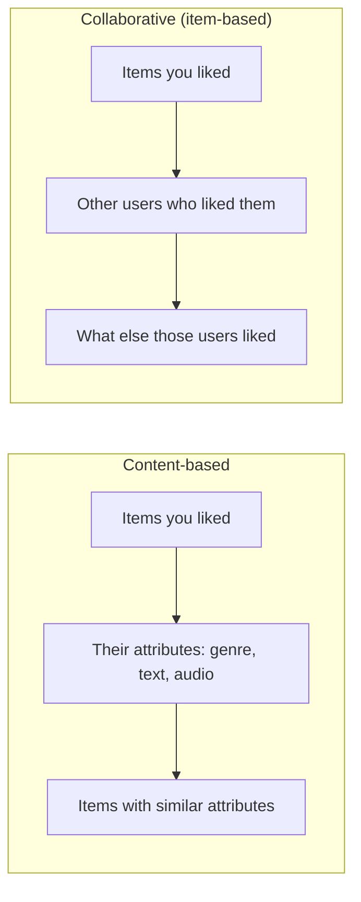
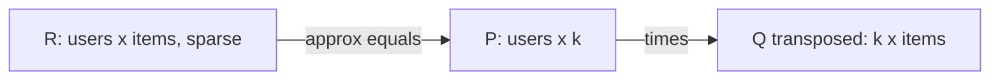
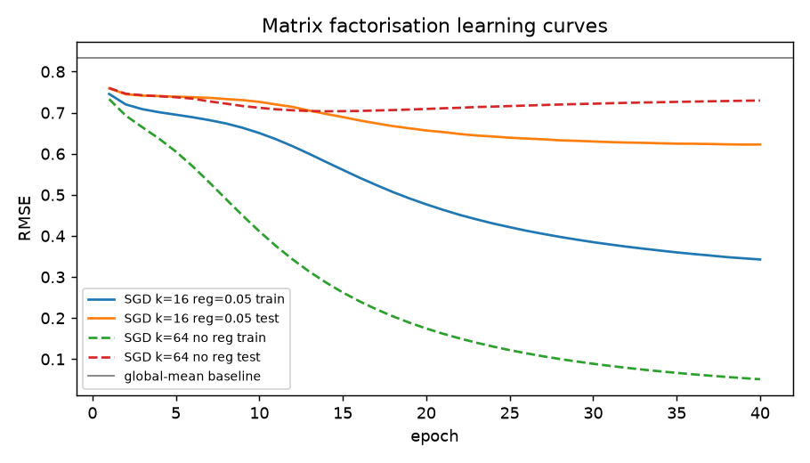
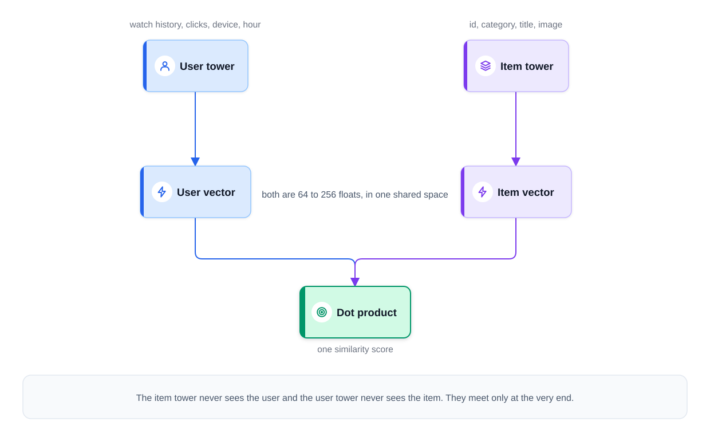
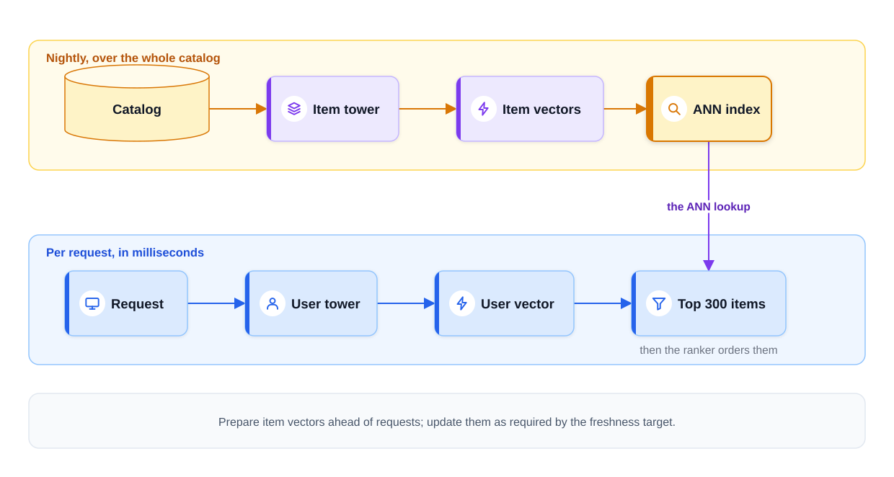
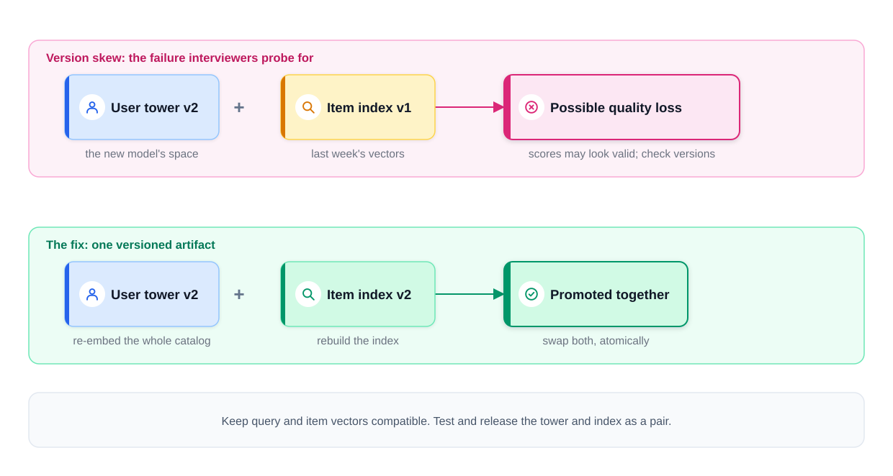
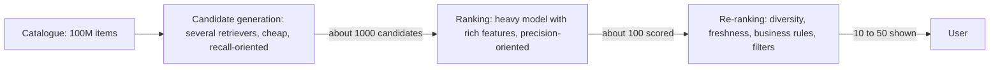
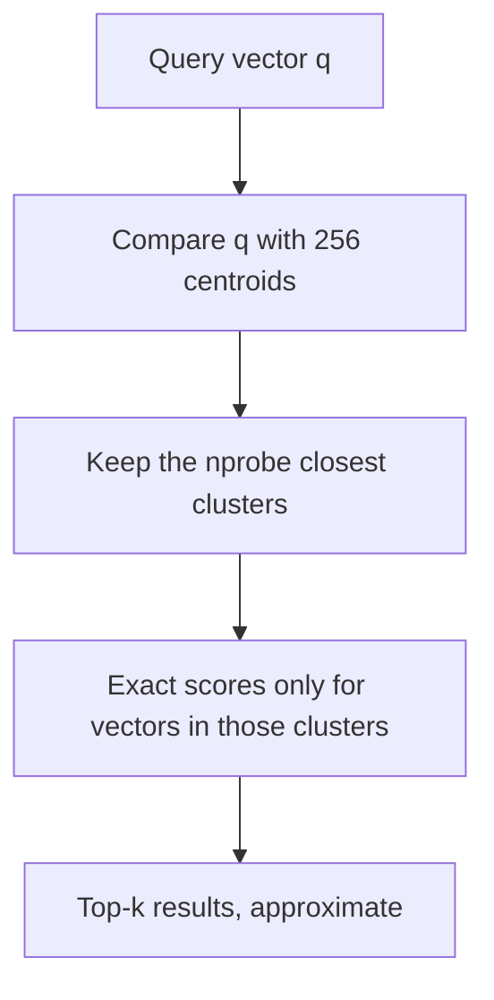
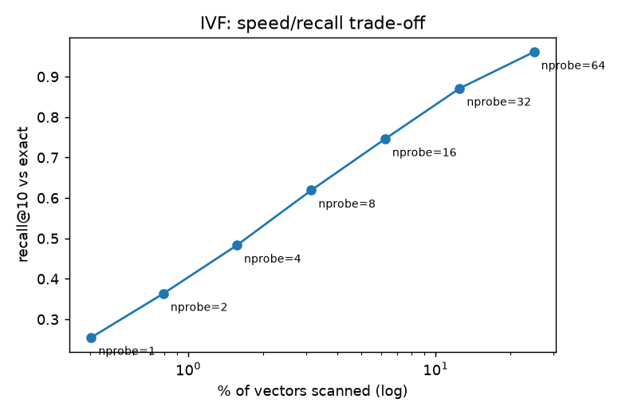
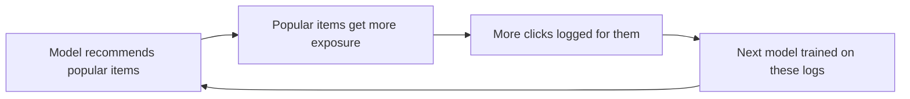

# Chapter 13 — Recommender Systems and Embeddings

When Netflix fills a row with shows, YouTube picks the next video or Amazon shows "customers who bought this also bought", a **recommender system** is at work: it predicts which items (movies, songs, products, posts) a particular user is most likely to want, from a catalogue far too large to browse. This chapter builds recommenders from a ratings matrix and a similarity formula, through matrix factorisation and learned **embeddings**, up to the **two-tower + ranking funnel** used in production — and shows how to evaluate them honestly.

**What you'll learn**

1. Framing (rating prediction vs top-K ranking), the user–item matrix, explicit vs implicit feedback.
2. Similarity measures; content-based vs collaborative filtering (user- and item-based) vs hybrids.
3. Matrix factorisation with SGD and ALS (implemented), plus its implicit-feedback version.
4. Embeddings, word2vec and item2vec (implemented).
5. Two-tower retrieval: in-batch negatives, serving from a nearest-neighbour index, freshness, versioning.
6. The funnel (retrieval → ranking → re-ranking with MMR) and approximate nearest neighbour search (IVF implemented, HNSW, PQ).
7. Cold start, popularity bias and feedback loops.
8. Evaluation: precision/recall@k, MAP, NDCG, hit rate, coverage, diversity, novelty, A/B tests — and how Netflix, YouTube, Spotify and Amazon do it.

All code is in `code/` (numpy, scikit-learn, PyTorch; no downloads — `code/data.py` generates a small dataset shaped like **MovieLens**, the classic public movie-ratings set from GroupLens). Outputs below are real.

---

## 13.1 The recommendation problem

### What it is
We have a set of **users** U, a set of **items** I, and a log of **interactions** (ratings, clicks, plays, purchases). The job: for a user u, produce a short **ranked list** of items u has not yet seen and is likely to value.

Analogy: a good bookshop clerk. They remember what you bought before (your history), know which books are alike (item similarity), and notice that people with your taste loved a particular new novel (collaborative signal). A recommender automates that clerk for millions of customers at once.

### Why it matters
- **Choice overload**: millions of items, about ten fit on a phone screen.
- **Business value**: Gomez-Uribe & Hunt (2015) wrote that Netflix's recommender influences the choice behind about 80% of hours streamed, with most of the rest coming from search. Recommendations drive discovery, engagement and sales.
- **Two-sided value**: they help creators and sellers in the "long tail" (the many niche items) find an audience.

### How to frame it
There are two classic formulations:

| Framing | Question the model answers | Typical loss / metric | Example |
|---|---|---|---|
| **Rating prediction** (regression) | "How many stars would u give i?" | Squared error / RMSE | The Netflix Prize (2006–2009) |
| **Top-K ranking** (the real product) | "Which K items should u see, in what order?" | Ranking losses / precision@K, recall@K, NDCG | Home feeds, "Up next", playlists |

Modern systems almost always optimise the **ranking** framing: users only see the top of the list, and most feedback is implicit (clicks, watch time), not stars. Before modelling, answer the framing questions an interviewer expects:

1. **What is a "good" outcome?** A click is cheap; watch time, a purchase or a "save" is closer to real value. Clicks alone reward clickbait.
2. **What signals exist?** Ratings, views, dwell time, skips, purchases, searches, item metadata, user profile, context (device, time, location).
3. **Scale and latency.** 1,000 items can be scored exhaustively; 100 million cannot — hence the funnel of §13.8.
4. **Freshness** (news goes stale in hours, movies last years) and **constraints** (diversity, creator fairness, safety filters, "don't show what they already bought").

### The user–item matrix
Users are rows, items are columns; cell (u, i) holds the interaction (stars, or 1 for "watched") or is empty.

```
            Movie1  Movie2  Movie3  Movie4
   Ana        5       4       .       1
   Ben        4       5       1       .
   Cy         1       .       5       4
```

Two facts define the whole field:
- The matrix is **huge**: users × items can be 10⁹ × 10⁸.
- It is **extremely sparse**: a typical user touches a vanishing fraction of items. Even our small synthetic dataset has only ~9% of cells filled; real ones are often below 0.1%.

Recommendation = **filling in the missing cells** well enough that the highest-scoring empty cells in each row are items the user would actually enjoy.

`code/data.py` builds the dataset used throughout the chapter: 600 users, 400 movies, 6 genres. Each user has hidden genre tastes; each movie has 1–2 genres and a hidden quality; popular movies are seen much more often (a long tail), like real catalogues.

```python
affinity = taste @ item_genres.T / item_genres.sum(1) + quality     # hidden "true" liking
stars = clip(round(3 + 1.2 * affinity + noise), 1, 5)                # what a rating would be
p_seen = popularity[None, :] * exp(1.5 * affinity)                   # people watch popular + liked
observed = rng.random(p_seen.shape) < p_seen                          # only these cells are known
```

Output:
```
users=600 items=400 ratings=21216
density = 8.840%
top 10% of items receive 38% of all ratings
star histogram: {1: 47, 2: 624, 3: 3054, 4: 6335, 5: 11156}
```

The star histogram is skewed high because people mostly watch (and rate) what they expect to like. This **selection bias** (data "missing not at random") holds in real data too: observed ratings are not a random sample of opinions.

### TL;DR
Recommenders fill in a huge, sparse user–item matrix and show each user the top-scoring empty cells. Frame it as **top-K ranking** on a well-chosen outcome (not just clicks), and state scale, latency, freshness and constraints before choosing a model.

---

## 13.2 Explicit vs implicit feedback

### What it is
- **Explicit feedback**: the user tells you directly — 1–5 stars, thumbs up/down, a review.
- **Implicit feedback**: you infer preference from behaviour — clicks, plays, watch time, purchases, add-to-cart, skips, dwell time.

### Why it matters
Implicit data is **plentiful** (every session produces it) while explicit data is **scarce** (few people rate anything). Netflix itself replaced 5-star ratings with thumbs up/down in 2017, saying far more members were willing to give a thumb than a star rating. So most production recommenders learn mainly from implicit signals — which changes the maths.

| | Explicit | Implicit |
|---|---|---|
| Volume | Low | Very high |
| Negative signal | Yes (1 star = dislike) | Mostly **no**: "not watched" may mean "never saw it" |
| Noise | Rating scale differs by person | A click may be accidental; a play may be background noise |
| Strength | Clear preference | Can be graded: watch 90% vs 5%, played 30 times |
| Modelling | Regress on the observed cells only | Treat all cells: observed = positive, unobserved = weak negative, with **confidence** weights |

### How it works — turning behaviour into training data
1. Define the **positive event** (watched > 50%, purchased, saved a track).
2. Optionally turn intensity into **confidence**: c = 1 + α·(play count), α a tuning constant.
3. **Sample negatives**: random unobserved items, or — much stronger — items shown but not clicked ("impressions without clicks").
4. Correct **position bias** (top slots get clicks just for being on top): log the position, or randomise a small slice of traffic.

### Common mistakes
- Treating every unobserved cell as a full-weight "dislike".
- Optimising clicks when the real goal is satisfaction (clickbait wins).
- Ignoring the **negative implicit signals** you do have: early skips, "not interested", short dwell.

### TL;DR
Explicit = stars (scarce, has real negatives). Implicit = behaviour (abundant, positives only, unobserved ≠ negative). Use confidence weights and sampled negatives for implicit data.

---

## 13.3 Similarity measures

### What it is
A **similarity** function gives a number saying how alike two vectors (two users' rating rows, two items' columns, two embeddings) or two sets are.

| Measure | Formula | Range | Use when |
|---|---|---|---|
| **Dot product** | a·b = Σ aₖbₖ | (−∞, ∞) | Embeddings where vector length carries meaning (e.g. popularity) |
| **Cosine** | a·b / (‖a‖‖b‖) | [−1, 1] | Direction matters, length does not (text, rating vectors) |
| **Adjusted cosine / Pearson** | cosine after subtracting each user's mean rating | [−1, 1] | Ratings, where some users rate everything high |
| **Jaccard** | \|A ∩ B\| / \|A ∪ B\| | [0, 1] | Sets / binary data: "users who bought both" |
| **Euclidean distance** | ‖a − b‖ (smaller = more similar) | [0, ∞) | Dense embeddings; for unit vectors ‖a−b‖² = 2 − 2·cos |

### How it works — worked numbers
Using the tiny matrix from §13.1 (0 = not rated):

- cos(Ana, Ben) = (5·4 + 4·5 + 0·1 + 1·0) / (√42 · √42) = 40 / 42 = **0.952** → very similar taste.
- cos(Ana, Cy) = (5·1 + 0 + 0 + 1·4) / 42 = 9 / 42 = **0.214** → different taste.
- Jaccard on the sets of movies each *liked* (≥ 4 stars): Ana {1, 2}, Ben {1, 2} → 2/2 = **1.0**; Ana vs Cy {3, 4} → 0/4 = **0**.

**Why subtract the mean?** A generous rater gives 4–5 to everything, a harsh one 2–3; raw cosine sees them as different even when they order movies identically. Mean-centring first (adjusted cosine ≈ Pearson correlation) compares *relative* preferences.

**Dot product vs cosine.** A dot product keeps vector length, so an item whose vector grew long because it is broadly popular scores higher for everyone — a real signal or a bias, depending on your goal.

### Common mistakes
- Raw cosine where 0 means "missing" — zeros drag similarities down. Mean-centre on observed entries only.
- Trusting similarities built on 2 co-rated items — **shrink** them (pull toward 0 when overlap is small) or require a minimum overlap.
- Training with dot product but serving with cosine (or vice versa) — rankings differ.

### Self-check
1. Two users rated the same 3 movies [5, 4, 3] and [3, 2, 1]. Raw cosine? Adjusted cosine? → Raw ≈ 0.98 (both positive vectors). After subtracting means (4 and 2): [1, 0, −1] and [1, 0, −1] → **1.0**, same relative taste.
2. When is Jaccard the right choice? → Binary/set data such as "bought" or "followed", with no graded strength.
3. For unit-length vectors, how do cosine and Euclidean rankings relate? → Identical: ‖a−b‖² = 2 − 2cos(a,b).

### TL;DR
Cosine for direction, dot product when magnitude matters, adjusted cosine for ratings, Jaccard for sets. Mean-centre ratings and shrink similarities built on small overlaps.

---

## 13.4 Content-based vs collaborative filtering

### What it is
- **Content-based filtering** recommends items **similar in their attributes** to what the user liked: genres, actors, text description, audio features, image. "You watched three sci-fi films → here is another sci-fi film."
- **Collaborative filtering (CF)** ignores item attributes and uses **other users' behaviour**: "people who liked what you liked also liked X." The word *collaborative* means users implicitly help each other.
  - **User-based CF**: find users similar to u, recommend what they liked.
  - **Item-based CF**: for each item u liked, find items that *the same users* tended to like, recommend the nearest ones. Amazon made this famous.
- **Hybrid**: combine both (weighted blend, or feed both signals into one model).



### How item-based CF predicts a rating
To predict how user u would rate item i:
1. Compute item–item similarity S(i, j) for all pairs (adjusted cosine over the users who rated both).
2. Take the k items most similar to i **that u has rated**.
3. Predict a similarity-weighted average of u's (mean-centred) ratings on them:
   r̂(u, i) = mean(u) + Σⱼ S(i, j)·(r(u, j) − mean(u)) / Σⱼ |S(i, j)|
   (the absolute value keeps the denominator positive if some similarities are negative; our code simply keeps only positive neighbours.)

Item-based usually beats user-based in practice: items have many more ratings each than users do, item–item similarities are more stable over time, and they can be precomputed offline.

### Code — `code/similarity_cf.py`
```python
# collaborative: item-item adjusted cosine on mean-centred ratings
Rc = np.where(mask, R - user_mean[:, None], 0.0)
norms = np.linalg.norm(Rc, axis=0) + 1e-12
S_cf = (Rc.T @ Rc) / np.outer(norms, norms)
# content-based: item-item cosine on genre vectors
Gn = G / np.linalg.norm(G, axis=1, keepdims=True)
S_cb = Gn @ Gn.T
# ... predict each held-out rating with the k=20 most similar items the user rated
```

Output:
```
== Rating prediction on held-out ratings (RMSE, lower is better) ==
predict global mean      : 0.833
predict user's mean      : 0.811
content-based item-kNN   : 0.6872
collaborative item-kNN   : 0.6820
hybrid (average of both) : 0.6711

Movie 51 (Drama) - 5 nearest neighbours
  collaborative: ['40:Drama', '341:Drama', '321:Drama', '325:Drama', '270:Drama']
  content-based: ['109:Drama', '40:Drama', '52:Drama', '56:Drama', '341:Drama']
```

What this shows:
- Both beat the naive baselines clearly, and the **hybrid** beats both — they capture partly different information.
- **CF discovered "Drama" by itself** from who-rated-what alone, never seeing a genre label.
- Here genre drives taste, so content does well. On real data CF usually wins for items with plenty of history (behaviour captures quality and mood that metadata misses); content wins for new items.

### Trade-offs

| | Content-based | Collaborative filtering |
|---|---|---|
| Needs | Item attributes / content | Many user interactions |
| New item (no history) | ✅ Works immediately | ❌ Cold start |
| New user | ⚠️ Needs a few likes | ❌ Cold start |
| Serendipity | Low — "more of the same" (filter bubble) | High — surprising cross-genre finds |
| Captures quality/taste beyond metadata | ❌ | ✅ |
| Explainability | "Because it's sci-fi like X" | "People like you also liked X" |
| Popularity bias | Low | High (popular items have more co-occurrences) |

### When not to use it
- Pure CF when the catalogue turns over daily (news, listings) — most items are always cold.
- Pure content-based when metadata is poor or quality varies wildly within a genre.

### Common mistakes
- Re-recommending items the user already consumed.
- User–user similarity over 100 M users (O(U²)) — go item-based, or embeddings + approximate nearest neighbours.
- A random split for a "predict what they do next" product — use a **time-based** split (§13.11).

### Real-world examples
- **Amazon** "Customers who bought this item also bought": item-to-item CF (Linden, Smith & York, *IEEE Internet Computing*, 2003). Its key idea was precomputing item–item similarities offline so the online step was a cheap lookup.
- **Pandora**'s Music Genome Project: content-based, with trained analysts tagging songs on hundreds of musical attributes.
- Most modern systems are **hybrids**.

### In the interview
**30-second answer:** "Content-based matches item attributes to what the user liked — it handles new items but over-specialises. Collaborative filtering uses co-behaviour across users — item-based CF is the scalable classic — and finds surprising, quality-aware matches but has cold start and popularity bias. Production systems combine both, often in an embedding model whose item side uses ID and content features."

- *Why item-based over user-based?* More interactions per item, more stable similarities, precomputable offline.
- *How do you make CF scale?* Precompute top-N neighbours per item, or learn embeddings and use an ANN index.
- *Rich metadata, sparse interactions?* Start content-heavy; blend in CF as data grows.

### Self-check
1. What does CF need that content-based does not? → Interaction data from many users.
2. Which handles a movie released today? → Content-based (it only needs attributes).
3. Why is CF prone to popularity bias? → Popular items co-occur with everything, so they look similar to everything.

### TL;DR
Content-based = "similar attributes"; collaborative = "similar people's behaviour". CF finds structure (even genres) from behaviour alone but needs history; content covers cold items. Hybrids win.

---

## 13.5 Matrix factorisation

### What it is
**Matrix factorisation (MF)** assumes each user and each item can be described by a short vector of k hidden **latent factors** (k ≈ 10–200). A user's affinity for an item is the dot product of their vectors:

r̂(u, i) = μ + bᵤ + bᵢ + pᵤ · qᵢ

- μ = global average rating; bᵤ = user bias (a generous rater); bᵢ = item bias (a universally loved film).
- pᵤ ∈ ℝᵏ = user factor vector; qᵢ ∈ ℝᵏ = item factor vector.

So the giant R (users × items) ≈ **P (users × k) · Qᵀ (k × items)** — two thin matrices. Analogy: instead of storing everyone's opinion of every song, store each person's "taste coordinates" and each song's "style coordinates" on a few hidden axes (say acoustic ↔ electronic); training discovers the axes, nobody names them.



### Why it matters
- It was the star of the **Netflix Prize** (Simon Funk's 2006 SGD "SVD" blog post; Koren, Bell & Volinsky, 2009).
- It **generalises** CF: two users with no co-rated movie can still be similar if their vectors point the same way.
- Its vectors pᵤ, qᵢ are **embeddings** — the bridge to two-tower models (§13.7) — and storage drops from U·I to (U + I)·k.

### How it works — the objective
Minimise the squared error on the **observed** ratings only, plus L2 **regularisation** so the vectors don't overfit:

L = Σ₍ᵤ,ᵢ₎ observed [ (r − r̂)² + λ(‖pᵤ‖² + ‖qᵢ‖² + bᵤ² + bᵢ²) ]

(λ = regularisation strength; the penalty sits inside the sum, as in Koren, Bell & Volinsky 2009, which is what the per-rating SGD updates below minimise. The constant factor 2 from differentiating the square is absorbed into the learning rate η.)

This is not classical SVD: SVD needs a full matrix, and filling missing cells with zeros would tell the model "everyone hates everything unseen". We optimise only over known cells. Two ways to minimise it:

**1. Stochastic gradient descent (SGD)** — loop over ratings one at a time:
1. err = r − r̂(u, i)
2. bᵤ ← bᵤ + η(err − λbᵤ); bᵢ ← bᵢ + η(err − λbᵢ)
3. pᵤ ← pᵤ + η(err·qᵢ − λpᵤ); qᵢ ← qᵢ + η(err·pᵤ − λqᵢ) (use the old pᵤ in the second update)

**2. Alternating least squares (ALS)** — the objective is not convex in P and Q together, but it **is** a plain ridge regression if you freeze one of them:
1. Freeze Q. For each user, solve pᵤ = (QᵤᵀQᵤ + λI)⁻¹ Qᵤᵀ rᵤ exactly (Qᵤ = rows of Q for the items u rated; rᵤ = u's ratings on them, minus μ in our bias-free version). This is the ridge-regression formula with Qᵤ as the inputs and rᵤ as the targets.
2. Freeze P. Solve each qᵢ the same way.
3. Repeat until the error stops falling (usually 10–20 rounds).

Each user's solve is independent, so ALS **parallelises** easily (Spark MLlib ships it).

| | SGD | ALS |
|---|---|---|
| Update | One rating at a time | Whole vector solved exactly |
| Parallelism | Harder (conflicting updates) | Embarrassingly parallel |
| Tuning | Learning rate, epochs | Few knobs, few iterations |
| Implicit data (all cells) | Needs negative sampling | Efficient (Hu et al. 2008) |
| Extra features, custom losses | Flexible | Less flexible |

### Code — `code/matrix_factorization.py`
```python
def mf_sgd(train, test, n_users, n_items, k=16, lr=0.02, reg=0.05, epochs=40, seed=0):
    ...
    for _ in range(epochs):
        for idx in rng.permutation(len(tr)):          # one rating at a time
            u, i, r = tu[idx], ti[idx], tr[idx]
            err = r - (mu + bu[u] + bi[i] + P[u] @ Q[i])
            bu[u] += lr * (err - reg * bu[u])
            bi[i] += lr * (err - reg * bi[i])
            pu = P[u].copy()
            P[u] += lr * (err * Q[i] - reg * P[u])
            Q[i] += lr * (err * pu - reg * Q[i])

def mf_als(train, test, n_users, n_items, k=16, reg=5.0, iters=10, seed=0):
    ...
        for u, idx in enumerate(by_user):               # fix Q, ridge-solve each user
            Qi = Q[ti[idx]]
            P[u] = np.linalg.solve(Qi.T @ Qi + I_k, Qi.T @ (tr[idx] - mu))
        # ... then the same loop over items with P fixed
```

Output:
```
baseline (global mean) test RMSE: 0.833
SGD epoch  1: train RMSE 0.746  test RMSE 0.759
SGD epoch  5: train RMSE 0.695  test RMSE 0.739
SGD epoch 10: train RMSE 0.650  test RMSE 0.726
SGD epoch 20: train RMSE 0.477  test RMSE 0.657
SGD epoch 40: train RMSE 0.343  test RMSE 0.623
SGD k=64, no regularisation, epoch 40: train 0.051  test 0.730
ALS iter   1: train RMSE 0.769  test RMSE 0.818
ALS iter   2: train RMSE 0.576  test RMSE 0.724
ALS iter   5: train RMSE 0.496  test RMSE 0.677
ALS iter  10: train RMSE 0.488  test RMSE 0.675

Top-5 for user 0: [98, 325, 236, 40, 314] predicted [5.16 5.14 5.11 4.98 4.93]
true (hidden) stars of those movies: [5. 5. 5. 5. 4.]
```



Reading the results:
- Regularised SGD reaches **0.623** test RMSE — better than item-kNN (0.682) and the mean (0.833).
- ALS converges in ~5 iterations (each step is an exact solve); it ends a little worse here because this simple version has no bias terms.
- The dashed lines show **overfitting**: 64 factors with no regularisation push training error to 0.05 while test error climbs back up to 0.73. With many parameters and sparse data, λ is not optional.
- User 0's top-5 are movies the generator says they would truly rate 5, 5, 5, 5, 4.

### Implicit-feedback MF (weighted ALS)
For clicks/plays, Hu, Koren & Volinsky (2008) changed the objective to cover **every** cell:
- preference pᵤᵢ = 1 if u interacted with i, else 0;
- confidence cᵤᵢ = 1 + α·(count), so observed cells matter a lot and unobserved ones a little;
- minimise Σ over **all** (u, i) of cᵤᵢ(pᵤᵢ − xᵤ·yᵢ)² + λ(…).

It is solved with ALS. The speed trick: the user solve needs YᵀCᵤY (Y = item-factor matrix, Cᵤ = diagonal matrix of u's confidences), rewritten as YᵀY + Yᵀ(Cᵤ − I)Y — YᵀY is shared by all users, and the second term only involves the few items u actually touched. `code/implicit_eval.py` uses the plain dense form (fine for small data); libraries: `implicit` (Python), Spark MLlib `ALS(implicitPrefs=True)`.

### Trade-offs / when not to use it
- MF sees only IDs: cold-start items have no vector, and context (time, device) is hard to add — use feature-based models (factorisation machines, two-towers).
- A dot product is a limited interaction function, yet well-tuned MF stays a strong baseline: Rendle et al. (2020) found a tuned dot product beat an MLP-based "neural collaborative filtering" model.

### Common mistakes
- Zero-filling missing cells and running `np.linalg.svd` — teaches "unseen = hated".
- No regularisation, or tuning k on the test set.
- Dropping bias terms — much of the signal is just "this user rates high" and "this movie is loved".

### Real-world examples
- **Netflix Prize**: *BellKor's Pragmatic Chaos* won in 2009 with the required 10% RMSE improvement over Cinematch, using a large blend of factor and neighbourhood models. Netflix wrote in 2012 that it productionised two components from an earlier progress prize (an SVD-style factorisation and restricted Boltzmann machines) but not the final blend — the extra accuracy did not justify the engineering cost.
- **Spotify** used implicit-feedback MF on listening data as one of the pillars behind Discover Weekly.

### In the interview
**30-second answer:** "MF gives every user and item a k-dimensional vector and predicts affinity as a dot product plus biases, trained on observed entries with L2 — by SGD, or by ALS, which becomes many small parallel ridge regressions. For implicit data I'd use weighted ALS with confidence weights. Weak spots: cold start and no context, which feature-based two-tower models fix."

- *Why not plain SVD?* It needs a complete matrix; imputing zeros biases toward "dislike".
- *How to choose k?* Validation sweep; larger k needs more regularisation.

### Self-check
1. What do bᵤ and bᵢ capture? → A user's general generosity; an item's general appeal.
2. Why regularise? → Few ratings per user/item vs many parameters → overfitting (see the dashed curve).
3. What makes ALS easy to distribute, and how does the implicit version differ? → With one side fixed, each user (or item) is an independent least-squares solve; implicit ALS covers all cells with 0/1 preferences and confidence weights.

### TL;DR
MF = users and items as short vectors, affinity = dot product (+ biases). Train on observed cells with L2, by SGD (flexible) or ALS (parallel, great for implicit data). Strong baseline; fails on cold start.

---

## 13.6 Embeddings

### What it is
An **embedding** is a short, dense, learned vector of numbers (typically tens to a few hundred values) that represents a discrete thing — a user ID, an item ID, a word, a category. The factor vectors pᵤ and qᵢ from MF are embeddings.

### The problem it solves
Raw IDs carry no meaning: `item_5521` is not "closer" to `item_5522` than to `item_9`. The naive encoding, **one-hot** (a vector as long as the vocabulary with a single 1), is enormous for 100 million items, and every pair of one-hot vectors is equally far apart — it says nothing about which items resemble each other.

An embedding is small, and training places the vectors so that **distance reflects the training objective**: items that serve the same users end up near each other. Mechanically, an embedding layer is a lookup table (one row per ID); multiplying a one-hot vector by it selects one row. Caution: "close" means close *for that objective* — two co-watched items may still differ in price, language or quality.

### Four ways to train them

| Route | Idea | Best when |
|---|---|---|
| **Matrix factorisation** | Factor the interaction matrix (§13.5) | Only interactions available; strong baseline |
| **Two-tower (contrastive)** | Real (user, item) pairs must outscore sampled negatives (§13.7) | Large-scale retrieval with features |
| **Graph embeddings** | Random walks or graph neural networks over users, items, follows, co-purchases | Relationships are the signal (e.g. Pinterest's PinSage) |
| **Pretrained content encoders** | A pretrained text/image/audio model embeds the item's content | Brand-new items; text/image-heavy catalogues |

This chapter focuses on vectors learned from *your own behaviour logs*. Text embeddings from pretrained language models (for semantic search and RAG) are covered in the AI book ([embeddings, vector databases and RAG](../../../ai/chapters/07-embeddings-vector-databases-and-rag/README.md)); the geometry is the same.

### word2vec intuition → item2vec
**word2vec** (Mikolov et al., 2013) learns word vectors from one idea: *a word is known by the company it keeps*. The **skip-gram** version:
1. Slide a window over text. For each centre word, the words within ±w positions are its **context**.
2. Train so that σ(centre vector · true context vector) → 1 (σ = sigmoid), and for k random **negative** words σ → 0. This is **negative sampling**; negatives are drawn in proportion to frequency^0.75, giving rare words a little more weight than raw frequency would.
3. Words used in similar contexts end up with similar vectors (the famous "king − man + woman ≈ queen").

**item2vec** (Barkan & Koenigstein, 2016) treats a session, playlist or basket as a "sentence" and its items as "words", so items consumed together get nearby vectors — no labels needed. Airbnb (listing embeddings from users' search click sessions, Grbovic & Cheng, KDD 2018) and Spotify (tracks co-occurring in playlists) have described using this idea. Case study [18.9](../18-ml-case-studies-2/README.md) builds a similar-listings carousel on it.

`code/item2vec.py` implements skip-gram with negative sampling in numpy:
```python
pos = sig(np.sum(vc * W_out[o], 1))                  # centre . true context  -> want 1
ngs = sig(np.einsum("bd,bkd->bk", vc, W_out[negs]))  # centre . 5 negatives   -> want 0
g_pos = (pos - 1)[:, None]                           # gradient of -log(pos)
g_neg = ngs[:, :, None]                              # gradient of -log(1 - ngs)
grad_c = g_pos * W_out[o] + np.sum(g_neg * W_out[negs], 1)
np.add.at(W_out, o, -lr * g_pos * vc)                # np.add.at handles repeated ids
np.add.at(W_out, negs, -lr * g_neg * vc[:, None, :])
np.add.at(W_in, c, -lr * grad_c)
```

Output:
```
epoch  1  mean loss per pair 2.884
epoch 10  mean loss per pair 2.581
top-5 neighbours sharing the main genre: 79% (random would give ~17%)
item 51 (Drama) neighbours: ['113:Drama', '236:Drama', '281:Action', '321:Drama', '146:Drama']
```

The model only saw lists of item IDs, yet 79% of each item's nearest neighbours share its genre (chance: 17%). That is the core promise of embeddings: **meaningful geometry learned from behaviour**.

### When not to use embeddings
- **Small catalogues** where exact scoring of everything already fits the budget — learned retrieval plus an ANN index is extra machinery.
- **Numeric inputs** (price, distance, account age) are already meaningful: scale them and use them directly.
- **Decisions that must be explained**: embedding dimensions have no human meaning, so credit and fraud systems keep interpretable features alongside.

### Common mistakes
- Comparing vectors from two different trainings — each run has its own coordinate system (§13.7).
- A separate embedding for every rare ID (noisy) — use a minimum count, hashing, or content features.
- Assuming "near" means "similar in every way".

### Self-check
1. Why is one-hot bad for 100 M IDs? → Enormous and every pair is equally distant — no similarity information.
2. What is an embedding layer mechanically? → A trainable lookup table; row i is ID i's vector.
3. What plays the role of "sentence" in item2vec? → A session, playlist or basket.

### TL;DR
Embeddings are short learned vectors that give IDs a geometry where near = related (for the training objective). Learn them by MF, two-tower, graphs or content encoders; item2vec = word2vec on sessions.

---

## 13.7 Two-tower retrieval

### What it is
A **two-tower model** (also *dual encoder*) has two separate neural networks:
- the **user (query) tower** reads user features — ID, recent watches/clicks, search terms, context such as device and hour — and outputs a vector;
- the **item (candidate) tower** reads item features — ID, category, text/image content — and outputs a vector of the **same length** (commonly 64–256 numbers).

The score is simply the **dot product** (or cosine) of the two vectors.


*Figure — The user tower and item tower run independently and meet only at the final dot product (course diagram).*

### Why it matters — the key property
The two towers **never see each other's inputs**; they meet only in the final dot product. So the item tower can embed the **entire catalogue ahead of time** and load the vectors into a nearest-neighbour index; when a request arrives, the system computes just the user's vector with the **user tower** and asks the index for its nearest items — 100 million items searched in milliseconds.

A **cross model**, which reads user and item features together, can learn interactions such as "this user × this item's price" and is more accurate, but nothing can be precomputed: it would have to run once per catalogue item per request. Hence two-towers do **retrieval** and cross models do **ranking** (§13.8).

### How it is trained
The logs already hold positive pairs: (user, video watched), (user, product bought).
1. Sample a batch of B positive pairs (uⱼ, iⱼ) and encode them → B user vectors, B item vectors.
2. Score every user against every item: a B × B matrix of dot products, divided by a **temperature** τ (e.g. 0.05–0.1; a small τ sharpens the softmax).
3. For row j the correct "class" is column j; the other B − 1 items are **negatives**. Apply softmax cross-entropy. This is **in-batch negative sampling** — negatives for free.
4. **Popularity correction**: a hit item appears as somebody's negative in batch after batch and gets pushed down too hard. The **logQ correction** (Yi et al., 2019) subtracts log(item's sampling probability) from its logit.
5. Optionally add a few **hard negatives** (close but wrong, e.g. shown-but-not-clicked) — useful, but too many or mislabelled ones hurt. Add them last, after the first two steps work.

### Code — `code/two_tower.py`
```python
class Tower(nn.Module):
    def __init__(self, n_ids, n_feats, id_dropout=0.0):
        super().__init__()
        self.id_emb = nn.Embedding(n_ids, 32)
        self.mlp = nn.Sequential(nn.Linear(32 + n_feats, 64), nn.ReLU(), nn.Linear(64, DIM))
        self.id_dropout = id_dropout   # randomly hide the id so the tower also learns from content

    def forward(self, ids, feats, use_id=True):
        e = self.id_emb(ids)
        if not use_id:
            e = torch.zeros_like(e)
        elif self.training and self.id_dropout:
            e = e * (torch.rand(len(ids), 1) > self.id_dropout).float()
        return F.normalize(self.mlp(torch.cat([e, feats], 1)), dim=1)

# training step
uv = user_tower(u, U_feat[u])                 # user tower: id + genre profile of history
iv = item_tower(i, G[i])                      # item tower: id + genre multi-hot
logits = uv @ iv.T / temperature              # (B, B) in-batch scores
logits = logits - log_q[i][None, :]           # logQ popularity correction
loss = F.cross_entropy(logits, torch.arange(len(idx)))
```
40 items are held out of training entirely to act as brand-new items; for them we use the item tower with the ID part zeroed (content only).

Output:
```
epoch  1  in-batch softmax loss 6.637
epoch  5  in-batch softmax loss 6.022
epoch 15  in-batch softmax loss 5.798

warm items  recall@50: two-tower 0.649 | popularity 0.510
cold items  hit@10 among the 40 new items: 0.586 (random = 0.250)
```

- Known items: recall@50 is 0.65 vs 0.51 for "show the most popular".
- Items **never seen in training**: the content half of the item tower still puts the right new item in the top 10 of 40 for 59% of users (random: 25%) — two-towers soften **item cold start**. The `id_dropout` trick (randomly hiding the ID in training) is what makes the content-only vector meaningful.
- (Batches hold 512 pairs, so plain uniform guessing would give a loss of ln 512 ≈ 6.24. The logQ term shifts the logits, so the absolute numbers are not directly comparable with that — read the downward trend, and judge the model by the recall figures.)

### How it serves

*Figure — Offline item embedding and index build vs the online per-request path (course diagram).*

1. **Offline (e.g. nightly):** embed the catalogue with the item tower and rebuild an **ANN index** (approximate nearest neighbour — returns *almost* the exact closest vectors, much faster; §13.9).
2. **Per request:** run the user tower (or reuse a recently cached user vector).
3. **Lookup:** the index returns a few hundred nearest items in milliseconds — the **candidates** the ranker will order.

**Freshness differs by tower.** Item vectors are refreshed as often as the catalogue and measured retrieval quality demand (nightly is an example, not a rule). The user side must be fresher — someone who just watched three cooking videos should get cooking candidates *now* — so the user tower reads **real-time features** from an online feature store at request time.

### The versioning trap

*Figure — Version skew: a new user tower querying an index built by an old item tower (course diagram).*

An embedding only has meaning **inside the space its model created**; retraining generally rotates and rescales that space. So upgrading is a coordinated migration: (1) re-embed the whole catalogue with the **new** item tower, (2) build a **new** index, (3) switch the new user tower and new index **together, atomically**, as a versioned pair in the model registry, keeping the old pair for rollback.

**Version skew** (new user tower querying an old index, or the reverse) is dangerous because nothing crashes — scores are valid numbers, latency looks normal, only quality silently drops. Defences: version tags on requests and indexes, routing to compatible pairs, offline validation of the pair, retrieval-quality monitoring during rollout. Budget the re-embedding compute too (100 M items through a new tower is not free).

### Trade-offs

| | Two-tower | Cross model (ranker) |
|---|---|---|
| User–item feature interactions | Only via final dot product | Full (any feature crosses) |
| Precompute items | ✅ | ❌ |
| Items scored per request | Whole catalogue (via ANN) | A few hundred |
| Role | Retrieval / candidate generation | Ranking |

### When not to use it
Small catalogues (score everything exactly), or when simple co-occurrence is good enough and the training + indexing + versioning machinery isn't affordable.

### Common mistakes
- The same item twice in a batch becomes its own false "negative" — deduplicate or mask.
- No popularity correction → hits pushed down (or, with uniform random negatives, pushed up).
- Mixing tower and index versions; leaking the future into user features (events after the label).

### Real-world examples
- **YouTube**: Covington, Adams & Sargin (2016) — a candidate-generation network trained as a huge softmax over videos and served by nearest-neighbour search, then a ranking network; Yi et al. (2019) — a two-tower model with streaming logQ correction.
- **Pinterest, LinkedIn, Airbnb** and many e-commerce sites describe embedding-based retrieval in engineering blogs.

### In the interview
**30-second answer** ("How do you find candidates among 100 M items?"): "A two-tower model trained with in-batch negatives and logQ correction. Item vectors are computed offline into an ANN index; per request I compute a fresh user vector and pull a few hundred nearest items for the ranker. I'd watch retrieval recall and refresh cadence, and ship tower and index as a tested, versioned pair."

- *What stops the two sides drifting apart?* Ship tower + index as one versioned artifact, switched atomically, with a rollback pair.
- *Can retrieval surface an item with zero interactions?* Yes, through the item tower's content features; add a "new arrivals" slot or exploration traffic.
- *Why not one network over user and item together?* It can't be precomputed — use it as the ranker on the retrieved few hundred.

### Self-check
1. What property lets item vectors be precomputed? → The item tower never sees user inputs.
2. What are in-batch negatives? → The other positives' items in the same batch, used as negatives for each user.
3. Why is version skew hard to detect? → Scores are still valid numbers; only quality degrades.

### TL;DR
Two towers encode users and items independently into one space; they meet only at a dot product, so items are embedded offline into an ANN index and only the user tower runs per request. Train with in-batch negatives + logQ correction; release tower and index together.

---

## 13.8 The funnel: candidate generation → ranking → re-ranking

### What it is
Large recommenders are **multi-stage funnels**. Each stage sees fewer items and can afford a heavier model.



| Stage | Input → output | Model | Optimises |
|---|---|---|---|
| **Candidate generation** (retrieval) | 10⁸ → 10³ | Several merged sources: two-tower + ANN, item-kNN, co-visitation, trending, followed creators | **Recall**: don't lose good items |
| **Ranking** | 10³ → ordered 10² | Gradient-boosted trees or deep nets (Wide & Deep, DCN, DLRM) on user × item × context features; predicts P(click), watch time, P(purchase)… combined into one score | **Precision** at the top |
| **Re-ranking** | 10² → 10–50 | Rules + algorithms (MMR, quotas) | Diversity, freshness, fairness, policy, de-duplication |

Some systems add a **pre-ranking** ("light ranking") stage between retrieval and ranking when candidate counts are very large.

### Why it matters
No single model is both cheap enough for 100 M items and rich enough for detailed feature interactions, so the funnel spends compute where it matters. Retrieval sets a **ceiling**: an item not retrieved can never be ranked.

### Maximal Marginal Relevance (MMR)
A ranker scores items independently, so the top 10 are often near-duplicates (ten episodes of one show). **MMR** (Carbonell & Goldstein, 1998) re-ranks greedily:

next item = argmax over remaining j of [ λ·relevance(j) − (1 − λ)·max similarity(j, already chosen) ]

λ = 1 is pure relevance; smaller λ trades relevance for variety.

### In the interview
**30-second answer:** "No single model is both cheap enough for the whole catalogue and rich enough for fine feature crosses, so I'd build a funnel: several high-recall retrievers to about a thousand candidates, a heavy ranker trained on logged impressions to order them, and a re-ranker for diversity, freshness and policy. I'd track retrieval recall separately, since it caps everything after it."

- *Why several retrievers?* Each covers a different need (similar items, trending, followed creators, fresh items); merging raises recall.
- *Where does diversity go?* In re-ranking (MMR or quotas), because the ranker scores items one at a time.

### Code — `code/funnel_rerank.py`
Stage 1: item-kNN retrieves 100 candidates. Stage 2: a logistic-regression ranker, trained on half the users, scores them with richer features (kNN score, a heavier implicit-ALS score, popularity, genre match with the user's profile, average star rating). Stage 3: MMR with λ = 0.7 on the ranker's top 30.

```python
def mmr(cands, relevance, sim, lam=0.7, k=K):
    chosen, pool = [], list(range(len(cands)))
    while len(chosen) < k:
        best = max(pool, key=lambda j: lam * relevance[j]
                   - (1 - lam) * max((sim[cands[j], cands[c]] for c in chosen), default=0))
        chosen.append(best); pool.remove(best)
    return [cands[j] for j in chosen]
```

Output:
```
stage 1 candidate recall@100 = 0.787  (ceiling for later stages)
stage 1 only (kNN order)           recall@10 0.375  NDCG@10 0.398  diversity 0.728
stage 2 ranker (logistic regr.)    recall@10 0.393  NDCG@10 0.409  diversity 0.524
stage 3 re-rank (MMR, lambda=0.7)  recall@10 0.375  NDCG@10 0.391  diversity 0.683
ranker weights: {'knn_score': 0.18, 'als_score': 0.63, 'log_popularity': 0.36, 'genre_match': 0.62, 'avg_star': 0.07}
```

- Retrieval keeps 79% of the held-out items within 100 candidates — the most any later stage can recover.
- The ranker improves accuracy (NDCG 0.398 → 0.409) by combining signals; it leans on the heavier ALS score and genre match.
- But the ranker made lists much **less diverse** (0.728 → 0.524), piling onto the favourite genre. MMR restores diversity (0.683) at a small offline accuracy cost; online, users often reward variety — an A/B test decides.

### Common mistakes
- Training the ranker only on what the *old* system showed (exposure bias) — log impressions and some randomised exposure.
- Evaluating the ranker but not retrieval recall.
- One objective (clicks) when the business wants long-term satisfaction — use a multi-task ranker (click, watch time, like, "not interested") with tuned weights.

### TL;DR
Funnel = cheap high-recall retrieval (10⁸ → 10³) → heavy precise ranking (10³ → 10²) → re-ranking for diversity/business rules (→ 10). Retrieval caps what ranking can achieve; MMR buys variety for a little relevance.

---

## 13.9 Approximate nearest neighbour (ANN) search

### What it is
**k-nearest-neighbour search** returns the k item vectors most similar to a query q. **Exact** (brute-force) search compares q with all N vectors of d dimensions: O(N·d) per query. **Approximate** nearest neighbour (ANN) search returns *almost* the same top-k while looking at a small fraction.

### Why it matters
10⁸ items × 128 dimensions ≈ 1.3·10¹⁰ multiply-adds per query — far too slow at thousands of requests per second. ANN trades a little **recall** (fraction of the true top-k found) for large speed-ups (often 10–1000×).

### How the main families work
**1. IVF — inverted file index (clustering).**
1. Offline: run k-means on the vectors to get `nlist` centroids; store each vector in the list of its nearest centroid.
2. Query: find the `nprobe` centroids nearest to q; scan only those lists exactly.
3. Knob: larger `nprobe` → higher recall, slower.

**2. HNSW — Hierarchical Navigable Small World graphs** (Malkov & Yashunin, 2016/2018).
1. Each vector is a node linked to about M close neighbours; upper layers hold few nodes ("highways"), the bottom layer holds all — like zooming from a country map to a street map.
2. Query: start at the top and greedily hop to whichever neighbour is closer to q; when none is closer, drop a layer; at the bottom keep a candidate list of size `ef_search` and return the best k.
3. Knobs: M, `ef_construction`, `ef_search` (recall vs speed). Excellent recall/latency and incremental inserts, but more memory than IVF.

**3. Product quantisation (PQ)** compresses vectors (e.g. 128 floats = 512 bytes → 16 bytes) by splitting each into sub-vectors and replacing each sub-vector by the ID of its nearest sub-centroid. Distances are computed from small lookup tables. Often combined: **IVF-PQ**.

**4. Tree forests** (e.g. Spotify's Annoy): random hyperplane splits build several trees; search a few.



### Code — `code/ann_demo.py` (brute force vs IVF)
```python
exact = np.argsort(-(queries @ X.T), axis=1)[:, :K]          # brute force: score every vector
C, _ = kmeans(X[rng.choice(N, 20_000, replace=False)], 256)  # train centroids on a sample
assign = np.argmax(X @ C.T, axis=1)
lists = [np.flatnonzero(assign == c) for c in range(256)]    # the "inverted file"
for q in queries:
    probe = np.argsort(-(C @ q))[:nprobe]                    # closest clusters
    cand = np.concatenate([lists[c] for c in probe])
    top = cand[np.argsort(-(X[cand] @ q))[:K]]
```

Output (100,000 unit vectors, 32 dimensions; timings depend on the machine):
```
brute force: scans 100% of 100,000 vectors, 6.13 ms/query, recall@10 = 1.000
IVF build (k-means, 256 lists): 0.1 s
IVF nprobe= 1: scans  0.41%, 0.06 ms/query, recall@10 = 0.255
IVF nprobe= 2: scans  0.79%, 0.08 ms/query, recall@10 = 0.363
IVF nprobe= 4: scans  1.57%, 0.14 ms/query, recall@10 = 0.483
IVF nprobe= 8: scans  3.14%, 0.27 ms/query, recall@10 = 0.619
IVF nprobe=16: scans  6.25%, 0.56 ms/query, recall@10 = 0.746
IVF nprobe=32: scans 12.49%, 1.21 ms/query, recall@10 = 0.871
IVF nprobe=64: scans 24.96%, 2.56 ms/query, recall@10 = 0.961
```



The curve is the whole story of ANN: scanning 12% of the data gives 87% recall at ~5× speed; 25% gives 96%. (This data is deliberately hard — overlapping clusters; real embeddings usually reach high recall at smaller `nprobe`, and production libraries are far faster than this numpy loop.)

### Trade-offs

| Method | Recall/speed | Memory | Build | Updates |
|---|---|---|---|---|
| Brute force | Exact, O(N) | Vectors only | None | Trivial |
| IVF | Good, tune `nprobe` | Low | k-means (fast) | Add to lists; re-train centroids occasionally |
| IVF-PQ | Good at huge scale | Very low (compressed) | Slower | As IVF |
| HNSW | Excellent | Higher (graph links) | Slowest | Incremental inserts; deletes are awkward |

Libraries: **FAISS** (Meta), **ScaNN** (Google), **hnswlib**, **Annoy**/**Voyager** (Spotify), plus vector databases (Milvus, Weaviate, Qdrant, pgvector, OpenSearch).

### When not to use it
Up to around a million vectors, a batched brute-force matrix multiply (especially on a GPU) may already meet the latency budget — exact and simple. Measure first.

### Common mistakes
- A cosine index fed un-normalised vectors (or vice versa).
- Reporting latency without recall@k measured against exact search.
- Filtering (country, availability) *after* ANN and ending with too few results — use filtered search or over-retrieve.

### Self-check
1. What does `nprobe` control? → How many clusters are scanned; recall ↑, speed ↓.
2. Why does HNSW have upper layers? → Long-range "express" hops to reach the right region quickly.
3. What does PQ buy you? → Much smaller memory per vector, with approximate distances.

### TL;DR
Exact k-NN is O(N) per query; ANN (IVF clustering, HNSW graphs, PQ compression) scans a fraction for a small recall loss. Always report recall with latency.

---

## 13.10 Cold start

### What it is
**Cold start** = making recommendations with little or no history.
- **New user**: we know nothing about their taste.
- **New item**: nobody has interacted with it yet, so CF/MF have no vector.
- **New system**: no data at all.

### How to handle it

| Case | Strategies |
|---|---|
| New user | Popular/trending items by region or device; short onboarding ("pick 3 genres"); context (location, time, referrer); fast updates from the first clicks (session-based models) |
| New item | Content features in the item tower (59% vs 25% random in `two_tower.py`); creator/brand signals; **exploration** — a small controlled share of traffic (bandits, [Chapter 14](../14-reinforcement-learning/README.md)) and a "new arrivals" slot |
| New system | Rules + popularity + content similarity, then collect data |

**Exploration** is essential: if only proven items are shown, new items never get to prove themselves. Multi-armed bandits (ε-greedy, UCB, Thompson sampling) balance exploiting proven items with exploring newcomers.

### Common mistakes
- Letting cold items sink forever because their score rests on zero data; asking for long onboarding questionnaires few people finish.

### TL;DR
New users: popularity + onboarding + context + fast session updates. New items: content features + controlled exploration. Never let "no data" mean "never shown".

---

## 13.11 Evaluation

### What it is
Recommenders are evaluated **offline** (on held-out historical data, fast and cheap) and **online** (A/B tests on real users, the final judge).

### Offline accuracy metrics (top-K)
For one user, with a ranked list `recs` and a set of `relevant` held-out items:

| Metric | Formula | Meaning |
|---|---|---|
| **Precision@k** | (# relevant in top k) / k | How much of what we showed was good |
| **Recall@k** | (# relevant in top k) / (# relevant) | How much of the good stuff we found |
| **Hit rate@k** | 1 if any relevant item is in top k, else 0 | Did we get at least one right? (common with leave-one-out) |
| **AP@k** (average precision) | (sum of precision@i over the ranks i that hold a hit) / min(#relevant, k) | Rewards putting hits early |
| **MAP@k** | mean AP@k over users | |
| **NDCG@k** | DCG / ideal DCG, where DCG = Σᵢ relᵢ / log₂(i + 1) (i = rank; a common variant uses 2^relᵢ − 1 as the gain) | Position-discounted gain, normalised to [0, 1]; supports graded relevance |
| **MRR** | mean of 1 / (rank of first hit) | Only the first hit matters (search-like) |
| **RMSE / MAE** | error on predicted ratings | Only for the rating-prediction framing |

**Worked example** (`implicit_eval.py`): recs = A B C D E, relevant = {A, C, F}, k = 5.
- Hits at ranks 1 (A) and 3 (C). Precision@5 = 2/5 = **0.400**. Recall@5 = 2/3 = **0.667**. Hit@5 = **1**.
- AP@5 = (precision@1 + precision@3) / min(3, 5) = (1/1 + 2/3) / 3 = **0.556**.
- DCG = 1/log₂2 + 1/log₂4 = 1 + 0.5 = 1.5. Ideal (3 hits at ranks 1–3) = 1 + 0.631 + 0.5 = 2.131. NDCG@5 = 1.5 / 2.131 = **0.704**.

```python
def average_precision_at_k(recs, relevant, k=K):
    hits, total = 0, 0.0
    for rank, item in enumerate(recs[:k], start=1):
        if item in relevant:
            hits += 1
            total += hits / rank          # precision at each position where we hit
    return total / min(len(relevant), k)

def ndcg_at_k(recs, relevant, k=K):
    dcg = sum(1 / np.log2(rank + 1) for rank, it in enumerate(recs[:k], 1) if it in relevant)
    ideal = sum(1 / np.log2(rank + 1) for rank in range(1, min(len(relevant), k) + 1))
    return dcg / ideal
```

### Beyond-accuracy metrics
- **Catalogue coverage**: fraction of all items shown to *anyone* (low = only the hits).
- **Intra-list diversity**: 1 − average pairwise similarity within one list (here: genre cosine).
- **Novelty**: average popularity of recommended items (lower = more novel); **serendipity** = relevant *and* unexpected.
- **Fairness / exposure**: how impressions spread across creators or sellers.

### Code — comparing three models on implicit data (`code/implicit_eval.py`)
Each user's interactions are binarised to "watched"; 5 random watched items per user are hidden as the **test** set, and models must rank them among all unseen items. The ALS settings are chosen on a separate **validation** split (5 more items per user hidden from the training data), never on the test items.

Output:
```
ALS chosen on validation split: alpha=10, lambda=50 (validation NDCG@10 0.331)

model              P@10   R@10   MAP@10 NDCG@10 HR@10  cover  divers  avgPop
Popularity         0.107  0.215  0.104  0.197  0.708  0.07   0.741   219
Item-kNN (cosine)  0.184  0.367  0.256  0.388  0.882  0.34   0.733   186
Implicit ALS       0.195  0.390  0.282  0.416  0.893  0.42   0.591   154
(average item popularity in the catalogue = 46 interactions)
```

- **Popularity** is a strong baseline (hit rate 71%) — always include it. But it covers 7% of the catalogue, with items ~5× more popular than average.
- **Implicit ALS** wins every accuracy metric, covers 42% and recommends less popular items — but its lists are less genre-diverse. Accuracy, coverage, novelty and diversity pull apart; choose deliberately.
- The validation sweep (α ∈ {5, 10, 20}, λ ∈ {10, 50, 100}, k = 16) picked α = 10, λ = 50; the model was then refit on all training data and scored once on the test items.

### Offline evaluation pitfalls
- **Random splits leak the future.** Use a **time-based split** (train before day T, test after), matching real use.
- **Sampled metrics** (true item vs only 100 random negatives) inflate scores and can even flip which model looks best (Krichene & Rendle, 2020). Rank against the full catalogue when possible.
- **Logs are biased by the old system** (feedback only on what it showed). **Inverse propensity scoring (IPS)** reweights each logged example by 1 / (probability the old system showed it), removing that bias at the cost of higher variance.

### Online evaluation
- **A/B test**: randomly split users; compare business metrics (watch time, retention, purchases) plus guardrails (latency, complaints, diversity); run long enough for novelty effects to fade.
- **Interleaving**: merge two rankers' lists and see whose items get clicked — detects a preference with far less traffic; Netflix uses it to pre-screen ideas.
- Offline metrics are a filter, not the verdict.

### In the interview
**30-second answer:** "Offline: a time-based split, recall@k for retrieval and NDCG@k or MAP@k for ranking over the full catalogue, plus coverage, diversity and novelty, versus a popularity baseline. Then an A/B test on the real objective, such as retention, with latency and diversity guardrails."

- *Precision@k vs recall@k?* Precision = quality of what's shown; recall = how much of the relevant set was found. Retrieval cares about recall, the final list about precision/NDCG.
- *Why NDCG over precision?* It rewards putting good items higher and supports graded relevance.
- *Why can offline and online disagree?* Logs reflect the old policy and ignore presentation and long-term effects.

### Self-check
1. Relevant = {X}, X at rank 4. NDCG@5? MRR? → 1/log₂5 ≈ 0.431 (ideal = 1); MRR = 1/4 = 0.25.
2. Why is a random train/test split risky? → The model sees the future (later interactions) during training.
3. Model A: higher NDCG, 5% coverage. Model B: slightly lower NDCG, 40% coverage. Which? → Depends on goals; usually test B online — low coverage starves the long tail and feeds the popularity loop.

### TL;DR
Offline: precision/recall/hit rate@k, MAP, NDCG on a time-based split, full-catalogue ranking, plus coverage/diversity/novelty and a popularity baseline. Online: A/B tests (or interleaving) on the true objective.

---

## 13.12 Popularity bias and feedback loops

### What it is
**Popularity bias**: models over-recommend already-popular items. Causes: the data (more interactions → more gradient updates and co-occurrences) and the model (dot products favour long vectors).

**Feedback loop**: popular items are shown → get more clicks → the next model, trained on those clicks, rates them even higher → shows them more. Long-tail items rarely get shown, so never collect the data to prove themselves. Result: less diversity, "filter bubbles", struggling niche creators.



### How to counter it
1. **Measure**: average popularity of recommendations, coverage, Gini coefficient of exposure (0 = perfectly even, 1 = all to one item).
2. **Correct in training**: logQ (§13.7), down-weighting popular positives, IPS.
3. **Explore**: a little bandit traffic for new and long-tail items.
4. **Re-rank**: MMR, novelty boosts, exposure quotas for new creators.
5. **Log impressions** so training can tell "not shown" from "shown and ignored".

### Common mistakes
- Celebrating an offline win that comes only from recommending more popular items (test sets are popularity-biased too).
- Removing popularity entirely — it is real information; aim for calibration, not elimination.

### TL;DR
Popular items get more data, so models over-recommend them and the loop reinforces itself. Measure it, correct it in training (logQ, IPS), explore, and re-rank for diversity.

---

## 13.13 Real-world systems

Amazon's item-to-item CF is covered in §13.4; the others are collected here.

| Company | Publicly described approach | Ideas to remember |
|---|---|---|
| **Netflix** | Netflix Prize (2006–2009, $1M, won by BellKor's Pragmatic Chaos); personalised rows and ranking; artwork chosen per member with contextual bandits; recommender influences ~80% of hours streamed (2015) | Moved from star prediction to ranking on implicit signals; heavy A/B testing plus interleaving |
| **YouTube** | Deep candidate generation + a ranking net predicting expected watch time (Covington et al., 2016); two-tower with streaming logQ correction (Yi et al., 2019); multi-task ranking (Zhao et al., 2019) | Two-stage funnel; watch time rather than clicks; an "example age" feature for freshness |
| **Spotify** | Discover Weekly (2015) blends collaborative filtering on listening and playlists, NLP on text about music, and audio models; bandits on home shelves; open-sourced Annoy and Voyager | Playlists as co-occurrence data; skips and saves as implicit feedback |
| **Pinterest** | PinSage (Ying et al., 2018): graph convolutional network over billions of pins and boards | The graph-embedding route |

---

## Chapter TL;DR
- **Frame** it as top-K ranking on a meaningful outcome; implicit feedback dominates, and unobserved ≠ negative.
- **Content-based** covers new items; **collaborative** finds quality and surprise but needs history. Hybrids win.
- **Matrix factorisation** (r̂ = μ + bᵤ + bᵢ + pᵤ·qᵢ, SGD or ALS; weighted ALS for implicit) is the strong baseline; its vectors are **embeddings**.
- **Two-tower** retrieval: items precomputed into an ANN index (IVF, HNSW, PQ), only the user tower runs per request; ship tower and index as one version.
- **Funnel**: retrieval (recall ceiling) → ranking (precision) → re-ranking (diversity, rules).
- **Evaluate** on a time-based split over the full catalogue (recall, NDCG, MAP + coverage, diversity, novelty) against a popularity baseline, then A/B test. Handle cold start with content and exploration; counter popularity bias's feedback loop.
