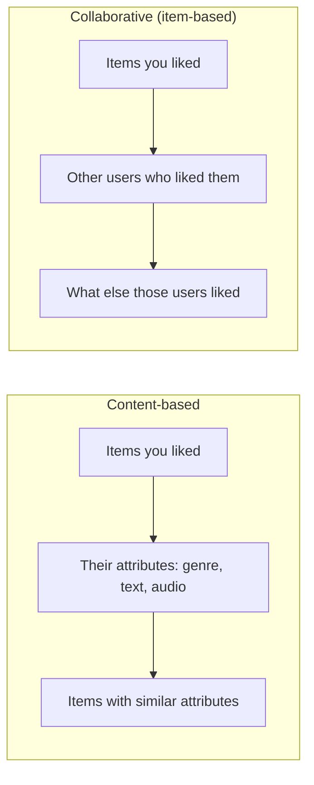
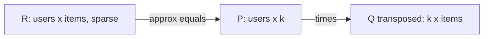
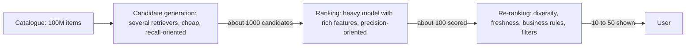
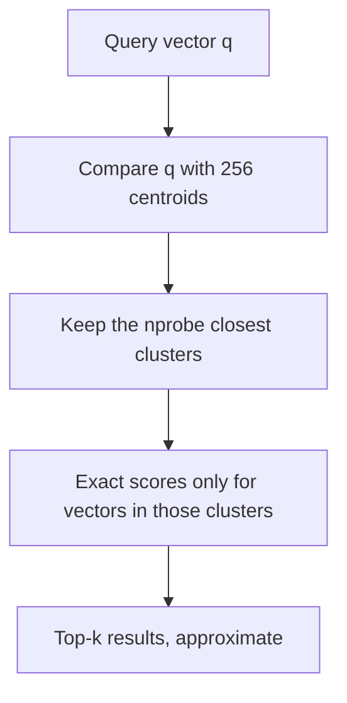
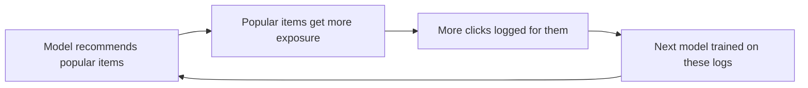

# Chapter 13 — Recommender Systems and Embeddings

When Netflix fills a row with shows, YouTube picks the next video or Amazon shows "customers who bought this also bought", a **recommender system** predicts which items a user most likely wants from a catalogue too large to browse. This chapter goes from a ratings matrix and a similarity formula, through matrix factorisation and learned **embeddings**, to the production **two-tower + ranking funnel** — and how to evaluate it honestly.

**What you'll learn:** framing and feedback types; similarity measures; content-based vs collaborative filtering; matrix factorisation (SGD, ALS, implicit ALS — implemented); embeddings and item2vec (implemented); two-tower retrieval and its serving/versioning; the funnel with MMR re-ranking; ANN search (IVF implemented, HNSW, PQ); cold start, popularity bias, feedback loops; offline metrics and A/B tests — and how Netflix, YouTube, Spotify and Amazon do it.

All code is in `code/` (numpy, scikit-learn, PyTorch; no downloads — `code/data.py` generates a small dataset shaped like **MovieLens**, the classic GroupLens movie-ratings set). Outputs are real.

---

## 13.1 The recommendation problem

### What it is
Users U, items I, and a log of **interactions** (ratings, clicks, plays, purchases). For a user u, produce a short **ranked list** of unseen items u is likely to value.

### Why it matters
- **Choice overload**: millions of items, ~ten fit on a phone screen.
- **Business value**: Gomez-Uribe & Hunt (2015) wrote that Netflix's recommender influences the choice behind about 80% of hours streamed, most of the rest coming from search.
- **Two-sided value**: helps creators and sellers in the **long tail** (the many niche items) find an audience.

### How to frame it

| Framing | Question | Typical loss / metric | Example |
|---|---|---|---|
| **Rating prediction** (regression) | "How many stars would u give i?" | Squared error / RMSE | The Netflix Prize (2006–2009) |
| **Top-K ranking** (the real product) | "Which K items should u see, in what order?" | Ranking losses / precision@K, recall@K, NDCG (§13.11) | Home feeds, "Up next", playlists |

Modern systems optimise **ranking**: users see only the top, and most feedback is implicit. Framing questions an interviewer expects:
1. **What is a good outcome?** Clicks are cheap and reward clickbait; watch time, purchase or "save" is closer to value.
2. **What signals exist?** Ratings, views, **dwell time**, skips, purchases, searches, item **metadata** (genre, author, price), user profile, context (device, time, location).
3. **Scale and latency** (a home page must be ready well under a second — [System Design Fundamentals](../../../system-design-patterns/modules/00-system-design-fundamentals/README.md)). 1,000 items can be scored exhaustively; 100 million cannot — hence the funnel (§13.8).
4. **Freshness** (news stales in hours, movies last years) and **constraints** (diversity, creator fairness, safety, "don't show what they already bought").

### The user–item matrix
Rows = users, columns = items; cell (u, i) holds the interaction or is empty.

```
            Movie1  Movie2  Movie3  Movie4
   Ana        5       4       .       1
   Ben        4       5       1       .
   Cy         1       .       5       4
```

It is **huge** (10⁹ users × 10⁸ items) and **extremely sparse** (ours is ~9% filled; real ones often < 0.1%). Recommendation = **filling in missing cells** well enough that each row's top-scoring empty cells are items the user would enjoy.

`code/data.py`: 600 users, 400 movies, 6 genres. Users have hidden genre tastes; movies have 1–2 genres and hidden quality; popular movies are seen far more (a long tail).

```python
affinity = taste @ item_genres.T / item_genres.sum(1) + quality     # hidden "true" liking
stars = clip(round(3 + 1.2 * affinity + noise), 1, 5)                # what a rating would be
p_seen = popularity[None, :] * exp(1.5 * affinity)                   # people watch popular + liked
observed = rng.random(p_seen.shape) < p_seen                          # only these cells are known
```

```
users=600 items=400 ratings=21216
density = 8.840%
top 10% of items receive 38% of all ratings
star histogram: {1: 47, 2: 624, 3: 3054, 4: 6335, 5: 11156}
```

Stars skew high because people mostly watch what they expect to like — **selection bias** (data **missing not at random**): observed ratings aren't a random sample of opinions, in real data too.

### TL;DR
Fill in a huge, sparse user–item matrix; show each user the top-scoring empty cells. Frame as **top-K ranking** on a well-chosen outcome; state scale, latency, freshness and constraints first.

---

## 13.2 Explicit vs implicit feedback

### What it is
- **Explicit**: the user says so — stars, thumbs, reviews.
- **Implicit**: inferred from behaviour — clicks, plays, watch time, purchases, add-to-cart, skips, dwell.

### Why it matters
Implicit data is **plentiful**, explicit **scarce**. Netflix replaced stars with thumbs in 2017, saying far more members would give a thumb. Most production recommenders learn mainly from implicit signals — which changes the maths.

| | Explicit | Implicit |
|---|---|---|
| Volume | Low | Very high |
| Negative signal | Yes (1 star = dislike) | Mostly **no**: "not watched" may mean "never saw it" |
| Noise | Rating scale differs by person | Accidental clicks, background plays |
| Strength | Clear preference | Graded: watched 90% vs 5%, played 30 times |
| Modelling | Regress on observed cells only | All cells: observed = positive, unobserved = weak negative, with **confidence** weights |

### How it works — behaviour → training data
1. Define the **positive event** (watched > 50%, purchased, saved).
2. Optionally map intensity to **confidence** c = 1 + α·(play count).
3. **Sample negatives**: random unobserved items, or — much stronger — **impressions without clicks**.
4. Correct **position bias** (top slots get clicks for being on top): log position, or randomise a small traffic slice.

### Common mistakes
- Treating every unobserved cell as a full-weight dislike.
- Optimising clicks when the goal is satisfaction.
- Ignoring the negative implicit signals you have: early skips, "not interested", short dwell.

### TL;DR
Explicit = scarce, real negatives. Implicit = abundant, positives only, unobserved ≠ negative — use confidence weights and sampled negatives.

---

## 13.3 Similarity measures

| Measure | Formula | Range | Use when |
|---|---|---|---|
| **Dot product** | a·b = Σ aₖbₖ | (−∞, ∞) | Vector length carries meaning (e.g. popularity) |
| **Cosine** | a·b / (‖a‖‖b‖) | [−1, 1] | Direction matters, length doesn't (text, rating vectors) |
| **Adjusted cosine / Pearson** | cosine after subtracting each user's mean | [−1, 1] | Ratings, where some users rate everything high |
| **Jaccard** | \|A ∩ B\| / \|A ∪ B\| | [0, 1] | Sets / binary data ("bought", "followed") |
| **Euclidean distance** | ‖a − b‖ (smaller = closer) | [0, ∞) | Dense embeddings; for unit vectors ‖a−b‖² = 2 − 2·cos, so rankings match cosine |

### Worked numbers
From the §13.1 matrix (0 = not rated):
- cos(Ana, Ben) = (5·4 + 4·5 + 0·1 + 1·0) / (√42 · √42) = 40/42 = **0.952** — similar.
- cos(Ana, Cy) = (5·1 + 1·4) / 42 = **0.214** — different.
- Jaccard on movies *liked* (≥ 4): Ana {1, 2} vs Ben {1, 2} → **1.0**; Ana vs Cy {3, 4} → **0**.

**Why subtract the mean?** A generous rater gives 4–5 to everything, a harsh one 2–3; raw cosine sees them as different even if they order movies identically. E.g. [5, 4, 3] vs [3, 2, 1]: raw cosine ≈ 0.98; mean-centred both become [1, 0, −1] → **1.0**.

**Dot product vs cosine:** dot product keeps length, so a broadly popular item with a long vector scores higher for everyone — a signal or a bias, depending on the goal.

### Common mistakes
- Raw cosine where 0 means "missing" — zeros drag similarity down; mean-centre on observed entries only.
- Trusting similarities from 2 co-rated items — **shrink** toward 0 when overlap is small, or require minimum overlap.
- Training with dot product but serving with cosine (or vice versa).

### TL;DR
Cosine for direction, dot for magnitude, adjusted cosine for ratings, Jaccard for sets. Mean-centre and shrink small-overlap similarities.

---

## 13.4 Content-based vs collaborative filtering

### What it is
- **Content-based filtering**: recommend items with **similar attributes** to what the user liked (genre, actors, text, audio, image).
- **Collaborative filtering (CF)**: ignore attributes, use **other users' behaviour** — "people who liked what you liked also liked X".
  - **User-based CF**: find similar users, recommend what they liked.
  - **Item-based CF**: for each item u liked, find items the same users liked. Made famous by Amazon.
- **Hybrid**: blend both, or feed both signals into one model.



### How item-based CF predicts a rating
1. Item–item similarity S(i, j) (adjusted cosine over users who rated both).
2. Take the k items most similar to i **that u rated**.
3. r̂(u, i) = mean(u) + Σⱼ S(i, j)·(r(u, j) − mean(u)) / Σⱼ |S(i, j)| (absolute value keeps the denominator positive; our code keeps only positive neighbours).

Item-based usually beats user-based: items have more ratings each, item similarities are more stable, and they can be precomputed **offline** (batch job) rather than **online** (while the user waits). User–user similarity over 100M users is O(U²).

### Code — `code/similarity_cf.py`
```python
# collaborative: item-item adjusted cosine on mean-centred ratings
Rc = np.where(mask, R - user_mean[:, None], 0.0)
norms = np.linalg.norm(Rc, axis=0) + 1e-12
S_cf = (Rc.T @ Rc) / np.outer(norms, norms)
# content-based: item-item cosine on genre vectors
Gn = G / np.linalg.norm(G, axis=1, keepdims=True)
S_cb = Gn @ Gn.T
# ... predict each held-out rating with the k=20 most similar items the user rated
```

```
== Rating prediction on held-out ratings (RMSE, lower is better) ==
predict global mean      : 0.833
predict user's mean      : 0.811
content-based item-kNN   : 0.6872
collaborative item-kNN   : 0.6820
hybrid (average of both) : 0.6711

Movie 51 (Drama) - 5 nearest neighbours
  collaborative: ['40:Drama', '341:Drama', '321:Drama', '325:Drama', '270:Drama']
  content-based: ['109:Drama', '40:Drama', '52:Drama', '56:Drama', '341:Drama']
```

- Both beat the baselines clearly ("item-kNN" = predict from the k nearest items); the **hybrid** beats both — they capture partly different information.
- **CF discovered "Drama" by itself** from who-rated-what, never seeing a genre label.
- Here genre drives taste, so content does well. On real data CF usually wins for items with history (behaviour captures quality and mood metadata misses); content wins for new items.

### Trade-offs

| | Content-based | Collaborative filtering |
|---|---|---|
| Needs | Item attributes | Many user interactions |
| New item (no history) | ✅ Works immediately | ❌ Cold start |
| New user | ⚠️ Needs a few likes | ❌ Cold start |
| Serendipity (pleasant surprise) | Low — "more of the same" (**filter bubble**) | High — cross-genre finds |
| Captures quality/taste beyond metadata | ❌ | ✅ |
| Explainability | "Because it's sci-fi like X" | "People like you also liked X" |
| Popularity bias | Low | High (popular items co-occur with everything) |

### When not to use it
- Pure CF when the catalogue turns over daily (news, listings) — most items are always cold.
- Pure content when metadata is poor or quality varies wildly within a genre.

### Common mistakes
- Re-recommending already-consumed items.
- User–user similarity at huge scale — go item-based, or embeddings + ANN.
- A random split for a "predict what they do next" product — use a **time-based** split (§13.11).

### Real-world examples
- **Amazon** "Customers who bought this also bought": item-to-item CF (Linden, Smith & York, *IEEE Internet Computing*, 2003) — item–item similarities precomputed offline so the online step is a cheap lookup.
- **Pandora**'s Music Genome Project: content-based, analysts tagging songs on hundreds of attributes.
- Most modern systems are **hybrids**.

### In the interview
**30-second answer:** "Content-based matches item attributes to what the user liked — handles new items but over-specialises. Collaborative filtering uses co-behaviour — item-based CF is the scalable classic — and finds surprising, quality-aware matches but has cold start and popularity bias. Production combines both, often in an embedding model whose item side uses ID and content features."

- *Why item-based over user-based?* More interactions per item, more stable, precomputable offline.
- *Scaling CF?* Precompute top-N neighbours per item, or embeddings + ANN index (§13.9).
- *Rich metadata, sparse interactions?* Start content-heavy; blend in CF as data grows.

### TL;DR
Content = similar attributes; collaborative = similar people's behaviour. CF finds structure (even genres) from behaviour but needs history; content covers cold items. Hybrids win.

---

## 13.5 Matrix factorisation

### What it is
**Matrix factorisation (MF)** describes each user and item by a short vector of k hidden **latent factors** (k ≈ 10–200):

r̂(u, i) = μ + bᵤ + bᵢ + pᵤ · qᵢ

- μ = global mean; bᵤ = user bias (a generous rater); bᵢ = item bias (a universally loved film).
- pᵤ, qᵢ ∈ ℝᵏ = user and item factor vectors.

So R (users × items) ≈ **P (users × k) · Qᵀ (k × items)**. Each person gets "taste coordinates" and each item "style coordinates" on a few hidden axes that training discovers.



### Why it matters
- Star of the **Netflix Prize** (Simon Funk's 2006 SGD "SVD" post; Koren, Bell & Volinsky, 2009).
- **Generalises** CF: two users with no co-rated movie can still be similar if their vectors align.
- pᵤ, qᵢ are **embeddings** — the bridge to two-towers (§13.7); storage drops from U·I to (U + I)·k.

### How it works — the objective
Squared error on **observed** ratings only, plus L2 regularisation:

L = Σ₍ᵤ,ᵢ₎ observed [ (r − r̂)² + λ(‖pᵤ‖² + ‖qᵢ‖² + bᵤ² + bᵢ²) ]

(Penalty inside the sum as in Koren et al. 2009 — what the per-rating SGD updates minimise; the factor 2 from differentiating is absorbed into the learning rate η.)

This is **not classical SVD**: SVD needs a full matrix, and zero-filling tells the model "everyone hates everything unseen". Two optimisers:

**1. SGD** — one rating at a time:
1. err = r − r̂(u, i)
2. bᵤ ← bᵤ + η(err − λbᵤ); bᵢ ← bᵢ + η(err − λbᵢ)
3. pᵤ ← pᵤ + η(err·qᵢ − λpᵤ); qᵢ ← qᵢ + η(err·pᵤ − λqᵢ) (use the old pᵤ)

**2. Alternating least squares (ALS)** — the objective isn't **convex** in P and Q jointly, but with one frozen it's a **ridge regression** with a closed-form solution:
1. Freeze Q. For each user: pᵤ = (QᵤᵀQᵤ + λI)⁻¹ Qᵤᵀ rᵤ (Qᵤ = rows of Q for items u rated; rᵤ = u's ratings on them, minus μ in our bias-free version).
2. Freeze P; solve each qᵢ the same way.
3. Repeat until error stops falling (10–20 rounds).

Each solve is independent, so ALS **parallelises** trivially (Spark MLlib ships it).

| | SGD | ALS |
|---|---|---|
| Update | One rating at a time | Whole vector solved exactly |
| Parallelism | Harder (conflicting updates) | Embarrassingly parallel |
| Tuning | Learning rate, epochs | Few knobs, few iterations |
| Implicit data (all cells) | Needs negative sampling | Efficient (Hu et al. 2008) |
| Extra features, custom losses | Flexible | Less flexible |

### Code — `code/matrix_factorization.py`
```python
def mf_sgd(train, test, n_users, n_items, k=16, lr=0.02, reg=0.05, epochs=40, seed=0):
    ...
    for _ in range(epochs):
        for idx in rng.permutation(len(tr)):          # one rating at a time
            u, i, r = tu[idx], ti[idx], tr[idx]
            err = r - (mu + bu[u] + bi[i] + P[u] @ Q[i])
            bu[u] += lr * (err - reg * bu[u])
            bi[i] += lr * (err - reg * bi[i])
            pu = P[u].copy()
            P[u] += lr * (err * Q[i] - reg * P[u])
            Q[i] += lr * (err * pu - reg * Q[i])

def mf_als(train, test, n_users, n_items, k=16, reg=5.0, iters=10, seed=0):
    ...
        for u, idx in enumerate(by_user):               # fix Q, ridge-solve each user
            Qi = Q[ti[idx]]
            P[u] = np.linalg.solve(Qi.T @ Qi + I_k, Qi.T @ (tr[idx] - mu))
        # ... then the same loop over items with P fixed
```

```
baseline (global mean) test RMSE: 0.833
SGD epoch  1: train RMSE 0.746  test RMSE 0.759
SGD epoch  5: train RMSE 0.695  test RMSE 0.739
SGD epoch 10: train RMSE 0.650  test RMSE 0.726
SGD epoch 20: train RMSE 0.477  test RMSE 0.657
SGD epoch 40: train RMSE 0.343  test RMSE 0.623
SGD k=64, no regularisation, epoch 40: train 0.051  test 0.730
ALS iter   1: train RMSE 0.769  test RMSE 0.818
ALS iter   2: train RMSE 0.576  test RMSE 0.724
ALS iter   5: train RMSE 0.496  test RMSE 0.677
ALS iter  10: train RMSE 0.488  test RMSE 0.675

Top-5 for user 0: [98, 325, 236, 40, 314] predicted [5.16 5.14 5.11 4.98 4.93]
true (hidden) stars of those movies: [5. 5. 5. 5. 4.]
```


- Regularised SGD reaches **0.623** — better than item-kNN (0.682) and the mean (0.833).
- ALS converges in ~5 iterations (exact solves); ends slightly worse because this version has no biases.
- **Overfitting** (dashed lines): 64 factors without regularisation drive train error to 0.05 while test climbs to 0.73. With many parameters and sparse data, λ isn't optional.
- User 0's top-5 truly rate 5, 5, 5, 5, 4.

### Implicit-feedback MF (weighted ALS)
Hu, Koren & Volinsky (2008) cover **every** cell:
- preference pᵤᵢ = 1 if u interacted with i, else 0;
- confidence cᵤᵢ = 1 + α·(count) — observed cells matter a lot, unobserved a little;
- minimise Σ over **all** (u, i) of cᵤᵢ(pᵤᵢ − xᵤ·yᵢ)² + λ(…).

Solved with ALS. Speed trick: YᵀCᵤY = YᵀY + Yᵀ(Cᵤ − I)Y — YᵀY is shared by all users and the second term touches only u's few items. `code/implicit_eval.py` uses the dense form; libraries: `implicit`, Spark MLlib `ALS(implicitPrefs=True)`.

### Trade-offs / when not to use it
- MF sees only IDs: cold items have no vector, and context (time, device) is hard to add — use feature-based models (**factorisation machines**, which learn pairwise interactions between any features, and two-towers).
- A dot product is a limited interaction function, yet tuned MF stays a strong baseline: Rendle et al. (2020) found a tuned dot product beat MLP-based "neural collaborative filtering".

### Common mistakes
- Zero-filling and running `np.linalg.svd` — teaches "unseen = hated".
- No regularisation, or tuning k on the test set (sweep k on validation; larger k needs more λ).
- Dropping biases — much of the signal is "this user rates high" and "this movie is loved".

### Real-world examples
- **Netflix Prize**: *BellKor's Pragmatic Chaos* won in 2009 with the required 10% RMSE improvement over Cinematch, using a large blend of factor and neighbourhood models. Netflix wrote in 2012 that it productionised two components from an earlier progress prize (SVD-style factorisation and restricted Boltzmann machines) but not the final blend — the extra accuracy didn't justify the engineering cost.
- **Spotify** used implicit-feedback MF on listening data as one pillar of Discover Weekly.

### In the interview
**30-second answer:** "MF gives every user and item a k-dimensional vector and predicts affinity as a dot product plus biases, trained on observed entries with L2 — by SGD, or by ALS, which becomes many small parallel ridge regressions. For implicit data, weighted ALS with confidence weights. Weak spots: cold start and no context, which feature-based two-towers fix."

- *Why not plain SVD?* It needs a complete matrix; imputing zeros biases toward "dislike".

### TL;DR
Users and items as short vectors; affinity = dot product + biases. Train on observed cells with L2 by SGD (flexible) or ALS (parallel, great for implicit). Strong baseline; fails on cold start.

---

## 13.6 Embeddings

### What it is
An **embedding** is a short, dense, learned vector (tens to a few hundred numbers) representing a discrete thing — user ID, item ID, word, category. MF's pᵤ and qᵢ are embeddings.

### The problem it solves
Raw IDs carry no meaning (`item_5521` isn't closer to `item_5522` than to `item_9`). **One-hot** vectors are enormous for 100M items and every pair is equally distant. Embeddings are small and training places them so **distance reflects the training objective**: items serving the same users end up near each other. Mechanically an embedding layer is a lookup table (one row per ID); multiplying a one-hot vector by it selects a row. "Close" means close *for that objective* — co-watched items may still differ in price, language or quality.

### Four ways to train them

| Route | Idea | Best when |
|---|---|---|
| **Matrix factorisation** | Factor the interaction matrix (§13.5) | Only interactions; strong baseline |
| **Two-tower (contrastive)** | Real (user, item) pairs must outscore sampled negatives (§13.7) | Large-scale retrieval with features |
| **Graph embeddings** | Random walks or graph neural networks over users, items, follows, co-purchases | Relationships are the signal (Pinterest's PinSage) |
| **Pretrained content encoders** | Text/image/audio model embeds item content | Brand-new items; text/image-heavy catalogues |

Text embeddings from pretrained language models (semantic search, RAG) are in the AI book ([embeddings, vector databases and RAG](../../../ai/chapters/07-embeddings-vector-databases-and-rag/README.md)); the geometry is the same.

### word2vec → item2vec
**word2vec** (Mikolov et al., 2013) skip-gram with negative sampling — centre word predicts window context, σ(centre · context) → 1 for real pairs and → 0 for k frequency^0.75-sampled negatives — is taught in [§12.9](../12-sequences-rnns-and-attention/README.md). **item2vec** (Barkan & Koenigstein, 2016) treats a session, playlist or basket as a "sentence" and its items as "words", so co-consumed items get nearby vectors — no labels needed. Airbnb (listing embeddings from search click sessions, Grbovic & Cheng, KDD 2018) and Spotify (tracks co-occurring in playlists) describe using it; case study [18.9](../18-ml-case-studies-2/README.md) builds a similar-listings carousel on it.

`code/item2vec.py` implements it in numpy:
```python
pos = sig(np.sum(vc * W_out[o], 1))                  # centre . true context  -> want 1
ngs = sig(np.einsum("bd,bkd->bk", vc, W_out[negs]))  # centre . 5 negatives   -> want 0
g_pos = (pos - 1)[:, None]                           # gradient of -log(pos)
g_neg = ngs[:, :, None]                              # gradient of -log(1 - ngs)
grad_c = g_pos * W_out[o] + np.sum(g_neg * W_out[negs], 1)
np.add.at(W_out, o, -lr * g_pos * vc)                # np.add.at handles repeated ids
np.add.at(W_out, negs, -lr * g_neg * vc[:, None, :])
np.add.at(W_in, c, -lr * grad_c)
```

```
epoch  1  mean loss per pair 2.884
epoch 10  mean loss per pair 2.581
top-5 neighbours sharing the main genre: 79% (random would give ~17%)
item 51 (Drama) neighbours: ['113:Drama', '236:Drama', '281:Action', '321:Drama', '146:Drama']
```

Seeing only lists of item IDs, 79% of nearest neighbours share the item's genre (chance 17%) — **meaningful geometry learned from behaviour**.

### When not to use embeddings
- **Small catalogues** where exact scoring already fits the budget.
- **Numeric inputs** (price, distance, account age) — already meaningful; scale and use directly.
- **Decisions that must be explained** — embedding dimensions have no human meaning; credit and fraud keep interpretable features alongside.

### Common mistakes
- Comparing vectors from two different trainings — each run has its own coordinate system (§13.7).
- An embedding per rare ID (noisy) — use a minimum count, **hashing** (many IDs into a fixed number of shared buckets), or content features.
- Assuming "near" means "similar in every way".

### TL;DR
Short learned vectors giving IDs a geometry where near = related (for the objective). Learn via MF, two-tower, graphs or content encoders; item2vec = word2vec on sessions.

---

## 13.7 Two-tower retrieval

### What it is
A **two-tower model** (*dual encoder*) has two separate networks:
- **user (query) tower**: user features — ID, recent clicks, search terms, device, hour → vector;
- **item (candidate) tower**: item features — ID, category, text/image content → vector of the **same length** (64–256).

Score = **dot product** (or cosine) of the two.


*Figure — The towers run independently and meet only at the final dot product (course diagram).*

### Why it matters — the key property
The towers **never see each other's inputs**. So the item tower embeds the **entire catalogue ahead of time** into a nearest-neighbour index; per request only the user vector is computed and the index returns its nearest items — 100M items searched in milliseconds.

A **cross model** reads user and item features together and learns interactions ("this user × this item's price") — more accurate, but nothing precomputes; it would run per item per request. Hence two-towers do **retrieval**, cross models **ranking** (§13.8).

### How it is trained
Logs hold positive pairs (user, video watched), (user, product bought).
1. Take a batch of B positive pairs; encode → B user and B item vectors.
2. Score all users against all items: a B × B dot-product matrix divided by a **temperature** τ (0.05–0.1; small τ sharpens the softmax).
3. Row j's correct "class" is column j; the other B − 1 items are negatives; softmax cross-entropy. This is **in-batch negative sampling** — negatives for free.
4. **logQ correction** (Yi et al., 2019): a hit item appears as a negative in batch after batch and gets pushed down too hard, so subtract log(item's sampling probability) from its logit.
5. Optionally a few **hard negatives** (close but wrong, e.g. shown-not-clicked) — useful, but too many or mislabelled ones hurt. Add them last.

### Code — `code/two_tower.py`
```python
class Tower(nn.Module):
    def __init__(self, n_ids, n_feats, id_dropout=0.0):
        super().__init__()
        self.id_emb = nn.Embedding(n_ids, 32)
        self.mlp = nn.Sequential(nn.Linear(32 + n_feats, 64), nn.ReLU(), nn.Linear(64, DIM))
        self.id_dropout = id_dropout   # randomly hide the id so the tower also learns from content

    def forward(self, ids, feats, use_id=True):
        e = self.id_emb(ids)
        if not use_id:
            e = torch.zeros_like(e)
        elif self.training and self.id_dropout:
            e = e * (torch.rand(len(ids), 1) > self.id_dropout).float()
        return F.normalize(self.mlp(torch.cat([e, feats], 1)), dim=1)

# training step
uv = user_tower(u, U_feat[u])                 # user tower: id + genre profile of history
iv = item_tower(i, G[i])                      # item tower: id + genre multi-hot
logits = uv @ iv.T / temperature              # (B, B) in-batch scores
logits = logits - log_q[i][None, :]           # logQ popularity correction
loss = F.cross_entropy(logits, torch.arange(len(idx)))
```
40 items are held out entirely as brand-new items, scored with the item tower's ID part zeroed (content only).

```
epoch  1  in-batch softmax loss 6.637
epoch  5  in-batch softmax loss 6.022
epoch 15  in-batch softmax loss 5.798

warm items  recall@50: two-tower 0.649 | popularity 0.510
cold items  hit@10 among the 40 new items: 0.586 (random = 0.250)
```

- Known items: recall@50 0.65 vs 0.51 for "most popular".
- **Never-seen items**: content alone puts the right new item in the top 10 of 40 for 59% of users (random 25%) — two-towers soften **item cold start**. `id_dropout` is what makes the content-only vector meaningful.
- (Batch 512 → uniform guessing loss ln 512 ≈ 6.24, but logQ shifts the logits, so read the trend and judge by recall.)

### How it serves

*Figure — Offline item embedding and index build vs the online per-request path (course diagram).*

1. **Offline (e.g. nightly):** embed the catalogue, rebuild the **ANN index** (approximate nearest neighbour, §13.9).
2. **Per request:** run the user tower (or reuse a recently cached vector).
3. **Lookup:** a few hundred nearest items in milliseconds — the **candidates** for the ranker.

**Freshness differs by tower.** Item vectors refresh as often as catalogue change and measured retrieval quality demand (nightly is an example). The user side must be fresher — three cooking videos just watched should yield cooking candidates *now* — so the user tower reads **real-time features** from an online **feature store** at request time.

### The versioning trap

*Figure — Version skew: a new user tower querying an index built by an old item tower (course diagram).*

An embedding means something only **inside its model's space**; retraining rotates and rescales it. Upgrading is a coordinated migration: (1) re-embed the catalogue with the **new** item tower, (2) build a **new** index, (3) switch new user tower and new index **together, atomically** (never half-switched) as a versioned pair in the **model registry**, keeping the old pair for **rollback**.

**Version skew** (new tower on old index, or the reverse) is dangerous because nothing crashes — scores are valid numbers, latency is normal, only quality silently drops. Defences: version tags on requests and indexes, routing to compatible pairs, offline validation of the pair, retrieval-quality monitoring during rollout. Budget re-embedding compute (100M items is not free).

### Trade-offs

| | Two-tower | Cross model (ranker) |
|---|---|---|
| User–item feature interactions | Only via final dot product | Full (any feature crosses) |
| Precompute items | ✅ | ❌ |
| Items scored per request | Whole catalogue (via ANN) | A few hundred |
| Role | Retrieval / candidate generation | Ranking |

### When not to use it
Small catalogues (score everything exactly), or when co-occurrence is good enough and training + indexing + versioning machinery isn't affordable.

### Common mistakes
- The same item twice in a batch becomes its own false negative — deduplicate or mask.
- No popularity correction → hits pushed down (or, with uniform random negatives, pushed up).
- Mixing tower and index versions; leaking the future into user features (events after the label).

### Real-world examples
- **YouTube**: Covington, Adams & Sargin (2016) — candidate generation as a huge softmax over videos, served by nearest-neighbour search, then a ranking network; Yi et al. (2019) — two-tower with streaming logQ.
- **Pinterest, LinkedIn, Airbnb** and many e-commerce sites describe embedding-based retrieval.

### In the interview
**30-second answer** ("How do you find candidates among 100M items?"): "A two-tower model trained with in-batch negatives and logQ correction. Item vectors go offline into an ANN index; per request I compute a fresh user vector and pull a few hundred nearest items for the ranker. I'd watch retrieval recall and refresh cadence, and ship tower and index as a tested, versioned pair."

- *What keeps the sides consistent?* Tower + index as one versioned **artifact**, switched atomically, with a rollback pair.
- *Can retrieval surface a zero-interaction item?* Yes, via content features; add a "new arrivals" slot or exploration traffic.
- *Why not one network over user and item?* Can't precompute — use it as the ranker on the few hundred retrieved.

### TL;DR
Two towers encode users and items independently; they meet only at a dot product, so items go offline into an ANN index and only the user tower runs per request. In-batch negatives + logQ; release tower and index together.

---

## 13.8 The funnel: candidate generation → ranking → re-ranking

### What it is
Large recommenders are **multi-stage funnels**; each stage sees fewer items and can afford a heavier model.



| Stage | Input → output | Model | Optimises |
|---|---|---|---|
| **Candidate generation** (retrieval) | 10⁸ → 10³ | Several merged sources: two-tower + ANN, item-kNN, **co-visitation** (items viewed in the same sessions), trending, followed creators — each covers a different need, merging raises recall | **Recall**: don't lose good items |
| **Ranking** | 10³ → ordered 10² | GBDTs or deep nets (Wide & Deep, DCN, DLRM) on user × item × context features; predicts P(click), watch time, P(purchase)… combined into one score | **Precision** at the top |
| **Re-ranking** | 10² → 10–50 | Rules + algorithms (MMR, quotas) | Diversity, freshness, fairness, policy, de-duplication |

Some systems add a **pre-ranking** ("light ranking") stage when candidate counts are very large. No single model is both cheap enough for 100M items and rich enough for fine feature crosses — the funnel spends compute where it matters. Retrieval sets a **ceiling**: an item not retrieved can never be ranked.

### Maximal Marginal Relevance (MMR)
A ranker scores items independently, so the top 10 are often near-duplicates (ten episodes of one show) — diversity therefore belongs in re-ranking. **MMR** (Carbonell & Goldstein, 1998) re-ranks greedily:

next item = argmax over remaining j of [ λ·relevance(j) − (1 − λ)·max similarity(j, already chosen) ]

λ = 1 is pure relevance; smaller λ trades relevance for variety.

### Code — `code/funnel_rerank.py`
Stage 1: item-kNN retrieves 100 candidates. Stage 2: a logistic-regression ranker trained on half the users scores them with richer features (kNN score, implicit-ALS score, popularity, genre match, average stars). Stage 3: MMR (λ = 0.7) on the ranker's top 30.

```python
def mmr(cands, relevance, sim, lam=0.7, k=K):
    chosen, pool = [], list(range(len(cands)))
    while len(chosen) < k:
        best = max(pool, key=lambda j: lam * relevance[j]
                   - (1 - lam) * max((sim[cands[j], cands[c]] for c in chosen), default=0))
        chosen.append(best); pool.remove(best)
    return [cands[j] for j in chosen]
```

```
stage 1 candidate recall@100 = 0.787  (ceiling for later stages)
stage 1 only (kNN order)           recall@10 0.375  NDCG@10 0.398  diversity 0.728
stage 2 ranker (logistic regr.)    recall@10 0.393  NDCG@10 0.409  diversity 0.524
stage 3 re-rank (MMR, lambda=0.7)  recall@10 0.375  NDCG@10 0.391  diversity 0.683
ranker weights: {'knn_score': 0.18, 'als_score': 0.63, 'log_popularity': 0.36, 'genre_match': 0.62, 'avg_star': 0.07}
```

- Retrieval keeps 79% of held-out items in 100 candidates — the most any later stage can recover.
- The ranker lifts NDCG (0.398 → 0.409) by combining signals, leaning on ALS score and genre match.
- But it makes lists much **less diverse** (0.728 → 0.524), piling onto the favourite genre. MMR restores diversity (0.683) at a small offline cost; online, users often reward variety — an A/B test decides.

### Common mistakes
- Training the ranker only on what the *old* system showed (exposure bias) — log impressions and some randomised exposure.
- Evaluating the ranker but not retrieval recall.
- A single objective (clicks) when the business wants long-term satisfaction — use a **multi-task** ranker (click, watch time, like, "not interested") with tuned weights.

### In the interview
**30-second answer:** "No single model is both cheap enough for the whole catalogue and rich enough for fine feature crosses, so: several high-recall retrievers to ~a thousand candidates, a heavy ranker trained on logged impressions, and a re-ranker for diversity, freshness and policy. I track retrieval recall separately — it caps everything after it."

### TL;DR
Cheap high-recall retrieval (10⁸ → 10³) → heavy precise ranking (→ 10²) → re-ranking for diversity/rules (→ 10). Retrieval caps ranking; MMR buys variety for a little relevance.

---

## 13.9 Approximate nearest neighbour (ANN) search

### What it is
**k-nearest-neighbour search** returns the k vectors most similar to a query q. **Exact** (brute-force) search is O(N·d) per query. **ANN** returns *almost* the same top-k while scanning a small fraction. 10⁸ items × 128 dims ≈ 1.3·10¹⁰ multiply-adds per query is far too slow at thousands of QPS; ANN trades a little **recall** (fraction of the true top-k found) for 10–1000× speed-ups.

### How the main families work
**1. IVF — inverted file index (clustering).** Offline: **k-means** the vectors into `nlist` centroids; store each vector in its nearest centroid's list. Query: find the `nprobe` nearest centroids, scan only those lists exactly. Larger `nprobe` → higher recall, slower.

**2. HNSW — Hierarchical Navigable Small World graphs** (Malkov & Yashunin, 2016/2018). Each vector links to ~M close neighbours; upper layers hold few nodes (long-range "express" hops), the bottom holds all. Query: start at the top, greedily hop closer to q, drop a layer when stuck; at the bottom keep a candidate list of size `ef_search`. Knobs M, `ef_construction`, `ef_search`. Excellent recall/latency and incremental inserts; more memory than IVF.

**3. Product quantisation (PQ)** compresses vectors (128 floats = 512 bytes → 16 bytes) by splitting into sub-vectors, each replaced by its nearest sub-centroid's ID; distances come from small lookup tables. Often combined: **IVF-PQ**.

**4. Tree forests** (Spotify's Annoy): random **hyperplane** splits build several trees; search a few.



### Code — `code/ann_demo.py` (brute force vs IVF)
```python
exact = np.argsort(-(queries @ X.T), axis=1)[:, :K]          # brute force: score every vector
C, _ = kmeans(X[rng.choice(N, 20_000, replace=False)], 256)  # train centroids on a sample
assign = np.argmax(X @ C.T, axis=1)
lists = [np.flatnonzero(assign == c) for c in range(256)]    # the "inverted file"
for q in queries:
    probe = np.argsort(-(C @ q))[:nprobe]                    # closest clusters
    cand = np.concatenate([lists[c] for c in probe])
    top = cand[np.argsort(-(X[cand] @ q))[:K]]
```

100,000 unit vectors, 32 dims (timings machine-dependent):
```
brute force: scans 100% of 100,000 vectors, 6.13 ms/query, recall@10 = 1.000
IVF build (k-means, 256 lists): 0.1 s
IVF nprobe= 1: scans  0.41%, 0.06 ms/query, recall@10 = 0.255
IVF nprobe= 2: scans  0.79%, 0.08 ms/query, recall@10 = 0.363
IVF nprobe= 4: scans  1.57%, 0.14 ms/query, recall@10 = 0.483
IVF nprobe= 8: scans  3.14%, 0.27 ms/query, recall@10 = 0.619
IVF nprobe=16: scans  6.25%, 0.56 ms/query, recall@10 = 0.746
IVF nprobe=32: scans 12.49%, 1.21 ms/query, recall@10 = 0.871
IVF nprobe=64: scans 24.96%, 2.56 ms/query, recall@10 = 0.961
```


Scanning 12% gives 87% recall at ~5× speed; 25% gives 96%. (Deliberately hard, overlapping clusters; real embeddings reach high recall at smaller `nprobe`, and production libraries are far faster than this numpy loop.)

### Trade-offs

| Method | Recall/speed | Memory | Build | Updates |
|---|---|---|---|---|
| Brute force | Exact, O(N) | Vectors only | None | Trivial |
| IVF | Good, tune `nprobe` | Low | k-means (fast) | Add to lists; re-train centroids occasionally |
| IVF-PQ | Good at huge scale | Very low (compressed) | Slower | As IVF |
| HNSW | Excellent | Higher (graph links) | Slowest | Incremental inserts; deletes awkward |

Libraries: **FAISS** (Meta), **ScaNN** (Google), **hnswlib**, **Annoy**/**Voyager** (Spotify); **vector databases**: Milvus, Weaviate, Qdrant, pgvector, OpenSearch.

### When not to use it
Up to ~a million vectors, batched brute-force matrix multiply (especially on GPU) may meet the latency budget — exact and simple. Measure first.

### Common mistakes
- A cosine index fed un-normalised vectors (or vice versa).
- Reporting latency without recall@k against exact search.
- Filtering (country, availability) *after* ANN and ending with too few results — use filtered search or over-retrieve.

### TL;DR
Exact k-NN is O(N); ANN (IVF clustering, HNSW graphs, PQ compression) scans a fraction for a small recall loss. Always report recall with latency.

---

## 13.10 Cold start

**Cold start** = recommending with little or no history: **new user**, **new item** (CF/MF have no vector), **new system**.

| Case | Strategies |
|---|---|
| New user | Popular/trending by region or device; short onboarding ("pick 3 genres"); context (location, time, referrer); fast updates from first clicks (session-based models) |
| New item | Content features in the item tower (59% vs 25% random in `two_tower.py`); creator/brand signals; **exploration** — a small controlled traffic share and a "new arrivals" slot |
| New system | Rules + popularity + content similarity, then collect data |

**Exploration** is essential: if only proven items are shown, new ones never get to prove themselves. **Multi-armed bandits** (ε-greedy, UCB, Thompson sampling — [Chapter 14](../14-reinforcement-learning/README.md)) balance exploiting proven items with exploring newcomers.

### Common mistakes
Letting cold items sink forever because their score rests on zero data; long onboarding questionnaires few finish.

### TL;DR
New users: popularity + onboarding + context + fast session updates. New items: content features + controlled exploration. "No data" must never mean "never shown".

---

## 13.11 Evaluation

### What it is
**Offline** (held-out history — fast, cheap) then **online** (A/B tests — the final judge).

### Offline accuracy metrics (top-K)
For one user with ranked `recs` and held-out `relevant` items:

| Metric | Formula | Meaning |
|---|---|---|
| **Precision@k** | (# relevant in top k) / k | Quality of what we showed |
| **Recall@k** | (# relevant in top k) / (# relevant) | How much of the good stuff we found |
| **Hit rate@k** | 1 if any relevant in top k | At least one right? (common with leave-one-out) |
| **AP@k** (average precision) | (Σ precision@i over ranks i holding a hit) / min(#relevant, k) | Rewards early hits |
| **MAP@k** | mean AP@k over users | |
| **NDCG@k** | DCG / ideal DCG, DCG = Σᵢ relᵢ / log₂(i + 1) (variant gain: 2^relᵢ − 1) | Position-discounted, normalised to [0, 1]; supports graded relevance |
| **MRR** | mean of 1 / (rank of first hit) | Only the first hit matters (search-like) |
| **RMSE / MAE** (root mean squared / mean absolute error) | error on predicted ratings | Rating-prediction framing only |

**Worked example** (`implicit_eval.py`): recs = A B C D E, relevant = {A, C, F}, k = 5.
- Hits at ranks 1 and 3. Precision@5 = **0.400**; Recall@5 = **0.667**; Hit@5 = **1**.
- AP@5 = (1/1 + 2/3) / 3 = **0.556**.
- DCG = 1/log₂2 + 1/log₂4 = 1.5; ideal = 1 + 0.631 + 0.5 = 2.131; NDCG@5 = **0.704**.
- (Single hit at rank 4: NDCG@5 = 1/log₂5 ≈ 0.431; MRR = 0.25.)

```python
def average_precision_at_k(recs, relevant, k=K):
    hits, total = 0, 0.0
    for rank, item in enumerate(recs[:k], start=1):
        if item in relevant:
            hits += 1
            total += hits / rank          # precision at each position where we hit
    return total / min(len(relevant), k)

def ndcg_at_k(recs, relevant, k=K):
    dcg = sum(1 / np.log2(rank + 1) for rank, it in enumerate(recs[:k], 1) if it in relevant)
    ideal = sum(1 / np.log2(rank + 1) for rank in range(1, min(len(relevant), k) + 1))
    return dcg / ideal
```

### Beyond-accuracy metrics
- **Catalogue coverage**: fraction of items shown to *anyone*.
- **Intra-list diversity**: 1 − mean pairwise similarity within a list (here genre cosine).
- **Novelty**: mean popularity of recommendations (lower = more novel); **serendipity** = relevant *and* unexpected.
- **Fairness / exposure**: how impressions spread across creators or sellers.

### Code — three models on implicit data (`code/implicit_eval.py`)
Interactions binarised to "watched"; 5 random watched items per user hidden as **test**, ranked among all unseen items. ALS settings chosen on a separate **validation** split (5 more items per user), never on test.

```
ALS chosen on validation split: alpha=10, lambda=50 (validation NDCG@10 0.331)

model              P@10   R@10   MAP@10 NDCG@10 HR@10  cover  divers  avgPop
Popularity         0.107  0.215  0.104  0.197  0.708  0.07   0.741   219
Item-kNN (cosine)  0.184  0.367  0.256  0.388  0.882  0.34   0.733   186
Implicit ALS       0.195  0.390  0.282  0.416  0.893  0.42   0.591   154
(average item popularity in the catalogue = 46 interactions)
```

- **Popularity** is a strong baseline (hit rate 71%) — always include it — but covers 7% of the catalogue with items ~5× more popular than average.
- **Implicit ALS** wins every accuracy metric, covers 42%, recommends less popular items — but lists are less genre-diverse. Accuracy, coverage, novelty and diversity pull apart; choose deliberately.
- The sweep (α ∈ {5, 10, 20}, λ ∈ {10, 50, 100}, k = 16) picked α = 10, λ = 50; refit on all training data, scored once on test.

### Offline evaluation pitfalls
- **Random splits leak the future** — use a **time-based split**.
- **Sampled metrics** (true item vs 100 random negatives) inflate scores and can flip which model wins (Krichene & Rendle, 2020) — rank against the full catalogue when possible.
- **Logs are biased by the old system**. **Inverse propensity scoring (IPS)** reweights each example by 1 / P(old system showed it) — unbiased, but higher variance.

### Online evaluation
- **A/B test**: random user split; business metrics (watch time, **retention**, purchases) plus **guardrails** (latency, complaints, diversity); run long enough for **novelty effects** to fade.
- **Interleaving**: merge two rankers' lists and see whose items get clicked — needs far less traffic; Netflix uses it to pre-screen ideas.
- Offline metrics are a filter, not the verdict — logs reflect the old policy and ignore presentation and long-term effects.

### In the interview
**30-second answer:** "Offline: time-based split, recall@k for retrieval and NDCG@k or MAP@k for ranking over the full catalogue, plus coverage, diversity and novelty, versus a popularity baseline. Then an A/B test on the real objective, such as retention, with latency and diversity guardrails."

- *Precision@k vs recall@k?* Quality of what's shown vs how much of the relevant set was found; retrieval cares about recall, the final list about precision/NDCG.
- *Why NDCG over precision?* Rewards higher placement; supports graded relevance.
- *Model A: higher NDCG, 5% coverage; B: slightly lower NDCG, 40% coverage?* Depends on goals; usually test B online — low coverage starves the long tail and feeds the popularity loop.

### TL;DR
Offline: precision/recall/hit@k, MAP, NDCG on a time-based split over the full catalogue, plus coverage/diversity/novelty and a popularity baseline. Online: A/B tests or interleaving on the true objective.

---

## 13.12 Popularity bias and feedback loops

### What it is
**Popularity bias**: models over-recommend popular items — from the data (more interactions → more updates and co-occurrences) and the model (dot products favour long vectors).

**Feedback loop**: popular items shown → more clicks → next model rates them higher → shown more. Long-tail items never collect data to prove themselves → less diversity, filter bubbles, struggling niche creators.



### How to counter it
1. **Measure**: average popularity of recommendations, coverage, Gini coefficient of exposure (0 = even, 1 = all to one item).
2. **Correct in training**: logQ (§13.7), down-weighting popular positives, IPS.
3. **Explore**: a little bandit traffic for new and long-tail items.
4. **Re-rank**: MMR, novelty boosts, exposure quotas for new creators.
5. **Log impressions** to tell "not shown" from "shown and ignored".

### Common mistakes
- Celebrating an offline win that comes only from recommending more popular items (test sets are popularity-biased too).
- Removing popularity entirely — it's real information; aim for calibration, not elimination.

### TL;DR
Popular items get more data, so models over-recommend them and the loop reinforces itself. Measure, correct in training (logQ, IPS), explore, re-rank.

---

## 13.13 Real-world systems

Amazon's item-to-item CF is in §13.4.

| Company | Publicly described approach | Ideas to remember |
|---|---|---|
| **Netflix** | Netflix Prize (2006–2009, $1M, won by BellKor's Pragmatic Chaos); personalised rows and ranking; artwork chosen per member with contextual bandits; recommender influences ~80% of hours streamed (2015) | Moved from star prediction to ranking on implicit signals; heavy A/B testing plus interleaving |
| **YouTube** | Deep candidate generation + ranking net predicting expected watch time (Covington et al., 2016); two-tower with streaming logQ (Yi et al., 2019); multi-task ranking (Zhao et al., 2019) | Two-stage funnel; watch time over clicks; "example age" feature for freshness |
| **Spotify** | Discover Weekly (2015) blends CF on listening and playlists, NLP on text about music, and audio models; bandits on home shelves; open-sourced Annoy and Voyager | Playlists as co-occurrence data; skips and saves as implicit feedback |
| **Pinterest** | PinSage (Ying et al., 2018): graph convolutional network over billions of pins and boards | The graph-embedding route |

---

## Chapter TL;DR
- **Frame** as top-K ranking on a meaningful outcome; implicit feedback dominates; unobserved ≠ negative.
- **Content-based** covers new items; **collaborative** finds quality and surprise but needs history; hybrids win.
- **MF** (r̂ = μ + bᵤ + bᵢ + pᵤ·qᵢ; SGD or ALS; weighted ALS for implicit) is the strong baseline; its vectors are **embeddings**.
- **Two-tower** retrieval: items precomputed into an ANN index (IVF, HNSW, PQ); only the user tower runs per request; ship tower and index as one version.
- **Funnel**: retrieval (recall ceiling) → ranking (precision) → re-ranking (diversity, rules).
- **Evaluate** on a time-based split over the full catalogue against a popularity baseline, then A/B test. Cold start → content + exploration; counter popularity feedback loops.
