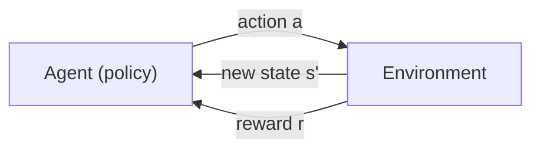
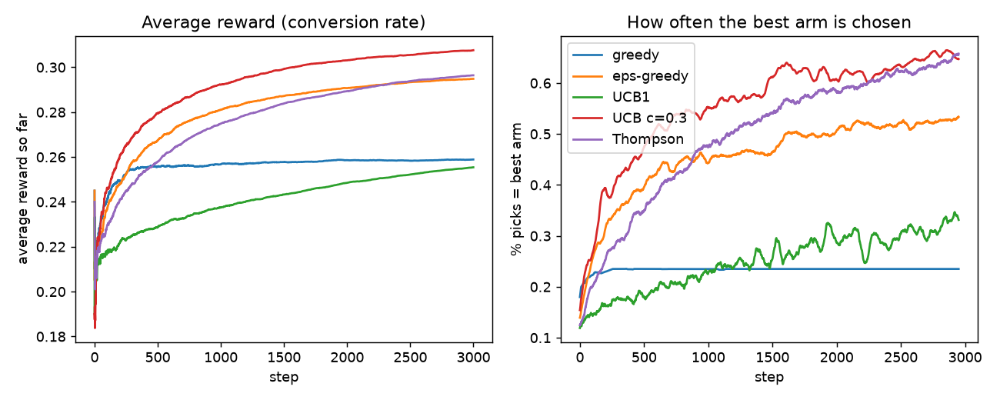
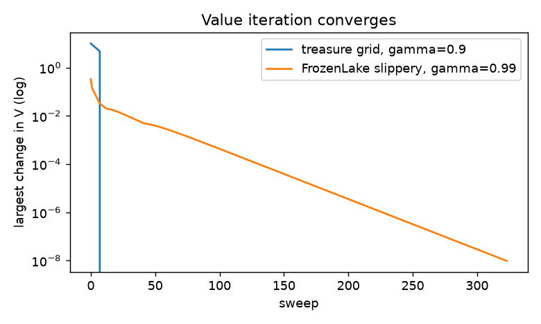
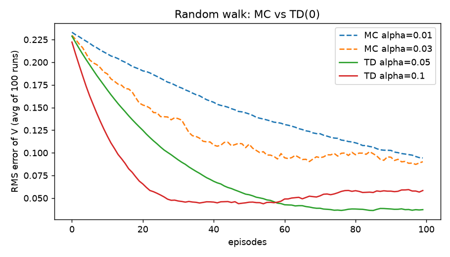
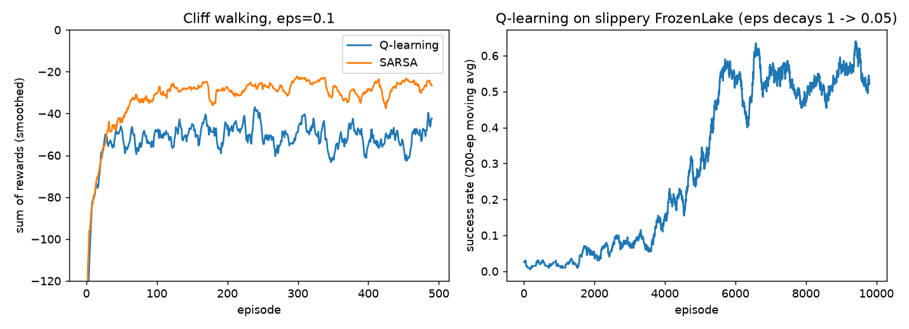
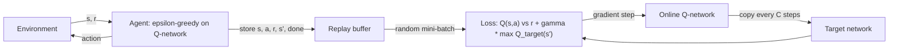
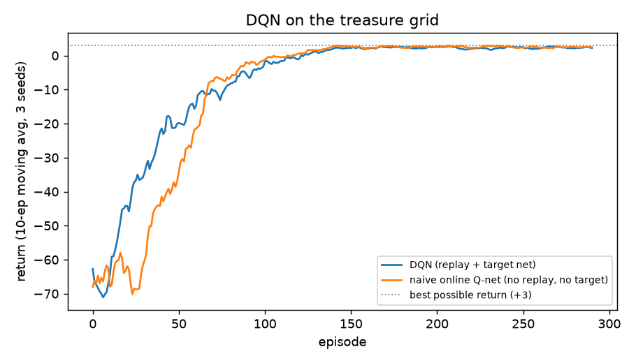
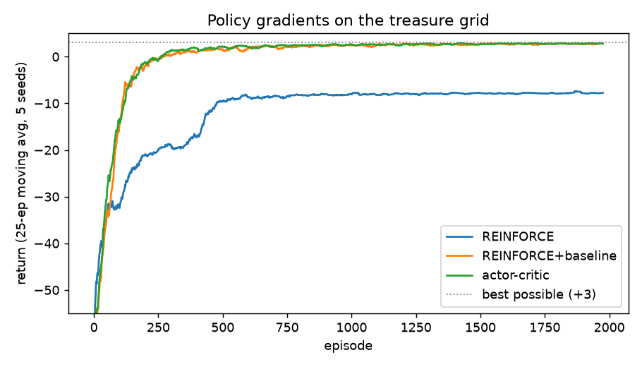
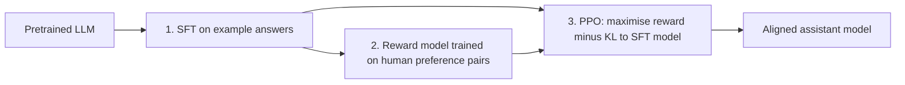

# Chapter 14 — Reinforcement Learning

Supervised learning learns from an answer key; unsupervised learning finds structure without one. **Reinforcement learning (RL)** is the third way: an agent learns *what to do* by acting in a world, seeing what happens, and collecting rewards — no answer key, just a score that arrives, often late. It is how AlphaGo learned to beat a world champion at Go, how robots learn to walk in simulation, how some recommenders decide what to try next, and how chat models such as ChatGPT and Claude were tuned to be more helpful (RLHF).

**What you'll learn**

1. The core vocabulary: agent, environment, state, action, reward, episode, policy.
2. Markov decision processes, the return and the discount factor — with worked numbers on a treasure-hunt grid.
3. Value functions V and Q, and the Bellman equations.
4. Exploration vs exploitation: multi-armed bandits with ε-greedy, UCB and Thompson sampling (implemented).
5. Dynamic programming when the rules are known: policy evaluation, policy iteration, value iteration (implemented on a gridworld and a FrozenLake-style lake).
6. Learning from experience: Monte Carlo vs temporal-difference (TD) learning.
7. Q-learning and SARSA from scratch in numpy — no Gym needed — and why they behave differently near a cliff.
8. Deep RL: DQN with a replay buffer and a target network (implemented in PyTorch).
9. Policy gradients: REINFORCE, baselines and actor-critic (implemented), plus PPO in one paragraph.
10. RLHF — the bridge from RL to large language models.
11. Real-world uses (AlphaGo, robotics, recommender bandits, ads) and pitfalls (reward hacking, sample inefficiency).

All code lives in `code/` and uses only numpy, matplotlib and PyTorch. `code/gridworld.py` is a tiny environment written for this chapter (FrozenLake-style lake, treasure grid, cliff walk); its action numbering (0 = left, 1 = down, 2 = right, 3 = up) matches the popular Gymnasium library so you can move to it later. Outputs below are real.

---

## 14.1 What reinforcement learning is

### What it is
In RL a learner called the **agent** repeatedly:
1. looks at the current **state** of its **environment**,
2. picks an **action**,
3. receives a **reward** (a number: positive = good, negative = a penalty) and finds itself in a new state.

Its goal is not to get the next reward, but to collect **as much total reward as possible over time**. The strategy it learns — "in this situation, do that" — is called a **policy**.

| Term | Meaning | Treasure-hunt example |
|---|---|---|
| **Agent** | The learner and decision-maker | A robot, a game player, a program |
| **Environment** | Everything the agent interacts with; it reacts to actions | The house, the maze, the game board |
| **State** (s) | A description of the current situation | The robot's position on the map |
| **Action** (a) | A choice available to the agent | Move up / down / left / right |
| **Reward** (r) | Immediate numeric feedback after an action | +10 treasure, −5 trap, −1 per step |
| **Episode** | One run from a start to an end (goal, failure or time limit) | One attempt at the maze |
| **Policy** (π) | The agent's rule for choosing actions in each state | "In the hallway, go left" |
| **Goal** | Maximise total (discounted) reward | Reach the treasure by the best route |



### Trial and error — the intuition
Think of learning to ride a bicycle. Nobody hands you the correct muscle movements. You try, wobble, fall, adjust, and gradually the attempts that kept you upright become habit. RL agents learn the same way: **act → observe the outcome → receive feedback → shift future choices** toward what paid off.

Everyday framings of the same loop:
- **A robot looking for a cookie** in a house: small rewards for getting closer, penalties for bumping into furniture; after many attempts it settles on the route that earned the most.
- **Tic-tac-toe**: early games are random and mostly lost (negative reward); the occasional win (positive reward) gradually tilts the agent toward the moves that appeared in winning games.
- **A grid game** (right = +5, left = −2) or **a snack chooser** (fruit rewarded, candy penalised): after sampling each option a few times, the agent comes to prefer the rewarded one, even if it looked unattractive before trying it.

### How RL differs from other learning

| | Supervised | Unsupervised | Reinforcement |
|---|---|---|---|
| Data | Inputs with correct labels | Inputs only | Experience generated by the agent's own actions |
| Feedback | "The right answer was X" | None | "That was worth +3" — how good, not what was right |
| Timing | Immediate, per example | — | Often **delayed** (the win comes 40 moves later) |
| Data distribution | Fixed dataset | Fixed dataset | **Depends on the policy** — change behaviour, change the data |
| Key challenge | Generalisation | Finding structure | Exploration and **credit assignment** (which earlier action earned the reward?) |

### Why it matters
RL fits problems that are **sequential decisions under uncertainty**, where actions change what happens next: games, robot control, resource allocation (cooling, bidding, inventory), dialogue, and sequential recommendation. It can discover strategies humans never wrote down (AlphaGo's famous "move 37").

### When not to use it
- If you have labelled examples of the right action, supervised learning (behaviour cloning) is simpler and far more data-efficient.
- If each decision does not affect future states, a **contextual bandit** (§14.4) is enough.
- If you cannot simulate the environment and real trials are expensive or dangerous (medicine, finance), pure online RL is risky; look at offline RL or stay supervised.

### TL;DR
RL = an agent learns a policy by trial and error, choosing actions in states to maximise long-run reward. Unlike supervised learning, feedback is a score (not the right answer), often delayed, and the agent's own behaviour decides what data it sees.

---

## 14.2 Markov decision processes, returns and discounting

### What it is
A **Markov decision process (MDP)** is the mathematical model of an RL problem: a tuple (S, A, P, R, γ).
- **S**: the set of states. **A**: the set of actions.
- **P(s′ | s, a)**: the **transition probability** of landing in s′ after doing a in s. (Deterministic worlds put probability 1 on one outcome; a slippery lake spreads it.)
- **R(s, a, s′)**: the reward for that transition.
- **γ** (gamma, 0 ≤ γ ≤ 1): the **discount factor**.

The **Markov property**: the next state and reward depend only on the current state and action, not on the full history. "The present summarises the past." If your state description misses something important (e.g. a car's speed, not just its position), the problem is not Markov in that state — add the missing information (or stack recent observations, as DQN stacks 4 Atari frames).

### Return and discount
The **return** Gₜ is the total reward from time t onward, with later rewards discounted:

Gₜ = rₜ₊₁ + γ·rₜ₊₂ + γ²·rₜ₊₃ + … = Σₖ γᵏ·rₜ₊ₖ₊₁

Why discount?
- **Mathematical**: keeps sums finite for tasks that never end.
- **Preference**: a reward now is worth more than the same reward later (like interest rates); future rewards are also more uncertain.
- γ = 0 → completely short-sighted (only the next reward counts). γ → 1 → far-sighted. With γ = 0.9 a reward 10 steps away counts 0.9¹⁰ ≈ 0.35 of its face value; a rough "horizon" is 1/(1 − γ) = 10 steps.

A useful identity: **Gₜ = rₜ₊₁ + γ·Gₜ₊₁** — the return is "this reward plus the discounted return from the next step". Everything in §14.3 builds on it.

**Episodic** tasks end (a game, a maze run); **continuing** tasks never do (a thermostat, a stock of servers) and need γ < 1 or an average-reward formulation.

### Worked example — the treasure grid
Here is the paper game "draw a grid, place a treasure and some traps, and score different routes", turned into code (`code/treasure_grid.py`):

```
S.-..      S = start, G = treasure (+10, ends the episode)
..-..      - = trap (-5, you keep going)
...-.      every other move costs -1
.-...      (walking into the edge = you stay put, still -1)
....G
```

```python
def play(env, actions, gamma=0.9):
    s = env.reset()
    rewards = []
    for a in actions:
        s, r, done, _ = env.step(a)
        rewards.append(r)
        if done:
            break
    G = sum(gamma ** t * r for t, r in enumerate(rewards))   # discounted return
    return rewards, sum(rewards), G, done
```

Output:
```
A: right along the top, then down    rewards=[-1, -5, -1, -1, -1, -1, -1, 10]  total=-1  discounted G(gamma=0.9)=-4.03  reached=True
B: down the left edge, then right    rewards=[-1, -1, -1, -1, -1, -1, -1, 10]  total=+3  discounted G(gamma=0.9)=-0.43  reached=True
C: zig-zag through the middle        rewards=[-1, -1, -1, -1, -1, -1, -1, 10]  total=+3  discounted G(gamma=0.9)=-0.43  reached=True

random tries that reached the treasure within 30 moves: 307 / 2000
best of 2,000 random tries: total=-1  moves=RDDRRDRD
```

Checking path B by hand: seven −1 steps, then +10 on step 8.
G = −(1 + 0.9 + 0.9² + … + 0.9⁶) + 10·0.9⁷ = −(1 − 0.9⁷)/(1 − 0.9) + 10·0.478 = −5.22 + 4.78 = **−0.43**.

Lessons:
- Path A walks through a trap and scores worse; B and C avoid all traps and tie on the best possible total, +3 (8 moves is the minimum).
- Even with discounting the ranking is the same here, but the discounted value of reaching +10 eight steps away is only 4.78 — distant rewards count less.
- **Blind trial and error is weak**: 2,000 random attempts never found a +3 route, and only 15% reached the treasure at all. The agent needs to *learn from* its trials — remember which actions paid off and prefer them. That is what value functions and Q-learning do.

### Self-check
1. γ = 0.5 and the next three rewards are 1, 1, 1 (then the episode ends). Gₜ? → 1 + 0.5 + 0.25 = **1.75**.
2. Why is a car's position alone not a Markov state? → The next position also depends on speed, which the state omits.
3. Rough horizon for γ = 0.99? → 1/(1 − 0.99) = **100** steps.

### TL;DR
An MDP = states, actions, transition probabilities, rewards, discount γ. The return Gₜ = Σ γᵏ rₜ₊ₖ₊₁ = rₜ₊₁ + γGₜ₊₁. γ trades short-term for long-term reward. Random exploration alone rarely finds the best plan.

---

## 14.3 Policies, value functions and the Bellman equations

### What it is
- A **policy** π tells the agent what to do. **Deterministic**: π(s) = a. **Stochastic**: π(a | s) = probability of choosing a in s.
- The **state-value function** Vπ(s) = expected return starting in s and then following π. "How good is it to be here, if I keep behaving like this?"
- The **action-value function** Qπ(s, a) = expected return if you take action a in s, then follow π. "How good is doing *this* here?"
- The **optimal** functions V*(s) and Q*(s, a) are the best achievable by any policy. Once you know Q*, acting optimally is trivial: **π*(s) = argmaxₐ Q*(s, a)** (be *greedy* with respect to Q*).

Why Q is so useful: choosing the best action from V requires knowing the transition model (to look one step ahead), but choosing from Q does not — just compare numbers. That is why model-free methods (Q-learning, DQN) learn Q.

### The Bellman equations
Plug the identity Gₜ = rₜ₊₁ + γGₜ₊₁ into the definitions:

| Equation | Formula | Used by |
|---|---|---|
| **Bellman expectation** (for a given π) | Vπ(s) = Σₐ π(a\|s) Σₛ′ P(s′\|s,a) [R(s,a,s′) + γVπ(s′)] | Policy evaluation |
| **Bellman optimality** for V | V*(s) = maxₐ Σₛ′ P(s′\|s,a) [R(s,a,s′) + γV*(s′)] | Value iteration |
| **Bellman optimality** for Q | Q*(s,a) = Σₛ′ P(s′\|s,a) [R(s,a,s′) + γ maxₐ′ Q*(s′,a′)] | Q-learning, DQN |

(V of a terminal state is 0 — nothing more can be earned after the episode ends.)

In words: *the value of where you are = the reward you get now + the discounted value of where you land* (averaged over what might happen, and, for the optimal version, choosing the best action).

**Worked numbers** on the treasure grid (γ = 0.9, deterministic):
- The cell just above G: move down → +10 and the episode ends. V* = **10**.
- One more cell up: V* = −1 + 0.9·10 = **8.0**.
- One more: −1 + 0.9·8 = **6.2**; then −1 + 0.9·6.2 = **4.58**; …; at the start, **−0.43** — exactly path B's discounted return.

### Self-check
1. What is the difference between V(s) and Q(s, a)? → V averages over the policy's action choice; Q fixes the first action.
2. If you know Q*, how do you act? → Pick argmaxₐ Q*(s, a).
3. Compute V* for a cell two steps from G with reward −1 per step, γ = 0.5. → −1 + 0.5·10 = 4.

### TL;DR
Policy = behaviour; V = how good a state is; Q = how good an action in a state is. Bellman: value now = reward now + γ × value next. Greedy on Q* is optimal.

---

## 14.4 Exploration vs exploitation — multi-armed bandits

### What it is
The **exploration–exploitation dilemma**: should you **exploit** the best option you know, or **explore** others that might be better? Always exploiting can lock you into a mediocre choice forever; always exploring wastes reward.

The simplest setting that isolates it is the **multi-armed bandit**: k slot machines ("one-armed bandits"), each paying off with an unknown probability. There is only one state — no consequences beyond the immediate reward — so it is RL with the sequential part removed. Real versions: which of 10 ad banners, headlines or thumbnails to show; which new item to give traffic to.

**Regret** = reward you could have collected by always pulling the best arm, minus what you actually got. Good strategies make regret grow slowly (logarithmically in time).

### The strategies
1. **Greedy**: try each arm once, then always pull the arm with the highest average so far. Can get stuck on an arm that got lucky early.
2. **ε-greedy**: with probability ε (e.g. 0.1) pull a random arm, otherwise the best-looking one. Simple and robust, but keeps exploring uselessly at rate ε forever (decay ε over time to fix).
3. **UCB (Upper Confidence Bound)** — *optimism in the face of uncertainty*: pick argmaxₐ [ Q(a) + c·√(ln t / Nₐ) ], where Nₐ = pulls of arm a so far. Rarely tried arms get a big bonus; the bonus shrinks as evidence accumulates. UCB1 uses c = √2 (from theory, for rewards in [0, 1]).
4. **Thompson sampling** — *probability matching*: keep a belief distribution over each arm's payoff (for 0/1 rewards, a Beta(wins + 1, losses + 1) distribution), draw one sample per arm, pull the arm whose sample is highest. Arms that *might* be best get tried in proportion to that chance.

### Code — `code/bandits.py`
10 arms with conversion rates drawn from 5–35%, 3,000 pulls, averaged over 200 random problems.

```python
if policy == "eps-greedy":
    a = int(rng.integers(N_ARMS)) if rng.random() < eps else int(np.argmax(q))
elif policy.startswith("UCB"):
    c = np.sqrt(2) if policy == "UCB1" else 0.3
    a = t if t < N_ARMS else int(np.argmax(q + c * np.sqrt(np.log(t + 1) / n)))
elif policy == "Thompson":
    a = int(np.argmax(rng.beta(wins, losses)))            # sample a belief, act on it
r = float(rng.random() < true_p[a])                       # conversion (1) or not (0)
n[a] += 1
q[a] += (r - q[a]) / n[a]                                 # incremental mean
```

Output:
```
policy      avg reward  % optimal arm (last 500)  total regret
greedy      0.2589       23.5%                197.0
eps-greedy  0.2948       52.4%                 89.1
UCB1        0.2554       31.5%                207.4
UCB c=0.3   0.3076       64.9%                 50.9
Thompson    0.2964       63.4%                 84.4
```



What the results show:
- **Greedy** locks in early: it finds the best arm in only 23.5% of problems, and its curve goes flat.
- **ε-greedy** and **Thompson** both learn steadily; Thompson picks the best arm most often among the untuned methods and needs no ε to tune.
- **UCB1** with its textbook c = √2 explores *too much* at this horizon: the bonus is large compared with rewards around 0.2–0.3, so after 3,000 pulls it is still sampling bad arms. A smaller constant (c = 0.3) gives the lowest regret here. Lesson: theoretical constants guarantee long-run behaviour, not the best finite-horizon performance — tune on simulations of your own traffic.

### Contextual bandits
Add **context** (user features, time, device): choose the arm based on context, e.g. LinUCB (a linear model per arm with a UCB bonus). Yahoo! used LinUCB for news-article recommendation on its front page (Li et al., 2010). Netflix has described using contextual bandits to choose which artwork to show each member. Contextual bandits are arguably the most widely deployed form of RL in industry, because they are simple, relatively safe and easy to measure.

### Common mistakes
- Using a fixed ε forever — decay it, or use Thompson/UCB.
- Ignoring **non-stationarity**: click rates drift; use a sliding window or constant step size instead of an all-time average.
- Declaring a winner from a handful of pulls (the greedy trap).

### In the interview
**30-second answer:** "Exploration vs exploitation is the trade-off between using the best-known option and gathering information about others. Bandits isolate it. ε-greedy explores randomly at a fixed rate; UCB adds an optimism bonus that shrinks with the number of tries; Thompson sampling samples from a posterior over each arm's reward and acts greedily on the sample. In production I'd use a contextual bandit, often Thompson or LinUCB, for things like headline or thumbnail selection."

- *Bandit vs A/B test?* A/B splits traffic evenly until the end; a bandit shifts traffic toward winners during the test, reducing regret — at the cost of less clean statistics.
- *Why does Thompson work?* An arm is chosen with the probability that it is the best, given the evidence.

### Self-check
1. Why is pure greedy bad? → An unlucky early estimate of the best arm is never corrected.
2. In UCB, what happens to an arm's bonus as it is pulled more? → It shrinks like 1/√Nₐ.
3. What distribution does Thompson use for 0/1 rewards? → Beta(successes + 1, failures + 1).

### TL;DR
Explore to learn, exploit to earn. ε-greedy (random exploration), UCB (optimism bonus), Thompson (posterior sampling). Contextual bandits are RL's biggest industrial success.

---

## 14.5 Dynamic programming — planning when the model is known

### What it is
If you **know** the MDP (P and R), you can compute optimal values without any trial and error, by repeatedly applying the Bellman equations. This family is called **dynamic programming (DP)** (Bellman, 1950s).

- **Policy evaluation**: given π, start with V = 0 and repeatedly replace each V(s) by the Bellman *expectation* right-hand side until it stops changing.
- **Policy improvement**: make π greedy with respect to the current V (look one step ahead with the model).
- **Policy iteration**: alternate evaluation and improvement until the policy stops changing. Converges in few rounds.
- **Value iteration**: skip full evaluation — apply the Bellman *optimality* update (with the max) directly, sweep after sweep, then read off the greedy policy.

### Code — `code/value_iteration.py`
```python
def q_from_v(env, V, s, gamma):
    """One-step look-ahead: Q(s,a) = sum_s' P(s'|s,a) * [r + gamma * V(s') * (not done)]."""
    return np.array([sum(p * (r + gamma * V[s2] * (not done)) for p, s2, r, done in env.transitions(s, a))
                     for a in range(env.nA)])

def value_iteration(env, gamma, tol=1e-8):
    V, deltas = np.zeros(env.nS), []
    while True:
        delta = 0.0
        for s in range(env.nS):
            if env.is_terminal(s):
                continue
            best = q_from_v(env, V, s, gamma).max()      # Bellman OPTIMALITY backup
            delta = max(delta, abs(best - V[s]))
            V[s] = best
        deltas.append(delta)
        if delta < tol:
            break
    policy = np.array([np.argmax(q_from_v(env, V, s, gamma)) for s in range(env.nS)])
    return V, policy, deltas
```

The **FrozenLake** world (a classic RL toy): walk across a frozen lake from S to the goal G without falling into holes H. It is **slippery**: whatever direction you choose, you move that way only 1/3 of the time and slide to either side 1/3 each. Reward 1 only for reaching G.

```
SFFF      F = frozen (safe), H = hole (episode ends, reward 0)
FHFH
FFFH
HFFG
```

Output:
```
== Treasure grid (deterministic), gamma = 0.9 ==
value iteration converged in 9 sweeps
V*:
 -0.43   0.63   1.81   3.12   4.58
  0.63   1.81   3.12   4.58   6.20
  1.81   3.12   4.58   6.20   8.00
  3.12   4.58   6.20   8.00  10.00
  4.58   6.20   8.00  10.00   0.00
greedy policy:
vv>vv
vvv>v
v>vvv
vvvvv
>>>>G

== FrozenLake 4x4, slippery (2/3 of moves slide sideways), gamma = 0.99 ==
value iteration converged in 324 sweeps
V*:
  0.54   0.50   0.47   0.46
  0.56   0.00   0.36   0.00
  0.59   0.64   0.62   0.00
  0.00   0.74   0.86   0.00
policy:
<^^^
<H<H
^v<H
H>vG
policy iteration: 7 improvement rounds, same policy as VI: True
simulated success rate of this policy: 73.8%
a random fixed policy succeeds:         2.9%
```



Reading it:
- On the treasure grid the values rise smoothly toward G (the Bellman numbers from §14.3), and the greedy policy routes around every trap.
- On the slippery lake the optimal policy looks **strange**: from the start it presses *left* (into the wall!). Because you only slide sideways, pushing against the wall means you either stay put or slide down — never toward a hole. Top-row cells press *up* for the same reason. The optimal plan under uncertainty is about **avoiding risk**, not the shortest path. It reaches the goal about 74% of the time within the 100-step limit, vs 3% for a random fixed policy.
- Value iteration needed 324 sweeps on the lake (γ = 0.99, slow propagation) but only 9 on the deterministic grid; policy iteration needed just 7 improvement rounds.

### Trade-offs / when not to use it
DP needs the **full model** and sweeps **every state** each iteration — fine for thousands of states, impossible for Go (≈10¹⁷⁰ positions) or for continuous states. It is the foundation that model-free methods approximate from samples.

### Self-check
1. Value iteration vs policy iteration? → VI applies the max-backup repeatedly and reads off the policy at the end; PI fully evaluates a policy, improves it greedily, and repeats until the policy stops changing.
2. Why does the lake policy press *left* at the start? → Slips only go sideways, so pushing into the wall can never slide the agent into a hole.
3. Why can't DP solve Go? → It needs the full model and a sweep over every state — about 10¹⁷⁰ of them.

### TL;DR
With a known model, value iteration (repeat the Bellman optimality backup) or policy iteration (evaluate, then act greedily; repeat) compute optimal values and policies exactly. Great for small, fully known problems.

---

## 14.6 Learning from experience: Monte Carlo vs temporal difference

### What it is
Usually we **don't** know P and R — we can only act and observe. **Model-free** methods estimate values from sampled experience. To estimate Vπ:

| | Monte Carlo (MC) | Temporal difference, TD(0) |
|---|---|---|
| Update target | Actual return Gₜ observed at the end of the episode | rₜ₊₁ + γV(sₜ₊₁) — one real reward + current estimate of the rest |
| Update rule | V(s) ← V(s) + α[Gₜ − V(s)] | V(s) ← V(s) + α[rₜ₊₁ + γV(sₜ₊₁) − V(s)] |
| When it can update | After the episode ends | After every step (works for never-ending tasks) |
| Bias | Unbiased (real return) | Biased (uses its own estimate — **bootstrapping**) |
| Variance | High (return depends on many random steps) | Low (one random step) |
| Usually | Slower, simpler | Faster learning in practice |

The quantity δ = rₜ₊₁ + γV(sₜ₊₁) − V(sₜ) is the **TD error**: "how much better or worse did this step go than I expected?" It is one of the central quantities in RL (and has a well-known parallel in dopamine signalling in the brain, per Schultz, Dayan & Montague, 1997). α is the **step size** (learning rate).

Analogy: predicting your commute time. MC waits until you arrive, then updates the estimate. TD updates at every landmark: "I'm at the bridge 5 minutes late → my estimate for the whole trip was too low, adjust now."

### Code — `code/mc_vs_td.py` (the classic 5-state random walk)
States A–E in a row; start at C; step left or right at random; reaching the right end gives +1, the left end 0. True values are 1/6, 2/6, …, 5/6.

```python
if method == "MC":        # wait until the end, then move each V(s) toward the actual return G
    for s in states:
        V[s] += alpha * (G - V[s])
else:                     # TD(0): after every step, move V(s) toward r + gamma * V(s')
    for t, s in enumerate(states):
        target = gamma * V[states[t + 1]] if t + 1 < len(states) else final_r
        V[s] += alpha * (target - V[s])
```
(The file writes the target explicitly with the zero intermediate reward; this is every-visit, constant-α Monte Carlo.)

Output:
```
MC alpha=0.01  RMS error after 10 eps 0.211, after 100 eps 0.094
MC alpha=0.03  RMS error after 10 eps 0.189, after 100 eps 0.090
TD alpha=0.05  RMS error after 10 eps 0.175, after 100 eps 0.037
TD alpha=0.1   RMS error after 10 eps 0.126, after 100 eps 0.058
TD estimate after 300 episodes: [0.22 0.41 0.51 0.67 0.84]  true: [0.17 0.33 0.5  0.67 0.83]
```



TD learns faster than MC here, as in Sutton & Barto's version of this experiment. Note the step-size trade-off: a larger α learns faster early but leaves more noise at the end (TD α = 0.1 plateaus above α = 0.05). With a constant α the estimates keep jittering around the truth rather than converging exactly.

**n-step returns and TD(λ)** blend the two: use n real rewards before bootstrapping (n = 1 is TD, n = ∞ is MC), or average the n-step targets for all n with weights (1 − λ)λⁿ⁻¹ (λ = 0 gives TD(0), λ = 1 gives MC). Modern deep RL (e.g. GAE in PPO) uses this idea.

### Self-check
1. TD(0) step: V(s) = 0.5, reward 0, V(s′) = 0.6, γ = 1, α = 0.1. New V(s)? → δ = 0 + 0.6 − 0.5 = 0.1, so V(s) = 0.5 + 0.1·0.1 = **0.51**.
2. Which method can learn in a task that never ends? → TD — MC must wait for an episode's end.
3. Why is MC unbiased but noisy? → Its target is the real return, which sums many random steps.

### TL;DR
MC updates toward the actual return (unbiased, noisy, waits for the end). TD updates toward reward + γ·V(next) (bootstraps, lower variance, learns every step). The TD error δ drives most of RL.

---

## 14.7 Q-learning and SARSA — tabular control

### What it is
To **act** without a model we learn **Q(s, a)** from experience, using TD updates, while behaving ε-greedily.

**Q-learning** (Watkins, 1989) — *off-policy*:
Q(s, a) ← Q(s, a) + α [ r + γ · maxₐ′ Q(s′, a′) − Q(s, a) ]

**SARSA** (Rummery & Niranjan, 1994) — *on-policy*, named after the quintuple (s, a, r, s′, a′) it uses:
Q(s, a) ← Q(s, a) + α [ r + γ · Q(s′, a′) − Q(s, a) ], where a′ is the action the agent will actually take next.

**Off-policy** means the agent learns about one policy (the greedy, optimal one — the max) while following another (the exploratory ε-greedy one). **On-policy** means it learns the value of the policy it is actually following, exploration included.

### How it works (Q-learning episode loop)
1. Initialise Q(s, a) = 0 for all s, a.
2. For each episode: s ← start.
3. Choose a with ε-greedy on Q(s, ·).
4. Take a; observe r, s′.
5. Update Q(s, a) toward r + γ·maxₐ′Q(s′, a′) (use 0 instead of the max if s′ is terminal).
6. s ← s′; repeat until the episode ends.
7. Decay ε over episodes so the agent gradually shifts from exploring to exploiting.

Under standard conditions (every state–action pair visited infinitely often, step sizes decaying appropriately) tabular Q-learning converges to Q*.

### Code — `code/q_learning_sarsa.py`
```python
def train(env, method, episodes, alpha, gamma, eps_schedule, seed=0):
    rng = np.random.default_rng(seed)
    Q = np.zeros((env.nS, env.nA))
    returns = []
    for ep in range(episodes):
        eps = eps_schedule(ep)
        s = env.reset()
        a = epsilon_greedy(Q, s, eps, rng)
        total, done, trunc = 0.0, False, False
        while not (done or trunc):
            s2, r, done, trunc = env.step(a)
            a2 = epsilon_greedy(Q, s2, eps, rng)
            if method == "Q-learning":           # off-policy: bootstrap from the BEST next action
                target = r + gamma * Q[s2].max() * (not done)
            else:                                # SARSA, on-policy: from the action we WILL take
                target = r + gamma * Q[s2, a2] * (not done)
            Q[s, a] += alpha * (target - Q[s, a])
            s, a, total = s2, a2, total + r
        returns.append(total)
    return Q, np.array(returns)
```

**Part 1 — Cliff walking** (Sutton & Barto, Example 6.6): walk from S to G along the bottom of a 4×12 grid; the cells between them (C) are a cliff: stepping in costs −100 and sends you back to S. Every step costs −1. ε stays at 0.1.

**Part 2 — slippery FrozenLake** with ε decaying from 1 to 0.05 over 6,000 of 10,000 episodes.

Output:
```
Q-learning avg return per episode (last 100, while exploring eps=0.1):   -51.7
greedy path learned:
>^>>>>>>>>>v
>>v>>v>>>>vv
>>>>>>>>>>>v
^CCCCCCCCCCG
SARSA      avg return per episode (last 100, while exploring eps=0.1):   -27.2
greedy path learned:
>>>>>>>>>>>v
^>>^^^^^>^vv
^^^^^^>>>^>v
^CCCCCCCCCCG

FrozenLake Q-learning policy:
<^^^
<H<H
^v<H
H>vG
greedy success rate: Q-learning 73.4% | value-iteration optimum 74.0%
```



Reading it:
- **Q-learning** learns the *optimal* path — right along the cliff edge (row 3: `>>>>>>>>>>>v`). But while it still explores with ε = 0.1, a random step sometimes drops it off the cliff, so its average return during training is worse (−51.7).
- **SARSA** learns the value of what it actually does, *including* its random slips, so it prefers the **safe path** along the top — longer, but it earns more while exploring (−27.2).
- Which is "right"? If exploration will continue in deployment (a robot that sometimes slips), SARSA's caution is valuable; if you will act greedily once trained, Q-learning finds the better final policy.
- On FrozenLake, Q-learning — with no knowledge of the slip probabilities — **rediscovers the exact optimal policy** found by value iteration (identical arrows, 73–74% success in simulation). It needed thousands of episodes to do what DP did from the model: that is **sample inefficiency** in a nutshell.

### Trade-offs

| | Q-learning | SARSA |
|---|---|---|
| Type | Off-policy (learns greedy policy) | On-policy (learns the behaviour policy) |
| Target | max over next actions | the actually chosen next action |
| During training | Riskier (optimistic about its own future) | Safer |
| Learns from others' data / replay | Yes (basis of DQN) | Not directly |
| Known issue | Maximisation bias (fixed by Double Q-learning) | Converges to optimal only as ε → 0 |

### Common mistakes
- Bootstrapping from a terminal state (must use 0 after the episode ends — the `(not done)` factor). Also, a **time-limit** truncation is not a real terminal state; ideally keep bootstrapping there.
- Never decaying ε, or decaying it so fast the agent never finds the goal (sparse rewards!).
- Breaking ties by always taking action 0 when Q is all zeros — the agent walks into a wall forever. Break ties randomly.
- Tabular methods on large state spaces — the table never fills in; use function approximation (next section).

### In the interview
**30-second answer:** "Q-learning is an off-policy TD method: it updates Q(s,a) toward r + γ·max Q(s′,·), so it learns the optimal greedy policy while exploring with ε-greedy. SARSA is on-policy: it bootstraps from the action it actually takes next, so it learns the value of its exploratory behaviour and tends to be safer, as the cliff-walking example shows."

- *Why does Q-learning overestimate?* The max over noisy estimates is biased upward; Double Q-learning uses one estimator to select and another to evaluate.
- *What does off-policy enable?* Learning from old data or other agents' data — replay buffers, offline RL.

### Self-check
1. Which target uses max, and why is that "off-policy"? → Q-learning; it evaluates the greedy policy regardless of the exploratory action actually taken.
2. On the cliff, why does SARSA take the long way? → Its values include the chance of random slips off the edge.
3. What does Q converge to under Q-learning? → Q*, given enough exploration and suitable step sizes.

### TL;DR
Q-learning: off-policy, target r + γ·max Q(s′) → learns the optimal policy. SARSA: on-policy, target r + γ·Q(s′, a′) → learns what it actually does, safer. Both are TD control with ε-greedy exploration.

---

## 14.8 Deep reinforcement learning — DQN

### What it is
A Q-table needs one entry per state–action pair. Atari screens, robot joint angles or board positions have far too many states. **Function approximation** replaces the table with a model Q(s, a; θ) — typically a neural network that takes the state and outputs one Q-value per action. That network generalises: similar states get similar values.

**DQN (Deep Q-Network)** — DeepMind, Mnih et al., *Nature* 2015 — learned to play 49 Atari 2600 games from raw pixels and score, with a single architecture and hyperparameter set, reaching human-level performance on many of them. Naively combining Q-learning with a neural network is unstable; DQN made it work with two tricks:

1. **Experience replay**: store transitions (s, a, r, s′, done) in a large buffer; train on **random mini-batches** from it. This breaks the strong correlation between consecutive steps (which violates the i.i.d. assumption of SGD) and reuses each experience many times.
2. **Target network**: compute the TD target r + γ·maxₐ′ Q(s′, a′; θ⁻) with a **frozen copy** θ⁻ of the network, copied from the online network only every C steps. Otherwise every update moves the target it is chasing ("a dog chasing its tail").

Plus: ε-greedy exploration, the Huber loss (less sensitive to large errors), frame stacking for motion.



The **deadly triad** (Sutton & Barto): function approximation + bootstrapping + off-policy learning can diverge. DQN's tricks are mitigations, not guarantees.

### Code — `code/dqn.py` (DQN on the treasure grid)
The state is one-hot encoded (25 inputs); a 64-unit MLP outputs 4 Q-values.

```python
buffer = deque(maxlen=5000)                                  # experience replay memory
...
buffer.append((s, a, r, s2, done))
batch = random.sample(buffer, min(64, len(buffer))) if use_replay else [buffer[-1]]
...
with torch.no_grad():                                        # TD target from the frozen network
    nxt = (target_net if use_target else q_net)(S2).max(1).values
    y = R + gamma * nxt * (1 - D)
q = q_net(S).gather(1, A[:, None]).squeeze(1)
loss = nn.functional.smooth_l1_loss(q, y)                    # Huber loss
opt.zero_grad(); loss.backward(); opt.step()
if use_target and steps % 200 == 0:
    target_net.load_state_dict(q_net.state_dict())           # periodic hard copy
```

Output:
```
DQN (replay + target net)                  mean return, last 50 episodes: +2.31
naive online Q-net (no replay, no target)  mean return, last 50 episodes: +2.42
greedy policy of the DQN (seed 0):
vv>>v
vv>>v
>>vvv
vvvvv
>>>>G
```



- The DQN learns a trap-free 8-move route (return +3; the last-50 average is a bit lower because ε = 0.05 exploration continues).
- With replay it learns noticeably **faster** (it reuses each experience in many mini-batches).
- On this tiny, 25-state problem the naive version also gets there eventually. Honest takeaway: replay and target networks matter most at scale — large networks, pixel inputs, long training — where the naive version often oscillates or diverges.

### Beyond DQN (one line each)
- **Double DQN**: select the next action with the online net, evaluate it with the target net → less overestimation.
- **Dueling DQN**: separate streams for V(s) and the advantage A(s, a).
- **Prioritised replay**: sample transitions with large TD error more often.
- **Rainbow** (2017): combines these and more.
- DQN handles **discrete** actions only; continuous control (robot torques) uses actor-critic methods such as DDPG, TD3 and SAC.

### In the interview
**30-second answer:** "DQN replaces the Q-table with a neural network trained toward the Q-learning target r + γ·max Q(s′, ·). Two tricks make it stable: an experience-replay buffer sampled at random, which breaks correlations and reuses data, and a target network, a frozen copy that is refreshed only every C steps so the target stops moving. It works for discrete actions; continuous control uses actor-critic methods such as SAC or TD3."

- *Why does DQN overestimate, and the fix?* The max over noisy estimates is biased upward; Double DQN picks the action with the online net and evaluates it with the target net.
- *Why not use DQN for robot torques?* Taking the max over infinitely many continuous actions isn't practical.

### Self-check
1. What goes wrong without a target network? → Every update shifts the target it is chasing, which can cause oscillation or divergence.
2. What does the replay buffer store? → Transitions (s, a, r, s′, done).
3. Name the deadly triad. → Function approximation, bootstrapping, off-policy learning.

### TL;DR
Deep RL replaces the Q-table with a neural network. DQN stabilises Q-learning with experience replay (decorrelate, reuse) and a target network (freeze the target). Discrete actions only; beware the deadly triad.

---

## 14.9 Policy gradients, REINFORCE and actor-critic

### What it is
Value-based methods learn Q and derive a policy from it. **Policy-gradient** methods learn the policy **directly**: a parameterised π(a | s; θ) (e.g. a softmax over action scores, or a neural net outputting a Gaussian over torques), improved by gradient ascent on expected return J(θ).

Why bother?
- Works naturally with **continuous** and huge action spaces (no max over actions needed).
- Can learn **stochastic** policies (useful in games like rock-paper-scissors and under partial observability).
- Small parameter changes → smooth policy changes (more stable than a greedy argmax that can flip).

### The policy-gradient theorem, intuitively
∇θ J(θ) = E[ ∇θ log π(a | s; θ) · (return that followed) ]

Read it as: *make actions that led to high returns more likely, and actions that led to low returns less likely, in proportion to how good the outcome was.* ∇ log π(a|s) is the direction in parameter space that raises the probability of the action taken. For a softmax policy with scores θ[s, ·], that gradient is simply (one-hot(a) − π(·|s)).

### REINFORCE (Williams, 1992)
1. Run an episode with the current policy; record (s, a, r) at every step.
2. For each step t compute the return Gₜ.
3. Update θ ← θ + α · Gₜ · ∇θ log π(aₜ | sₜ; θ).

(The textbook version also multiplies by γᵗ; most practical implementations drop that factor, and so does our code.)

**Problem: variance.** Gₜ depends on everything that happened afterwards, so the gradient estimate is extremely noisy. If all returns are negative (as with a −1 per step cost), every action taken gets pushed down, and learning can lock into bad behaviour.

**Fix: a baseline.** Subtract b(s) — usually a learned estimate V(s) — from the return: use the **advantage** Aₜ = Gₜ − V(sₜ), "was this better or worse than usual from here?". It does not change the expected gradient but greatly reduces its variance.

### Actor-critic
Go one step further: instead of waiting for the full return, use the **TD error** as the advantage: δ = r + γV(s′) − V(s).
- The **actor** (policy π) chooses actions and is updated by δ·∇log π.
- The **critic** (value function V) judges them and is updated by TD learning.
Updates happen every step, with lower variance (and some bias). Modern variants: **A2C/A3C**, **PPO**, **SAC**.

**PPO** (Proximal Policy Optimization, Schulman et al., 2017) is today's default workhorse: an actor-critic that **clips** how far each update may move the policy from the one that collected the data. With the probability ratio ρ = π_new(a|s) / π_old(a|s) and advantage A, it maximises min(ρ·A, clip(ρ, 1 − ε, 1 + ε)·A) with ε ≈ 0.2, so pushing ρ outside that band earns nothing extra — preventing destructive large steps. It was the RL algorithm in InstructGPT (2022), the RLHF recipe behind early ChatGPT.

### Code — `code/policy_gradient.py` (tabular softmax policy on the treasure grid)
```python
p = softmax(theta[s])
a = rng.choice(4, p=p)
s2, r, done, trunc = env.step(a)
if method == "actor-critic":          # update every step using the TD error
    delta = r + GAMMA * V[s2] * (not done) - V[s]
    V[s] += lr_v * delta              # critic
    grad = -p; grad[a] += 1           # d log pi(a|s) / d theta[s]
    theta[s] += lr * delta * grad     # actor
...
# REINFORCE (after the episode), going backwards to accumulate the return
G = r + GAMMA * G
adv = G if method == "REINFORCE" else G - V[s]   # baseline version subtracts V(s)
theta[s] += lr * adv * grad
```

Output (5 random seeds, 2,000 episodes each):
```
REINFORCE           mean return: episodes 1-100 -40.96 | last 100 -7.80 | std across seeds (last 100) 21.10
REINFORCE+baseline  mean return: episodes 1-100 -42.48 | last 100 +2.75 | std across seeds (last 100) 0.08
actor-critic        mean return: episodes 1-100 -39.86 | last 100 +2.80 | std across seeds (last 100) 0.02
```



- **Plain REINFORCE** is unreliable: four of the five seeds learn a good route, but one gets stuck in a policy that never reaches the treasure (−50 per episode) — hence the average of −7.8 and the huge spread across seeds (21.1). That is the variance problem in action.
- **Adding a baseline** fixes it — every seed reaches close to the optimal +3.
- **Actor-critic** learns about as fast, with the smallest spread, because it updates every step from the lower-variance TD error.

### Value-based vs policy-based

| | Value-based (Q-learning, DQN) | Policy-based (REINFORCE, PPO) | Actor-critic |
|---|---|---|---|
| Learns | Q(s, a) | π(a \| s) | Both |
| Action spaces | Discrete | Discrete or continuous | Both |
| Sample efficiency | Higher (off-policy replay) | Lower (on-policy) | Middle |
| Stability | Can diverge (deadly triad) | High variance | Better balanced |
| Examples | DQN (Atari) | REINFORCE | PPO (RLHF, games, robotics), SAC (robotics) |

### In the interview
**30-second answer:** "Policy-gradient methods adjust the policy's parameters directly so that actions followed by high returns become more likely: the gradient is the average of ∇log π(a|s) times the return. REINFORCE uses the full return and is noisy; subtracting a baseline V(s) gives the advantage and cuts variance without adding bias; actor-critic uses the TD error as the advantage and updates every step. PPO limits each update by clipping the probability ratio, which makes it stable enough to be the default."

- *Why policy gradients over DQN?* Continuous or huge action spaces, and stochastic policies.
- *Why is PPO on-policy a cost?* Data from old policies can't be reused much, so it needs more samples than replay-based methods.

### Self-check
1. Softmax policy π(·|s) = [0.7, 0.2, 0.1] and action 0 was taken. ∇ of log π(a|s) with respect to the three scores? → one-hot − π = **[0.3, −0.2, −0.1]**.
2. Does subtracting a baseline change the expected gradient? → No — it only lowers the variance.
3. What does PPO clip? → The ratio π_new(a|s) / π_old(a|s), to the range [1 − ε, 1 + ε].

### TL;DR
Policy gradients push up the log-probability of actions in proportion to how good their outcome was. REINFORCE is simple but noisy; a baseline (advantage = G − V) cuts variance; actor-critic uses the TD error for step-by-step updates. PPO = clipped actor-critic, the default in practice.

---

## 14.10 RLHF — the bridge to large language models

### What it is
**Reinforcement Learning from Human Feedback (RLHF)** tunes a pretrained language model so that its responses match what people prefer (helpful, honest, harmless). The "environment" is a prompt; the "action" is the generated response (a sequence of token choices); the "reward" comes from a model trained on human preferences.

### How it works (the InstructGPT recipe, Ouyang et al., 2022)
1. **Supervised fine-tuning (SFT)**: fine-tune the pretrained model on human-written example answers.
2. **Reward model (RM)**: show people two (or more) responses to the same prompt and ask which is better. Train a model to give higher scores to preferred responses (a pairwise loss: maximise log σ(score_preferred − score_rejected)). Comparisons are easier and more consistent for people than absolute scores.
3. **RL fine-tuning with PPO**: generate responses, score them with the RM, and update the policy (the LLM) to increase reward, **minus a KL penalty** that keeps it close to the SFT model. Without that penalty the policy drifts into gibberish or reward-model exploits — a textbook case of reward hacking (§14.12).



### Variants you'll hear about
- **RLAIF / Constitutional AI** (Anthropic, Bai et al., 2022): an AI model, guided by a written set of principles, produces the preference labels, reducing the need for human labels on harmful content.
- **DPO** (Direct Preference Optimization, Rafailov et al., 2023): skips the separate reward model and the RL loop — optimises the policy directly on preference pairs with a classification-style loss. Simpler and popular for open models.
- **RL with verifiable rewards** for reasoning: reward = "did the maths answer / code test pass?". DeepSeek's GRPO (introduced in DeepSeekMath, 2024; used for DeepSeek-R1, 2025) is a PPO variant that samples a group of answers per prompt and scores each one relative to the group (reward minus the group mean, divided by the group's standard deviation) instead of using a learned critic.

### Why it is still "RL"
The model's outputs change what data it learns from (on-policy sampling), the reward is a scalar judgement not a correct answer, and credit must be assigned across many token choices — all the defining features of RL. And all the RL pitfalls apply: reward hacking (verbose or flattering answers that score well with the RM), instability, and cost.

### Self-check
1. Why ask people to compare two answers rather than score one? → Comparisons are easier and more consistent than absolute scores.
2. What does DPO remove from the pipeline? → The separate reward model and the RL loop.
3. What is a "verifiable reward"? → An automatic check, such as a passing unit test or a correct final answer.

### TL;DR
RLHF = SFT → reward model from human preference comparisons → PPO against the reward model with a KL leash to the SFT model. DPO removes the RL loop; RLAIF replaces human labels with AI feedback; verifiable-reward RL powers reasoning models. The AI book's [large language models chapter](../../../ai/chapters/04-large-language-models/README.md) places RLHF in the full LLM training pipeline.

---

## 14.11 Real-world RL

| Domain | Example (publicly described) | What kind of RL |
|---|---|---|
| **Games** | **AlphaGo** (DeepMind) beat Lee Sedol 4–1 in March 2016. Policy and value networks, first trained on human expert games, then improved by self-play RL, combined with Monte Carlo tree search. **AlphaGo Zero** (2017) learned from self-play alone; **AlphaZero** (2018) mastered chess, shogi and Go with one algorithm; **MuZero** (Nature, 2020) matched this without being told the rules, by learning its own model of the game's dynamics. Also: DQN on Atari (2015), OpenAI Five (Dota 2, 2019), AlphaStar (StarCraft II, 2019) | Self-play, deep RL + planning |
| **Robotics** | OpenAI's Dactyl hand manipulated a Rubik's Cube to a solved state (2019) with a policy trained entirely in simulation, using automatic **domain randomisation** (randomising physics and visuals so the policy copes with the real hand). The RL policy did the finger control; the sequence of face turns came from a standard cube-solving algorithm (Kociemba's). Legged-robot locomotion is now commonly trained in simulation (sim-to-real) | Deep RL (PPO/SAC) in simulation |
| **Recommenders** ([Chapter 13](../13-recommenders-and-embeddings/README.md)) | Yahoo! front-page news with LinUCB (2010); Netflix artwork personalisation with contextual bandits; Spotify homepage shelves with bandits; research on RL for long-term engagement (e.g. Google's REINFORCE-based YouTube recommender, Chen et al., 2019) | Contextual bandits (most common), off-policy RL |
| **Ads & pricing** | Ad selection/creative testing with bandits; real-time bidding and **budget pacing** formulated as sequential decisions (several published industrial papers) | Bandits, constrained RL |
| **Operations** | DeepMind reported (2016) that neural-network recommendations cut the energy used for cooling in a Google data centre by up to 40%; a 2018 follow-up let the system control cooling directly | Control / RL-style optimisation |
| **LLMs** | RLHF / RLAIF for ChatGPT, Claude and others; verifiable-reward RL for reasoning models | PPO, DPO, GRPO |

The honest pattern: RL shines when a **simulator or cheap trials** exist (games, simulated robots) or when the decision is **one step** (bandits). Full sequential RL in live products is rarer, because exploration there costs real money or user trust.

---

## 14.12 Pitfalls

### Reward hacking (specification gaming)
The agent maximises **the reward you wrote**, not the goal you meant. `code/reward_hacking.py` adds a "+3 bonus" tile next to the start, intended to encourage exploration:

```
S+-..
..-..
...-.
.-...
....G
```

Output:
```
bonus tile worth +3: first 12 moves RUUUUUUUUUUU reward +36 reached treasure: False   V(start) = 30.00
bonus tile worth +0: first 12 moves RDDRDDRR     reward +4 reached treasure: True   V(start) = 0.57
```

The optimal policy for the buggy reward steps onto the bonus and then **walks into the wall forever** (U, U, U…): bumping the edge keeps it on the tile, collecting +3 every step — worth 3/(1 − 0.9) = 30, far more than the treasure. It is not a bug in the learner; it's a bug in the reward. Real cases: a boat-racing agent (OpenAI's CoastRunners example, 2016) that circled to hit respawning targets instead of finishing the race; chat models learning that longer or more flattering answers get higher reward-model scores.

**Defences:** reward the outcome, not a proxy (only once, and not re-collectable); penalise unwanted side effects; constrain the policy (e.g. RLHF's KL penalty); watch the agent's actual behaviour, not only the reward curve; red-team the reward.

### Other pitfalls

| Pitfall | What it means | Mitigations |
|---|---|---|
| **Sample inefficiency** | Q-learning needed thousands of episodes for a 16-cell lake; deep RL on Atari used hundreds of millions of frames in some variants | Simulators, model-based RL, replay, offline data, imitation learning to start |
| **Sparse rewards** | The only reward is at the far goal; random exploration never finds it | Reward shaping (carefully — see hacking), curriculum, curiosity bonuses, demonstrations |
| **Credit assignment** | Which of 200 moves earned the win? | Discounting, TD learning, advantage estimation (GAE) |
| **Instability & seed sensitivity** | Results swing between runs (see plain REINFORCE's std of 21) | Report many seeds with confidence intervals; target nets, clipping (PPO), normalisation |
| **Sim-to-real gap** | Policies overfit simulator quirks | Domain randomisation, system identification, fine-tune on real data |
| **Safe exploration** | Random actions can break robots or lose money | Constrained RL, safety layers, offline RL, human oversight |
| **Distribution shift (offline RL)** | Learning only from logs: the policy wants actions the logs never tried | Conservative methods (CQL, IQL), stay close to the data policy |
| **Non-stationarity** | The world (users, markets, opponents) changes | Continual learning, sliding windows, monitoring |
| **Evaluation is hard** | You can't A/B test every idea; off-policy evaluation is noisy | IPS/doubly robust estimators, shadow mode, staged rollouts |

### In the interview
**30-second answer** ("When would you use RL, and what goes wrong?"): "I'd use RL when decisions are sequential and change future states, and when I can simulate or safely experiment — otherwise supervised learning or a contextual bandit is simpler. Typical problems are reward hacking, sample inefficiency, sparse rewards, instability across seeds and the sim-to-real gap. I'd start with a bandit or offline evaluation, carefully design and audit the reward, and roll out in stages with guardrails."

- *Bandit or full RL for a recommender?* A contextual bandit if you optimise the immediate response; full RL only if you can model long-term effects (retention) and evaluate off-policy credibly.
- *How to evaluate an RL policy before launch?* Simulation; off-policy evaluation (IPS, doubly robust) on logged data with known propensities; shadow mode; small canary traffic.

### Self-check
1. Why did the bonus-tile agent never reach the treasure? → Repeatedly re-collectable reward worth 30 in discounted value beats a one-off +10.
2. What is the deadly triad? → Function approximation + bootstrapping + off-policy → possible divergence.
3. Why does RLHF include a KL penalty? → To keep the model close to the SFT model and limit reward-model exploitation.

---

## Chapter TL;DR
- **RL** = agent learns by trial and error: state → action → reward + next state; goal = maximise long-run (discounted) return. Feedback is evaluative and often delayed; the agent's behaviour shapes its data.
- **MDP** (S, A, P, R, γ); **return** Gₜ = rₜ₊₁ + γGₜ₊₁; γ sets the horizon.
- **V(s)**, **Q(s, a)**; **Bellman**: value = reward now + γ × value next; greedy on Q* is optimal.
- **Bandits**: ε-greedy, UCB (optimism bonus), Thompson (posterior sampling); contextual bandits are RL's biggest industrial use. Tune exploration for your horizon.
- **Dynamic programming** (model known): value iteration / policy iteration — solved the slippery lake exactly (≈74% success, "hug the wall" policy).
- **MC vs TD**: actual return (unbiased, noisy) vs bootstrapped target (lower variance, learns every step).
- **Q-learning** (off-policy, max target → optimal, risky while exploring) vs **SARSA** (on-policy → safer path on the cliff). Both learned from scratch without a model.
- **DQN**: neural Q-function + experience replay + target network; discrete actions.
- **Policy gradients**: REINFORCE (noisy) → baseline/advantage (much better) → actor-critic → PPO (clipped, default).
- **RLHF**: SFT → reward model from preference pairs → PPO with a KL leash; DPO and verifiable-reward RL are the newer variants.
- **Pitfalls**: reward hacking (our agent farmed a bonus tile forever), sample inefficiency, sparse rewards, instability across seeds, sim-to-real gap, unsafe exploration.
