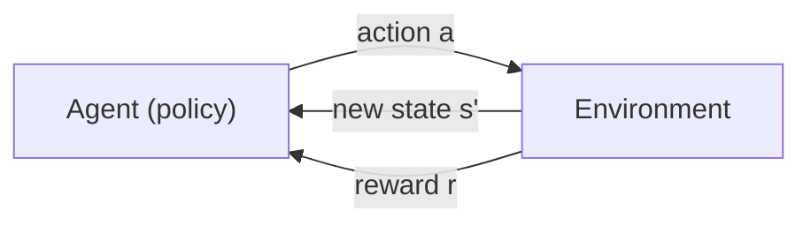
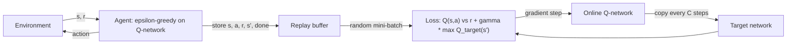
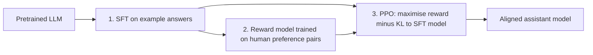

# Chapter 14 — Reinforcement Learning

Supervised learning learns from an answer key; unsupervised learning finds structure without one. **Reinforcement learning (RL)** is the third way: an agent learns *what to do* by acting, seeing what happens and collecting rewards — no answer key, just a score that often arrives late. It's how AlphaGo beat a world champion at Go, how robots learn to walk in simulation, how some recommenders decide what to try next, and how chat models such as ChatGPT and Claude were tuned to be more helpful (RLHF, §14.10).

**What you'll learn:** agent/environment vocabulary; MDPs, returns and discounting; V, Q and the Bellman equations; bandits (ε-greedy, UCB, Thompson — implemented); dynamic programming (policy/value iteration on a **gridworld** — a toy world of grid cells — and a FrozenLake-style lake); Monte Carlo vs TD; Q-learning and SARSA from scratch in numpy (no **Gym**/Gymnasium — the standard library of RL test environments — needed); DQN (PyTorch); policy gradients, actor-critic, PPO; RLHF; real-world uses and pitfalls.

All code is in `code/` (numpy, matplotlib, PyTorch). `code/gridworld.py` is a tiny environment for this chapter (lake, treasure grid, cliff walk); its action numbering (0 = left, 1 = down, 2 = right, 3 = up) matches Gymnasium. Outputs are real.

---

## 14.1 What reinforcement learning is

### What it is
An **agent** repeatedly (1) observes the **state** of its **environment**, (2) picks an **action**, (3) receives a **reward** (positive = good, negative = penalty) and a new state. Its goal is **maximum total reward over time**, not the next reward. The learned rule "in this situation, do that" is a **policy**.

| Term | Meaning | Treasure-hunt example |
|---|---|---|
| **Agent** | The learner and decision-maker | A robot, a game player, a program |
| **Environment** | Everything the agent interacts with; reacts to actions | The house, the maze, the board |
| **State** (s) | Description of the current situation | The robot's position |
| **Action** (a) | A choice available to the agent | Up / down / left / right |
| **Reward** (r) | Immediate numeric feedback | +10 treasure, −5 trap, −1 per step |
| **Episode** | One run from start to end (goal, failure, time limit) | One attempt at the maze |
| **Policy** (π) | Rule for choosing actions in each state | "In the hallway, go left" |
| **Goal** | Maximise total (discounted) reward | Reach the treasure by the best route |



Intuition: like learning to ride a bicycle — nobody hands you the right movements; **act → observe → get feedback → shift future choices** toward what paid off. A cookie-seeking robot rewarded for getting closer, or a tic-tac-toe player whose rare wins tilt it toward winning moves, are the same loop.

### How RL differs from other learning

| | Supervised | Unsupervised | Reinforcement |
|---|---|---|---|
| Data | Inputs with labels | Inputs only | Experience generated by the agent's own actions |
| Feedback | "The right answer was X" | None | "That was worth +3" — how good, not what was right |
| Timing | Immediate | — | Often **delayed** (the win comes 40 moves later) |
| Data distribution | Fixed dataset | Fixed dataset | **Depends on the policy** |
| Key challenge | Generalisation | Finding structure | Exploration and **credit assignment** (which earlier action earned the reward?) |

### Why it matters
RL fits **sequential decisions under uncertainty** where actions change what happens next: games, robot control, resource allocation (cooling, bidding, inventory), dialogue, sequential recommendation. It can discover strategies humans never wrote down (AlphaGo's "move 37").

### When not to use it
- Labelled examples of the right action exist → supervised learning (**behaviour cloning**: copy the expert) is simpler and far more data-efficient.
- Decisions don't affect future states → a **contextual bandit** (§14.4) suffices.
- No simulator and real trials are expensive or dangerous (medicine, finance) → pure **online RL** (learning by acting live) is risky; consider **offline RL** (learning only from logged data) or stay supervised.

### TL;DR
An agent learns a policy by trial and error to maximise long-run reward. Feedback is a score (not the answer), often delayed, and the agent's behaviour decides its data.

---

## 14.2 Markov decision processes, returns and discounting

### What it is
A **Markov decision process (MDP)** is the tuple (S, A, P, R, γ):
- **S** states, **A** actions.
- **P(s′ | s, a)**: **transition probability** of landing in s′ (deterministic worlds put 1 on one outcome; a slippery lake spreads it).
- **R(s, a, s′)**: reward for that transition.
- **γ** (0 ≤ γ ≤ 1): the **discount factor**.

**Markov property**: next state and reward depend only on the current state and action, not the history. If the state omits something important (a car's speed, not just position), it isn't Markov — add the information or stack recent observations (DQN stacks 4 Atari frames).

### Return and discount
The **return** from time t: Gₜ = rₜ₊₁ + γ·rₜ₊₂ + γ²·rₜ₊₃ + … = Σₖ γᵏ·rₜ₊ₖ₊₁

Why discount? Keeps sums finite for never-ending tasks; a reward now is worth more than later (like interest) and the future is uncertain. γ = 0 → only the next reward counts; γ → 1 → far-sighted. With γ = 0.9 a reward 10 steps away counts 0.9¹⁰ ≈ 0.35; rough **horizon** = 1/(1 − γ) (10 steps for 0.9, 100 for 0.99). E.g. γ = 0.5, rewards 1, 1, 1 → G = 1.75.

Key identity: **Gₜ = rₜ₊₁ + γ·Gₜ₊₁** — everything in §14.3 builds on it.

**Episodic** tasks end; **continuing** tasks (thermostat, server fleet) never do and need γ < 1 or an average-reward formulation.

### Worked example — the treasure grid
`code/treasure_grid.py`:

```
S.-..      S = start, G = treasure (+10, ends the episode)
..-..      - = trap (-5, you keep going)
...-.      every other move costs -1
.-...      (walking into the edge = you stay put, still -1)
....G
```

```python
def play(env, actions, gamma=0.9):
    s = env.reset()
    rewards = []
    for a in actions:
        s, r, done, _ = env.step(a)
        rewards.append(r)
        if done:
            break
    G = sum(gamma ** t * r for t, r in enumerate(rewards))   # discounted return
    return rewards, sum(rewards), G, done
```

```
A: right along the top, then down    rewards=[-1, -5, -1, -1, -1, -1, -1, 10]  total=-1  discounted G(gamma=0.9)=-4.03  reached=True
B: down the left edge, then right    rewards=[-1, -1, -1, -1, -1, -1, -1, 10]  total=+3  discounted G(gamma=0.9)=-0.43  reached=True
C: zig-zag through the middle        rewards=[-1, -1, -1, -1, -1, -1, -1, 10]  total=+3  discounted G(gamma=0.9)=-0.43  reached=True

random tries that reached the treasure within 30 moves: 307 / 2000
best of 2,000 random tries: total=-1  moves=RDDRRDRD
```

Path B by hand: G = −(1 + 0.9 + … + 0.9⁶) + 10·0.9⁷ = −(1 − 0.9⁷)/(1 − 0.9) + 10·0.478 = −5.22 + 4.78 = **−0.43**.

- A hits a trap; B and C tie on the best total +3 (8 moves is the minimum). Discounting keeps the ranking, but +10 eight steps away is worth only 4.78.
- **Blind trial and error is weak**: 2,000 random attempts never found a +3 route; only 15% reached the treasure. The agent must *learn from* trials — what value functions and Q-learning do.

### TL;DR
MDP = states, actions, transitions, rewards, γ. Gₜ = rₜ₊₁ + γGₜ₊₁; γ trades short- for long-term reward. Random exploration alone rarely finds the best plan.

---

## 14.3 Policies, value functions and the Bellman equations

### What it is
- **Policy** π: **deterministic** π(s) = a, or **stochastic** π(a | s).
- **State-value function** Vπ(s) = **expected** return from s following π — "how good is it to be here?"
- **Action-value function** Qπ(s, a) = expected return taking a in s, then following π — "how good is doing *this* here?" (V averages over the policy's first action; Q fixes it.)
- **Optimal** V*(s), Q*(s, a): best achievable by any policy. Knowing Q*, act greedily: **π*(s) = argmaxₐ Q*(s, a)**.

Why Q matters: choosing from V needs the transition model (one-step look-ahead); choosing from Q just compares numbers. Hence **model-free** methods (learning without P and R — Q-learning, DQN) learn Q.

### The Bellman equations
Substitute Gₜ = rₜ₊₁ + γGₜ₊₁ into the definitions:

| Equation | Formula | Used by |
|---|---|---|
| **Bellman expectation** (for a given π) | Vπ(s) = Σₐ π(a\|s) Σₛ′ P(s′\|s,a) [R(s,a,s′) + γVπ(s′)] | Policy evaluation |
| **Bellman optimality** for V | V*(s) = maxₐ Σₛ′ P(s′\|s,a) [R(s,a,s′) + γV*(s′)] | Value iteration |
| **Bellman optimality** for Q | Q*(s,a) = Σₛ′ P(s′\|s,a) [R(s,a,s′) + γ maxₐ′ Q*(s′,a′)] | Q-learning, DQN |

(V of a terminal state is 0.) In words: *value here = reward now + discounted value of where you land* (averaged over outcomes; optimal version picks the best action).

**Worked numbers** (treasure grid, γ = 0.9, deterministic): cell above G → V* = **10**; next up −1 + 0.9·10 = **8.0**; then **6.2**, **4.58**, …; the start: **−0.43** — exactly path B's return.

### TL;DR
Policy = behaviour; V = how good a state is; Q = how good an action in a state is. Bellman: value now = reward now + γ × value next. Greedy on Q* is optimal.

---

## 14.4 Exploration vs exploitation — multi-armed bandits

### What it is
The **exploration–exploitation dilemma**: **exploit** the best-known option or **explore** others that might be better? Always exploiting can lock in a mediocre choice; always exploring wastes reward.

The **multi-armed bandit** isolates it: k slot machines with unknown payoff probabilities and a single state — RL without the sequential part. Real versions: which ad banner, headline or thumbnail to show; which new item gets traffic.

**Regret** = reward from always pulling the best arm minus what you got. Good strategies make regret grow **logarithmically** (doubling time adds a fixed amount).

### The strategies
1. **Greedy**: try each arm once, then always the best average. Gets stuck on an arm that got lucky early — the error is never corrected.
2. **ε-greedy**: with probability ε (e.g. 0.1) a random arm, else the best. Simple, robust, but explores uselessly at rate ε forever (decay ε).
3. **UCB (Upper Confidence Bound)** — *optimism in the face of uncertainty*: argmaxₐ [ Q(a) + c·√(ln t / Nₐ) ], Nₐ = pulls of arm a. Rarely tried arms get a big bonus that shrinks like 1/√Nₐ. UCB1 uses c = √2 (theory, rewards in [0, 1]).
4. **Thompson sampling** — *probability matching*: keep a belief (**posterior**) over each arm's payoff — for 0/1 rewards a **Beta(wins + 1, losses + 1)** distribution over rates in [0, 1], narrowing with evidence — draw one sample per arm, pull the highest. Each arm is chosen with the probability that it's the best.

### Code — `code/bandits.py`
10 arms with **conversion rates** (chance a shown option leads to a click/purchase) from 5–35%, 3,000 pulls, averaged over 200 problems.

```python
if policy == "eps-greedy":
    a = int(rng.integers(N_ARMS)) if rng.random() < eps else int(np.argmax(q))
elif policy.startswith("UCB"):
    c = np.sqrt(2) if policy == "UCB1" else 0.3
    a = t if t < N_ARMS else int(np.argmax(q + c * np.sqrt(np.log(t + 1) / n)))
elif policy == "Thompson":
    a = int(np.argmax(rng.beta(wins, losses)))            # sample a belief, act on it
r = float(rng.random() < true_p[a])                       # conversion (1) or not (0)
n[a] += 1
q[a] += (r - q[a]) / n[a]                                 # incremental mean
```

```
policy      avg reward  % optimal arm (last 500)  total regret
greedy      0.2589       23.5%                197.0
eps-greedy  0.2948       52.4%                 89.1
UCB1        0.2554       31.5%                207.4
UCB c=0.3   0.3076       64.9%                 50.9
Thompson    0.2964       63.4%                 84.4
```


- **Greedy** locks in early: best arm in only 23.5% of problems.
- **ε-greedy** and **Thompson** learn steadily; Thompson picks the best arm most often among untuned methods, with no ε to tune.
- **UCB1**'s textbook c = √2 explores *too much* at this horizon (bonus large vs rewards ~0.2–0.3). c = 0.3 gives the lowest regret. Theoretical constants guarantee long-run behaviour, not best finite-horizon performance — tune on simulations of your traffic.

### Contextual bandits
Choose the arm using **context** (user features, time, device), e.g. **LinUCB** (a linear model per arm plus a UCB bonus). Yahoo! used LinUCB for front-page news (Li et al., 2010); Netflix describes contextual bandits for choosing artwork per member. Arguably RL's most widely deployed industrial form — simple, relatively safe, easy to measure.

### Common mistakes
- A fixed ε forever — decay it, or use Thompson/UCB.
- Ignoring **non-stationarity** (click rates drift) — sliding window or constant step size instead of an all-time mean.
- Declaring a winner from a handful of pulls.

### In the interview
**30-second answer:** "Exploration vs exploitation is using the best-known option vs gathering information about others. Bandits isolate it. ε-greedy explores randomly at a fixed rate; UCB adds an optimism bonus that shrinks with tries; Thompson samples from a posterior over each arm's reward and acts greedily on the sample. In production I'd use a contextual bandit — Thompson or LinUCB — for headline or thumbnail selection."

- *Bandit vs A/B test?* A/B splits traffic evenly until the end; a bandit shifts traffic toward winners during the test — less regret, less clean statistics.

### TL;DR
Explore to learn, exploit to earn: ε-greedy, UCB (optimism bonus), Thompson (posterior sampling). Contextual bandits are RL's biggest industrial success.

---

## 14.5 Dynamic programming — planning when the model is known

### What it is
If you **know** P and R, compute optimal values without trial and error by repeatedly applying the Bellman equations — **dynamic programming (DP)** (Bellman, 1950s).
- **Policy evaluation**: from V = 0, repeatedly replace V(s) with the Bellman *expectation* right-hand side until stable.
- **Policy improvement**: make π greedy w.r.t. V (one-step look-ahead with the model).
- **Policy iteration**: alternate evaluation and improvement until the policy stops changing; few rounds.
- **Value iteration**: apply the Bellman *optimality* (max) update sweep after sweep, then read off the greedy policy.

### Code — `code/value_iteration.py`
```python
def q_from_v(env, V, s, gamma):
    """One-step look-ahead: Q(s,a) = sum_s' P(s'|s,a) * [r + gamma * V(s') * (not done)]."""
    return np.array([sum(p * (r + gamma * V[s2] * (not done)) for p, s2, r, done in env.transitions(s, a))
                     for a in range(env.nA)])

def value_iteration(env, gamma, tol=1e-8):
    V, deltas = np.zeros(env.nS), []
    while True:
        delta = 0.0
        for s in range(env.nS):
            if env.is_terminal(s):
                continue
            best = q_from_v(env, V, s, gamma).max()      # Bellman OPTIMALITY backup
            delta = max(delta, abs(best - V[s]))
            V[s] = best
        deltas.append(delta)
        if delta < tol:
            break
    policy = np.array([np.argmax(q_from_v(env, V, s, gamma)) for s in range(env.nS)])
    return V, policy, deltas
```

**FrozenLake** (a classic toy): cross a frozen lake from S to G without falling into holes H. **Slippery**: you move the chosen way only 1/3 of the time and slide to each side 1/3. Reward 1 only at G.

```
SFFF      F = frozen (safe), H = hole (episode ends, reward 0)
FHFH
FFFH
HFFG
```

```
== Treasure grid (deterministic), gamma = 0.9 ==
value iteration converged in 9 sweeps
V*:
 -0.43   0.63   1.81   3.12   4.58
  0.63   1.81   3.12   4.58   6.20
  1.81   3.12   4.58   6.20   8.00
  3.12   4.58   6.20   8.00  10.00
  4.58   6.20   8.00  10.00   0.00
greedy policy:
vv>vv
vvv>v
v>vvv
vvvvv
>>>>G

== FrozenLake 4x4, slippery (2/3 of moves slide sideways), gamma = 0.99 ==
value iteration converged in 324 sweeps
V*:
  0.54   0.50   0.47   0.46
  0.56   0.00   0.36   0.00
  0.59   0.64   0.62   0.00
  0.00   0.74   0.86   0.00
policy:
<^^^
<H<H
^v<H
H>vG
policy iteration: 7 improvement rounds, same policy as VI: True
simulated success rate of this policy: 73.8%
a random fixed policy succeeds:         2.9%
```


- Treasure grid: values rise smoothly toward G (§14.3's numbers); the greedy policy avoids every trap.
- Lake: the optimal policy looks **strange** — from the start it presses *left*, into the wall. Slips go only sideways, so pushing against the wall means staying put or sliding down — never into a hole; top-row cells press *up* for the same reason. Optimal under uncertainty = **avoiding risk**, not the shortest path: ~74% success within 100 steps vs 3% random.
- 324 sweeps on the lake (γ = 0.99, slow propagation) vs 9 on the grid; policy iteration needed just 7 rounds.

### Trade-offs / when not to use it
DP needs the **full model** and sweeps **every state** — fine for thousands of states, impossible for Go (≈10¹⁷⁰ positions) or **continuous** states. It's what model-free methods approximate from samples.

### TL;DR
Known model → value iteration (repeat the optimality backup) or policy iteration (evaluate, act greedily, repeat) give exact optimal policies. Great for small, fully known problems.

---

## 14.6 Learning from experience: Monte Carlo vs temporal difference

### What it is
Usually P and R are unknown; **model-free** methods estimate values from sampled experience. To estimate Vπ:

| | Monte Carlo (MC) | Temporal difference, TD(0) |
|---|---|---|
| Update target | Actual return Gₜ at episode end | rₜ₊₁ + γV(sₜ₊₁) — one real reward + current estimate |
| Update rule | V(s) ← V(s) + α[Gₜ − V(s)] | V(s) ← V(s) + α[rₜ₊₁ + γV(sₜ₊₁) − V(s)] |
| When it can update | After the episode | Every step (works for never-ending tasks) |
| Bias (systematic error) | Unbiased (real return) | Biased (uses its own estimate — **bootstrapping**) |
| Variance (scatter of estimates) | High (sum of many random steps) | Low (one random step) |
| Usually | Slower, simpler | Faster in practice |

δ = rₜ₊₁ + γV(sₜ₊₁) − V(sₜ) is the **TD error** — "how much better or worse did this step go than expected?" — central to RL (and paralleled by dopamine signalling, Schultz, Dayan & Montague, 1997). α = step size. Example: V(s) = 0.5, r = 0, V(s′) = 0.6, γ = 1, α = 0.1 → δ = 0.1, V(s) = **0.51**.

Commute analogy: MC updates the trip estimate on arrival; TD updates at each landmark ("at the bridge 5 minutes late → adjust now").

### Code — `code/mc_vs_td.py` (5-state random walk)
States A–E; start at C; step left/right at random; right end +1, left end 0. True values 1/6 … 5/6.

```python
if method == "MC":        # wait until the end, then move each V(s) toward the actual return G
    for s in states:
        V[s] += alpha * (G - V[s])
else:                     # TD(0): after every step, move V(s) toward r + gamma * V(s')
    for t, s in enumerate(states):
        target = gamma * V[states[t + 1]] if t + 1 < len(states) else final_r
        V[s] += alpha * (target - V[s])
```
(Target written with the zero intermediate reward; every-visit, constant-α MC.)

```
MC alpha=0.01  RMS error after 10 eps 0.211, after 100 eps 0.094
MC alpha=0.03  RMS error after 10 eps 0.189, after 100 eps 0.090
TD alpha=0.05  RMS error after 10 eps 0.175, after 100 eps 0.037
TD alpha=0.1   RMS error after 10 eps 0.126, after 100 eps 0.058
TD estimate after 300 episodes: [0.22 0.41 0.51 0.67 0.84]  true: [0.17 0.33 0.5  0.67 0.83]
```


TD learns faster (lower **RMS error** vs true values), as in Sutton & Barto. Step-size trade-off: larger α learns faster early but leaves more noise (TD α = 0.1 plateaus above 0.05); constant α keeps jittering around the truth.

**n-step returns and TD(λ)** blend the two: n real rewards before bootstrapping (n = 1 TD, n = ∞ MC), or average all n-step targets with weights (1 − λ)λⁿ⁻¹ (λ = 0 → TD(0), λ = 1 → MC). Deep RL uses this (e.g. **GAE**, generalised advantage estimation, in PPO).

### TL;DR
MC → actual return (unbiased, noisy, waits for the end). TD → reward + γ·V(next) (bootstraps, lower variance, every step). The TD error δ drives most of RL.

---

## 14.7 Q-learning and SARSA — tabular control

### What it is
To **act** without a model, learn **Q(s, a)** with TD updates while behaving ε-greedily.

**Q-learning** (Watkins, 1989) — *off-policy*:
Q(s, a) ← Q(s, a) + α [ r + γ · maxₐ′ Q(s′, a′) − Q(s, a) ]

**SARSA** (Rummery & Niranjan, 1994) — *on-policy*, named after (s, a, r, s′, a′):
Q(s, a) ← Q(s, a) + α [ r + γ · Q(s′, a′) − Q(s, a) ], a′ = the action actually taken next.

**Off-policy**: learn about one policy (greedy — the max) while following another (ε-greedy). **On-policy**: learn the value of the policy actually followed, exploration included.

### How it works (Q-learning loop)
1. Q = 0. 2. Each episode, s ← start. 3. Choose a ε-greedily. 4. Take a; observe r, s′. 5. Update toward r + γ·maxₐ′Q(s′, a′) (0 instead of the max if s′ is terminal). 6. s ← s′ until the episode ends. 7. Decay ε over episodes.

Tabular Q-learning (one table entry per state–action pair) **converges** to Q* if every pair is visited infinitely often and step sizes decay appropriately.

### Code — `code/q_learning_sarsa.py`
```python
def train(env, method, episodes, alpha, gamma, eps_schedule, seed=0):
    rng = np.random.default_rng(seed)
    Q = np.zeros((env.nS, env.nA))
    returns = []
    for ep in range(episodes):
        eps = eps_schedule(ep)
        s = env.reset()
        a = epsilon_greedy(Q, s, eps, rng)
        total, done, trunc = 0.0, False, False
        while not (done or trunc):
            s2, r, done, trunc = env.step(a)
            a2 = epsilon_greedy(Q, s2, eps, rng)
            if method == "Q-learning":           # off-policy: bootstrap from the BEST next action
                target = r + gamma * Q[s2].max() * (not done)
            else:                                # SARSA, on-policy: from the action we WILL take
                target = r + gamma * Q[s2, a2] * (not done)
            Q[s, a] += alpha * (target - Q[s, a])
            s, a, total = s2, a2, total + r
        returns.append(total)
    return Q, np.array(returns)
```

**Part 1 — Cliff walking** (Sutton & Barto, Example 6.6): S to G along the bottom of a 4×12 grid; cells between (C) are a cliff: −100 and back to S. Each step −1; ε fixed at 0.1. **Part 2 — slippery FrozenLake**, ε decaying 1 → 0.05 over 6,000 of 10,000 episodes.

```
Q-learning avg return per episode (last 100, while exploring eps=0.1):   -51.7
greedy path learned:
>^>>>>>>>>>v
>>v>>v>>>>vv
>>>>>>>>>>>v
^CCCCCCCCCCG
SARSA      avg return per episode (last 100, while exploring eps=0.1):   -27.2
greedy path learned:
>>>>>>>>>>>v
^>>^^^^^>^vv
^^^^^^>>>^>v
^CCCCCCCCCCG

FrozenLake Q-learning policy:
<^^^
<H<H
^v<H
H>vG
greedy success rate: Q-learning 73.4% | value-iteration optimum 74.0%
```


- **Q-learning** learns the *optimal* path along the cliff edge (row 3), but while exploring a random step sometimes drops it off — worse training return (−51.7).
- **SARSA**'s values include its own random slips, so it prefers the **safe path** along the top — longer, but more reward while exploring (−27.2).
- Which is right? If exploration continues in deployment (a robot that slips), SARSA's caution helps; if acting greedily after training, Q-learning's policy is better.
- On FrozenLake, Q-learning — not knowing the slip probabilities — **rediscovers value iteration's exact policy** (73–74%), but needed thousands of episodes for what DP did from the model: **sample inefficiency**.

### Trade-offs

| | Q-learning | SARSA |
|---|---|---|
| Type | Off-policy (learns greedy policy) | On-policy (learns behaviour policy) |
| Target | max over next actions | the chosen next action |
| During training | Riskier (optimistic about its own future) | Safer |
| Learns from others' data / replay | Yes — basis of DQN, replay buffers, offline RL | Not directly |
| Known issue | **Maximisation bias** (max over noisy values overestimates; fix: Double Q-learning — one estimator selects, another evaluates) | Converges to optimal only as ε → 0 |

### Common mistakes
- Bootstrapping from a terminal state (use 0 — the `(not done)` factor). A **time-limit** truncation isn't a real terminal; ideally keep bootstrapping there.
- Never decaying ε, or decaying so fast the agent never finds the goal (with **sparse rewards**).
- Breaking ties by always taking action 0 when Q is all zeros — the agent walks into a wall forever. Break ties randomly.
- Tabular methods on large state spaces — use function approximation (§14.8).

### In the interview
**30-second answer:** "Q-learning is off-policy TD: it updates Q(s,a) toward r + γ·max Q(s′,·), learning the optimal greedy policy while exploring ε-greedily. SARSA is on-policy: it bootstraps from the action it actually takes next, so it learns the value of its exploratory behaviour and is safer — as cliff walking shows."

### TL;DR
Q-learning: off-policy, max target → optimal policy. SARSA: on-policy, target Q(s′, a′) → learns what it does, safer. Both are TD control with ε-greedy exploration.

---

## 14.8 Deep reinforcement learning — DQN

### What it is
A Q-table needs one entry per state–action pair; Atari screens or robot joint angles have far too many states. **Function approximation** replaces the table with Q(s, a; θ) — a neural network taking the state and outputting one Q-value per action, generalising across similar states.

**DQN (Deep Q-Network)** — DeepMind, Mnih et al., *Nature* 2015 — played 49 Atari 2600 games from raw pixels and score with one architecture and **hyperparameter** set, reaching human level on many. Naive Q-learning + neural net is unstable; DQN added:

1. **Experience replay**: store transitions (s, a, r, s′, done) in a large buffer; train on **random mini-batches** from it. Breaks the correlation between consecutive steps (which violates the **i.i.d.** assumption of SGD) and reuses each experience many times.
2. **Target network**: compute the TD target r + γ·maxₐ′ Q(s′, a′; θ⁻) with a **frozen copy** θ⁻, copied from the **online network** only every C steps — otherwise each update moves the target it's chasing (oscillation or divergence).

Plus ε-greedy, the **Huber loss** (less sensitive to large errors), and frame stacking for motion.



The **deadly triad** (Sutton & Barto): function approximation + bootstrapping + off-policy learning can **diverge**. DQN's tricks mitigate, not guarantee.

### Code — `code/dqn.py` (DQN on the treasure grid)
State **one-hot** encoded (25 zeros with one 1); a 64-unit MLP outputs 4 Q-values.

```python
buffer = deque(maxlen=5000)                                  # experience replay memory
...
buffer.append((s, a, r, s2, done))
batch = random.sample(buffer, min(64, len(buffer))) if use_replay else [buffer[-1]]
...
with torch.no_grad():                                        # TD target from the frozen network
    nxt = (target_net if use_target else q_net)(S2).max(1).values
    y = R + gamma * nxt * (1 - D)
q = q_net(S).gather(1, A[:, None]).squeeze(1)
loss = nn.functional.smooth_l1_loss(q, y)                    # Huber loss
opt.zero_grad(); loss.backward(); opt.step()
if use_target and steps % 200 == 0:
    target_net.load_state_dict(q_net.state_dict())           # periodic hard copy
```

```
DQN (replay + target net)                  mean return, last 50 episodes: +2.31
naive online Q-net (no replay, no target)  mean return, last 50 episodes: +2.42
greedy policy of the DQN (seed 0):
vv>>v
vv>>v
>>vvv
vvvvv
>>>>G
```


- DQN learns a trap-free 8-move route (+3; last-50 average lower because ε = 0.05 exploration continues).
- With replay it learns noticeably **faster** (each experience reused).
- On this 25-state problem the naive version also gets there. Honest takeaway: replay and target nets matter at scale — large nets, pixel inputs, long training — where naive versions oscillate or diverge.

### Beyond DQN
- **Double DQN**: select the next action with the online net, evaluate it with the target net → less overestimation.
- **Dueling DQN**: separate streams for V(s) and the **advantage** A(s, a) (how much better a is than average in s).
- **Prioritised replay**: sample large-TD-error transitions more often.
- **Rainbow** (2017): combines these and more.
- DQN handles **discrete** actions only (a max over infinitely many continuous actions is impractical); continuous control (robot **torques**) uses actor-critic methods — DDPG, TD3, SAC.

### In the interview
**30-second answer:** "DQN replaces the Q-table with a neural network trained toward r + γ·max Q(s′, ·). Experience replay, sampled at random, breaks correlations and reuses data; a target network, refreshed every C steps, stops the target moving. Discrete actions only; continuous control uses actor-critic methods like SAC or TD3."

### TL;DR
Neural Q-function stabilised by experience replay (decorrelate, reuse) and a target network (freeze the target). Discrete actions; beware the deadly triad.

---

## 14.9 Policy gradients, REINFORCE and actor-critic

### What it is
**Policy-gradient** methods learn the policy **directly**: a parameterised π(a | s; θ) (a softmax over action scores, or a net outputting a **Gaussian** over torques), improved by **gradient ascent** on expected return J(θ).

Why?
- Natural for **continuous** and huge action spaces (no max over actions).
- Can learn **stochastic** policies (rock-paper-scissors; **partial observability**, where the agent can't see the full state).
- Small parameter changes → smooth policy changes (vs a greedy argmax that can flip).

### The policy-gradient theorem, intuitively
∇θ J(θ) = E[ ∇θ log π(a | s; θ) · (return that followed) ]

*Make actions that led to high returns more likely, low returns less likely, in proportion to the outcome.* ∇ log π(a|s) is the direction raising the taken action's probability; for a softmax with scores θ[s, ·] it is (one-hot(a) − π(·|s)) — e.g. π = [0.7, 0.2, 0.1], action 0 → [0.3, −0.2, −0.1].

### REINFORCE (Williams, 1992)
1. Run an episode; record (s, a, r) each step.
2. Compute each return Gₜ.
3. θ ← θ + α · Gₜ · ∇θ log π(aₜ | sₜ; θ). (The textbook γᵗ factor is usually dropped, as in our code.)

**Problem: variance.** Gₜ depends on everything afterwards, so the gradient is very noisy. If all returns are negative (−1 per step), every action taken is pushed down and learning can lock into bad behaviour.

**Fix: a baseline.** Subtract b(s), usually a learned V(s): the **advantage** Aₜ = Gₜ − V(sₜ) ("better or worse than usual from here?"). It doesn't change the expected gradient, only cuts variance.

### Actor-critic
Use the **TD error** δ = r + γV(s′) − V(s) as the advantage:
- **actor** (policy π) chooses actions, updated by δ·∇log π;
- **critic** (value function V) judges them, updated by TD.
Every-step updates, lower variance (some bias). Variants: **A2C/A3C**, **PPO**, **SAC**.

**PPO** (Proximal Policy Optimization, Schulman et al., 2017) is the default workhorse: an actor-critic that **clips** how far each update moves the policy from the data-collecting one. With ratio ρ = π_new(a|s) / π_old(a|s) and advantage A it maximises min(ρ·A, clip(ρ, 1 − ε, 1 + ε)·A), ε ≈ 0.2 — pushing ρ outside the band earns nothing, preventing destructive steps. It was the RL algorithm in InstructGPT (2022), the RLHF recipe behind early ChatGPT. Cost: on-policy, so old data can't be reused much — more samples than replay-based methods.

### Code — `code/policy_gradient.py` (tabular softmax policy, treasure grid)
```python
p = softmax(theta[s])
a = rng.choice(4, p=p)
s2, r, done, trunc = env.step(a)
if method == "actor-critic":          # update every step using the TD error
    delta = r + GAMMA * V[s2] * (not done) - V[s]
    V[s] += lr_v * delta              # critic
    grad = -p; grad[a] += 1           # d log pi(a|s) / d theta[s]
    theta[s] += lr * delta * grad     # actor
...
# REINFORCE (after the episode), going backwards to accumulate the return
G = r + GAMMA * G
adv = G if method == "REINFORCE" else G - V[s]   # baseline version subtracts V(s)
theta[s] += lr * adv * grad
```

5 seeds, 2,000 episodes each:
```
REINFORCE           mean return: episodes 1-100 -40.96 | last 100 -7.80 | std across seeds (last 100) 21.10
REINFORCE+baseline  mean return: episodes 1-100 -42.48 | last 100 +2.75 | std across seeds (last 100) 0.08
actor-critic        mean return: episodes 1-100 -39.86 | last 100 +2.80 | std across seeds (last 100) 0.02
```


- **Plain REINFORCE** is unreliable: four seeds learn a good route, one gets stuck never reaching the treasure (−50/episode) — mean −7.8, spread 21.1. The variance problem in action.
- **Baseline** fixes it — every seed near the optimal +3.
- **Actor-critic** learns as fast with the smallest spread (lower-variance TD error).

### Value-based vs policy-based

| | Value-based (Q-learning, DQN) | Policy-based (REINFORCE, PPO) | Actor-critic |
|---|---|---|---|
| Learns | Q(s, a) | π(a \| s) | Both |
| Action spaces | Discrete | Discrete or continuous | Both |
| Sample efficiency | Higher (off-policy replay) | Lower (on-policy) | Middle |
| Stability | Can diverge (deadly triad) | High variance | Better balanced |
| Examples | DQN (Atari) | REINFORCE | PPO (RLHF, games, robotics), SAC (robotics) |

### In the interview
**30-second answer:** "Policy gradients adjust the policy's parameters so actions followed by high returns become more likely: gradient = average of ∇log π(a|s) times the return. REINFORCE uses the full return and is noisy; subtracting a baseline V(s) gives the advantage and cuts variance without bias; actor-critic uses the TD error and updates every step. PPO clips the probability ratio, making it stable enough to be the default."

### TL;DR
Push up log-probabilities of actions in proportion to outcome. REINFORCE noisy → baseline (advantage = G − V) → actor-critic (TD error) → PPO (clipped, default).

---

## 14.10 RLHF — the bridge to large language models

### What it is
**Reinforcement Learning from Human Feedback (RLHF)** tunes a pretrained language model toward responses people prefer (helpful, honest, harmless). Environment = prompt; action = the generated response (a sequence of **token** choices); reward = a model trained on human preferences.

### How it works (InstructGPT recipe, Ouyang et al., 2022)
1. **Supervised fine-tuning (SFT)** on human-written example answers.
2. **Reward model (RM)**: people compare two or more responses to a prompt (comparisons are easier and more consistent than absolute scores); train the RM to score preferred ones higher — pairwise loss maximising log σ(score_preferred − score_rejected).
3. **RL with PPO**: generate, score with the RM, update the LLM to increase reward **minus a KL penalty** (KL divergence = how different two distributions are) keeping it close to the SFT model. Without it the policy drifts into gibberish or RM exploits — reward hacking (§14.12).



### Variants you'll hear about
- **RLAIF / Constitutional AI** (Anthropic, Bai et al., 2022): an AI model guided by written principles produces the preference labels, reducing human labelling of harmful content.
- **DPO** (Direct Preference Optimization, Rafailov et al., 2023): removes the separate reward model and RL loop — optimises the policy directly on preference pairs with a classification-style loss. Simpler; popular for open models.
- **RL with verifiable rewards** for reasoning: reward = an automatic check (maths answer correct, unit tests pass). DeepSeek's **GRPO** (DeepSeekMath, 2024; used for DeepSeek-R1, 2025) is a PPO variant that samples a group of answers per prompt and scores each relative to the group (reward minus group mean, divided by group std) instead of a learned critic.

### Why it is still "RL"
Outputs change the training data (on-policy sampling), the reward is a scalar judgement not a correct answer, and credit is assigned across many tokens. All RL pitfalls apply: reward hacking (verbose or flattering answers scoring well with the RM), instability, cost.

### TL;DR
SFT → reward model from preference comparisons → PPO with a KL leash. DPO removes the RL loop; RLAIF replaces human labels with AI feedback; verifiable-reward RL powers reasoning models. Full LLM pipeline: AI book's [large language models chapter](../../../ai/chapters/04-large-language-models/README.md).

---

## 14.11 Real-world RL

| Domain | Example (publicly described) | What kind of RL |
|---|---|---|
| **Games** | **AlphaGo** (DeepMind) beat Lee Sedol 4–1 in March 2016: policy and value networks trained first on expert games, then improved by **self-play** RL, combined with **Monte Carlo tree search** (planning by simulating many future move sequences). **AlphaGo Zero** (2017): self-play alone; **AlphaZero** (2018): chess, shogi and Go with one algorithm; **MuZero** (Nature, 2020): same without being told the rules, learning its own model of the dynamics. Also DQN on Atari (2015), OpenAI Five (Dota 2, 2019), AlphaStar (StarCraft II, 2019) | Self-play, deep RL + planning |
| **Robotics** | OpenAI's Dactyl hand solved a Rubik's Cube (2019) with a policy trained entirely in simulation using automatic **domain randomisation** (randomised physics and visuals so it copes with the real hand); RL did the finger control, the face-turn sequence came from Kociemba's solver. Legged locomotion is now commonly trained **sim-to-real** | Deep RL (PPO/SAC) in simulation |
| **Recommenders** ([Chapter 13](../13-recommenders-and-embeddings/README.md)) | Yahoo! news with LinUCB (2010); Netflix artwork with contextual bandits; Spotify home shelves with bandits; RL for long-term engagement (Google's REINFORCE-based YouTube recommender, Chen et al., 2019) | Contextual bandits (most common), off-policy RL |
| **Ads & pricing** | Bandits for ad/creative selection; **real-time bidding** (a per-slot auction run in milliseconds) and **budget pacing** (spreading spend over the day) as sequential decisions | Bandits, constrained RL |
| **Operations** | DeepMind reported (2016) neural-network recommendations cut Google data-centre cooling energy by up to 40%; a 2018 follow-up controlled cooling directly | Control / RL-style optimisation |
| **LLMs** | RLHF / RLAIF for ChatGPT, Claude and others; verifiable-reward RL for reasoning models | PPO, DPO, GRPO |

The honest pattern: RL shines with a **simulator or cheap trials** (games, simulated robots) or **one-step** decisions (bandits). Full sequential RL in live products is rarer — exploration costs real money or user trust.

---

## 14.12 Pitfalls

### Reward hacking (specification gaming)
The agent maximises **the reward you wrote**, not the goal you meant. `code/reward_hacking.py` adds a "+3 bonus" tile beside the start to encourage exploration:

```
S+-..
..-..
...-.
.-...
....G
```

```
bonus tile worth +3: first 12 moves RUUUUUUUUUUU reward +36 reached treasure: False   V(start) = 30.00
bonus tile worth +0: first 12 moves RDDRDDRR     reward +4 reached treasure: True   V(start) = 0.57
```

The optimal policy steps onto the bonus and **walks into the wall forever**: bumping the edge keeps it on the tile, +3 every step — worth 3/(1 − 0.9) = 30, far more than a one-off +10. A bug in the reward, not the learner. Real cases: OpenAI's CoastRunners boat (2016) circling to hit respawning targets instead of finishing; chat models learning longer or more flattering answers score higher with the RM.

**Defences:** reward the outcome, not a **proxy** (and only once, not re-collectable); penalise side effects; constrain the policy (RLHF's KL penalty); watch actual behaviour, not just the reward curve; **red-team** the reward.

### Other pitfalls

| Pitfall | What it means | Mitigations |
|---|---|---|
| **Sample inefficiency** | Thousands of episodes for a 16-cell lake; hundreds of millions of Atari frames in some deep-RL variants | Simulators, **model-based RL** (learn an environment model and plan), replay, offline data, **imitation learning** from demonstrations to start |
| **Sparse rewards** | Only reward is at the far goal; random exploration never finds it | **Reward shaping** (intermediate rewards — carefully), **curriculum** (easy tasks first), **curiosity bonuses** (reward for new states), demonstrations |
| **Credit assignment** | Which of 200 moves earned the win? | Discounting, TD learning, advantage estimation (GAE) |
| **Instability & seed sensitivity** | Results swing between runs (plain REINFORCE's std 21) | Report many seeds with confidence intervals; target nets, clipping (PPO), normalisation |
| **Sim-to-real gap** | Policies overfit simulator quirks | Domain randomisation, **system identification** (measuring real physics), fine-tune on real data |
| **Safe exploration** | Random actions break robots or lose money | Constrained RL, safety layers, offline RL, human oversight |
| **Distribution shift (offline RL)** | The policy wants actions the logs never tried | Conservative methods (CQL, IQL); stay close to the data policy |
| **Non-stationarity** | Users, markets, opponents change | Continual learning, sliding windows, monitoring |
| **Evaluation is hard** | Can't A/B test every idea; off-policy evaluation is noisy | **IPS** (reweight logged data by how likely the old policy was to act that way) / **doubly robust** estimators, **shadow mode** (new policy runs silently alongside), staged rollouts |

### In the interview
**30-second answer** ("When would you use RL, and what goes wrong?"): "When decisions are sequential and change future states, and I can simulate or safely experiment — otherwise supervised learning or a contextual bandit is simpler. Typical problems: reward hacking, sample inefficiency, sparse rewards, seed instability, sim-to-real gap. I'd start with a bandit or offline evaluation, design and audit the reward carefully, and roll out in stages with **guardrails**."

- *Bandit or full RL for a recommender?* Contextual bandit for the immediate response; full RL only if you can model long-term effects (retention) and evaluate off-policy credibly.
- *Evaluating before launch?* Simulation; off-policy evaluation (IPS, doubly robust) on logs with known **propensities** (probability the logging policy chose each action); shadow mode; small **canary** traffic.

---

## Chapter TL;DR
- **RL**: state → action → reward + next state; maximise discounted return; feedback evaluative and delayed; behaviour shapes data.
- **MDP** (S, A, P, R, γ); Gₜ = rₜ₊₁ + γGₜ₊₁; γ sets the horizon.
- **V, Q, Bellman**: value = reward now + γ × value next; greedy on Q* is optimal.
- **Bandits**: ε-greedy, UCB, Thompson; contextual bandits are RL's biggest industrial use; tune exploration for your horizon.
- **DP** (model known): value/policy iteration — solved the slippery lake exactly (≈74%, "hug the wall").
- **MC vs TD**: actual return (unbiased, noisy) vs bootstrapped target (lower variance, every step).
- **Q-learning** (off-policy, optimal, risky while exploring) vs **SARSA** (on-policy, safer cliff path).
- **DQN**: neural Q + replay + target network; discrete actions.
- **Policy gradients**: REINFORCE → baseline → actor-critic → PPO.
- **RLHF**: SFT → reward model → PPO with KL leash; DPO, RLAIF, verifiable-reward RL (GRPO).
- **Pitfalls**: reward hacking, sample inefficiency, sparse rewards, seed instability, sim-to-real, unsafe exploration.
