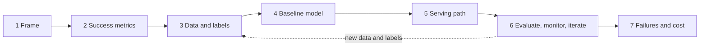

# Chapter 15 — ML System Design: The Interview Framework

"Design YouTube's recommendations." "Design a fraud detector." "Add AI to our support desk." These now sit beside "Design Twitter" in system design loops, and are asked of ordinary **backend engineers**, not only ML specialists. Everything about load balancers, caches, queues and databases still applies ([System Design Fundamentals](../../../system-design-patterns/modules/00-system-design-fundamentals/README.md)). The new part: one box **learns from data** — its output can be wrong while the request succeeds, its quality can decay while the code is unchanged, and each call may cost real money.

This chapter gives a repeatable 45-minute method: the five question forms and role expectations; four classic assumptions that break; three question families (predictive, generative, agentic); a seven-step framework (frame → success metrics → data → baseline → serving → keep-it-working → failures and cost); turning a **business goal** into an **ML objective**; scoping a vague question (capstone); the mistakes that sink answers. Chapter 16 goes deep on each production block (training pipelines, feature stores, serving, evaluation, monitoring, A/B tests, **MLOps** — practices and tooling for running ML in production).

Code is in `code/`; outputs are real.

---

## 15.1 ML design vs classic system design

### What it is
An **ML (or AI) system design question** asks for a product in which at least one component is a **model** — a function learned from data rather than written as rules — mapping an input (watch history, a transaction, a question) to an output (score, label, number, text).

| Term | Meaning | Example |
|---|---|---|
| **Training** | Fitting or updating the model from data; usually a background job separate from user traffic | Nightly job learning from yesterday's orders |
| **Inference** | Running the trained model on an input | Scoring one transaction at checkout |
| **Online inference** | Inference inside a live request; must meet its latency limit | Fraud score before a payment is approved |
| **Batch inference** | Inference over many inputs in a scheduled job; results stored | Tonight's recommendation lists for every active user |

A model is like a new hire who learned from past examples: you still need an office (infrastructure), checks on their work (evaluation), a way to notice decline (monitoring), a budget (cost) and a plan for mistakes (fallbacks). Model internals help, but the round mostly grades the **whole system** — candidates who spent weeks on attention and loss derivations often freeze at "where does the training data come from?" or "what if the model times out?".

### The five forms of the question


*Figure — Five shapes of AI design prompts (course diagram)*

| # | Form | Example prompts | What to emphasise |
|---|---|---|---|
| 1 | **Known ML product** | "Design YouTube recommendations", "Design search autocomplete" | Data, features, training, serving, evaluation, feedback loop |
| 2 | **GenAI product** | "Design ChatGPT", "Design a docs Q&A assistant" | Retrieval, context assembly (building the text sent to the model), inference cost, output evaluation, safety |
| 3 | **Add AI to an existing system** | "Our store runs fine — which part should get AI?" | Whether AI is needed at all, one useful feature, simplest viable design |
| 4 | **Design an agent** | "An agent that books travel" | Tool permissions, approvals, step/cost limits, stop conditions, task-success evaluation |
| 5 | **Critique / scale an AI design** | "Our RAG system is slow and wrong — fix it" | Diagnose with measurements, logs and failed examples *before* changing anything |

Terms: a **feature** is one input to the model (watch history, hour); the **feature pipeline** computes and delivers them; the **feedback loop** collects outcomes to evaluate and improve. **GenAI** = generative AI. **LLM** = large language model. **RAG** = retrieval-augmented generation (put relevant fetched documents in the model's input — grounds answers, doesn't guarantee correctness). **Fine-tuning** = extra training of an existing model for a narrower task.

### Who gets asked what
Depth varies by role and company — **ask**.

| Role | Forms to prepare | Depth expected |
|---|---|---|
| Software engineer (senior+) | 2, 3, sometimes 1 | Architecture, serving, cost, failure handling; model inputs/outputs/limits |
| ML engineer | 1, 2, 5 | Above + model choice, features, training pipelines, evaluation metrics |
| AI / ML platform engineer | 2, 4, 5 | Inference infrastructure: GPUs, batching, caching, latency under load |
| Engineering manager / staff+ | 3, 5 | Build vs buy, cost limits, ownership, risk, gradual rollout |

First-minute question: *"Would you like me to go deep on model development, or on the system that serves and maintains the model?"*

### What interviewers grade (and what they don't)

| Graded | Usually secondary |
|---|---|
| **Requirements discipline** — users, latency, quality measure, out of scope, numeric assumptions | Deriving the transformer or backprop by hand |
| **A complete loop**, not just the request path — outcomes come back and improve the system | Naming this month's newest model |
| **Cost and latency realism** — assume, estimate, optimise | Framework trivia without saying why a component is needed |
| **Failure honesty** — a model can be confidently wrong with HTTP 200; detection, **blast-radius** limits (how much one failure can damage), fallbacks | |

### How it works — four assumptions that break when a model enters


*Figure — Serving path on top, improvement loop underneath (course diagram)*

Contrasts, not absolutes — but where incomplete AI designs fall down.

| # | Classic assumption | What changes with a model | Design response |
|---|---|---|---|
| 1 | **Correctness is binary** (a payment is right or a bug) | Quality is a spectrum: a recommendation can render fine and be irrelevant | **Quality metrics** (CTR — clicks ÷ impressions, resolution rate, suggestion-acceptance) *alongside* latency and availability **SLOs** (service-level objectives); log predictions and join them with later outcomes |
| 2 | **The code is the behaviour** | Behaviour depends on data. **Drift** — change in input patterns or the input→outcome relationship — degrades an unchanged model (new fraud tactics, changed tastes) | Feedback process: collect outcomes, investigate quality changes, evaluate candidate vs current, release gradually with rollback. Retrain on evidence, not on every alert |
| 3 | **Compute is cheap** | A model call can cost orders of magnitude more than a DB read, depending on model size, input/output length, hardware and utilisation | Put a number on it: 10M requests/day × $0.01 = $100,000/day ≈ $3M/month (illustrative). Then caching (when permissions/freshness allow), routing easy requests to a smaller model (if it meets the quality bar), batch precompute |
| 4 | **Failures are loud** (500s, timeouts) | A wrong answer arrives as `200 OK`: invented citation, missed fraud, harmful text | Treat user text and retrieved text as possibly hostile (**prompt injection** — untrusted text overriding instructions — can't be fully filtered; enforce permissions outside the model), check outputs, human approval for high-impact actions, fallbacks (unpersonalised results, hand-off to a human) |

For every design ask: **"Who is hurt by a wrong output, and what limits the damage?"**

### Build, host, or call an API?

| Option | Pros | Cons / what you still own |
|---|---|---|
| **Hosted API** (pay per use) | Fastest launch, no GPU fleet | Data-handling terms, rate limits, provider availability, per-call cost at scale; you still build integration, evaluation, monitoring. Poor fit under strict **data-residency**/sensitivity rules, very high steady volume, or latency the provider can't meet |
| **Self-host open-weights model** (weights downloadable under a licence) | Control over data, deployment, latency; can be cheaper at high, steady utilisation | Capacity, security, upgrades, on-call, often GPUs; savings not guaranteed |
| **Train / fine-tune your own** | Needed when your interaction data is the product (ranking, fraud, recommendations); fine-tuning can help a narrow generative task | Data preparation, training infra, ongoing maintenance |

Options overlap (fine-tune, then managed hosting). Compare on quality, data sensitivity, volume, latency, total cost and team skills; start simplest and say what evidence would make you switch.

### Trade-offs
Going ML at all is a trade-off. Google's *Rules of ML*: **Rule #1: don't be afraid to launch without ML** — a **heuristic** (hand-written rule of thumb) may suffice to start, gives a baseline, and produces the data you'll learn from. **Rule #3: choose ML over a complex heuristic** — once rules become a tangle, a model is easier to maintain.

### Common mistakes
- Answering an SWE design question like a research talk (15 minutes on fine-tuning, nothing on serving or evaluation).
- Drawing only the request path — no logging, outcome join, retraining or evaluation loop.
- Assuming model calls are free or cache-fast.
- Treating thumbs up/down as trustworthy training labels.
- Claiming a fixed traffic share can go to a small model without evidence.

### Real-world examples
**Netflix, YouTube, TikTok** feeds (form 1); **GitHub Copilot**-style assistants measured by suggestion acceptance and **retention** (form 2); **Stripe Radar**, a fraud model inside an existing payments flow (form 3 in spirit); support agents issuing refunds through limited tools (form 4).

### In the interview
**30-second answer** — *"What changes compared with an ordinary backend service?"* → *"Distributed-systems fundamentals still hold. I add quality metrics beside latency and uptime SLOs; a loop that notices when quality slips and tests any new version before a staged rollout; a budget for per-call latency and spend; and safeguards for bad outputs — validation, fallbacks, human review where stakes warrant."*

- **"What do you mean by quality?"** → Feed: CTR plus a longer-term signal (watch time, return visits). Fraud: **precision** (share of flagged that is fraud) and **recall** (share of fraud flagged) at the chosen threshold. Support: correct resolution rate plus **CSAT** (customer-satisfaction score) and repeat-contact rate.
- **"Would you fine-tune?"** → Not first. Check whether an existing model with good instructions (plus retrieval for private data) meets quality and cost on an evaluation set; fine-tune only for a measured gap simpler changes don't close.
- **"Assume the model exists."** → Spend the time on integration, serving, cost, evaluation and feedback.

### TL;DR
Classic design still applies; a model adds **quality measurement, drift, cost, and silent failure**. Five forms; confirm depth. Graded: requirements, full loop, cost/latency realism, failure honesty. Build vs host vs API is requirements-driven — start simplest.

---

## 15.2 The three question families

### What it is
Classify what the system mainly **produces**:

| Family | The model produces… | Typical questions | Focus of your answer | Classic failure |
|---|---|---|---|---|
| **1. Predictive** | A score, number or label the system acts on | Recommendations, feed/search ranking, ads CTR, fraud/spam, ETA, churn | Data & features, candidate generation + ranking (cheap shortlist, then careful ordering), offline & online metrics, feedback loop | Picking a model ("an LLM ranks the feed") without data, latency or cost reasoning |
| **2. Generative** | Content: answer, summary, code, image | ChatGPT-style assistant, docs bot, code assistant, meeting summaries | Retrieval & context assembly, inference latency/cost (streaming, caching, routing), output evaluation, safety | Training a foundation model from scratch; ignoring cost; no quality measurement |
| **3. Agentic** | Which **action** to take next (call a tool, read result, decide again) | Refund-issuing support agent, travel booking, coding agent opening PRs | Tool interface & permissions, step/time/cost limits, stop conditions, approval for risky actions, task-level evaluation | Unlimited tools and no stop rule — or human approval for every harmless step |


*Figure — Predictive, generative and agentic compared (course diagram)*

Terms: **label** = the target to predict. **Pretrained** = trained before your task. **Foundation model** = large model trained on broad data, adaptable to many tasks. **Token** = the text chunk an LLM reads/writes (word, fragment, punctuation). **Hallucination** = false or unsupported generated content. **Streaming** = showing output as it's generated. **Model routing** = picking which model handles a request by difficulty/cost.

"Design an AI shopping experience" and "Design fraud detection" need different designs, metrics and risks — classifying early avoids 30 minutes on the wrong system.

### How it works — the output test
1. Does the system mainly output a **prediction, content, or an action**?
2. If vague, state your read and confirm.
3. Mixed products → split into subsystems (a streaming service ranks the homepage — predictive — and writes "why you might like this" blurbs — generative; a support platform routes tickets, drafts replies, issues refunds via an authorised tool — all three).
4. Name each subsystem and its interfaces, and ask which to go deep on — usually the riskiest.

This book focuses mostly on **family 1**; the AI Handbook covers LLM serving, RAG and agents. The framework works for all three.

### Common mistakes
- An LLM for everything, e.g. one call per item to rank a 50M-item catalog (ignores personalisation data, evaluation, latency, cost). Sensible LLM roles are narrower — offline item enrichment, reordering a short list of finalists (~top 50) — and even then benchmark against a learned ranker on quality, speed and spend.
- Multi-agent designs when a fixed workflow would do (known steps → hard-code them).

### In the interview
**30-second answer** to an unclear prompt: *"First, what does the system output? A ranking or score puts my time on data, features and evaluation. Generated text shifts it to context, per-call spend and answer quality. Actions put tools, permissions and limits at the centre. My read is this is mostly ranking items per user — shall I go that way?"*

- **"It's all three."** → List subsystems and interfaces, go deep on the riskiest ("wrong refunds cost money"), let the interviewer redirect.
- *"Summarise tickets and auto-close duplicates" — family?* → Generative plus a small agentic part (closing) needing permission and review rules.

### TL;DR
Predictions → data/features/metrics. Content → context/cost/quality/safety. Actions → permissions/limits/oversight. Mixed: split, connect, pick a focus.

---

## 15.3 The seven-step framework

### What it is
A fixed order of decisions so requirements and data drive the architecture. It's the classic structure (requirements → estimates → API → high-level design → deep dive → wrap-up) with two ML concerns made explicit: **define quality early** and **show how the system keeps working after launch**.


*Figure — Seven steps with their guiding questions and minutes (course diagram)*

| Step | Question it answers | Minutes (45-min round) |
|---|---|---|
| 1. Frame the problem | What family, what known system does it resemble, what's in/out of scope? | 3 |
| 2. Define success | Quality, latency, scale and cost targets? | 5 |
| 3. Map the data | Sources, label origin, required freshness? | 5 |
| 4. Pick the model | Simplest baseline, and what would justify upgrading? | 5 |
| 5. Design the serving path | Offline vs per request, caches, cheaper paths, failure handling? | 12 |
| 6. Keep it working | How are outcomes logged, quality measured, changes evaluated and rolled out? | 8 |
| 7. Count failures and cost | What breaks, what controls exist, cost vs budget? | 5 |
| Buffer | Questions | 2 |

The same structure is in Aminian & Xu's *ML System Design Interview* (clarify requirements → frame as ML task → data preparation → model development → evaluation → deployment/serving → monitoring) and Chip Huyen's *Designing ML Systems* lifecycle (scoping → data engineering → model development → deployment → monitoring and continual learning → business analysis). Any wording; cover every step. Shift time toward data/models for predictive, inference/context for generative, permissions for agents.



### Step 1 — Frame the problem (and frame it as an ML task)
1. **Name the family** (output test).
2. **Name the known system** it resembles ("a recommender where items are podcasts") and say which requirements differ — don't paste a memorised design.
3. **State scope**: "English text support first; voice and other languages later. OK?"
4. For predictive problems, **frame as an ML task** (Aminian & Xu's step 2):
   - **Input and output** (input = user, video, context; output = P(user watches ≥ 30 s)).
   - **ML category**: binary/multiclass classification, regression, ranking (learning-to-rank), retrieval, clustering, or generation.
   - **ML objective**: what the model optimises, chosen because it moves the business metric.

**Business metric → ML objective (worked examples)**

| Business goal / metric | ML task | ML objective (what the model predicts) | Why not the obvious one |
|---|---|---|---|
| Increase time spent on video platform | Ranking | P(watch ≥ X seconds) or expected watch time | Raw clicks reward clickbait (watch-time objectives risk short-clip bias — guard with surveys, retention) |
| Reduce fraud losses without annoying customers | Binary classification | P(fraud) → thresholds set by expected cost | Accuracy is meaningless at 0.2% fraud |
| Accurate delivery promise at checkout | Regression | Minutes from order to delivery | Business also needs a *promise-kept rate*, handled by a display buffer, not the model |
| Improve marketplace search revenue | Ranking | P(purchase \| query, item), possibly × price | Relevance-only ranking may ignore **conversion** (view → purchase) |
| Reduce subscription churn | Binary classification | P(cancel within 30 days) | Label arrives 30 days late — shapes monitoring |

*Rules of ML*: **Rule #12 — don't overthink which objective you directly optimise** at first; **Rule #13 — pick a simple, observable and attributable metric** for the first objective (a click is attributable to the item shown; "user happiness" is not).

### Step 2 — Define success
Numbers; state assumptions when not given.
1. **Quality** — a *business/online metric* plus a correlated *offline ML metric*:
   - "Users find videos they enjoy" → online: watch time, CTR, with **guardrails** (metrics that must not worsen: satisfaction surveys, policy-violating content); offline: NDCG / recall@k (Chapter 13) on **held-out** interactions.
   - "Helpful support bot" → correct resolution rate, CSAT, repeat-contact rate.
2. **Latency** — a feed in a few hundred ms; a chatbot has a **time-to-first-token** target *and* a full-answer target; a batch job has a completion deadline and freshness target. Latency decides what must be precomputed.
3. **Scale and cost** — users, requests/day, **peak QPS** ([System Design Fundamentals](../../../system-design-patterns/modules/00-system-design-fundamentals/README.md)), cost per request or per *completed task*. A free feature needs tiny per-request cost; a support bot can cost more if it really resolves tickets. A concrete budget, never "near zero".

Rules of ML **#2: design and implement metrics first** — log what you'll need before building.

### Step 3 — Map the data
Sources: interaction logs, catalog/content, user profiles (where permitted), documents for generation. Then:
1. **Label source** — often late or imperfect:
   - Fraud: confirmed investigations and **chargebacks** (disputed card payments reversed) — weeks late, and not every chargeback is fraud.
   - Feeds: clicks — instant but only a **proxy** for satisfaction.
   - Support: reviewed conversations, verified resolutions; a thumbs-down is feedback, not a correctness label.
   - **Self-supervised learning** (labels made from the data itself, e.g. next word) and pretrained models reduce hand-labelling, but you still need labelled *evaluation* data.
2. **Freshness** — daily for long-term tastes; minutes or seconds for trending content and fraud. Decides batch vs **streaming** (continuous event processing) vs request-time computation.

Name **feature groups** (entity, recent-behaviour aggregates over time windows, request context, cross features such as user × category — §16.4) and flag **leakage** (features unavailable at prediction time) and **privacy** limits.

### Step 4 — Choose a model, beginning with a baseline
A **baseline** is the least elaborate approach meeting basic requirements: it tests the pipeline end to end and is the yardstick for everything later (*Rules of ML #4: keep the first model simple and get the infrastructure right*) — and sometimes it's good enough.

| Family | Baseline | Upgrade path | Trigger to upgrade |
|---|---|---|---|
| Predictive | Popularity / rules / per-entity averages; logistic regression | GBDT on tabular features → deep models (two-tower retrieval, multitask rankers — Chapter 13) | Baseline misses the offline target and the gain is worth the complexity |
| Generative | Existing model + clear instructions; add retrieval for private/fresh data | Better retrieval, model routing, fine-tuning | Evaluation shows a failure prompts/retrieval don't fix |
| Agentic | Fixed workflow if steps are known; else one agent with a few narrow tools | More tools, then multiple agents | Separation clearly helps and justifies coordination cost |

Always state the condition: *"If the baseline misses the target, I'll compare a GBDT on the same held-out weeks."*

#### Code — baseline first (`code/baseline_first.py`)
Synthetic delivery-time task: naive baseline → heuristic → GBDT, then model error → the business metric "orders delivered within the promised time" via a display buffer.

```python
# 1) naive baseline: everyone gets the global average
rows.append(report("global mean", yte, np.full(len(yte), ytr.mean())))

# 2) heuristic: per-restaurant average + a distance term (shippable in a week)
rest_avg = {r: ytr[Xtr[:, 0] == r].mean() for r in np.unique(Xtr[:, 0])}
resid = ytr - np.array([rest_avg[r] for r in Xtr[:, 0]])
dist_fit = LinearRegression().fit(Xtr[:, [1]], resid)
heur = np.array([rest_avg.get(r, ytr.mean()) for r in Xte[:, 0]]) + dist_fit.predict(Xte[:, [1]])

# 3) learned model: gradient-boosted trees on all features (restaurant id as categorical)
gbdt = HistGradientBoostingRegressor(random_state=0, categorical_features=[0]).fit(Xtr, ytr)
pred = gbdt.predict(Xte)

# business metric: % of orders that arrive within (prediction + buffer)
kept = [(yte <= pred + b).mean() * 100 for b in buffers]
```

```
model                           MAE  p90 abs err
global mean                    9.80        19.92
restaurant avg + distance      5.11        10.45
GBDT (all features)            2.54         5.31

buffer (min) -> promise kept % / avg promised minutes   [GBDT]
  + 0 min ->  49.6%  /  37.8
  + 3 min ->  82.7%  /  40.8
  + 5 min ->  93.9%  /  42.8
  + 8 min ->  99.2%  /  45.8
```


- (MAE in minutes; **p90 abs err** = error size 90% of predictions stay within.) Every number is judged **against a baseline**: heuristic halves naive error, GBDT halves it again (synthetic data — real gains are usually smaller).
- An unbiased regressor's errors are roughly symmetric, so it's late **half the time** (49.6% kept). The business metric depends on a **product decision** (the buffer): +5 min keeps ~94% but makes the ETA look slower. Keep that knob outside the model so product owns it.

### Step 5 — Design the serving path
Draw the architecture and trace one request. Whatever the shape, answer four questions:


*Figure — Step 5 checklist: offline/online, caches, model choice, failure (course diagram)*

1. **Offline or online?** What can be precomputed vs needs request-time data (§16.5)?
2. **Where are the caches?** Latency/cost saved, freshness, **invalidation**, and **permission** rules so no user sees another's cached result.
3. **Which requests can take a cheaper path** (smaller model, cached answer, rule)?
4. **What if the model is slow, down or rate-limited?** Timeouts, bounded retries (only when safe), a fallback (previous model, cached score, heuristic, unpersonalised list) or a clear failure; for batch, deadlines and recovery.

A typical predictive design for a large catalog is a **funnel**:


### Step 6 — Keep it working (evaluation, monitoring, iteration)
Show the feedback process **in the diagram**:
1. **Log** inputs, outputs, features used and model version (privacy controls, retention limits).
2. **Capture outcomes**: clicks, ratings, escalations, confirmed fraud, actual delivery time.
3. **Measure** step-2 metrics on live outcomes and human-reviewed samples.
4. **Improve** data, features, retrieval, prompts or model.
5. **Release safely**: offline evaluation → **shadow deployment** (new version scores copied traffic, outputs hidden, side effects disabled) and/or **A/B test** → gradual ramp with explicit stop/**rollback** conditions.

| | Offline evaluation | Online evaluation |
|---|---|---|
| Data | Held-out historical data (time-based split) | Live users |
| Metrics | ML metrics: PR-AUC, NDCG, recall@k, MAE, **calibration** (predicted probabilities match real frequencies) | Business metrics: CTR, watch time, revenue, resolution rate + guardrails |
| Cost / risk | Cheap, no user risk | Real traffic; needs time and **statistical power** |
| Blind spots | Proxy labels, feedback loops, serving-time degradation | Slow, noisy, needs good experiment design |
| Role | Filter candidates | Decide the launch |

(Details §16.7, §16.9.) Monitoring in one line: system health → input feature distributions → prediction distributions → outcome quality (as labels arrive), sliced per segment. Retrain on a schedule justified by measured decay or after an investigation — never auto-promote because an alert fired.

### Step 7 — Failure modes and the bill
**Failure list** specific to your system — unsupported answers, drifting data, unsafe actions, feedback loops reinforcing bad behaviour (clicks-only → clickbait) — each with a control (thresholds, quality monitors, content checks, permission limits, a **kill switch** to turn the feature off) and what the control *cannot* guarantee.

**Cost** ≈ requests × share hitting each model × calls per request × cost per call, plus retrieval, storage, retries and human escalation.

#### Code — napkin math (`code/napkin_math.py`)
```python
def qps(per_day, peak_factor=3.0):
    avg = per_day / 86_400
    return avg, avg * peak_factor

def model_cost_per_day(requests_per_day, share, calls_per_request, cost_per_call):
    return requests_per_day * share * calls_per_request * cost_per_call
```
```
10M req/day -> avg 116 QPS, peak ~347 QPS (3x peak factor assumed)
all requests x $0.01        -> $100,000/day, $3,000,000/30-day month
20% to large model x $0.01  -> $20,000/day (excludes small model, retrieval, retries)
support: 40,000 conversations/day x $0.10 = $4,000/day model cost
  compare per resolved issue, not per call: human ticket assumed $4.00
  resolve 30%: expected cost/ticket $2.90 vs $4.00 human-only
  resolve 50%: expected cost/ticket $2.10 vs $4.00 human-only
  resolve 70%: expected cost/ticket $1.30 vs $4.00 human-only
precompute 25M users x 500 recs = 12.5B rows; active-only (5M) = 2.5B rows
```
The habit is the **unit**: cost *per resolved issue* (AI cost + human cost for the unresolved share), not one model call vs one human ticket. All prices are illustrative assumptions.

> Short on time? Steps 6–7 in two sentences: *"Every prediction is matched to its eventual outcome; when quality moves I dig in, and any new version passes offline tests, then shadow or **canary** (a small slice of real traffic), before a staged ramp — with cost per request on the dashboard. The two risks I'd watch hardest are X and Y."*

### Trade-offs of the framework
| Benefit | Cost |
|---|---|
| Decisions follow requirements and data | Feels slow if the interviewer wants the diagram — state assumptions in one sentence each and jump to step 5 |
| You don't forget evaluation/monitoring/cost | Following it rigidly when steered elsewhere looks robotic — adapt order and depth |

### When not to use it rigidly
- "Skip to the architecture": state quality and latency as assumptions, draw, revisit requirements when they change a choice.
- "You have 10 minutes": scope, main architecture, biggest risk, cost — one sentence each on quality target, data, evaluation.

### In the interview
**30-second opener**: *"Plan: agree the task and boundaries; put numbers on quality, latency and spend; find the data and label source. Then a baseline and the serving path. I'll close with evaluation, safe rollout, failures, and cost. To start — this reads like a ranking problem…"*

- **"Why a baseline if GBDT will win?"** → Validates pipeline and logging, gives a number to beat, sometimes good enough (Rules #1, #4).
- **"What's your ML objective?"** → Name the target, how it moves the business metric, the proxy risk and the guardrail that catches it.
- **"How will you know it works after launch?"** → Four monitoring layers, outcome join, per-segment quality, drift alerts → investigation, gated retraining.

### TL;DR
Frame (3) → Success (5) → Data (5) → Baseline (5) → Serving (12) → Keep it working (8) → Failures & cost (5). Observable ML objective, beat a baseline, show the loop, price it.

---

## 15.4 Capstone — scoping a vague AI question

### The exercise
Hypothetical prompt (numbers are assumptions):

> "We're a food-delivery company: ~25 million monthly users, 500,000 orders a day. Leadership wants AI to improve customer experience. Design something."

Feature, metric and family are unspecified. The first ten minutes turn this into an agreed, measurable problem — not an architecture.

### Step A — Generate options by family, then choose

| Family | Options |
|---|---|
| Predictive | ETA prediction; restaurant/dish recommendations; fraud on refund claims; predictions feeding courier assignment (assignment itself also needs optimisation/rules) |
| Generative | Support assistant for order status and refund policy; AI-written dish descriptions; review summaries |
| Agentic | "Dinner for four under $60" assistant that places an order after checks and confirmation |

Choose on **impact × feasibility × risk** (feasibility = can the team build and run it with available data, time, people):
- **ETA** — touches every order; delivered orders give labels (check completeness).
- **Support assistant** — savings show directly in support spend; order records and policy documents likely exist; risk limited by restricted actions and escalation.
- **Ordering agent** — spends users' money; needs payment authorisation, confirmation, cancellation. Feasible, more controls.

No universally right pick — state your preference under these assumptions and what would change your mind.

### Step B — Framework opening (support assistant chosen)
1. **Quality**: primary = *correct resolution without escalation*; plus CSAT and repeat contacts (closed ≠ fixed). Human ticket assumed $4. Target: resolve ≥ 50% of eligible **tier-1** tickets (order status, coupons, simple cancellations) with CSAT no worse than humans. Explaining the cancellation policy differs from *cancelling* — actions need their own authorisation and rule checks.
2. **Latency**: stream; p95 (95% of requests meet it) time-to-first-token ≤ 1 s, p95 completion ≤ 5 s for short answers; tool calls may get separate targets.
3. **Scale and cost**: 500,000 orders × 8% contact rate = **40,000 conversations/day** (average; peaks and repeats separately). 10 calls × $0.01 → $0.10/conversation → **$4,000/day**. Compare *total cost per correctly resolved issue* (retrieval, infrastructure, retries, escalations included).
4. **Out of scope**: voice, non-English. Refunds above an assumed $10 go to a human; smaller ones still need identity, eligibility and duplicate-payment checks enforced **outside** the model.

### Step C — Classify and preview the shape
*"At its core this generates answers grounded in order data the user may see and retrieved policy text. A refund tool adds an agentic slice, so reading data and moving money get separate safeguards. Deep dives: retrieval accuracy, answer grading, cost per conversation, and backend checks guarding refunds ≤ $10."*

### Sample opening (paraphrased dialogue)
- **Interviewer:** "Use AI to improve customer experience."
- **You:** "Three candidates: ETA prediction, a support assistant, or an ordering agent — the agent needs payment and confirmation controls. I'd start with support: savings are measurable against current support costs and we likely have order data and policies. Support, or ETA?"
- **Interviewer:** "Support works."
- **You:** "Target: correctly resolve at least half of eligible routine tickets, CSAT at least human-level, no rise in repeat contacts. 500k orders × 8% ≈ 40k conversations a day. p95 first output within 1 s, completion within 5 s. Ten one-cent calls is ten cents a conversation before retrieval and infrastructure, so we track total spend per issue actually resolved. V1 skips voice and non-English. Refunds above $10 go to a person; smaller ones still pass authorisation and policy checks. So: answer generation over orders and policies plus a refund action; deep dive on retrieval, grading, spend and guarding the action — agreed?"

### Now you (10 minutes each, out loud)
Cover options by family, one choice with reasons, quality/latency/scale/cost targets with assumptions flagged, scope, family and key decisions.
1. "Our music-streaming app wants listeners to discover more. Where does AI help?"
2. "Bank leadership wants something AI-powered in the mobile app." (Weigh the damage of a wrong output: personal money advice is far riskier than explaining a purchase's category; forecasts and fraud warnings still need watching. No family is automatically safe — say what it may do, must not do, and when a human reviews.)
3. "Candidates and jobs on our job board are poorly matched. Fix it with AI."

### TL;DR
Vague prompt → options by family → choose on impact, data, feasibility, risk → quality/latency/scale/cost numbers in comparable units → confirm scope, family, key decisions.

---

## 15.5 Common mistakes (the whole interview)

| Mistake | Better |
|---|---|
| "I'd use a transformer" in minute 2 | Frame, success and data first; baseline before deep models |
| Optimising a proxy with no guardrail (clicks → clickbait) | Pair the objective with guardrails (satisfaction, retention, policy violations) |
| "We'll have labels" | Where from, how late, how noisy, who pays |
| Random train/test split on time-dependent data | Time-based split; **point-in-time-correct** features (only data available at that moment) (Rules of ML #33) |
| Accuracy on imbalanced data | Precision/recall at a threshold, PR-AUC; threshold owned by product/risk |
| No fallback | Timeouts + fallback prediction agreed with product and risk owners |
| Only the request path | Logging → outcome join → evaluation → gated retraining → staged rollout |
| Training features computed differently from serving | One feature definition; log serving features and train on them (Rules of ML #29, #32) |
| "GPU cluster" for a small tabular model | Benchmark on CPU first |
| Auto-retraining on every drift alert | Alert → investigate (often a broken pipeline) → validated retrain → gates |
| Hand-waving cost | Requests × share × calls × price, per completed task |
| Ignoring the interviewer's redirect | The framework is a checklist, not a script |

## Chapter TL;DR
- ML design = classic system design **plus** quality metrics, a data/label story, baseline-first modelling, a feedback loop, cost realism.
- Identify the **form** and the **family** (prediction, content, action) in the first minute; confirm depth.
- Seven steps in ~43 minutes: frame (3), success (5), data (5), model (5), serving (12), keep-it-working (8), failures and cost (5).
- Business metric → observable ML objective; product knobs (buffers, thresholds) outside the model.
- Numbers mean something only next to a baseline; every design needs a fallback; cost goes in the same unit as benefit.
- Next: Chapter 16 builds each production piece and assembles an ETA platform.
