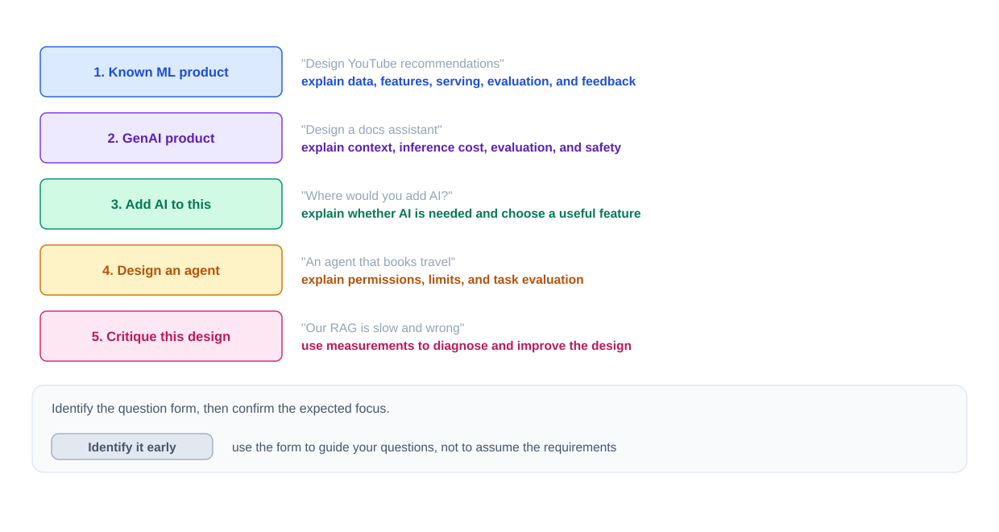
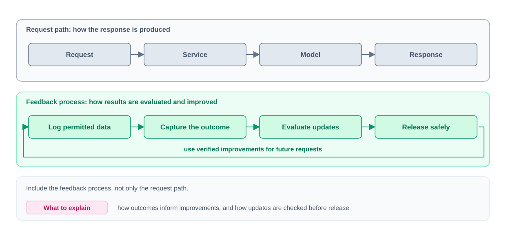
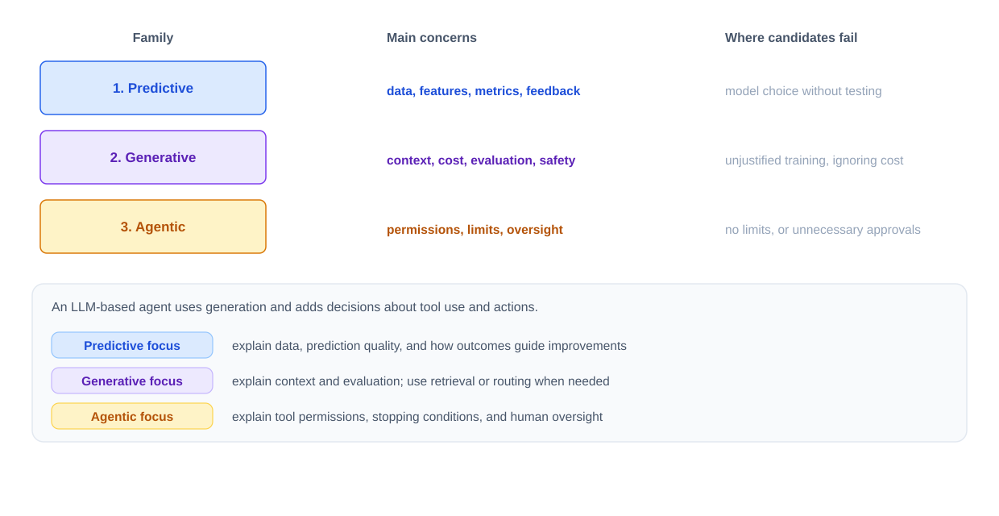
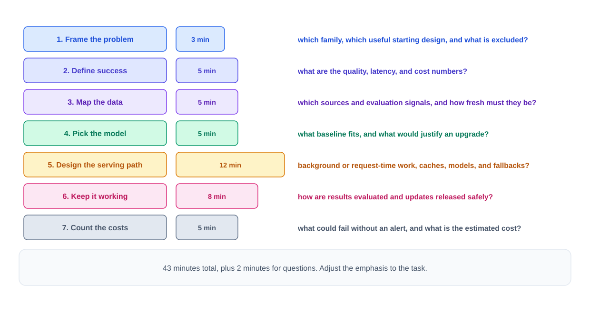
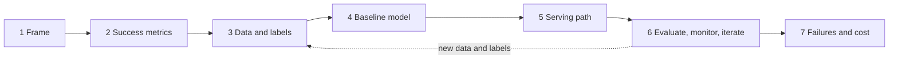
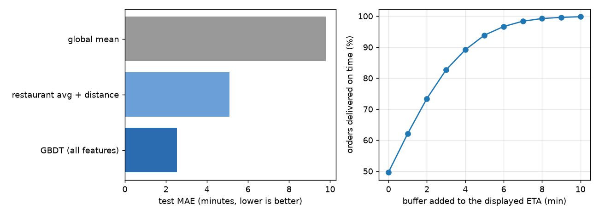
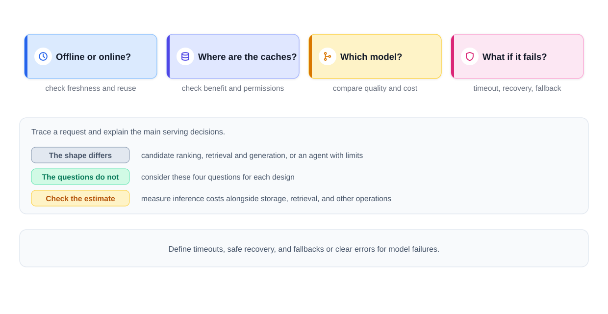

# Chapter 15 — ML System Design: The Interview Framework

"Design YouTube's recommendations." "Design a fraud detector." "Add AI to our support desk." These questions now sit next to the classic "Design Twitter" in system design loops, and they are asked of ordinary backend engineers, not only ML specialists. The good news: everything you know about load balancers, caches, queues and databases still applies. The new part is that one box in your diagram **learns from data** — so its output can be wrong while the request succeeds, its quality can decay while the code stays the same, and each call may cost real money.

This chapter gives you a repeatable way to answer such questions in 45 minutes. Chapter 16 then goes deep on each production building block (training pipelines, feature stores, serving, evaluation, monitoring, A/B tests, MLOps).

**What you'll learn**

1. The five shapes an AI/ML design question takes, and what each role is expected to cover.
2. What changes when a system contains a model — four assumptions from classic design that break.
3. The three question families (predictive, generative, agentic) and the one-line test that tells them apart.
4. A seven-step framework with a minute-by-minute plan: frame → success metrics → data → baseline model → serving → keep-it-working loop → failures and cost.
5. How to turn a **business goal** into an **ML objective**, labels, features, offline and online metrics.
6. How to scope a vague "use AI to improve X" question in the first ten minutes (full worked capstone).
7. The mistakes that sink most answers.

Code for this chapter is in `code/` and runs with the shared environment. Outputs below are real.

---

## 15.1 ML design vs classic system design

### What it is
An **ML (or AI) system design question** asks you to design a product in which at least one component is a **model** — a function learned from data rather than written as explicit rules. It takes an input (a user's watch history, a transaction, a typed question) and returns an output (a score, a label, a number, generated text).

Two words you will use constantly:

| Term | Meaning | Example |
|---|---|---|
| **Training** | Fitting or updating the model from data. Usually a background job, separate from user traffic. | Nightly job that learns from yesterday's orders |
| **Inference** | Running the trained model on an input to get an output. | Scoring one transaction at checkout |
| **Online inference** | Inference inside a live request; must meet the request's latency limit. | Fraud score before a card payment is approved |
| **Batch inference** | Inference over many inputs in a scheduled job; results stored for later. | Tonight's recommendation lists for every active user |

Analogy: a model is like a new hire who learned the job from past examples. You still need an office (infrastructure), a way to check their work (evaluation), a way to notice when they get worse (monitoring), a budget (cost), and a plan for when they make a mistake (fallbacks). Knowing how their brain works (model architecture) helps, but it is not what the design interview is mostly about.

### Why it matters
A common preparation mistake is to spend weeks on model internals — transformer attention, loss derivations — and then freeze when asked "where does the training data come from?" or "what happens when the model times out?". In a system design round, the interviewer mostly grades the **whole system** around the model.

### The five forms of the question


*Figure — Five shapes of AI design prompts (course diagram)*

| # | Form | Example prompts | What to emphasise |
|---|---|---|---|
| 1 | **Known ML product** | "Design YouTube recommendations", "Design search autocomplete" | Data, features, training, serving, evaluation, feedback loop |
| 2 | **GenAI product** | "Design ChatGPT", "Design a docs Q&A assistant" | Retrieval, context assembly, inference cost, output evaluation, safety |
| 3 | **Add AI to an existing system** | "Our online store already runs fine — which part of it should get AI?" | Whether AI is needed at all, choosing one useful feature, simplest viable design |
| 4 | **Design an agent** | "An agent that books travel for users" | Tool permissions, approvals, step/cost limits, stop conditions, task-success evaluation |
| 5 | **Critique / scale an AI design** | "Our RAG system is slow and wrong — fix it" | Diagnose with measurements, logs and failed examples *before* changing anything |

Terms: a **feature** is one piece of information fed to the model (watch history, hour of day); the **feature pipeline** computes and delivers them; the **feedback loop** collects outcomes (clicks, resolutions) to evaluate and improve the system. **GenAI** = generative AI (produces text, code, images). **LLM** = large language model. **RAG** = retrieval-augmented generation (fetch relevant documents and put them in the model's input — this helps ground answers but does not guarantee correctness). **Fine-tuning** = extra training of an existing model for a narrower task.

### Who gets asked what
Expected depth depends on role and company — treat this as a preparation guide, and **ask**.

| Role | Forms to prepare | Depth expected |
|---|---|---|
| Software engineer (senior+) | 2, 3, sometimes 1 | Architecture, serving, cost, failure handling; model inputs/outputs/limits |
| ML engineer | 1, 2, 5 | Above + model choice, features, training pipelines, evaluation metrics |
| AI / ML platform engineer | 2, 4, 5 | Inference infrastructure: GPUs, batching, caching, latency under load |
| Engineering manager / staff+ | 3, 5 | Build vs buy, cost limits, ownership, risk, gradual rollout |

A useful question in the first minute: *"Would you like me to go deep on model development, or on the system that serves and maintains the model?"*

### What interviewers grade (and what they don't)

| Graded | Usually secondary in a system design round |
|---|---|
| **Requirements discipline** — users, latency, quality measure, what's out of scope, numeric assumptions | Deriving the transformer or backprop by hand |
| **A complete loop**, not just the request path — how outcomes come back and improve the system | Naming this month's newest model |
| **Cost and latency realism** — state assumptions, estimate, then optimise | Framework trivia ("use library X") without saying why the component is needed |
| **Failure honesty** — a model can be confidently wrong with HTTP 200; detection, blast-radius limits, fallbacks | |

### How it works — four assumptions that break when a model enters the system


*Figure — Serving path on top, improvement loop underneath (course diagram)*

These are contrasts, not absolutes — non-ML systems also need quality checks and cost control — but they are where incomplete AI designs usually fall down.

| # | Classic assumption | What changes with a model | Design response |
|---|---|---|---|
| 1 | **Correctness is binary** — a payment is either the authorised amount or a bug | Output quality is a spectrum: a recommendation can render fine and still be irrelevant | Define **quality metrics** (CTR, resolution rate, suggestion-acceptance rate) *alongside* latency and availability SLOs; log predictions and join them with later outcomes |
| 2 | **The code is the behaviour** | Behaviour also depends on data. **Drift** — a change in input patterns or in the input→outcome relationship — can degrade a model whose code never changed (new fraud tactics, changed tastes) | A feedback process: collect outcomes, investigate quality changes, evaluate a candidate against the current version, release gradually with rollback. Retrain because evidence says so, not on every alert |
| 3 | **Compute is cheap** | A model call can cost orders of magnitude more than a DB read, depending on model size, input/output length, hardware and utilisation | Put a number on it: 10M requests/day × $0.01 = $100,000/day ≈ $3M/month (illustrative). Then consider caching (only when permissions/freshness allow), routing easy requests to a smaller model (only if it meets the quality bar), and precomputing in batch |
| 4 | **Failures are loud** (500s, timeouts) | A wrong answer arrives as `200 OK`: an invented citation, a missed fraud, harmful text | Assume anything a user types, or that retrieval pulls in, may be hostile (prompt injection can't be fully stopped by input filters — enforce permissions outside the model), check outputs, require human approval for high-impact actions, define fallbacks (unpersonalised results, hand-off to a human) |

Question to ask yourself for every design: **"Who is hurt by a wrong output, and what limits the damage?"**

### Build, host, or call an API?
The other big decision is how you obtain and run the model. The options overlap (you can fine-tune and then use managed hosting).

| Option | Pros | Cons / what you still own |
|---|---|---|
| **Hosted API** (pay per use) | Fastest to launch, no GPU fleet | Data handling terms, rate limits, provider availability, per-call cost at scale; you still build integration, evaluation, monitoring |
| **Self-host open-weights model** (weights downloadable under a licence) | Control over data, deployment, latency; can be cheaper at high, steady utilisation | Capacity, security, upgrades, on-call, often GPUs; savings are not guaranteed |
| **Train / fine-tune your own** | Needed when your own interaction data is the product (ranking, fraud, recommendations); fine-tuning can help a narrow generative task | Data preparation, training infra, ongoing maintenance |

Compare them on quality, data sensitivity, volume, latency, total cost and team skills. Start with the simplest option that meets requirements and say what evidence would make you switch.

### Trade-offs
Going ML at all is itself a trade-off. Google's *Rules of ML* open with **Rule #1: don't be afraid to launch without ML** — a heuristic may be good enough to start, and it produces the data you'll later learn from. **Rule #3: choose ML over a complex heuristic** — once hand-written rules become a tangle, a learned model is easier to maintain.

### Common mistakes
- Answering an SWE design question like a research talk (15 minutes on fine-tuning objectives, nothing on serving or evaluation).
- Drawing only the request path — no logging, no outcome join, no retraining or evaluation loop.
- Assuming model calls are free or as fast as a cache read.
- Treating user feedback (thumbs up/down) as automatically trustworthy training labels.
- Claiming a fixed percentage of traffic can go to a small model without evidence.

### Real-world examples
- **Netflix, YouTube, TikTok** feeds: predictive ranking systems (form 1).
- **GitHub Copilot** style code assistants: generative products measured by suggestion acceptance and retention (form 2).
- **Stripe Radar**: a fraud model embedded into an existing payments flow (form 3 in spirit).
- Customer-support agents that can issue refunds through tools with limits (form 4).

### In the interview
**30-second answer** — *"What changes compared with an ordinary backend service?"* → *"Everything from distributed systems still holds. I add three things: quality metrics that sit beside the latency and uptime SLOs; a loop that notices when quality slips and tests any new version before rolling it out step by step; and a budget for per-call latency and spend. Finally, safeguards for bad outputs — validation, fallbacks, and a human reviewer where the stakes warrant one."*

- **"What do you mean by quality, concretely?"** → Name a task metric: for a feed, CTR plus a longer-term satisfaction signal (watch time, return visits); for fraud, precision and recall at the chosen threshold; for support, correct resolution rate plus CSAT and repeat-contact rate.
- **"Would you fine-tune?"** → Not first. Check whether an existing model with good instructions (and retrieval if private data is needed) meets the quality and cost bar on an evaluation set; fine-tune only if evaluation shows a specific gap that simpler changes don't close.
- **"Assume the model already exists."** → Then spend the time on integration, serving, cost, evaluation and feedback; bring training up only when some requirement depends on it.

### Self-check
1. Why can a model fail "silently"? → Because a wrong prediction is returned successfully (HTTP 200); error-rate dashboards don't see it — you need quality metrics joined to outcomes.
2. Name the four broken assumptions. → Binary correctness, code = behaviour, cheap compute, loud failures.
3. When is a hosted API a poor fit? → Strict data-residency/sensitivity rules, very high steady volume where per-call pricing dominates, or latency needs the provider can't meet.
4. What does Rules of ML #1 say, and why? → You may launch without ML; a simple heuristic gets the product and the data pipeline going, and gives a baseline.

### TL;DR
- Classic design still applies; a model adds **quality measurement, drift, cost, and silent failure**.
- Five question forms; confirm how deep to go on models vs system.
- Graded: requirements, full loop, cost/latency realism, failure honesty.
- Build vs host vs API is a requirements-driven choice — start simplest.

---

## 15.2 The three question families

### What it is
Before choosing an architecture, classify what the system mainly has to **produce**:

| Family | The model produces… | Typical questions | Focus of your answer | Classic failure |
|---|---|---|---|---|
| **1. Predictive** | A score, number or label that the system acts on | Recommendations, feed/search ranking, ads CTR, fraud/spam, ETA, churn | Data & features, candidate generation + ranking, offline & online metrics, feedback loop | Picking a model (e.g. "an LLM ranks the feed") without data, latency or cost reasoning |
| **2. Generative** | Content: an answer, summary, code, image | ChatGPT-style assistant, docs support bot, code assistant, meeting summaries | Retrieval & context assembly, inference latency/cost (streaming, caching, model routing), output evaluation, safety (prompt injection, hallucination) | Proposing to train a foundation model from scratch; ignoring cost; no quality measurement |
| **3. Agentic** | A decision about which **action** to take next (call a tool, read result, decide again) | Refund-issuing support agent, travel booking, coding agent opening PRs | Tool interface & permissions, step/time/cost limits, stop conditions, approval for risky actions, task-level evaluation | Unlimited tool access and no stop rule — or, the opposite, human approval for every harmless step |


*Figure — Predictive, generative and agentic compared (course diagram)*

Terms: a **label** is the category or target value to predict (fraud / not fraud). **Pretrained** = trained before you use it for your task. A **foundation model** is a large model trained on broad data, adaptable to many tasks. A **token** is the chunk of text an LLM reads and writes — often a whole word, sometimes a word fragment or a punctuation mark. **Hallucination** = generated content that is false or unsupported. **Prompt injection** = untrusted text trying to redirect the model's instructions. **Streaming** = showing output as it is generated. **Model routing** = choosing which model handles a request based on difficulty/cost.

### Why it matters
"Design an AI shopping experience" and "Design fraud detection" need completely different designs, metrics and risks. Classifying early prevents you from spending 30 minutes on the wrong system.

### How it works — the output test
1. Ask: *does the system mainly output a prediction, content, or an action?*
2. If the prompt is vague, say what you think it is and confirm.
3. If the product mixes families, split it into subsystems. Example: a streaming service ranks the homepage (predictive) and writes "why you might like this" blurbs (generative). A support platform routes tickets (predictive), drafts replies (generative), and issues refunds through an authorised tool (agentic).
4. Name each subsystem, say how they pass work to each other, and ask which one to go deep on — usually the one carrying the biggest risk.

This book (ML Handbook) focuses mostly on **family 1**; the AI Handbook covers LLM serving, RAG and agents in depth. The framework below works for all three.

### Common mistakes
- Using an LLM for everything, e.g. calling it once per item to rank a 50M-item catalog. Sensible LLM roles are narrower — enriching item descriptions offline, or reordering a short list of finalists — and even then benchmark it against a standard learned ranker on quality, speed and spend.
- Choosing a multi-agent design when a fixed workflow would do (if the steps are known, hard-code them).

### In the interview
**30-second answer** to an unclear prompt: *"First I want to pin down what the system outputs. A ranking or score means my time goes to data, features and evaluation. Generated text shifts it to context building, per-call spend and answer quality. Actions put tools, permissions and limits at the centre. My read is that this is mostly ranking items per user — shall I go that way?"*

- **"It's all three."** → List the subsystems and their interfaces, propose to go deep on the riskiest ("wrong refunds cost money, so the agentic part"), and let the interviewer redirect.
- **"Why not let an LLM rank?"** → Evaluate it: quality vs a learned ranker on interaction data, per-item latency and cost. Plausible as a reranker on the top ~50, not as a scorer over millions.

### Self-check
1. "Summarise support tickets and auto-close duplicates." Family? → Generative (summaries) plus an action (closing tickets) — a small agentic part that needs permission and review rules.
2. What's graded most in predictive questions? → Features/data, candidate generation and ranking, offline and online metrics, the feedback loop.
3. Why is "LLM ranks the feed" weak? → It ignores personalisation data, evaluation, latency and cost at catalog scale.

### TL;DR
Predictions → data/features/metrics. Content → context/cost/quality/safety. Actions → permissions/limits/oversight. Mixed products: split, connect, pick a focus.

---

## 15.3 The seven-step framework

### What it is
A fixed order of decisions, so that requirements and data drive the architecture instead of the other way round. It is the classic design structure (requirements → estimates → API → high-level design → deep dive → wrap-up) with two ML-specific concerns made explicit: **define quality early** and **show how the system keeps working after launch**.


*Figure — Seven steps with their guiding questions and minutes (course diagram)*

| Step | Question it answers | Minutes (45-min round) |
|---|---|---|
| 1. Frame the problem | What family, what known system does it resemble, what's in/out of scope? | 3 |
| 2. Define success | What are the quality, latency, scale and cost targets? | 5 |
| 3. Map the data | Which sources, where do labels come from, how fresh must data be? | 5 |
| 4. Pick the model | What's the simplest baseline, and what would justify upgrading? | 5 |
| 5. Design the serving path | What runs offline vs per request, caches, cheaper paths, failure handling? | 12 |
| 6. Keep it working | How are outcomes logged, quality measured, changes evaluated and rolled out? | 8 |
| 7. Count failures and cost | What breaks, what controls exist, what does it cost vs budget? | 5 |
| Buffer | Questions | 2 |

The same structure appears in Aminian & Xu's *ML System Design Interview* (clarify requirements → frame as ML task → data preparation → model development → evaluation → deployment/serving → monitoring) and in Chip Huyen's *Designing ML Systems* lifecycle (scoping → data engineering → model development → deployment → monitoring and continual learning → business analysis). Use whichever wording you like; cover every step. Shift time toward data and models for predictive questions, toward inference and context for generative ones, and toward permissions for agents.



### Step 1 — Frame the problem (and frame it as an ML task)
1. **Name the family** with the output test.
2. **Name the known system** it resembles: "this is a recommender where items are podcasts", "this is document Q&A with stricter accuracy". Then say which requirements differ — don't paste a memorised design.
3. **State scope** in and out: "English text support first; voice and other languages later. OK?"
4. For predictive problems, **frame it as an ML task** — this is the heart of Aminian & Xu's step 2:
   - **Input and output** of the model (e.g. input = user, video, context; output = probability the user watches ≥ 30 s).
   - **ML category**: binary/multiclass classification, regression, ranking (learning-to-rank), retrieval, clustering, or generation.
   - **ML objective**: the quantity the model is trained to optimise, chosen because it moves the business metric.

**Business metric → ML objective (worked examples)**

| Business goal / metric | ML task | ML objective (what the model predicts) | Why not the obvious one |
|---|---|---|---|
| Increase time spent on video platform | Ranking | P(watch ≥ X seconds) or expected watch time | Optimising raw clicks rewards clickbait |
| Reduce fraud losses without annoying customers | Binary classification | P(transaction is fraud) → thresholds set by expected cost | Accuracy is meaningless at 0.2% fraud |
| Accurate delivery promise at checkout | Regression | Minutes from order to delivery | Business also needs a *promise-kept rate*, handled by a display buffer, not the model |
| Improve marketplace search revenue | Ranking | P(purchase \| query, item), possibly × price | Relevance-only ranking may ignore conversion |
| Reduce subscription churn | Binary classification | P(cancel within 30 days) | The label arrives 30 days late — shapes monitoring |

*Rules of ML* adds two useful reminders: **Rule #12 — don't overthink which objective you directly optimise** at first, and **Rule #13 — pick a simple, observable and attributable metric** for your first objective (a click is observable and attributable to the item shown; "user happiness" is not).

### Step 2 — Define success
Turn the goal into numbers; when the interviewer doesn't give them, state assumptions.

1. **Quality** — a *business / online metric* and an *offline ML metric* that correlates with it:
   - "Users find videos they enjoy" → online: watch time, CTR, with guardrails for satisfaction surveys and policy-violating content; offline: NDCG / recall@k on held-out interactions.
   - "Helpful support bot" → correct resolution rate, CSAT, repeat-contact rate.
2. **Latency** — a feed might need to load in a few hundred ms; a chatbot has a time-to-first-token target *and* a full-answer target; a batch job needs a completion deadline and a freshness target. Latency decides what must be precomputed.
3. **Scale and cost** — users, requests/day, peak QPS, cost per request or per *completed task*. A free feature needs a tiny per-request cost; a support bot can cost more per conversation if it genuinely resolves tickets. Use a concrete budget, never "near zero".

Rules of ML **#2: design and implement metrics first** — before building anything, log what you'll need to measure success.

### Step 3 — Map the data
List data sources: interaction logs (clicks, watches, purchases), catalog/content data, user profiles (where use is permitted), documents for generation. Then answer two things:

1. **Label source.** A label is the target value for a supervised training example, and labels are often late or imperfect:
   - Fraud: confirmed investigations and chargebacks — slow (weeks) and not every chargeback is fraud.
   - Feeds: clicks — instant but only a proxy for satisfaction.
   - Support: reviewed conversations, verified resolutions; a thumbs-down is feedback, not a reliable correctness label.
   - Self-supervised learning and pretrained models reduce the need for hand-labelled data, but you still need labelled *evaluation* data.
2. **Freshness.** Daily may be enough for long-term tastes; trending content and fraud need minutes or seconds. Freshness decides batch vs streaming vs request-time computation.

Briefly name **feature groups** here (entity, recent-behaviour aggregates, request context, cross features — see Chapter 16.4), and flag **leakage** risk (features that wouldn't exist at prediction time) and **privacy** limits.

### Step 4 — Choose a model, beginning with a baseline
Begin from a **baseline**: the least elaborate approach that satisfies the basic requirements. It tests the pipeline end to end, and it's the yardstick for every later model (*Rules of ML #4: keep the first model simple and get the infrastructure right*).

| Family | Baseline | Upgrade path | Trigger to upgrade |
|---|---|---|---|
| Predictive | Popularity / rules / per-entity averages; logistic regression | GBDT on tabular features → deep models (two-tower retrieval, multitask rankers) | Baseline misses the quality target on the offline metric and the gain is worth the complexity |
| Generative | Existing model + clear instructions; add retrieval if answers need private/fresh data | Better retrieval, model routing, fine-tuning | Evaluation shows a specific failure that prompts/retrieval don't fix |
| Agentic | Fixed workflow if the steps are known; otherwise one agent with a few narrow tools | More tools, then multiple agents | The task clearly benefits from separation; extra coordination cost is justified |

Always say the condition: *"If the baseline misses the target, I'll compare a GBDT against it on the same held-out weeks."*

#### Code — baseline first (`code/baseline_first.py`)
A synthetic delivery-time task: naive baseline → quick heuristic → GBDT, then translate model error into the business metric "orders delivered within the promised time" by adding a display buffer.

```python
# 1) naive baseline: everyone gets the global average
rows.append(report("global mean", yte, np.full(len(yte), ytr.mean())))

# 2) heuristic: per-restaurant average + a distance term (shippable in a week)
rest_avg = {r: ytr[Xtr[:, 0] == r].mean() for r in np.unique(Xtr[:, 0])}
resid = ytr - np.array([rest_avg[r] for r in Xtr[:, 0]])
dist_fit = LinearRegression().fit(Xtr[:, [1]], resid)
heur = np.array([rest_avg.get(r, ytr.mean()) for r in Xte[:, 0]]) + dist_fit.predict(Xte[:, [1]])

# 3) learned model: gradient-boosted trees on all features (restaurant id as categorical)
gbdt = HistGradientBoostingRegressor(random_state=0, categorical_features=[0]).fit(Xtr, ytr)
pred = gbdt.predict(Xte)

# business metric: % of orders that arrive within (prediction + buffer)
kept = [(yte <= pred + b).mean() * 100 for b in buffers]
```

Output:
```
model                           MAE  p90 abs err
global mean                    9.80        19.92
restaurant avg + distance      5.11        10.45
GBDT (all features)            2.54         5.31

buffer (min) -> promise kept % / avg promised minutes   [GBDT]
  + 0 min ->  49.6%  /  37.8
  + 3 min ->  82.7%  /  40.8
  + 5 min ->  93.9%  /  42.8
  + 8 min ->  99.2%  /  45.8
```



What it shows:
- Every number is judged **against a baseline**. The heuristic halves the naive error; the GBDT halves it again (on synthetic data — real gains are usually smaller).
- An unbiased model is late about **half the time** (49.6% kept with no buffer). The business metric depends on a **product decision** (the buffer), not only on model accuracy: +5 min keeps ~94% of promises but makes the displayed ETA look slower. Keep that knob outside the model so product can own it.

### Step 5 — Design the serving path
Draw the architecture and trace one request. Whatever the shape (retrieval → ranking, retrieval → generation, agent loop), answer the same four questions:


*Figure — Step 5 checklist: offline/online, caches, model choice, failure (course diagram)*

1. **Offline or online?** What can be precomputed (batch) and what needs request-time data? (Chapter 16.5.)
2. **Where are the caches?** What do they save in latency/cost, and what are the freshness, invalidation and **permission** rules so one user never sees another's cached result?
3. **Which requests can take a cheaper path** — a smaller model, cached answer, or rule — and which need the expensive one?
4. **What if the model is slow, down, or rate-limited?** Timeouts, bounded retries (only when safe), a fallback (previous model, cached score, heuristic, unpersonalised list) or a clear failure. For batch jobs: deadlines and recovery.

A typical predictive design for a large catalog is a **funnel**:


### Step 6 — Keep it working (evaluation, monitoring, iteration)
Show the feedback process **in the diagram**, not just in words:

1. **Log** inputs, outputs, features used and model version (with privacy controls and retention limits).
2. **Capture outcomes**: clicks, ratings, escalations, confirmed fraud, actual delivery time.
3. **Measure** the step-2 metrics on live outcomes and on human-reviewed samples.
4. **Improve** data, features, retrieval, prompts or the model.
5. **Release safely**: offline evaluation → **shadow deployment** (new version scores copied traffic, outputs not shown; disable side effects) and/or a **controlled experiment** (A/B test) → gradual ramp with explicit stop/rollback conditions.

Offline vs online evaluation, in one table (details in Chapter 16.7 and 16.9):

| | Offline evaluation | Online evaluation |
|---|---|---|
| Data | Held-out historical data (time-based split) | Live users |
| Metrics | ML metrics: PR-AUC, NDCG, recall@k, MAE, calibration | Business metrics: CTR, watch time, revenue, resolution rate + guardrails |
| Cost / risk | Cheap, no user risk | Uses real traffic, needs time and statistical power |
| Blind spots | Proxy labels, feedback loops, serving-time degradation | Slow, noisy, needs good experiment design |
| Role | Filter candidates | Decide the launch |

Monitoring in one line: system health (latency, errors) → input feature distributions → prediction distributions → outcome quality (as late as labels arrive). Retrain on a schedule justified by measured decay, or after an investigation — never promote a model automatically just because an alert fired.

### Step 7 — Failure modes and the bill
**Failure list** — specific to your system: unsupported answers, drifting data, unsafe actions, feedback loops that reinforce bad behaviour (optimising only clicks → clickbait). For each, a control (thresholds, quality monitors, content checks, permission limits, a kill switch) and what the control *cannot* guarantee.

**Cost list** — model cost ≈ requests × share hitting each model × calls per request × cost per call. Add retrieval, storage, retries and human escalation.

#### Code — napkin math (`code/napkin_math.py`)
```python
def qps(per_day, peak_factor=3.0):
    avg = per_day / 86_400
    return avg, avg * peak_factor

def model_cost_per_day(requests_per_day, share, calls_per_request, cost_per_call):
    return requests_per_day * share * calls_per_request * cost_per_call
```
Output:
```
10M req/day -> avg 116 QPS, peak ~347 QPS (3x peak factor assumed)
all requests x $0.01        -> $100,000/day, $3,000,000/30-day month
20% to large model x $0.01  -> $20,000/day (excludes small model, retrieval, retries)
support: 40,000 conversations/day x $0.10 = $4,000/day model cost
  compare per resolved issue, not per call: human ticket assumed $4.00
  resolve 30%: expected cost/ticket $2.90 vs $4.00 human-only
  resolve 50%: expected cost/ticket $2.10 vs $4.00 human-only
  resolve 70%: expected cost/ticket $1.30 vs $4.00 human-only
precompute 25M users x 500 recs = 12.5B rows; active-only (5M) = 2.5B rows
```
The important habit is the **unit**: compare cost *per resolved issue* (AI cost + human cost for the unresolved share), not "one model call vs one human ticket". All prices are illustrative assumptions, not quotes from any provider.

> Short on time? Squeeze steps 6–7 into two sentences: *"Every prediction gets matched to its eventual outcome; when quality moves I dig in, and any new version passes offline tests, then shadow or canary, before a staged ramp — with cost per request on the dashboard. The two risks I'd watch hardest are X and Y."*

### Trade-offs of the framework
| Benefit | Cost |
|---|---|
| Decisions follow requirements and data | Can feel slow if the interviewer wants the diagram now — then state assumptions in one sentence each and jump to step 5 |
| Guarantees you don't forget evaluation/monitoring/cost | Rigidly following it when the interviewer steers elsewhere looks robotic — adapt order and depth |

### When not to use it rigidly
- "Skip to the architecture": state quality target and latency limit as assumptions, draw, and return to any open requirement at the moment it changes a choice.
- "You have 10 minutes": scope, main architecture, biggest risk, cost — and one sentence each on quality target, data, and evaluation.

### In the interview
**30-second opener**: *"Plan: agree the task and its boundaries; put numbers on quality, latency and spend; find the data and where labels come from. Next a baseline and the serving path. I'll close with how we evaluate, roll out safely, handle failures, and what it all costs. To start — this reads like a ranking problem…"*

- **"Why start with a baseline if you know GBDT will win?"** → It validates the pipeline and logging, gives a number to beat, and sometimes it's good enough (Rules of ML #1, #4).
- **"What's your ML objective, and why that one?"** → Name the prediction target, show how it moves the business metric, and name the proxy risk (e.g. clicks vs satisfaction) and the guardrail that catches it.
- **"How will you know it's working after launch?"** → Four monitoring layers, outcome join, per-segment quality, drift alerts that trigger investigation, gated retraining.

### Self-check
1. Which steps are ML-specific additions to the classic framework? → Early quality definition (step 2's quality metric), data/labels (3), baseline model (4), and the keep-it-working loop (6).
2. Give a business metric → ML objective pair and its proxy risk. → Watch time → P(watch ≥ 30 s); risk: short-clip bias; guardrail: satisfaction surveys, long-term retention.
3. What are the four serving questions? → Offline vs online, caches (and permissions), cheaper paths, failure handling.
4. Why was the "no-buffer" promise kept only ~50% of the time? → An unbiased regressor's errors are roughly symmetric, so about half the deliveries are later than predicted.
5. What goes into model cost? → Requests × share per model × calls per request × price, plus retrieval, retries, storage and escalations.

### TL;DR
Frame (3) → Success (5) → Data (5) → Baseline (5) → Serving (12) → Keep it working (8) → Failures & cost (5). Translate the business goal into an observable ML objective, beat a baseline, show the feedback loop, and put numbers on cost.

---

## 15.4 Capstone — scoping a vague AI question

### The exercise
Hypothetical prompt (numbers are exercise assumptions):

> "We're a food-delivery company: ~25 million monthly users, 500,000 orders a day. Leadership wants AI to improve customer experience. Design something."

The feature, the success metric and the system family are all unspecified. Your job in the first ten minutes is to turn this into an agreed, measurable design problem — not to draw the architecture yet.

### Step A — Generate options by family, then choose
Spend ~30 seconds listing options, grouped with the output test:

| Family | Options |
|---|---|
| Predictive | Delivery-time (ETA) prediction; restaurant/dish recommendations; fraud detection on refund claims; predictions that feed courier assignment (the assignment itself also needs optimisation/rules) |
| Generative | Support assistant explaining order status and refund policy; AI-written dish descriptions; review summaries |
| Agentic | "Get me dinner for four under $60" ordering assistant that can place an order after checks and confirmation |

Pick using **impact × feasibility × risk** (feasibility = can the team build and run it with the data, time and people available):
- **ETA prediction** — touches every order; delivered orders provide labels (check completeness).
- **Support assistant** — savings show up directly in support spend; the order records and policy documents it needs probably exist today; risk limited by restricting actions and escalating uncertain cases.
- **Ordering agent** — spends users' money; needs payment authorisation, confirmation and cancellation flows. Feasible, but more controls.

There is no universally right pick — say which you prefer under these assumptions and what would change your mind.

### Step B — Run the framework opening (support assistant chosen)
Numbers are assumptions to confirm aloud.

1. **Quality**: primary = *correct resolution without human escalation*; also CSAT and repeat contacts for the same issue (a closed ticket isn't proof of a fix). Assume a human-handled ticket costs $4. Target: resolve ≥ 50% of eligible **tier-1** tickets (routine: order status, coupon questions, simple cancellations) with CSAT no worse than humans. Note: explaining the cancellation policy is one thing; actually *cancelling* is another, and doing things requires its own authorisation and rule checks.
2. **Latency**: stream the reply; assume p95 time-to-first-token ≤ 1 s and p95 completion ≤ 5 s for short answers (p95 = 95% of requests meet it); tool calls may get separate targets.
3. **Scale and cost**: 500,000 orders × 8% contact rate = **40,000 conversations/day** (average; peaks and repeats estimated separately). Assume 10 model calls per conversation at $0.01 → $0.10 per conversation → **$4,000/day** in model cost. Compare *total cost per correctly resolved issue*, including retrieval, infrastructure, retries and escalations — not one model call against one human ticket.
4. **Out of scope**: voice, non-English. Refunds above an assumed $10 go to a human; refunds below it still need identity, eligibility and duplicate-payment checks enforced **outside** the model.

### Step C — Classify and preview the shape
*"At its core this generates answers, grounded in order data the user is allowed to see and in retrieved policy text. Giving the model a refund tool adds an agentic slice, so reading data and moving money get separate safeguards. My deep dives: how accurate retrieval is, how we grade answers, what each conversation costs, and the backend checks that guard refunds of $10 or less."*

### Sample opening (paraphrased dialogue)
- **Interviewer:** "Use AI to improve customer experience."
- **You:** "Three candidates: ETA prediction, a support assistant, or an ordering agent — the agent needs payment and confirmation controls. I'd start with support: we can measure savings against current support costs and likely already have order data and policies. Support, or would you prefer ETA?"
- **Interviewer:** "Support works."
- **You:** "Target: correctly resolve at least half of eligible routine tickets, CSAT at least human-level, no rise in repeat contacts. Assuming $4 per human ticket, 500k orders and 8% contact rate gives ~40k conversations a day. For short answers, p95 first output within 1 s and completion within 5 s. At an assumed ten calls of one cent each, model spend is ten cents a conversation, and more once retrieval and infrastructure are added — so the number we track is total spend per issue actually resolved. Version one skips voice and languages other than English. A person handles any refund above $10; smaller ones still go through authorisation and policy checks. So: answer generation over orders and policies, plus a refund action. I'd spend the deep dive on retrieval, grading answers, spend, and guarding that action — agreed?"

### Now you (10 minutes each, out loud)
Cover: options by family, one choice with reasons, quality/latency/scale/cost targets with assumptions flagged, in/out of scope, the family and key design decisions.
1. "Our music-streaming app wants listeners to discover more. Where does AI help?"
2. "Bank leadership has asked for something AI-powered in the mobile app." (Weigh the damage a wrong output could do: a bot that gives personal money advice is far riskier than one that explains why a purchase was put in a category, and forecasts or fraud warnings still need someone watching them. Don't assume any family is automatically safe — say what the feature may do, must not do, and when a human reviews.)
3. "Candidates and jobs on our job board are poorly matched. Fix it with AI."

### TL;DR
Vague prompt → list options by family → choose on benefit, data, feasibility, risk → state quality/latency/scale/cost numbers in comparable units → confirm scope, name the family and the key decisions.

---

## 15.5 Common mistakes (the whole interview)

| Mistake | Better |
|---|---|
| Jumping to "I'd use a transformer" in minute 2 | Frame, define success and data first; baseline before deep models |
| Optimising a proxy with no guardrail (clicks → clickbait) | Pair the objective with guardrail metrics (satisfaction, retention, policy violations) |
| "We'll have labels" | Say where labels come from, how late, how noisy, who pays |
| Random train/test split on time-dependent data | Time-based split; point-in-time-correct features (Rules of ML #33) |
| Accuracy on imbalanced data | Precision/recall at a threshold, PR-AUC; threshold owned by product/risk |
| No fallback | Timeouts + fallback prediction chosen with product and risk owners |
| Only the request path | Logging → outcome join → evaluation → gated retraining → staged rollout |
| Training features computed differently from serving features | One feature definition, log serving features and train on them (Rules of ML #29, #32) |
| "GPU cluster" for a small tabular model | Benchmark on CPU first |
| Retraining automatically on every drift alert | Alert → investigate (often a broken pipeline) → validated retrain → gates |
| Hand-waving cost | Requests × share × calls × price, compared per completed task |
| Ignoring the interviewer's redirect | Adapt order and depth; the framework is a checklist, not a script |

## Chapter TL;DR
- An ML design answer = classic system design **plus** quality metrics, a data/label story, a baseline-first model plan, a feedback loop, and cost realism.
- Identify the **form** (known product, GenAI, add-AI, agent, critique) and the **family** (prediction, content, action) in the first minute; confirm depth.
- Seven steps in ~43 minutes: frame (3), success (5), data (5), model (5), serving (12), keep-it-working (8), failures and cost (5).
- Translate the business metric into an observable ML objective, and keep product knobs (buffers, thresholds) outside the model.
- Every number means something only next to a baseline; every design needs a fallback; every cost goes in the same unit as the benefit.
- Next: Chapter 16 builds each production piece — training vs serving, labels, feature stores, batch vs online inference, serving, offline metrics, monitoring and drift, A/B testing and MLOps — and assembles them into an ETA platform.
