# Chapter 16 — ML in Production: Pipelines, Serving, Evaluation, Monitoring and MLOps

Fitting a model in a **notebook** (Jupyter) is a small slice of the job. The rest is machinery: trustworthy labels, identical features for training and live traffic, deciding when predictions are computed, fast serving with a fallback, the metric that proves one model beats another, alarms for quiet decay, and safe releases. This chapter builds each piece for **predictive** models (scores, labels, numbers), then assembles an ETA (delivery-time) platform.

**What you'll learn:** the five pieces and the offline/online divide; training vs serving and skew (leakage demo); labels (natural, behavioural, human, LLM-assisted), imbalance and recalibration, negatives, splits, privacy; features and feature stores; batch/online/streaming inference; serving (budgets, batching, caching, rollout, hardware, compression, fallbacks); production offline metrics; monitoring and drift (PSI, KS), retraining, feedback loops; A/B tests (power, peeking, guardrails, interleaving, switchbacks, bandits); MLOps (tracking, registry, validation, **CI/CD/CT**, shadow, canary); the ETA capstone.

Embeddings and two-tower retrieval are in [Chapter 13](../13-recommenders-and-embeddings/README.md). Code is in `code/`; outputs are real.

---

## 16.1 The five pieces and the offline/online divide

### What it is
Recommenders, fraud detectors and ETA predictors all decompose into:

| Piece | Job |
|---|---|
| 1. **Training pipeline** | Builds a dataset, fits and scores a model, on a schedule or trigger |
| 2. **Feature layer** | Code plus storage turning raw events into model inputs |
| 3. **Inference path** | Everything between a request and its score |
| 4. **Serving platform** | Machines, routing and autoscaling behind live traffic |
| 5. **Monitoring loop** | Signals that reveal and help diagnose degradation |

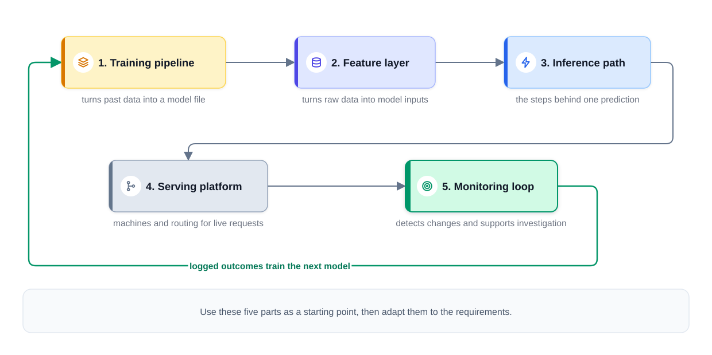
*Figure — Five building blocks of a predictive ML system (course diagram)*

Vocabulary: a **feature** is a model input derived from raw data (order events are raw; "orders this restaurant took in the past half hour" is a feature). A **label** is the outcome predicted — delivery minutes, a click — possibly imperfect (a chargeback isn't always fraud), and it doesn't exist at prediction time. A **training example** = features + label.

### How it works — one prediction, start to finish
ETA at checkout: (1) checkout calls the prediction service; (2) it gathers features from storage and the request, (3) arranged exactly as the model expects; (4) the model returns, say, 34 minutes; (5) business rules add a buffer and it's shown; (6) features, prediction, model version and order id are logged. (7) ~40 minutes later the food arrives — the **label** is known; (8) overnight, training joins logged features with actual times; (9) a fresh candidate replaces the current model only if it wins. Steps 1–6 live inside a **latency budget**; 7–9 run hours or days later — that gap is the thread of this chapter.

### The offline/online divide

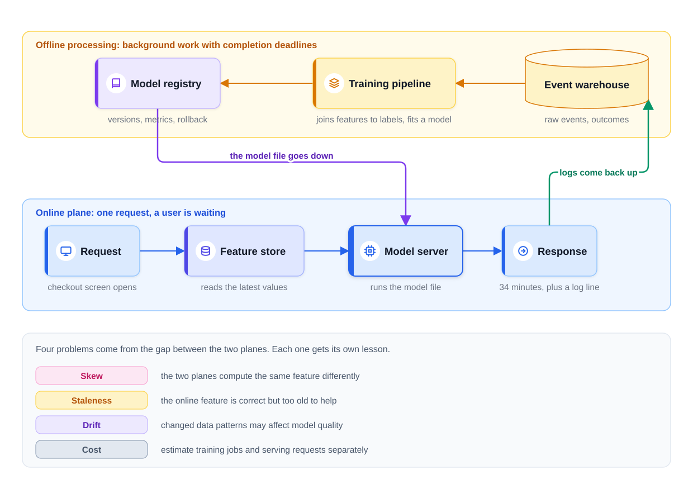
*Figure — Offline and online planes: model goes down, logs come up (course diagram)*

- **Offline plane**: background jobs over history (training, batch inference) — **throughput** and deadlines ([System Design Fundamentals](../../../system-design-patterns/modules/00-system-design-fundamentals/README.md)).
- **Online plane**: live requests under a response-time limit.
- The **model artifact** (saved trained model) crosses offline → online; **prediction logs + outcomes** cross back. **Schemas**, feature definitions and config are shared.

| Problem | Meaning | Section |
|---|---|---|
| **Skew** | A feature computed differently in training and serving | 16.2 |
| **Staleness** | Correct but old (hourly average when the kitchen got busy 10 min ago) | 16.4 |
| **Drift** | Data or input→outcome relationships change; quality falls while the service is "up" | 16.8 |
| **Cost** | Training cost (job size × frequency) and serving cost (traffic × hardware × utilisation) — separate, both estimated | 16.5, 16.6 |

### TL;DR
Five pieces; two planes; model goes down, logs come back up; skew, staleness, drift and cost live at the boundary.

---

## 16.2 Training vs serving

### What it is
Two systems sharing artifacts: **training** consumes history and emits a model; **serving** loads it and answers live traffic. Draw them as separate groups from the start.

| | Training | Serving |
|---|---|---|
| Runs | Scheduled (nightly/weekly) or triggered | Continuously, per request |
| Optimises for | Throughput over large datasets | Latency and availability |
| Hardware | Big GPU or high-memory clusters; cheap **spot machines** (reclaimable spare cloud capacity) work if the job checkpoints and resumes | Always-on CPUs or small GPUs, sized for the **SLO** |
| When it breaks | New model is late; previous one stays live (urgency depends on staleness) | Users see errors, on-call is paged — a safe fallback is required |
| Data | Months/years of history | This request's inputs, now |

### How it works — the training pipeline
A scheduled workflow (Airflow, Kubeflow Pipelines, Dagster, cloud equivalents), four stages:
1. **Data preparation** — read raw events from the **warehouse** (cleaned tables) or **lake** (raw files); pair feature values **as of the prediction moment** with the later label. Test hard: one wrong **join** quietly poisons everything downstream.
2. **Training** — for tabular data a **GBDT** is the strong default; a modest neural net the other common choice. Too big for one machine → **data parallelism** (examples split across workers, each with the full model) or **model parallelism** (the model split across devices).
3. **Evaluation** — score on **held-out** data; compare with production on quality, latency, cost and safety. Equally good but cheaper is a valid release.
4. **Registration** — store in a **model registry** with version, metrics, stage and **lineage** (data and code that produced it). **Rollback** needs compatible features, dependencies and config too — not just the old file.

Propose a cadence with a reason ("daily — labels arrive within the hour, demand shifts weekly") and validate it against label availability, measured decay and compute cost.

### How it works — the serving path
Request → features → model → prediction returned and logged. Budget the **entire** path; with small models, feature fetching often outweighs inference. Service hygiene: **timeouts**, a **fallback** score (default or cached), horizontal scaling, versioned releases.

State one product decision: **fail closed** (block when unsure/unavailable — safer for high-risk payments) or **fail open** (allow — better experience)? For card fraud often open for small amounts with rules as backstop, closed/review for high-risk — and say who decides.

### Training–serving skew
**Skew**: serving inputs differ from what the model learned from. Quality drops while error logs stay empty.

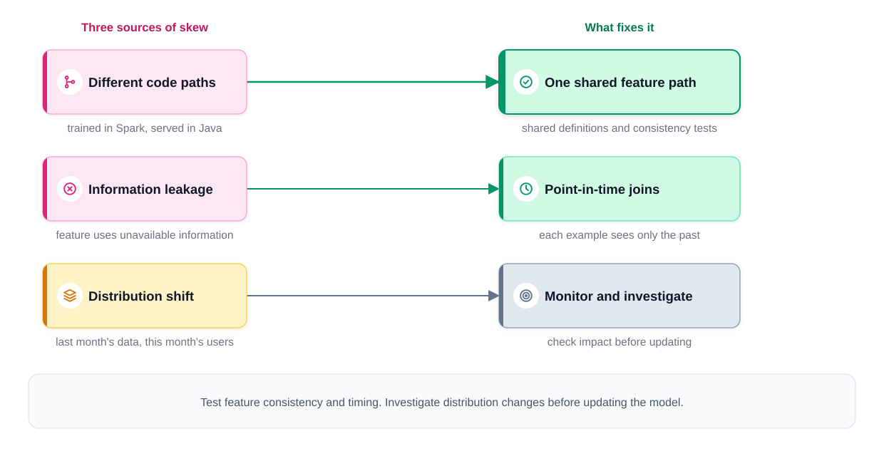
*Figure — Skew: causes and remedies (course diagram)*

| Source | Example | Fix |
|---|---|---|
| **Different code paths** | Spark/Python feature for training rewritten in Java for serving, with a different null default, rounding or time zone | Shared, tested feature definitions; consistency tests comparing both paths |
| **Information leakage** | "Today's average delivery time for this restaurant" built from the full day, so it contains the order being predicted | **Point-in-time-correct joins**: each example sees only data that existed at its timestamp |
| **Distribution shift** | Trained last month, serving this month | Not a bug, same symptom — monitoring and retraining (16.8) |

*Rules of ML*: **#29** — log serving-time features and train on those logs; **#32** — reuse code between training and serving; **#37** — measure training/serving skew. Logs can still be incomplete or mis-joined, but this removes the biggest source.

### Code — leakage vs point-in-time join (`code/point_in_time_join.py`)
`pandas.merge_asof`: for each order, the running mean of same-restaurant, same-day orders **finished before** it was placed.

```python
def pit_feature(df):
    done = df[["rest", "day", "done_h", "minutes"]].sort_values("done_h").copy()
    done["cum_sum"] = done.groupby(["rest", "day"])["minutes"].cumsum()
    done["cum_n"] = done.groupby(["rest", "day"]).cumcount() + 1
    left = df[["rest", "day", "placed_h"]].reset_index().sort_values("placed_h")
    j = pd.merge_asof(left, done[["rest", "day", "done_h", "cum_sum", "cum_n"]],
                      left_on="placed_h", right_on="done_h", by=["rest", "day"],
                      direction="backward", allow_exact_matches=False)   # strictly before
    j = j.set_index("index").sort_index()
    return (j["cum_sum"] / j["cum_n"]).to_numpy()     # NaN = nothing finished yet today

df["avg_today_LEAKY"] = df.groupby(["rest", "day"])["minutes"].transform("mean")  # whole day!
df["avg_today_PIT"] = pit_feature(df)
# ... temporal split (last 12 days = test), fit one GBDT per feature version
```
```
   placed_h  rest  minutes  avg_today_LEAKY  avg_today_PIT
0      10.0    20     31.3             34.1            NaN
1      10.0    31     36.6             44.5            NaN
...
PIT feature missing (no finished orders yet today): 15.0%

setup                                         MAE (min)
distance only (no daily feature)              5.88
LEAKY model, offline test (looks amazing)     3.60
LEAKY model, fed real serving features        4.91
PIT model, offline = what serving will see    4.67
```
The leaky model wins offline (3.60) because its feature partly contains the label; fed serving-time values it's *worse* (4.91) than the point-in-time model (4.67), whose offline number honestly forecasts production. The honest feature is **missing** 15% of the time (first orders of the day) — the model must learn to handle that.

### Trade-offs
| Choice | Benefit | Cost |
|---|---|---|
| Frequent retraining | Fresher model | Compute, evaluation load, release risk |
| Train on logged serving features | Removes most skew | Log volume, privacy review, no logs yet for new features |
| Separate training/serving teams | Specialisation | Handoff skew — needs shared definitions |

### Common mistakes
- Random split of time-ordered data.
- Rewriting feature logic for serving "because it's faster in Java".
- No fallback: checkout hangs when the model service is slow.

### In the interview
**30-second answer** ("walk me through the ML architecture"): *"Offline, a scheduled job assembles examples with features frozen at prediction time, fits a candidate, compares it with what's live, and registers it with lineage. Online, a **stateless** service (no memory between requests) computes features from the same definitions, calls the model within a time budget with timeout and fallback, and logs features, output and version. Artifacts travel to serving; logs and outcomes travel back."*

- **"Why not train continuously?"** → Freshness value vs label delay, compute and evaluation burden; online learning needs guards (16.8).
- **"First model with no logs?"** → Historical data if any; else a rule-based baseline that starts collecting data — with selection bias (outcomes only for what the rules allowed).

### TL;DR
Four-stage pipeline ending in a registry; serving with budget, timeout, fallback, logging; kill skew with shared definitions, point-in-time joins and training on logged serving features.

---

## 16.3 Where training data comes from

### What it is
A supervised model is only as good as the pipeline attaching outcomes to feature rows. Expect probes on labels' source, delay and cost.

| Source | Examples | Cost | Delay | Main weakness |
|---|---|---|---|---|
| **Natural labels** (observed outcomes) | Delivery duration, chargeback, cancellation | Logging + validation | Minutes to weeks | Late, incomplete; a chargeback is evidence, not proof |
| **Behavioural labels** | Clicks, skips, saves, watch time | Logging + processing | Often seconds | Indirect (click ≠ satisfaction); only covers what the system showed |
| **Human annotation** | Relevance grades, moderation decisions | Roughly cents to a few dollars each | Hours to days | Budget caps volume; reviewers need quality control |

Chip Huyen calls the prediction-to-label gap the **feedback loop length** — short for ETAs and clicks, long for fraud and churn. Delay doesn't stall training — only "mature" examples (old enough to have a label) are used — but outcome monitoring lags by the same amount.

### Human labelling is a system, not a task
- **Versioned guidelines** — record the guideline version in lineage; redefining "spam" breaks metric comparisons.
- **Inter-annotator agreement** — several reviewers label the same items (e.g. **Cohen's κ** for two raters, agreement corrected for chance). Low agreement usually means an unclear guideline, hard items or missing context; high agreement ≠ correctness.
- **Gold questions** — known-answer items seeded into the queue track each reviewer's accuracy.
- **Active learning** — spend labels where they're worth most: least-certain items, disagreements, new product areas.
- **Reuse existing queues** — fraud analysts already decide; record context and uncertainty, validate and version before training.
- **Weak supervision** (Snorkel-style **labelling functions** — heuristics that vote) gives many noisy labels cheaply; audit them the same way.

### LLM-assisted labelling
Given the guideline, an LLM proposes labels fast. In production it's **tiered**: the LLM labels eligible items, humans check a random sample plus low-confidence or contested ones, and accuracy is measured against human-reviewed sets **per important subgroup**. The catch: LLM errors are **correlated** — one blind spot repeated a million times (dialects, specialist topics, adversarial content) and invisible from inside. Keep human audit slices, re-measure whenever prompt, model or policy changes, check privacy rules before sending data.

### Class imbalance
At 0.2% fraud (1 in 500), "always legit" scores 99.8% accuracy, and compute goes on easy negatives.
- **Downsample negatives**: keep all positives and a fraction *w* (say 10%) of negatives → data ~10× smaller, positive share 0.2% → ~2%.
- **Scores are now inflated** (odds × 1/w). If scores are used as probabilities (dollar thresholds, auctions), **recalibrate**: **p = w·q / (w·q + 1 − q)**, q = downsampled score (e.g. w = 0.1, q = 0.05 → p ≈ 0.0052) — or fit **Platt** (sigmoid) / **isotonic** (step-wise increasing) calibration on held-out data at the real **base rate**. (Rules of ML **#30**: importance-weight sampled data, don't drop it arbitrarily.)
- **Reweighting** alternative: keep all data, weight positives more in the loss. More compute, no resampling.
- Evaluate with **precision and recall**, not accuracy (16.7).

### Code — downsample, recalibrate, check (`code/imbalance_calibration.py`)
```python
w = 0.10
keep = (ytr == 1) | (rng.random(len(ytr)) < w)               # all fraud, 10% of legit
model = LogisticRegression(max_iter=1000).fit(Xtr[keep], ytr[keep])
q = model.predict_proba(Xte)[:, 1]
p_corrected = w * q / (w * q + 1 - q)                       # undo the 1/w odds inflation

# or learn the mapping on held-out data with the true base rate (scikit-learn >= 1.6)
cal_platt = CalibratedClassifierCV(FrozenEstimator(model), method="sigmoid").fit(Xcal, ycal)
cal_iso = CalibratedClassifierCV(FrozenEstimator(model), method="isotonic").fit(Xcal, ycal)
```
```
base rate: 0.200%
'always legit' accuracy: 99.80%  (catches 0 fraud)

downsampled train: 30,732 rows (was 300,000), positive share 1.94%

scores                         mean  PR-AUC     Brier  logloss      ECE
(true rate)                  0.0020
raw (downsampled)            0.0095   0.653  0.001610   0.0119  0.00758
odds-corrected (w=0.1)       0.0018   0.653  0.001093   0.0063  0.00044
Platt on held-out            0.0021   0.653  0.001016   0.0062  0.00038
isotonic on held-out         0.0021   0.624  0.001020   0.0061  0.00020
-> ranking (PR-AUC) is identical for raw and corrected: calibration is a separate property
```
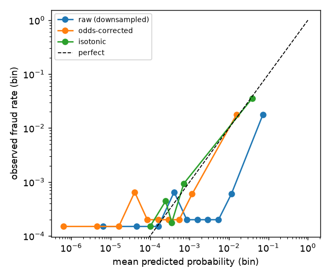

Raw scores average 0.95% vs a true 0.2% (≈5× too high); the formula and Platt restore ~0.2% and nearly halve **log-loss**. **Monotonic** fixes leave **PR-AUC** unchanged (ranking ≠ calibration); isotonic's small drop comes from ties in its step function. (`FrozenEstimator` replaced `cv="prefit"` in scikit-learn 1.6.) **ECE** (expected calibration error) = weighted mean gap between score and observed rate per bin; **Brier** = mean squared error of probabilities.

### Manufacturing negatives (retrieval)
Logs show clicks, never what a user ignored, so retrieval models ([Chapter 13](../13-recommenders-and-embeddings/README.md)) manufacture negatives: **random** (easy, teaches little about close calls); **in-batch** (other users' positives — cheap, but popular items are over-represented, so apply a **popularity/sampling-bias correction** or the model learns to demote popularity itself); **hard** (shown-not-clicked, near neighbours — sharpen the boundary, but some are false negatives). Mix and tune the ratio.

### Split hygiene and the leakage checklist

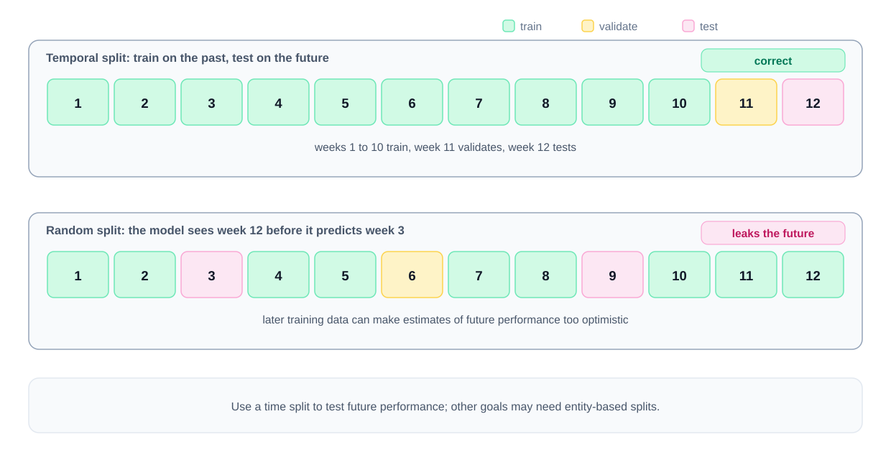
*Figure — Time-based vs random split (course diagram)*

- **Temporal splits** (nearly always): train weeks 1–10, validate 11, test 12; a random split lets the model train on week 12 and "predict" week 3 (Rules of ML **#33**: trained through Jan 5 → test from Jan 6). Generalising to new users needs **entity-based splits** (all of a user's rows in one split).
- **Point-in-time features** in every example (16.2).
- Leakage checklist: (1) aggregates whose window includes the label moment ("merchant fraud rate" including this transaction); (2) **label-adjacent fields** filled only because the outcome happened (refund flag, case-resolution code); (3) near-duplicates across splits (decide whether the same user may appear in both, per what you're testing).

### Privacy, in one paragraph
Minimise **PII** (personally identifiable information) at ingestion: collect only what's needed, restrict access, set retention. Hashed IDs are still linkable. Define how deletion requests reach raw data, derived datasets, embeddings and models (versioned data, deletion tracking, scheduled rebuilds — involve privacy/legal). Fraud verdicts and moderation decisions are sensitive too.

### In the interview
**30-second answer** ("where does your training data come from?"): *"Outcomes, behaviour and human judgments, each with a cost and delay. I validate labels, join them to point-in-time features, split by time, downsample and recalibrate for imbalance, and audit LLM labels against human slices."*

- **"Fraud outcomes take six weeks. What do you train on today?"** → Matured rows (window stops six weeks back) plus provisional signals — rule hits, analyst verdicts — for recent traffic. Outcome monitoring lags six weeks; score-distribution monitors cover the gap.
- **"Annotators disagree 30% of the time."** → A guideline bug first: cluster disagreements, add examples, re-version, re-measure. For truly ambiguous items, collect several judgments and train on the majority or the distribution.

### TL;DR
Outcomes (slow), behaviour (fast, biased), humans (costly, need QA). Downsample then recalibrate. Split by time, join point-in-time, dedupe, minimise PII.

---

## 16.4 Features and feature stores

### What it is
A **feature store** computes, stores and serves features consistently for training (history) and serving (latest values). For each feature say what it is, its source, required freshness and cost.

### How it works — four feature groups (ETA example)

| Group | Meaning | ETA examples | Typical compute path |
|---|---|---|---|
| **Entity** | Rarely-changing attributes of restaurant, courier, customer | Typical prep time, courier vehicle, building type | Batch (nightly) |
| **Behavioural aggregates** | Counts/averages over a recent window | Orders last 30 min, courier speed today, dish median prep over 7 days | Streaming for short windows, batch for long |
| **Contextual** | The request moment | Time, weekday, weather, distance, big match on TV | Request time |
| **Cross** | Two entities together | This courier at this restaurant; this customer in this cuisine | Batch or streaming |

A second gap-finding checklist by **signal source**: the item's content, the actor, their recent behaviour, graph links between entities, the request's circumstances.

### Turning raw signals into model inputs

| Kind of input | Usual encoding | Example |
|---|---|---|
| Huge ID vocabularies | Learned **embedding tables** (Chapter 13); for unbounded ID sets the **hashing trick** maps each ID to one of a fixed number of buckets | user, item, merchant IDs |
| Numbers | Bucketing, normalisation, log transform for **heavy tails** (a few enormous values) | order counts, km, prices |
| Short category lists | One-hot or tiny embeddings | device type, country |
| Interacting pairs | Hand-built crosses, or a deep model that discovers them | user × category |

Trees don't need scaling; linear models and neural nets do.

### Freshness: batch path + streaming path
A half-hour order count refreshed nightly tells the model nothing, so the feature layer may have two arms:
- **Batch path** — Spark/SQL jobs compute slow features for every entity; easy to **backfill** (compute past values).
- **Streaming path** — Flink or Spark Structured Streaming reading **Kafka** (a durable, multi-consumer event log) keeps windowed aggregates current within seconds; more operational work (state, late events, backfills).

This is the **lambda architecture** (Nathan Marz); streaming-only is **kappa**. Run both only when freshness requires it — Rules of ML **#8: know the freshness requirements of your system**.

### What a feature store actually is

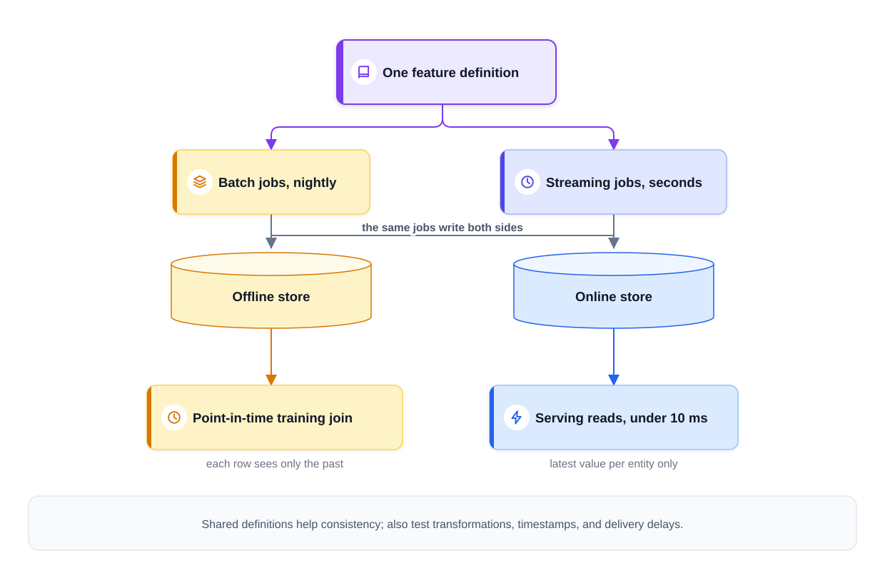
*Figure — Feature store: shared definitions, offline history, online latest (course diagram)*

| Side | Storage | Holds | Used for |
|---|---|---|---|
| **Offline store** | Warehouse / lake (Parquet, BigQuery, Snowflake…) | Timestamped history of feature values | Training sets via **point-in-time joins** — a row from 6:02 pm on 3 March gets values as of then |
| **Online store** | Low-latency **key-value store** (Redis, DynamoDB, Cassandra, Bigtable) | Only the **current** value per feature per entity | Serving: "40 features for restaurant 812, courier 3407, this route — in < 10 ms" |

One set of definitions feeds both, and the store doubles as a **registry** so teams reuse rather than re-derive (re-derivation recreates skew). Still test transforms, timestamps, late data and empty values. Products: **Feast** (open source), **Tecton**, **Databricks**, **SageMaker** and **Vertex AI** feature stores; Uber's **Michelangelo** popularised the pattern.

### Request-time features
Some values exist only at request time (route distance, current cart). The trap: an expensive call (routing service, third-party API) with no latency plan. If it eats 80 ms of a 100 ms budget: (1) **cache** a recent answer; (2) **approximate** (straight-line vs road distance); (3) **default** a "missing" value on timeout. Train and evaluate with those degraded inputs so the fallback is rehearsed and its quality cost known. Budget line: *"15 ms to assemble features — one batched lookup and two computed inline; anything late takes the default the model met in training."*

### Trade-offs
| | Batch features | Streaming features | Request-time features |
|---|---|---|---|
| Freshness | Hours | Seconds | Instant |
| Cost/complexity | Low | High (state, late events, backfills) | Latency on the critical path |
| Backfill for training | Easy | Harder | Must be logged at serving |

### Common mistakes
- 7-day aggregates computed at request time (millions of events per call).
- Silent staleness: the stream falls behind with no alarm. Put **feature freshness** on the main dashboard with its own alert; consider feeding "feature age" to the model.
- A second team re-implements a feature → skew.

### In the interview
**30-second answer**: *"Entity features in nightly batch, short-window aggregates in streaming, request context inline under a budget. A feature store gives point-in-time history for training and latest values for serving from one definition, and I test that both paths agree."*

- **"Why not compute everything per request?"** → Too slow and costly: precompute what tolerates it, stream what must be current, request-time only for what can't be known sooner.
- **"The streaming job lags?"** → Freshness alert, trained-in defaults, feature age as input.

### TL;DR
Four groups; batch for slow, streaming for fresh, inline for request-only; feature store = offline history + online latest; budget request-time features.

---

## 16.5 Batch vs online vs streaming inference

### What it is
**Batch inference** precomputes predictions on a schedule into a key-value store (a request becomes a lookup). **Online inference** computes per request. **Streaming inference** scores events arriving through a queue.

| | Batch | Online |
|---|---|---|
| When computed | On schedule, for all (or active) entities | Per request |
| Request-time work | KV lookup, ~1 ms | Feature fetch + model, ~10–100 ms |
| Infra | Scheduled job + KV store | Always-on capacity, autoscaling |
| Freshness | As old as the last run | As fresh as the inputs |
| Can use request context? | No | Yes (query, cart, route) |
| Cost shape | Batch size × reuse × hardware | Scales with traffic, peaks at busy hours |

### How it works — the deciding question
**Does the prediction need information that exists only at request time?** Then weigh freshness and reuse.
- ETA: yes (route, cart, live queue) → online.
- Fraud: the transaction *is* the input → online (or streaming).
- "Videos you might like" shelf: mostly no → batch (last night's top-500 is fine).
- Search ranking: query is request-time, per-item quality scores precomputable → hybrid.

**Waste**: 25M users × 500 recommendations = 12.5B rows, mostly unread if 80% don't visit this week. Precompute for **active users only** (5M → 2.5B rows), keep **fewer items per user** and reorder cheaply online, or precompute per **segment**.

### The hybrid: precompute-then-rerank

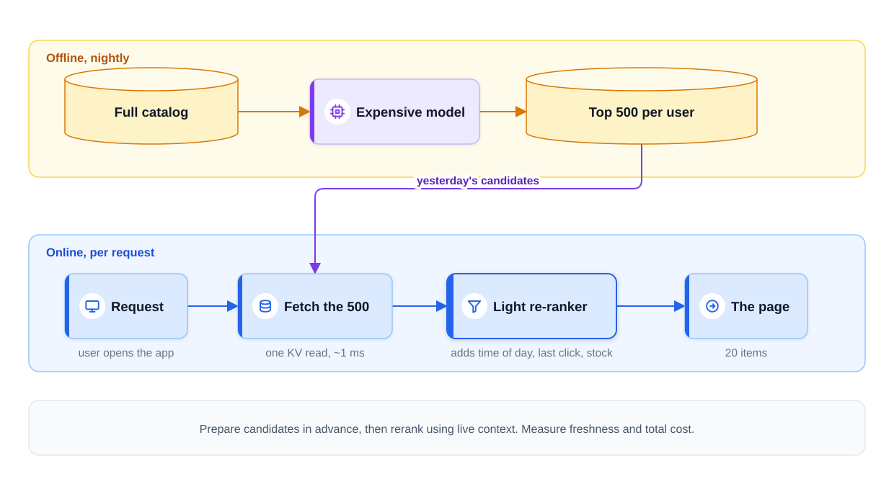
*Figure — Nightly candidates, live rerank (course diagram)*

Offline, an expensive model picks ~500 candidates per user; online, a small model reorders them using the moment (time, last click, stock). New items need an online retrieval path. Degrades gracefully: yesterday's candidates if the nightly job fails (alert on staleness, rerun — an online failure would be an immediate incident), unreranked candidates if the reranker fails.

### Streaming inference
Events trigger predictions (each uploaded video scored for policy, each payment in the pipeline): online inference behind a queue, no synchronous caller. Handle queue delay, retries, **duplicate events** (**idempotent** scoring — twice has the same effect as once) and **backpressure** (slowing producers when consumers can't keep up) — see [System Design Fundamentals](../../../system-design-patterns/modules/00-system-design-fundamentals/README.md).

### Trade-offs / when not to use
- Batch: wrong when inputs exist only at request time or staleness hurts (fraud, ETA).
- Online: wasteful when predictions are stable and heavily reused.
- Streaming: wrong when a caller waits **synchronously** for the answer.

### In the interview
**30-second answer**: *"Does it need request-time inputs, how fresh must it be, how often is a stored prediction reused? Stable and reused → batch; request-dependent → online; event-driven async → streaming. For feeds, precompute candidates for active users and rerank online."*

- **"How fresh is fresh enough?"** → Measure: plot CTR against stored-candidate age; the decay rate sets the rerun cadence.

### TL;DR
Batch = lookup, stale, cheap per request; online = fresh, request context, pay at peak; streaming = event-triggered async. Precompute-then-rerank is the default for large catalogs.

---

## 16.6 Model serving basics

### What it is
A typical predictive model server is **stateless**: it loads the model at startup and turns feature vectors into scores, so it scales like any web tier — **replicas** behind a **load balancer**, autoscaling on CPU or queue length, **rolling deploys**, **health checks** ([System Design Fundamentals](../../../system-design-patterns/modules/00-system-design-fundamentals/README.md)). ML-specific parts: artifact source, latency budget, safe rollout, hardware.

### The latency budget, itemised (illustrative small-model numbers)

| Stage | Rough cost | Comment |
|---|---|---|
| Model inference | 1–10 ms | Trees and small tabular models are quick; deep nets need tuning |
| Online-store lookup | 2–10 ms | One batched read; frequently the slowest step (the usual small-model bottleneck) |
| Features computed inline | 0–15 ms | Each with its own allowance and a default if late |
| Routing, auth, parsing | 1–5 ms | Usual web-service overhead |
| Writing the log, sending the reply | 1–2 ms | Logging asynchronous so it doesn't block |

Profile before optimising:
- **Batching** (dynamic/micro-batching) — group requests for a few ms for better hardware use, especially GPUs; trades a small wait for throughput, so test **p99** (latency 99% of requests beat).
- **Feature caching** — keep the most-requested entities' vectors (busy restaurants, trending videos) in process memory so most traffic never hits the online store.

### Shipping a new model safely

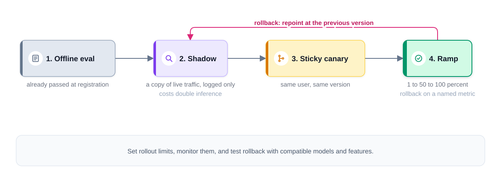
*Figure — Rollout stages: offline eval, shadow, canary, ramp (course diagram)*

1. **Offline evaluation** — passed (that's how it got registered).
2. **Shadow deployment** — candidate scores a copy of live traffic; outputs logged, never used. Catches serving bugs, latency, big behaviour differences; isolate capacity, disable side effects.
3. **Canary / A/B** — a small traffic share gets real outputs from the new model, usually **sticky per user** (sessions, orgs, regions or time windows in other cases).
4. **Ramp up with a pre-agreed abort rule** — "revert if session CTR falls 2% or p99 exceeds 150 ms". Rollback restores a compatible model *and* features and config; rehearse it and know how long it takes.

### Hardware
Trees and small nets serve well on CPU — say *"I'd benchmark the GBDT on CPU replicas first"*, not "GPU cluster" by reflex; GPUs pay off for large neural models with batching. Runtimes worth naming: ONNX Runtime, NVIDIA Triton, TensorFlow Serving.

### Shrinking the model
| Technique | Idea | Watch out |
|---|---|---|
| **Distillation** | A small *student* mimics a large *teacher* | Measure the quality loss |
| **Quantisation** | Fewer bits per weight/activation (int8 vs float32) | Needs runtime support; check accuracy |
| **Pruning** | Drop weights that contribute little | Speedups need sparse-aware runtimes |

Compare with simply changing hardware, counting engineering effort and quality loss. (Central for LLMs — AI Handbook.)

### Degradation is part of the spec
Agree the **fallback prediction** with product and risk owners: previous version kept warm, cached prediction, heuristic (average ETA; rules-only fraud), or product default (unpersonalised shelf). For fraud it may be review or decline, not "allow". Name the owner and how long degraded mode may last before paging.

### Model-in-service vs model-as-a-service
Embedding the model in the app saves a network hop but couples deploys and scaling. A standalone model service costs a few ms but gives independent rollout, sharing across teams and right-sized hardware — the default at scale.

### Common mistakes
- Forgetting timeouts and autoscaling once a model is in the diagram.
- No model version logged per prediction — A/B results can't be attributed.
- Rollback = "redeploy the old file" after the feature schema changed.

### In the interview
**30-second answer**: *"A stateless, versioned model service loading from the registry, scaled like a web tier. I itemise the latency budget and profile before adding batching or caches. Releases: offline eval → shadow → sticky canary → ramp with a named rollback metric. Fallback: previous version or a heuristic agreed with product."*

- **"A/B two models cheaply?"** → One service with both versions loaded, sticky per-user router, version logged per prediction; shadow first, since experiments cost weeks of traffic.

### TL;DR
Stateless versioned service; itemised budget; batching and hot caches; shadow → canary → ramp; CPU first; distill/quantise/prune; explicit fallback.

---

## 16.7 Offline evaluation: choosing the metric

### What it is
Offline metrics are the *first gate* (held-out data, before users see anything); the online experiment (16.9) is the second. Definitions — precision/recall, ROC-AUC vs PR-AUC, MAE/RMSE, recall@k/NDCG/MRR, calibration — are in [Chapter 6](../06-evaluation-and-tuning/README.md) (§6.2 regression, §6.3 classification and thresholds, §6.4 ranking, §6.5 calibration). This section adds only the production twist.

| Problem | Report | Production twist |
|---|---|---|
| Rare-event classification (fraud, abuse) | P/R at the shipping threshold, PR-AUC beside the base rate | Thresholds are business policy; often two (approve / review / block) |
| Retrieval → ranking | recall@k for candidate generation, NDCG@k or MRR for ordering | Each funnel stage its own metric; click labels are position-biased |
| Regression (ETA, demand) | MAE or RMSE plus p90 error | Break down per **cohort** — new cities or segments hide inside a good average |
| Any score used as a number | Calibration (reliability diagram, ECE) | Recheck after downsampling/re-weighting (16.3) and population shifts |

### Production checklist
1. **Eval set looks like traffic**: time-based split, real base rate, no leaked features (16.2, [§4.7–4.8](../04-data-eda-feature-engineering/README.md)).
2. **Report the operating point, not only an area**: "92% precision at 60% recall at threshold 0.05", plus the review workload (alerts/day).
3. **The cost owner picks the threshold**: product/risk price blocked good customers vs missed fraud; ML supplies the PR curve and expected costs.
4. **Slice**: country, device, new vs returning, new vs mature market. Ship only if no important slice regresses.
5. **Beat two baselines**: naive (majority class, popularity, "same hour last week") and current production. A 6-minute MAE impresses against a naive 8, not a naive 6.2.
6. **Ranking label source**: judged sets (human graders following guidelines) plus behavioural labels with position-bias correction.

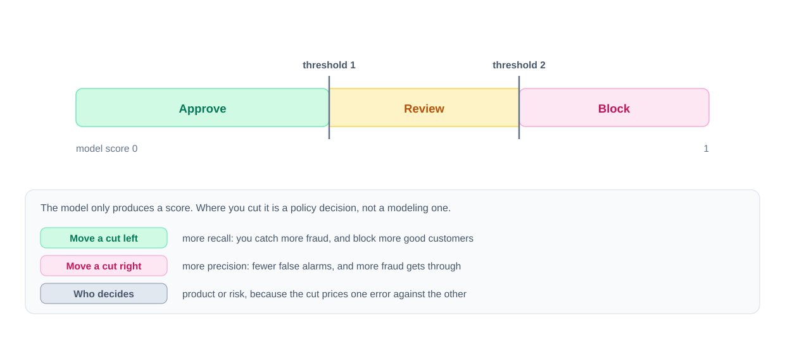
*Figure — Approve / review / block bands from two cut-offs (course diagram)*

### Code — one production-sized run per family (`code/offline_metrics.py`)
Logistic regression on synthetic transactions with 0.2% fraud: threshold sweep, two-threshold bands, a by-hand NDCG checked against scikit-learn, ETA errors split by city cohort.

Output (abridged):
```
== classification (rare positives) ==
test rows 80,000, positives 146 (base rate 0.18%)
ROC-AUC 0.935   PR-AUC (average precision) 0.083   PR-AUC of a random model = base rate = 0.002
threshold  flagged   TP     FP precision  recall     FPR
    0.005     5776  106   5670      0.02    0.73  0.0710
    0.050      462   42    420      0.09    0.29  0.0053
  approve :  77081 txns, fraud rate in band 0.07%
  review  :   2457 txns, fraud rate in band 1.91%
  block   :    462 txns, fraud rate in band 9.09%

== regression (ETA minutes) ==
overall  MAE  3.71  RMSE  5.27  p90|err|  7.41
mature   MAE  3.17  RMSE  3.99  p90|err|  6.55  share 93%
new      MAE 10.93  RMSE 13.69  p90|err| 22.66  share 7%
naive baseline (predict the mean) MAE  9.46
```
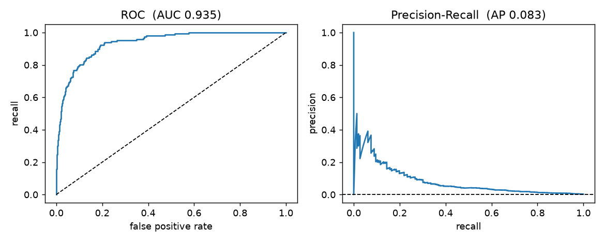

(TP = fraud caught; FP = good transactions flagged; FPR = false-positive rate.) A 0.935 ROC-AUC passes a dashboard review, but catching 73% of fraud means 5,670 false alarms for 106 catches — the analyst queue, not the AUC, is what the business feels. Two bands put 9% fraud in "block" and 1.9% in "review", so humans look at 2,457 cases instead of 80,000. Overall ETA error 3.7 min hides 10.9 min in new cities.

### In the interview
**30-second answer**: *"I pick the offline metric from the task, but in production I report it at the shipping threshold with the workload it creates, sliced by cohort, against a naive baseline and the current model. The cost owner chooses the threshold. Offline wins only earn an A/B test."*

- **"Offline metric up, A/B flat?"** → The offline metric is a proxy: weak label (click vs watch time), test set no longer like traffic, or serving-time degradation (skew). Check experiment power and logging first.

### TL;DR
Definitions in §6.2–6.5. Production: traffic-like eval set, operating point + workload, owner-chosen thresholds, cohort slices, naive and production baselines — then an A/B test.

---

## 16.8 Monitoring, drift and retraining

### What it is
Deployed models lose quality as the world changes — fraudsters adapt, a pandemic reshapes delivery times, new slang fools a toxicity classifier. Decay rates differ; measure them.

| Drift type | What changes | Example | Also called (Huyen) |
|---|---|---|---|
| **Data drift** | Inputs P(X) | Orders shift from lunch to dinner | Covariate shift |
| **Label / prior shift** | Outcomes P(Y) | Fraud rate doubles in a holiday | Label shift |
| **Concept drift** | The relationship P(Y \| X) | Same features, different outcomes — new fraud tactics, a restaurant changes kitchens | Concept drift |

Data drift may not hurt accuracy; concept drift always needs new labels. Monitoring must also tell drift from plain **bugs** (a broken upstream pipeline looks like drift).

### How it works — the four-layer monitoring stack

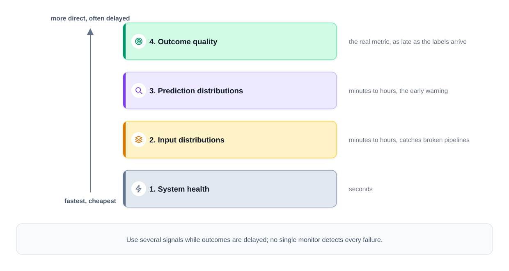
*Figure — Monitoring layers from fast/cheap to slow/direct (course diagram)*

| Layer | How quickly it reacts | Signals tracked | Typical findings |
|---|---|---|---|
| 1. Service health | Seconds | Traffic, latency, error rate, feature-store value age | Outages; pipelines that stopped updating |
| 2. Inputs | Minutes to hours | Each feature vs its training reference — null share, means, PSI or KS | Data drift; a producer sending garbage |
| 3. Outputs | Minutes to hours | Score histogram; share of positive decisions | Model behaving differently, visible before labels exist |
| 4. Outcomes | When labels land — seconds for clicks, ~an hour for ETAs, weeks for chargebacks | CTR, realised ETA error, recall on confirmed fraud | Concept drift and genuine quality loss |

Layers 2–3 exist because layer 4 is late; some attacks move neither inputs nor scores, so combine signals. Rules of ML **#9: detect problems before exporting models**; **#10: watch for silent failures** (a joined table that stopped updating). *Reliable Machine Learning* (Chen, Murphy et al., O'Reilly 2022) treats model quality as SLOs with incident playbooks.

### Drift statistics
- **PSI (Population Stability Index)**: bin the reference distribution into **quantiles**; PSI = Σ (cur% − ref%) · ln(cur% / ref%). Credit-scoring convention: < 0.1 stable, 0.1–0.25 watch, > 0.25 investigate.
- **Two-sample Kolmogorov–Smirnov (KS) test**: D = max gap between the two empirical **CDFs**, plus a **p-value**. With large samples trivial shifts become "significant" — look at D (the **effect size**).
- **Null rates and schema checks** — PSI on non-null values can't see a producer that started sending 30% nulls.
- Categorical features: **chi-square test** or PSI over categories. Tools: Evidently, WhyLabs, NannyML, SageMaker Model Monitor, Vertex AI Model Monitoring, TFDV.

### Code — PSI and KS (`code/drift_psi_ks.py`)
```python
def psi(reference, current, bins=10, eps=1e-6):
    ref, cur = reference[~np.isnan(reference)], current[~np.isnan(current)]
    edges = np.quantile(ref, np.linspace(0, 1, bins + 1))
    edges[0], edges[-1] = -np.inf, np.inf            # catch values outside the training range
    r = np.histogram(ref, edges)[0] / len(ref)
    c = np.histogram(cur, edges)[0] / len(cur)
    r, c = np.clip(r, eps, None), np.clip(c, eps, None)
    return float(np.sum((c - r) * np.log(c / r)))

ks = ks_2samp(reference, current)                       # scipy.stats
```
```
same distribution (new sample)     PSI  0.001  KS D 0.007  p  4.9e-01  nulls  0.0%  -> stable
tiny shift (+3%) -- big n          PSI  0.002  KS D 0.018  p  2.5e-11  nulls  0.0%  -> stable
new suburb city (longer trips)     PSI  0.361  KS D 0.241  p  0.0e+00  nulls  0.0%  -> INVESTIGATE
upstream bug: miles not km         PSI  0.426  KS D 0.251  p  0.0e+00  nulls  0.0%  -> INVESTIGATE
30% nulls (broken producer)        PSI  0.000  KS D 0.006  p  7.5e-01  nulls 30.2%  -> stable
```
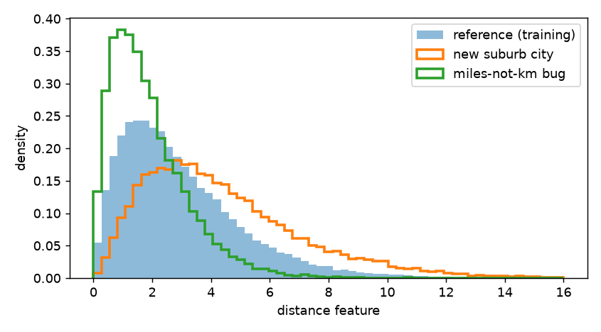

(1) A 3% shift on large samples gives p ≈ 10⁻¹¹ but PSI 0.002 — don't page on p-values. (2) A new city and a unit bug look the **same** — alerts start investigations (PSI 0.4 ≠ "retrain"), they don't prove drift. (3) PSI/KS missed the 30% nulls — check null rates separately.

### Retraining: cadence, trigger, gates
Retraining is one possible response — first fix broken data, policy or serving bugs.
1. **Scheduled** — simple, right for gradual drift; set cadence from measured decay (a weekly model down 2% AUC by day 7 → twice a week).
2. **Triggered** — monitor fires → investigation → candidate run if validated data exists. Never auto-promote because an alert fired.
3. **Online / continual learning** — incremental updates (Huyen: **stateless retraining** from scratch vs **stateful training** from the last checkpoint). Suits fast-changing tasks; needs bounded updates, validation, rollback — a bad stream corrupts an online learner fast.

Every candidate passes the same gates: offline vs production (overall **and per segment**) → shadow → canary, approved by a named owner or automated limits. The history window should cover **seasonality** yet drop stale patterns — treat it as a **hyperparameter**, weighting recent data in fast-drift domains.

### Feedback loops that damage your data

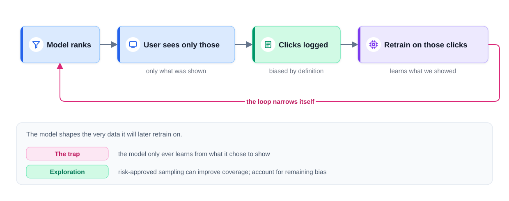
*Figure — How a ranker narrows its own training data (course diagram)*

The model shapes the data it later learns from — Huyen's **degenerate feedback loop**. A feed shows what it predicts you'll like, you can click only what was shown, and the retrained model learns "what we showed gets clicked" (popularity bias, filter bubbles). In fraud, blocked transactions never produce an outcome (investigator evidence gives partial labels — record source and uncertainty).

Mitigations:
- **Controlled exploration** — in low-risk recommenders, a small approved traffic share gets randomised candidates, with **selection probabilities logged** for later **inverse propensity weighting** (unbiased estimates); bandits ([Chapter 14](../14-reinforcement-learning/README.md)) formalise this.
- Fraud: never let suspicious payments through merely to learn outcomes; use risk-approved reviews, simulations, or small strictly limited experiments.
- Positional features: log position at training, fix it to a constant at serving (Rules of ML **#36**).
- Exploration improves coverage but doesn't remove all bias; measure its benefit and user cost.

### In the interview
**30-second answer**: *"Four layers — service health, inputs, outputs, real outcomes; labels are late, so the first three warn early. An alert starts an investigation; often it's a broken pipeline, not the model. Retraining runs on a cadence set by measured decay or after an investigation, and every candidate clears offline, shadow and canary gates. A small, risk-approved exploration budget guards against the model skewing its own labels."*

- **"Quality dropped overnight — debug it."** → Bottom up: pipeline freshness and feature nulls (most likely, fastest) → prediction histogram → segment the drop (one country? app version?) → only then the model.

### TL;DR
Data/label/concept drift; four monitoring layers; PSI/KS + null checks; gated retraining by schedule or after investigation; beware models that shape their own data.

---

## 16.9 Online experiments and A/B testing

### What it is
Offline asks whether the new model predicts held-out labels better; production asks whether it makes the **product** better. An **A/B test** randomly splits units between control (A, current) and treatment (B, new) and compares a business metric.

### Why offline numbers aren't enough
**The label is a proxy** (a model can win on click-AUC while lowering watch time); **deploying changes the behaviour it's judged on** (a new ranker changes what people see and click — a frozen test set can't reflect that); **serving isn't scoring** (timeouts, stale caches, fallbacks never seen offline).

### How it works — two gates, and shadow in between
**Offline gate** (predefined quality, cost, safety, per-subgroup criteria) → **shadow mode** when failures are expensive (identical live requests, outputs hidden) → **online gate**: A/B on the **business** metric (some products can't A/B safely or lack traffic).

### A/B mechanics
1. **Randomise by unit** — usually users, via a **hash** of user id + experiment name for **sticky** assignment; sessions, orgs, regions or time windows when users affect each other (**interference**) or effects carry over.
2. **One primary metric, chosen in advance** (avoids p-hacking) — the rest are guardrails or diagnostics.
3. **Size for power** — fix the **minimum detectable effect** (MDE), significance α (false-positive rate, typically 0.05) and **power** (chance of detecting a true effect of that size, typically 0.8). Per-arm sample size for two proportions:
   n = [z₁₋α/₂·√(2·p̄(1−p̄)) + z₁₋β·√(p₁(1−p₁) + p₂(1−p₂))]² / (p₂ − p₁)²
   (z₁₋α/₂ ≈ 1.96, z₁₋β ≈ 0.84 from the standard normal; p₁, p₂ the arms' rates, p̄ their mean.) Rare events, small effects and noisy metrics need big samples.
4. **Duration** — from sample size, outcome delay and whole weekly cycles; watch **novelty effects** and seasonality.
5. **Don't peek** — stopping at the first daily p < 0.05 inflates false positives. Fix an end date or use a **sequential test** (alpha-spending, always-valid methods). **CUPED** (pre-experiment behaviour as a **covariate**) cuts variance and sample size.

### Code — sample size, z-test, peeking (`code/ab_test.py`)
```python
def assign(user_id, experiment, treatment_share=0.5):
    h = int(hashlib.sha256(f"{experiment}:{user_id}".encode()).hexdigest(), 16)
    return "B" if (h % 10_000) / 10_000 < treatment_share else "A"      # sticky

def two_prop_ztest(x_a, n_a, x_b, n_b):
    pa, pb = x_a / n_a, x_b / n_b
    pooled = (x_a + x_b) / (n_a + n_b)
    se0 = np.sqrt(pooled * (1 - pooled) * (1 / n_a + 1 / n_b))        # SE under H0
    z = (pb - pa) / se0
    p = 2 * (1 - norm.cdf(abs(z)))
    se = np.sqrt(pa * (1 - pa) / n_a + pb * (1 - pb) / n_b)           # SE for the CI
    return pa, pb, z, p, (pb - pa - 1.96 * se, pb - pa + 1.96 * se)
# ... sample_size_per_arm(), and 2,000 simulated A/A tests with 20 peeks each
```
```
sticky assignment: ['A', 'B', 'A', 'A', 'A', 'A', 'B', 'B'] | again: True
baseline CTR 5%, detect +1% relative lift (alpha .05, power .8): 2,996,698 users per arm
baseline CTR 5%, detect +2% relative lift (alpha .05, power .8): 752,703 users per arm
baseline CTR 5%, detect +5% relative lift (alpha .05, power .8): 122,124 users per arm

A: 19,906/400,000 = 4.9765%   B: 20,575/400,000 = 5.1437%
diff +0.1673% (relative +3.4%), z = 3.41, p = 0.0006, 95% CI [+0.0712%, +0.2633%]

A/A tests, alpha 0.05: false-positive rate testing once at the end = 4.9%; stopping at the first significant of 20 peeks = 23.3%
```
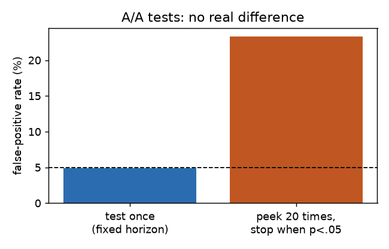

Halving the lift roughly **quadruples** the sample (n ∝ 1/δ²): a 1% relative CTR lift needs ~3M users per arm. The finished test is significant (the 95% **CI** excludes zero). In an **A/A test** both groups get the same version, so any "win" is a false positive; peeking 20 times turns 5% into ~23%.

### Guardrails and the metric hierarchy

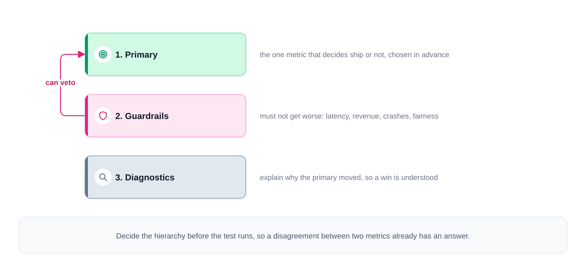
*Figure — Metric tiers: primary, guardrails, diagnostics (course diagram)*

1. **Primary** — decides ship/no-ship (e.g. watch time per session).
2. **Guardrails** — must not degrade: latency, crash rate, unsubscribes, revenue, fairness across segments. A primary win doesn't override a breached guardrail.
3. **Diagnostics** — explain *why* the primary moved.

Fixing the hierarchy beforehand settles disagreements in advance. Also check **sample ratio mismatch** (a 50/50 split arriving as 52/48 = broken assignment or logging).

### Beyond the simple A/B
| Variant | Use when | How |
|---|---|---|
| **Interleaving** | Ranking, low traffic | Merge two rankers' results into one list per user (e.g. team-draft); see whose items get clicked. Much more sensitive, but measures preference, not long-term impact |
| **Switchback** | Marketplaces with network effects (dispatch, surge pricing) | Flip the whole region between variants over time windows, because treating some riders affects the shared drivers |
| **Multi-armed bandits** | Ongoing selection, reward during the test | Shift traffic toward the winner as evidence accrues (Thompson, UCB); analysis differs from fixed splits |
| **Holdback** | Durable long-term effect | Keep a small slice on the old experience for months |

### Real-world examples
Microsoft (Bing/ExP), Netflix, Booking.com, LinkedIn and Airbnb run thousands of experiments a year; Netflix and Airbnb have published on interleaving, DoorDash and Lyft on switchbacks; CUPED originated at Microsoft (Deng et al., 2013).

### In the interview
**30-second answer**: *"Offline filters candidates; shadow catches serving problems; then an A/B test with a predeclared unit, primary metric and guardrails, sample size from MDE and power, whole weekly cycles, and a fixed-horizon or sequential stopping rule — then a gradual rollout with rollback conditions."*

- **"Very little traffic?"** → More sensitive metrics, interleaving, longer runs, variance reduction, bolder changes — and admit some rare-event effects can't be A/B tested; rely on shadow plus careful ramps.
- **"Improved for a month, then reverted."** → Novelty, seasonality, population change or data issues; run past the novelty window, keep a long-term holdback.

### TL;DR
Offline filters, online decides: right unit, one primary metric, vetoing guardrails, powered sample, whole weeks, no peeking; interleaving, switchbacks, bandits, holdbacks for special cases.

---

## 16.10 MLOps: the glue that makes it repeatable

### What it is
**MLOps** applies **DevOps** practices — version control, automated testing, **CI/CD** (continuous integration: test every change automatically; continuous delivery/deployment: release it automatically), monitoring — to ML, where the "code" includes **data** and **models**. Google's maturity levels:

| Level | What's automated | Typical symptom |
|---|---|---|
| **0 — Manual** | Nothing: notebooks, hand-exported models, rare releases | "Only Alice can retrain it" |
| **1 — ML pipeline automation** | Training runs automatically on new data (**continuous training**, CT), with data & model validation and a registry | Models refresh; pipeline code still deployed by hand |
| **2 — CI/CD pipeline automation** | Pipeline code itself built, tested, deployed automatically | Commit to production safely |

### The components

| Component | Job | Examples |
|---|---|---|
| **Experiment tracking** | Log each run's code version, params, **data hash** (fingerprint of the exact data), metrics, artifacts — reproducible (same code + data → same model) and comparable | MLflow Tracking, Weights & Biases, Neptune |
| **Data & model versioning** | Snapshot datasets and link them to models (lineage) | DVC, lakeFS, Delta Lake time travel |
| **Data validation** | Schema, ranges, null rates, distributions **before** training and at serving; fail the pipeline on bad data | TFDV, Great Expectations, Pandera |
| **Model registry** | Versions, stages (candidate/staging/production/archived), metrics, approvals, rollback target | MLflow Model Registry, SageMaker, Vertex AI |
| **Orchestration** | **DAG** (steps with dependencies, no loops): ingest → validate → features → train → evaluate → register | Airflow, Kubeflow Pipelines, Dagster, Metaflow, TFX |
| **CI for ML** | Feature-code unit tests, training–serving consistency tests, a "trains and beats baseline" **smoke test**, validation gate | GitHub Actions + pytest, etc. |
| **CD for ML** | Package model + serving code, deploy via shadow → canary → ramp, auto-rollback on guardrails | KServe, Seldon, BentoML, SageMaker endpoints |
| **Monitoring** | 16.8's four layers, feeding CT | Evidently, Arize, WhyLabs, Prometheus/Grafana |

Rules of ML **#5: test the infrastructure independently from the ML** — push a trivial model through and confirm identical offline and online predictions before trusting any accuracy number. Google's "ML Test Score" paper (Breck et al., 2017) is a checklist for this.

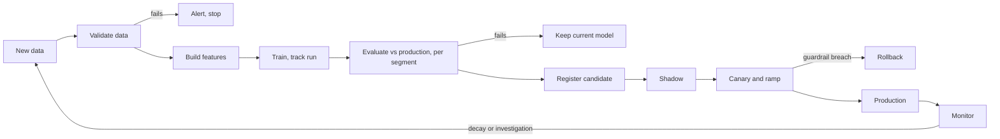

### Code — a toy end-to-end loop (`code/mlops_pipeline.py`)
Data validation, tracked runs with data hashes, a staged registry, a per-segment promotion gate, shadow comparison, a canary with automatic rollback, and a skew check — ~170 lines of plain Python.
```python
def gate(cand, prod, tolerance=0.01):
    c, p = cand["metrics"], prod["metrics"]
    if c["mae"] >= p["mae"]:
        return False, f"overall MAE {c['mae']:.2f} not better than {p['mae']:.2f}"
    for k in ("mae_mature", "mae_new_city"):                       # no segment may regress
        if c[k] > p[k] * (1 + tolerance):
            return False, f"segment {k} regressed {p[k]:.2f} -> {c[k]:.2f}"
    return True, f"MAE {p['mae']:.2f} -> {c['mae']:.2f}, no segment regressed"

def canary(cand_model, prod_model, live, ylive, cand_features=None):
    for share in (0.01, 0.05, 0.25, 0.50):
        # ... compare canary MAE with production MAE on the traffic slice
        if mae_c > mae_p * 1.05:
            return False            # ROLLBACK
    return True
```
```
1) validation of a clean batch: OK
   validation of a broken batch: ['distance_km: 99.9% out of range [0.0, 80.0]', 'hour: 2.0% nulls']

2-3) train + track + register; v1 (ridge) bootstraps production
   v1 ridge            MAE 2.94 (mature 2.84, new city 3.79)
   v2 gbdt             MAE 2.43 (mature 2.43, new city 2.40)
   v3 gbdt_no_new_city MAE 2.58 (mature 2.43, new city 3.85)
   tracked run files: ['run_1.json', 'run_2.json', 'run_3.json']

4) promotion gate vs production (v1)
   v2 gbdt             -> PASS: MAE 2.94 -> 2.43, no segment regressed
   v3 gbdt_no_new_city -> FAIL: segment mae_new_city regressed 3.79 -> 3.85

5) shadow v2: 20,000 live requests, mean |prod - cand| = 1.49 min, max = 27.3 min (logged, never served)

6) canary v2, first attempt (serving container has the UTC-hour bug):
   canary   1%: MAE 2.95 vs prod 2.93 -> continue ramp
   canary   5%: MAE 3.47 vs prod 2.92 -> ROLLBACK (guardrail: >5% worse)
7) skew check on logged features: 'hour' differs from the training pipeline on 100% of rows -> fix the serving code path
   canary v2, after the fix:
   canary   1%: MAE 2.20 vs prod 2.93 -> continue ramp
   canary   5%: MAE 2.48 vs prod 2.93 -> continue ramp
   canary  25%: MAE 2.42 vs prod 2.93 -> continue ramp
   canary  50%: MAE 2.46 vs prod 2.92 -> continue ramp
   registry: [(1, 'ridge', 'archived'), (2, 'gbdt', 'production'), (3, 'gbdt_no_new_city', 'candidate')]
```
Validation stops a km→m unit bug; v3 beats v1 on average but is blocked for regressing on new cities; the canary catches a **serving-side** bug (hour in UTC inside the serving **container**) invisible offline — 1% was too noisy, 5% caught it; comparing logged serving features with training finds the cause; after the fix v2 ramps and is promoted.

### Common mistakes
- Metrics tracked without the data version → unreproducible models.
- A registry without stages or owners → nobody knows what's live.
- Auto-retrain and auto-promote without gates.
- CI that never checks training and serving produce the same features.

### In the interview
**30-second answer**: *"Every run tracked with code, data hash, params and metrics; data validated before training; candidates registered and promoted only through an evaluation gate, shadow and auto-rollback canary. The pipeline retrains on schedule or trigger (CT), and its code ships through CI/CD with training–serving consistency tests."*

### TL;DR
Track runs, version data and models, validate, staged registry, orchestrate, CI/CD/CT with gates, shadow → canary → rollback, monitor, loop.

---

## 16.11 Capstone — an ML platform for ETA prediction

### The exercise
> "Show a delivery-time estimate at checkout and keep it accurate as the business grows. 500K orders/day, peak 30 orders/s at dinner. The estimate appears as soon as the customer opens checkout."

(Numbers illustrative.) Try it with the Chapter 15 framework first.

### Steps 2–4: success, data, baseline (first ~12 minutes)
- **Metrics**: MAE vs real delivery time, **p90 absolute error** (customers remember the 25-minute promise that took 70), and **promise-kept rate** — share arriving inside the window shown. The business may trade a slightly longer displayed time for promises that almost never break.
- **Latency**: assume < 100 ms. 30 *orders*/s ≠ checkout views/s — estimate views, abandoned sessions and retries separately.
- **Labels**: each completed order reveals its time within ~an hour — excellent. Validate timestamps, cancellations, missing events, the checkout-view vs order-time gap.
- **Sources**: order event stream, courier location pings, restaurant accept/finish times, past weather.
- **Features**: entity (restaurant median prep, courier vehicle); streaming (restaurant queue now, courier supply in zone, prep-time drift last hour); request context (route distance, cart size, time, rain).
- **Baseline**: per-restaurant average + distance term — ships fast, tests logging and evaluation. **Upgrade**: GBDT on all features, benchmarked on CPU.

### Step 5: architecture (minutes 12–30)
Online inference: nobody knows the kitchen queue or route until checkout.

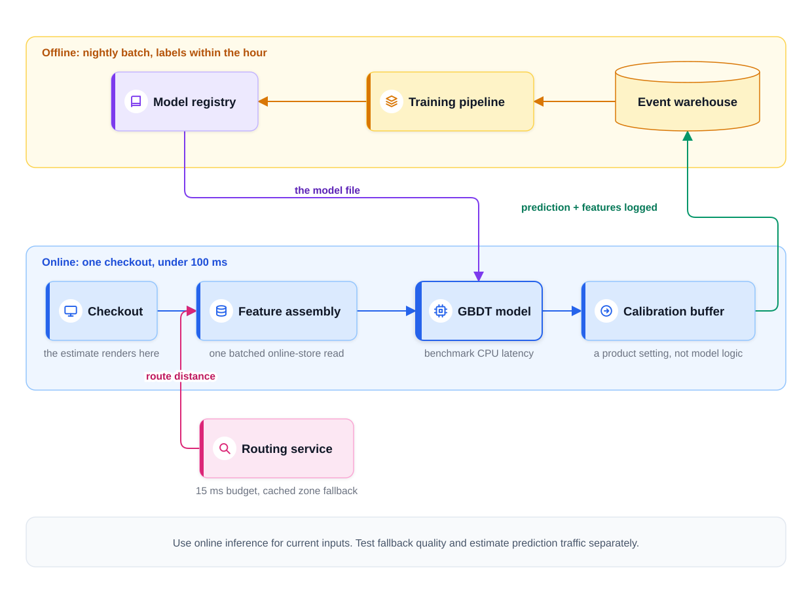
*Figure — ETA platform end to end (course diagram)*

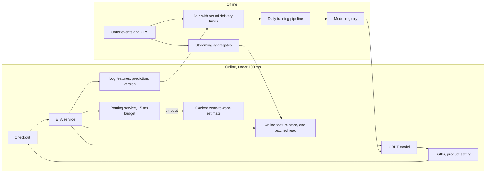
Say out loud:
1. **Routing is where latency goes wrong** — an external dependency on every checkout. Budget 15 ms with a cached zone-to-zone fallback; train/evaluate with that approximation so degradation is measured.
2. **Log predictions with the exact features used** — kills skew; join outcomes on completion, validating timestamps, ID matches, duplicates, late events.
3. **A buffer layer after the model** — displayed ETA = prediction + buffer. Bigger buffer keeps more promises but makes the restaurant look slower than rivals; it's a **product** setting (Chapter 15's buffer curve).

### Steps 6–7: loop, failures, cost (minutes 30–40)
- **Monitoring**: freshness & nulls → input distributions (a new city skews distances) → prediction distribution (a rising mean promised time is business news) → MAE on completed orders by prediction hour, **per city, restaurant type, weather**.
- **Retraining**: daily to start, checked against data maturity, measured decay and cost; evaluate **per segment** before promotion — a better average can hide a worse Manhattan dinner rush.
- **Failures and fallbacks** (rehearsed, never improvised):

| Failure | Fallback |
|---|---|
| Routing service down | Cached zone estimates + wider buffer |
| Feature store stale | Trained-in defaults; freshness monitor fires |
| Model service down | Warm, versioned per-restaurant heuristic table; never block checkout — show the fallback or "estimate unavailable" |

- **Cost**: count prediction requests separately from orders; benchmark CPU, replicas, storage, stream processing, routing calls. For a small GBDT, features and routing may cost more than inference — the opposite of LLM systems.

### What each level sounds like
- **Mid**: right components with prompting (GBDT, feature store, daily retrain, dashboard) but gaps between them — features not logged, routing unbudgeted, MAE only global.
- **Senior**: unprompted label timing and validation, features logged with predictions, routing budget + trained-in fallback, per-segment promotion via shadow and canary.
- **Staff**: separates model from promise (business owns the buffer), starts with the baseline to prove logging and evaluation, compares inference vs pipeline vs routing cost, builds a platform for future models.

### Follow-ups to drill
- **p99 creeps past 100 ms; profiling blames feature reads** → one batched read, in-process cache for hot restaurants, defaults for the slowest aggregates, drop features costing more ms than they add accuracy.
- **ETAs on the restaurant list (100× checkout traffic)** → routing load breaks latency and cost budgets. Serve browsing from batch estimates per zone and restaurant; keep the live path for checkout, where the figure becomes a commitment.
- **New city, zero history** → distance baseline + **priors** (starting estimates) from the most similar city; monitor as its own segment; labels arrive within hours, so retrains fold it in within days.
- **A storm doubles delivery times tonight** → input drift (weather), then prediction drift, then hourly MAE fire; training data may hold no storm this severe. Fastest lever: widen the buffer (product decision) while a triggered retrain absorbs tonight's labels.

### Same structure, different problem (practise 40 minutes each, out loud)
- **Delivery date on a retailer's product page** → labels take days, monitoring slows, buffer matters more; batch per zone × warehouse, online only at checkout.
- **Freight ETA across a country** → multi-day horizons, sparse GPS, thousands (not millions) of predictions; more label quality, per-segment accuracy, dispatcher overrides.
- **Subscription churn** → "churned" is known 30 days later; reshapes training windows, monitoring and retraining.
- **Ride-hailing price estimate** → surge makes freshness paramount; seconds-level aggregates; routing on every render.
For each: when labels arrive, what happens with no prediction, which component dominates cost.

### TL;DR
Per-request inference (live queue, route); labels within the hour; routing budgeted, cached, its absence rehearsed in training; features logged with predictions; buffer owned by product; per-segment monitoring and promotion; features and external calls outweigh small-model inference cost.

---

## Chapter TL;DR
- **Five pieces, two planes**; models flow to serving, logs flow back.
- **Skew**: one set of feature definitions, as-of joins, train on logged serving features (Rules of ML #29, #32, #37).
- **Labels** have a source, cost and delay; downsample then recalibrate (p = wq / (wq + 1 − q)); split by time.
- **Features**: entity / aggregates / context / cross; batch, streaming, request-time; feature store = offline history + online latest.
- **Inference**: request-time inputs → online; stable and reused → batch; events → streaming; big catalogs → precompute-then-rerank.
- **Serving**: stateless, budgeted, CPU first, shadow → canary → ramp, explicit fallback.
- **Offline metrics**: operating point + workload, owner-chosen thresholds, cohorts, calibration, always vs baselines.
- **Monitoring**: health → inputs → predictions → outcomes; investigate before retraining; watch feedback loops.
- **A/B tests**: predeclared unit and metrics, powered sample, whole weeks, no peeking.
- **MLOps**: tracking, versioning, validation, registry, CI/CD/CT, gated promotion — every time.
