# Chapter 17 — ML Case Studies I: Recommendations, Feed Ranking, Search

Chapter 15 gave you a seven-step framework and Chapter 16 built the production pieces behind it. This chapter and the next put both to work on the questions interviewers actually ask. The same handful of designs come up again and again — recommendations, feeds, search, ads, fraud, content moderation, "people you may know" — and each one teaches a different lesson about data, serving and evaluation. Learn these well and a new question ("design job matching", "design a podcast feed") becomes a matter of saying which parts transfer and which requirement is new.

This chapter covers the four **retrieval-and-ranking** designs: video recommendations, social feed ranking, e-commerce search and text-to-video search. Chapter 18 covers ads, fraud, harmful content, people-you-may-know, music discovery, visual search, privacy blurring, event recommendation and similar listings, and ends with a comparison table across all thirteen case studies.

**What you'll learn**

1. A single case-study template you can run for any predictive design question (17.0).
2. **Recommendations**: the retrieval → ranking → re-ranking funnel, two-tower embeddings with an ANN (approximate-nearest-neighbour) index, cold start (users or items with no history yet), position bias and the proxy trap (17.1).
3. **Feed ranking**: a social candidate pool, multi-task models with one head per reaction, a product-owned value formula, and an integrity layer (17.2).
4. **Search ranking**: query understanding, hybrid lexical + semantic retrieval (word matching + meaning matching), L1/L2 rankers, NDCG (a ranking-quality score), and click bias correction with inverse-propensity weighting (17.3).
5. **Text-to-video search**: indexing what videos say (ASR, automatic speech recognition) and show (CLIP-style frame embeddings — CLIP maps pictures and text into one shared vector space), fusing evidence channels, segment vectors for moments (17.4).
6. Four small runnable toys (synthetic data) that show the core modelling idea of each design.

Code for this chapter is in `code/` and runs with the shared environment. All outputs below are real.

---

## 17.0 The case-study template

### What it is
One fixed order of questions for every design in Chapters 17–18. It is the seven-step framework from Chapter 15.3, split into finer pieces so the ML parts get their own slot:

| # | Section | The question it answers | Ch. 15 step |
|---|---|---|---|
| 1 | Clarify requirements | What product surface, what scale, what latency, what's out of scope? | 1–2 |
| 2 | Frame as an ML task | What goes in, what comes out, which ML category, which objective? | 1 |
| 3 | Data and labels | Which logs and catalogs exist, where do labels come from, how biased/late are they? | 3 |
| 4 | Features | Which feature groups, how fresh, what leakage risk? | 3 |
| 5 | Model: baseline → advanced | What's the simplest thing that works, and what's worth upgrading to? | 4 |
| 6 | Offline metrics | How do we pick models before exposing users? | 2, 6 |
| 7 | Online metrics and A/B (randomised live experiment) | What decides a launch, and what may never get worse (guardrails)? | 2, 6 |
| 8 | Serving architecture | What runs offline vs per request; draw the request path | 5 |
| 9 | Scale numbers | QPS (queries per second; see [System Design Fundamentals](../../../system-design-patterns/modules/00-system-design-fundamentals/README.md)), candidates scored per second, memory — with the arithmetic shown | 5, 7 |
| 10 | Monitoring and failure modes | What breaks silently, what are the fallbacks? | 6–7 |
| 11 | Interview follow-ups | The questions you'll get, with answers | — |

Each case study then adds a **toy** (a small runnable script), **common mistakes**, **same design, other questions** (variants that reuse the design), a **self-check**, and a **TL;DR**.

Generic material is taught once elsewhere and only referenced here: A/B test mechanics — sticky randomisation, one primary metric, guardrails, novelty effects, interleaving, holdbacks — are in [Chapter 16.9](../16-ml-in-production/README.md); drift, monitoring layers and retraining triggers in 16.8; shadow → canary → ramp releases in 16.6. The case studies only add what is *specific* to each design.

### The shared shape: a funnel (for retrieval and ranking designs)
Recommendations, feeds and search all face the same arithmetic: too many items to score each one carefully on every request. The answer is a **funnel** — a series of stages, each handling fewer items and so able to spend more compute per item:

1. **Retrieve** (also called **candidate generation**): cheap methods pick a few hundred plausible items from millions. It is graded on **recall**: what fraction of the things this person would have enjoyed made it into the shortlist? Anything missing from the shortlist is lost for good, because later stages can only reorder what they receive.
2. **Rank**: a richer model scores those few hundred and sorts them. It is graded on **top-of-list precision**: among the first few results on screen, what share are genuinely good? Those few slots are nearly all a person ever looks at.
3. **Re-rank / apply rules**: a final layer adjusts the top items for business reasons — freshness, variety, policy, "no two ads in a row".

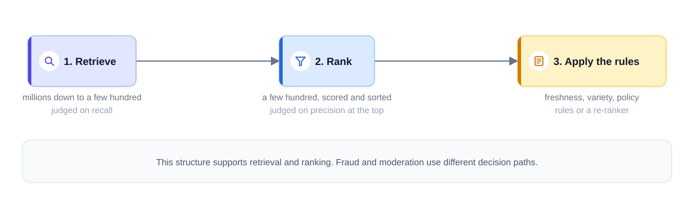
*Figure — Retrieve, rank, apply rules: the funnel shared by recommendations and search (course diagram)*

Not every design is a funnel. **Fraud detection** scores one transaction at a time, and **harmful content detection** uses a **cascade**: cheap checks on everything, expensive checks (bigger models, humans) only on what the cheap checks flag. **Privacy blurring** is not a funnel either: a batch detection pipeline that runs once per image. Chapter 18 covers all three.

**Embedding** (used everywhere below): a list of numbers (a vector) that represents an item or a user, learned so that similar things get nearby vectors. "Similar" then becomes a distance you can compute.

### What each case study adds
| Case study | New idea it teaches | Chapter |
|---|---|---|
| Recommendations | Multi-source retrieval, ranking, rule layer, cold start | 17.1 |
| Feed ranking | Many goals at once (like, comment, hide, report) → value formula | 17.2 |
| Search ranking | A query as input; clicks are biased by position | 17.3 |
| Text-to-video search | Documents with no reliable text: index speech and pictures, fuse channels | 17.4 |
| Ad click prediction | Probabilities feed an auction, so **calibration** (predicted probabilities matching real rates) matters | 18.1 |
| Fraud detection | An adversary who adapts; asymmetric, per-transaction costs | 18.2 |
| Harmful content | Platform-wide scale, high stakes both ways, human review | 18.3 |
| People you may know | Graph-based candidates, two-sided acceptance | 18.4 |
| Music discovery | Sequences, sessions, exploration vs familiarity | 18.5 |
| Visual search | Image embeddings and nearest-neighbour search at scale | 18.6 |
| Privacy blurring | Detection where a miss is a privacy breach: recall per person, fail closed | 18.7 |
| Event recommendation | Every item is new, perishable, tied to a place and time | 18.8 |
| Similar listings | Item-to-item similarity learned from browsing sessions | 18.9 |

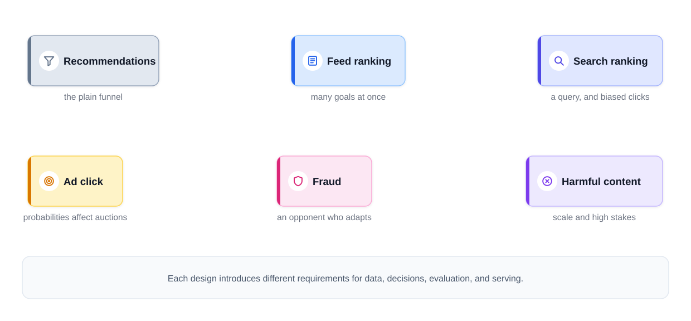
*Figure — The main focus of each of the six core designs (course diagram)*

### Warm-up (do this before 17.1)
Open any app that recommends things to you. Compare its catalog size with how many items you see per session — that ratio is why a retrieval stage exists. Then recall an irrelevant item it showed you: if better items were never pulled in, that's a **retrieval failure**; if they were pulled in but ranked too low, a **ranking failure** (logs or experiments tell which).

---

## 17.1 Case study: video recommendations

> "Design the homepage recommendations for a video platform (think YouTube)."

### 1. Clarify requirements
Ask, then state assumptions out loud:

| Question | Assumption used below |
|---|---|
| Which surface? | Homepage feed only. Search, "up next" and notifications are out of scope. |
| Catalog size? | 50 million videos, thousands uploaded per hour |
| Users? | 100 million daily active users (DAU) |
| Latency? | Whole page in about 200 ms |
| Page size? | About 20 videos |
| Business goal? | People come back and watch more |

The scale *is* the design: running a careful model on 50 million videos for each request would blow both the 200 ms budget and the cost budget by orders of magnitude. So say early: *"This is a prediction problem with a ranking-funnel shape."*

### 2. Frame it as an ML task
- **Input**: user (history, profile), context (time, device, location), candidate video.
- **Output**: a score per (user, video) — e.g. P(click) (the predicted probability of a click) and expected watch time, or P(watch ≥ 30 s).
- **Category**: retrieval + **learning-to-rank** (sorting items by predicted value).
- **Objective**: predicted engagement per **impression** (one item shown to one user once). Engagement arrives within minutes, so the model can learn fast, while the true business goal (daily return rate, long-term **retention** — users continuing to come back) takes weeks.

Why not optimise one proxy? Clicks alone reward misleading thumbnails; watch time alone rewards needlessly long videos. This is the **proxy trap** — a *proxy* being a stand-in metric you optimise because the real one is too slow. The mature framing combines several predicted outcomes and checks the long-term metric in experiments.

### 3. Data and labels
Three sources:

1. **Interaction logs** — the source of labels. Log every impression with: user and item IDs, timestamp, position on the page, model version, the features used for ranking, then join (match up) outcomes (click, watch seconds, like, "not interested") within a defined **observation window** (e.g. 24 h). Respect privacy and retention rules.
2. **Catalog content** — title, tags, description, channel, audio/visual embeddings (defined in 17.0).
3. **Signup signals** — language, country, declared interests, device.

**Labels**: an engaged impression is a positive. A skipped impression is only a *weak* negative — the user may never have noticed it. Two flaws to name unprompted:

- **Exposure bias** — you only observe outcomes for items you showed. The model may **generalise** (make reasonable predictions) to unshown items, but their outcomes are never directly measured.
- **Position bias** — an item in slot 1 gets more clicks than the same item in slot 15, so clicks mix relevance with placement. (Fixes in section 10 and in 17.3.)

Content and signup data exist precisely for what logs can't cover: brand-new users and brand-new videos.

### 4. Features
| Group | Examples | Freshness |
|---|---|---|
| User | Watch history (IDs + embeddings), subscriptions, language, country | Nightly + in-session updates |
| Short-term user state | Last 10 videos watched this session, topics skipped | Seconds (streaming) |
| Item | Channel, topic, length, upload age, embedding, **CTR** (click-through rate = clicks ÷ impressions) and watch-rate aggregates | Stable fields nightly; counts every few minutes |
| User × item (cross) | Has the user watched this channel before? Similarity of item embedding to the user's recent watches | Request time |
| Context | Device, hour of day, day of week, network speed | Request time |

**Leakage** to avoid: any feature computed with data from after the impression (e.g. total watch count including the watch you're predicting). Use point-in-time-correct joins (each training row only sees data that existed at its timestamp; Chapter 16).

### 5. Model: baseline → advanced
One model per funnel stage.

**Baseline**: "most popular in your region + newest from your subscriptions." It ships in a week, tests the whole logging pipeline, and gives a number to beat.

**Candidate generation** — several cheap sources running in parallel, results merged:

1. **Two-tower embeddings (collaborative filtering — learning from what similar users did)** — the main source. One neural "tower" turns user features into a vector, a second turns item features into a vector of the same length; training pushes a user's vector close to the vectors of items they engaged with (and away from sampled negatives — randomly chosen items treated as "not engaged"). Relevance = **dot product** (multiply matching entries of the two vectors and add them up). Items are precomputed; only the user vector is computed per request.
2. **Co-occurrence** (viewers of video X frequently went on to watch Y) — item-to-item lists precomputed offline and looked up from the user's recent watches. Cheap, explainable, surprisingly strong. Amazon's item-to-item collaborative filtering (Linden, Smith & York, 2003) is the classic example.
3. **Non-personalised sources** — trending now, fresh uploads, popular in region. They serve new users and keep the page fresh.

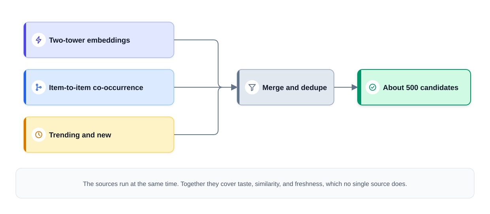
*Figure — Three cheap candidate sources running at the same time (course diagram)*

**Ranker** — the candidate list is now small (~500), so use rich features and a stronger model: gradient-boosted decision trees (**GBDT**) as the first ranker, then a deep network predicting several engagement events (click, watch time, like) — a **multi-task** model. Most modelling effort goes here. YouTube's published systems follow exactly this split: a candidate-generation network and a separate ranking network (Covington et al., 2016), later a multi-task ranker with a separate small "shallow tower" that models position bias (Zhao et al., 2019).

### 6. Offline metrics
- **Retrieval**: **recall@K** — take the videos a person really watched during a later, held-out week; what share of them show up in the K retrieved candidates?
- **Ranking**: **AUC** (probability a random positive is scored above a random negative) or a ranking loss; **NDCG@k** (defined with a worked example in 17.3) if you have graded outcomes.
- Always use a **time-based split** (train on weeks 1–4, test on week 5) — random splits leak the future.

Offline metrics only *select candidates for an online test*; they don't decide launches.

### 7. Online metrics and A/B testing
- **Primary**: watch time per user, daily return rate (retention) over a long enough window.
- **Guardrails**: "not interested" / dislike rate, policy-violating impressions, latency, creator-side diversity.
- Standard user-level A/B test (16.9); run it long enough to see return behaviour, not just first-week **novelty** (a temporary bump because something is new).

### 8. Serving architecture
Stage by stage, with example numbers:

1. **Candidate generation: 50 M → ~500.** Item vectors are computed offline and loaded into an **approximate nearest neighbour (ANN)** index — a data structure such as **HNSW** (a layered graph of vectors; Malkov & Yashunin, 2016) that finds close vectors without comparing against every item. At request time: fetch the user vector, pull the nearest few hundred in a few ms, merge with co-occurrence and trending results. ANN trades a little recall for huge speed; measure that recall loss and choose index settings (memory, update speed, latency) from benchmarks.
2. **Ranking: ~500 → ~50.** All candidates go to the model in one **batch** (a single combined model call). Treat 20–40 ms for this step as an illustrative budget and verify it with your model, hardware and concurrent load (many requests running at the same time).
3. **Re-ranking: ~50 → ~20 on screen.** Rules: cap slots per channel, lift recent uploads, apply policy demotions, drop just-seen items, honour editor-pinned slots. Keep mandatory rules **outside** the model so policy changes need no retraining; re-check fast-changing restrictions just before display.

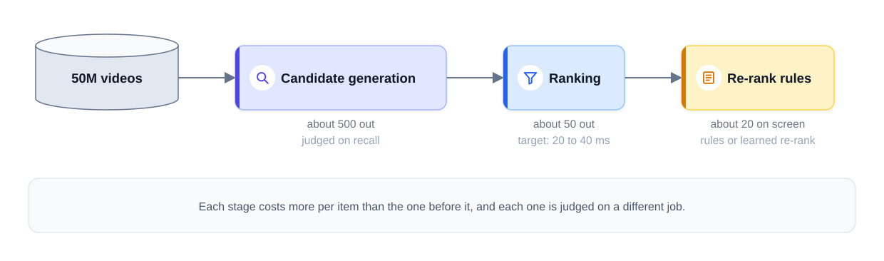
*Figure — Example candidate counts and latency targets for the recommendation pipeline (course diagram)*

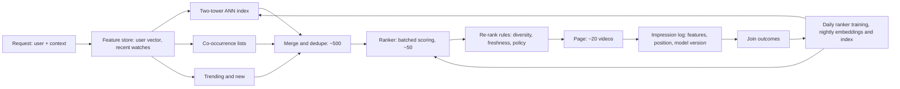

**Cold start** (bring it up yourself, both kinds):
- **New user**: no history, so collaborative sources are weak. Serve what is popular overall and in their region, lean on what signup told you (language, declared interests, platform), and learn fast in the first session — weight early clicks heavily and update session state in seconds, not overnight.
- **New video**: no engagement yet. Use **content features** (title, tags, audio/visual embeddings) so it can be retrieved by looking like established videos, and give it a small, controlled **exploration boost**. Without that, established videos soak up almost all exposure and new ones never collect data.

### 9. Scale numbers
| Quantity | Arithmetic | Result |
|---|---|---|
| Homepage QPS | 100 M DAU × 5 loads/day ÷ 86,400 s (assumed 5 loads) | ≈ 5,800 avg; ~17 K at a 3× peak |
| Items scored by ranker | 17 K QPS × 500 | ≈ 8.7 M scores/s at peak |
| Raw item vectors | 50 M × 128 dims × 4 bytes | 25.6 GB (before index structure, IDs, metadata, replicas — extra copies for reliability) |

The design deliberately moves heavy work offline (embedding and index builds, co-occurrence lists) so each request is cheap. Incremental updates avoid recomputing unchanged items.

### 10. Monitoring and failure modes
**Update loops at three speeds** (validate each interval against measured freshness needs): ranker retrained daily; item embeddings and ANN index rebuilt nightly with incremental inserts for new uploads; user short-term state updated in-session via streaming.

**Training traps**:
- **Position bias** → either model how position affects *examination* separately from relevance (e.g. a separate position tower used only in training), or use **inverse-propensity weighting (IPW)**: weight each example by 1 / (estimated probability the user examined that slot). Validate the propensity estimates and cap large weights. A common shortcut — feed slot number in as a feature during training, then fix it to one value when serving — does not reliably remove the bias. (Worked toy in 17.3.)
- **Proxy trap** → multiple objectives + long-term guardrails.

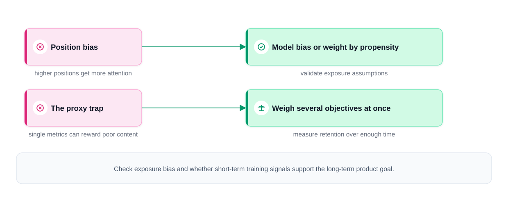
*Figure — The two training traps, and the fix for each (course diagram)*

**Failures and fallbacks**:
| Failure | Fallback | Monitor |
|---|---|---|
| Nightly index build fails | Keep serving the last validated index up to an age limit; still enforce current availability and policy filters | Index age (alert severity rises with staleness) |
| Ranker times out | Candidate order or trending list, same required filters | Fallback rate, latency |
| Diversity collapse (feedback loop) | Re-rank diversity rules, exploration | Watch time by category over time narrowing |

### 11. Interview follow-ups
- **"Why not one end-to-end model?"** → Any model smart enough to order items well costs too much to evaluate 50 M times per page load. Stages fix that, each with its own yardstick (recall for the shortlist, top precision for the final order).
- **"Recall looks fine but users seem bored."** → Check the re-rank layer and the objective per user segment: diversity may have collapsed into one taste cluster, or the proxy over-rewards short-term clicks. A shrinking week-by-week category mix is the warning sign.
- **"How do you do real-time personalisation?"** → Session events stream into short-term features within seconds and nudge the user vector (cheap version: a recency-weighted average of the last few videos' vectors); full retraining stays daily.
- **"Someone proposes a new candidate source. Include it?"** → Measure its **marginal** value — watched items it finds that no other source does — then **shadow** (run it on real traffic without showing its results), then a small experiment slice. (The toy below computes exactly this.)

### Toy — multi-source retrieval and marginal value (`code/rec_funnel_toy.py`)
Synthetic users and videos live in a hidden 8-dimensional "taste space"; each user watches 35 videos sampled by taste + popularity; the last 5 are held out. Three candidate sources each return K = 100 items; then we take their union.

```python
def two_tower(train, k, dim=16, epochs=15, lr=0.05, reg=1e-4, n_neg=5):
    """Matrix factorisation = the simplest 'two-tower': user tower and item tower are embedding tables."""
    U = 0.1 * rng.normal(size=(N_USERS, dim))
    V = 0.1 * rng.normal(size=(N_ITEMS, dim))
    # ... for each (user, watched item): 1 positive + 5 random negatives, logistic loss, SGD
            scores = V[items] @ U[u]
            g = 1 / (1 + np.exp(-scores)) - labels           # logistic-loss gradient
    # ...
        s = V @ U[u]                                          # in production: ANN search, not a full scan
        s[row] = -np.inf                                      # never re-recommend watched items

union = [np.unique(np.concatenate(x)) for x in zip(pop, co, tt)]
# marginal value: share of held-out hits that ONLY this source found
```

Output:
```
2000 users, 3000 videos, 30 past watches each, last 5 held out

candidate source          size  recall@K
popularity                 100     0.129
co-occurrence              100     0.177
two-tower (MF)             100     0.203
union of the three         223     0.306
hits found ONLY by popularity      : 0.022 of held-out watches
hits found ONLY by co-occurrence   : 0.043 of held-out watches
hits found ONLY by two-tower (MF)  : 0.096 of held-out watches
```

What it shows:
- ("MF" = matrix factorisation, the simplest two-tower model: each tower is just an embedding table.) The learned embeddings beat popularity and co-occurrence, but **the union** (≈223 unique candidates) reaches clearly higher recall than any single source — sources overlap only partly, which is why real systems run several.
- **Marginal value** is how to judge a source: popularity finds 12.9% of held-out watches, but only 2.2% that nobody else finds. It still earns its place as the only source that works for brand-new users — a benefit this offline test can't see. (Numbers are synthetic.)

### Common mistakes
| Weak | Strong |
|---|---|
| Opens by naming a model architecture | Opens with 50 M items vs 200 ms, which forces the funnel |
| Treats clicks as ground truth (the true answer) | Raises position bias unprompted, offers a validated correction |
| Hides diversity and policy inside the model | Separate rule layer that product can change without retraining |
| Waits to be asked about cold start | Covers both kinds, with different fixes |

### Same design, other questions
- **"Customers also bought"** — item-to-item co-occurrence carries most of retrieval; the target becomes purchase (rarer, but far less ambiguous). Funnel, cold start and bias story unchanged.
- **Podcast discovery** — hour-long episodes make completion signals late and weak, so audio/transcript embeddings carry more of retrieval and new-item handling becomes the main path.

### Self-check
1. Why is retrieval judged on recall and ranking on precision at the top? → Retrieval losses are unrecoverable; ranking only matters for the few items the user sees.
2. Two kinds of cold start, one fix each? → New user: popularity + signup signals + in-session learning. New item: content embeddings + exploration boost.
3. Why is a skipped impression a weak negative? → The user may never have examined it.

### TL;DR
| | |
|---|---|
| Shape | Multi-source retrieval (~500) → rich ranker (~50) → rule re-rank (~20 on screen) |
| Retrieval | Two-tower embeddings in an ANN index + co-occurrence + trending/new |
| Cold start | Fresh accounts: popular/regional lists, then learn during the first visit. Fresh uploads: content embeddings plus a small exploration budget |
| Traps | Position bias (examination model or IPW); proxy trap (multi-objective + guardrails) |
| Metrics | Offline recall@K / AUC choose what to test; online watch time and retention decide |
| Cost | Precompute heavy, serve cheap; 25.6 GB of raw vectors; fall back to yesterday's index |

---

## 17.2 Case study: social feed ranking

> "Design the ranking for Instagram's (or LinkedIn's) home feed."

### 1. Clarify requirements
Say in one sentence that the recommendation funnel carries over — a candidate stage, a ranker over hundreds of items, a rule layer — and then spend your time on what a feed changes:

1. **The candidate pool is social.** It comes mostly from who you follow, not from a 50 M catalog.
2. **"Good" is plural.** There are several positive reactions and several negative ones, and the ranking must weigh them together.
3. **Integrity moves inside ranking.** Engagement alone can reward bait and misinformation, so quality and safety checks sit in the ranking path, not beside it.

| Question | Assumption used below |
|---|---|
| Users | 500 M DAU |
| Candidates per session | A few hundred to a few thousand posts (graph-limited), plus suggested posts from a larger pool |
| Latency | < 200 ms per ranking call |
| Calls per session | Several — infinite scroll re-ranks as you scroll (assume 3) |
| Freshness | New eligible posts rankable within seconds |

### 2. Frame it as an ML task
- **Input**: viewer, post (author, content, age, engagement so far), viewer–author relationship, context.
- **Output**: a *vector* of predictions per post: P(like), P(comment), P(reshare), E[dwell time], P(profile visit), and negatives P(hide), P("see less"), P(unfollow), P(report). (P(x) = the model's estimated probability of event x; E[·] = expected value.)
- **Category**: **multi-task** (one model, several predicted outcomes) classification/regression feeding a ranking.
- **Objective**: rank by a **value formula** that combines the predictions — the formula, not any single probability, is what you optimise.

### 3. Data and labels
- **Retrieval data = the social graph.** Candidates come from (a) **fan-in**: recent posts by accounts you follow; (b) **engagement spillover**: posts that people you're connected to reacted to, written by accounts outside your follow list; (c) a slice of **out-of-network suggestions** retrieved with the same two-tower + ANN machinery as 17.1.
- **Labels = the event stream.** Each (impression, event kind) pair becomes a row, stamped with the feature values the ranker actually saw. Log positives (like, comment, reshare, dwell) *and* negatives (hide, report).
- **Negative events are valuable but not ground truth.** A hide is a much clearer preference signal than a scroll-past, but its meaning depends on context; a report needs validation — it's not automatic proof of a violation.
- **Survey labels**: ask a sample of users "was this post worth your time?" and train a satisfaction head on the answers. Useful beyond engagement, but check **response bias** (people who answer surveys differ from those who don't), sample size and differences across user groups.

### 4. Features
| Group | Examples |
|---|---|
| Viewer | Interests, past engagement rates by content type, language, session depth so far |
| Author | Follower count, posting frequency, historical engagement and hide rates, integrity history |
| Viewer × author | Interaction history (DMs — direct messages — comments, profile visits), closeness, how recently they interacted |
| Post content | Type (photo/video/text/link), text and image embeddings, topic, integrity classifier scores |
| Post engagement (streaming) | Likes/comments/hides in the last 5 min, 1 h — sparse for new posts |
| Session | Posts already seen this session (dedupe), in-session reactions |

A brand-new post has zero reactions to count, so at first the ranker relies on who wrote it, what it contains and who its likely audience is, until first-hour engagement streams in.

### 5. Model: baseline → advanced
- **Baseline**: reverse-chronological fan-in, or a single **logistic regression** (a simple linear classifier that outputs a probability) predicting P(like). It works, and it's the "Following" tab many apps still offer.
- **Advanced — multi-task learning (MTL)**: one network with a **shared body** (layers that read viewer, post and context once) and a small **head** per event on top. Shared layers learn a common representation, so rare events (reports, reshares) borrow statistical strength from common ones (likes). Variants such as MMoE (multi-gate mixture of experts) help when tasks conflict.
- **Value formula** (the product's definition of "good"):

```
score = w1·P(like) + w2·P(comment) + w3·P(reshare) + w4·E[dwell]  −  w5·P(hide) − w6·P(report)
```

Harm terms are *subtracted*, so a post you'd likely hide ranks lower. Rules for the weights:
- Product, safety and ML teams choose them together — they encode policy.
- **Normalise units**: dwell is measured in seconds while the other heads output values between 0 and 1, so rescale before adding.
- Heads must be **calibrated** (a predicted 0.1 means ~10% happen), or the weighted sum is meaningless.
- Weights live **outside** the model, so many policy changes are a formula change + A/B test, no retraining. Some changes still need new labels or features.

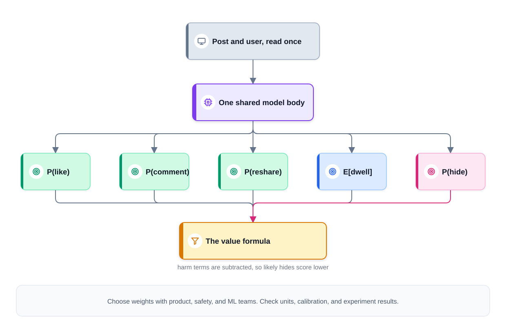
*Figure — One shared body, one head per event, one value formula (course diagram)*

Real-world: Facebook's 2018 "meaningful social interactions" change re-weighted the feed toward comments and reshares among friends; Twitter's open-sourced 2023 "heavy ranker" predicted about ten engagement probabilities and combined them with fixed weights — e.g. +0.5 for a like, −74 for negative feedback ("show less", mute, block) and −369 for a report.

### 6. Offline metrics
- Per-head **AUC** and **log loss** (the cross-entropy of the predicted probabilities; lower is better); **calibration** per head (reliability curve — predicted vs actual rate per score bucket — expected-vs-actual rate) because the formula adds them up.
- Ranking-level: offline replay of the value formula — expected likes/comments/hides in the top-k under each weight setting (the toy below does this).
- Slice by viewer segment, content type and new vs established authors.

### 7. Online metrics and A/B testing
- **Primary metric** (one, decides the launch): sessions per user per day, or the share of survey answers saying a post was "worth your time".
- **Guardrails** (can veto a win on their own, limits fixed in advance — 16.9): hide rate, report rate, integrity-violating impressions, creator-side distribution.
- Weight changes are A/B tested against the same primary + guardrails; urgent safety changes may use a faster release process.

### 8. Serving architecture
**Getting posts into candidate lists** — the classic news-feed systems question:
- **Push (fan-out on write)**: each new post is written into every follower's precomputed inbox. Fast reads; but a celebrity with 100 M followers triggers 100 M writes.
- **Pull (fan-out on read)**: gather followed accounts' posts when the app opens. Cheap writes; hot accounts get enormous read load.
- **Hybrid**: push for normal accounts, pull for mega-accounts. Mention it, offer to go deeper, and return to the ML if the interviewer declines.

**Two-pass ranking**: a **light ranker** (a small **distilled** model — trained to imitate the heavy one) trims ~2,000 candidates to ~500; the **heavy multi-task ranker** scores those; the value formula orders them; then the **integrity layer**:
- demote clickbait, engagement bait (posts engineered to farm reactions), misinformation and borderline content using probabilistic classifiers;
- **per-author caps** so one prolific account can't take over a session;
- **diversity** interleaving across friends, groups and suggested content;
- durable **per-user suppression** after explicit "see less".

The classifiers feeding this layer are a separate **adversarial** ML system (one that attackers actively try to evade; compare 18.2, 18.3).

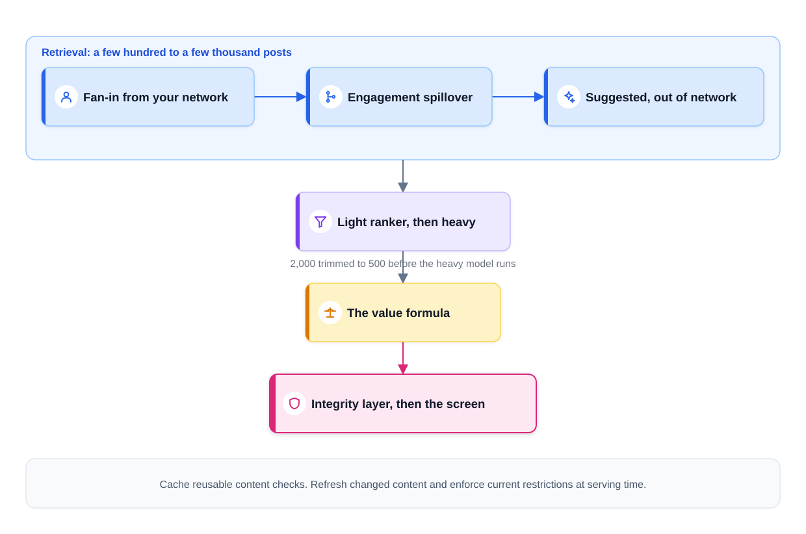
*Figure — The feed serving path, from fan-in to the screen (course diagram)*

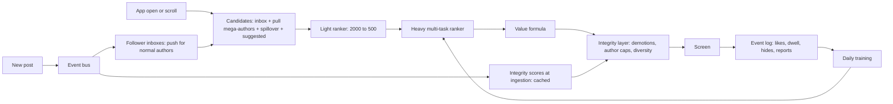

### 9. Scale numbers
| Quantity | Arithmetic | Result |
|---|---|---|
| Ranking calls, average | 500 M DAU × 5 sessions × 3 calls ÷ 86,400 | ≈ 86,800 /s |
| Peak (assume 2×) | 86,800 × 2 | ≈ 174,000 /s |
| Posts scored, average | 86,800 × 500 | ≈ 43.4 M scores/s (provision for peak) |

What makes this affordable: the two-pass funnel (the light ranker absorbs most volume), **micro-batching** (many scoring requests in one model call), and **item-side feature caching** — very effective because one viral post is scored in millions of feeds. Post-only integrity scores are computed at upload and cached (redone on edit or policy change); viewer-dependent checks still run per request.

### 10. Monitoring and failure modes
**Three loop speeds** (examples — set from data availability, measured quality and cost): session state in seconds, engagement aggregates in minutes, model retrained daily. Candidate freshness comes from the streaming path, not a nightly build.

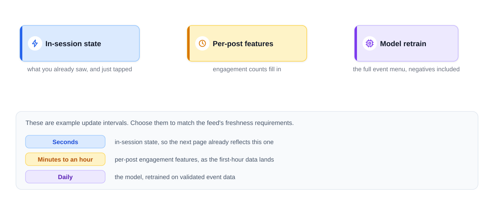
*Figure — Three loops running at three different speeds (course diagram)*

| Failure | Response |
|---|---|
| Heavy ranker times out at peak | Serve the order the light ranker produced; with no ranking available at all, sort followed posts newest-first. **Tag degraded sessions** so their engagement doesn't pollute training. Privacy, eligibility and safety checks stay on in every path — if they can't run, suppress. |
| Feedback loop (silent) | The feed shows what it predicts, people react to what they're shown, the model retrains on those reactions — which can amplify low-quality engagement. Monitor satisfaction surveys and content-quality metrics, keep guardrails and the integrity layer. |
| Calibration drift in one head | The formula silently re-weights; monitor predicted vs actual rate per head. |
| Recency mis-weighting | Breaking news must surface in seconds; an old personal update may still be valuable. Let the model learn recency per content type. |

### 11. Interview follow-ups
- **"Defend ranking over chronological."** → Most users follow enough accounts that newest-first buries the few posts they'd value; test that ranking improves interaction *and* satisfaction. Concede the downsides (less transparent order, possible bubbles) and offer a newest-first tab plus a "why am I seeing this" link.
- **"A post went up seconds ago — how can it be ranked?"** → The streaming path adds it to candidate pools at once; with no reaction counts, the model uses the author's history, a content embedding and audience **priors** (starting estimates borrowed from similar posts); a modest freshness boost buys exploration data.
- **"Who sets the weights, and how?"** → Offline sweeps propose settings, A/B tests judge them against the primary metric and guardrails, product leadership signs off because weights are policy. No retraining needed while the heads still predict the right events.

### Toy — multi-task heads + value formula (`code/feed_multitask_toy.py`)
Synthetic impressions have 6 features; some posts are "bait" that attract likes *and* hides. A small PyTorch network with a shared body and three heads (like, comment, hide) is trained with one **binary cross-entropy** loss (the standard yes/no classification loss) per head, summed. Then 500 simulated users each get 200 candidates, and we compare what the top 10 contains under three rankings.

```python
class MultiTask(nn.Module):
    def __init__(self):
        super().__init__()
        self.body = nn.Sequential(nn.Linear(N_FEAT, 32), nn.ReLU(), nn.Linear(32, 16), nn.ReLU())
        self.heads = nn.ModuleList([nn.Linear(16, 1) for _ in range(3)])   # like, comment, hide

    def forward(self, x):
        h = self.body(x)                                   # shared representation, computed once
        return torch.cat([head(h) for head in self.heads], 1)   # 3 logits

# training: loss = sum(BCEWithLogits(logits[:, k], y[:, k]) for k in range(3))
formulas = {"P(like) only": np.array([1.0, 0.0, 0.0]),
            "gentle 1/2/-3": np.array([1.0, 2.0, -3.0]),
            "strong 1/4/-10": np.array([1.0, 4.0, -10.0])}
top = np.argsort(-(ph @ w))[:10]          # ph = predicted [P(like), P(comment), P(hide)]
```

Output:
```
event rates in logs  like=0.259 comment=0.077 hide=0.060
head like     AUC=0.818  mean pred=0.244 vs actual=0.252
head comment  AUC=0.782  mean pred=0.071 vs actual=0.082
head hide     AUC=0.868  mean pred=0.057 vs actual=0.061

expected events per user in the top 10 (true probabilities):
ranking           likes  comments  hides
P(like) only       8.16      1.08   2.34
gentle 1/2/-3      5.37      2.79   0.33
strong 1/4/-10     3.51      3.18   0.17
```

What it shows:
- Ranking by P(like) alone maximises likes but fills the top 10 with bait: 2.34 expected hides per user.
- The **gentle** formula cuts hides by ~86% (2.34 → 0.33) and more than doubles comments, at the cost of about a third of the likes; the **strong** one goes further. Which is "right" is a **product decision** settled by A/B test — exactly why the weights sit outside the model.
- Mean predictions are close to actual rates for each head — the calibration check you'd run before summing heads.

### Common mistakes
| Weak | Strong |
|---|---|
| Rebuilds the whole recommendation funnel for ten minutes | One sentence "it transfers", then spends the time on what's feed-specific |
| Ranks on one P(click) | Multi-task heads + a product-owned value formula |
| Filters hides and reports out of training as noise | Trains on negative feedback, weights it by evidence, applies durable suppressions |
| Puts integrity into the training objective only | Separate post-formula integrity layer that policy teams can tune |

### Same design, other questions
- **Notification ranking** — each candidate is push-or-hold and users tolerate only a few pings a day; predicted annoyance (e.g. P(turns notifications off)) gets a big negative weight and the rule layer is mostly a frequency cap.
- **A "Following" tab next to "For You"** — pure fan-in, near-pure recency; the effort goes into logging both tabs identically so one training and experimentation pipeline serves both.

### Self-check
1. Why must the heads be calibrated? → The formula adds weighted probabilities; a head that systematically over-predicts silently gets more weight.
2. What's wrong with push fan-out for celebrities? → One post = one write per follower (100 M writes); hybrid push/pull fixes it.
3. Why tag degraded sessions? → Their engagement came from a fallback ranking; training on them unmarked teaches the model the wrong thing.

### TL;DR
| | |
|---|---|
| Reused from 17.1 | Retrieve → rank → rules; mention it in a sentence and move to what's new |
| Candidates | Social graph fan-in + spillover + suggested (embedding retrieval); push/pull hybrid |
| Ranker | Multi-task heads, one per event; value formula owned by product |
| Integrity | Post-formula demotions, author caps, diversity; negative feedback trained on |
| Freshness | Streaming candidates; content/author features for brand-new posts; session state |
| Metrics | One primary session metric + guardrails (hides, reports) + worthwhileness surveys |
| Scale | ~86.8 K avg ranking calls/s, ~43 M scores/s; two-pass, micro-batching, caching |

---

## 17.3 Case study: e-commerce search ranking

> "Design product search for an online store (think Amazon)."

### 1. Clarify requirements
It's the funnel again, reshaped by one new input: the **query**. Recommendations *infer* what you want from history and context; a query *states* your current goal — though often incompletely or ambiguously ("apple", "case"). The query touches every stage, so the system has three jobs in order: **understand the query → retrieve against it → rank with it**. Say that early: *"recommendation funnel plus a query-understanding stage at the front."*

| Question | Assumption used below |
|---|---|
| Catalog | 100 M products |
| Traffic | 10 K queries/s at peak |
| Latency | ~300 ms end to end: a few ms for query understanding, the biggest slice for the heavy ranker |
| Scope | Search results page; autocomplete out of scope unless asked |
| Business | Search drives purchases directly, so revenue matters as well as relevance |

### 2. Frame it as an ML task
- **Input**: query text, user, context (locale, device), candidate product.
- **Output**: a relevance/purchase score per (query, product) — e.g. P(purchase | query, product), or a graded relevance estimate.
- **Category**: **learning-to-rank**. Three standard loss styles: **pointwise** (predict each item's label independently), **pairwise** (predict which of two items is better — e.g. RankNet), **listwise** (optimise a whole-list metric such as NDCG). **LambdaMART** — gradient-boosted trees trained on pairs whose weights come from how much swapping them would change NDCG — sits between the last two and is the classic industrial default.
- **Supporting ML tasks** inside query understanding: spelling correction (sequence-to-sequence models that rewrite one text into another, or noisy-channel models of how typos corrupt the intended word), query classification, attribute extraction (named-entity-style tagging — labelling spans of text as brand, colour, size…).

### 3. Data and labels
1. **Catalog**: titles, descriptions, attributes (brand, colour, size), category tree, price, ratings, stock.
2. **Search logs**: query, results page with positions, clicks, add-to-carts, purchases, reformulations.
3. **Human relevance judgments**: raters grade (query, product) pairs from *irrelevant* to *highly relevant* — expensive but unbiased, used for evaluation and for training heads.
4. **The query itself** is data. Query frequencies follow a roughly **Zipf-like distribution** — a few head queries are very common, the long tail is enormous — which matters for caching (section 8).

**Labels**: graded judgments are the clean labels; behaviour (clicks < add-to-cart < purchase) gives cheap, plentiful, biased ones. **Position bias** is strongest here: people look at the top results, so top results get clicked partly *because* they're on top. Training on raw clicks teaches the new ranker to copy the old one.

### 4. Features
The ranker's defining ingredient is **query–item features** — how well *this* item matches *this* query:

| Group | Examples |
|---|---|
| Query–item match | BM25 text score (a keyword-match score, explained in section 5) per field (title, brand, description), embedding similarity, attribute agreement (query says "red", item is red), category match |
| Item quality | Rating, review count, sales velocity (how fast it sells), return rate, in stock, shipping speed |
| Query | Length, class (product / brand / help), head vs tail, predicted category |
| Personalisation | User's brand and price-range history, past purchases (capped influence) |
| Context | Locale, device, time, season |

### 5. Model: baseline → advanced
**Query understanding** (runs first, a few ms, results cached for repeated queries):
1. **Normalise and spell-correct**: "iphon 15 cas" → "iphone 15 case". Correction models are trained on **reformulation logs** — pairs where users retyped a query.
2. **Expand with synonyms**: "sofa" also matches "couch", "running shoes" matches "sneakers". Historically hand lists plus **co-click mining** (two words are synonyms if their queries lead to clicks on the same products); increasingly handled by embeddings.
3. **Classify intent and extract structure**: product vs brand vs help query; "red nike shoes size 10" → brand=nike, colour=red, size=10, category=shoes. **Reliable, explicit** constraints become **hard filters**; uncertain interpretations become ranking features (or prompt a clarification).

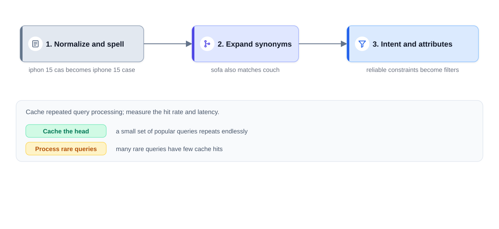
*Figure — The three jobs of the query-understanding stage (course diagram)*

**Retrieval — two engines in parallel**:
- **Lexical** via an **inverted index** (like a book's index for the whole catalog: for each word, the list of products containing it), scored with **BM25** — a formula that rewards query words appearing in the document, more for rare words (IDF, inverse document frequency), with diminishing returns for repeats and a correction for document length. It shines on literal hits — part numbers, brand names, tokens such as "X200-B" — and is fast and explainable. Its blind spot is **vocabulary mismatch**: a shopper typing "something warm for the snow" misses a parka described only as a "thermal winter jacket", because no word matches.
- **Semantic** via embeddings: a two-tower model trained on (query, clicked product) pairs encodes the query; an ANN index returns the nearest products. It captures meaning across wordings but is unreliable on exact codes and can confidently return a plausible wrong item.

**Ranking — two levels** at this volume: a light **L1** ranker (e.g. a small GBDT on cheap features) trims the union; a heavy **L2** ranker (LambdaMART-style GBDT or a deep model with query–item features) orders the final list. Optionally, a **cross-encoder** (a transformer — the attention-based network behind modern language models — that reads query and product text *together* — slower, sharper) re-ranks only the top ~20 if the latency budget allows.

**Baseline**: BM25 + popularity + in-stock filter. Everything above is the upgrade path.

### 6. Offline metrics
**NDCG@k** (normalised discounted cumulative gain) — rewards putting the most relevant results near the top:

1. DCG@k = Σ over positions i = 1..k of (2^rel_i − 1) / log₂(i + 1)
2. NDCG@k = DCG@k / IDCG@k, where IDCG is the DCG of the perfect ordering → range 0 to 1.

Worked example (k = 3): results with relevance [3, 0, 2]: DCG = 7/1 + 0/1.585 + 3/2 = 8.5. Ideal order [3, 2, 0]: IDCG = 7 + 3/1.585 + 0 = 8.89. NDCG = 8.5 / 8.89 ≈ 0.956. Swapping the 0 and the 2 would reach 1.0.

Also: **MRR** (mean reciprocal rank of the first relevant result) for navigational queries (looking for one specific product or page), and recall of the retrieval stage. Compute on human-graded sets; use behaviour-based labels only after bias correction.

### 7. Online metrics and A/B testing
- **Primary**: session success rate (a search session that ends in add-to-cart or purchase), revenue per search.
- **Also**: add-to-cart rate, click-through rate on results.
- **Dissatisfaction signals**: **reformulation**, **abandonment** and **zero-results** rates — interpret with care (a reformulation can be exploration).
- **Guardrails**: relevance of sponsored slots, latency, zero-results rate by query segment.
- **Interleaving** (mix rankers A and B in one list, see which side gets clicks; 16.9) is a more sensitive way to compare rankers.

### 8. Serving architecture
Run both retrieval engines **in parallel** and take the **union** (a few hundred candidates). This isn't redundancy: each catches what the other misses. The same **hybrid retrieval** pattern (BM25 + vectors) reappears in RAG (retrieval-augmented generation) systems in the AI book. Each index needs a defined **update path** (both inverted and ANN indexes can be updated incrementally, depending on the implementation) — measure how long a new or changed product takes to become searchable.

The **business layer** matters more in search than anywhere else: anything out of stock or not shippable to the user is removed outright; boosts for margin or strategy are applied afterwards; **paid placements** appear only in marked slots and only if they clear a minimum **relevance floor**. Money and relevance genuinely pull in different directions — present that as a decision product leadership owns, protected by guardrail metrics.

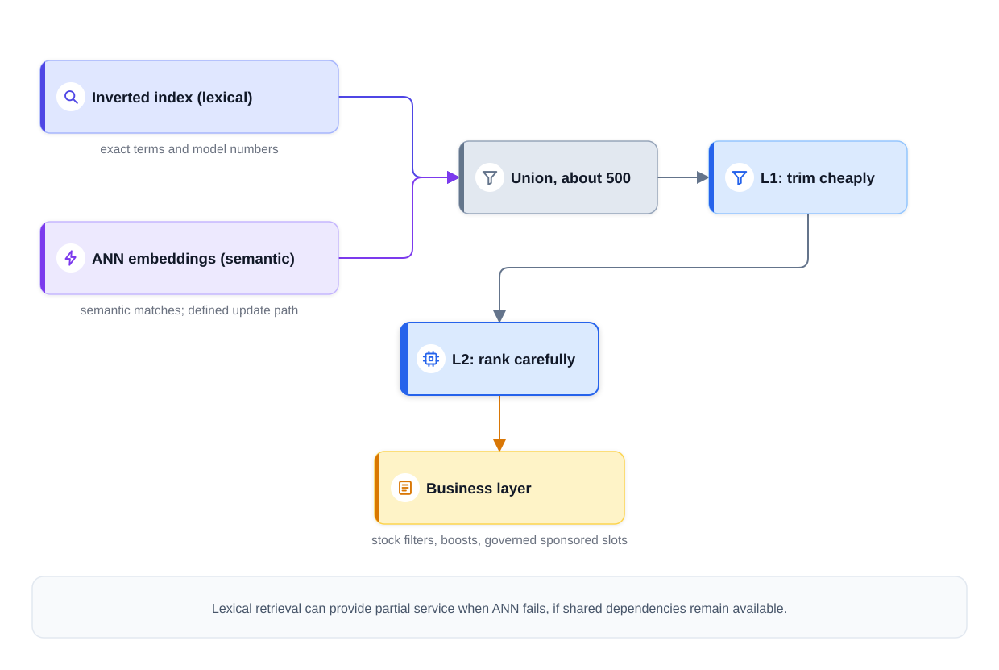
*Figure — Two retrieval engines, one union, then two rankers (course diagram)*

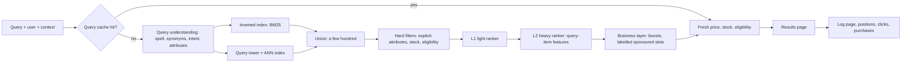

**Caching done right**: cache the **ranked list of IDs** for head queries — with locale, permissions and personalisation in the **cache key** (the values that identify a cached entry) — while the fast-changing fields — **price, stock, delivery eligibility** — are looked up live as the page is assembled, then checked once more at checkout. Inventory events **invalidate** (throw away stale cached copies of) the filter layer. A cache holding yesterday's availability sells products you can't ship: a correctness bug even though the service "works".

### 9. Scale numbers
| Quantity | Arithmetic | Result |
|---|---|---|
| Peak QPS | given | 10,000 /s |
| Cache misses (assume 40% miss — *measure it*) | 10,000 × 0.4 | 4,000 /s pay full price |
| L2 scores | 4,000 × 200 candidates after L1 | 800 K scores/s |
| Per-item LLM (large language model) ranking | 4,000 × 200 LLM calls | 800 K LLM calls/s — not viable; benchmark before any LLM on the request path |

The head is cheap (cached); the long tail pays for query understanding, two retrievals and two rankers. LLMs still help **offline**: generating training labels, enriching product text, rewriting queries.

### 10. Monitoring and failure modes
**Training loop**: log every results page with its features and positions → retrain rankers on **position-corrected clicks** and **within-session preference pairs** (e.g. a purchased result ranked below a skipped one) → gate releases on NDCG offline and session success online. Preference pairs help but aren't automatically unbiased: a skip doesn't prove the user saw the item.

**Position-bias fixes** (same family as 17.1, sharpened):
- Model examination separately from relevance (a click happens if the user *examined* the slot *and* found the item relevant).
- **IPW**: weight each click by 1 / P(examined at its position). Estimate propensities with randomisation experiments (e.g. swapping adjacent results for a small share of traffic) or from multiple rankers' logs; validate them and cap large weights. (Joachims, Swaminathan & Schnabel, 2017, is the standard reference for unbiased learning-to-rank.)

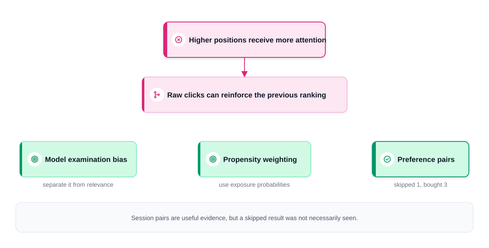
*Figure — Position affects click labels; each correction needs validated assumptions (course diagram)*

**Monitor by query segment**: reformulation and zero-results rates reveal problems that aggregate revenue hides (e.g. a broken synonym list for one category).

| Failure | Fallback / effect |
|---|---|
| Embedding service / ANN index down | Lexical still serves exact and head queries (if it doesn't share the failed infrastructure); long-tail natural-language queries degrade — watch reformulation and zero-results rates as the outage dashboard |
| Query understanding down | Search the raw query |
| Stale cache | Wrong availability → refresh volatile fields at render, validate at checkout |

### 11. Interview follow-ups
- **"A search returns nothing. What do you do?"** → First the cause: no inventory, or vocabulary mismatch? Then fallbacks — relax *uncertain inferred* filters (never explicit ones or eligibility), try spelling variants, retry semantic-only, offer category browsing — each logged as a health metric.
- **"How far would you personalise search?"** → Personal signals may reorder results that already match the query, never outrank what the user explicitly typed. Personal features go into L2 with a capped effect; check each user segment in experiments.
- **"Why not let an LLM rank everything?"** → At 10 K QPS per-item LLM calls blow latency and cost (section 9). Use LLMs offline for labels and enrichment, and at most a small cross-encoder over the top 20.

### Toy — position bias and IPW (`code/search_position_bias_toy.py`)
Each synthetic query has 20 products with 3 features: x0 and x1 drive true relevance (graded 0–3); x2 is a "promoted" score the **old ranker** leaned on, with **no effect** on relevance. Users click only if they **examine** the slot (P = 1/position) **and** are attracted (more likely for higher relevance). We train a linear scorer on the logs three ways and measure NDCG@10 against true relevance on fresh queries.

```python
PROPENSITY = 1.0 / POS                                  # P(examined at rank k) = 1/k

def fit_linear(x, target, weight_pos, weight_neg, epochs=300):
    """Weighted logistic loss: w_pos*log(s) + w_neg*log(1-s), full-batch Adam."""
    # ...
        loss = -(wp * logsigmoid(z) + wn * logsigmoid(-z)).mean()

ipw = clicks / np.clip(prop, 0.1, None)                  # clip: cap weights at 10x
models = {
    "naive clicks": fit_linear(xs, clicks, clicks, 1 - clicks),
    "IPW clicks":   fit_linear(xs, clicks, ipw, 1 - ipw),   # unbiased pointwise loss (weights may be < 0)
    "oracle (true rel)": fit_linear(xs, None, (rs >= 2).astype(float), (rs < 2).astype(float)),
}
```

Output:
```
CTR by position (1..10): [0.352 0.174 0.107 0.071 0.064 0.044 0.038 0.033 0.026 0.022]
mean true relevance by position (1..10): [1.11 1.04 0.98 0.95 0.91 0.87 0.87 0.84 0.81 0.79]

model                  w_x0   w_x1   w_x2  NDCG@10
naive clicks           1.03   0.50   0.82    0.820
IPW clicks             1.28   0.79   0.22    0.948
oracle (true rel)      3.72   2.48   0.01    0.956
old ranker                                   0.514
saved img/search_ctr_by_position.png
```

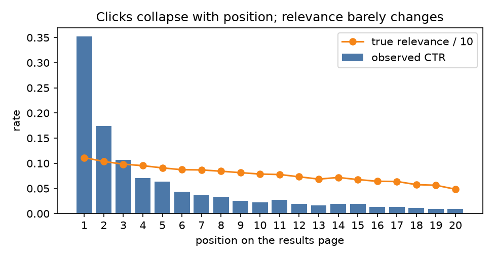

What it shows:
- CTR falls 16× from position 1 to 10 while true relevance barely moves (1.11 → 0.79) — clicks mostly measure **where** an item was shown.
- The **naive** model gives the irrelevant promoted feature x2 a large weight (0.82): it learned to copy the old ranker. **IPW** shrinks that to 0.22 and reaches NDCG 0.948, close to the **oracle** (0.956) trained on true labels we'd never have in real life.
- IPW falls short of the oracle partly because weights are clipped at 10× — a little bias traded for much lower **variance** (noise from run to run) — and its guarantee holds only if the propensities are right.
- Why it works: with click c and propensity p, the weight c/p has expected value P(attracted), so on average the loss equals the loss on true attraction labels. The negative weight 1 − c/p is below zero for clicks below slot 1 — fine in a custom PyTorch loss, rejected by libraries that forbid negative weights.

### Common mistakes
| Weak | Strong |
|---|---|
| Jumps straight to embedding retrieval | Runs keyword and vector retrieval side by side and names each one's blind spot (part numbers vs paraphrased needs) |
| Treats the query as an opaque string | A whole stage for spelling, synonyms, intent, attributes; reliable constraints as filters, uncertain ones as features |
| Trains on raw clicks | Names position bias; validated correction; treats session pairs as imperfect evidence |
| Pretends sponsored results don't exist | Names revenue vs relevance as a governed trade-off with a relevance floor |

### Same design, other questions
- **App-store search** — small catalog, extreme head skew, exact title/brand matching dominates; success = install-and-retain.
- **Job search** — **two-sided** relevance (seeker fits the job *and* employer wants the seeker); qualifications as hard filters; postings expire, so freshness matters.

### Self-check
1. Why run lexical and semantic retrieval together? → Lexical handles exact identifiers and rare tokens; semantic handles vocabulary mismatch.
2. Compute NDCG@2 for relevances [0, 3]. → DCG = 0 + 7/1.585 = 4.42; IDCG = 7 + 0 = 7; NDCG ≈ 0.63.
3. What does IPW weight each click by? → 1 / P(examined at that position), with weights capped.

### TL;DR
| | |
|---|---|
| New stage | Query understanding (fix typos, add synonyms, detect intent, turn reliable attributes into filters); frequent queries are cached |
| Retrieval | Hybrid: inverted index + BM25 (lexical) and two-tower + ANN (semantic), union |
| Ranking | L1 → L2 with query–item features; optional cross-encoder on the top ~20 |
| Biased clicks | Position bias → examination model or IPW; NDCG on graded judgments offline; session success online |
| Business | Hard filters, boosts, labelled sponsored slots with a relevance floor |
| Failure | Lexical as fallback; refresh volatile fields; zero-results and reformulation by segment |

---

## 17.4 Case study: text-to-video search

> "Users type a query such as 'how to fold a fitted sheet' or 'goal from last night's match'. Design the search system that returns videos (think YouTube search)."

### 1. Clarify requirements
The recognition sentence: **"This is the search funnel of 17.3, but the documents are videos, and most of what a video contains is not written down anywhere."** A video's title may be empty, in another language, or clickbait; what it shows lives in its **frames** and what it says in its **audio**. So the new work is on the *indexing* side: turn pictures and speech into something a text query can match. Query understanding, hybrid retrieval, L1/L2 ranking and position bias carry over from 17.3.

| Question | Assumption used below |
|---|---|
| Corpus | 1 B searchable videos; ~1 M new uploads/day, average 10 minutes long |
| Traffic | 20 K queries/s at peak |
| Latency | ~300 ms for the results page |
| In scope | Text query → ranked videos; a "jump to the moment" timestamp when the match is one scene of a long video |
| Out of scope | Query by image or clip (that is 18.6), autocomplete, ads |
| Freshness | A new upload should be searchable within minutes by its title, and within hours by its content |

Business goal: a **satisfied** watch — a click followed by 5 seconds of viewing and a return to the results is a failure.

### 2. Frame it as an ML task
- **Input**: query text, user and context (language, region, device), candidate video with all its evidence (text fields, transcript, frames).
- **Output**: a relevance score per (query, video), then a ranking score that also predicts **satisfied watch** (e.g. P(watch ≥ 30 s or ≥ 50% of a short video | shown for this query)).
- **Category**: **cross-modal retrieval** (the query is text, the item is pictures + sound + text) followed by **learning-to-rank**.
- **Two supporting ML tasks run at upload time**, not query time: **speech recognition** (**ASR**, automatic speech recognition: audio → transcript) and **visual embedding** (frames → vectors in the same space as text). Optionally **OCR** (optical character recognition: text burned into the frames, such as slide titles or scoreboards).

### 3. Data and labels
1. **Video metadata**: title, description, tags, channel, language, upload time, duration, chapters if the creator added them.
2. **Derived content**: ASR transcript with timestamps, OCR text, sampled frames (e.g. one per second, or one per detected shot — a **shot** is a continuous run of frames from one camera cut).
3. **Search logs**: query, results with positions, clicks, **watch time after the click**, returns to the results page ("pogo-sticking"), reformulations.
4. **Human relevance ratings** on sampled (query, video) pairs — the clean, unbiased evaluation set, split by query type.

**Labels**:
- For the **ranker**: satisfied watches after a search are positives; short clicks followed by a quick return are strong negatives; skipped results are weak negatives. Position bias applies exactly as in 17.3, so log positions and correct for it.
- For the **text–video encoder**: (query, satisfyingly watched video) pairs are best. Before logs exist, **weak pairs** do the job: (title, video) and (transcript sentence, frames at that timestamp). Research datasets work the same way: MSR-VTT pairs clips with human captions (Xu et al., 2016); HowTo100M uses the narration of 1.2 M instructional videos as free, noisy captions (Miech et al., 2019).

### 4. Features
| Group | Examples |
|---|---|
| Query–text match | BM25 on title, description, tags, transcript and OCR (separate score per field); text-embedding similarity |
| Query–visual match | Similarity between the query vector and the video-level visual vector; **best-matching segment** score and its timestamp |
| Channel availability | Has transcript? Title empty or very short? Language of speech vs language of query |
| Video quality | Satisfied-watch rate for similar queries, likes vs dislikes, completion rate, channel authority, upload age |
| Query | Class (navigational: a channel or a specific video; informational: "how to…"; fresh: news, sport results), language, head vs tail |
| Personalisation | Subscribed channel, languages the user watches in (capped, as in 17.3) |

**Availability features** matter: a ranker cannot tell a bad title match from a missing title unless it is told the title is missing (see the toy).

### 5. Model: baseline → advanced
**Baseline**: BM25 over title + description + tags, times popularity. It fails on exactly the videos this design is about: thin or misleading text.

**Upgrade 1 — index what is said.** Run ASR on every upload and index the transcript (with timestamps) as another text field. Modern ASR such as Whisper (Radford et al., 2022, trained on 680 K hours of weakly labelled audio) makes speech searchable across many languages. A large gain for tutorials and talks; nothing for music or silent footage.

**Upgrade 2 — index what is shown.** A **shared text–image embedding space** in the style of CLIP (Radford et al., 2021; contrastive training on image–caption pairs so that a caption and its picture land close together — the same idea as [18.6](../18-ml-case-studies-2/README.md)). Encode sampled frames with the image tower and the query with the text tower; similarity is a dot product. From frames to a video:
- **Mean-pool** (average) all frame vectors into one video vector — one entry per video in the ANN index, cheap, but a short scene gets diluted.
- **Segment vectors** — one vector per shot or per few seconds — find moments inside long videos, at many times the index size.
- **Temporal models** (a small transformer over frame vectors) learn which frames matter. CLIP4Clip (Luo et al., 2022) compared these choices on top of CLIP: parameter-free mean-pooling is strong on small datasets; learned temporal models need more training data.
Fine-tune (continue training) the towers contrastively (InfoNCE — the standard contrastive loss: pick the true pair out of many — 18.6) on (query, satisfied-watch video) pairs once search logs exist.

**Fusion.** Each channel (lexical text, text embedding, visual embedding) returns its own top few hundred. Merge them:
- **Reciprocal rank fusion** (RRF; Cormack, Clarke & Büttcher, 2009): score = Σ over channels of 1 / (k + rank), with k ≈ 60. It needs no training and ignores the fact that the channels' raw scores are on different scales.
- **A learned ranker** (L1 then L2, as in 17.3) with every channel's score *and* the availability features as inputs. This is where the real gain is: it learns that a missing transcript is not evidence against a video.

**Ranking objective**: multi-task heads — P(click) and P(satisfied watch | click) — combined into one score, the product of the two (the 17.2 value-formula idea), plus a freshness term for queries classified as fresh.

### 6. Offline metrics
- **Retrieval**: recall@K **per channel and after fusion**, on the rated set. Also **marginal recall** per channel (videos only that channel found — the 17.1 test for adding a source).
- **Ranking**: NDCG@10 on graded ratings; MRR for navigational queries.
- **Slices** that aggregate numbers hide: query class, language, videos with no title / no speech, long videos with moment-level matches, fresh uploads.
- **Moment accuracy**: for rated moment queries, is the returned timestamp within a few seconds of the right scene?

### 7. Online metrics and A/B testing
- **Primary**: search success rate = share of searches ending in a satisfied watch; **time to first satisfied watch**.
- **Dissatisfaction**: quick returns to the results page, reformulations, abandonment.
- **Guardrails**: harmful or misleading videos in results (18.3), latency, creator diversity, freshness on fresh queries. **Interleaving** (16.9) compares rankers with far fewer users.

### 8. Serving architecture
**Two pipelines**: an *indexing* pipeline that runs once per upload, and a *query* path that runs per search.

**Indexing path** (per upload):

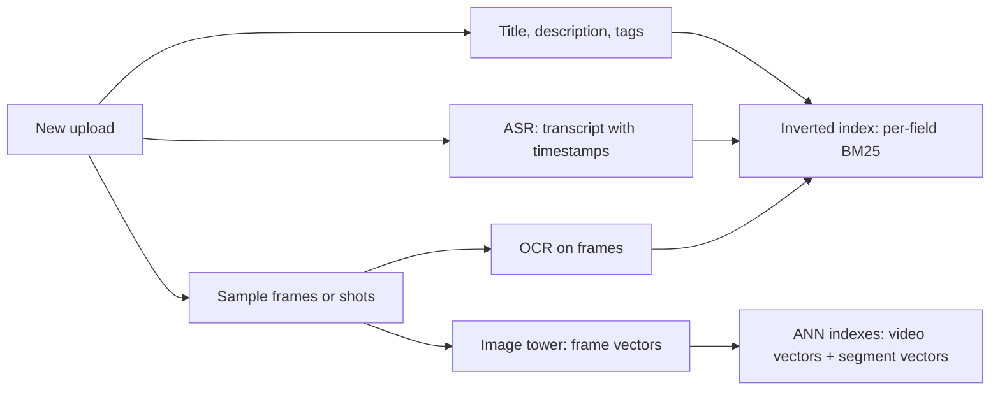

**Query path** (per search):

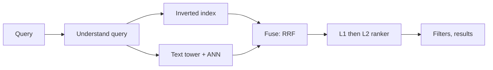

Query understanding = spelling, language, query class, freshness intent (17.3). The ANN lookup covers video-level and segment-level vectors; fusion keeps ~1,000 candidates; the L2 ranker predicts click × satisfied watch; policy, safety and region filters run last, and results carry a moment timestamp when a segment matched.

**Staged freshness**: title and description are indexed within minutes; ASR and visual vectors follow in minutes to hours. Until then the ranker sees "transcript: not yet available", not "no match". For fresh queries a small **real-time index** of the last day's uploads is searched alongside the main one.

**Caching**: head queries' ranked ID lists are cached (language and region in the key; short TTLs — time-to-live, how long a cache entry stays valid — for fresh queries); policy status (taken down, age-restricted, region-blocked) is checked at render time.

### 9. Scale numbers
| Quantity | Arithmetic | Result |
|---|---|---|
| Video-level vectors | 1 B × 512 dims × 2 bytes (float16, 16-bit numbers) | 1 TB raw → shard it (split across machines; see [System Design Fundamentals](../../../system-design-patterns/modules/00-system-design-fundamentals/README.md)); with PQ (product quantisation, a vector-compression method, 18.6) at 64 B/vector, 64 GB |
| Segment vectors | long videos only, say 100 M × 30 segments × 64 B (PQ) | 192 GB — 3× the video-level index, so index segments selectively |
| Frame encoding | 1 M uploads/day × 600 s ÷ 2 s per sampled frame | 300 M frames/day ≈ 3,500/s — a steady GPU fleet (many graphics chips running constantly) |
| ASR | 1 M × 10 min of audio | 10 M audio-minutes/day to transcribe |
| Query side | 20 K QPS × (1 text-tower pass + 3 index lookups) | cheap compared with indexing; L2 on 20 K × 300 = 6 M scores/s |

The expensive half of this design is **indexing**, not querying — the reverse of 17.3, where documents are cheap to index and queries are expensive to rank.

### 10. Monitoring and failure modes
- **Indexing lag**: time from upload to (a) title-searchable, (b) transcript-searchable, (c) visually searchable. Alert on each.
- **Coverage**: share of videos with a transcript, with visual vectors, per language. A broken ASR language model silently makes a whole language unsearchable by speech.
- **Encoder upgrades**: a new visual encoder needs a full re-embed and an **atomic swap** (switching both at the same instant) of model + index (the 18.6 rule); budget weeks of GPU time for 1 B videos.
- **Keyword stuffing**: creators pack popular words into titles and tags; content channels plus satisfied-watch labels are the defence.

| Failure | Fallback / effect |
|---|---|
| Visual ANN index down | Text channels still serve; visually-only-findable videos disappear — watch success rate on "no title / no speech" slice |
| ASR backlog | Serve without transcripts; ranker treats them as missing, not as no-match |
| Stale cache on a taken-down video | Render-time policy check drops it |

### 11. Interview follow-ups
- **"Why not just search titles and descriptions?"** → A large share of videos have empty, foreign-language or misleading titles; what a video shows and says is the only reliable evidence. Show recall per channel and the marginal recall of each.
- **"How would you let users jump to the right moment?"** → Segment-level vectors and transcript timestamps; return the best segment's start time. Index segments only for long videos to control index size.
- **"How do you handle breaking-news queries?"** → Classify the query as fresh, search a small real-time index of recent uploads in parallel, and add a freshness feature to the ranker; rely on title/ASR first because visual embedding may lag.

### Toy — three evidence channels, fusion and moments (`code/video_search_toy.py`)
Each synthetic video has a hidden topic vector. We assume a CLIP-style encoder already maps text and frames into one space, so each channel gives a vector comparable to the query: a **title** vector (31% of videos have empty titles, 7% clickbait), **16 frame** vectors (each very noisy, always present) and a **transcript** vector (only 44% have speech). Queries are noisy views of a video's topic.

```python
s_rrf = sum(1.0 / (K + 1 + ranks(s)) for s in (s_title, s_visual, s_trans))      # K = 60

def feats(i):   # learned fusion: channel scores gated by availability + availability flags
    has_t, has_s = (~empty).astype(float), speech.astype(float)
    return np.stack([s_title[i] * has_t, s_visual[i], np.where(speech, s_trans[i], 0) * has_s,
                     has_t, has_s], axis=1)
lr = LogisticRegression(max_iter=1000).fit(X_train, y_train)    # target vs hard + random negatives

seg = unit(frames.reshape(N, F // 2, 2, D).mean(axis=2))         # 8 segments of 2 frames
seg_scores = np.einsum("qd,nsd->qns", mq, seg).max(axis=2)       # best segment per video
```

Output:
```
5,000 videos; 31% empty titles, 7% clickbait titles, 44% with speech

main-topic queries, recall@10 on 500 test queries   (all | target title empty, n=132)
  title/tags only           0.672 | 0.000
  visual (mean of frames)   0.652 | 0.606
  transcript only           0.462 | 0.424
  average of raw scores     0.714 | 0.288
  reciprocal rank fusion    0.740 | 0.379
  learned fusion (LR)       0.896 | 0.886
  learned weights [title, visual, transcript, has_title, has_speech]: [ 9.7  8.  10.8 -5.7 -6. ]

'moment' queries (scene lasts 2 of 16 frames), recall@10
  mean-pool whole video       0.138
  max over 2-frame segments   0.978
  index size: 1 vector/video = 5,000; 8 segments/video = 40,000
```

What it shows:
- **Title-only search never finds a video with an empty title** (0.000 on that slice). The visual channel is present for every video, so it keeps working there (0.606).
- **Untrained fusion helps overall but hurts the empty-title slice**: averaging raw scores (0.288) and RRF (0.379) both let a missing title drag a video down, below what visual search alone achieves on that slice (0.606).
- **A learned fusion with availability flags** fixes it: 0.896 overall and 0.886 on empty-title videos. The negative weights on `has_title` and `has_speech` are the model's way of saying "an available channel raises the bar; a missing one is not evidence against the video."
- **Moments**: when the queried scene is 2 of 16 frames, mean-pooling dilutes it (0.138); taking the best of 8 short segments finds it (0.978) — at 8× the index size. The toy's scene frames are clean, so real gains are smaller, but the direction and the cost are the same.

### Common mistakes
| Weak | Strong |
|---|---|
| Indexes titles and descriptions only | Indexes what is said (ASR), shown (visual embeddings) and written on screen (OCR), each as a channel |
| Treats a missing channel as a low score | Availability features and a learned fusion; "not yet indexed" is different from "no match" |
| One vector per video for everything | Video-level vectors for topic queries, segment vectors (selectively) for moments |
| Optimises clicks | Satisfied watch after search; quick returns to results are strong negatives |

### Same design, other questions
- **Podcast or meeting-recording search** — the same design with the visual channel replaced by speaker identification; ASR quality is everything, timestamps become the product.
- **Stock-footage search** — no speech, weak titles, so the visual channel carries the design; buyers search for moments, so segment vectors are core.

### Self-check
1. Why does video search need an indexing pipeline that product search mostly doesn't? → The content is in pictures and audio; ASR, OCR and visual encoders must turn it into searchable text and vectors at upload time.
2. What does reciprocal rank fusion add up, and why not raw scores? → 1/(k + rank) per channel; raw scores from different channels are on different scales.
3. Why can mean-pooling miss a query about a short scene? → The scene's frames are a small share of the average, so their signal is diluted.

### TL;DR
| | |
|---|---|
| Big picture | 17.3's search funnel where documents are videos; the new work is indexing pictures and speech |
| Channels | Lexical (title, description, ASR transcript, OCR) + shared text–image embeddings (CLIP-style) at video and segment level |
| Fusion | RRF as a start; a learned ranker with availability features is what handles missing titles and speech |
| Objective | Satisfied watch after search, not clicks; position bias corrected as in 17.3 |
| Cost | Indexing dominates (frames, ASR per upload); segment vectors multiply the index — use selectively |
| Freshness | Title in minutes, content in hours, a real-time index for fresh queries |

---

## Chapter comparison (17.1–17.4)

| | Recommendations | Feed ranking | Search ranking | Text-to-video search |
|---|---|---|---|---|
| Task type | Retrieval + learning-to-rank | Multi-task ranking | Query understanding + learning-to-rank | Cross-modal retrieval + learning-to-rank |
| Candidate source | Two-tower ANN, co-occurrence, trending | Social graph fan-in, spillover, suggested | Inverted index (BM25) + embedding ANN | Inverted index over title/ASR/OCR + text–visual ANN (video and segment level) |
| Key features | Watch history, item embeddings, user×item similarity | Viewer–author closeness, post content, live engagement | Query–item match (BM25, embedding sim, attributes), item quality | Per-channel match scores, channel availability, satisfied-watch rate, freshness |
| Model | GBDT → deep multi-objective ranker | Shared-body multi-task net + value formula | L1 GBDT → L2 LambdaMART / deep; cross-encoder top-k | BM25 → + ASR → + CLIP-style encoders; RRF → learned fusion ranker |
| Offline metric | Recall@K, AUC | Per-head AUC, calibration, formula replay | NDCG@k, MRR | Recall@K per channel, NDCG@10, moment accuracy |
| Online metric | Watch time, return rate | Sessions/user or worthwhileness + hide/report guardrails | Session success, revenue per search, reformulation | Searches ending in a satisfied watch, quick returns |
| Hardest challenge | Cold start + position bias | Balancing many goals without rewarding bait | Biased clicks + revenue vs relevance | Indexing cost; missing or misleading text |

The full thirteen-way table is at the end of Chapter 18.

## Chapter TL;DR
- One template for every case: requirements → ML framing → data/labels → features → baseline → advanced → offline metrics → online metrics → serving → scale → monitoring → follow-ups.
- Retrieval-and-ranking problems share a **funnel**: cheap high-recall retrieval, expensive high-precision ranking, rules kept outside the model.
- **Recommendations**: multi-source retrieval judged by marginal recall, cold start, precompute-heavy serving.
- **Feeds**: calibrated per-event heads blended by a product-owned **value formula**, integrity layer after it, negative feedback in training.
- **Search**: query understanding, hybrid lexical + semantic retrieval, NDCG, and **position-biased clicks** corrected with an examination model or IPW.
- **Video search**: index what videos say (ASR) and show (CLIP-style frame vectors); a learned fusion that knows when a channel is missing; segment vectors for moments.
- In all four, clicks are a biased proxy: log positions and features, correct for bias, and let long-term online metrics with guardrails decide.
