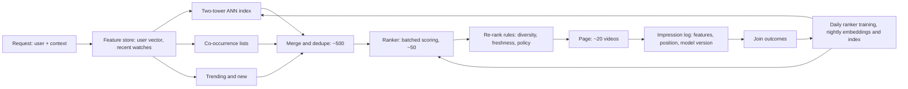
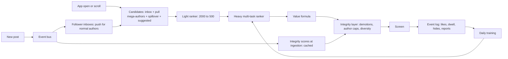
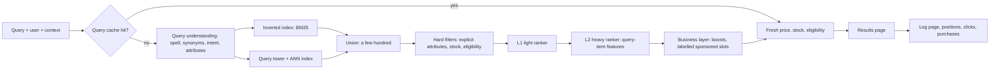
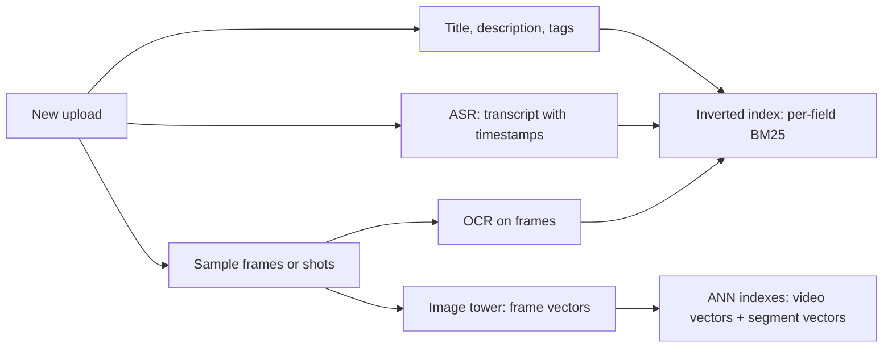
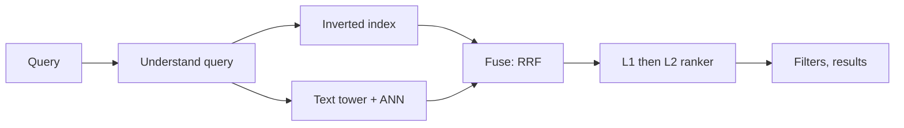

# Chapter 17 — ML Case Studies I: Recommendations, Feed Ranking, Search

Chapter 15 gave the seven-step framework and Chapter 16 the production pieces. This chapter and the next apply both to the questions interviewers actually ask — recommendations, feeds, search, ads, fraud, moderation, "people you may know" — each teaching a different lesson about data, serving and evaluation. Learn them and a new question ("design job matching") becomes a matter of saying which parts transfer and which requirement is new.

This chapter covers the four **retrieval-and-ranking** designs: video recommendations (multi-source retrieval, two-tower + ANN, cold start, position bias, the proxy trap), social feed ranking (social candidates, multi-task heads, a product-owned value formula, integrity layer), e-commerce search (query understanding, hybrid lexical + semantic retrieval, L1/L2 rankers, NDCG, IPW) and text-to-video search (indexing speech with **ASR** and pictures with **CLIP**-style frame embeddings, fusing channels, segment vectors for moments) — each with a small runnable toy on synthetic data. Chapter 18 covers ads, fraud, harmful content, people-you-may-know, music, visual search, privacy blurring, events and similar listings, ending with a thirteen-way comparison.

Code is in `code/`; outputs are real.

---

## 17.0 The case-study template

### What it is
One fixed order of questions for every design in Chapters 17–18 — the Chapter 15.3 framework split so the ML parts get their own slot:

| # | Section | The question it answers | Ch. 15 step |
|---|---|---|---|
| 1 | Clarify requirements | Product surface, scale, latency, out of scope? | 1–2 |
| 2 | Frame as an ML task | Input, output, ML category, objective? | 1 |
| 3 | Data and labels | Which logs and catalogs, where labels come from, how biased/late? | 3 |
| 4 | Features | Which groups, how fresh, what leakage risk? | 3 |
| 5 | Model: baseline → advanced | Simplest thing that works, and what's worth upgrading to? | 4 |
| 6 | Offline metrics | How do we pick models before exposing users? | 2, 6 |
| 7 | Online metrics and A/B | What decides a launch, what may never get worse (guardrails)? | 2, 6 |
| 8 | Serving architecture | Offline vs per request; draw the request path | 5 |
| 9 | Scale numbers | QPS, candidates scored per second, memory — arithmetic shown | 5, 7 |
| 10 | Monitoring and failure modes | What breaks silently; fallbacks? | 6–7 |
| 11 | Interview follow-ups | Questions you'll get, with answers | — |

Each case also has a **toy**, **common mistakes** and **same design, other questions**; the chapter-end comparison table is the one-row summary of each case. Generic material is referenced, not retaught: A/B mechanics (sticky randomisation, primary metric, guardrails, novelty, interleaving, holdbacks) in [Chapter 16.9](../16-ml-in-production/README.md); drift and monitoring in 16.8; shadow → canary → ramp in 16.6; embeddings, two-tower, ANN and ranking metrics in [Chapter 13](../13-recommenders-and-embeddings/README.md).

### The shared shape: a funnel (for retrieval and ranking designs)
Too many items to score carefully per request, so a **funnel** of stages, each with fewer items and more compute per item:
1. **Retrieve** (**candidate generation**): cheap methods pick a few hundred from millions. Graded on **recall** — anything missing is lost for good, since later stages only reorder.
2. **Rank**: a richer model scores and sorts them. Graded on **top-of-list precision** — the few slots people actually look at.
3. **Re-rank / apply rules**: freshness, variety, policy, "no two ads in a row".


*Figure — Retrieve, rank, apply rules: the funnel shared by recommendations and search (course diagram)*

Not every design is a funnel: **fraud** scores one transaction at a time; **harmful content** uses a **cascade** (cheap checks on everything, expensive checks — bigger models, humans — only on what they flag); **privacy blurring** is a once-per-image batch detection pipeline (Chapter 18).

### What each case study adds
| Case study | New idea it teaches | Chapter |
|---|---|---|
| Recommendations | Multi-source retrieval, ranking, rule layer, cold start | 17.1 |
| Feed ranking | Many goals at once (like, comment, hide, report) → value formula | 17.2 |
| Search ranking | A query as input; clicks biased by position | 17.3 |
| Text-to-video search | No reliable text: index speech and pictures, fuse channels | 17.4 |
| Ad click prediction | Probabilities feed an auction, so **calibration** matters | 18.1 |
| Fraud detection | An adaptive adversary; asymmetric per-transaction costs | 18.2 |
| Harmful content | Platform scale, high stakes both ways, human review | 18.3 |
| People you may know | Graph-based candidates, two-sided acceptance | 18.4 |
| Music discovery | Sequences, sessions, exploration vs familiarity | 18.5 |
| Visual search | Image embeddings and nearest-neighbour search at scale | 18.6 |
| Privacy blurring | A miss is a privacy breach: recall per person, fail closed | 18.7 |
| Event recommendation | Every item new, perishable, tied to place and time | 18.8 |
| Similar listings | Item-to-item similarity from browsing sessions | 18.9 |


*Figure — The main focus of each of the six core designs (course diagram)*

**Diagnosing a bad recommendation:** if better items were never pulled in, it's a **retrieval failure**; if pulled in but ranked too low, a **ranking failure** (logs or experiments tell which).

---

## 17.1 Case study: video recommendations

> "Design the homepage recommendations for a video platform (think YouTube)."

### 1. Clarify requirements

| Question | Assumption used below |
|---|---|
| Which surface? | Homepage feed only (search, "up next", notifications out of scope) |
| Catalog size? | 50 million videos, thousands uploaded per hour |
| Users? | 100 million daily active users (DAU) |
| Latency? | Whole page in about 200 ms |
| Page size? | About 20 videos |
| Business goal? | People come back and watch more |

Running a careful model on 50M videos per request would blow the 200 ms and cost budgets by orders of magnitude — so say early: *"This is a prediction problem with a ranking-funnel shape."*

### 2. Frame it as an ML task
- **Input**: user (history, profile), context (time, device, location), candidate video.
- **Output**: a score per (user, video) — P(click) and expected watch time, or P(watch ≥ 30 s).
- **Category**: retrieval + **learning-to-rank**.
- **Objective**: predicted engagement per **impression** (one item shown once). Engagement arrives in minutes; the true goal (daily return rate, long-term **retention**) takes weeks.

**Proxy trap**: clicks alone reward misleading thumbnails; watch time alone rewards needlessly long videos. Combine several predicted outcomes and check the long-term metric in experiments.

### 3. Data and labels
1. **Interaction logs** — the label source. Log every impression with user and item IDs, timestamp, position, model version, ranking features; join outcomes (click, watch seconds, like, "not interested") within an **observation window** (e.g. 24 h). Respect privacy and retention rules.
2. **Catalog content** — title, tags, description, channel, audio/visual embeddings.
3. **Signup signals** — language, country, declared interests, device.

An engaged impression is a positive; a skipped one only a *weak* negative (maybe never noticed). Name two flaws unprompted:
- **Exposure bias** — outcomes exist only for items shown; the model may generalise to unshown items, but they're never measured.
- **Position bias** — slot 1 gets more clicks than slot 15 for the same item; clicks mix relevance with placement (fixes in section 10 and 17.3).

Content and signup data exist for what logs can't cover: brand-new users and videos.

### 4. Features
| Group | Examples | Freshness |
|---|---|---|
| User | Watch history (IDs + embeddings), subscriptions, language, country | Nightly + in-session updates |
| Short-term user state | Last 10 videos this session, topics skipped | Seconds (streaming) |
| Item | Channel, topic, length, upload age, embedding, CTR and watch-rate aggregates | Stable fields nightly; counts every few minutes |
| User × item (cross) | Watched this channel before? Item embedding vs recent watches | Request time |
| Context | Device, hour, weekday, network speed | Request time |

**Leakage**: any feature using data from after the impression (total watch count including the watch being predicted) — use point-in-time-correct joins (Chapter 16).

### 5. Model: baseline → advanced
**Baseline**: "most popular in your region + newest from your subscriptions" — ships in a week, tests logging, gives a number to beat.

**Candidate generation** — several cheap sources in parallel, merged:
1. **Two-tower embeddings** (collaborative filtering) — the main source; user and item towers trained so a user's vector is near engaged items and away from sampled negatives; relevance = dot product; items precomputed, only the user vector computed per request ([§13.7](../13-recommenders-and-embeddings/README.md)).
2. **Co-occurrence** (viewers of X went on to watch Y) — item-to-item lists precomputed offline, looked up from recent watches. Cheap, explainable, surprisingly strong (Amazon's item-to-item CF, Linden, Smith & York, 2003).
3. **Non-personalised** — trending, fresh uploads, popular in region; serve new users and keep the page fresh.


*Figure — Three cheap candidate sources running at the same time (course diagram)*

**Ranker** — ~500 candidates, so rich features and a stronger model: **GBDT** first, then a deep **multi-task** network predicting click, watch time, like. Most modelling effort goes here. YouTube's published systems follow this split: candidate-generation and ranking networks (Covington et al., 2016), later a multi-task ranker with a small "shallow tower" modelling position bias (Zhao et al., 2019).

### 6. Offline metrics
- **Retrieval**: **recall@K** — of videos watched in a later held-out week, what share appear among the K candidates?
- **Ranking**: **AUC** or a ranking loss; **NDCG@k** (worked example in 17.3) with graded outcomes.
- Always a **time-based split** (train weeks 1–4, test week 5). Offline metrics select candidates for an online test; they don't decide launches.

### 7. Online metrics and A/B testing
- **Primary**: watch time per user, daily return rate over a long enough window.
- **Guardrails**: "not interested"/dislike rate, policy-violating impressions, latency, creator-side diversity.
- User-level A/B (16.9), long enough to see return behaviour, not just first-week **novelty**.

### 8. Serving architecture
1. **Candidate generation: 50M → ~500.** Item vectors precomputed into an **ANN** index (e.g. **HNSW**, Malkov & Yashunin, 2016). Per request: fetch the user vector, pull the nearest few hundred in a few ms, merge with co-occurrence and trending. ANN trades a little recall for huge speed — measure that loss and pick index settings (memory, update speed, latency) from benchmarks.
2. **Ranking: ~500 → ~50.** All candidates in one **batch** model call; treat 20–40 ms as illustrative and verify under concurrent load.
3. **Re-ranking: ~50 → ~20 on screen.** Cap slots per channel, lift recent uploads, policy demotions, drop just-seen items, editor-pinned slots. Mandatory rules live **outside** the model (policy changes need no retraining); re-check fast-changing restrictions just before display.


*Figure — Example candidate counts and latency targets for the recommendation pipeline (course diagram)*



**Cold start** (raise both kinds yourself):
- **New user**: popular overall and in region, signup signals (language, interests, platform), and fast first-session learning — weight early clicks heavily, update session state in seconds.
- **New video**: **content features** (title, tags, audio/visual embeddings) so it's retrieved by resembling established videos, plus a small controlled **exploration boost** — otherwise established videos soak up all exposure and new ones never collect data.

### 9. Scale numbers
| Quantity | Arithmetic | Result |
|---|---|---|
| Homepage QPS | 100M DAU × 5 loads/day ÷ 86,400 s (assumed 5 loads) | ≈ 5,800 avg; ~17K at a 3× peak |
| Items scored by ranker | 17K QPS × 500 | ≈ 8.7M scores/s at peak |
| Raw item vectors | 50M × 128 dims × 4 bytes | 25.6 GB (before index structure, IDs, metadata, replicas) |

Heavy work (embedding and index builds, co-occurrence lists) moves offline so each request is cheap; incremental updates skip unchanged items.

### 10. Monitoring and failure modes
**Update loops at three speeds** (validate each against measured freshness needs): ranker retrained daily; embeddings and ANN index rebuilt nightly with incremental inserts for uploads; short-term user state updated in-session via streaming.

**Training traps**:
- **Position bias** → model *examination* separately from relevance (a position tower used only in training), or **inverse-propensity weighting (IPW)**: weight each example by 1 / P(user examined that slot); validate propensities and cap large weights. Feeding slot number as a feature in training and fixing it at serving does **not** reliably remove the bias. (Toy in 17.3.)
- **Proxy trap** → multiple objectives + long-term guardrails.


*Figure — The two training traps, and the fix for each (course diagram)*

| Failure | Fallback | Monitor |
|---|---|---|
| Nightly index build fails | Last validated index up to an age limit; still enforce current availability and policy filters | Index age (severity rises with staleness) |
| Ranker times out | Candidate order or trending list, same required filters | Fallback rate, latency |
| Diversity collapse (feedback loop) | Re-rank diversity rules, exploration | Watch time by category narrowing over time |

### 11. Interview follow-ups
- **"Why not one end-to-end model?"** → Any model good enough to order items costs too much to run 50M times per page; stages fix that, each with its own yardstick (recall for the shortlist, top precision for the order).
- **"Recall looks fine but users seem bored."** → Check re-ranking and the objective per segment: diversity may have collapsed into one taste cluster, or the proxy over-rewards short-term clicks. A shrinking weekly category mix is the warning sign.
- **"Real-time personalisation?"** → Session events stream into short-term features within seconds and nudge the user vector (cheap version: recency-weighted average of the last few videos' vectors); full retraining stays daily.
- **"Add a new candidate source?"** → Measure its **marginal** value (watched items only it finds), then **shadow**, then a small experiment slice (the toy computes this).

### Toy — multi-source retrieval and marginal value (`code/rec_funnel_toy.py`)
Synthetic users and videos in a hidden 8-dimensional "taste space"; each user watches 35 videos sampled by taste + popularity; the last 5 held out. Three sources each return K = 100; then their union.

```python
def two_tower(train, k, dim=16, epochs=15, lr=0.05, reg=1e-4, n_neg=5):
    """Matrix factorisation = the simplest 'two-tower': user tower and item tower are embedding tables."""
    U = 0.1 * rng.normal(size=(N_USERS, dim))
    V = 0.1 * rng.normal(size=(N_ITEMS, dim))
    # ... for each (user, watched item): 1 positive + 5 random negatives, logistic loss, SGD
            scores = V[items] @ U[u]
            g = 1 / (1 + np.exp(-scores)) - labels           # logistic-loss gradient
    # ...
        s = V @ U[u]                                          # in production: ANN search, not a full scan
        s[row] = -np.inf                                      # never re-recommend watched items

union = [np.unique(np.concatenate(x)) for x in zip(pop, co, tt)]
# marginal value: share of held-out hits that ONLY this source found
```

```
2000 users, 3000 videos, 30 past watches each, last 5 held out

candidate source          size  recall@K
popularity                 100     0.129
co-occurrence              100     0.177
two-tower (MF)             100     0.203
union of the three         223     0.306
hits found ONLY by popularity      : 0.022 of held-out watches
hits found ONLY by co-occurrence   : 0.043 of held-out watches
hits found ONLY by two-tower (MF)  : 0.096 of held-out watches
```

- ("MF" = matrix factorisation, the simplest two-tower.) Learned embeddings beat popularity and co-occurrence, but **the union** (≈223 unique) reaches clearly higher recall — sources overlap only partly, which is why real systems run several.
- **Marginal value** judges a source: popularity finds 12.9% of held-out watches but only 2.2% nobody else finds — yet it's the only source that works for brand-new users, a benefit this offline test can't see. (Synthetic numbers.)

### Common mistakes
| Weak | Strong |
|---|---|
| Opens by naming an architecture | Opens with 50M items vs 200 ms, which forces the funnel |
| Treats clicks as ground truth | Raises position bias unprompted, offers a validated correction |
| Hides diversity and policy inside the model | Separate rule layer product can change without retraining |
| Waits to be asked about cold start | Covers both kinds, with different fixes |

### Same design, other questions
- **"Customers also bought"** — item-to-item co-occurrence carries retrieval; target = purchase (rarer, far less ambiguous). Funnel, cold start and bias unchanged.
- **Podcast discovery** — hour-long episodes make completion signals late and weak, so audio/transcript embeddings carry more of retrieval and new-item handling becomes the main path.

---

## 17.2 Case study: social feed ranking

> "Design the ranking for Instagram's (or LinkedIn's) home feed."

### 1. Clarify requirements
Say in one sentence that the funnel carries over, then spend time on what a feed changes:
1. **The candidate pool is social** — mostly from who you follow, not a 50M catalog.
2. **"Good" is plural** — several positive and negative reactions weighed together.
3. **Integrity moves inside ranking** — engagement alone rewards bait and misinformation.

| Question | Assumption used below |
|---|---|
| Users | 500M DAU |
| Candidates per session | A few hundred to a few thousand posts (graph-limited), plus suggested posts |
| Latency | < 200 ms per ranking call |
| Calls per session | Several — infinite scroll re-ranks (assume 3) |
| Freshness | New eligible posts rankable within seconds |

### 2. Frame it as an ML task
- **Input**: viewer, post (author, content, age, engagement so far), viewer–author relationship, context.
- **Output**: a *vector* per post: P(like), P(comment), P(reshare), E[dwell time], P(profile visit), and negatives P(hide), P("see less"), P(unfollow), P(report).
- **Category**: **multi-task** classification/regression feeding a ranking.
- **Objective**: a **value formula** combining the predictions — the formula, not any one probability, is optimised.

### 3. Data and labels
- **Retrieval = the social graph**: (a) **fan-in** — recent posts by followed accounts; (b) **engagement spillover** — posts your connections reacted to, from outside your follow list; (c) a slice of **out-of-network suggestions** via two-tower + ANN (17.1).
- **Labels = the event stream**: each (impression, event kind) is a row with the features the ranker saw. Log positives (like, comment, reshare, dwell) *and* negatives (hide, report).
- **Negative events are valuable but not ground truth**: a hide is far clearer than a scroll-past but context-dependent; a report needs validation, not automatic proof.
- **Survey labels**: ask a sample "was this post worth your time?" and train a satisfaction head. Check **response bias** (responders differ from non-responders), sample size and group differences.

### 4. Features
| Group | Examples |
|---|---|
| Viewer | Interests, past engagement rates by content type, language, session depth |
| Author | Follower count, posting frequency, historical engagement and hide rates, integrity history |
| Viewer × author | Interaction history (DMs, comments, profile visits), closeness, recency |
| Post content | Type (photo/video/text/link), text and image embeddings, topic, integrity scores |
| Post engagement (streaming) | Likes/comments/hides in the last 5 min, 1 h — sparse for new posts |
| Session | Posts already seen (dedupe), in-session reactions |

A brand-new post has no reactions, so the ranker relies on author, content and likely audience until first-hour engagement streams in.

### 5. Model: baseline → advanced
- **Baseline**: reverse-chronological fan-in, or one logistic regression for P(like) — the "Following" tab many apps still offer.
- **Multi-task learning (MTL)**: one network with a **shared body** (reads viewer, post, context once) and a small **head** per event. Rare events (reports, reshares) borrow statistical strength from common ones (likes). **MMoE** (multi-gate mixture of experts) helps when tasks conflict.
- **Value formula** (the product's definition of "good"):

```
score = w1·P(like) + w2·P(comment) + w3·P(reshare) + w4·E[dwell]  −  w5·P(hide) − w6·P(report)
```

Harm terms are *subtracted*. Rules:
- Product, safety and ML choose weights together — they encode policy.
- **Normalise units** — dwell is in seconds, other heads in [0, 1].
- Heads must be **calibrated** (predicted 0.1 ≈ 10% happen), else the sum is meaningless and an over-predicting head silently gains weight.
- Weights live **outside** the model: many policy changes are a formula change + A/B test, no retraining (some still need new labels or features).


*Figure — One shared body, one head per event, one value formula (course diagram)*

Real-world: Facebook's 2018 "meaningful social interactions" change re-weighted toward comments and reshares among friends; Twitter's open-sourced 2023 "heavy ranker" predicted about ten engagement probabilities combined with fixed weights — e.g. +0.5 for a like, −74 for negative feedback ("show less", mute, block), −369 for a report.

### 6. Offline metrics
- Per-head **AUC** and **log loss**; **calibration** per head (reliability curve: predicted vs actual rate per score bucket), since the formula sums them.
- Ranking-level: offline replay of the formula — expected likes/comments/hides in the top-k per weight setting (the toy does this).
- Slice by viewer segment, content type, new vs established authors.

### 7. Online metrics and A/B testing
- **Primary** (decides launch): sessions per user per day, or share of "worth your time" survey answers.
- **Guardrails** (can veto alone, limits fixed in advance — 16.9): hide rate, report rate, integrity-violating impressions, creator distribution.
- Weight changes are A/B tested on the same primary + guardrails; urgent safety changes may use a faster process.

### 8. Serving architecture
**Getting posts into candidate lists** — the classic news-feed question:
- **Push (fan-out on write)**: each post written into every follower's inbox. Fast reads; a celebrity with 100M followers = 100M writes.
- **Pull (fan-out on read)**: gather followed accounts' posts at open. Cheap writes; hot accounts get huge read load.
- **Hybrid**: push for normal accounts, pull for mega-accounts. Mention it, offer to go deeper, return to the ML if declined.

**Two-pass ranking**: a **light ranker** (a small **distilled** model imitating the heavy one) trims ~2,000 → ~500; the **heavy multi-task ranker** scores those; the value formula orders them; then the **integrity layer**:
- demote clickbait, engagement bait, misinformation and borderline content via probabilistic classifiers;
- **per-author caps**;
- **diversity** interleaving across friends, groups, suggested content;
- durable **per-user suppression** after explicit "see less".

The classifiers feeding it are a separate **adversarial** ML system (attackers try to evade it; cf. 18.2, 18.3).


*Figure — The feed serving path, from fan-in to the screen (course diagram)*



### 9. Scale numbers
| Quantity | Arithmetic | Result |
|---|---|---|
| Ranking calls, average | 500M DAU × 5 sessions × 3 calls ÷ 86,400 | ≈ 86,800 /s |
| Peak (assume 2×) | 86,800 × 2 | ≈ 174,000 /s |
| Posts scored, average | 86,800 × 500 | ≈ 43.4M scores/s (provision for peak) |

Affordable thanks to the two-pass funnel (light ranker absorbs most volume), **micro-batching**, and **item-side feature caching** (one viral post is scored in millions of feeds). Post-only integrity scores are computed at upload and cached (redone on edit or policy change); viewer-dependent checks run per request.

### 10. Monitoring and failure modes
**Three loop speeds** (set from data availability, measured quality and cost): session state in seconds, engagement aggregates in minutes, model retrained daily. Candidate freshness comes from streaming, not a nightly build.


*Figure — Three loops running at three different speeds (course diagram)*

| Failure | Response |
|---|---|
| Heavy ranker times out at peak | Serve the light ranker's order; with no ranking at all, followed posts newest-first. **Tag degraded sessions** so their engagement (produced by a fallback ranking) doesn't pollute training. Privacy, eligibility and safety checks stay on in every path — if they can't run, suppress. |
| Feedback loop (silent) | Feed shows what it predicts, people react to what's shown, model retrains on that — amplifying low-quality engagement. Monitor satisfaction surveys and quality metrics; keep guardrails and the integrity layer. |
| Calibration drift in one head | The formula silently re-weights; monitor predicted vs actual per head. |
| Recency mis-weighting | Breaking news must surface in seconds; an old personal update may still matter. Let the model learn recency per content type. |

### 11. Interview follow-ups
- **"Defend ranking over chronological."** → Most users follow enough accounts that newest-first buries the few posts they'd value; test that ranking improves interaction *and* satisfaction. Concede less transparency and possible bubbles; offer a newest-first tab and "why am I seeing this".
- **"A post went up seconds ago — how is it ranked?"** → Streaming adds it to candidate pools at once; with no reactions the model uses author history, content embedding and audience **priors** (starting estimates from similar posts); a modest freshness boost buys exploration data.
- **"Who sets the weights?"** → Offline sweeps propose, A/B tests judge on primary + guardrails, product leadership signs off (weights are policy). No retraining while heads still predict the right events.

### Toy — multi-task heads + value formula (`code/feed_multitask_toy.py`)
Synthetic impressions with 6 features; some posts are "bait" attracting likes *and* hides. A PyTorch shared body with three heads (like, comment, hide), trained with one **binary cross-entropy** per head, summed. 500 simulated users get 200 candidates each; compare the top 10 under three rankings.

```python
class MultiTask(nn.Module):
    def __init__(self):
        super().__init__()
        self.body = nn.Sequential(nn.Linear(N_FEAT, 32), nn.ReLU(), nn.Linear(32, 16), nn.ReLU())
        self.heads = nn.ModuleList([nn.Linear(16, 1) for _ in range(3)])   # like, comment, hide

    def forward(self, x):
        h = self.body(x)                                   # shared representation, computed once
        return torch.cat([head(h) for head in self.heads], 1)   # 3 logits

# training: loss = sum(BCEWithLogits(logits[:, k], y[:, k]) for k in range(3))
formulas = {"P(like) only": np.array([1.0, 0.0, 0.0]),
            "gentle 1/2/-3": np.array([1.0, 2.0, -3.0]),
            "strong 1/4/-10": np.array([1.0, 4.0, -10.0])}
top = np.argsort(-(ph @ w))[:10]          # ph = predicted [P(like), P(comment), P(hide)]
```

```
event rates in logs  like=0.259 comment=0.077 hide=0.060
head like     AUC=0.818  mean pred=0.244 vs actual=0.252
head comment  AUC=0.782  mean pred=0.071 vs actual=0.082
head hide     AUC=0.868  mean pred=0.057 vs actual=0.061

expected events per user in the top 10 (true probabilities):
ranking           likes  comments  hides
P(like) only       8.16      1.08   2.34
gentle 1/2/-3      5.37      2.79   0.33
strong 1/4/-10     3.51      3.18   0.17
```

- P(like) alone maximises likes but fills the top 10 with bait: 2.34 expected hides per user.
- The **gentle** formula cuts hides ~86% (2.34 → 0.33) and more than doubles comments, losing about a third of likes; **strong** goes further. Which is "right" is a **product decision** settled by A/B — why weights sit outside the model.
- Mean predictions are close to actual rates per head — the calibration check to run before summing.

### Common mistakes
| Weak | Strong |
|---|---|
| Rebuilds the recommendation funnel for ten minutes | One sentence "it transfers", then feed-specific parts |
| Ranks on one P(click) | Multi-task heads + product-owned value formula |
| Drops hides and reports from training as noise | Trains on negative feedback, weights it by evidence, durable suppressions |
| Integrity only in the training objective | Separate post-formula integrity layer policy teams can tune |

### Same design, other questions
- **Notification ranking** — push-or-hold per candidate, users tolerate few pings; predicted annoyance (P(turns notifications off)) gets a big negative weight; the rule layer is mostly a frequency cap.
- **"Following" tab beside "For You"** — pure fan-in, near-pure recency; log both tabs identically so one training and experimentation pipeline serves both.

---

## 17.3 Case study: e-commerce search ranking

> "Design product search for an online store (think Amazon)."

### 1. Clarify requirements
The funnel again, reshaped by the **query**: recommendations *infer* intent from history; a query *states* it — often incompletely ("apple", "case"). Three jobs in order: **understand the query → retrieve against it → rank with it**. Say early: *"recommendation funnel plus a query-understanding stage at the front."*

| Question | Assumption used below |
|---|---|
| Catalog | 100M products |
| Traffic | 10K queries/s at peak |
| Latency | ~300 ms end to end: a few ms for query understanding, the biggest slice for the heavy ranker |
| Scope | Results page; autocomplete out of scope unless asked |
| Business | Search drives purchases directly — revenue matters as well as relevance |

### 2. Frame it as an ML task
- **Input**: query, user, context (locale, device), candidate product.
- **Output**: relevance/purchase score per (query, product), e.g. P(purchase | query, product) or graded relevance.
- **Category**: **learning-to-rank**. Loss styles: **pointwise** (each item's label independently), **pairwise** (which of two is better — RankNet), **listwise** (optimise a whole-list metric like NDCG). **LambdaMART** — GBDTs on pairs weighted by how much swapping them changes NDCG — sits between the last two and is the classic industrial default.
- **Supporting tasks** in query understanding: spelling correction (sequence-to-sequence rewriting, or noisy-channel models of how typos corrupt words), query classification, attribute extraction (tagging spans as brand, colour, size…).

### 3. Data and labels
1. **Catalog**: titles, descriptions, attributes, category tree, price, ratings, stock.
2. **Search logs**: query, results with positions, clicks, add-to-carts, purchases, reformulations.
3. **Human relevance judgments**: raters grade (query, product) from *irrelevant* to *highly relevant* — expensive but unbiased; for evaluation and training heads.
4. **The query itself**: frequencies are roughly **Zipf-like** — a few very common head queries, an enormous long tail — which matters for caching.

Graded judgments are the clean labels; behaviour (click < add-to-cart < purchase) is cheap, plentiful, biased. **Position bias** is strongest here: training on raw clicks teaches the new ranker to copy the old one.

### 4. Features
The defining ingredient is **query–item features**:

| Group | Examples |
|---|---|
| Query–item match | BM25 per field (title, brand, description), embedding similarity, attribute agreement (query "red", item red), category match |
| Item quality | Rating, review count, **sales velocity**, return rate, in stock, shipping speed |
| Query | Length, class (product / brand / help), head vs tail, predicted category |
| Personalisation | Brand and price-range history, past purchases (capped influence) |
| Context | Locale, device, time, season |

### 5. Model: baseline → advanced
**Query understanding** (first, a few ms, cached for repeated queries):
1. **Normalise and spell-correct**: "iphon 15 cas" → "iphone 15 case", trained on **reformulation logs** (users retyping a query).
2. **Expand with synonyms**: "sofa" ↔ "couch", "running shoes" ↔ "sneakers" — hand lists plus **co-click mining** (queries leading to clicks on the same products), increasingly embeddings.
3. **Classify intent and extract structure**: "red nike shoes size 10" → brand=nike, colour=red, size=10, category=shoes. **Reliable, explicit** constraints become **hard filters**; uncertain ones become ranking features (or prompt clarification).


*Figure — The three jobs of the query-understanding stage (course diagram)*

**Retrieval — two engines in parallel**:
- **Lexical**: an **inverted index** (for each word, the products containing it) scored with **BM25** — rewards query words in the document, more for rare words (**IDF**, inverse document frequency), with diminishing returns for repeats and a length correction. Shines on literal hits (part numbers, brands, "X200-B"); fast, explainable. Blind spot: **vocabulary mismatch** ("something warm for the snow" misses a "thermal winter jacket").
- **Semantic**: a two-tower model trained on (query, clicked product) pairs + ANN. Captures meaning across wordings; unreliable on exact codes and can confidently return a plausible wrong item.

**Ranking — two levels**: a light **L1** (small GBDT on cheap features) trims the union; a heavy **L2** (LambdaMART-style GBDT or deep model with query–item features) orders the final list. Optionally a **cross-encoder** (a transformer reading query and product text *together* — slower, sharper) re-ranks the top ~20 if latency allows.

**Baseline**: BM25 + popularity + in-stock filter; everything above is the upgrade path.

### 6. Offline metrics
**NDCG@k** rewards relevant results near the top:
1. DCG@k = Σ over positions i = 1..k of (2^rel_i − 1) / log₂(i + 1)
2. NDCG@k = DCG@k / IDCG@k (IDCG = DCG of the perfect ordering) → 0 to 1.

Worked (k = 3): relevances [3, 0, 2]: DCG = 7/1 + 0/1.585 + 3/2 = 8.5. Ideal [3, 2, 0]: IDCG = 7 + 3/1.585 = 8.89. NDCG ≈ 0.956; swapping the 0 and 2 reaches 1.0. (Relevances [0, 3] at k = 2: DCG = 7/1.585 = 4.42, IDCG = 7, NDCG ≈ 0.63.)

Also **MRR** for **navigational** queries (seeking one specific product or page), and retrieval recall. Compute on human-graded sets; behaviour labels only after bias correction.

### 7. Online metrics and A/B testing
- **Primary**: session success rate (search session ending in add-to-cart or purchase), revenue per search.
- **Also**: add-to-cart rate, result CTR.
- **Dissatisfaction**: **reformulation**, **abandonment**, **zero-results** rates — interpret with care (a reformulation can be exploration).
- **Guardrails**: relevance of sponsored slots, latency, zero-results by query segment.
- **Interleaving** (16.9) compares rankers more sensitively.

### 8. Serving architecture
Run both retrieval engines **in parallel** and take the **union** (a few hundred) — not redundancy: each catches what the other misses. The same **hybrid retrieval** (BM25 + vectors) reappears in RAG in the AI book. Each index needs a defined **update path** (both can update incrementally, implementation-dependent) — measure how long a new or changed product takes to become searchable.

The **business layer** matters most here: out-of-stock or unshippable items removed outright; margin/strategy boosts afterwards; **paid placements** only in marked slots above a minimum **relevance floor**. Money vs relevance is a decision product leadership owns, protected by guardrails.


*Figure — Two retrieval engines, one union, then two rankers (course diagram)*



**Caching done right**: cache the **ranked ID list** for head queries — locale, permissions and personalisation in the **cache key** — while volatile fields (**price, stock, delivery eligibility**) are looked up live at render and checked again at checkout. Inventory events **invalidate** the filter layer. A cache holding yesterday's availability sells products you can't ship — a correctness bug while the service "works".

### 9. Scale numbers
| Quantity | Arithmetic | Result |
|---|---|---|
| Peak QPS | given | 10,000 /s |
| Cache misses (assume 40% — *measure it*) | 10,000 × 0.4 | 4,000 /s pay full price |
| L2 scores | 4,000 × 200 candidates after L1 | 800K scores/s |
| Per-item LLM ranking | 4,000 × 200 LLM calls | 800K LLM calls/s — not viable; benchmark before any LLM on the request path |

The head is cheap (cached); the long tail pays for understanding, two retrievals and two rankers. LLMs help **offline**: training labels, product-text enrichment, query rewriting.

### 10. Monitoring and failure modes
**Training loop**: log every results page with features and positions → retrain on **position-corrected clicks** and **within-session preference pairs** (a purchased result ranked below a skipped one) → gate on offline NDCG and online session success. Pairs help but aren't automatically unbiased: a skip doesn't prove the user saw the item.

**Position-bias fixes**:
- Model examination separately from relevance (click = *examined* slot **and** found item relevant).
- **IPW**: weight each click by 1 / P(examined at its position). Estimate propensities with randomisation (swapping adjacent results for a small traffic share) or from multiple rankers' logs; validate and cap large weights. (Joachims, Swaminathan & Schnabel, 2017 — the standard unbiased learning-to-rank reference.)


*Figure — Position affects click labels; each correction needs validated assumptions (course diagram)*

**Monitor by query segment**: reformulation and zero-results reveal what aggregate revenue hides (a broken synonym list for one category).

| Failure | Fallback / effect |
|---|---|
| Embedding service / ANN index down | Lexical still serves exact and head queries (if not on the failed infrastructure); long-tail natural-language queries degrade — reformulation and zero-results are the outage dashboard |
| Query understanding down | Search the raw query |
| Stale cache | Wrong availability → refresh volatile fields at render, validate at checkout |

### 11. Interview follow-ups
- **"A search returns nothing."** → Cause first: no inventory or vocabulary mismatch? Then fallbacks — relax *uncertain inferred* filters (never explicit ones or eligibility), spelling variants, semantic-only retry, category browsing — each logged as a health metric.
- **"How far would you personalise?"** → Personal signals reorder results that already match; never outrank what the user explicitly typed. Capped personal features in L2; check segments in experiments.
- **"Why not an LLM ranking everything?"** → At 10K QPS per-item calls blow latency and cost; LLMs offline, at most a small cross-encoder on the top 20.

### Toy — position bias and IPW (`code/search_position_bias_toy.py`)
Each synthetic query has 20 products with 3 features: x0, x1 drive true relevance (0–3); x2 is a "promoted" score the **old ranker** used, with **no effect** on relevance. Users click only if they **examine** the slot (P = 1/position) **and** are attracted (likelier with relevance). A linear scorer is trained three ways; NDCG@10 vs true relevance on fresh queries.

```python
PROPENSITY = 1.0 / POS                                  # P(examined at rank k) = 1/k

def fit_linear(x, target, weight_pos, weight_neg, epochs=300):
    """Weighted logistic loss: w_pos*log(s) + w_neg*log(1-s), full-batch Adam."""
    # ...
        loss = -(wp * logsigmoid(z) + wn * logsigmoid(-z)).mean()

ipw = clicks / np.clip(prop, 0.1, None)                  # clip: cap weights at 10x
models = {
    "naive clicks": fit_linear(xs, clicks, clicks, 1 - clicks),
    "IPW clicks":   fit_linear(xs, clicks, ipw, 1 - ipw),   # unbiased pointwise loss (weights may be < 0)
    "oracle (true rel)": fit_linear(xs, None, (rs >= 2).astype(float), (rs < 2).astype(float)),
}
```

```
CTR by position (1..10): [0.352 0.174 0.107 0.071 0.064 0.044 0.038 0.033 0.026 0.022]
mean true relevance by position (1..10): [1.11 1.04 0.98 0.95 0.91 0.87 0.87 0.84 0.81 0.79]

model                  w_x0   w_x1   w_x2  NDCG@10
naive clicks           1.03   0.50   0.82    0.820
IPW clicks             1.28   0.79   0.22    0.948
oracle (true rel)      3.72   2.48   0.01    0.956
old ranker                                   0.514
saved img/search_ctr_by_position.png
```


- CTR falls 16× from position 1 to 10 while true relevance barely moves (1.11 → 0.79) — clicks mostly measure **where** an item was shown.
- **Naive** gives the irrelevant x2 a large weight (0.82) — it copied the old ranker. **IPW** shrinks it to 0.22 and reaches NDCG 0.948, near the **oracle** (0.956) trained on labels we'd never have.
- IPW trails the oracle partly because weights are clipped at 10× — a little bias for much lower **variance** — and its guarantee holds only if propensities are right.
- Why it works: with click c and propensity p, c/p has expected value P(attracted), so the loss equals, on average, the loss on true attraction. The negative weight 1 − c/p for clicks below slot 1 is fine in a custom PyTorch loss but rejected by libraries forbidding negative weights.

### Common mistakes
| Weak | Strong |
|---|---|
| Jumps straight to embedding retrieval | Keyword and vector retrieval side by side, naming each one's blind spot |
| Treats the query as an opaque string | A stage for spelling, synonyms, intent, attributes; reliable constraints as filters, uncertain as features |
| Trains on raw clicks | Names position bias; validated correction; session pairs as imperfect evidence |
| Ignores sponsored results | Revenue vs relevance as a governed trade-off with a relevance floor |

### Same design, other questions
- **App-store search** — small catalog, extreme head skew, exact title/brand matching dominates; success = install-and-retain.
- **Job search** — **two-sided** relevance (seeker fits job *and* employer wants seeker); qualifications as hard filters; postings expire, so freshness matters.

---

## 17.4 Case study: text-to-video search

> "Users type a query such as 'how to fold a fitted sheet' or 'goal from last night's match'. Design the search system that returns videos (think YouTube search)."

### 1. Clarify requirements
Recognition sentence: **"The search funnel of 17.3, but the documents are videos, and most of what a video contains isn't written down."** Titles may be empty, foreign or clickbait; content lives in **frames** and **audio**. The new work is **indexing**: turn pictures and speech into something a text query can match. Query understanding, hybrid retrieval, L1/L2 and position bias carry over.

| Question | Assumption used below |
|---|---|
| Corpus | 1B searchable videos; ~1M new uploads/day, average 10 minutes |
| Traffic | 20K queries/s at peak |
| Latency | ~300 ms for the results page |
| In scope | Text query → ranked videos; "jump to the moment" timestamp when one scene of a long video matches |
| Out of scope | Query by image or clip (18.6), autocomplete, ads |
| Freshness | New uploads searchable by title within minutes, by content within hours |

Business goal: a **satisfied** watch — a click, 5 seconds of viewing and a return to results is a failure.

### 2. Frame it as an ML task
- **Input**: query, user and context (language, region, device), candidate video with all its evidence.
- **Output**: relevance per (query, video), then a ranking score that also predicts **satisfied watch** (P(watch ≥ 30 s or ≥ 50% of a short video | shown for this query)).
- **Category**: **cross-modal retrieval** (text query, picture + sound + text item) then learning-to-rank.
- **Upload-time supporting tasks**: **ASR** (automatic speech recognition: audio → timestamped transcript), **visual embedding** (frames → vectors in the text space), optionally **OCR** (optical character recognition of on-screen text — slide titles, scoreboards).

### 3. Data and labels
1. **Metadata**: title, description, tags, channel, language, upload time, duration, creator chapters.
2. **Derived content**: timestamped ASR transcript, OCR text, sampled frames (one per second, or one per **shot** — a continuous run from one camera cut).
3. **Search logs**: query, positions, clicks, **watch time after the click**, quick returns to results ("**pogo-sticking**"), reformulations.
4. **Human relevance ratings** on sampled pairs — the unbiased evaluation set, split by query type.

**Labels**:
- **Ranker**: satisfied watches = positives; short click + quick return = strong negatives; skipped = weak negatives. Position bias as in 17.3.
- **Text–video encoder**: (query, satisfyingly watched video) pairs are best; before logs, **weak pairs**: (title, video) and (transcript sentence, frames at that timestamp). Research datasets do the same: MSR-VTT pairs clips with human captions (Xu et al., 2016); HowTo100M uses narration of 1.2M instructional videos as free, noisy captions (Miech et al., 2019).

### 4. Features
| Group | Examples |
|---|---|
| Query–text match | BM25 on title, description, tags, transcript, OCR (one score per field); text-embedding similarity |
| Query–visual match | Query vs video-level visual vector; **best-matching segment** score and timestamp |
| Channel availability | Has transcript? Title empty/very short? Speech language vs query language |
| Video quality | Satisfied-watch rate for similar queries, likes vs dislikes, completion, channel authority, upload age |
| Query | Class (navigational; informational "how to…"; fresh: news, sport), language, head vs tail |
| Personalisation | Subscribed channel, languages watched (capped) |

**Availability features** matter: a ranker can't tell a bad title match from a missing title unless told it's missing (see toy).

### 5. Model: baseline → advanced
**Baseline**: BM25 over title + description + tags × popularity — fails exactly on thin or misleading text.

**Upgrade 1 — index what is said.** ASR on every upload; index the timestamped transcript as another field. Whisper (Radford et al., 2022, trained on 680K hours of weakly labelled audio) makes speech searchable across many languages. Big gain for tutorials and talks; nothing for music or silent footage.

**Upgrade 2 — index what is shown.** A **shared text–image embedding space**, CLIP-style (Radford et al., 2021: contrastive training on image–caption pairs so a caption and its picture land close — as in [18.6](../18-ml-case-studies-2/README.md)). Image tower encodes frames, text tower the query; similarity = dot product. From frames to a video:
- **Mean-pool** all frame vectors → one ANN entry per video; cheap, but a short scene is diluted.
- **Segment vectors** (per shot or few seconds) find moments inside long videos, at many times the index size.
- **Temporal models** (a small transformer over frames) learn which frames matter. CLIP4Clip (Luo et al., 2022): parameter-free mean-pooling is strong on small datasets; learned temporal models need more data.
Fine-tune the towers contrastively (**InfoNCE**: pick the true pair out of many — 18.6) on (query, satisfied-watch) pairs once logs exist.

**Fusion.** Each channel (lexical, text embedding, visual embedding) returns its top few hundred. Merge with:
- **Reciprocal rank fusion** (RRF; Cormack, Clarke & Büttcher, 2009): score = Σ over channels of 1 / (k + rank), k ≈ 60 — no training, and sidesteps channels' raw scores being on different scales.
- **A learned ranker** (L1 → L2) taking every channel's score *and* the availability features. The real gain: it learns a missing transcript isn't evidence against a video.

**Ranking objective**: multi-task P(click) × P(satisfied watch | click) (the 17.2 value-formula idea) plus a freshness term for fresh queries.

### 6. Offline metrics
- **Retrieval**: recall@K **per channel and after fusion**; **marginal recall** per channel (17.1's test).
- **Ranking**: NDCG@10 on graded ratings; MRR for navigational queries.
- **Slices**: query class, language, no-title / no-speech videos, long videos with moment matches, fresh uploads.
- **Moment accuracy**: is the returned timestamp within a few seconds of the right scene?

### 7. Online metrics and A/B testing
- **Primary**: search success rate (searches ending in a satisfied watch); **time to first satisfied watch**.
- **Dissatisfaction**: quick returns, reformulations, abandonment.
- **Guardrails**: harmful/misleading videos (18.3), latency, creator diversity, freshness on fresh queries. Interleaving (16.9) needs far fewer users.

### 8. Serving architecture
Two pipelines: **indexing** (once per upload) and **query** (per search).





Query understanding = spelling, language, class, freshness intent (17.3). ANN covers video- and segment-level vectors; fusion keeps ~1,000; L2 predicts click × satisfied watch; policy, safety and region filters run last; results carry a moment timestamp when a segment matched.

**Staged freshness**: title/description indexed within minutes; ASR and visual vectors in minutes to hours — meanwhile the ranker sees "transcript: not yet available", not "no match". Fresh queries also search a small **real-time index** of the last day's uploads.

**Caching**: head queries' ranked ID lists (language and region in the key; short **TTLs** for fresh queries); policy status (taken down, age-restricted, region-blocked) checked at render.

### 9. Scale numbers
| Quantity | Arithmetic | Result |
|---|---|---|
| Video-level vectors | 1B × 512 dims × 2 bytes (float16) | 1 TB raw → **shard** across machines; with PQ (product quantisation, 18.6) at 64 B/vector, 64 GB |
| Segment vectors | long videos only: 100M × 30 segments × 64 B (PQ) | 192 GB — 3× the video-level index, so index selectively |
| Frame encoding | 1M uploads/day × 600 s ÷ 2 s per frame | 300M frames/day ≈ 3,500/s — a steady GPU fleet |
| ASR | 1M × 10 min | 10M audio-minutes/day |
| Query side | 20K QPS × (1 text-tower pass + 3 index lookups) | cheap vs indexing; L2 on 20K × 300 = 6M scores/s |

The expensive half is **indexing**, not querying — the reverse of 17.3.

### 10. Monitoring and failure modes
- **Indexing lag**: upload → title-, transcript-, visually-searchable; alert on each.
- **Coverage**: share with transcript, with visual vectors, per language — a broken ASR language model silently makes a whole language unsearchable by speech.
- **Encoder upgrades**: full re-embed and **atomic swap** of model + index (18.6 rule); weeks of GPU time for 1B videos.
- **Keyword stuffing**: creators pack popular words into titles/tags; content channels plus satisfied-watch labels defend.

| Failure | Fallback / effect |
|---|---|
| Visual ANN index down | Text channels still serve; visually-only-findable videos vanish — watch success on the "no title / no speech" slice |
| ASR backlog | Serve without transcripts; ranker treats them as missing, not no-match |
| Stale cache on a taken-down video | Render-time policy check drops it |

### 11. Interview follow-ups
- **"Why not just titles and descriptions?"** → Many videos have empty, foreign or misleading titles; what a video shows and says is the reliable evidence. Show per-channel recall and marginal recall.
- **"Jump to the right moment?"** → Segment vectors and transcript timestamps; return the best segment's start; segments only for long videos.
- **"Breaking-news queries?"** → Classify as fresh, search the real-time index in parallel, freshness feature in the ranker; rely on title/ASR first since visual embedding may lag.

### Toy — three evidence channels, fusion and moments (`code/video_search_toy.py`)
Each synthetic video has a hidden topic vector; assume a CLIP-style encoder maps text and frames into one space. Channels: a **title** vector (31% empty, 7% clickbait), **16 frame** vectors (very noisy, always present), a **transcript** vector (only 44% have speech). Queries are noisy views of a topic.

```python
s_rrf = sum(1.0 / (K + 1 + ranks(s)) for s in (s_title, s_visual, s_trans))      # K = 60

def feats(i):   # learned fusion: channel scores gated by availability + availability flags
    has_t, has_s = (~empty).astype(float), speech.astype(float)
    return np.stack([s_title[i] * has_t, s_visual[i], np.where(speech, s_trans[i], 0) * has_s,
                     has_t, has_s], axis=1)
lr = LogisticRegression(max_iter=1000).fit(X_train, y_train)    # target vs hard + random negatives

seg = unit(frames.reshape(N, F // 2, 2, D).mean(axis=2))         # 8 segments of 2 frames
seg_scores = np.einsum("qd,nsd->qns", mq, seg).max(axis=2)       # best segment per video
```

```
5,000 videos; 31% empty titles, 7% clickbait titles, 44% with speech

main-topic queries, recall@10 on 500 test queries   (all | target title empty, n=132)
  title/tags only           0.672 | 0.000
  visual (mean of frames)   0.652 | 0.606
  transcript only           0.462 | 0.424
  average of raw scores     0.714 | 0.288
  reciprocal rank fusion    0.740 | 0.379
  learned fusion (LR)       0.896 | 0.886
  learned weights [title, visual, transcript, has_title, has_speech]: [ 9.7  8.  10.8 -5.7 -6. ]

'moment' queries (scene lasts 2 of 16 frames), recall@10
  mean-pool whole video       0.138
  max over 2-frame segments   0.978
  index size: 1 vector/video = 5,000; 8 segments/video = 40,000
```

- **Title-only search never finds an empty-title video** (0.000); the always-present visual channel still works there (0.606).
- **Untrained fusion hurts the empty-title slice**: averaging raw scores (0.288) and RRF (0.379) let a missing title drag a video below visual-only (0.606).
- **Learned fusion with availability flags** fixes it: 0.896 overall, 0.886 on empty titles. Negative weights on `has_title`/`has_speech` say "an available channel raises the bar; a missing one isn't evidence against."
- **Moments**: a 2-of-16-frame scene is diluted by mean-pooling (0.138); best of 8 segments finds it (0.978) — at 8× the index. Toy scenes are clean, so real gains are smaller; direction and cost hold.

### Common mistakes
| Weak | Strong |
|---|---|
| Indexes titles and descriptions only | Indexes what's said (ASR), shown (visual embeddings), written on screen (OCR), each a channel |
| Treats a missing channel as a low score | Availability features + learned fusion; "not yet indexed" ≠ "no match" |
| One vector per video for everything | Video vectors for topics, segment vectors (selectively) for moments |
| Optimises clicks | Satisfied watch; quick returns are strong negatives |

### Same design, other questions
- **Podcast or meeting search** — visual channel replaced by speaker identification; ASR quality is everything; timestamps become the product.
- **Stock-footage search** — no speech, weak titles: the visual channel carries the design; buyers want moments, so segment vectors are core.

---

## Chapter comparison (17.1–17.4)

| | Recommendations | Feed ranking | Search ranking | Text-to-video search |
|---|---|---|---|---|
| Task type | Retrieval + learning-to-rank | Multi-task ranking | Query understanding + learning-to-rank | Cross-modal retrieval + learning-to-rank |
| Candidate source | Two-tower ANN, co-occurrence, trending | Social fan-in, spillover, suggested | Inverted index (BM25) + embedding ANN | Inverted index over title/ASR/OCR + text–visual ANN (video and segment level) |
| Key features | Watch history, item embeddings, user×item similarity | Viewer–author closeness, post content, live engagement | Query–item match (BM25, embedding sim, attributes), item quality | Per-channel match scores, availability, satisfied-watch rate, freshness |
| Model | GBDT → deep multi-objective ranker | Shared-body multi-task net + value formula | L1 GBDT → L2 LambdaMART / deep; cross-encoder top-k | BM25 → + ASR → + CLIP-style encoders; RRF → learned fusion |
| Offline metric | Recall@K, AUC | Per-head AUC, calibration, formula replay | NDCG@k, MRR | Recall@K per channel, NDCG@10, moment accuracy |
| Online metric | Watch time, return rate | Sessions/user or worthwhileness + hide/report guardrails | Session success, revenue per search, reformulation | Searches ending in a satisfied watch, quick returns |
| Hardest challenge | Cold start + position bias | Many goals without rewarding bait | Biased clicks + revenue vs relevance | Indexing cost; missing or misleading text |

The full thirteen-way table is at the end of Chapter 18.

## Chapter TL;DR
- One template: requirements → ML framing → data/labels → features → baseline → advanced → offline → online → serving → scale → monitoring → follow-ups.
- Retrieval-and-ranking problems share a **funnel**: cheap high-recall retrieval, expensive high-precision ranking, rules outside the model.
- In all four, clicks are a biased proxy: log positions and features, correct for bias, let long-term online metrics with guardrails decide.
