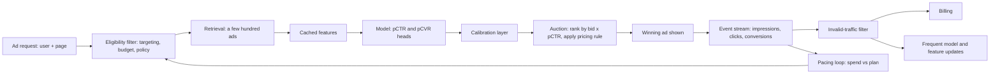
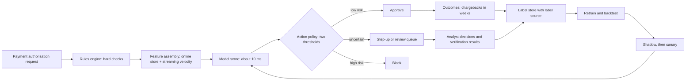
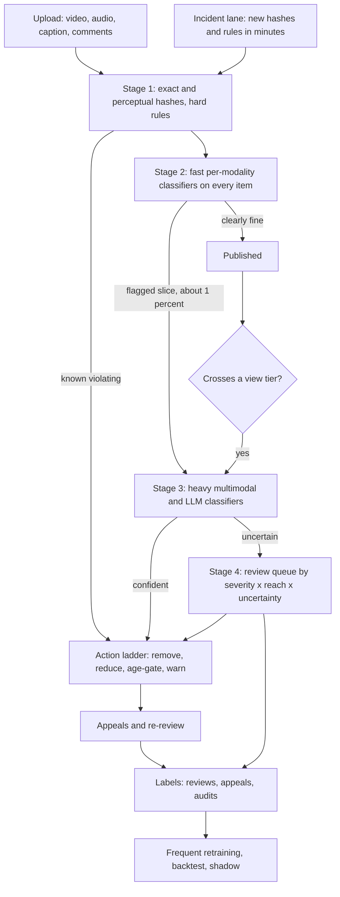
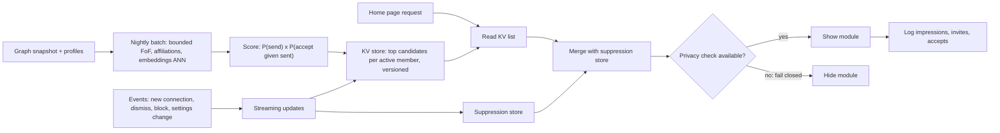
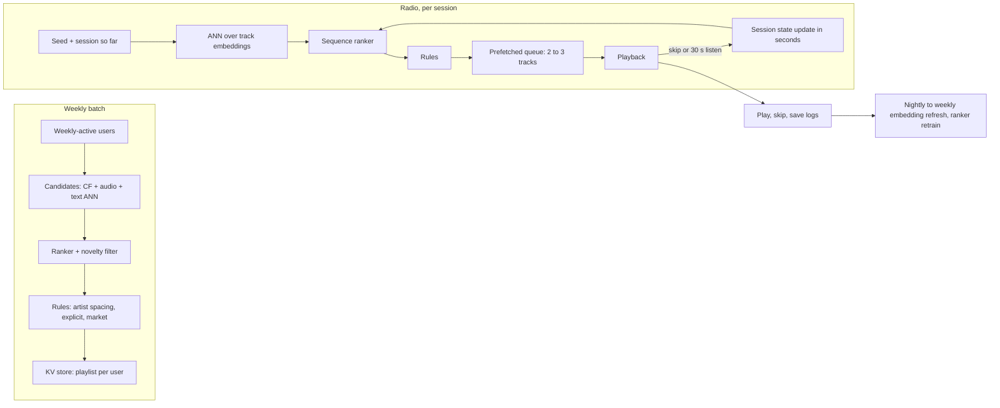
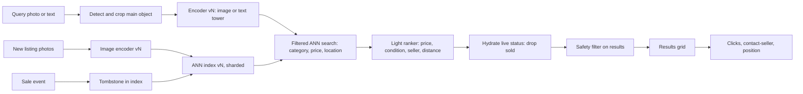
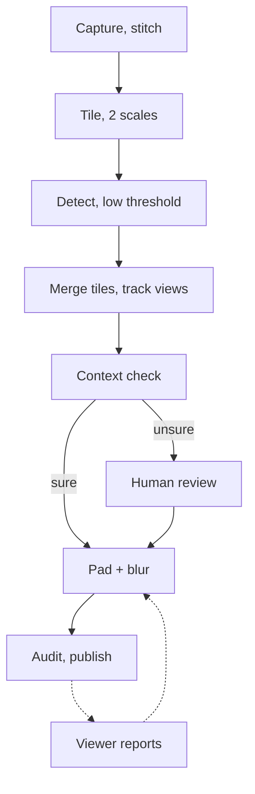
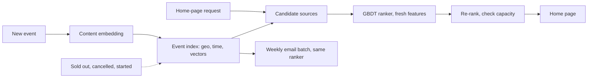
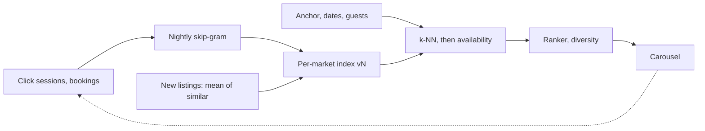

# Chapter 18 — ML Case Studies II: Ads, Fraud, Moderation, PYMK, Music, Visual Search, Blurring, Events, Similar Listings

Chapter 17 worked through the four retrieval-and-ranking designs. This chapter adds nine more, each bringing one new pressure: money riding on every probability (ads), an opponent who adapts (fraud), platform-wide scale with harm in both directions (moderation), a two-sided graph problem (people you may know), two serving modes for one product (music), an index that changes every minute (visual search), a detector whose misses are privacy breaches (street-imagery blurring), a catalogue where every item is new and perishable (events), and similarity learned from browsing sessions (similar listings). Each uses the **eleven-part template** of 17.0 and ends with a runnable toy on synthetic data (randomly generated, not real logs). Generic A/B-testing (randomly splitting users between the old and new version and comparing outcomes) and monitoring mechanics are not repeated — see [Chapter 16](../16-ml-in-production/README.md) (16.8 monitoring, 16.9 experiments).

**What you'll learn**

1. **Ad click prediction**: why the auction needs *calibrated* probabilities, down-sampling correction, Platt/isotonic calibration, delayed conversions, pacing (18.1).
2. **Fraud detection**: extreme imbalance, velocity and graph features, rules + model, two cost-based thresholds, censored labels (18.2).
3. **Harmful content** (including the platform-scale version): the risk cascade, the action ladder, prevalence of violating views, reviewer capacity, reach-aware re-scoring (18.3).
4. **People You May Know**: friends-of-friends retrieval, Adamic-Adar, the two-sided objective P(send) × P(accept), privacy that fails closed (18.4).
5. **Music discovery**: weekly batch playlists vs online radio, audio embeddings (learned lists of numbers placed so that similar items sit close together) for new tracks, session context (18.5).
6. **Visual search**: a shared image-text space (CLIP-style), contrastive training, IVF/HNSW, index churn and encoder upgrades (18.6).
7. **Privacy blurring**: recall-first detection, object-level recall across views, box padding, audits instead of A/B tests, failing closed (18.7).
8. **Event recommendation**: an all-cold catalogue scored by content, place, time and social features; point-in-time features; a two-sided marketplace (18.8).
9. **Similar listings**: skip-gram listing embeddings from click sessions, booked-listing context, same-market negatives, cold-start averaging (18.9).
10. A comparison table across all thirteen case studies of Chapters 17–18.

Code is in `code/`; every output shown is real.

---

## 18.1 Case study: ad click prediction

> "Design the system that picks which ad to show and predicts whether it will be clicked."

### 1. Clarify requirements
Ranking again, plus auctions (advertisers bid for each ad slot; the system picks the winner and the price), budgets and billing. The key difference: **the model's output is part of a financial transaction**. In a simplified cost-per-click (CPC) setup ads are ranked by **expected value per impression = bid × pCTR** (**pCTR** = predicted click-through rate, CTR = clicks ÷ impressions; an **impression** is one showing of an ad on someone's screen). A wrong probability changes who wins and what the platform earns.

| Question | Assumption used below |
|---|---|
| Traffic | 100 K ad requests/s at peak |
| Latency (time to answer one request) | 50–100 ms for the whole auction (eligibility → retrieval → scoring → auction) |
| Pricing | CPC and cost-per-conversion campaigns both exist |
| Auction | State one (e.g. quality-weighted second-price); real auctions add reserves (minimum prices) |
| Freshness | Campaigns start, pause and change budgets all day |

### 2. Frame it as an ML task
- **Input**: user and context (page, device, time), ad and creative, advertiser history.
- **Output**: **pCTR** = P(click | impression) and, for conversion campaigns, **pCVR** = P(conversion | click) — a conversion being the purchase or sign-up the advertiser actually wants.
- **Category**: binary classification (predicting one of two outcomes — here click or no click) whose output must be a **calibrated probability**, not just a good ordering; minimise **log loss** (cross-entropy), which rewards accurate probabilities and punishes confident wrong ones hardest.

**Calibration** — what this question is really about. A model is calibrated if, of many impressions given pCTR = 2%, about 2% are clicked. **AUC** (area under the ROC curve — the chance that a randomly chosen positive is scored above a randomly chosen negative) only checks ordering, so a model can have excellent AUC while every probability is 3× too high — tolerable in a feed, not in an auction that multiplies the probability by money.


*Figure — Good ranking and accurate probabilities are different properties (course diagram)*

### 3. Data and labels
Two clocks:
- **Clicks** arrive within seconds, but a *non-click* is only final after an **observation window** — otherwise late clicks get recorded as negatives.
- **Conversions** arrive hours to days later, and some never do. A recent click with no conversion yet is **unresolved**, not negative; treating it as negative biases pCVR downward (**delayed feedback**).


*Figure — A click is instant; the conversion it may cause is not (course diagram)*

Also: **eligibility data** (targeting, remaining budget, policy approval) for a hard pre-model filter, and **invalid-traffic** signals (bots, click farms) removed before billing *and* training — with later credits and label fixes for what's found late.

### 4. Features
| Group | Examples |
|---|---|
| User / context | Interest segments, recent activity, device, OS, placement, page topic, time, country |
| Ad / creative (the actual ad content) | Format, text and image embeddings, landing-page category |
| Advertiser history | Historical CTR by placement/device, account age, policy record |
| Cross features | User segment × ad category, placement × format (hand-made for logistic regression (LR), learned by deep models) |
| Counters | Impressions/clicks per ad in the last hour/day (streaming — updated continuously as events arrive) |

Features are sparse (millions of IDs): **embedding tables** (one learned vector per ID, looked up by index) or **feature hashing** (map each ID into a fixed number of buckets), all cached (kept in fast memory, ready to read — see [System Design Fundamentals](../../../system-design-patterns/modules/00-system-design-fundamentals/README.md)) for the 50–100 ms budget.

### 5. Model: baseline → advanced
- **Baseline**: logistic regression on hashed and crossed features — cheap, usually well calibrated under log loss, the historical workhorse (Google's search-ads system: online LR — updated continuously as new examples arrive — with FTRL-Proximal, an update rule that keeps most weights at exactly zero; McMahan et al., 2013).
- **Next**: boosted-tree (many small decision trees, each correcting the errors of the ones before) outputs used as features for a logistic model (Facebook, He et al., 2014), then deep CTR models that learn feature crosses (combinations such as device × ad category) — factorisation machines (Rendle, 2010; they model every pair of features through small learned vectors), Wide & Deep (Cheng et al., 2016, Google Play), DeepFM, DCN.
- **Multi-head**: shared body, pCTR and pCVR heads (17.2's pattern; a **head** is a small output layer on top of a shared network, one per prediction). Alibaba's ESMM (Ma et al., 2018) trains on *all* impressions by predicting pCTCVR = pCTR × pCVR, so the conversion head isn't learned only from the biased "clicked" subset.
- **Calibration layer** (part of the model, not an afterthought): map raw scores to probabilities on held-out data (examples not used for training) with **Platt scaling** (a one-feature logistic regression on the score) or **isotonic regression** (a non-decreasing step function). If you **down-sample negatives**, keeping a fraction w of them to save training cost, correct analytically: q = p / (p + (1 − p)/w) (the formula in He et al., 2014).

### 6. Offline metrics
- **Log loss** and **normalised entropy** — log loss divided by the log loss of always predicting the average CTR (Facebook's metric; lower is better) — both sensitive to calibration.
- **AUC** for ordering.
- **Calibration**: predicted/observed ratio, reliability curves (predicted vs observed rate, plotted bucket by bucket), and **expected calibration error (ECE)** — bucket predictions, then average |mean prediction − observed rate| across buckets weighted by bucket size. Break it down **per segment** (advertiser size, slot, device, market): a model can be calibrated on average while over-predicting for new advertisers and under-predicting on mobile.

### 7. Online metrics and A/B testing
- **Platform**: revenue per thousand impressions (RPM), CTR. **Advertiser**: cost per click / conversion, return on ad spend (revenue earned per dollar of advertising) — advertisers who lose money leave. **User guardrails**: ad load, ad hide/report rate, page latency.
- Ads-specific trap: **budget interference** — both arms spend the same campaign budgets, so one can starve the other; split budgets per arm (A/B basics: 16.9).

### 8. Serving architecture
1. **Eligibility filter first** (targeting, budget, policy) — serving outside targeting or budget breaks the advertiser contract, far worse than a poor match.
2. **Retrieval** narrows eligible ads by relevance (embedding or rule-based).
3. **Scoring**: calibrated pCTR / pCVR in one batched call.
4. **Auction**: rank by expected value (bid × pCTR, plus quality terms and reserves) and price by the chosen rule. In a one-slot **second-price** (Vickrey) auction the winner pays the second-highest bid, making truthful bidding optimal; the multi-slot **generalised second-price (GSP)** auction does *not* guarantee that (Edelman, Ostrovsky & Schwarz, 2007), and Google Ad Manager moved to a **first-price** auction in 2019.
5. **Pacing**: a control loop compares spend rate with the campaign's plan and throttles or boosts participation — otherwise budgets burn out by mid-morning.


*Figure — An example auction path with a 50–100 ms target (course diagram)*



### 9. Scale numbers
| Quantity | Arithmetic | Result |
|---|---|---|
| Scores per second at peak | 100 K requests × 300 candidates | 30 M scores/s |
| Cost sensitivity | 30 M/s × 86,400 s | ~2.6 trillion scores/day at peak rate — a microsecond per score matters |
| Outage cost | revenue/day ÷ 86,400 | An ads outage is priced in dollars per second |

### 10. Monitoring and failure modes
- **Update loop**: among the fastest in ML — incremental updates every minutes to hours, each validated with a tested rollback (a quick, rehearsed way back to the previous model).
- **Cold start is permanent**: start new campaigns from **priors** (guesses from advertiser, category, creative) plus a small, capped **exploration** budget (deliberately showing less-proven ads to learn how they perform).
- **Delayed conversions**: train on **mature** examples inside an attribution window (the period after a click during which a conversion is credited to it), or model the delay (Chapelle, 2014).

| Failure | Response |
|---|---|
| pCTR service degraded | Warm fallbacks: last-known-good model → segment-average CTR tables; eligibility and budget checks never skipped |
| Calibration drift (predictions slowly moving away from reality) in one segment | Per-segment alerts; recalibrate; investigate the feature pipeline |
| Invalid-traffic spike | Filter before billing and training; credits and label fixes for what's found later |
| Budget over-delivery | Pacing plus hard budget accounting |

### 11. Interview follow-ups
- **"Second-price or first-price?"** → Describe the incentives: truthfulness holds only for single-slot second-price, not GSP; calibration matters in every variant.
- **"An advertiser says they're overcharged."** → Compare predicted vs realised CTR for their segment, then auction logs, invalid-click records and billing — recalibration fixes predictions, billing errors need a separate correction.
- **"Conversions are scarce — how does pCVR learn?"** → Factor into click × conversion-given-click (ESMM-style) so each head uses the densest labels; correct for delay; priors for thin advertisers.

### Toy — calibration, down-sampling and the auction (`code/ads_calibration_toy.py`)
Synthetic impressions, ~4% CTR; a GBDT (gradient-boosted decision trees) trained on all clicks but only 10% of non-clicks. We correct the probabilities, check calibration per segment, and run a two-advertiser auction.

```python
keep = (ytr == 1) | (rng.random(len(ytr)) < w)          # all clicks, 10% of non-clicks
model = HistGradientBoostingClassifier(max_iter=200, random_state=0).fit(Xtr[keep], ytr[keep])
raw = model.predict_proba(Xte)[:, 1]
corrected = raw / (raw + (1 - raw) / w)                  # analytic down-sampling correction
platt = LogisticRegression().fit(np.log(raw_cal / (1 - raw_cal)).reshape(-1, 1), ycal)   # Platt on logit
iso = IsotonicRegression(out_of_bounds="clip").fit(raw_cal, ycal)                       # isotonic
```

Output:
```
true CTR in test traffic: 0.0397

pCTR source               AUC  mean pCTR  log loss     ECE
raw (down-sampled)      0.788     0.2368    0.3217  0.1971
analytic correction     0.788     0.0404    0.1438  0.0016
Platt scaling           0.788     0.0402    0.1438  0.0017
isotonic                0.787     0.0403    0.1444  0.0020

segment check (skewed model)   overall pred/actual = 0.0403/0.0397
  mobile   predicted 0.0601  observed 0.0460  ratio 1.31
  desktop  predicted 0.0203  observed 0.0334  ratio 0.61
auction, calibrated pCTR      : A wins 49.8% of mobile / 48.9% of desktop, expected value $1,064
auction, A inflated on mobile : A wins 75.9% of mobile / 48.9% of desktop, expected value $1,040
```

What it shows:
- The raw model has the **same AUC** (0.788) as the corrected ones yet predicts a 23.7% CTR for 4% traffic. AUC can't see this; log loss and ECE can.
- The analytic formula and both calibrators restore the ≈4% mean and cut ECE about 100×. A model can match the overall rate (0.0403 vs 0.0397) while being 31% high on mobile and 39% low on desktop — only **per-segment** checks reveal it.
- Inflating one advertiser's mobile pCTR lifts its mobile win share from 50% to 76% and lowers expected value ($1,040 vs $1,064): impressions go to the ad less likely to be clicked.

### Common mistakes
| Weak | Strong |
|---|---|
| Optimises AUC and stops | Calibration layer plus per-segment calibration monitoring |
| Starts with relevance retrieval | Eligibility (targeting, budget, policy) is the first, hard filter |
| Diagram ends at the winning ad | Delayed conversions, invalid-traffic filtering, pacing, warm fallbacks |

### Same design, other questions
- **Sponsored search ads** — an ad must clear a query-relevance bar before bid × pCTR applies (17.3's retrieval). **Native feed ads** — a quality floor no bid can buy past, and an ad-load cap on slots shared with organic posts.

### Self-check
1. Why can't an ads model be judged on AUC alone? → The auction multiplies the probability by a bid; AUC ignores whether probabilities are accurate.
2. You kept 5% of negatives and the model outputs p = 0.5. Corrected probability? → q = 0.5 / (0.5 + 0.5/0.05) = 0.5 / 10.5 ≈ 0.048.
3. Platt vs isotonic? → Platt fits a smooth sigmoid (an S-shaped curve that maps any score to 0–1; 2 parameters, little data needed); isotonic fits any monotone step function (more flexible, needs more data, can overfit — fit noise in its training data that doesn't hold on new data).

### TL;DR
| | |
|---|---|
| Core idea | Probabilities are priced: rank by bid × **calibrated** pCTR; check calibration per segment |
| Path | Eligibility → retrieval → pCTR/pCVR heads → calibration → auction → pacing |
| Labels | Delayed conversions via windows or delay models; invalid traffic stripped before billing and training |
| Cold start | Permanent: priors + capped exploration |

---

## 18.2 Case study: payment fraud detection

> "Design fraud detection for a payments platform."

### 1. Clarify requirements
No funnel: no catalog to narrow, just a stream of transactions, each needing a decision while the payment waits. The new ingredient is an **adversary** — fraudsters change behaviour to get past whatever you deploy, so some patterns die within days.

| Question | Assumption used below |
|---|---|
| Volume | 10 K transactions/s at peak |
| Fraud rate | Below 1% (the toy uses ~0.2%) |
| Latency | ~50 ms inside the payment authorisation call, ~10 ms of it for the model |
| Actions | Approve, step-up authentication (an extra identity check: 3-D Secure, one-time passcode), review, block |
| Costs | Missed fraud → loss + **chargeback** fees (a disputed payment reversed to the cardholder, at the merchant's cost); false decline → lost sale and trust; review → analyst time |

**Class imbalance** (one class far rarer than the other): at 0.2% fraud, "approve everything" is 99.8% accurate and catches nothing — accuracy is off the table from minute one.

### 2. Frame it as an ML task
- **Input**: transaction (amount, merchant, channel), card/account, device, recent activity, graph links.
- **Output**: a risk score ≈ P(fraud). **Category**: binary classification on heavily imbalanced data.
- **Decision** — *separate from the score*: an **action policy** maps score (plus amount, review capacity, mandatory rules) to **approve** (below the low threshold — the vast majority), **extra checks** between thresholds (step-up, or human review via a pending/delayed-capture state (the payment is approved but the money is taken later), since humans can't answer in 50 ms), or **decline** (above the high threshold).


*Figure — The decision is three-way, set by two thresholds (course diagram)*

Thresholds trade **precision** (share of flagged that is fraud) against **recall** (share of fraud caught); set them from **expected cost**, review capacity and policy.

### 3. Data and labels
Three label problems — name all three:

1. **Delayed labels.** Chargebacks and fraud reports arrive weeks later (assume 2–8 weeks); not every chargeback is fraud, not every fraud is reported. Fresh recall *doesn't exist yet*, so early warning comes from score distributions and rule-hit rates.
2. **Censored labels.** A blocked payment never produces an outcome, so the data has holes exactly where the model sees most risk. Partial remedies: analyst investigations, verification results, appeals — record each label's source. **Letting likely fraud through to learn its outcome is off the table** (any deliberate test needs risk-owner sign-off and a loss cap).
3. **Imbalance.** Class weights (counting each rare-class example more in the loss) or down-sampling in training (then recalibrate — 18.1); report **PR-AUC** (area under the precision–recall curve, see 6 below), precision/recall at the operating thresholds, or best, **expected dollar loss**.


*Figure — Blocked payments have missing outcomes; audited evidence helps but doesn't remove all bias (course diagram)*

### 4. Features
Dominated by **velocity** (how much activity, how fast) and **graph** signals:

| Group | Examples | Freshness |
|---|---|---|
| Velocity | Transactions on this card in the last 10 min / 1 h; distinct merchants today; amount vs this card's usual | Seconds (streaming) |
| "Impossible travel" | Distance between consecutive in-person transactions ÷ time between them | Request time |
| Device / session | New device? Device seen with other cards? Emulator (software pretending to be a phone), proxy (a relay that hides the real network address), typing cadence | Request time |
| Graph | Device linked to a confirmed-stolen card; many accounts sharing one address or IP (internet address) | Minutes |
| Merchant / account | Merchant fraud rate (from *past* windows only — leakage risk: accidentally using information from after the decision), account age | Hourly–daily |

**Fraud rings** show up as dense clusters in the card–device–address graph before any single transaction looks odd. Shared devices also occur innocently (families, offices), so a graph link is evidence, not proof.

### 5. Model: baseline → advanced
**Rules and model, together on purpose.** A **rules engine** (explicit, human-written conditions) gives three things a learned score can't: **hard constraints** (sanctions checks, verified blocklists aren't probabilities), **speed** against a new attack (a rule ships in minutes; a model has no training data for a scheme that appeared today), and **explainability** for regulators and dispute teams. The **model** catches combinations of weak signals no short rule list captures.

- **Baseline**: rules + logistic regression on velocity features.
- **Standard**: **GBDT** on tabular features (the common choice for card fraud) plus graph features or a graph neural network (a network that learns from each node's neighbours in a graph) for rings; optionally an anomaly score (e.g. isolation forest, which flags points that random splits separate unusually fast) for never-seen patterns.
- **Rule hygiene**: each rule gets an owner, a precision/recall dashboard and an **expiry date**, or stale rules pile up (**rule sprawl**).

Real-world: Stripe Radar combines ML risk scores with merchant-written rules; in Europe, PSD2's (the EU's payment-services law) strong customer authentication makes 3-D Secure step-up a standard middle action.

### 6. Offline metrics
- **PR-AUC** (area under the precision–recall curve) — meaningful under heavy imbalance, where ROC-AUC can look excellent while the flagged queue is mostly false alarms.
- **Recall at a fixed false-positive rate** (share of legitimate payments wrongly flagged), or **precision at a fixed review capacity**.
- **Expected cost** of the whole policy (missed fraud + false declines + review), on a **time-based** split with **mature** labels only — a **backtest** on past windows whose outcomes are known.

### 7. Online metrics and A/B testing
- **Business**: fraud loss in **basis points** of volume (1 bp = 0.01%), chargeback rate, false-decline rate, review-queue size and SLA (promised turnaround).
- You can't A/B a fraud model like a feed ranker (letting fraud through on purpose is unacceptable). Rollout: backtest → **shadow scoring** (score live traffic silently; compare distributions and reviewer agreement) → **canary** (release to a small slice of real traffic first) under approved risk limits → wait for mature labels → full rollout (16.6).

### 8. Serving architecture
~50 ms end to end, set by the payment network: **rules** → **feature assembly** (online store — a low-latency database of precomputed features — + streaming velocity) → **model** (~10 ms) → **policy**. Labels return as three streams at different speeds: analyst findings, verification results, late chargebacks.


*Figure — An example 50 ms automated decision path, with labels arriving separately (course diagram)*



### 9. Scale numbers
| Quantity | Arithmetic | Result |
|---|---|---|
| Fraud events | 10 K/s × 0.2% | ~20 fraudulent attempts/s at peak |
| Review load | 0.5% in the middle band: 10 K × 0.005 × 3,600 | 180 K reviews per peak hour — impossible for humans, so step-up handles most of the band and review is kept for high-value cases |
| Velocity state | 200 M active cards × 4 counters × 8 bytes | ≈ 6.4 GB in memory (plus keys, replicas — extra copies on other machines for safety and load), updated per transaction |

### 10. Monitoring and failure modes
- **Early warning** while labels are weeks late: score distributions, rule-hit rates, approval rate — per merchant, country, channel (drift basics: 16.8).
- **Adversarial drift**: watch for bursts of small "test" transactions on new cards. A **sudden drop** in the flagged rate is a possible attack or a broken feature, not good news.
- **Timeout policy**: neither global **fail open** (approve if scoring fails) nor global **fail closed** (decline) — decide in advance by risk: small amounts from long-standing accounts pass, large or risky ones are challenged or held.

| Failure | First check |
|---|---|
| False-decline rate doubles overnight | Data feeds before the model: a velocity counter that stopped updating moves every score. One segment spiking suggests a rule or feature; everything spiking suggests upstream |
| Fraud volume ×10, analysts ×1 | Narrow the review band to high-value cases, lean on step-up; never weaken mandatory controls |

### 11. Interview follow-ups
- **"Once the model is strong, can the rules go?"** → No: speed during an attack, hard constraints, readable logic. Manage rules with metrics and expiry dates instead.
- **"How do you catch a fraud ring?"** → Graph features, community detection (algorithms that find tightly connected groups in a graph), and tools to expand from one confirmed case to its neighbours — checking for innocent shared infrastructure.

### Toy — velocity features and two thresholds (`code/fraud_thresholds_toy.py`)
One synthetic week of card transactions (~0.23% fraud); stolen cards are used in quick bursts. Train on days 1–5, test on days 6–7 (time split), then pick approve/review/block thresholds by expected dollar cost under a review-capacity limit.

```python
def velocity(card, t, window=10.0):
    """# of earlier transactions on the same card within `window` minutes (a streaming aggregate)."""
    # ... keep, per card, the timestamps still inside the window

def cost(lo, hi):
    block, review = p >= hi, (p >= lo) & (p < hi)
    missed = (yt == 1) & ~block & ~review                       # approved fraud: lose the amount
    c = amt[missed].sum() + COST_FALSE_DECLINE * ((yt == 0) & block).sum() + COST_REVIEW * review.sum()
    c += amt[(yt == 1) & review].sum() * 0.1                    # reviewers miss ~10% of what they see
```

Output:
```
360,769 transactions, fraud rate 0.230%
'approve everything' accuracy = 99.770%  (catches 0 fraud)

amount+foreign+hour    ROC-AUC 0.838   PR-AUC 0.054
+ velocity (10 min)    ROC-AUC 0.849   PR-AUC 0.408

no model (approve all): cost $33,052
single threshold 0.5   lo=0.50 hi=0.50: cost $17,258  blocked 163  reviewed 0  fraud caught 50%
best two thresholds    lo=0.02 hi=0.70: cost $15,554  blocked 158  reviewed 293  fraud caught 57%
```

What it shows:
- **Accuracy is useless**: 99.77% for a policy that catches nothing.
- **ROC-AUC barely moves** (0.838 → 0.849) with velocity, but **PR-AUC jumps ~7.6×** (0.054 → 0.408) — ROC-AUC hides false alarms under imbalance.
- A **review band** (within 300-review capacity) catches more fraud at lower cost than one threshold. (In practice pick thresholds on a separate validation window.)

### Common mistakes
| Weak | Strong |
|---|---|
| Binary classifier, one threshold | Three-way decision, two cost-based thresholds, step-up in the middle |
| "Retire the rules once the model is good" | Rules for speed, constraints, explainability; model for complex patterns |
| Quotes accuracy at a 0.2% base rate | PR-AUC, precision/recall at operating points, expected dollar loss |

### Same design, other questions
- **Account takeover at login** — the unit is a session; device fingerprint, location velocity and typing rhythm dominate; step-up is the main action. **Promo/referral abuse** — audit labels in days, so a faster loop; graph features dominate because abuse comes from rings.

### Self-check
1. Why is ROC-AUC misleading here? → With 500 legitimate per fraud, a small false-positive *rate* is still a large *number* of false alarms; PR-AUC shows it.
2. What's a censored label? → An outcome never observed because your own action (blocking) prevented it.
3. A sudden drop in flagged transactions — good news? → Treat it first as possible evasion or a broken feature.

### TL;DR
| | |
|---|---|
| New ingredient | An adaptive adversary: patterns expire, probing is constant |
| Decision | Approve / step-up or review / block via two cost-derived thresholds |
| Hybrid | Rules (speed, constraints, explainability) + GBDT/graph model |
| Labels | Weeks late, censored by blocks, extremely imbalanced; PR-AUC and dollar loss |

---

## 18.3 Case study: harmful content detection (and running it at platform scale)

> "Design a system to detect harmful content — hate speech, harassment, spam, graphic violence, misinformation." Scale-up version: trust and safety for a short-video app receiving ~200 M new items daily (clips, sound, captions, comments), with a rulebook from CSAM (child sexual abuse material; zero tolerance, legally mandated handling) to grey-zone health misinformation.

### 1. Clarify requirements
Fraud's adaptive adversary and unequal error costs, plus three things:

1. **Multimodal input** (several kinds of data — image, text, audio — at once) — a harmless photo plus a hateful caption is harmful though neither half is: several models (per modality or harm) plus a policy layer combining their scores.
2. **Costs both ways, not only money.** A **false negative** (missed violation) exposes people to harm; a **false positive** (wrongful removal) silences a legitimate user. Thresholds become an explicit policy conversation.
3. **Huge scale, low base rates** that differ by harm type and surface.

| Question | Assumption used below |
|---|---|
| Volume | 200 M uploads/day ≈ 2,300/s average (tens of thousands/s at peak across all item types) |
| Violation rate | Below 1% for any given category |
| Latency | Livestream near-real-time (score rolling few-second windows); uploads a second or two; back-catalogue re-scans offline |
| Scope | Public posts; ads and private messages have their own pipelines and privacy rules |
| Jurisdiction | One policy engine keyed by **harm category and country**, since legal lines differ |

**The highest-harm category first.** CSAM (child sexual abuse material) needs a dedicated, tightly governed process: hash matching (comparing a short fingerprint computed from the file) against approved databases of known material (Microsoft's **PhotoDNA**; Meta open-sourced **PDQ** and **TMK+PDQF** in 2019), restricted-access review, evidence preservation, and legally required reporting. In the US, for example, providers must report apparent CSAM to NCMEC's (the US National Center for Missing & Exploited Children) CyberTipline once they know of it (18 U.S.C. § 2258A); that statute does not itself require proactive scanning, and duties differ by country — name who owns policy and escalation. Hashes find *known* material only.

### 2. Frame it as an ML task
- **Input**: the item (frames, audio, text), its context (account, where posted, replies) and its distribution (views, share velocity).
- **Output**: per-category risk scores P(violates policy c). **Category**: multi-label classification (one item can get several labels at once) run as a **cascade** (a chain of models — cheap ones on everything, expensive ones only on what earlier stages flag), then a policy decision — an **action ladder**, not remove/allow (section 8).

**The metric that matters: prevalence of violating views** = (views landing on violating content) ÷ (all views), estimated by human-labelling a random sample of *views*, so each miss counts by its reach. Report it **per category, with confidence intervals** (a range that likely contains the true value) (Meta's Community Standards Enforcement Report gives violating views per 10,000). **Opposite-direction guardrails**: **false-removal rate** (audits) and **appeal-overturn rate**; plus **time to action** and **views before action**.

### 3. Data and labels
1. **Rare, expensive labels.** Reviewer time is the bottleneck. **Active learning** sends the most useful items (uncertain, diverse, high reach) to reviewers; a *separate* random sample measures prevalence, since active-learning samples are biased by design.
2. **Three label feeds**: reviewer decisions (best, scarcest); **appeals** (false-positive evidence, but self-selected — add random audits); **user reports** (huge, noisy, manipulable — weight by **reporter reputation**, the historical precision of that reporter's reports; evidence, never verdicts).
3. **Adversarial evasion** — drift driven by an opponent: **leetspeak** ("fr33"), **homoglyphs** (Cyrillic "а" for Latin "a"), **text inside images** (needs **OCR**, optical character recognition), **splitting** the attack into the comment under an innocent post, **re-encoding / cropping / mirroring** to break hashes, and **coded language** that rotates faster than training cycles.
4. **Consistency and context.** Guidelines plus **inter-rater agreement** checks (how often independent reviewers agree); the same image can be news or gore.


*Figure — Four forms of adversarial evasion (course diagram)*

### 4. Features
| Group | Examples |
|---|---|
| Content | Text embeddings (after normalising leetspeak/homoglyphs), image and frame embeddings, OCR text, **ASR** (speech-to-text) transcript, audio embeddings |
| Hashes | Exact hash, perceptual hash (stays similar after small edits) of keyframes, audio fingerprint |
| Account / context | Account age, prior strikes, posting rate; surface (comment, post, live), the thread it replies to |
| Distribution | Views, **share velocity** (how fast it's spreading), audience |
| Reports | Count weighted by reporter reputation, report-graph clustering |

### 5. Model: baseline → advanced (one model per stage)
1. **Hashes and high-confidence rules** — **exact hashes** catch identical files; **perceptual hashes** tolerate some edits (test robustness to crops and mirroring; audio fingerprints survive a mirrored video). Hash-sharing programmes exist for some categories (e.g. GIFCT's database for terrorist content).
2. **Fast classifiers on everything** — small per-modality models (a distilled — trained to copy a bigger model — text transformer, a small image CNN, i.e. convolutional neural network) whose only job is triage.
3. **Heavy multimodal models on the flagged slice** — large image-text models and LLM-based (large language model) classifiers for nuanced text and memes.
4. **Human review** — borderline and appealed cases; also the label source.

**Baseline** for a new category: rules + hashes + report routing; then a fast classifier as labels accumulate; heavy models last. **Upgrade** by distilling the heavy model into the fast one.


*Figure — The risk funnel spends compute in proportion to risk (course diagram)*

### 6. Offline metrics
- Per-category **precision and recall at the operating thresholds** on a **fully reviewed** evaluation set, sliced by language, region and content type.
- **Recall of the whole cascade**, not of each stage: an item wrongly passed by stage 2 never reaches stage 3.
- **Hash recall under mutation**: a test suite of known items transformed by current evasion tricks.

### 7. Online metrics and A/B testing
Metrics as in section 2, plus creator churn and queue age. You can't ethically randomise *leaving harm up*, so rollouts go backtest → shadow scoring → **independent adjudication** of disagreements (agreement with the old system isn't proof) → canary → sampled prevalence.

### 8. Serving architecture
**The action ladder** — policy turned into callable actions, per category and region:

| Rung | When | Notes |
|---|---|---|
| Auto-remove | Confidently violating | Tuned so false removals stay rare; user notified, can appeal |
| Human review | Uncertain cases, appeals | Prioritised queue |
| Reduce / age-gate / warn | Borderline or allowed-but-restricted | Stays up but isn't amplified (the feed's integrity layer, 17.2), hidden from minors, or behind a warning |
| Auto-allow | Clearly fine — the vast majority | |

Thresholds are owned by Trust & Safety and Legal (not the model team), set from measured error rates, severity, reviewer capacity and law.


*Figure — The action ladder, not a binary (course diagram)*

**Review-queue priority** = f(severity, expected reach, uncertainty, deadline), with capacity reserved for random audits and appeals.

**Reach-aware re-scoring** — against the **viral miss** (harm reaching millions before anyone looks): each view tier crossed (10 K, 100 K, 1 M) triggers a re-check by a stronger model. Affordable because few items climb the tiers.


*Figure — Reach-aware re-scoring: scrutiny grows with the audience (course diagram)*

**Incident lane**: in a crisis (e.g. a live-streamed attack being re-uploaded) new fingerprints and rules go live in minutes — no retrain is that fast.



### 9. Scale numbers
| Quantity | Arithmetic | Result |
|---|---|---|
| Fast stage | 200 M/day ÷ 86,400 | ≈ 2,300 items/s average → small models, strict budgets |
| Heavy stage at 1% flag rate | 200 M × 0.01 | 2 M/day ≈ 23/s average (then add media length, decoding, peaks, replicas) |
| Cost of the dial | +0.1 percentage point flag rate | +200,000 heavy inferences/day |
| Human review at 0.1% | 200 M × 0.001 | 200,000 decisions/day |
| Reviewers | 200,000 ÷ ~300 decisions per reviewer-day | ≈ 670 reviewer-days per day → with shifts and leave, many hundreds of staff |

The flag rate is the GPU (graphics processor, the chip that runs large models) bill; the review threshold is a **headcount** setting.


*Figure — The risk funnel, with the volume said out loud at every stage (course diagram)*

### 10. Monitoring and failure modes
- A sudden **drop** in flag rate means possible evasion, not improvement.
- **Policy changes trigger a back-catalogue re-scan** — yesterday's allowed content can violate today's rule.
- **Outage policy per category**: never treat unscored content as low-risk; high-risk surfaces hold (fail closed), low-risk ones may publish (fail open).
- **Moderator well-being is designed capacity**: exposure limits per shift, rotation off graphic queues, blurred-first media, attrition in the headcount plan.

| Failure | Loud or quiet? | Defence |
|---|---|---|
| Viral miss | Loud | Re-check at view tiers; for the worst harms, escalate generously (accept extra false alarms) |
| Over-removal | Quiet (overturns, creator churn) | Audited false-removal and overturn rates beside prevalence |
| Evasion wave | Quiet at first | Flag-rate drop alerts, near-duplicate clustering, fast rules |


*Figure — Two budgets, and only one of them is measured in GPUs (course diagram)*

### 11. Interview follow-ups
- **"Something harmful is spreading fast right now."** → Share velocity is an input: fast spreaders jump to deeper checks and the head of the queue, and every view tier triggers another pass.
- **"A brigade mass-reports one creator overnight."** → Reports raise priority but can't remove; reputation weighting and report-graph clustering (same target, correlated timing, shared origin) expose the campaign — a fraud-ring problem in moderation clothing.
- **"A government bans a new category within a week."** → Rules, hashes and report routing on day one, classifier in weeks; the region-keyed policy engine scopes it to one jurisdiction.

### Toy — the cascade dial and prevalence sampling (`code/moderation_cascade_toy.py`)
One million uploads, 0.5% violating, heavy-tailed views (a few items get most of the views). The fast classifier scores everything; the heavy model (100× the cost) scores the flagged slice; removal needs a high heavy score. We vary the flag rate, add view-tier re-scoring, then estimate prevalence by sampling views. (Simplification: removals happen before any views.)

```python
def run(bad, views, fast, heavy, flag_rate, viral_tier=None):
    flagged = fast >= np.quantile(fast, 1 - flag_rate)
    if viral_tier is not None:
        flagged |= views >= viral_tier                               # reach-aware re-scoring
    removed = flagged & (heavy > 2.5)
    compute = N * 1 + flagged.sum() * HEAVY_COST                     # fast on all + heavy on flagged
    viol_views = views[bad & ~removed].sum() / views[~removed].sum() # prevalence of violating views
```

Output:
```
violating uploads 0.49%, violating share of views before action 0.45%; top 1% of items get 62% of views

policy                             heavy runs  compute*  recall  viol. views false rem.
flag top 0.5%                           5,000     0.015   30.4%       0.345%         24
flag top 1.0%                          10,000     0.020   41.3%       0.288%         49
flag top 2.0%                          20,000     0.030   52.4%       0.172%        103
flag top 5.0%                          50,000     0.060   67.6%       0.136%        281
flag top 1.0% + re-score >=10K views     12,903     0.023   41.5%       0.136%         67
* compute relative to running the heavy model on every item

true prevalence of violating views: 0.136%
  sample  5,000 labelled views -> estimate 0.120%  (95% CI 0.024% to 0.216%)
  sample 50,000 labelled views -> estimate 0.152%  (95% CI 0.118% to 0.186%)
```

What it shows:
- The cascade costs 1.5–6% of "heavy model on everything"; a higher flag rate buys recall with diminishing returns.
- **Reach-aware re-scoring** matches the 5% flag rate's violating-view prevalence (0.136%) at well under half the compute (0.023 vs 0.060) and a quarter of the false removals, because 1% of items get 62% of views. Upload recall barely moves (41.5%) — the view metric is the one that tracks harm.
- Measuring 0.1% prevalence is hard: 5,000 labelled views give a CI of 0.02–0.22%, 50,000 narrow it to 0.12–0.19% — metric precision costs reviewer hours.

### Common mistakes
| Weak | Strong |
|---|---|
| One big classifier over everything | Cascade: expensive compute only on the slice that needs it |
| Remove vs allow | Full action ladder, including reduce and age-gate |
| Thresholds read off a PR curve | Thresholds as policy, per category and region, informed by measured errors |

### Same design, other questions
- **Marketplace counterfeits** — photos, text and price that don't fit (a luxury bag at a tenth of retail); actions hit listings and sellers. **DM spam** — private content, so triage uses sending behaviour and reports; rate limits (caps on how many messages an account can send per minute) before removal.

### Self-check
1. Why measure prevalence on views rather than uploads? → Harm scales with exposure; an unseen violating item does little harm, a viral one a lot.
2. Why can't appeals alone estimate the false-positive rate? → They're self-selected; use random audits.

### TL;DR
| | |
|---|---|
| Shape | Four-stage cascade: fingerprints and rules → cheap triage on everything → big models on the suspicious few → people for hard cases |
| Metric | Violating-view prevalence per category with error bars; false-removal and overturn rates as the opposite guardrail |
| Decision | Action ladder; thresholds are policy per category and region |
| Scale | Flag rate = compute bill; review threshold = headcount; reach-aware re-scoring against viral misses |

---

## 18.4 Case study: People You May Know (PYMK)

> A LinkedIn-style network with 900 M members wants a connection-suggestion module, shown on the home page and during onboarding. Design it.

### 1. Clarify requirements
| Question | Assumption used below |
|---|---|
| Members | 900 M registered (not daily active) |
| Surfaces | Home-page module; post-sign-up onboarding |
| Latency | ~200 ms for the module; heavy work precomputed |
| Privacy | Suggestions can reveal sensitive relationships or invite unwanted contact — privacy controls are core requirements |

**Success has three layers**, because each simple metric is a trap: invites sent ignores whether the recipient wants the connection; acceptance rate alone rewards suggesting obvious existing acquaintances; the real goal is **network value** — connections that go on to interact.

| Layer | Metric |
|---|---|
| Primary (online) | Accepted invitations per suggestion impression |
| Guardrails (can veto) | Invitation-ignore rate; "I don't know this person" reports (weighted heavily in training, like hides in 17.2) |
| Long-term (weeks later) | Interaction between newly connected pairs |


*Figure — Three layers of metric, because acceptance alone is a trap (course diagram)*

### 2. Frame it as an ML task
- **Input**: viewer, candidate member, the graph around them, context (new vs tenured member).
- **Output**: two probabilities per pair — **P(send)** = P(invite sent | shown), does the *viewer* want it? — and **P(accept | sent)**, does the *candidate* want it?
- **Ranking score** = P(send) × P(accept | sent) = probability of an accepted invitation per impression.
- **Category**: **link prediction** (predict which edges will form in a graph) + two-sided ranking.


*Figure — The score multiplies the viewer's intent by the recipient's willingness (course diagram)*

### 3. Data and labels
- **Graph**: connections, follows, past invites (sent, accepted, ignored), dismissals, blocks. **Profiles**: employer, school, groups, skills, location, with dates (overlap in time matters).
- **Imported contacts** (only with permission): minimise collection and retention, support opt-out and deletion; hashing identifiers does *not* make them anonymous.
- **Labels**: invite sent arrives in-session; acceptance takes days. A pending invite is *unresolved*, not rejected — use an observation window (the delayed-label idea of 18.1).

### 4. Features
| Group | Examples |
|---|---|
| Graph | Mutual-connection count and strength; **Adamic-Adar** score — sum over mutual friends of 1 / log(that friend's number of connections), so a shared friend with few connections counts more than one who knows everyone; graph-embedding similarity |
| Affinity | Same employer/school/group with overlapping dates, similar skills, profile views of each other |
| Behavioural | Viewer's historic invite-acceptance rate; candidate's accept rate and inbox load |
| Context | New vs tenured member; surface; times this pair was already shown |

### 5. Model: baseline → advanced
**Candidate generation — four sources, unioned and deduped (merged, duplicates removed)** (17.1's multi-source retrieval, with people as the catalog):
1. **Friends-of-friends (FoF)** / **triangle closing** — if A–B and B–C are connected, C is a candidate for A. The main source, precomputed and **bounded**: expand only top neighbours by interaction, sample very-high-degree (huge number of connections) accounts' lists, cap candidates per member.
2. **Shared affiliations** — same company/school/group with overlapping dates; catches the new coworker with no mutuals yet.
3. **Imported contacts** — permission-based matches.
4. **Embedding similarity** — two-tower member vectors (one network encodes the viewer, another the candidate, and the score is how close the two vectors are) from profile and activity, or graph embeddings (node2vec-style random walks — node vectors learned from random paths through the graph — or graph neural networks), queried through an ANN index (approximate nearest neighbour: finds the closest vectors fast by accepting small errors).

**Hard filters at retrieval** (re-checked before display): already connected, blocked, dismissed, opted out. **Impression discounting** lowers candidates shown many times without action — softer than an explicit, permanent dismissal.


*Figure — Four retrieval sources, then hard filters before ranking (course diagram)*

**Ranker**: baseline = sort FoF candidates by mutual count or Adamic-Adar; advanced = GBDT or a two-head network predicting P(send) and P(accept | sent), multiplied.

### 6. Offline metrics
- **Recall@K of future edges** (share of the true items that appear in the top K): hide connections formed after a cutoff and check whether retrieval would have produced them.
- **AUC / log loss** per head, plus calibration — the heads are multiplied.
- Diversity: share of suggestions going to the top-1% most-connected members; share crossing community boundaries.

### 7. Online metrics and A/B testing
- The three metric layers, measured on **both sides** (inviter and recipient).
- **Network interference**: a treated viewer invites a control member, so user-level randomisation leaks. Use **graph-cluster randomisation** (assign whole communities to one arm) or model the interference.
- The interaction metric takes weeks, so keep a long-running **holdback** (a small group kept on the old system for months, 16.9).

### 8. Serving architecture
- **Nightly batch**: bounded FoF, affiliations, scoring → top candidates per active member in a **key-value (KV) store** (a database that returns a value for a given key, like a giant dictionary), with **idempotent** (repeating a write has the same effect as doing it once), **versioned** writes (see [System Design Fundamentals](../../../system-design-patterns/modules/00-system-design-fundamentals/README.md)) (a retry can't overwrite a newer run).
- **Streaming path**: new connections, dismissals and blocks update a **suppression store** within minutes (seconds for dismissals).
- **Request time**: read the list, merge with suppressions, re-check current privacy settings, render.
- **New members**: contacts and affiliations carry the first session, refreshed within minutes as first connections form.



### 9. Scale numbers
| Quantity | Arithmetic | Result |
|---|---|---|
| Batch scope | Active in last 30 days only (assume 300 M) instead of 900 M | ~⅓ of the graph work; dormant members refreshed weekly |
| FoF blow-up | 500 connections, each with 500 → up to 250,000 two-hop paths | why expansion is capped to top neighbours |
| KV storage | 300 M members × 100 candidates × ~16 bytes | ≈ 480 GB before replication |

The dominant cost is usually the **graph computation**, not inference.

### 10. Monitoring and failure modes
**Graph-shaped feedback loops**: **rich-get-richer** (well-connected members sit in more triangles, get suggested more, grow more connected — cap exposure per candidate) and **cluster amplification** (triangle closing reinforces silos — monitor cross-cluster suggestions).

| Failure | Response |
|---|---|
| Nightly graph job fails | Serve last validated candidates within a freshness limit, still enforcing *current* privacy, blocks, dismissals; alert on age |
| Privacy filter unavailable | **Fail closed**: render nothing rather than unverified suggestions |
| Dismissed person reappears an hour later | Design bug: dismissals must go through the streamed suppression store merged at render time |

### 11. Interview follow-ups
- **"FoF for 900 M members without melting the cluster?"** → Top neighbours only, 30-day-active members nightly, sampled celebrity neighbour lists, capped outputs — never the full two-hop closure.
- **"Legal asks you to prove opted-out members never appear."** → Auditable filters at retrieval *and* before display, fail-closed on timeouts, prompt cache invalidation (removing stale stored copies), filter-version logging, tests for stale caches and races (bugs when two updates land at nearly the same moment).

### Toy — FoF retrieval, Adamic-Adar, two-sided ranking (`code/pymk_toy.py`)
A 4,000-member clustered graph (networkx, a Python graph library: `powerlaw_cluster_graph` builds a few hubs and many small clusters) with 10% of edges hidden as "future". Part 1 ranks FoF candidates three ways; part 2 simulates viewers who like inviting popular members who rarely accept.

```python
def fof_candidates(G, u):
    """Two-hop neighbours with their mutual-connection lists (bounded in production: top neighbours only)."""
    mutual = {}
    for f in G[u]:
        for c in G[f]:
            if c != u and not G.has_edge(u, c):
                mutual.setdefault(c, []).append(f)
    return mutual

scores = {
    "random FoF": {c: random.random() for c in cands},
    "common neighbours": {c: len(m) for c, m in mutual.items()},
    "Adamic-Adar": {c: sum(1 / math.log(deg[f]) for f in m if deg[f] > 1) for c, m in mutual.items()},
}
# part 2: rank the top 10 by p_send alone vs p_send[c] * p_acc[c]
```

Output:
```
4000 members, 15977 connections, 1597 hidden as future; max degree 264, median 5
avg FoF candidates per member 155; FoF retrieval covers 65.0% of future connections

random FoF           recall@10 = 0.080
common neighbours    recall@10 = 0.216
Adamic-Adar          recall@10 = 0.287

ranking (top 10 per member) invites sent  accepted accept rate  to top-1% members
P(send) only                     4.44      0.80       17.9%              65.4%
P(send) x P(accept)              2.48      1.35       54.6%               1.5%
```

What it shows:
- FoF covers 65% of future connections — a third come from elsewhere, hence four sources. Within FoF, common neighbours is 2.7× better than random, and **Adamic-Adar** adds another third.
- Ranking by P(send) alone sends 65% of suggestions to the top 1% most-connected members, who accept only 18%. The **two-sided score** sends fewer invites but yields 69% more accepted connections (1.35 vs 0.80 per member). (Behaviour is simulated; a real system learns both heads.)

### Common mistakes
| Weak | Strong |
|---|---|
| Optimises invites sent or acceptance alone | P(send) × P(accept \| sent), ignore/report guardrails, long-term interaction |
| Privacy filtering only at display | Filters at retrieval *and* before display; fails closed |
| Dismissals wait for the nightly batch | Streamed suppression merged at render time |

### Same design, other questions
- **Groups to join** — one side is an aggregate, so predict join × stay-and-participate; big groups dominate triangles, so a diversity cap is mandatory. **CRM (customer-relationship management) contact suggestions** — shared accounts matter more than mutuals; the second side is "will this contact reply".

### Self-check
1. Why multiply P(send) by P(accept | sent)? → The product is the probability of an accepted invite per impression — both sides must want it.
2. Why randomise by graph cluster? → Members interact across arms, so individual randomisation leaks treatment into control.
3. What if the privacy check can't run? → Hide the module (fail closed).

### TL;DR
| | |
|---|---|
| Objective | P(send) × P(accept \| sent); ignores and "don't know" reports as guardrails; lasting interaction as the goal |
| Retrieval | FoF + affiliations + contacts + embeddings; hard privacy/dismissal filters |
| Serving | Nightly bounded batch → versioned KV; streamed suppressions |
| Non-negotiables | Privacy fails closed; dismissals take effect immediately; watch rich-get-richer |

---

## 18.5 Case study: music discovery (Spotify-style)

> "Design discovery for a music streaming service with 400 million users and 100 million tracks: personalised weekly playlists like Discover Weekly, plus a 'radio' that plays endlessly from any seed song."

### 1. Clarify requirements
The recognition sentence: **"It's the recommendation funnel used twice — once in batch, once online."**
- **Batch** = computed ahead of time on a schedule. Discover Weekly is one precomputed playlist per user per week (launched by Spotify in 2015; refreshed every Monday).
- **Online** = computed at request time. Radio picks the next track from the current session.

| Question | Assumption used below |
|---|---|
| Users / tracks | 400 M users (≈ 250 M weekly active), 100 M tracks, many uploads daily (pick a rate for capacity planning) |
| Discover Weekly | Batch with a deadline (ready before Monday) plus a serving cache |
| Radio | Next-track decision in ~100–200 ms using session context |
| Out of scope | Search, social features, licensing economics |


*Figure — The same machinery, used as batch and as online (course diagram)*

### 2. Frame it as an ML task
- **Discover Weekly**: retrieval + ranking of tracks the user *hasn't heard* but will like — recommendation with a novelty constraint.
- **Radio**: **sequential recommendation** — predict the next track from the seed and the session so far.
- **Labels**: listens past **30 seconds**, saves, playlist adds, artist follows = positive; an **early skip** = fast but noisy negative (interruptions, repetition, a change of activity).
- **Launch metric** (Discover Weekly): tracks **saved** per eligible user. **Guardrail**: **diversity and artist fairness** — discovery that keeps serving the same hits fails even when engagement looks fine.

### 3. Data and labels
Plays, skips (with position in the track), saves and session sequences; catalogue metadata (artist, genre, release date, explicit flag, market availability); **the audio itself**; and billions of **user-made playlists** — tracks on the same playlists go together. Labels arrive fast (a skip in seconds).

### 4. Features
Three signal families — and what each does for **cold start**:

| Signal | What it captures | New track with zero plays? |
|---|---|---|
| **Collaborative** (listening co-occurrence, matrix factorisation — learning user and track vectors from the play matrix) | Who listens to what together | Useless until plays accumulate |
| **Audio content embeddings** (model over the raw audio) | Tempo, timbre (texture of the sound), mood, instrumentation | Works from day zero |
| **Text / metadata embeddings** (tags, playlist titles, editorial, web text) | Genre, scene, cultural context | Works from day zero |


*Figure — Three signal sources, and what each does at cold start (course diagram)*

Radio session features: seed track, last N tracks, skips this session, time of day, device. **Session context is first-class** — the same user wants different music at the gym and at bedtime.

### 5. Model: baseline → advanced
1. **Baseline**: popularity within a **cohort** (a group of similar users, e.g. new listeners in one country who like a genre).
2. **Collaborative embeddings**: matrix factorisation on implicit feedback (behaviour such as plays and skips, not explicit ratings; implicit ALS, alternating least squares — Hu, Koren & Volinsky, 2008) or a two-tower model (Chapter 13).
3. **Content encoders**: a CNN or audio transformer over spectrograms (pictures of how sound frequencies change over time; van den Oord, Dieleman & Schrauwen, 2013, showed CNNs can predict collaborative-filtering vectors from audio); a text model for metadata. Map content embeddings into the collaborative space so new tracks are retrieved like established ones.
4. **Sequence model for radio**: from item-to-item transitions, to recurrent (reads the sequence step by step, carrying a memory) GRU4Rec (Hidasi et al., 2016), to self-attention (each position weighs every earlier one) SASRec (Kang & McAuley, 2018).
5. **Ranker**: GBDT or neural, with features from all three families plus session context.

### 6. Offline metrics
- **Recall@K / Hit@K** on held-out listens (**Hit@K** = share of cases where the true next item is in the top K); **MRR** (mean reciprocal rank: the average of 1 ÷ the true item's position) for radio's next track.
- **Coverage and diversity**: share of catalogue ever recommended, artist concentration (e.g. **Gini coefficient** of exposure — 0 = perfectly even, 1 = one artist gets everything), novelty.
- **Cold-start slice**: tracks released after the training cutoff.

### 7. Online metrics and A/B testing
- **Discover Weekly**: saves per user, 30-second-listen rate, return next week. **Radio**: skip rate, session length. **Longitudinal truth**: repeat listening of discovered tracks a month later.
- **Exploration**: a small randomised slice gives less-exposed tracks a chance — **artist-ecosystem policy** as much as ML. If it costs skip rate, bound it and judge it on a long-term holdback (16.9) rather than let the short-term metric veto it.

### 8. Serving architecture
1. **The weekly batch runs only on weekly-active users** — scoring all 400 M when ~250 M are active wastes over a third of the compute. Output → KV store, served from cache.
2. **Radio prefetches the next 2–3 tracks**, hiding ranking latency; a skip **re-scores the queue immediately**, and a backup queue covers skip storms.
3. **A rules layer outside the model**: artist spacing, explicit-content filters, market licensing.


*Figure — Radio prefetches the queue, so a skip re-ranks instantly (course diagram)*



### 9. Scale numbers
| Quantity | Arithmetic | Result |
|---|---|---|
| Weekly batch | 250 M users × 30 tracks | 7.5 B playlist entries/week — a compute job with a deadline, not a latency problem |
| Waste avoided | 150 M inactive users not scored | ~37.5% of the batch |
| Track embeddings | 100 M × 128 dims × 4 bytes | 51.2 GB raw per embedding space (before index overhead and replicas) |
| Radio QPS (queries per second) | e.g. 20 M concurrent radio listeners ÷ ~200 s per track | ≈ 100 K next-track decisions/s |

### 10. Monitoring and failure modes
- **Loops**: skips update session state in seconds; embeddings refresh nightly to weekly; ranker training uses **position-bias-corrected** logs (17.3; position bias = people click higher slots more, whatever their quality), or it copies its own previous ordering.
- **Funnel observability**: log per track, per stage — retrieved → ranked where → shown → played. If a label claims its artists are buried, you can show which stage dropped them.

| Failure | Fallback |
|---|---|
| Weekly batch fails | Last week's playlists keep serving; alert on staleness |
| ANN index or ranker down during radio | Cached queue → genre-station heuristic. **Never silence** |
| Embedding refresh out of sync | Version index + vectors as a pair, promote atomically (switch both at once so no request sees a mix), check versions per request |

### 11. Interview follow-ups
- **"Power users are bored by midweek."** → Keep the weekly ritual; add a daily shelf re-ranked on this week's listens from the same precomputed candidates — cheap freshness.
- **"Radio for a brand-new user?"** → Audio neighbours of the seed carry the session, market priors fill the ranker, the first skips teach fast — radio is the *best* cold-start surface.

### Toy — session context and audio embeddings for the next track (`code/music_session_toy.py`)
2,000 tracks, each with a genre and a mood (workout/sleep/focus) encoded in a synthetic "audio embedding". Users like two genres, each session has one mood, 20% of tracks are released after training. Predict a session's 4th track from its first 3 (Hit@10).

```python
elif method == "session transitions":
    score = trans[prefix[-1]] + 1e-3 * plays          # item-to-item "played B right after A"
elif method == "session audio embedding":
    score = audio @ audio[prefix].mean(0)             # nearest to the session's average sound
elif method == "audio + user taste":
    score = audio @ audio[prefix].mean(0) + 0.3 * (user_genre[u][genre] > 0)
```

Output:
```
method                        Hit@10  Hit@10 on NEW tracks
popularity                     0.004                 0.000
user taste (no session)        0.020                 0.000
session transitions            0.039                 0.000
session audio embedding        0.080                 0.107
audio + user taste             0.081                 0.107
ceiling (true pool, random)    0.092                 0.073
(205 of 1000 test targets are tracks released after training)
```

What it shows:
- **Ignoring the session** scores 0.020 (right genres, usually the wrong mood). **Session transitions** double that but, like every play-count method, score **zero on new tracks**.
- **Session audio embeddings** reach 0.080, near the ceiling of knowing the exact eligible pool (0.092), and alone find new tracks (0.107) — cold start in miniature. (Numbers are low because each pool holds ~130 equally likely tracks.)

### Common mistakes
| Weak | Strong |
|---|---|
| One serving mode for both products | Batch weekly playlist, online sequential radio — said in minute two |
| Collaborative filtering only | Audio + text embeddings so new tracks are retrievable from day zero |
| Engagement only | Diversity/artist-fairness guardrail and a defended exploration slice |

### Same design, other questions
- **Podcasts** — same funnel; transcript and speech embeddings, completion curves as labels, and a higher precision bar (each pick costs an hour of trust). **News "For You"** — recency is everything, so overnight precomputation is nearly worthless: streaming signals and per-request ranking.

### Self-check
1. Which product is batch and which online, and why? → Discover Weekly: one list per week (deadline, cache). Radio: needs session context per request.
2. Which signal handles a track uploaded today? → Audio and text/metadata embeddings.
3. What does prefetching buy? → Hides ranking latency; must re-rank on skip and keep a fallback queue.

### TL;DR
| | |
|---|---|
| Big picture | One recommender served two ways: a precomputed weekly list and a live next-track picker |
| What's special | Audio vectors make unplayed tracks findable; skips are fast but noisy; the session shapes every pick |
| Architecture | Active-users-only batch → KV; radio = ANN + sequence ranker + prefetch, re-rank on skip |
| Guardrails | Diversity and artist fairness beside engagement; continuous audio fallback |

---

## 18.6 Case study: visual search for a second-hand marketplace

> A used-goods marketplace has about 100 M active listings, and each one disappears when it sells, so the catalogue turns over constantly. Shoppers should be able to snap a picture of something they like — say a vintage lamp or a coat a friend is wearing — and see comparable items on sale. A second request: let people type a description to find things among listings they have saved.

### 1. Clarify requirements
The recognition sentence: **"This is the search funnel of 17.3, except the query is a photo."** The front stage becomes an **encoder** (a model that turns an input into an embedding) and retrieval runs in an embedding space, not an inverted index (a map from each word to the items containing it — it can search captions but not visual similarity). The hard part is **the index**: 100 M listings where every sale is a deletion. The second request is a clue: if photos and text share **one embedding space** (encoders trained so a photo and its description land close together), a single index answers both.

| Question | Assumption used below |
|---|---|
| Listings | 100 M live, millions of new listings/day with several photos each |
| Latency | ~300 ms photo-to-results — say whether upload and compression count |
| In scope | Picture-to-listing lookup; typed lookup within a user's *saved* items |
| Out of scope | Exact-product recognition, AR (augmented reality) try-on, anything generative |
| Signature failure | Showing items that are already sold |


*Figure — Image-text embeddings support visual retrieval beyond caption matching (course diagram)*

### 2. Frame it as an ML task
- **Input**: query photo (or text); candidate listings (photos, title, attributes).
- **Output**: similarity in the shared space, then a purchase-likelihood ranking score.
- **Category**: **representation (metric) learning** — an embedding where distance = similarity — trained with a **contrastive loss** (pull matching pairs together, push others apart), plus nearest-neighbour retrieval and ranking.

### 3. Data and labels
- **Photos**: a few per listing, amateur phone shots; **query photos are often worse** — include them in training and evaluation. **Text and attributes**: title, description, brand, size, condition, price, category.
- **Labels in two phases** (at launch there are no behaviour logs — the **bootstrap problem**):
  1. **Human-judged pairs**: raters mark (query photo, listing) as close match, partial or miss; scored with NDCG (normalised discounted cumulative gain — rewards putting the best results at the top). The judged set becomes the permanent **regression suite** (a fixed test set re-run on every new version to catch backsliding).
  2. **Behaviour** later: clicks, then **contact-seller** events, then transactions — with position-bias correction on the results grid (17.3).
- **Free positive pairs**: different photos of the same single-item listing (after screening out bundles and stock images).

### 4. Features
| Stage | Features |
|---|---|
| Retrieval | Query image (or text) embedding vs listing image embeddings |
| Filters | Category, price range, location/shipping, live status (not sold) |
| Ranker | Embedding similarity, **price proximity**, condition, seller rating, listing freshness, distance/shipping cost |

**Retrieval finds lookalikes; the ranker decides what's worth buying.**

### 5. Model: baseline → advanced
- **Baseline**: a **pretrained image-text model**, no fine-tuning (extra training on your own data) — CLIP-style (OpenAI's CLIP, Radford et al., 2021, trained contrastively on ~400 M image-caption pairs). Ship it against the judged set in week one.
- **Upgrade — fine-tune on marketplace pairs** with **InfoNCE** (the contrastive loss CLIP uses: a softmax (turns scores into probabilities that sum to 1) over similarities that should pick the true partner out of the batch):
  - positives: two photos of the same listing; photo ↔ its title/description;
  - **in-batch negatives**: other items in the batch — cheap, but near-duplicates become false negatives;
  - **category-hard negatives**: a *different sofa* rather than a toaster — sharpens distinctions buyers actually make.
- **Light ranker** (GBDT) on the structured features.
- **Query preprocessing**: a light object detector crops the dominant item (plus tap-to-select). **Composed queries** ("this jacket, but in black"): fuse image and text scores, route colour/size to filters, evaluate them explicitly.

### 6. Offline metrics
- **NDCG@k and recall@k** on the judged set, **per category** — an embedding can excel on sofas while quietly failing on sneakers.
- **ANN recall vs exact search** at the chosen index settings. Include poor query photos, or offline numbers flatter the model.

### 7. Online metrics and A/B testing
- **Primary**: contact-seller rate per search. **Guardrails**: sold-item impressions (target ≈ 0), zero-results rate, latency, offensive-adjacency reports.
- **Testing an encoder that needs a full re-embed**: judged-suite gate → index one category with it → **interleave** (mix both models' results in one list and see which get chosen) for a sliver of users → only then re-embed everything.

### 8. Serving architecture
**Request path**: upload → crop → image encoder (e.g. a 20 ms GPU budget — benchmark it) → **ANN search** with filters → light ranker → **live-status hydration** (filling in the latest data — here, whether it has sold — just before display) → results.

**ANN index families** (details in Chapter 13.9):
- **IVF** (inverted file): k-means (a clustering algorithm that groups points around k centres) groups vectors into buckets; a query scans only the `nprobe` nearest buckets. Often combined with **product quantisation (PQ)**, which compresses each vector into a few bytes (FAISS, Meta's vector-search library; Johnson, Douze & Jégou, 2017).
- **HNSW** (hierarchical navigable small world): a layered proximity graph walked greedily from coarse to fine (17.1).

**Filtered ANN**: a very selective post-filter can leave too few results — fall back to more candidates, partitioned indexes or exact search on small subsets.

**The index path is the heart of this design**:
- **Embed at creation**, streamed into the index within minutes — a listing unfindable for a day may already be sold.
- **Tombstone on sale** (mark deleted) and **check live status at render time** — index updates alone can't guarantee no sold items.
- **Version model and index together, promote atomically**: a new encoder against an old index returns nonsense even if dimensions match, so upgrades mean a planned, budgeted **re-embed of the corpus**, not a deploy.


*Figure — Index churn: every sale is a deletion (course diagram)*


*Figure — An incompatible encoder upgrade requires a compatible replacement index (course diagram)*



### 9. Scale numbers
| Quantity | Arithmetic | Result |
|---|---|---|
| Index memory | 100 M × 512 dims × 4 bytes (float32) | 204.8 GB raw, before graph overhead, metadata, replicas; more if several photos per listing are indexed |
| With PQ compression | e.g. 64 bytes per vector | 6.4 GB — at some recall cost |
| Encoding load | e.g. 5 M new listings/day × 4 photos | 20 M encodings/day ≈ 230/s — possibly more than query traffic |
| Re-embed on upgrade | 100 M listings × several photos | a multi-day batch plus temporary dual-index capacity |

Shard the index (split it across machines); a lost shard means reduced recall, backed up by text search or category browse — degrade, don't error.

### 10. Monitoring and failure modes
- Every encoder version replays the growing judged suite; online, watch contact-seller rate **per category**. **Seasonal drift** (coat season → swimwear) means budgeted periodic retrains and index rebuilds.

| Failure | Defence |
|---|---|
| Model–index **version skew** | Atomic promotion + per-query version check |
| **Tombstone lag** (sold items shown) | Render-time live-status hydration — the stale-cache rule of 17.3 applied to "sold" |
| **Offensive adjacency** (similar-looking but inappropriate result) | Safety filter on results, using the moderation machinery of 18.3 |
| **Counterfeits** via stock photos | Near-duplicate detection against catalogue imagery at listing time |

### 11. Interview follow-ups
- **"Why not predict a category and search inside it?"** → Classifiers break on items straddling categories (a futon: couch or bed?) while embeddings degrade gently; use the taxonomy as a filter and feature, not the retrieval.
- **"Results look right but nobody contacts sellers."** → Relevance ≠ desirability: overpriced, worn, distant or zero-history lookalikes. That's the ranker's job — measure on contact-seller rate, not clicks.

### Toy — contrastive image-text space + IVF search (`code/visual_search_toy.py`)
Synthetic "photos" are noisy 64-d views of a hidden item vector plus nuisance directions (lighting, background); "descriptions" are noisy 24-d views. Two small encoders are trained with InfoNCE on 30 K listings and tested on 5 K *new* ones with a noisier "buyer photo" as query; then IVF over 100 K listings.

```python
def info_nce(a, b, temp=0.07):
    a, b = nn.functional.normalize(a, dim=1), nn.functional.normalize(b, dim=1)
    logits = a @ b.T / temp                                           # every other row = an in-batch negative
    target = torch.arange(len(a))
    return (nn.functional.cross_entropy(logits, target) + nn.functional.cross_entropy(logits.T, target)) / 2

loss = info_nce(f_img(p1[b]), f_img(p2[b])) + info_nce(f_img(p1[b]), f_txt(d[b]))   # photo-photo + photo-text

# IVF: k-means buckets (plain numpy Lloyd's, 10 iterations), scan only the nprobe nearest buckets
centers, labels = kmeans(idx_vec, 256)
buckets = np.argsort(-(centers @ q))[:nprobe]
cand = np.concatenate([lists[c] for c in buckets])
```

Output (timings vary run to run):
```
recall@10 among 5,000 listings
  raw features, photo -> listing     : 0.070
  trained encoder, photo -> listing  : 0.527
  trained encoder, text  -> listing  : 0.381   (same index, text query)

IVF over 100,000 vectors, 256 buckets (exact search: 6.99 ms/query)
  nprobe= 1: scans  0.4% of index, recall vs exact 0.270, 0.05 ms/query
  nprobe= 4: scans  1.6% of index, recall vs exact 0.596, 0.15 ms/query
  nprobe=16: scans  6.3% of index, recall vs exact 0.916, 0.62 ms/query

without a live-status check, 4.9% of returned results are already sold -> filter tombstones
```

What it shows:
- Raw features barely work (0.070) — lighting and clutter dominate distance; contrastive training learns to ignore them (7.5× better on unseen listings). The **same index** answers **text queries** (0.381), so the saved-items request comes almost free.
- **IVF** trades recall for speed: scanning 6.3% of the index recovers 92% of the exact top-10 in about a tenth of the time (a Python loop; FAISS is far faster). `nprobe` is the dial.
- ~5% of results are already sold — why render-time hydration is non-negotiable.

### Common mistakes
| Weak | Strong |
|---|---|
| Treats the index as a static corpus | Embed at creation, tombstone on sale, hydrate live status at render |
| Swaps in a new encoder like a normal deploy | Versioned model+index pairs, atomic promotion, budgeted re-embed |
| Stops at "nearest neighbours" | A ranker with price, condition, seller, distance — lookalikes aren't purchases |

### Same design, other questions
- **On-device photo search** — distilled, quantised (numbers stored with fewer bits to save memory and time) encoder and a small index on the phone; battery is the cost, nothing leaves the device. **Video moment search** — chunk videos into timestamped shots; the corpus multiplies while churn nearly disappears.

### Self-check
1. Why does one index serve photo and text queries? → Both encoders map into one shared space.
2. What's an in-batch negative, and its risk? → Other batch items used as non-matches; near-duplicates become false negatives.
3. What does `nprobe` control in IVF? → How many buckets are scanned: higher = better recall, more latency.

### TL;DR
| | |
|---|---|
| Big picture | Search where the query is a picture; a shared image-text space lets one index answer photos and words |
| Twist | The index churns: embed at creation, tombstone on sale, check live status at render |
| Model | Pretrained CLIP-style → contrastive fine-tune with hard negatives → light ranker on structured signals |
| Versioning | Model and index promoted together; incompatible upgrades need a budgeted re-embed |

---

## 18.7 Case study: privacy blurring in street imagery

> A mapping service drives camera cars through cities and publishes 360° street-level panoramas. Before any image is published, every face and every licence plate in it must be blurred. Design the system.

### 1. Clarify requirements
The recognition sentence: **"This is object detection where one kind of error is a privacy breach and the other is a blurred poster — so it is a recall problem first, and the unit that matters is the person, not the box."** It is also a **batch** design: nothing is served per user request, so latency means "time from capture to publication", not milliseconds.

| Question | Assumption used below |
|---|---|
| Volume | 5 M new panoramas/day, each about 32 megapixels (8,192 × 4,096) |
| Objects | Faces (any angle, including tiny ones far away) and licence plates (many countries' formats) |
| Deadline | Published within a few days of capture; nothing unblurred ever leaves the pipeline |
| In scope | Detection, blurring, quality audits, a "report a problem" path from viewers |
| Out of scope | Recognising *who* someone is — the system must never identify people, only locate faces |
| Legal | Privacy law (e.g. the EU's GDPR) treats faces and plates as personal data; retention of the unblurred originals is a policy decision for legal, not the ML team |

**The two errors are not symmetric**:
- **Miss** (false negative) → a recognisable face or readable plate is published. Harm to a real person, legal exposure, press coverage.
- **False alarm** (false positive) → a face on a billboard, a statue, a street-sign number gets blurred. Mildly ugly; blurring shop signs and house numbers does reduce the map's usefulness, so it is a real but smaller cost.

Say the target out loud: *"maximise recall per person; spend precision only where it hurts the product."* The published system Google described for Street View (Frome et al., 2009) framed it exactly this way and reported automatically blurring about 89% of faces and 94–96% of licence plates on their evaluation sets at the time — which is also why a manual **report path** is a permanent part of the design, not a temporary patch.

### 2. Frame it as an ML task
- **Input**: a panorama (plus the neighbouring panoramas along the drive, camera pose — position and direction — GPS).
- **Output**: a set of regions to blur, each from a detected box with a class (face / plate) and a confidence.
- **Category**: **object detection** ([11.7](../11-cnns-and-computer-vision/README.md)): predict boxes + classes + confidences, then **NMS** (non-maximum suppression: among heavily overlapping boxes keep only the highest-scoring) to remove duplicates.
- **Objective**: at the chosen threshold, maximise **object-level recall** (every view of every person is covered) subject to a budget on falsely blurred area.

### 3. Data and labels
- **Labelled panoramas**: boxes on faces and plates, including tiny, blurry, side-on, partly hidden and reflected ones. Guidelines matter: is a face on a poster a face? (Usually yes — blurring it is cheap.) Decide the minimum identifiable size and write it down.
- **Hard-case mining**: the rare cases (night, rain, crowds, motorbike plates, foreign plates) are where errors live. Mine them by running the current model and sending low-confidence and disagreement regions to labellers — **active learning**.
- **Public datasets** for pre-training: WIDER FACE (Yang et al., 2016) was built for faces with large variation in scale, pose and occlusion (objects partly hidden), including many tiny faces; plate datasets exist per region (e.g. CCPD, Xu et al., 2018, for Chinese plates).
- **The training data is itself sensitive**: annotators see unblurred faces. Restrict access, log it, and delete labelled originals on the retention schedule.

**Labels from users**: every "please blur this" report is a missed detection with a location — the most valuable label you get. Feed confirmed reports back into training as hard positives.

### 4. Features
This is an image model, so there is no feature table; the design choices are about **what the model sees**:

| Choice | Why |
|---|---|
| **Tiling** the panorama into overlapping perspective views (e.g. cube faces), not the raw equirectangular (flat, stretched world-map-style) image | Panoramas stretch objects near the top and bottom; detectors are trained on normal photos |
| **Multiple scales**: run once at normal resolution and once on 2× upscaled tiles near the horizon | Far-away faces are 10–20 pixels tall — too small for a detector's default input size |
| **Overlap between tiles** | An object cut by a tile edge is missed in both tiles |
| **Neighbouring panoramas** (the car took another picture 5–10 m later) | The same person appears in 2–4 consecutive panoramas; one view is often easier than the others |
| **Geometry priors** from camera height and the horizon line | A "face" floating in the sky or a "plate" 3 m above the road is probably a false alarm |

### 5. Model: baseline → advanced
**Baseline**: off-the-shelf face and plate detectors on tiles, threshold 0.5, blur every box. The audit set shows where it misses (small, side-on, dark).

**Upgrade 1 — one fine-tuned detector for both classes.** A one-stage detector (predicts boxes in a single pass, with no separate region-proposal step; the YOLO family, Redmon et al., 2016; or RetinaNet, Lin et al., 2017, whose **focal loss** down-weights the millions of easy background locations so training focuses on hard examples) fine-tuned on in-domain panoramas with tiling and multi-scale training. Transformer detectors such as DETR (Carion et al., 2020) predict a set of boxes directly without NMS — worth benchmarking, but one-stage CNN detectors remain the usual choice for high-resolution, high-throughput batch work.

**Upgrade 2 — a cascade (18.3's idea) for recall at a sane false-alarm rate.**
1. Stage 1 runs at a **very low threshold** (high recall, many false alarms).
2. Stage 2 is a small classifier on each candidate crop *with more context around it* (is this a face on a person, a face on a poster, or a pattern?). It removes most false alarms stage 1 created. Frome et al. (2009) used this shape: sensitive detectors first, then a second model combining detector scores with extra features to decide.
3. Anything stage 2 is unsure about goes to **human review** before publication.

**Upgrade 3 — multi-view fusion.** Track objects across consecutive panoramas using camera motion: a face detected confidently in one view is projected into its neighbours, and blurred there even if the detector missed it. The unit of success becomes the *person*, not the box.

**Blurring itself**: pad each box (localisation is imperfect — see the toy), blur with a method that destroys information (a strong Gaussian blur — a smooth weighted average of nearby pixels — or solid fill; light pixelation of text can sometimes be reversed), and apply it to the published copy only.

### 6. Offline metrics
- **Recall by size bucket, class, region and lighting** at the operating threshold — overall recall hides the tiny-object failure.
- **Object-level recall**: share of physical people/plates covered in *every* view they appear in.
- **Pixel coverage**: share of each true object's area inside a blur region; count an object as **leaked** if more than, say, 5% of it is uncovered. A detection that is found but misplaced still leaks.
- **Cost of false alarms**: false blurs per panorama and share of image area blurred wrongly; separately track blurred **text** (signs, house numbers) because that is the useful content.
- mAP (mean average precision, 11.7) is still useful for comparing detectors, but it is not the launch metric — it averages over thresholds nobody will use.

### 7. Online metrics and A/B testing
There is no A/B test on privacy: you cannot publish a less-safe variant to half the users. Instead:
- **Audits**: a random sample of published panoramas reviewed by humans each week → estimated **missed faces and plates per 1,000 panoramas**, with confidence intervals. This is the headline number (the same "prevalence by sampling" idea as 18.3).
- **Report rate**: user privacy reports per million panorama views, and **time to fix** a confirmed report.
- **Product guardrails**: complaints about unreadable signs, and the share of panoramas routed to human review (that is headcount).
- A new model is compared on the frozen audit set and in **shadow** on new captures before it replaces the old one.

### 8. Serving architecture


Stage by stage: panoramas are cut into overlapping perspective tiles at two scales; the stage-1 detector runs on GPUs in batches; boxes are mapped back to panorama coordinates, merged with NMS across tiles and the seam, and propagated to neighbouring panoramas by tracking; the context classifier either confirms or sends a region to human review; blurring is padded and irreversible; a weekly sample is audited. Confirmed viewer reports are blurred by hand within hours and become hard positives for training, as do audit misses.

Details to say out loud:
- **The seam**: a 360° panorama wraps around; a face cut by the left/right edge must be merged across it.
- **Fail closed**: if detection fails or times out for a panorama, it is **not published** (the opposite of most serving designs, which degrade and carry on).
- **Irreversibility and originals**: the published copy is blurred destructively; whether an unblurred original is retained, for how long and who can access it, is a legal policy — the pipeline must make deletion possible.

### 9. Scale numbers
| Quantity | Arithmetic | Result |
|---|---|---|
| Tiles | 5 M panoramas × 24 tiles (1,024², incl. overlap and a 2× horizon band) | 120 M tile inferences/day ≈ 1,400/s |
| GPU time | 120 M × 10 ms per tile (batched; benchmark it) | 1.2 M GPU-seconds/day ≈ 14 GPUs busy all day; ~40 with headroom for re-processing and peaks |
| Stage 2 | ~2 low-confidence candidates per panorama × 5 M | 10 M small crops/day — cheap |
| Human review | 0.5% of panoramas × 5 M × 20 s each | 25 K reviews/day ≈ 140 reviewer-hours/day (~18 full-time reviewers) |
| Re-processing | a better model re-run on a 10 B-panorama archive at the same rate | ~5.4 years on 14 GPUs → needs a separate, much larger budget; prioritise by views |

The last row is the hidden cost: improving the model helps new captures immediately, but the published archive only improves if you pay to re-process it.

### 10. Monitoring and failure modes
- **Drift**: new countries (plate formats), new camera hardware, winter clothing, night drives → track audited recall **per country and camera model**; report spikes from one city are an early alarm.
- **Model upgrades** can raise mAP while lowering tiny-face recall: gate releases on per-size-bucket recall.

| Failure | Defence |
|---|---|
| Detector misses tiny/side-on faces | Multi-scale tiling, low stage-1 threshold, multi-view propagation, audits by size bucket |
| Found but misplaced box leaks part of a face | Padding (toy: 20% padding cuts leaks from ~80% of objects to ~6%) |
| Face cut by a tile edge or the 360° seam | Overlapping tiles, merge across the seam |
| Pipeline error on a panorama | Fail closed: do not publish |
| Over-blurring signs and numbers | Stage 2 context classifier; measure blurred text separately |

### 11. Interview follow-ups
- **"Can you guarantee 100% of faces are blurred?"** → No detector reaches 100%. Layer the defences: high-recall detector, multi-view tracking, padding, human review of uncertain cases, audits, and a fast report-and-fix path — and state the audited miss rate honestly.
- **"Why not blur every person entirely with a segmentation model?"** (a model that labels every pixel) → Possible (segmenting whole bodies, 11.7), and some operators blur people fully. It costs more of the image and more compute; faces and plates are the identifying parts. It is a policy choice to name, not a default.
- **"Should the model recognise people who asked to be removed?"** → No — that would require face *recognition*, a far more sensitive capability. Handle such requests by location (blur this house, this spot), not by identity.

### Toy — the recall decisions around a detector (`code/blur_recall_toy.py`)
No images: we simulate what a detector outputs so we can study the decisions around it. Each of 13,333 physical objects appears in 3 consecutive frames at a different size; confidence rises with object size (small, far-away objects are hard), background patches give low-confidence false alarms, and predicted box corners are off by about 8% of the object size.

```python
score = sig(2.2 * (np.log(h) - np.log(14)) + rng.normal(0, 1.2, h.shape))   # true objects: bigger = easier
det = score >= t
all_views = det.all(axis=1)                                     # a person is safe only if blurred in EVERY view
tracked = det | (det.any(axis=1, keepdims=True) & (rng.random(det.shape) < 0.9))   # propagate between views
bx = pred + np.stack([-pad * w_, -pad * h_, pad * w_, pad * h_], 1)                # pad the blur box
```

Output:
```
13,333 physical objects x 3 views; 21% of views are under 16 px tall

threshold  recall/view  recall <16px  FP per frame  % frame blurred by FP
      0.7        0.670         0.137          0.02                 0.003%
      0.5        0.796         0.321          0.09                 0.015%
      0.3        0.889         0.556          0.31                 0.047%
      0.1        0.971         0.868          1.19                 0.188%
     0.05        0.990         0.953          1.94                 0.307%

threshold 0.1: per-view recall 0.971
  objects blurred in ALL 3 views, per-frame detection only : 0.929
  ... with box propagation between neighbouring views       : 0.992
  objects never detected in any view (tracking cannot help) : 0.001

box padding vs leaked pixels (detected objects only)
 padding    objects with >5% of pixels unblurred   blur area vs true box
      0%                                   79.8%                   0.99x
     10%                                   27.1%                   1.43x
     20%                                    6.4%                   1.94x
     30%                                    1.6%                   2.54x
```

What it shows:
- **The default 0.5 threshold is badly wrong here**: it misses 20% of views and 68% of tiny ones. Dropping to 0.05 reaches 99% (95% of tiny ones) at a cost of about 2 false blurs per frame covering 0.3% of the image — cheap. Recall-first thresholds are the right call when misses are the expensive error.
- **Per-view recall overstates safety**: 97.1% per view becomes only 92.9% of people blurred in all 3 views. Propagating boxes between neighbouring views lifts it to 99.2%; only people missed in *every* view (0.1%) remain.
- **Found is not covered**: with exact boxes, 80% of detected objects still leak more than 5% of their pixels because the box is slightly off. 20% padding cuts that to 6.4% at about twice the blurred area — which is why padding is part of the blur step.

### Common mistakes
| Weak | Strong |
|---|---|
| "Train a detector, use threshold 0.5" | Recall-first threshold chosen from the cost of a miss vs a false blur; cascade to recover precision |
| Reports overall recall or mAP | Recall by size, country, lighting; object-level across views; pixel coverage |
| Treats each image independently | Tracks people across neighbouring panoramas and propagates boxes |
| Blurs the exact box | Pads boxes, uses an irreversible blur, handles tile edges and the 360° seam |
| Fails open when the pipeline errors | Fails closed: nothing unverified is published |

### Same design, other questions
- **Redacting documents or screenshots** (credit-card numbers, names, addresses) before sharing — detection of text regions + classification; the same recall-first threshold, padding and fail-closed rules.
- **Blurring bystanders in body-camera or dash-cam video** — video adds tracking over dozens of frames; the per-person, all-frames recall becomes even more important.

### Self-check
1. Why is per-view recall a misleading metric here? → A person appears in several views and is exposed if any one of them misses; object-level recall across all views is the real measure.
2. Why pad the blur box? → Detected boxes are slightly misplaced; without padding, many detected faces still show part of the face.
3. What does "fail closed" mean in this pipeline? → If detection fails for an image, the image is not published.

### TL;DR
| | |
|---|---|
| Big picture | Object detection where a miss is a privacy breach: recall first, per person, per pixel |
| Model | Tiled, multi-scale one-stage detector at a low threshold → context classifier (cascade) → human review for uncertain cases |
| Views | Track across neighbouring panoramas and propagate boxes; per-view recall overstates safety |
| Blur step | Pad boxes, irreversible blur, merge across tile edges and the seam, fail closed |
| Measuring | Weekly audit samples → missed objects per 1,000 panoramas; reports and time-to-fix; no privacy A/B tests |
| Cost | GPU batch for new captures; re-processing the archive is a separate, large budget |

---

## 18.8 Case study: event recommendation

> An events platform (think Eventbrite or Meetup) lists concerts, workshops, meetups and classes created by organisers. Design the "events for you" recommendations on the home page and in a weekly email.

### 1. Clarify requirements
The recognition sentence: **"This is the recommendation funnel of 17.1, except every item is new, perishable and tied to a place and a time."** A video can collect views for years; an event is created, sells tickets for a few weeks, happens once and is gone. So there is almost never enough interaction history on an event to use collaborative filtering on its ID. The design has to score events by **what they are, where and when they are, and who else is going**.

| Question | Assumption used below |
|---|---|
| Users | 50 M registered, 10 M monthly active; many are occasional (a few events a year) |
| Catalogue | ~1 M upcoming events at any time; ~50 K new per day; most live 2–6 weeks |
| Surfaces | Home page (online, ~200 ms) and a weekly email (batch) |
| Actions | Register (free RSVP or paid ticket); later, attend (check-in) |
| Constraints | Must be in the future, not sold out, reachable (distance, or online) |
| Business | Registrations and ticket revenue, and organisers' success — an event with zero registrations loses the organiser |

It is a **two-sided marketplace** (like PYMK's two sides in 18.4, but between users and organisers): showing only already-popular events makes attendees happy and starves new organisers.

### 2. Frame it as an ML task
- **Input**: user (location, history, friends), context (time, device, surface), candidate event.
- **Output**: P(register | shown), optionally P(attend | registered); the ranking score is their product for free events (no-shows waste capacity) or P(register) × price for revenue-weighted surfaces.
- **Category**: **pointwise learning-to-rank** (learn a score for each item on its own, then sort by it) on a **content- and context-based** model. Item-ID embeddings are nearly useless because each item's life is short.
- **Hard constraints first**: time window, distance or online, capacity, age restrictions — filters, not features.

### 3. Data and labels
1. **Events**: title, description, category, organiser, venue location, start time, price, capacity and **remaining capacity**, online/in-person.
2. **Organisers**: past events, past registration and attendance rates, ratings, followers.
3. **Users**: home location (or current location with permission), past registrations and check-ins, categories browsed, organisers followed, stated interests at sign-up.
4. **Social graph** (if the platform has one, or imported with consent): who is friends with whom, and who has registered for what — shown to others only if those users allow it.
5. **Impression logs**: every event shown, position, surface, then registration within an observation window.

**Labels**:
- A registration within, say, 7 days of an impression is a positive. Many registrations happen days after the first view (people check calendars), so use a **delayed-label window** (18.1) rather than same-session clicks.
- **Attendance** is known only after the event date — weeks late — and only for events that check people in. Use it as a second head or as a sample weight, not as the only label.
- Point-in-time correctness is critical: features like "registrations so far" and "friends going" must be computed **as of the impression time**, not at training time when the event has already filled up. This is the most common leakage bug in this design.

### 4. Features
| Group | Examples |
|---|---|
| User–event match | Topic affinity (user's category history vs event category; text-embedding similarity of description to the user's past events), price vs the user's usual spend |
| Place | **Distance** or travel time from user to venue; same city/neighbourhood; online flag |
| Time | Days until the event, weekday/weekend and hour vs the user's past attendance pattern, clash with events the user already registered for |
| Social | Friends registered (count, closeness), organiser followed by user or by friends |
| Event quality | Organiser's past attendance rate and rating, description completeness, photos |
| Momentum | Registrations in the last 24 h, **remaining capacity**, sell-out velocity (all as of impression time) |
| Context | Surface (home vs email), device, time of day |

### 5. Model: baseline → advanced
**Baseline**: rules — upcoming events within 20 km, in categories the user has attended, sorted by registrations so far. It ships in days and it is a fair number to beat. Its weakness: "registrations so far" is zero for every new event, so the ranking is decided by events that are already popular (see the toy).

**Main model — gradient-boosted trees on the features above.** GBDT (e.g. XGBoost, Chen & Guestrin, 2016) handles this mix of distances, counts, prices and categorical fields (values from a fixed set, like 'music' or 'sport') well without heavy feature engineering, and it generalises to events it has never seen because it scores **features of the event**, not its ID. Research on event-based social networks took the same route: Macedo, Marinho & Santos (2015) combined content, social, location and time signals with learning-to-rank on Meetup data, precisely because collaborative filtering struggles when every event is new.

**Candidate generation** for 1 M events:
- **Geo + time index**: events within the user's radius (a geohash or S2 cell lookup — the cells of a hierarchical grid over the map) in the next N weeks, plus online events. This alone cuts 1 M to a few thousand.
- **Two-tower retrieval** ([13.7](../13-recommenders-and-embeddings/README.md)) where the event tower uses **content only** (category, text embedding, organiser features, price) — so a brand-new event gets a vector the moment it is created. Retrieve a few hundred from the geo-filtered pool.
- **Social source**: events friends registered for; events by followed organisers.
- **Exploration source**: a small quota of new events from organisers with little history, so they can collect data at all (the cold-start boost of 17.1).

**Advanced ranker**: a deep model with the description's text embedding and multi-task heads (register, attend). Upgrade only when GBDT stops improving — the features, not the model, carry this design.

**Re-ranking**: spread categories and dates (not five pub quizzes on the same night), respect an organiser-exposure floor, drop events the user already registered for, and never show sold-out events.

### 6. Offline metrics
- **Time-based split by event creation date**: train on events from weeks 1–4, test on events **created in week 5**. A random split puts the same event in train and test and flatters any model that memorises IDs.
- **AUC / log loss** of P(register); **hit@k / NDCG@k** per user on the events actually shown.
- **Slices**: new users, new organisers, events with zero registrations at impression time, online vs in-person, small towns vs big cities.
- **Calibration** if the weekly email uses a threshold ("send only if at least 3 events score above p").

### 7. Online metrics and A/B testing
- **Primary**: registrations per active user per week; for paid events, ticket revenue.
- **Quality**: **attendance rate** of recommended registrations (registrations that don't turn up are weak wins), post-event ratings.
- **Marketplace health (guardrails)**: share of events that get at least one registration, organiser retention, concentration of registrations on the top 1% of events.
- **Email guardrails**: unsubscribe and spam-report rates.
- Events are local, so randomise **by user** but check effects by city; an experiment that only works in the three largest cities is not a win everywhere.

### 8. Serving architecture


Candidate sources = geo + time filter, content-only two-tower ANN, events friends registered for, followed organisers, and an exploration quota. The ranker's momentum features (registrations in the last hour, remaining capacity) come from a stream processor (a service that keeps running counts over the live event stream), computed as of now; impressions, registrations and check-ins are logged for training.

- **Event lifecycle drives the index**: an event is embedded and indexed **when it is created** (minutes, not nightly — a new event matters most in its first days), and removed when it sells out, is cancelled or starts. Remaining capacity is **hydrated at render time**, the same rule as sold listings in 18.6.
- **Streaming features**: registrations in the last hour and remaining capacity come from a stream processor; they change fastest just when an event is most in demand.
- **Email** runs the same ranker in batch over active users once a week — one model, two serving modes, as in 18.5.

### 9. Scale numbers
| Quantity | Arithmetic | Result |
|---|---|---|
| Home-page QPS | 10 M MAU (monthly active users) × ~10 visits/month ÷ (30 × 86,400 s) | ≈ 40/s average; ~150/s at a weekend-evening peak |
| Ranker load | 150 QPS × 500 candidates | 75 K scores/s — small for a GBDT |
| Event vectors | 1 M × 128 dims × 4 B | 512 MB — fits in memory per region, no sharding needed |
| Weekly email | 10 M users × 500 candidates | 5 B scores per week in batch — a few hours on a modest cluster |
| New-event embedding | 50 K/day | < 1/s — trivial |

This is a small system by 17.1's standards: the difficulty is **correctness** (freshness, leakage, capacity), not throughput.

### 10. Monitoring and failure modes
- **Seasonality**: holidays, summer festivals, and the week before a long weekend change behaviour sharply; compare against the same week last year, not last week.
- **New-city launches**: no local history at all — fall back to category popularity from similar cities and lean on the exploration quota.
- **Feature freshness**: if the capacity stream lags, sold-out events get recommended; alert on stream lag.

| Failure | Fallback / effect |
|---|---|
| Ranker down | Rules baseline (nearby + category + date), still capacity-filtered |
| Two-tower / ANN down | Geo + time filter + followed organisers; quality drops most for users with sparse history |
| Capacity stream stale | Render-time check against the ticketing service; never sell a sold-out seat |
| Leakage in training ("registrations so far" computed late) | Offline AUC jumps suspiciously, online gains vanish → point-in-time feature store ([16.4](../16-ml-in-production/README.md)) |

### 11. Interview follow-ups
- **"Why not matrix factorisation or item-ID embeddings?"** → Each event's life is a few weeks and most get few registrations; its ID has too little history to learn a vector. Model users and events through **features** that transfer across events: category, organiser, place, time, price, text.
- **"A brand-new user opens the app."** → Location plus the interests picked at sign-up; popular events nearby this week; learn from the first clicks within the session.
- **"Should we show 'your friend is going'?"** → Only if the friend's privacy setting allows it; when it does, it is one of the strongest signals (the toy: 7.6% vs 1.7% register rate), but it only exists for a small share of impressions.
- **"How do you treat online events?"** → Distance becomes meaningless: set a separate flag, use time zone instead of distance, and give them their own candidate source so they neither crowd out local events nor get buried.

### Toy — every item is cold (`code/event_rec_toy.py`)
A synthetic city of 4,000 users with a home location, topic tastes and price sensitivity; friends live nearby. Each week brings 300 **new** events. True P(register) rises with topic match, falls with distance and price, rises with friends already registered and host quality. We train on four weeks of impressions and test on week 5's events, none of which appear in training.

```python
def true_p(u, ev, j, n_friends):
    dist = np.linalg.norm(u_loc[u] - ev["loc"][j], axis=-1)
    z = (-3.0 + 6.0 * u_topic[u, ev["topic"][j]] - 0.18 * dist + 1.2 * np.log1p(n_friends)
         - 0.03 * u_price[u] * ev["price"][j] + 0.5 * ev["host"][j])
    return sig(z), dist

for drop in [None, "distance_km", "friends_registered", "user_topic_affinity"]:     # ablations
    keep = [i for i, c in enumerate(COLS) if c != drop]
    m = HistGradientBoostingClassifier(max_iter=200, random_state=0).fit(Xtr[:, keep], ytr)
```

Output:
```
train: 240,000 impressions on 1200 past events, register rate 2.0%
test : 60,000 impressions on 300 NEW events (0 overlap with training IDs)

4.3% of test impressions have >=1 friend already registered (register rate 7.6% vs 1.7% without)

model                                 AUC   hit@3  AUC, friend-going slice
random / item-ID CF (all cold)      0.496   0.204
popularity (early registrations)    0.679   0.430
GBDT, all features                  0.894   0.797                    0.845
GBDT without distance_km            0.837   0.714                    0.791
GBDT without friends_registered     0.892   0.785                    0.844
GBDT without user_topic_affinity    0.810   0.650                    0.676
```

What it shows:
- **Item-ID collaborative filtering has nothing to work with**: every test event is new, so it is no better than random (AUC ≈ 0.5).
- **Popularity helps but needs a warm-up**: it only works because the toy lets early registrations accumulate first; at the moment an event is posted it is zero for everyone.
- **The feature-based GBDT generalises to unseen events** (AUC 0.894, hit@3 0.797) because it scores *what, where, when and who*, not *which ID*.
- **Ablations** (retraining with one feature group removed) **price each feature group**: removing topic affinity costs the most (0.894 → 0.810), distance next (→ 0.837). The social feature is powerful where it exists (about 4.5× the register rate) but present on only 4% of impressions, so it barely moves the overall AUC — measure such features on their own slice, not only in aggregate.

### Common mistakes
| Weak | Strong |
|---|---|
| Uses item-ID collaborative filtering or MF | Content- and context-based model that scores events it has never seen |
| Ignores location and time | Distance, travel time and date fit as core features; time window and reachability as filters |
| Computes "registrations so far" at training time | Point-in-time features as of the impression; leakage checked |
| Ranks by popularity | Exploration quota and organiser-exposure floor for a healthy two-sided marketplace |
| Counts registrations only | Attendance, ratings and organiser success as quality and guardrail metrics |

### Same design, other questions
- **Restaurant or class booking recommendations** — same place-and-time constraints; items are longer-lived, so collaborative signals help more.
- **Job recommendations** — perishable postings (weeks), location and qualifications as filters, two-sided (the employer must want the candidate).
- **Live-stream recommendations** — the event is happening *now*: momentum (viewers joining per minute) dominates and the "index" churns every few minutes.

### Self-check
1. Why is item-ID collaborative filtering weak for events? → Each event lives a few weeks and collects little history; there is no time to learn an ID vector.
2. What leakage bug is typical here? → Momentum features (registrations so far, remaining capacity) computed at training time instead of as of the impression.
3. Why an exploration quota? → New organisers' events start with no signals; without guaranteed exposure they never collect any, and the marketplace loses organisers.

### TL;DR
| | |
|---|---|
| Big picture | 17.1's funnel where every item is new, perishable, and tied to a place and a time |
| Candidates | Geo + time filter, content-only two-tower, friends going, followed organisers, exploration |
| Model | Rules → GBDT on user–event, place, time, social, organiser and momentum features → deep multi-task (register, attend) |
| Traps | Point-in-time features; delayed registrations; attendance known weeks later |
| Marketplace | Organiser-exposure floor, events-with-≥1-registration guardrail |
| Serving | Index on creation, drop on sell-out/start, hydrate capacity at render; same ranker for home and weekly email |

---

## 18.9 Case study: similar listings from session embeddings

> A vacation-rental marketplace (think Airbnb) shows a "similar listings" carousel on every listing page. A guest looking at a flat in Lisbon for 12–15 June should see good alternatives. Design it.

### 1. Clarify requirements
The recognition sentence: **"This is item-to-item retrieval: the anchor is the listing on screen, and 'similar' should mean *what guests consider as alternatives*, not just matching attributes."** Two listings can share a price, size and neighbourhood and still attract different guests (a design loft vs a family flat); two listings with different attributes can be natural substitutes. Browsing sessions record those judgements for free: guests click through several listings they are comparing. Learn from that — the item2vec idea of [13.6](../13-recommenders-and-embeddings/README.md) applied to listings.

| Question | Assumption used below |
|---|---|
| Listings | 5 M active, spread over ~50 K markets (a **market** = a destination: a city or region) |
| Traffic | 50 M listing-page views/day |
| Latency | ~100 ms for the carousel (it loads alongside the page) |
| Hard constraints | Same destination; available for the guest's dates; fits the guest count |
| Goal | Bookings — ideally the guest books *something*, even if not the anchor |
| Out of scope | The main search ranking (a sibling system; see "Same design" below) |

Watch the goal: a carousel that steals clicks from a listing the guest would have booked anyway is not a win. The launch metric is **bookings on the whole site**, not carousel clicks.

### 2. Frame it as an ML task
- **Input**: anchor listing; guest context (dates, guests, recent clicks in this session).
- **Output**: a ranked list of ~12 listings.
- **Category**: **representation learning** (listing embeddings where distance = "considered together") + nearest-neighbour **retrieval** + a small **ranker**.
- **Objective for the embedding**: listings clicked close together in the same session should be close; listings eventually booked should pull the session's clicks toward them.

### 3. Data and labels
1. **Click sessions**: the sequence of listing pages a guest opens during one search. Clean them: count only clicks with a meaningful dwell time (how long the page stayed open) (e.g. ≥ 30 s, so mis-taps don't count), and split a user's activity into sessions at gaps of 30+ minutes.
2. **Bookings**: which listing each session ended in (a minority of sessions book).
3. **Listing attributes**: location, type (entire home, private room), price, capacity, bedrooms, amenities, photos, review score, host responsiveness.
4. **Availability calendar**: which nights are free — changes constantly.
5. **Carousel impression logs** (once the carousel exists): shown, clicked, booked, position.

**Labels**: there are no labelled "similar pairs". The embedding learns from **co-occurrence** in sessions (self-supervised — the labels come from the data itself — like word2vec, which learns word vectors from neighbouring words in sentences). The later ranker learns from carousel impressions → clicks → bookings.

### 4. Features
| Stage | Features |
|---|---|
| Retrieval | Cosine similarity (how closely two vectors point the same way) of listing embeddings (anchor vs candidate) |
| Filters | Same market, available for the dates, capacity ≥ guests, not the anchor itself, not hidden by the host |
| Ranker | Embedding similarity, **similarity to the guest's session** (mean of recently clicked listings' vectors), distance to the anchor, price ratio to the anchor, type/capacity match, review score and count, host response rate, instant-book, listing age |

**Retrieval defines "alternatives"; the ranker decides which alternatives are worth booking for this guest and these dates.**

### 5. Model: baseline → advanced
**Baseline — attribute nearest neighbours.** Same market, same type, capacity ≥ guests, price within ±30%, sort by distance to the anchor. Explainable, zero training, and good enough to launch the carousel and start logging. It misses intangible taste — style, vibe, "feels like a hotel" vs "feels like home".

**Upgrade 1 — session-based listing embeddings (skip-gram with negative sampling).** Treat each click session as a sentence and each listing as a word, and train word2vec's skip-gram (Mikolov et al., 2013; item2vec, Barkan & Koenigstein, 2016; 13.6): for each clicked listing, predict the listings clicked just before and after it, contrasting them with random **negative** listings. Grbovic & Cheng (2018) described doing this at Airbnb for similar-listing recommendations and search personalisation, with two adaptations that fit this problem well:
- **The booked listing as global context**: in sessions that end in a booking, every clicked listing is also trained to predict the booked one — it pulls embeddings toward what guests actually *book*, not just what they look at.
- **Negatives from the same market**: sessions almost never leave one destination, so random negatives are nearly always from other markets. The model can then minimise the loss by learning *"Lisbon vs Paris"* and little else. Adding negatives drawn from the anchor's own market forces it to learn distinctions *inside* the market — which is all the carousel needs, since the market is a hard filter anyway (see the toy).

**Cold start — new listings have no clicks.** Give a new listing the average vector of a few existing listings that are nearby, of the same type and in the same price bucket (the approach Grbovic & Cheng describe). Longer term, train a **content encoder** (photos, text, attributes → vector) to predict the session embedding, so every new listing gets a vector the moment it is published.

**Upgrade 2 — a ranker on top.** GBDT on the ranker features, trained on carousel impressions with **booking** as the main label (clicks as an auxiliary one). This is where dates, price and quality enter — a similar listing that is double the price or has 3-star reviews should not lead.

### 6. Offline metrics
- **Next-click hit rate@K** on held-out sessions: from a clicked listing, is the next listing the guest clicked among the K most similar (after the same filters serving will apply)?
- **Booking hit rate@K**: from the session's first click, is the eventually booked listing among the K most similar? Closer to the business goal.
- **Sanity checks by eye and by numbers**: nearest neighbours should share the market (unfiltered), usually the type and a similar price; plot a 2-D projection per city. Embeddings that pass metrics but fail the eye test usually have a data bug.
- **Slices**: big vs small markets, cold-start listings, luxury and budget ends.

### 7. Online metrics and A/B testing
- **Primary**: **site-wide bookings per visitor** (captures cannibalisation — the carousel stealing bookings the anchor listing would have got anyway).
- **Secondary**: carousel click-through, carousel-attributed bookings.
- **Guardrails**: bookings of the anchor listing (a big drop means the carousel distracts), host-side exposure concentration (a few listings appearing in every carousel), latency, empty-carousel rate.
- Randomise by **guest**; for marketplace-wide effects (hosts losing exposure), check by market as well.

### 8. Serving architecture


The skip-gram uses the booked listing as global context and same-market negatives; k-NN (k-nearest-neighbour search) fetches ~200 neighbours in the anchor's market, the calendar service removes those unavailable for the dates or too small for the guests, and a GBDT ranker (similarity, session similarity, price ratio, quality) plus a host-diversity rule picks ~12.

- **Per-market indexes**: similarity search never crosses a market, so build one small index per market. Most markets hold a few hundred to a few thousand listings — exact (brute-force) search is fast enough; only the largest need ANN (13.9).
- **Availability is the expensive filter**: fetch 200 neighbours, then check the calendar service for the dates, then rank. In peak season many neighbours are booked, so fetch more when the filter empties the list — the filtered-ANN issue of 18.6.
- **Versioning**: a retrained skip-gram model produces a *new, unrelated* vector space (it can come out rotated). Swap vectors and index together, atomically (the 18.6 rule), or warm-start (begin from the previous vectors rather than random ones) each night's training from the previous vectors to keep neighbours stable.
- **Precompute for popular anchors**: the top-200 neighbour list per listing can be computed nightly and cached; only availability filtering and ranking run per request.

### 9. Scale numbers
| Quantity | Arithmetic | Result |
|---|---|---|
| Carousel QPS | 50 M page views/day ÷ 86,400 | ≈ 580/s average, ~1,700/s at a 3× peak |
| Vectors | 5 M × 32 dims × 4 B | 640 MB — the whole catalogue fits in memory on each server |
| Largest market | e.g. 60 K listings × 32 dims | ~2 M multiply-adds per exact k-NN query — well under a millisecond |
| Training pairs | e.g. 300 M sessions/month × 8 clicks × 4 context listings | ~10 B pairs/month — a few hours per nightly run on a small cluster, or incremental training |
| Availability checks | 1,700/s × 200 candidates | 340 K listing-date lookups/s → cache calendars; precompute "available next 30 days" bitmaps (one bit per night: free or booked) |

Small vectors (32 dimensions) are enough here: the space only needs to separate listings *within* a market.

### 10. Monitoring and failure modes
- **Neighbour stability**: overlap of each listing's top-10 neighbours between yesterday's and today's model; a sudden drop means a training bug or a rotated space served with an old index.
- **Cold-start share**: the fraction of carousel slots filled by listings with averaged (not learned) vectors, and their booking rate.
- **Seasonality**: summer vs winter sessions differ (beach houses vs ski chalets); train on a recent window, and watch per-market hit rate.

| Failure | Fallback / effect |
|---|---|
| Embedding job fails | Keep serving yesterday's vectors and index (both, as a pair) |
| Calendar service slow | Serve precomputed availability bitmaps; confirm at booking |
| Empty carousel after filters (peak season) | Widen: more neighbours, then attribute nearest neighbours, then nearby markets |
| Model–index version skew | Atomic promotion; per-request version check |

### 11. Interview follow-ups
- **"Why not just use attributes?"** → Attributes miss taste. Sessions capture what guests treat as substitutes — style, neighbourhood feel, the kind of trip — without anyone labelling it. Attributes remain as filters, ranker features and the cold-start fallback.
- **"Why are same-market negatives needed if you filter by market anyway?"** → Because the filter is exactly why they're needed: with random negatives, the model spends its capacity separating markets (which the filter already does) instead of ordering listings inside one.
- **"How would you personalise the carousel?"** → Add the guest's **in-session** vector (mean of recently clicked listings) as a ranker feature; Grbovic & Cheng used similar in-session embedding features for search ranking. Long-term preferences (a family that always books whole homes) come from the guest's booking history.
- **"How does this relate to search ranking?"** → Same embeddings, different anchor: search ranks listings for a query and dates; the carousel ranks them for an anchor listing. Share the embedding pipeline, keep separate rankers.

### Toy — skip-gram listing vectors, market negatives, cold start (`code/listing_embeddings_toy.py`)
20 synthetic cities with 100 listings each; each listing has hidden attributes (price tier, style, size). A session stays in one city and clicks 8 listings close to the guest's hidden taste; 30% end in a booking. We train skip-gram (window 2, 5 negatives) three ways and evaluate on held-out sessions, applying the same-city filter serving would apply.

```python
n = torch.randint(0, N, (len(b), neg))                            # catalogue-wide negatives
if same_city_neg:                                                 # half the negatives from a's own city
    local = city_t[a][:, None] * PER + torch.randint(0, PER, (len(b), neg // 2 + 1))
    n = torch.cat([n[:, : neg - local.shape[1]], local], 1)
loss = (-logsigmoid((va * emb_out(p)).sum(1)).mean()               # pull real co-clicks together
        - logsigmoid(-(va[:, None] * emb_out(n)).sum(2)).mean())   # push negatives apart

# cold start: a new listing = mean vector of the 3 closest known listings in its city by attributes
near = cand[np.argsort(((obs[cand] - obs[i]) ** 2).sum(1))[:3]]
E[i] = E[near].mean(0)
```

Output:
```
2000 listings in 20 cities; 20,000 training sessions, 2,000 held out

                                               top-10 in          after same-city filter
variant                                        same city next-click HR@10  booking HR@10
random vectors                                     0.054            0.100          0.075
a) skip-gram, catalogue-wide negatives             1.000            0.337          0.310
b) + same-city negatives                           0.957            0.380          0.387
c) + booked listing as global context              0.969            0.378          0.383

cold start: 200 listings treated as new (no clicks); next-click HR@10 starting from them
  random vector                         0.089
  mean of 3 similar nearby listings     0.326
  (vector learned from real clicks      0.353)
```

What it shows:
- **Sessions alone learn geography perfectly**: with catalogue-wide negatives, 100% of each listing's top-10 neighbours are in its own city — nobody told the model about cities.
- **Same-city negatives trade that for better within-city order**: next-click hit rate 0.337 → 0.380 and booking hit rate 0.310 → 0.387 after the city filter. A few neighbours now come from other cities (95.7% same city), which doesn't matter because serving filters by market — it was capacity spent on the wrong distinction.
- **The booked-listing context adds nothing here** (0.378 vs 0.380) — honestly, because in this toy the booked listing is a random one of the clicked listings and carries no extra signal. In real logs bookings differ from clicks (guests click attractive photos and book good value), which is why the technique exists; test it on your data rather than assuming it helps.
- **Cold start by averaging** recovers most of the quality: 0.326 vs 0.353 for a vector learned from real clicks, and far above a random vector (0.089).

### Common mistakes
| Weak | Strong |
|---|---|
| Defines similarity by attributes only | Learns "considered together" from sessions; attributes as filters, features and cold-start fallback |
| Random negatives from the whole catalogue | Adds same-market negatives so the space orders listings inside a market |
| Ignores new listings | Averaged neighbour vectors on day one, a content encoder longer term |
| Optimises carousel clicks | Site-wide bookings as the launch metric; anchor bookings as a cannibalisation guardrail |
| Forgets dates | Availability filter per request; fetch more neighbours in peak season |
| Retrains embeddings like a normal model deploy | Versions vectors and index together; monitors neighbour stability |

### Same design, other questions
- **"Customers also viewed" in e-commerce** — the same session embeddings; categories play the role of markets, and stock replaces availability.
- **Next-song or next-video "up next"** — sessions become sequences to *predict* (18.5's radio), not just co-occurrence to embed.
- **Hotel search personalisation** — the same listing vectors as ranker features, compared with the guest's in-session vector.

### Self-check
1. What plays the role of a "sentence" and a "word" here? → A click session; a listing.
2. Why do random negatives waste capacity in this setting? → Sessions stay in one market, so random negatives are almost always from another market; the model learns market identity, which the market filter already provides.
3. How does a brand-new listing get a vector? → The mean of the vectors of a few nearby listings of the same type and price bucket (later, a content encoder).

### TL;DR
| | |
|---|---|
| Big picture | Item-to-item retrieval where "similar" = what guests consider together, learned from click sessions |
| Model | Attribute k-NN baseline → skip-gram listing embeddings (booked-listing context, same-market negatives) → GBDT ranker on bookings |
| Cold start | Average vectors of similar nearby listings; content encoder later |
| Serving | Per-market index, availability filter per request, precomputed neighbour lists, model + index versioned together |
| Measuring | Next-click and booking hit rate offline; site-wide bookings online with an anchor-cannibalisation guardrail |

---

## Comparison across all thirteen case studies (Chapters 17–18)

| Case study | Task type | Key features | Model (baseline → advanced) | Main metric (offline / online) | Hardest challenge |
|---|---|---|---|---|---|
| **Video recommendations** (17.1) | Retrieval + learning-to-rank | Watch history, item embeddings, user×item similarity, session state | Popularity → two-tower ANN + co-occurrence → GBDT / deep multi-objective ranker | Recall@K, AUC / watch time, return rate | Cold start and position bias; clickbait proxy trap |
| **Feed ranking** (17.2) | Multi-task ranking over a social candidate pool | Viewer–author closeness, content embeddings, live engagement counts, integrity scores | Chronological / P(like) LR → shared-body multi-task net + value formula | Per-head AUC + calibration / sessions per user or worthwhileness, with hide/report guardrails | Balancing many goals without rewarding bait; ~87 K ranking calls/s |
| **Search ranking** (17.3) | Query understanding + learning-to-rank | Query–item match (BM25, embedding similarity, attributes), item quality, capped personalisation | BM25 (a classic keyword-match score) + popularity → hybrid retrieval, L1 GBDT → L2 LambdaMART (a GBDT trained for ranking)/deep, cross-encoder (reads query and item together) on top-k | NDCG@k / session success, revenue per search, reformulation | Position-biased clicks; revenue vs relevance |
| **Text-to-video search** (17.4) | Cross-modal retrieval + learning-to-rank | Per-channel match (title, ASR transcript, OCR, visual), channel availability, satisfied-watch rate, freshness | BM25 on metadata → + ASR transcripts → + CLIP-style text–frame embeddings (video + segment vectors) → learned fusion ranker | Recall@K per channel, NDCG@10 / searches ending in a satisfied watch | Indexing cost (frames, ASR per upload); missing or misleading text; moments inside long videos |
| **Ad click prediction** (18.1) | Binary classification with calibrated probabilities feeding an auction | Sparse user/context/ad IDs, crosses, advertiser history, streaming counters | Logistic regression → GBDT+LR / deep CTR, pCTR+pCVR heads, calibration layer | Log loss, calibration by segment / RPM, advertiser ROI (return on investment) | Calibration per segment; delayed conversions; 100 K QPS in 50–100 ms |
| **Fraud detection** (18.2) | Imbalanced binary classification + cost-based action policy | Velocity counters, impossible travel, device and graph links | Rules + LR → GBDT + graph features (GNN, graph neural network, for rings) | PR-AUC, expected $ loss / fraud bps, false-decline rate | Adaptive adversary; weeks-late and censored labels |
| **Harmful content** (18.3) | Multi-label multimodal classification in a cost cascade | Text/image/audio/OCR embeddings, hashes, account history, share velocity, weighted reports | Hashes + rules → fast per-modality classifiers → heavy multimodal/LLM → humans | Per-category precision/recall / prevalence of violating views, false-removal & overturn rates | Harm both ways at huge scale; reviewer capacity; evasion |
| **People You May Know** (18.4) | Link prediction + two-sided ranking | Mutual count, Adamic-Adar, shared affiliations, accept history, graph embeddings | Mutual-count sort → two-head P(send)×P(accept) model over FoF+affiliation+contacts+ANN candidates | Recall of future edges / accepted invites per impression, "don't know" reports | Two-sided objective; privacy fail-closed; graph-scale batch; rich-get-richer |
| **Music discovery** (18.5) | Batch recommendation + online sequential recommendation | Collaborative vectors, audio embeddings, metadata/playlist text, session context | Cohort popularity → MF/two-tower + audio encoder → sequence model (GRU4Rec/SASRec) for radio | Recall/Hit@K, diversity / saves, skip rate, long-term repeat listening | New-track cold start; skip-responsive radio; diversity and artist fairness |
| **Visual search** (18.6) | Representation learning + ANN retrieval + ranking | Image and text embeddings, price proximity, condition, seller quality, live status | Pretrained CLIP-style → contrastive fine-tune with hard negatives + light ranker | Judged NDCG per category / contact-seller rate, sold-item impressions | Index churn (sold = deleted), encoder upgrades needing re-embeds |
| **Privacy blurring** (18.7) | Object detection (batch), recall-first | Tiled multi-scale panoramas, neighbouring views, geometry priors | Off-the-shelf detectors → fine-tuned one-stage detector at a low threshold → context classifier (cascade) + multi-view tracking + human review | Recall by size/region, object-level recall, pixel coverage / audited misses per 1,000 panoramas, report rate | Misses are privacy breaches; tiny faces; per-person recall across views; no A/B tests |
| **Event recommendation** (18.8) | Content- and context-based pointwise ranking | Topic affinity, distance, date fit, friends going, organiser quality, momentum (as of impression) | Nearby-popular rules → GBDT on features → content two-tower retrieval + deep multi-task (register, attend) | AUC, hit@k on newly created events / registrations per user, attendance, events with ≥1 registration | Every item is cold and perishable; point-in-time leakage; two-sided marketplace |
| **Similar listings** (18.9) | Item-to-item representation learning + ranking | Session-embedding similarity, in-session vector, price ratio, distance, availability, quality | Attribute k-NN → skip-gram on click sessions (booked context, same-market negatives) → GBDT ranker on bookings | Next-click / booking hit rate / site-wide bookings, anchor cannibalisation | Learning 'substitutes' without labels; cold-start listings; availability filtering |

**Patterns that repeat** — learn these once, reuse everywhere:
- **Funnels and cascades**: cheap high-recall stage → expensive precise stage (17.1–17.4, 18.3, 18.5–18.9).
- **Rules outside the model**: re-rank rules, integrity layers, eligibility filters, fraud rules, action ladders, availability and capacity filters — so policy changes don't need retraining.
- **Biased and late labels**: position bias (search, recs, visual grids), delayed conversions (ads, PYMK acceptance, event registrations), weeks-late chargebacks and attendance, censored blocks, selective appeals.
- **Two-sided or multi-goal objectives**: value formulas (feeds), bid × pCTR (ads), P(send) × P(accept) (PYMK), organiser exposure (events), costs of both error types (fraud, moderation, blurring).
- **Fail-safe defaults decided in advance**: yesterday's index, light-ranker order, segment CTR tables, risk-based timeout policy, privacy fail-closed (PYMK, blurring), genre station.
- **Perishable items and render-time checks**: sold listings, sold-out events, unavailable dates, taken-down videos — filter in the index *and* re-check when the page is built (17.4, 18.6, 18.8, 18.9).

## Chapter TL;DR
- **Ads**: the probability is priced — calibrate, check per segment, handle delayed conversions, pace budgets.
- **Fraud**: accuracy is meaningless at 0.2%; velocity + graph features, rules + GBDT, two cost-based thresholds; labels late and censored.
- **Harmful content**: flag rate = compute bill, review threshold = headcount; measure prevalence of *views* per category; action ladder; reach-aware re-scoring.
- **PYMK**: four candidate sources ranked by P(send) × P(accept); privacy fails closed; streamed dismissals.
- **Music**: one funnel, two serving modes; audio embeddings make new tracks findable; radio is session-driven.
- **Visual search**: shared image-text space; the index is perishable — embed at creation, tombstone on sale, version model and index together.
- **Privacy blurring**: recall first, per person across views and per pixel; low threshold + cascade + tracking + padding; audits and reports, fail closed.
- **Events**: every item is new — score by content, place, time and friends with GBDT; point-in-time features; keep organisers alive with exploration.
- **Similar listings**: skip-gram on click sessions with booked-listing context and same-market negatives; averaged vectors for new listings; launch on site-wide bookings.
- Across all thirteen: name the shape, tie the ML objective to the business goal, be honest about labels, keep policy outside the model, decide failure behaviour in advance.
