# Chapter 18 — ML Case Studies II: Ads, Fraud, Moderation, PYMK, Music, Visual Search, Blurring, Events, Similar Listings

Chapter 17 worked through four retrieval-and-ranking designs. This chapter adds nine, each bringing one new pressure: money riding on every probability (**ads** — calibration, down-sampling correction, delayed conversions, pacing), an adaptive opponent (**fraud** — imbalance, velocity and graph features, rules + model, two cost thresholds, censored labels), platform-scale harm in both directions (**moderation** — risk cascade, action ladder, prevalence of violating views, reviewer capacity, reach-aware re-scoring), a two-sided graph problem (**people you may know** — friends-of-friends, Adamic-Adar, P(send) × P(accept), privacy that fails closed), two serving modes for one product (**music** — weekly batch vs online radio, audio embeddings, session context), an index that changes every minute (**visual search** — shared image-text space, contrastive training, IVF/HNSW, encoder upgrades), a detector whose misses are privacy breaches (**street-imagery blurring** — recall per person, padding, audits, fail closed), an all-new perishable catalogue (**events** — content, place, time, social features, point-in-time features) and similarity from browsing sessions (**similar listings** — skip-gram, booked-listing context, same-market negatives, cold-start averaging). Each follows the **eleven-part template** of 17.0 and ends with a runnable toy on synthetic data; a comparison table of all thirteen case studies closes the chapter. A/B and monitoring mechanics are not repeated — see [Chapter 16](../16-ml-in-production/README.md) (16.8 monitoring, 16.9 experiments).

Code is in `code/`; every output shown is real.

---

## 18.1 Case study: ad click prediction

> "Design the system that picks which ad to show and predicts whether it will be clicked."

### 1. Clarify requirements
Ranking again, plus auctions (advertisers bid per slot; the system picks winner and price), budgets and billing. The key difference: **the model's output is part of a financial transaction**. In a simplified cost-per-click (**CPC**) setup ads rank by **expected value per impression = bid × pCTR** (predicted click-through rate). A wrong probability changes who wins and what the platform earns.

| Question | Assumption used below |
|---|---|
| Traffic | 100K ad requests/s at peak |
| Latency | 50–100 ms for the whole auction (eligibility → retrieval → scoring → auction) |
| Pricing | CPC and cost-per-conversion campaigns both exist |
| Auction | State one (e.g. quality-weighted second-price); real auctions add **reserves** (minimum prices) |
| Freshness | Campaigns start, pause and change budgets all day |

### 2. Frame it as an ML task
- **Input**: user and context (page, device, time), ad and creative, advertiser history.
- **Output**: **pCTR** = P(click | impression) and, for conversion campaigns, **pCVR** = P(conversion | click) — the purchase or sign-up the advertiser wants.
- **Category**: binary classification whose output must be a **calibrated probability**, not just a good ordering; minimise **log loss**, which rewards accurate probabilities and punishes confident wrong ones hardest.

**Calibration** is what this question is really about: of many impressions given pCTR = 2%, about 2% should be clicked. **AUC** checks only ordering, so a model can have excellent AUC with every probability 3× too high — tolerable in a feed, not in an auction multiplying it by money.

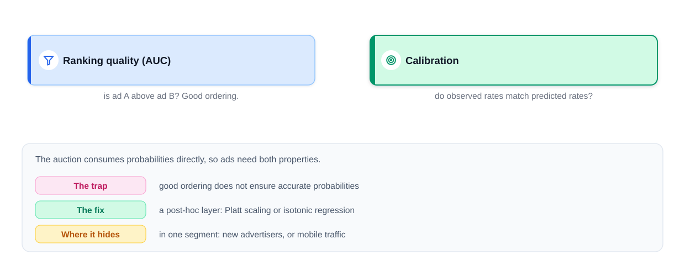
*Figure — Good ranking and accurate probabilities are different properties (course diagram)*

### 3. Data and labels
Two clocks:
- **Clicks** arrive in seconds, but a *non-click* is final only after an **observation window** — else late clicks become negatives.
- **Conversions** arrive hours to days later, some never. A recent click without conversion is **unresolved**, not negative; treating it as negative biases pCVR down (**delayed feedback**).

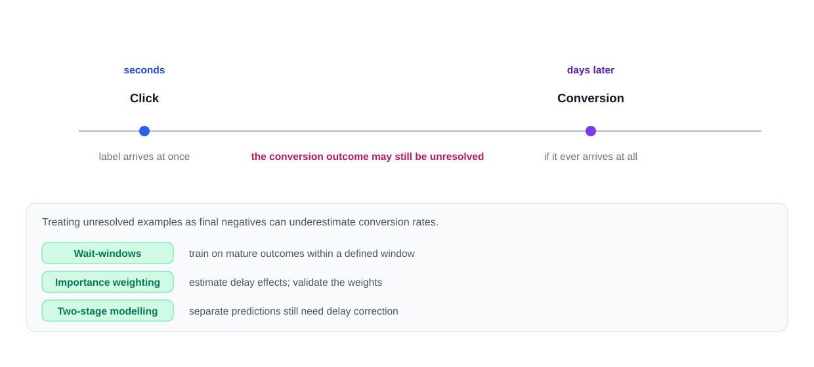
*Figure — A click is instant; the conversion it may cause is not (course diagram)*

Also **eligibility data** (targeting, remaining budget, policy approval) for a hard pre-model filter, and **invalid-traffic** signals (bots, click farms) removed before billing *and* training — with later credits and label fixes for what's found late.

### 4. Features
| Group | Examples |
|---|---|
| User / context | Interest segments, recent activity, device, OS, placement, page topic, time, country |
| Ad / creative | Format, text and image embeddings, landing-page category |
| Advertiser history | Historical CTR by placement/device, account age, policy record |
| Cross features | User segment × ad category, placement × format (hand-made for logistic regression, learned by deep models) |
| Counters | Impressions/clicks per ad in the last hour/day (streaming) |

Features are sparse (millions of IDs): **embedding tables** or **feature hashing** (IDs into a fixed number of buckets), all cached for the 50–100 ms budget.

### 5. Model: baseline → advanced
- **Baseline**: logistic regression on hashed and crossed features — cheap, usually well calibrated under log loss; the historical workhorse (Google search ads: online LR with **FTRL-Proximal**, an update rule keeping most weights exactly zero; McMahan et al., 2013).
- **Next**: boosted-tree outputs as features for a logistic model (Facebook, He et al., 2014), then deep CTR models that learn feature crosses — **factorisation machines** (Rendle, 2010; every feature pair through small learned vectors), Wide & Deep (Cheng et al., 2016, Google Play), DeepFM, DCN.
- **Multi-head**: shared body with pCTR and pCVR heads (17.2's pattern). Alibaba's **ESMM** (Ma et al., 2018) trains on *all* impressions by predicting pCTCVR = pCTR × pCVR, so the conversion head isn't learned only from the biased "clicked" subset.
- **Calibration layer** (part of the model): map raw scores to probabilities on held-out data with **Platt scaling** (one-feature logistic regression on the score — 2 parameters, little data) or **isotonic regression** (non-decreasing step function — flexible, needs more data, can overfit). If you **down-sample negatives** keeping fraction w, correct analytically: q = p / (p + (1 − p)/w) (He et al., 2014) — e.g. w = 0.05, p = 0.5 → q ≈ 0.048.

### 6. Offline metrics
- **Log loss** and **normalised entropy** (log loss ÷ that of always predicting the average CTR; Facebook's metric) — both calibration-sensitive.
- **AUC** for ordering.
- **Calibration**: predicted/observed ratio, reliability curves, **ECE** (bucket-size-weighted mean |mean prediction − observed rate|). Break down **per segment** (advertiser size, slot, device, market): a model can be calibrated on average while over-predicting for new advertisers and under-predicting on mobile.

### 7. Online metrics and A/B testing
- **Platform**: revenue per thousand impressions (**RPM**), CTR. **Advertiser**: cost per click/conversion, return on ad spend — losing advertisers leave. **User guardrails**: ad load, ad hide/report rate, page latency.
- Ads-specific trap: **budget interference** — both arms spend the same campaign budgets, so one can starve the other; split budgets per arm.

### 8. Serving architecture
1. **Eligibility filter first** (targeting, budget, policy) — serving outside them breaks the advertiser contract, far worse than a poor match.
2. **Retrieval** by relevance (embedding or rule-based).
3. **Scoring**: calibrated pCTR/pCVR in one batched call.
4. **Auction**: rank by expected value (bid × pCTR, plus quality terms and reserves), price by the chosen rule. In a one-slot **second-price** (Vickrey) auction the winner pays the second-highest bid, making truthful bidding optimal; multi-slot **generalised second-price (GSP)** does *not* guarantee that (Edelman, Ostrovsky & Schwarz, 2007); Google Ad Manager moved to **first-price** in 2019.
5. **Pacing**: a control loop compares spend rate with plan and throttles or boosts participation — else budgets burn out by mid-morning.

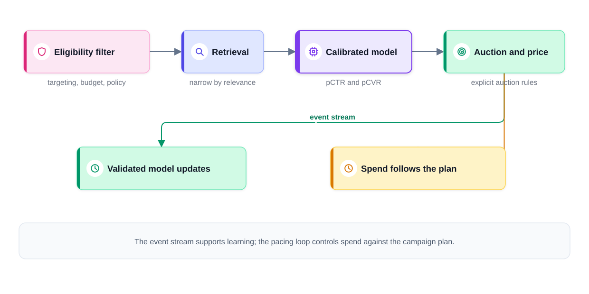
*Figure — An example auction path with a 50–100 ms target (course diagram)*

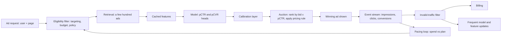

### 9. Scale numbers
| Quantity | Arithmetic | Result |
|---|---|---|
| Scores per second at peak | 100K requests × 300 candidates | 30M scores/s |
| Cost sensitivity | 30M/s × 86,400 s | ~2.6 trillion scores/day at peak rate — a microsecond per score matters |
| Outage cost | revenue/day ÷ 86,400 | Priced in dollars per second |

### 10. Monitoring and failure modes
- **Update loop**: among the fastest in ML — incremental updates every minutes to hours, each validated with a tested rollback.
- **Cold start is permanent**: new campaigns start from **priors** (advertiser, category, creative) plus a small capped **exploration** budget.
- **Delayed conversions**: train on **mature** examples inside an **attribution window** (period after a click in which a conversion is credited to it), or model the delay (Chapelle, 2014).

| Failure | Response |
|---|---|
| pCTR service degraded | Warm fallbacks: last-known-good model → segment-average CTR tables; eligibility and budget checks never skipped |
| Calibration drift in one segment | Per-segment alerts; recalibrate; investigate the feature pipeline |
| Invalid-traffic spike | Filter before billing and training; credits and label fixes later |
| Budget over-delivery | Pacing plus hard budget accounting |

### 11. Interview follow-ups
- **"Second-price or first-price?"** → Incentives: truthfulness holds only for single-slot second-price, not GSP; calibration matters in every variant.
- **"An advertiser says they're overcharged."** → Predicted vs realised CTR for their segment, then auction logs, invalid-click records, billing — recalibration fixes predictions, billing errors need separate correction.
- **"Conversions are scarce — how does pCVR learn?"** → Factor into click × conversion-given-click (ESMM-style) so each head uses the densest labels; correct for delay; priors for thin advertisers.

### Toy — calibration, down-sampling and the auction (`code/ads_calibration_toy.py`)
Synthetic impressions, ~4% CTR; a GBDT trained on all clicks and 10% of non-clicks. Correct the probabilities, check calibration per segment, run a two-advertiser auction.

```python
keep = (ytr == 1) | (rng.random(len(ytr)) < w)          # all clicks, 10% of non-clicks
model = HistGradientBoostingClassifier(max_iter=200, random_state=0).fit(Xtr[keep], ytr[keep])
raw = model.predict_proba(Xte)[:, 1]
corrected = raw / (raw + (1 - raw) / w)                  # analytic down-sampling correction
platt = LogisticRegression().fit(np.log(raw_cal / (1 - raw_cal)).reshape(-1, 1), ycal)   # Platt on logit
iso = IsotonicRegression(out_of_bounds="clip").fit(raw_cal, ycal)                       # isotonic
```

```
true CTR in test traffic: 0.0397

pCTR source               AUC  mean pCTR  log loss     ECE
raw (down-sampled)      0.788     0.2368    0.3217  0.1971
analytic correction     0.788     0.0404    0.1438  0.0016
Platt scaling           0.788     0.0402    0.1438  0.0017
isotonic                0.787     0.0403    0.1444  0.0020

segment check (skewed model)   overall pred/actual = 0.0403/0.0397
  mobile   predicted 0.0601  observed 0.0460  ratio 1.31
  desktop  predicted 0.0203  observed 0.0334  ratio 0.61
auction, calibrated pCTR      : A wins 49.8% of mobile / 48.9% of desktop, expected value $1,064
auction, A inflated on mobile : A wins 75.9% of mobile / 48.9% of desktop, expected value $1,040
```

- The raw model has the **same AUC** (0.788) yet predicts 23.7% CTR for 4% traffic — AUC can't see it; log loss and ECE can.
- The formula and both calibrators restore ≈4% and cut ECE ~100×. A model can match the overall rate (0.0403 vs 0.0397) while 31% high on mobile and 39% low on desktop — only **per-segment** checks reveal it.
- Inflating one advertiser's mobile pCTR lifts its mobile win share 50% → 76% and lowers expected value ($1,040 vs $1,064): impressions go to the ad less likely to be clicked.

### Common mistakes
| Weak | Strong |
|---|---|
| Optimises AUC and stops | Calibration layer plus per-segment calibration monitoring |
| Starts with relevance retrieval | Eligibility (targeting, budget, policy) is the first, hard filter |
| Diagram ends at the winning ad | Delayed conversions, invalid-traffic filtering, pacing, warm fallbacks |

### Same design, other questions
- **Sponsored search ads** — must clear a query-relevance bar before bid × pCTR applies (17.3's retrieval). **Native feed ads** — a quality floor no bid can buy past, and an ad-load cap on slots shared with organic posts.

---

## 18.2 Case study: payment fraud detection

> "Design fraud detection for a payments platform."

### 1. Clarify requirements
No funnel: a stream of transactions, each needing a decision while the payment waits. The new ingredient is an **adversary** — fraudsters adapt to whatever you deploy, so some patterns die within days.

| Question | Assumption used below |
|---|---|
| Volume | 10K transactions/s at peak |
| Fraud rate | Below 1% (the toy uses ~0.2%) |
| Latency | ~50 ms inside the authorisation call, ~10 ms of it for the model |
| Actions | Approve, **step-up authentication** (extra identity check: 3-D Secure, one-time passcode), review, block |
| Costs | Missed fraud → loss + **chargeback** fees; false decline → lost sale and trust; review → analyst time |

**Class imbalance**: at 0.2% fraud, "approve everything" is 99.8% accurate and catches nothing — accuracy is off the table from minute one.

### 2. Frame it as an ML task
- **Input**: transaction (amount, merchant, channel), card/account, device, recent activity, graph links.
- **Output**: risk score ≈ P(fraud); binary classification on heavily imbalanced data.
- **Decision** — *separate from the score*: an **action policy** maps score (plus amount, review capacity, mandatory rules) to **approve** (below the low threshold — the vast majority), **extra checks** between thresholds (step-up, or human review via a **pending/delayed-capture** state — approved now, money taken later — since humans can't answer in 50 ms), or **decline** (above the high threshold).

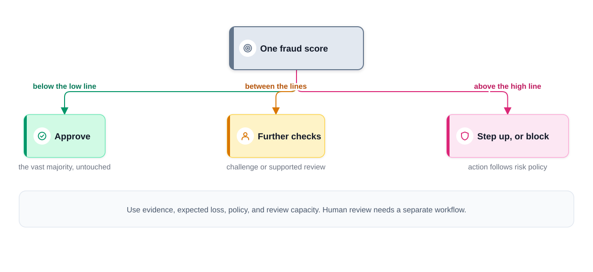
*Figure — The decision is three-way, set by two thresholds (course diagram)*

Thresholds trade precision against recall; set them from **expected cost**, review capacity and policy.

### 3. Data and labels
Name all three label problems:
1. **Delayed labels.** Chargebacks and reports arrive weeks later (assume 2–8); not every chargeback is fraud, not every fraud reported. Fresh recall *doesn't exist yet*; early warning comes from score distributions and rule-hit rates.
2. **Censored labels.** A blocked payment never produces an outcome — holes exactly where the model sees most risk. Partial remedies: analyst investigations, verification results, appeals — record each label's source. **Letting likely fraud through to learn is off the table** (any deliberate test needs risk-owner sign-off and a loss cap).
3. **Imbalance.** Class weights or down-sampling (then recalibrate — 18.1); report **PR-AUC**, precision/recall at operating thresholds, or best, **expected dollar loss**.

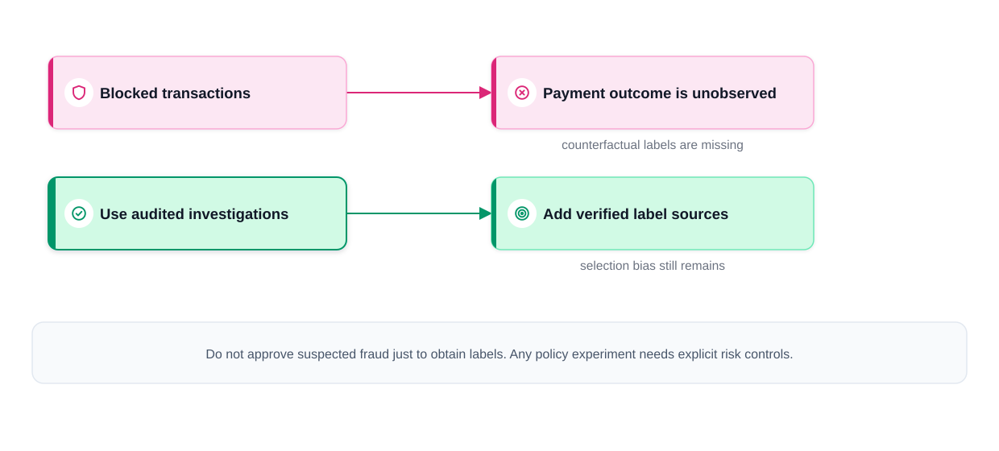
*Figure — Blocked payments have missing outcomes; audited evidence helps but doesn't remove all bias (course diagram)*

### 4. Features
Dominated by **velocity** (how much activity, how fast) and **graph** signals:

| Group | Examples | Freshness |
|---|---|---|
| Velocity | Transactions on this card in the last 10 min / 1 h; distinct merchants today; amount vs this card's usual | Seconds (streaming) |
| "Impossible travel" | Distance between consecutive in-person transactions ÷ time between them | Request time |
| Device / session | New device? Device seen with other cards? Emulator, proxy, typing cadence | Request time |
| Graph | Device linked to a confirmed-stolen card; many accounts sharing one address or IP | Minutes |
| Merchant / account | Merchant fraud rate (from *past* windows only — leakage risk), account age | Hourly–daily |

**Fraud rings** show up as dense clusters in the card–device–address graph before any single transaction looks odd. Shared devices also occur innocently (families, offices) — a graph link is evidence, not proof.

### 5. Model: baseline → advanced
**Rules and model together, on purpose.** A **rules engine** gives what a learned score can't: **hard constraints** (sanctions checks, verified blocklists aren't probabilities), **speed** against a new attack (a rule ships in minutes; a model has no training data for today's scheme), and **explainability** for regulators and dispute teams. The **model** catches combinations of weak signals.

- **Baseline**: rules + logistic regression on velocity features.
- **Standard**: **GBDT** on tabular features plus graph features or a **graph neural network** for rings; optionally an anomaly score (**isolation forest** — flags points random splits isolate unusually fast) for never-seen patterns.
- **Rule hygiene**: each rule gets an owner, a precision/recall dashboard and an **expiry date**, or **rule sprawl** builds up.

Real-world: Stripe Radar combines ML risk scores with merchant-written rules; in Europe, **PSD2**'s strong customer authentication makes 3-D Secure step-up a standard middle action.

### 6. Offline metrics
- **PR-AUC** — meaningful under heavy imbalance; with 500 legitimate per fraud, a small false-positive *rate* is still a large *number* of false alarms, which ROC-AUC hides.
- **Recall at a fixed false-positive rate**, or **precision at a fixed review capacity**.
- **Expected cost** of the whole policy (missed fraud + false declines + review), on a **time-based** split with **mature** labels only — a **backtest**.

### 7. Online metrics and A/B testing
- **Business**: fraud loss in **basis points** of volume (1 bp = 0.01%), chargeback rate, false-decline rate, review-queue size and SLA.
- You can't A/B a fraud model like a feed (deliberately letting fraud through is unacceptable). Rollout: backtest → **shadow scoring** (compare distributions and reviewer agreement) → **canary** under approved risk limits → wait for mature labels → full rollout (16.6).

### 8. Serving architecture
~50 ms end to end, set by the payment network: **rules** → **feature assembly** (online store + streaming velocity) → **model** (~10 ms) → **policy**. Labels return as three streams at different speeds: analyst findings, verification results, late chargebacks.

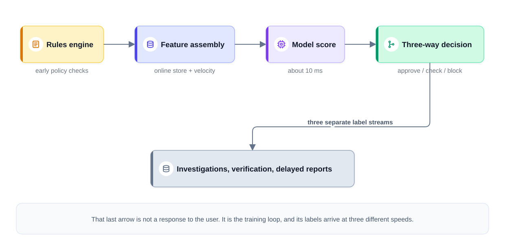
*Figure — An example 50 ms automated decision path, with labels arriving separately (course diagram)*

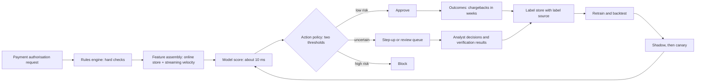

### 9. Scale numbers
| Quantity | Arithmetic | Result |
|---|---|---|
| Fraud events | 10K/s × 0.2% | ~20 fraudulent attempts/s at peak |
| Review load | 0.5% in the middle band: 10K × 0.005 × 3,600 | 180K reviews per peak hour — impossible for humans, so step-up handles most of the band and review is kept for high-value cases |
| Velocity state | 200M active cards × 4 counters × 8 bytes | ≈ 6.4 GB in memory (plus keys, replicas), updated per transaction |

### 10. Monitoring and failure modes
- **Early warning** while labels are weeks late: score distributions, rule-hit rates, approval rate — per merchant, country, channel.
- **Adversarial drift**: bursts of small "test" transactions on new cards. A **sudden drop** in flagged rate is possible evasion or a broken feature, not good news.
- **Timeout policy**: neither global **fail open** nor global **fail closed** — decide by risk in advance: small amounts from long-standing accounts pass, large or risky ones are challenged or held.

| Failure | First check |
|---|---|
| False-decline rate doubles overnight | Data feeds before the model: a stalled velocity counter moves every score. One segment spiking → a rule or feature; everything spiking → upstream |
| Fraud volume ×10, analysts ×1 | Narrow the review band to high-value cases, lean on step-up; never weaken mandatory controls |

### 11. Interview follow-ups
- **"Once the model is strong, can the rules go?"** → No: speed during an attack, hard constraints, readable logic. Manage rules with metrics and expiry dates.
- **"How do you catch a fraud ring?"** → Graph features, **community detection** (finding tightly connected groups), tools to expand from one confirmed case to its neighbours — checking for innocent shared infrastructure.

### Toy — velocity features and two thresholds (`code/fraud_thresholds_toy.py`)
One synthetic week of card transactions (~0.23% fraud); stolen cards used in quick bursts. Train days 1–5, test days 6–7 (time split), then pick approve/review/block thresholds by expected dollar cost under a review-capacity limit.

```python
def velocity(card, t, window=10.0):
    """# of earlier transactions on the same card within `window` minutes (a streaming aggregate)."""
    # ... keep, per card, the timestamps still inside the window

def cost(lo, hi):
    block, review = p >= hi, (p >= lo) & (p < hi)
    missed = (yt == 1) & ~block & ~review                       # approved fraud: lose the amount
    c = amt[missed].sum() + COST_FALSE_DECLINE * ((yt == 0) & block).sum() + COST_REVIEW * review.sum()
    c += amt[(yt == 1) & review].sum() * 0.1                    # reviewers miss ~10% of what they see
```

```
360,769 transactions, fraud rate 0.230%
'approve everything' accuracy = 99.770%  (catches 0 fraud)

amount+foreign+hour    ROC-AUC 0.838   PR-AUC 0.054
+ velocity (10 min)    ROC-AUC 0.849   PR-AUC 0.408

no model (approve all): cost $33,052
single threshold 0.5   lo=0.50 hi=0.50: cost $17,258  blocked 163  reviewed 0  fraud caught 50%
best two thresholds    lo=0.02 hi=0.70: cost $15,554  blocked 158  reviewed 293  fraud caught 57%
```

- **Accuracy is useless**: 99.77% for a policy that catches nothing.
- **ROC-AUC barely moves** (0.838 → 0.849) with velocity, but **PR-AUC jumps ~7.6×** (0.054 → 0.408) — ROC-AUC hides false alarms under imbalance.
- A **review band** (within 300-review capacity) catches more fraud at lower cost than one threshold. (In practice pick thresholds on a separate validation window.)

### Common mistakes
| Weak | Strong |
|---|---|
| Binary classifier, one threshold | Three-way decision, two cost-based thresholds, step-up in the middle |
| "Retire the rules once the model is good" | Rules for speed, constraints, explainability; model for complex patterns |
| Quotes accuracy at a 0.2% base rate | PR-AUC, precision/recall at operating points, expected dollar loss |

### Same design, other questions
- **Account takeover at login** — the unit is a session; device fingerprint, location velocity and typing rhythm dominate; step-up is the main action. **Promo/referral abuse** — audit labels in days (faster loop); graph features dominate because abuse comes from rings.

---

## 18.3 Case study: harmful content detection (and running it at platform scale)

> "Design a system to detect harmful content — hate speech, harassment, spam, graphic violence, misinformation." Scale-up version: trust and safety for a short-video app receiving ~200M new items daily (clips, sound, captions, comments), with a rulebook from CSAM (zero tolerance, legally mandated handling) to grey-zone health misinformation.

### 1. Clarify requirements
Fraud's adaptive adversary and unequal error costs, plus:
1. **Multimodal input** — a harmless photo plus a hateful caption is harmful though neither half is: several models (per modality or harm) plus a policy layer combining scores.
2. **Costs both ways, not only money**: a **false negative** exposes people to harm; a **false positive** silences a legitimate user. Thresholds become an explicit policy conversation.
3. **Huge scale, low base rates** varying by harm type and surface.

| Question | Assumption used below |
|---|---|
| Volume | 200M uploads/day ≈ 2,300/s average (tens of thousands/s at peak across all item types) |
| Violation rate | Below 1% per category |
| Latency | Livestream near-real-time (rolling few-second windows); uploads a second or two; back-catalogue re-scans offline |
| Scope | Public posts; ads and private messages have their own pipelines and privacy rules |
| Jurisdiction | One policy engine keyed by **harm category and country** — legal lines differ |

**Highest-harm category first.** **CSAM** (child sexual abuse material) needs a dedicated, tightly governed process: **hash matching** (comparing a short file fingerprint) against approved databases of known material (Microsoft's **PhotoDNA**; Meta open-sourced **PDQ** and **TMK+PDQF** in 2019), restricted-access review, evidence preservation, legally required reporting. In the US, providers must report apparent CSAM to **NCMEC**'s CyberTipline once they know of it (18 U.S.C. § 2258A); that statute doesn't itself require proactive scanning, and duties differ by country — name who owns policy and escalation. Hashes find *known* material only.

### 2. Frame it as an ML task
- **Input**: the item (frames, audio, text), context (account, where posted, replies), distribution (views, share velocity).
- **Output**: per-category risk P(violates policy c). **Category**: multi-label classification run as a **cascade** (cheap models on everything, expensive ones only on what earlier stages flag), then a policy decision — an **action ladder**, not remove/allow (section 8).

**The metric that matters: prevalence of violating views** = views landing on violating content ÷ all views, estimated by human-labelling a random sample of *views* — harm scales with exposure, so each miss counts by its reach. Report **per category with confidence intervals** (Meta's Community Standards Enforcement Report gives violating views per 10,000). **Opposite-direction guardrails**: **false-removal rate** (audits) and **appeal-overturn rate**; plus **time to action** and **views before action**.

### 3. Data and labels
1. **Rare, expensive labels** — reviewer time is the bottleneck. **Active learning** sends the most useful items (uncertain, diverse, high reach) to reviewers; a *separate* random sample measures prevalence, since active-learning samples are biased by design.
2. **Three label feeds**: reviewer decisions (best, scarcest); **appeals** (false-positive evidence but self-selected — add random audits); **user reports** (huge, noisy, manipulable — weight by **reporter reputation**, the historical precision of that reporter; evidence, never verdicts).
3. **Adversarial evasion**: **leetspeak** ("fr33"), **homoglyphs** (Cyrillic "а" for Latin "a"), **text inside images** (needs **OCR**), **splitting** the attack into the comment under an innocent post, **re-encoding / cropping / mirroring** to break hashes, **coded language** rotating faster than training cycles.
4. **Consistency and context**: guidelines plus **inter-rater agreement** checks; the same image can be news or gore.

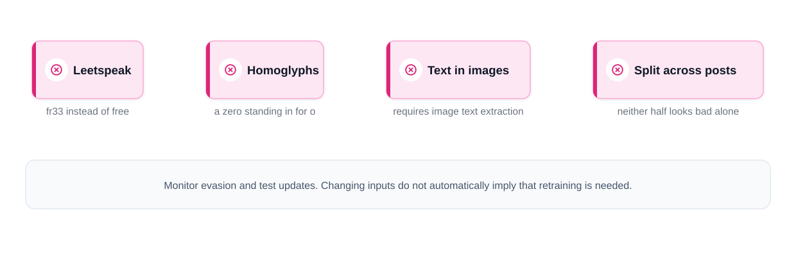
*Figure — Four forms of adversarial evasion (course diagram)*

### 4. Features
| Group | Examples |
|---|---|
| Content | Text embeddings (after normalising leetspeak/homoglyphs), image and frame embeddings, OCR text, **ASR** transcript, audio embeddings |
| Hashes | Exact hash, **perceptual hash** (stays similar after small edits) of keyframes, audio fingerprint |
| Account / context | Account age, prior strikes, posting rate; surface (comment, post, live), thread replied to |
| Distribution | Views, **share velocity**, audience |
| Reports | Count weighted by reporter reputation, report-graph clustering |

### 5. Model: baseline → advanced (one model per stage)
1. **Hashes and high-confidence rules** — exact hashes catch identical files; perceptual hashes tolerate some edits (test against crops and mirroring; audio fingerprints survive a mirrored video). Hash-sharing programmes exist for some categories (GIFCT's database for terrorist content).
2. **Fast classifiers on everything** — small per-modality models (a distilled text transformer, a small image CNN) whose only job is triage.
3. **Heavy multimodal models on the flagged slice** — large image-text models and LLM-based classifiers for nuanced text and memes.
4. **Human review** — borderline and appealed cases; also the label source.

**Baseline** for a new category: rules + hashes + report routing; a fast classifier as labels accumulate; heavy models last. **Upgrade** by distilling the heavy model into the fast one.

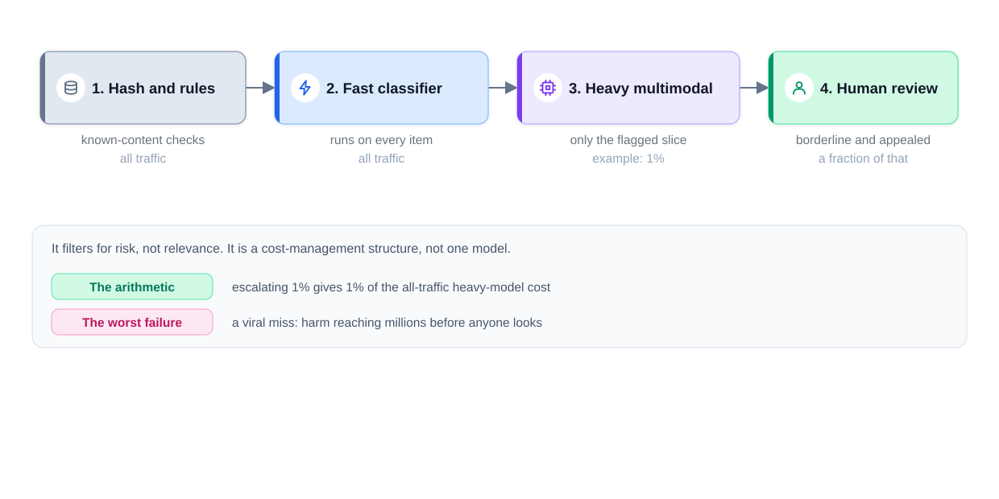
*Figure — The risk funnel spends compute in proportion to risk (course diagram)*

### 6. Offline metrics
- Per-category **precision and recall at the operating thresholds** on a **fully reviewed** set, sliced by language, region, content type.
- **Recall of the whole cascade**, not of each stage: an item stage 2 wrongly passes never reaches stage 3.
- **Hash recall under mutation**: known items transformed by current evasion tricks.

### 7. Online metrics and A/B testing
Metrics from section 2, plus creator churn and queue age. You can't ethically randomise *leaving harm up*: backtest → shadow scoring → **independent adjudication** of disagreements (agreement with the old system isn't proof) → canary → sampled prevalence.

### 8. Serving architecture
**The action ladder** — policy as callable actions, per category and region:

| Rung | When | Notes |
|---|---|---|
| Auto-remove | Confidently violating | Tuned so false removals stay rare; user notified, can appeal |
| Human review | Uncertain cases, appeals | Prioritised queue |
| Reduce / age-gate / warn | Borderline or allowed-but-restricted | Stays up but isn't amplified (the feed integrity layer, 17.2), hidden from minors, or behind a warning |
| Auto-allow | Clearly fine — the vast majority | |

Thresholds are owned by Trust & Safety and Legal (not the model team), set from measured error rates, severity, reviewer capacity and law.

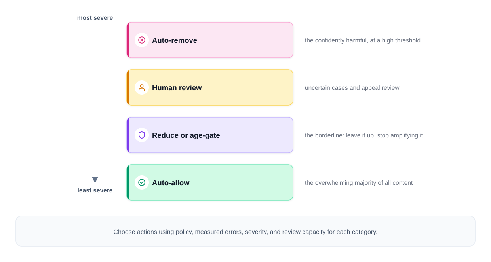
*Figure — The action ladder, not a binary (course diagram)*

**Review-queue priority** = f(severity, expected reach, uncertainty, deadline), with capacity reserved for random audits and appeals.

**Reach-aware re-scoring** against the **viral miss** (harm reaching millions before anyone looks): crossing each view tier (10K, 100K, 1M) triggers a re-check by a stronger model; affordable because few items climb the tiers. Share velocity also pushes fast spreaders to deeper checks and the head of the queue.

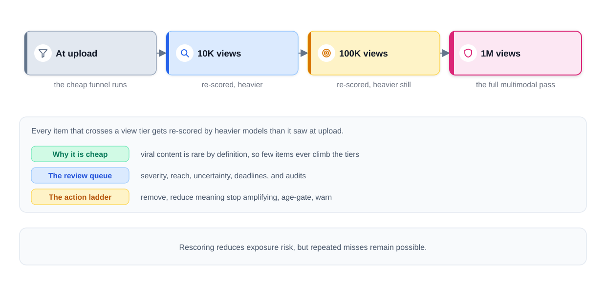
*Figure — Reach-aware re-scoring: scrutiny grows with the audience (course diagram)*

**Incident lane**: in a crisis (a live-streamed attack being re-uploaded) new fingerprints and rules go live in minutes — no retrain is that fast.

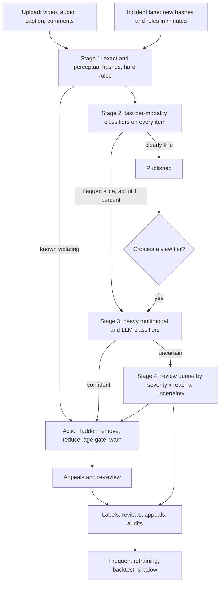

### 9. Scale numbers
| Quantity | Arithmetic | Result |
|---|---|---|
| Fast stage | 200M/day ÷ 86,400 | ≈ 2,300 items/s average → small models, strict budgets |
| Heavy stage at 1% flag rate | 200M × 0.01 | 2M/day ≈ 23/s average (plus media length, decoding, peaks, replicas) |
| Cost of the dial | +0.1 percentage point flag rate | +200,000 heavy inferences/day |
| Human review at 0.1% | 200M × 0.001 | 200,000 decisions/day |
| Reviewers | 200,000 ÷ ~300 decisions per reviewer-day | ≈ 670 reviewer-days per day → with shifts and leave, many hundreds of staff |

The flag rate is the GPU bill; the review threshold is a **headcount** setting.

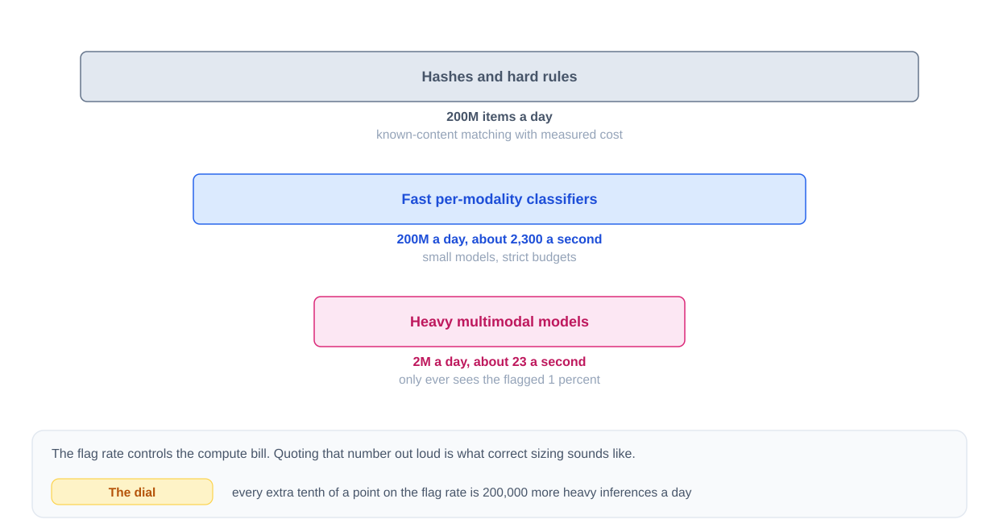
*Figure — The risk funnel, with the volume said out loud at every stage (course diagram)*

### 10. Monitoring and failure modes
- A sudden **drop** in flag rate means possible evasion, not improvement.
- **Policy changes trigger a back-catalogue re-scan** — yesterday's allowed content can violate today's rule.
- **Outage policy per category**: never treat unscored content as low-risk; high-risk surfaces hold (fail closed), low-risk ones may publish (fail open).
- **Moderator well-being is designed capacity**: exposure limits per shift, rotation off graphic queues, blurred-first media, attrition in the headcount plan.

| Failure | Loud or quiet? | Defence |
|---|---|---|
| Viral miss | Loud | Re-check at view tiers; for the worst harms escalate generously (accept extra false alarms) |
| Over-removal | Quiet (overturns, creator churn) | Audited false-removal and overturn rates beside prevalence |
| Evasion wave | Quiet at first | Flag-rate drop alerts, near-duplicate clustering, fast rules |

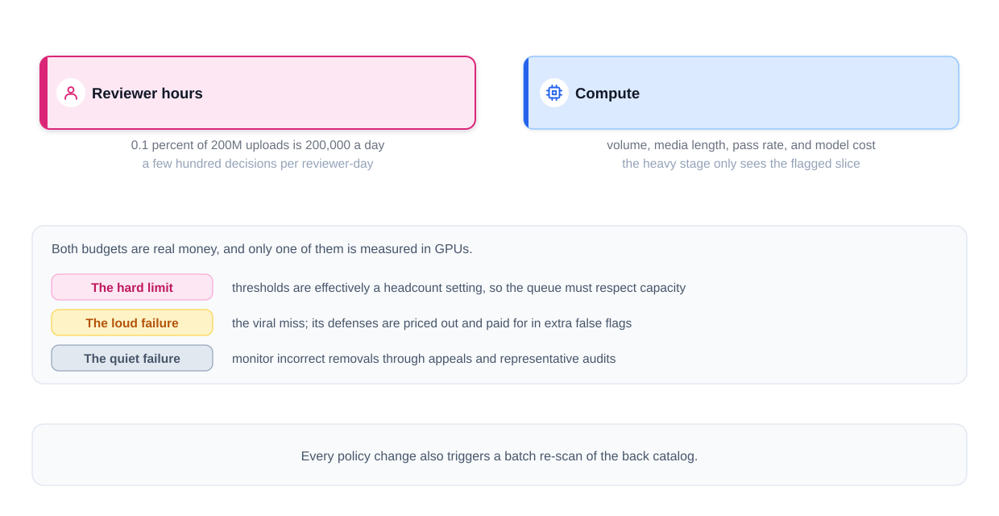
*Figure — Two budgets, and only one of them is measured in GPUs (course diagram)*

### 11. Interview follow-ups
- **"A brigade mass-reports one creator overnight."** → Reports raise priority but can't remove; reputation weighting and report-graph clustering (same target, correlated timing, shared origin) expose the campaign — a fraud-ring problem in moderation clothing.
- **"A government bans a new category within a week."** → Rules, hashes and report routing on day one, classifier in weeks; the region-keyed policy engine scopes it to one jurisdiction.

### Toy — the cascade dial and prevalence sampling (`code/moderation_cascade_toy.py`)
One million uploads, 0.5% violating, heavy-tailed views. The fast classifier scores everything; the heavy model (100× the cost) scores the flagged slice; removal needs a high heavy score. Vary the flag rate, add view-tier re-scoring, estimate prevalence by sampling views. (Simplification: removals happen before any views.)

```python
def run(bad, views, fast, heavy, flag_rate, viral_tier=None):
    flagged = fast >= np.quantile(fast, 1 - flag_rate)
    if viral_tier is not None:
        flagged |= views >= viral_tier                               # reach-aware re-scoring
    removed = flagged & (heavy > 2.5)
    compute = N * 1 + flagged.sum() * HEAVY_COST                     # fast on all + heavy on flagged
    viol_views = views[bad & ~removed].sum() / views[~removed].sum() # prevalence of violating views
```

```
violating uploads 0.49%, violating share of views before action 0.45%; top 1% of items get 62% of views

policy                             heavy runs  compute*  recall  viol. views false rem.
flag top 0.5%                           5,000     0.015   30.4%       0.345%         24
flag top 1.0%                          10,000     0.020   41.3%       0.288%         49
flag top 2.0%                          20,000     0.030   52.4%       0.172%        103
flag top 5.0%                          50,000     0.060   67.6%       0.136%        281
flag top 1.0% + re-score >=10K views     12,903     0.023   41.5%       0.136%         67
* compute relative to running the heavy model on every item

true prevalence of violating views: 0.136%
  sample  5,000 labelled views -> estimate 0.120%  (95% CI 0.024% to 0.216%)
  sample 50,000 labelled views -> estimate 0.152%  (95% CI 0.118% to 0.186%)
```

- The cascade costs 1.5–6% of "heavy model on everything"; higher flag rates buy recall with diminishing returns.
- **Reach-aware re-scoring** matches the 5% flag rate's violating-view prevalence (0.136%) at well under half the compute (0.023 vs 0.060) and a quarter of the false removals, because 1% of items get 62% of views. Upload recall barely moves (41.5%) — the view metric is the one tracking harm.
- Measuring 0.1% prevalence is hard: 5,000 labelled views give a CI of 0.02–0.22%, 50,000 narrow it to 0.12–0.19% — metric precision costs reviewer hours.

### Common mistakes
| Weak | Strong |
|---|---|
| One big classifier over everything | Cascade: expensive compute only on the slice that needs it |
| Remove vs allow | Full action ladder, including reduce and age-gate |
| Thresholds read off a PR curve | Thresholds as policy, per category and region, informed by measured errors |

### Same design, other questions
- **Marketplace counterfeits** — photos, text and price that don't fit (a luxury bag at a tenth of retail); actions hit listings and sellers. **DM spam** — private content, so triage uses sending behaviour and reports; **rate limits** before removal.

---

## 18.4 Case study: People You May Know (PYMK)

> A LinkedIn-style network with 900M members wants a connection-suggestion module, shown on the home page and during onboarding. Design it.

### 1. Clarify requirements
| Question | Assumption used below |
|---|---|
| Members | 900M registered (not daily active) |
| Surfaces | Home-page module; post-sign-up onboarding |
| Latency | ~200 ms for the module; heavy work precomputed |
| Privacy | Suggestions can reveal sensitive relationships or invite unwanted contact — privacy controls are core requirements |

**Success has three layers**, because each simple metric is a trap: invites sent ignores whether the recipient wants it; acceptance rate alone rewards suggesting obvious acquaintances; the real goal is **network value** — connections that go on to interact.

| Layer | Metric |
|---|---|
| Primary (online) | Accepted invitations per suggestion impression |
| Guardrails (can veto) | Invitation-ignore rate; "I don't know this person" reports (weighted heavily in training, like hides in 17.2) |
| Long-term (weeks later) | Interaction between newly connected pairs |

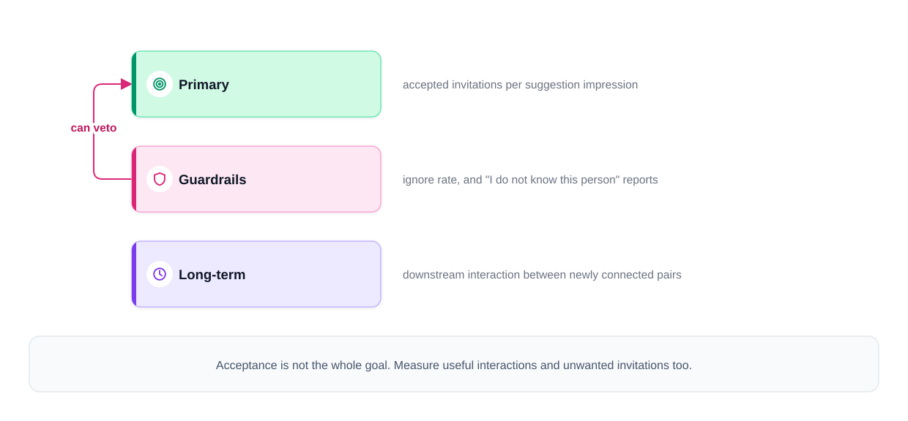
*Figure — Three layers of metric, because acceptance alone is a trap (course diagram)*

### 2. Frame it as an ML task
- **Input**: viewer, candidate, the graph around them, context (new vs tenured member).
- **Output**: **P(send)** = P(invite sent | shown) — does the *viewer* want it? — and **P(accept | sent)** — does the *candidate*?
- **Ranking score** = P(send) × P(accept | sent) = probability of an accepted invitation per impression; both sides must want it.
- **Category**: **link prediction** (which graph edges will form) + two-sided ranking.


*Figure — The score multiplies the viewer's intent by the recipient's willingness (course diagram)*

### 3. Data and labels
- **Graph**: connections, follows, past invites (sent, accepted, ignored), dismissals, blocks. **Profiles**: employer, school, groups, skills, location, with dates (overlap in time matters).
- **Imported contacts** (only with permission): minimise collection and retention, support opt-out and deletion; hashing identifiers does *not* anonymise them.
- **Labels**: invite-sent arrives in-session; acceptance takes days. A pending invite is *unresolved*, not rejected — use an observation window (18.1's delayed-label idea).

### 4. Features
| Group | Examples |
|---|---|
| Graph | Mutual-connection count and strength; **Adamic-Adar** = Σ over mutual friends of 1 / log(that friend's degree) — a shared friend with few connections counts more than one who knows everyone; graph-embedding similarity |
| Affinity | Same employer/school/group with overlapping dates, similar skills, mutual profile views |
| Behavioural | Viewer's historic invite-acceptance rate; candidate's accept rate and inbox load |
| Context | New vs tenured; surface; times this pair was already shown |

### 5. Model: baseline → advanced
**Candidate generation — four sources, unioned and deduped** (17.1's multi-source retrieval, people as the catalog):
1. **Friends-of-friends (FoF)** / **triangle closing** — A–B and B–C connected → C is a candidate for A. The main source, precomputed and **bounded**: expand only top neighbours by interaction, sample very-high-degree accounts' lists, cap candidates per member.
2. **Shared affiliations** — same company/school/group with overlapping dates; catches the new coworker with no mutuals.
3. **Imported contacts** — permission-based matches.
4. **Embedding similarity** — two-tower member vectors from profile and activity, or graph embeddings (**node2vec**-style random walks, or graph neural networks), via an ANN index.

**Hard filters at retrieval** (re-checked before display): already connected, blocked, dismissed, opted out. **Impression discounting** lowers candidates shown many times without action — softer than a permanent dismissal.

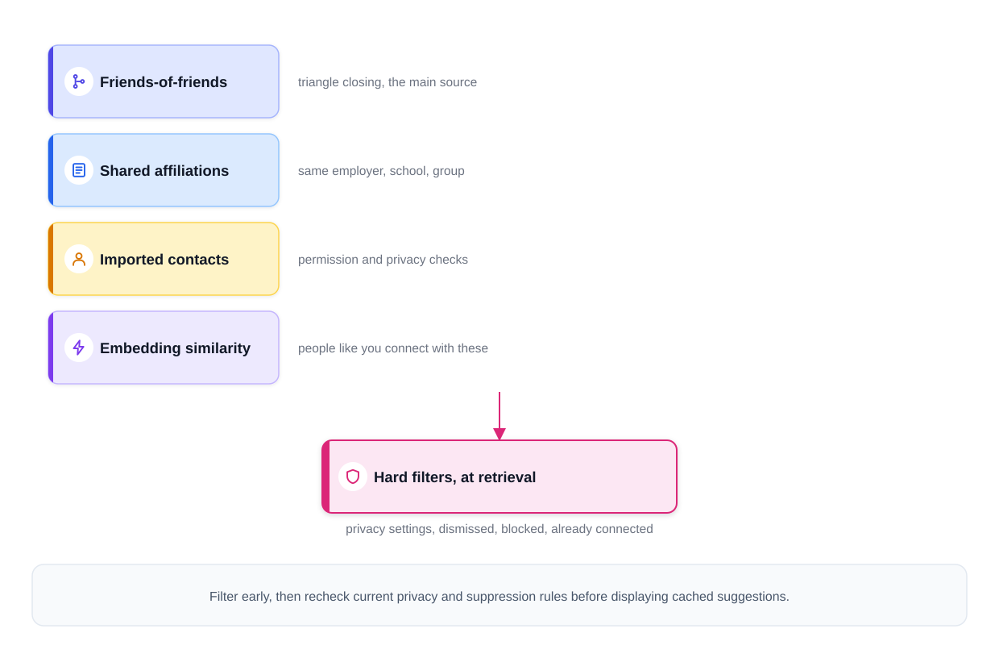
*Figure — Four retrieval sources, then hard filters before ranking (course diagram)*

**Ranker**: baseline = sort FoF by mutual count or Adamic-Adar; advanced = GBDT or a two-head network predicting P(send) and P(accept | sent), multiplied.

### 6. Offline metrics
- **Recall@K of future edges**: hide connections formed after a cutoff; would retrieval have produced them?
- **AUC / log loss** per head, plus calibration — the heads are multiplied.
- Diversity: share of suggestions to the top-1% most-connected members; share crossing community boundaries.

### 7. Online metrics and A/B testing
- The three metric layers, on **both sides** (inviter and recipient).
- **Network interference**: a treated viewer invites a control member, so user-level randomisation leaks. Use **graph-cluster randomisation** (whole communities to one arm) or model the interference.
- The interaction metric takes weeks — keep a long-running **holdback** (16.9).

### 8. Serving architecture
- **Nightly batch**: bounded FoF, affiliations, scoring → top candidates per active member in a **KV store**, with **idempotent, versioned** writes so a retry can't overwrite a newer run ([System Design Fundamentals](../../../system-design-patterns/modules/00-system-design-fundamentals/README.md)).
- **Streaming path**: new connections, dismissals, blocks update a **suppression store** within minutes (seconds for dismissals).
- **Request time**: read the list, merge suppressions, re-check current privacy settings, render.
- **New members**: contacts and affiliations carry the first session, refreshed within minutes as first connections form.

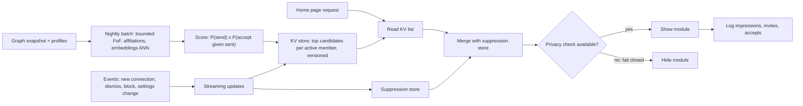

### 9. Scale numbers
| Quantity | Arithmetic | Result |
|---|---|---|
| Batch scope | Active in last 30 days only (assume 300M) instead of 900M | ~⅓ of the graph work; dormant members refreshed weekly |
| FoF blow-up | 500 connections, each with 500 → up to 250,000 two-hop paths | why expansion is capped to top neighbours |
| KV storage | 300M members × 100 candidates × ~16 bytes | ≈ 480 GB before replication |

The dominant cost is usually **graph computation**, not inference.

### 10. Monitoring and failure modes
**Graph-shaped feedback loops**: **rich-get-richer** (well-connected members sit in more triangles, get suggested more, grow more connected — cap exposure per candidate) and **cluster amplification** (triangle closing reinforces silos — monitor cross-cluster suggestions).

| Failure | Response |
|---|---|
| Nightly graph job fails | Serve last validated candidates within a freshness limit, still enforcing *current* privacy, blocks, dismissals; alert on age |
| Privacy filter unavailable | **Fail closed**: render nothing rather than unverified suggestions |
| Dismissed person reappears an hour later | Design bug: dismissals must go through the streamed suppression store merged at render time |

### 11. Interview follow-ups
- **"FoF for 900M members without melting the cluster?"** → Top neighbours only, 30-day-active members nightly, sampled celebrity neighbour lists, capped outputs — never the full two-hop closure.
- **"Legal asks you to prove opted-out members never appear."** → Auditable filters at retrieval *and* before display, fail-closed on timeouts, prompt cache invalidation, filter-version logging, tests for stale caches and race conditions.

### Toy — FoF retrieval, Adamic-Adar, two-sided ranking (`code/pymk_toy.py`)
A 4,000-member clustered graph (networkx `powerlaw_cluster_graph`: a few hubs, many small clusters), 10% of edges hidden as "future". Part 1 ranks FoF candidates three ways; part 2 simulates viewers who like inviting popular members who rarely accept.

```python
def fof_candidates(G, u):
    """Two-hop neighbours with their mutual-connection lists (bounded in production: top neighbours only)."""
    mutual = {}
    for f in G[u]:
        for c in G[f]:
            if c != u and not G.has_edge(u, c):
                mutual.setdefault(c, []).append(f)
    return mutual

scores = {
    "random FoF": {c: random.random() for c in cands},
    "common neighbours": {c: len(m) for c, m in mutual.items()},
    "Adamic-Adar": {c: sum(1 / math.log(deg[f]) for f in m if deg[f] > 1) for c, m in mutual.items()},
}
# part 2: rank the top 10 by p_send alone vs p_send[c] * p_acc[c]
```

```
4000 members, 15977 connections, 1597 hidden as future; max degree 264, median 5
avg FoF candidates per member 155; FoF retrieval covers 65.0% of future connections

random FoF           recall@10 = 0.080
common neighbours    recall@10 = 0.216
Adamic-Adar          recall@10 = 0.287

ranking (top 10 per member) invites sent  accepted accept rate  to top-1% members
P(send) only                     4.44      0.80       17.9%              65.4%
P(send) x P(accept)              2.48      1.35       54.6%               1.5%
```

- FoF covers 65% of future connections — a third come from elsewhere, hence four sources. Within FoF, common neighbours is 2.7× random, and **Adamic-Adar** adds another third.
- Ranking by P(send) alone sends 65% of suggestions to the top 1% most-connected members, who accept only 18%. The **two-sided score** sends fewer invites but yields 69% more accepted connections (1.35 vs 0.80 per member). (Behaviour simulated; a real system learns both heads.)

### Common mistakes
| Weak | Strong |
|---|---|
| Optimises invites sent or acceptance alone | P(send) × P(accept \| sent), ignore/report guardrails, long-term interaction |
| Privacy filtering only at display | Filters at retrieval *and* before display; fails closed |
| Dismissals wait for the nightly batch | Streamed suppression merged at render time |

### Same design, other questions
- **Groups to join** — one side is an aggregate, so predict join × stay-and-participate; big groups dominate triangles, so a diversity cap is mandatory. **CRM contact suggestions** — shared accounts matter more than mutuals; the second side is "will this contact reply".

---

## 18.5 Case study: music discovery (Spotify-style)

> "Design discovery for a music streaming service with 400 million users and 100 million tracks: personalised weekly playlists like Discover Weekly, plus a 'radio' that plays endlessly from any seed song."

### 1. Clarify requirements
Recognition sentence: **"The recommendation funnel used twice — once in batch, once online."**
- **Batch**: Discover Weekly is one precomputed playlist per user per week (Spotify, 2015; refreshed every Monday) — a deadline and a cache.
- **Online**: radio picks the next track from the current session, which needs per-request context.

| Question | Assumption used below |
|---|---|
| Users / tracks | 400M users (≈ 250M weekly active), 100M tracks, many uploads daily (pick a rate for capacity planning) |
| Discover Weekly | Batch with a deadline (ready before Monday) plus a serving cache |
| Radio | Next-track decision in ~100–200 ms using session context |
| Out of scope | Search, social features, licensing economics |

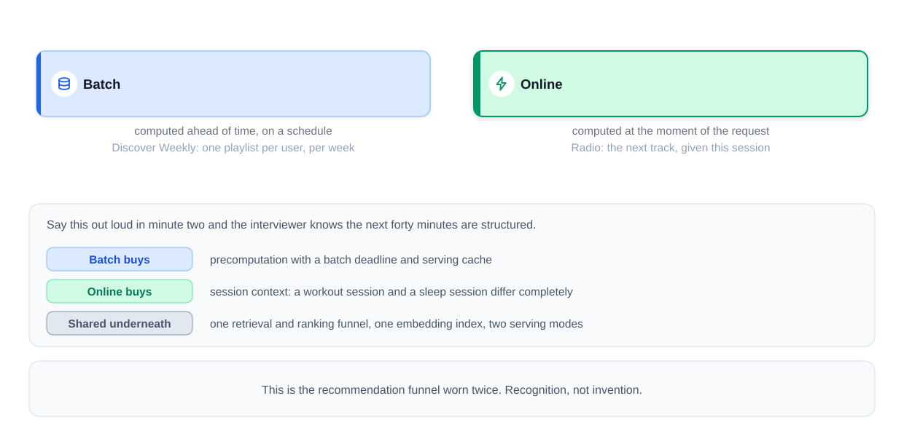
*Figure — The same machinery, used as batch and as online (course diagram)*

### 2. Frame it as an ML task
- **Discover Weekly**: retrieval + ranking of tracks the user *hasn't heard* but will like — recommendation with a novelty constraint.
- **Radio**: **sequential recommendation** — predict the next track from seed and session.
- **Labels**: listens past **30 seconds**, saves, playlist adds, artist follows = positive; an **early skip** = fast but noisy negative (interruptions, repetition, activity change).
- **Launch metric** (Discover Weekly): tracks **saved** per eligible user. **Guardrail**: **diversity and artist fairness** — discovery that keeps serving the same hits fails even when engagement looks fine.

### 3. Data and labels
Plays, skips (with position in the track), saves, session sequences; catalogue metadata (artist, genre, release date, explicit flag, market availability); **the audio itself**; billions of **user-made playlists** (tracks on the same playlists go together). Labels arrive fast (a skip in seconds).

### 4. Features
Three signal families — and what each does for **cold start**:

| Signal | What it captures | New track with zero plays? |
|---|---|---|
| **Collaborative** (listening co-occurrence, matrix factorisation) | Who listens to what together | Useless until plays accumulate |
| **Audio content embeddings** (model over raw audio) | Tempo, **timbre** (texture of the sound), mood, instrumentation | Works from day zero |
| **Text / metadata embeddings** (tags, playlist titles, editorial, web text) | Genre, scene, cultural context | Works from day zero |


*Figure — Three signal sources, and what each does at cold start (course diagram)*

Radio session features: seed, last N tracks, skips this session, time, device. **Session context is first-class** — the same user wants different music at the gym and at bedtime.

### 5. Model: baseline → advanced
1. **Baseline**: popularity within a **cohort** (similar users, e.g. new listeners in one country who like a genre).
2. **Collaborative embeddings**: implicit-feedback MF (implicit ALS — Hu, Koren & Volinsky, 2008) or a two-tower model (Chapter 13).
3. **Content encoders**: a CNN or audio transformer over **spectrograms** (images of how sound frequencies change over time; van den Oord, Dieleman & Schrauwen, 2013, showed CNNs can predict CF vectors from audio); a text model for metadata. Map content embeddings into the collaborative space so new tracks are retrieved like established ones.
4. **Sequence model for radio**: item-to-item transitions → recurrent **GRU4Rec** (Hidasi et al., 2016) → self-attention **SASRec** (Kang & McAuley, 2018).
5. **Ranker**: GBDT or neural, with all three families plus session context.

### 6. Offline metrics
- **Recall@K / Hit@K** on held-out listens (Hit@K = true next item in the top K); **MRR** for radio's next track.
- **Coverage and diversity**: share of catalogue ever recommended, artist concentration (**Gini coefficient** of exposure: 0 = even, 1 = one artist gets everything), novelty.
- **Cold-start slice**: tracks released after the training cutoff.

### 7. Online metrics and A/B testing
- **Discover Weekly**: saves per user, 30-second-listen rate, return next week. **Radio**: skip rate, session length. **Longitudinal truth**: repeat listening of discovered tracks a month later.
- **Exploration**: a small randomised slice gives less-exposed tracks a chance — **artist-ecosystem policy** as much as ML. If it costs skip rate, bound it and judge it on a long-term holdback rather than let the short-term metric veto it.

### 8. Serving architecture
1. **The weekly batch runs only on weekly-active users** — scoring all 400M when ~250M are active wastes over a third of compute. Output → KV store, served from cache.
2. **Radio prefetches the next 2–3 tracks**, hiding ranking latency; a skip **re-scores the queue immediately**; a backup queue covers skip storms.
3. **Rules outside the model**: artist spacing, explicit-content filters, market licensing.

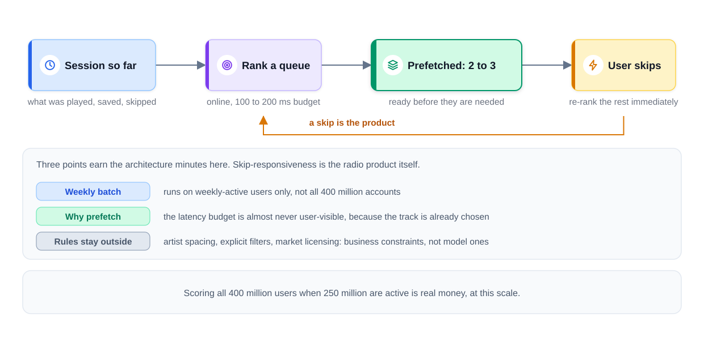
*Figure — Radio prefetches the queue, so a skip re-ranks instantly (course diagram)*

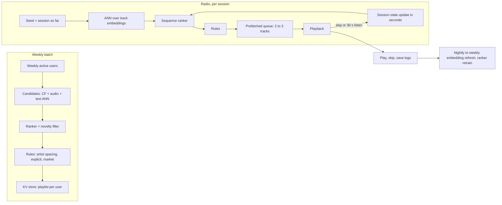

### 9. Scale numbers
| Quantity | Arithmetic | Result |
|---|---|---|
| Weekly batch | 250M users × 30 tracks | 7.5B playlist entries/week — a deadline-bound compute job, not a latency problem |
| Waste avoided | 150M inactive users not scored | ~37.5% of the batch |
| Track embeddings | 100M × 128 dims × 4 bytes | 51.2 GB raw per embedding space (before index overhead and replicas) |
| Radio QPS | e.g. 20M concurrent listeners ÷ ~200 s per track | ≈ 100K next-track decisions/s |

### 10. Monitoring and failure modes
- **Loops**: skips update session state in seconds; embeddings refresh nightly to weekly; ranker training uses **position-bias-corrected** logs (17.3), or it copies its own previous ordering.
- **Funnel observability**: log per track, per stage — retrieved → ranked where → shown → played. If a label claims its artists are buried, show which stage dropped them.

| Failure | Fallback |
|---|---|
| Weekly batch fails | Last week's playlists keep serving; alert on staleness |
| ANN index or ranker down during radio | Cached queue → genre-station heuristic. **Never silence** |
| Embedding refresh out of sync | Version index + vectors as a pair, promote atomically, check versions per request |

### 11. Interview follow-ups
- **"Power users are bored by midweek."** → Keep the weekly ritual; add a daily shelf re-ranked on this week's listens from the same precomputed candidates — cheap freshness.
- **"Radio for a brand-new user?"** → Audio neighbours of the seed carry the session, market priors fill the ranker, the first skips teach fast — radio is the *best* cold-start surface.

### Toy — session context and audio embeddings for the next track (`code/music_session_toy.py`)
2,000 tracks, each with a genre and a mood (workout/sleep/focus) encoded in a synthetic "audio embedding". Users like two genres, each session has one mood, 20% of tracks released after training. Predict a session's 4th track from its first 3 (Hit@10).

```python
elif method == "session transitions":
    score = trans[prefix[-1]] + 1e-3 * plays          # item-to-item "played B right after A"
elif method == "session audio embedding":
    score = audio @ audio[prefix].mean(0)             # nearest to the session's average sound
elif method == "audio + user taste":
    score = audio @ audio[prefix].mean(0) + 0.3 * (user_genre[u][genre] > 0)
```

```
method                        Hit@10  Hit@10 on NEW tracks
popularity                     0.004                 0.000
user taste (no session)        0.020                 0.000
session transitions            0.039                 0.000
session audio embedding        0.080                 0.107
audio + user taste             0.081                 0.107
ceiling (true pool, random)    0.092                 0.073
(205 of 1000 test targets are tracks released after training)
```

- **Ignoring the session** scores 0.020 (right genres, usually wrong mood). **Session transitions** double that but, like every play-count method, score **zero on new tracks**.
- **Session audio embeddings** reach 0.080, near the ceiling of knowing the exact eligible pool (0.092), and alone find new tracks (0.107) — cold start in miniature. (Numbers are low because each pool holds ~130 equally likely tracks.)

### Common mistakes
| Weak | Strong |
|---|---|
| One serving mode for both products | Batch weekly playlist, online sequential radio — said in minute two |
| Collaborative filtering only | Audio + text embeddings so new tracks are retrievable from day zero |
| Engagement only | Diversity/artist-fairness guardrail and a defended exploration slice |

### Same design, other questions
- **Podcasts** — same funnel; transcript and speech embeddings, completion curves as labels, a higher precision bar (each pick costs an hour of trust). **News "For You"** — recency is everything, so overnight precomputation is nearly worthless: streaming signals and per-request ranking.

---

## 18.6 Case study: visual search for a second-hand marketplace

> A used-goods marketplace has about 100M active listings, each disappearing when it sells, so the catalogue turns over constantly. Shoppers snap a picture of something they like — a vintage lamp, a friend's coat — and see comparable items on sale. Second request: let people type a description to find things among listings they've saved.

### 1. Clarify requirements
Recognition sentence: **"The search funnel of 17.3, except the query is a photo."** The front stage becomes an **encoder** and retrieval runs in an embedding space, not an inverted index (which can search captions but not visual similarity). The hard part is **the index**: 100M listings where every sale is a deletion. The second request is a clue: if photos and text share **one embedding space**, a single index answers both.

| Question | Assumption used below |
|---|---|
| Listings | 100M live, millions new per day with several photos each |
| Latency | ~300 ms photo-to-results — say whether upload and compression count |
| In scope | Picture-to-listing lookup; typed lookup within a user's *saved* items |
| Out of scope | Exact-product recognition, AR try-on, anything generative |
| Signature failure | Showing items already sold |

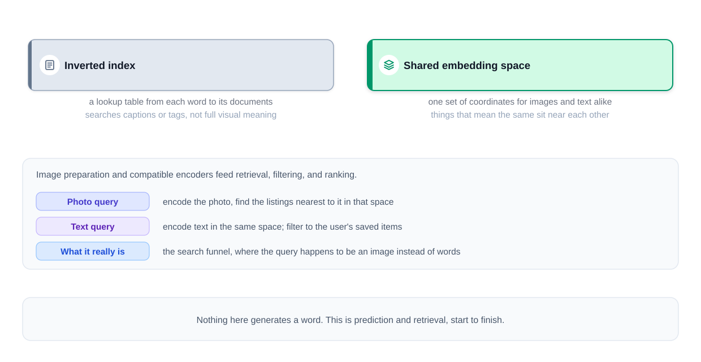
*Figure — Image-text embeddings support visual retrieval beyond caption matching (course diagram)*

### 2. Frame it as an ML task
- **Input**: query photo (or text); candidate listings (photos, title, attributes).
- **Output**: similarity in the shared space, then a purchase-likelihood ranking score.
- **Category**: **representation (metric) learning** — an embedding where distance = similarity — trained with a **contrastive loss** (pull matching pairs together, push others apart), plus nearest-neighbour retrieval and ranking.

### 3. Data and labels
- **Photos**: a few amateur phone shots per listing; **query photos are often worse** — include them in training and evaluation. **Text and attributes**: title, description, brand, size, condition, price, category.
- **Labels in two phases** (at launch there are no behaviour logs — the **bootstrap problem**):
  1. **Human-judged pairs**: raters mark (query photo, listing) as close match, partial or miss; scored with NDCG. The judged set becomes the permanent **regression suite** re-run on every version.
  2. **Behaviour** later: clicks, then **contact-seller** events, then transactions — position-bias corrected on the results grid (17.3).
- **Free positive pairs**: different photos of the same single-item listing (screen out bundles and stock images).

### 4. Features
| Stage | Features |
|---|---|
| Retrieval | Query image (or text) embedding vs listing image embeddings |
| Filters | Category, price range, location/shipping, live status (not sold) |
| Ranker | Embedding similarity, **price proximity**, condition, seller rating, listing freshness, distance/shipping cost |

**Retrieval finds lookalikes; the ranker decides what's worth buying.**

### 5. Model: baseline → advanced
- **Baseline**: a **pretrained image-text model**, no fine-tuning — CLIP-style (OpenAI's CLIP, Radford et al., 2021, contrastively trained on ~400M image-caption pairs). Ship it against the judged set in week one.
- **Upgrade — fine-tune on marketplace pairs** with **InfoNCE** (CLIP's contrastive loss: a softmax over similarities that should pick the true partner out of the batch):
  - positives: two photos of the same listing; photo ↔ its title/description;
  - **in-batch negatives**: other batch items — cheap, but near-duplicates become false negatives;
  - **category-hard negatives**: a *different sofa* rather than a toaster — sharpens the distinctions buyers make.
- **Light ranker** (GBDT) on structured features.
- **Query preprocessing**: a light object detector crops the dominant item (plus tap-to-select). **Composed queries** ("this jacket, but in black"): fuse image and text scores, route colour/size to filters, evaluate them explicitly.

### 6. Offline metrics
- **NDCG@k and recall@k** on the judged set, **per category** — an embedding can excel on sofas and quietly fail on sneakers.
- **ANN recall vs exact search** at the chosen settings. Include poor query photos, or offline numbers flatter the model.

### 7. Online metrics and A/B testing
- **Primary**: contact-seller rate per search. **Guardrails**: sold-item impressions (target ≈ 0), zero-results rate, latency, offensive-adjacency reports.
- **Testing an encoder needing a full re-embed**: judged-suite gate → index one category with it → **interleave** for a sliver of users → only then re-embed everything.

### 8. Serving architecture
**Request path**: upload → crop → image encoder (e.g. a 20 ms GPU budget — benchmark it) → **ANN search** with filters → light ranker → **live-status hydration** (filling in whether it has sold, just before display) → results.

**ANN index families** (Chapter 13.9): **IVF** — k-means buckets, a query scans the `nprobe` nearest (higher = better recall, more latency), often with **product quantisation (PQ)** compressing each vector to a few bytes (FAISS; Johnson, Douze & Jégou, 2017); **HNSW** — a layered proximity graph walked coarse to fine.

**Filtered ANN**: a very selective post-filter can leave too few results — fall back to more candidates, partitioned indexes, or exact search on small subsets.

**The index path is the heart of this design**:
- **Embed at creation**, streamed into the index within minutes — a listing unfindable for a day may already be sold.
- **Tombstone on sale** (mark deleted) and **check live status at render time** — index updates alone can't guarantee no sold items.
- **Version model and index together, promote atomically**: a new encoder against an old index returns nonsense even if dimensions match, so upgrades mean a planned, budgeted **re-embed of the corpus**, not a deploy.

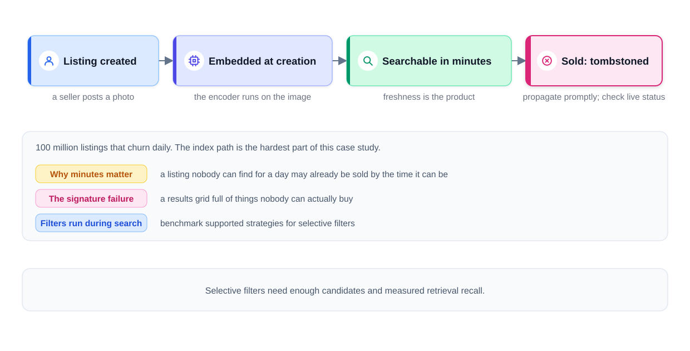
*Figure — Index churn: every sale is a deletion (course diagram)*

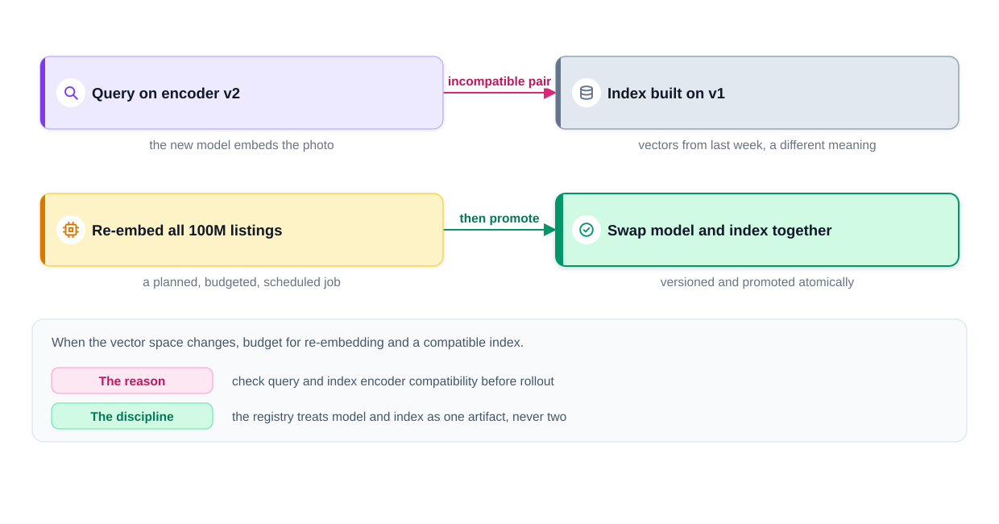
*Figure — An incompatible encoder upgrade requires a compatible replacement index (course diagram)*

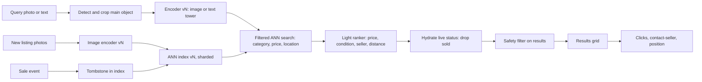

### 9. Scale numbers
| Quantity | Arithmetic | Result |
|---|---|---|
| Index memory | 100M × 512 dims × 4 bytes (float32) | 204.8 GB raw, before graph overhead, metadata, replicas; more if several photos per listing are indexed |
| With PQ compression | e.g. 64 bytes per vector | 6.4 GB — at some recall cost |
| Encoding load | e.g. 5M new listings/day × 4 photos | 20M encodings/day ≈ 230/s — possibly more than query traffic |
| Re-embed on upgrade | 100M listings × several photos | a multi-day batch plus temporary dual-index capacity |

Shard the index; a lost shard means reduced recall, backed up by text search or category browse — degrade, don't error.

### 10. Monitoring and failure modes
Every encoder version replays the growing judged suite; online, watch contact-seller rate **per category**. **Seasonal drift** (coat season → swimwear) means budgeted periodic retrains and index rebuilds.

| Failure | Defence |
|---|---|
| Model–index **version skew** | Atomic promotion + per-query version check |
| **Tombstone lag** (sold items shown) | Render-time live-status hydration — 17.3's stale-cache rule applied to "sold" |
| **Offensive adjacency** (similar-looking but inappropriate result) | Safety filter on results, using 18.3's machinery |
| **Counterfeits** via stock photos | Near-duplicate detection against catalogue imagery at listing time |

### 11. Interview follow-ups
- **"Why not predict a category and search inside it?"** → Classifiers break on items straddling categories (a futon: couch or bed?) while embeddings degrade gently; use the taxonomy as a filter and feature, not the retrieval.
- **"Results look right but nobody contacts sellers."** → Relevance ≠ desirability: overpriced, worn, distant or zero-history lookalikes. That's the ranker's job — measure on contact-seller rate, not clicks.

### Toy — contrastive image-text space + IVF search (`code/visual_search_toy.py`)
Synthetic "photos" are noisy 64-d views of a hidden item vector plus nuisance directions (lighting, background); "descriptions" are noisy 24-d views. Two small encoders are trained with InfoNCE on 30K listings and tested on 5K *new* ones with a noisier "buyer photo" as query; then IVF over 100K listings.

```python
def info_nce(a, b, temp=0.07):
    a, b = nn.functional.normalize(a, dim=1), nn.functional.normalize(b, dim=1)
    logits = a @ b.T / temp                                           # every other row = an in-batch negative
    target = torch.arange(len(a))
    return (nn.functional.cross_entropy(logits, target) + nn.functional.cross_entropy(logits.T, target)) / 2

loss = info_nce(f_img(p1[b]), f_img(p2[b])) + info_nce(f_img(p1[b]), f_txt(d[b]))   # photo-photo + photo-text

# IVF: k-means buckets (plain numpy Lloyd's, 10 iterations), scan only the nprobe nearest buckets
centers, labels = kmeans(idx_vec, 256)
buckets = np.argsort(-(centers @ q))[:nprobe]
cand = np.concatenate([lists[c] for c in buckets])
```

Output (timings vary run to run):
```
recall@10 among 5,000 listings
  raw features, photo -> listing     : 0.070
  trained encoder, photo -> listing  : 0.527
  trained encoder, text  -> listing  : 0.381   (same index, text query)

IVF over 100,000 vectors, 256 buckets (exact search: 6.99 ms/query)
  nprobe= 1: scans  0.4% of index, recall vs exact 0.270, 0.05 ms/query
  nprobe= 4: scans  1.6% of index, recall vs exact 0.596, 0.15 ms/query
  nprobe=16: scans  6.3% of index, recall vs exact 0.916, 0.62 ms/query

without a live-status check, 4.9% of returned results are already sold -> filter tombstones
```

- Raw features barely work (0.070) — lighting and clutter dominate distance; contrastive training learns to ignore them (7.5× better on unseen listings). The **same index** answers **text queries** (0.381), so the saved-items request comes almost free.
- **IVF** trades recall for speed: scanning 6.3% recovers 92% of the exact top-10 in about a tenth of the time (a Python loop; FAISS is far faster).
- ~5% of results are already sold — render-time hydration is non-negotiable.

### Common mistakes
| Weak | Strong |
|---|---|
| Treats the index as a static corpus | Embed at creation, tombstone on sale, hydrate live status at render |
| Swaps in a new encoder like a normal deploy | Versioned model+index pairs, atomic promotion, budgeted re-embed |
| Stops at "nearest neighbours" | A ranker with price, condition, seller, distance — lookalikes aren't purchases |

### Same design, other questions
- **On-device photo search** — distilled, quantised encoder and a small on-phone index; battery is the cost, nothing leaves the device. **Video moment search** — chunk videos into timestamped shots; the corpus multiplies while churn nearly disappears.

---

## 18.7 Case study: privacy blurring in street imagery

> A mapping service drives camera cars through cities and publishes 360° street-level panoramas. Before any image is published, every face and every licence plate in it must be blurred. Design the system.

### 1. Clarify requirements
Recognition sentence: **"Object detection where one error is a privacy breach and the other a blurred poster — recall first, and the unit that matters is the person, not the box."** It's also **batch**: nothing is served per request, so latency means capture-to-publication time.

| Question | Assumption used below |
|---|---|
| Volume | 5M new panoramas/day, each ~32 megapixels (8,192 × 4,096) |
| Objects | Faces (any angle, including tiny far ones) and licence plates (many countries' formats) |
| Deadline | Published within a few days of capture; nothing unblurred ever leaves the pipeline |
| In scope | Detection, blurring, quality audits, a viewer "report a problem" path |
| Out of scope | Recognising *who* someone is — the system must never identify people, only locate faces |
| Legal | Privacy law (e.g. the EU's **GDPR**) treats faces and plates as personal data; retention of unblurred originals is a legal decision, not the ML team's |

**The two errors are not symmetric**:
- **Miss** (false negative) → a recognisable face or readable plate is published: harm to a real person, legal exposure, press.
- **False alarm** → a billboard face, a statue, a street-sign number blurred: mildly ugly; blurring shop signs and house numbers does reduce map usefulness — a real but smaller cost.

Say it: *"maximise recall per person; spend precision only where it hurts the product."* Google's published Street View system (Frome et al., 2009) framed it this way and reported automatically blurring about 89% of faces and 94–96% of plates on its evaluation sets at the time — why a manual **report path** is a permanent part of the design.

### 2. Frame it as an ML task
- **Input**: a panorama (plus neighbouring panoramas along the drive, camera **pose** — position and direction — GPS).
- **Output**: regions to blur, each from a detected box with class (face / plate) and confidence.
- **Category**: **object detection** ([11.7](../11-cnns-and-computer-vision/README.md)): boxes + classes + confidences, then **NMS** to remove duplicates.
- **Objective**: at the chosen threshold, maximise **object-level recall** (every view of every person covered) subject to a budget on falsely blurred area.

### 3. Data and labels
- **Labelled panoramas**: boxes on faces and plates, including tiny, blurry, side-on, partly hidden and reflected ones. Guidelines matter: is a poster face a face? (Usually yes — blurring it is cheap.) Write down the minimum identifiable size.
- **Hard-case mining** (**active learning**): errors live in rare cases (night, rain, crowds, motorbike and foreign plates); send low-confidence and disagreement regions to labellers.
- **Public datasets** for pre-training: WIDER FACE (Yang et al., 2016) — large variation in scale, pose and **occlusion**, many tiny faces; plate datasets per region (e.g. CCPD, Xu et al., 2018, Chinese plates).
- **The training data is itself sensitive**: annotators see unblurred faces. Restrict and log access; delete labelled originals on schedule.

**Labels from users**: every "please blur this" report is a missed detection with a location — the most valuable label; confirmed reports return to training as hard positives.

### 4. Features
An image model — no feature table; the choices are about **what the model sees**:

| Choice | Why |
|---|---|
| **Tiling** the panorama into overlapping perspective views (e.g. cube faces), not the raw **equirectangular** (flat, stretched world-map-style) image | Panoramas stretch objects near top and bottom; detectors are trained on normal photos |
| **Multiple scales**: normal resolution plus 2× upscaled tiles near the horizon | Far faces are 10–20 px tall — too small for default detector inputs |
| **Overlap between tiles** | An object cut by a tile edge is missed in both tiles |
| **Neighbouring panoramas** (another shot 5–10 m later) | The same person appears in 2–4 consecutive panoramas; one view is often easier |
| **Geometry priors** from camera height and horizon | A "face" in the sky or a "plate" 3 m above the road is probably a false alarm |

### 5. Model: baseline → advanced
**Baseline**: off-the-shelf face and plate detectors on tiles, threshold 0.5, blur every box. The audit set shows where it misses (small, side-on, dark).

**Upgrade 1 — one fine-tuned detector for both classes.** A **one-stage detector** (boxes in a single pass, no region-proposal step: YOLO family, Redmon et al., 2016; or **RetinaNet**, Lin et al., 2017, whose **focal loss** down-weights the millions of easy background locations so training focuses on hard examples) fine-tuned on in-domain panoramas with tiling and multi-scale training. Transformer detectors such as DETR (Carion et al., 2020) predict a box set without NMS — worth benchmarking, but one-stage CNNs remain usual for high-resolution, high-throughput batch work.

**Upgrade 2 — a cascade (18.3's idea) for recall at a sane false-alarm rate.**
1. Stage 1 at a **very low threshold** (high recall, many false alarms).
2. Stage 2: a small classifier on each candidate crop *with more surrounding context* (face on a person, on a poster, or a pattern?) removes most stage-1 false alarms. Frome et al. (2009) used this shape: sensitive detectors, then a second model combining detector scores with extra features.
3. Anything stage 2 is unsure about goes to **human review** before publication.

**Upgrade 3 — multi-view fusion.** Track objects across consecutive panoramas using camera motion: a confident detection is projected into neighbouring views and blurred there even if the detector missed it. The unit of success becomes the *person*.

**Blurring**: pad each box (localisation is imperfect — see toy), use an information-destroying method (strong Gaussian blur or solid fill; light pixelation of text can sometimes be reversed), apply to the published copy only.

### 6. Offline metrics
- **Recall by size bucket, class, region, lighting** at the operating threshold — overall recall hides the tiny-object failure.
- **Object-level recall**: share of physical people/plates covered in *every* view they appear in.
- **Pixel coverage**: share of each true object's area inside a blur; an object **leaks** if, say, > 5% is uncovered. Found-but-misplaced still leaks.
- **False-alarm cost**: false blurs per panorama, share of area wrongly blurred; separately, blurred **text** (signs, house numbers) — the useful content.
- **mAP** (11.7) still compares detectors but isn't the launch metric — it averages over thresholds nobody uses.

### 7. Online metrics and A/B testing
No A/B test on privacy — you can't publish a less-safe variant to half the users. Instead:
- **Audits**: humans review a weekly random sample of published panoramas → **missed faces and plates per 1,000 panoramas** with confidence intervals — the headline number (18.3's prevalence-by-sampling).
- **Report rate** per million panorama views, and **time to fix** confirmed reports.
- **Product guardrails**: complaints about unreadable signs; share of panoramas routed to human review (headcount).
- New models are compared on the frozen audit set and in **shadow** on new captures.

### 8. Serving architecture
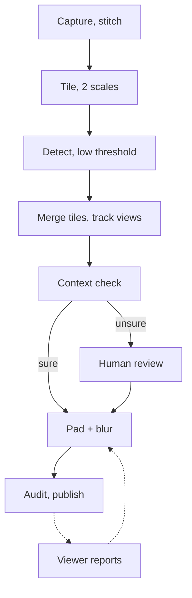

Panoramas are cut into overlapping tiles at two scales; stage 1 runs batched on GPUs; boxes map back to panorama coordinates, merge with NMS across tiles and the seam, and propagate to neighbours by tracking; the context classifier confirms or sends to review; blurring is padded and irreversible; a weekly sample is audited. Confirmed reports are blurred by hand within hours and become hard positives, as do audit misses.

Say out loud:
- **The seam**: a 360° panorama wraps around; a face cut by the left/right edge must be merged across it.
- **Fail closed**: if detection fails or times out, the panorama is **not published** (the opposite of most serving designs).
- **Irreversibility and originals**: the published copy is destructively blurred; retention of originals is legal policy — the pipeline must make deletion possible.

### 9. Scale numbers
| Quantity | Arithmetic | Result |
|---|---|---|
| Tiles | 5M panoramas × 24 tiles (1,024², incl. overlap and a 2× horizon band) | 120M tile inferences/day ≈ 1,400/s |
| GPU time | 120M × 10 ms per tile (batched; benchmark it) | 1.2M GPU-seconds/day ≈ 14 GPUs busy all day; ~40 with headroom for re-processing and peaks |
| Stage 2 | ~2 low-confidence candidates per panorama × 5M | 10M small crops/day — cheap |
| Human review | 0.5% of panoramas × 5M × 20 s each | 25K reviews/day ≈ 140 reviewer-hours/day (~18 full-time reviewers) |
| Re-processing | a better model on a 10B-panorama archive at the same rate | ~5.4 years on 14 GPUs → a separate, much larger budget; prioritise by views |

The hidden cost: a better model helps new captures immediately, but the archive improves only if you pay to re-process it.

### 10. Monitoring and failure modes
- **Drift**: new countries (plate formats), camera hardware, winter clothing, night drives → audited recall **per country and camera model**; report spikes from one city are an early alarm.
- **Model upgrades** can raise mAP while lowering tiny-face recall: gate releases on per-size-bucket recall.

| Failure | Defence |
|---|---|
| Detector misses tiny/side-on faces | Multi-scale tiling, low stage-1 threshold, multi-view propagation, audits by size bucket |
| Found but misplaced box leaks part of a face | Padding (toy: 20% padding cuts leaks from ~80% of objects to ~6%) |
| Face cut by a tile edge or the 360° seam | Overlapping tiles, merge across the seam |
| Pipeline error on a panorama | Fail closed: do not publish |
| Over-blurring signs and numbers | Stage 2 context classifier; measure blurred text separately |

### 11. Interview follow-ups
- **"Can you guarantee 100% of faces are blurred?"** → No detector reaches 100%. Layer defences — high-recall detector, multi-view tracking, padding, human review, audits, a fast report-and-fix path — and state the audited miss rate honestly.
- **"Why not blur every whole person with segmentation?"** → Possible (11.7), and some operators do; it costs more of the image and compute, while faces and plates are the identifying parts. A policy choice to name, not a default.
- **"Should the model recognise people who asked to be removed?"** → No — that needs face *recognition*, far more sensitive. Handle requests by location (this house, this spot), not identity.

### Toy — the recall decisions around a detector (`code/blur_recall_toy.py`)
No images: we simulate detector outputs to study the decisions around them. 13,333 physical objects each appear in 3 consecutive frames at different sizes; confidence rises with size; background patches give low-confidence false alarms; predicted box corners are off by ~8% of object size.

```python
score = sig(2.2 * (np.log(h) - np.log(14)) + rng.normal(0, 1.2, h.shape))   # true objects: bigger = easier
det = score >= t
all_views = det.all(axis=1)                                     # a person is safe only if blurred in EVERY view
tracked = det | (det.any(axis=1, keepdims=True) & (rng.random(det.shape) < 0.9))   # propagate between views
bx = pred + np.stack([-pad * w_, -pad * h_, pad * w_, pad * h_], 1)                # pad the blur box
```

```
13,333 physical objects x 3 views; 21% of views are under 16 px tall

threshold  recall/view  recall <16px  FP per frame  % frame blurred by FP
      0.7        0.670         0.137          0.02                 0.003%
      0.5        0.796         0.321          0.09                 0.015%
      0.3        0.889         0.556          0.31                 0.047%
      0.1        0.971         0.868          1.19                 0.188%
     0.05        0.990         0.953          1.94                 0.307%

threshold 0.1: per-view recall 0.971
  objects blurred in ALL 3 views, per-frame detection only : 0.929
  ... with box propagation between neighbouring views       : 0.992
  objects never detected in any view (tracking cannot help) : 0.001

box padding vs leaked pixels (detected objects only)
 padding    objects with >5% of pixels unblurred   blur area vs true box
      0%                                   79.8%                   0.99x
     10%                                   27.1%                   1.43x
     20%                                    6.4%                   1.94x
     30%                                    1.6%                   2.54x
```

- **The default 0.5 threshold is badly wrong**: it misses 20% of views and 68% of tiny ones. At 0.05: 99% (95% of tiny) for ~2 false blurs per frame covering 0.3% of the image — cheap. Recall-first thresholds are right when misses are the expensive error.
- **Per-view recall overstates safety**: 97.1% per view becomes 92.9% of people blurred in all 3 views. Propagating boxes lifts it to 99.2%; only people missed in *every* view (0.1%) remain.
- **Found is not covered**: with unpadded boxes, 80% of detected objects leak > 5% of their pixels. 20% padding cuts that to 6.4% at about twice the blurred area — why padding is part of the blur step.

### Common mistakes
| Weak | Strong |
|---|---|
| "Train a detector, use threshold 0.5" | Recall-first threshold from miss vs false-blur cost; cascade to recover precision |
| Reports overall recall or mAP | Recall by size, country, lighting; object-level across views; pixel coverage |
| Treats each image independently | Tracks people across neighbouring panoramas, propagates boxes |
| Blurs the exact box | Pads boxes, irreversible blur, handles tile edges and the seam |
| Fails open on pipeline errors | Fails closed: nothing unverified is published |

### Same design, other questions
- **Redacting documents or screenshots** (card numbers, names, addresses) — text-region detection + classification; same recall-first threshold, padding, fail-closed.
- **Blurring bystanders in body-camera or dash-cam video** — tracking over dozens of frames; per-person, all-frames recall matters even more.

---

## 18.8 Case study: event recommendation

> An events platform (think Eventbrite or Meetup) lists concerts, workshops, meetups and classes created by organisers. Design the "events for you" recommendations on the home page and in a weekly email.

### 1. Clarify requirements
Recognition sentence: **"The recommendation funnel of 17.1, except every item is new, perishable and tied to a place and time."** An event sells for a few weeks, happens once, is gone — almost never enough history for collaborative filtering on its ID. Score events by **what they are, where and when, and who else is going**.

| Question | Assumption used below |
|---|---|
| Users | 50M registered, 10M monthly active; many occasional (a few events a year) |
| Catalogue | ~1M upcoming events; ~50K new per day; most live 2–6 weeks |
| Surfaces | Home page (online, ~200 ms) and a weekly email (batch) |
| Actions | Register (free RSVP or paid ticket); later, attend (check-in) |
| Constraints | Future, not sold out, reachable (distance, or online) |
| Business | Registrations, ticket revenue, and organisers' success — zero registrations loses the organiser |

A **two-sided marketplace** (users and organisers, like PYMK's two sides): showing only already-popular events pleases attendees and starves new organisers.

### 2. Frame it as an ML task
- **Input**: user (location, history, friends), context (time, device, surface), candidate event.
- **Output**: P(register | shown), optionally P(attend | registered); score = their product for free events (no-shows waste capacity) or P(register) × price for revenue-weighted surfaces.
- **Category**: **pointwise learning-to-rank** on a **content- and context-based** model; item-ID embeddings are nearly useless given short lives.
- **Hard constraints first**: time window, distance or online, capacity, age restrictions — filters, not features.

### 3. Data and labels
1. **Events**: title, description, category, organiser, venue, start time, price, capacity and **remaining capacity**, online/in-person.
2. **Organisers**: past events, registration and attendance rates, ratings, followers.
3. **Users**: home (or current, with permission) location, past registrations and check-ins, categories browsed, organisers followed, sign-up interests.
4. **Social graph** (if present, or imported with consent): who's registered for what — shown to others only if they allow it.
5. **Impression logs**: event, position, surface, then registration within an observation window.

**Labels**:
- Registration within, say, 7 days of an impression = positive; many register days later (calendars), so use a **delayed-label window** (18.1), not same-session clicks.
- **Attendance** is known only after the event — weeks late — and only where check-in exists: a second head or sample weight, not the only label.
- **Point-in-time correctness is critical**: "registrations so far" and "friends going" must be computed **as of impression time**, not at training time when the event has filled up — the most common leakage bug here (offline AUC jumps suspiciously, online gains vanish).

### 4. Features
| Group | Examples |
|---|---|
| User–event match | Topic affinity (category history; description text-embedding similarity to past events), price vs usual spend |
| Place | **Distance** or travel time to venue; same city/neighbourhood; online flag |
| Time | Days until event, weekday/weekend and hour vs past attendance pattern, clash with already-registered events |
| Social | Friends registered (count, closeness), organiser followed by user or friends |
| Event quality | Organiser's past attendance rate and rating, description completeness, photos |
| Momentum | Registrations in last 24 h, **remaining capacity**, sell-out velocity (as of impression) |
| Context | Surface (home vs email), device, time of day |

### 5. Model: baseline → advanced
**Baseline**: rules — upcoming events within 20 km, in attended categories, sorted by registrations so far. Ships in days, a fair number to beat. Weakness: "registrations so far" is zero for every new event, so already-popular events decide the ranking (see toy).

**Main model — GBDT** (e.g. XGBoost, Chen & Guestrin, 2016) handles distances, counts, prices and categorical fields without heavy engineering, and generalises to never-seen events because it scores **features of the event**, not its ID. Research on event-based social networks did the same: Macedo, Marinho & Santos (2015) combined content, social, location and time signals with learning-to-rank on Meetup data because CF struggles when every event is new.

**Candidate generation** for 1M events:
- **Geo + time index**: events within the user's radius (a **geohash** or **S2 cell** lookup — cells of a hierarchical map grid) in the next N weeks, plus online events — 1M → a few thousand.
- **Two-tower retrieval** ([13.7](../13-recommenders-and-embeddings/README.md)) with a **content-only** event tower (category, text embedding, organiser, price) — a new event has a vector the moment it's created.
- **Social source**: events friends registered for; followed organisers.
- **Exploration source**: a small quota of new events from low-history organisers so they can collect data at all.

**Advanced ranker**: deep model with the description embedding and multi-task heads (register, attend) — only when GBDT stops improving; the features, not the model, carry this design.

**Re-ranking**: spread categories and dates (not five pub quizzes the same night), an organiser-exposure floor, drop already-registered events, never show sold-out ones.

### 6. Offline metrics
- **Time-based split by event creation date**: train on events from weeks 1–4, test on events **created in week 5** — a random split puts the same event in train and test and flatters ID memorisation.
- **AUC / log loss** of P(register); **hit@k / NDCG@k** per user on events actually shown.
- **Slices**: new users, new organisers, zero-registration-at-impression events, online vs in-person, small towns vs big cities.
- **Calibration** if the weekly email uses a threshold ("send only if ≥ 3 events score above p").

### 7. Online metrics and A/B testing
- **Primary**: registrations per active user per week; ticket revenue for paid events.
- **Quality**: **attendance rate** of recommended registrations, post-event ratings.
- **Marketplace guardrails**: share of events with ≥ 1 registration, organiser retention, concentration on the top 1% of events.
- **Email guardrails**: unsubscribe and spam-report rates.
- Randomise **by user** but check effects by city — an experiment working only in the three largest cities isn't a win everywhere.

### 8. Serving architecture
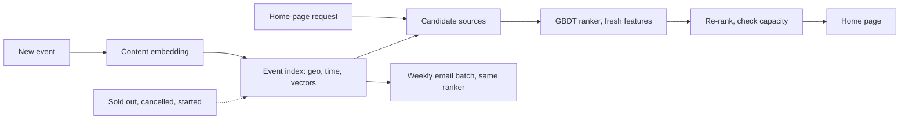

Candidate sources = geo + time filter, content-only two-tower ANN, friends' events, followed organisers, exploration quota. Impressions, registrations and check-ins are logged for training.
- **Event lifecycle drives the index**: embed and index **at creation** (minutes, not nightly — a new event matters most in its first days); remove on sell-out, cancellation or start. Remaining capacity is **hydrated at render time** (18.6's rule).
- **Streaming features**: registrations in the last hour and remaining capacity come from a stream processor — they change fastest exactly when demand peaks.
- **Email** runs the same ranker in batch over active users weekly — one model, two serving modes (18.5).

### 9. Scale numbers
| Quantity | Arithmetic | Result |
|---|---|---|
| Home-page QPS | 10M MAU × ~10 visits/month ÷ (30 × 86,400 s) | ≈ 40/s average; ~150/s at a weekend-evening peak |
| Ranker load | 150 QPS × 500 candidates | 75K scores/s — small for a GBDT |
| Event vectors | 1M × 128 dims × 4 B | 512 MB — fits in memory per region, no sharding |
| Weekly email | 10M users × 500 candidates | 5B scores per week in batch — a few hours on a modest cluster |
| New-event embedding | 50K/day | < 1/s — trivial |

Small by 17.1's standards: the difficulty is **correctness** (freshness, leakage, capacity), not throughput.

### 10. Monitoring and failure modes
- **Seasonality**: holidays, summer festivals, the week before a long weekend — compare with the same week last year, not last week.
- **New-city launches**: no local history — category popularity from similar cities plus the exploration quota.
- **Feature freshness**: a lagging capacity stream recommends sold-out events; alert on stream lag.

| Failure | Fallback / effect |
|---|---|
| Ranker down | Rules baseline (nearby + category + date), still capacity-filtered |
| Two-tower / ANN down | Geo + time filter + followed organisers; quality drops most for sparse-history users |
| Capacity stream stale | Render-time check against the ticketing service; never sell a sold-out seat |
| Leakage in training ("registrations so far" computed late) | Point-in-time feature store ([16.4](../16-ml-in-production/README.md)) |

### 11. Interview follow-ups
- **"Why not matrix factorisation or item-ID embeddings?"** → Each event lives a few weeks with few registrations — too little history per ID. Model users and events through transferable **features**: category, organiser, place, time, price, text.
- **"A brand-new user opens the app."** → Location plus sign-up interests; popular nearby events this week; learn from first clicks in-session.
- **"Show 'your friend is going'?"** → Only if the friend's privacy setting allows; then it's among the strongest signals (toy: 7.6% vs 1.7% register rate), but present on few impressions.
- **"Online events?"** → Distance is meaningless: a separate flag, time zone instead of distance, their own candidate source so they neither crowd out nor get buried by local events.

### Toy — every item is cold (`code/event_rec_toy.py`)
A synthetic city of 4,000 users with home locations, topic tastes and price sensitivity; friends live nearby. Each week brings 300 **new** events. True P(register) rises with topic match, falls with distance and price, rises with friends registered and host quality. Train on four weeks of impressions, test on week 5's events (none in training).

```python
def true_p(u, ev, j, n_friends):
    dist = np.linalg.norm(u_loc[u] - ev["loc"][j], axis=-1)
    z = (-3.0 + 6.0 * u_topic[u, ev["topic"][j]] - 0.18 * dist + 1.2 * np.log1p(n_friends)
         - 0.03 * u_price[u] * ev["price"][j] + 0.5 * ev["host"][j])
    return sig(z), dist

for drop in [None, "distance_km", "friends_registered", "user_topic_affinity"]:     # ablations
    keep = [i for i, c in enumerate(COLS) if c != drop]
    m = HistGradientBoostingClassifier(max_iter=200, random_state=0).fit(Xtr[:, keep], ytr)
```

```
train: 240,000 impressions on 1200 past events, register rate 2.0%
test : 60,000 impressions on 300 NEW events (0 overlap with training IDs)

4.3% of test impressions have >=1 friend already registered (register rate 7.6% vs 1.7% without)

model                                 AUC   hit@3  AUC, friend-going slice
random / item-ID CF (all cold)      0.496   0.204
popularity (early registrations)    0.679   0.430
GBDT, all features                  0.894   0.797                    0.845
GBDT without distance_km            0.837   0.714                    0.791
GBDT without friends_registered     0.892   0.785                    0.844
GBDT without user_topic_affinity    0.810   0.650                    0.676
```

- **Item-ID CF has nothing to work with**: every test event is new → AUC ≈ 0.5.
- **Popularity needs a warm-up**: it works only because early registrations accumulate first; at posting time it's zero for everyone.
- **Feature-based GBDT generalises to unseen events** (AUC 0.894, hit@3 0.797) — it scores *what, where, when, who*, not *which ID*.
- **Ablations** (retrain with one group removed) **price each feature group**: topic affinity costs most (→ 0.810), distance next (→ 0.837). The social feature is powerful where it exists (~4.5× the register rate) but present on 4% of impressions, so it barely moves overall AUC — measure such features on their own slice.

### Common mistakes
| Weak | Strong |
|---|---|
| Item-ID CF or MF | Content- and context-based model scoring events it has never seen |
| Ignores location and time | Distance, travel time, date fit as core features; time window and reachability as filters |
| "Registrations so far" computed at training time | Point-in-time features as of the impression; leakage checked |
| Ranks by popularity | Exploration quota and organiser-exposure floor for a healthy marketplace |
| Counts registrations only | Attendance, ratings and organiser success as quality and guardrail metrics |

### Same design, other questions
- **Restaurant or class booking** — same place-and-time constraints; longer-lived items, so CF helps more.
- **Job recommendations** — perishable postings, location and qualifications as filters, two-sided.
- **Live-stream recommendations** — happening *now*: momentum (viewers joining per minute) dominates and the index churns every few minutes.

---

## 18.9 Case study: similar listings from session embeddings

> A vacation-rental marketplace (think Airbnb) shows a "similar listings" carousel on every listing page. A guest looking at a flat in Lisbon for 12–15 June should see good alternatives. Design it.

### 1. Clarify requirements
Recognition sentence: **"Item-to-item retrieval: the anchor is the listing on screen, and 'similar' should mean *what guests consider as alternatives*, not just matching attributes."** Two listings can share price, size and neighbourhood yet attract different guests (design loft vs family flat); different attributes can still be substitutes. Browsing sessions record those judgements for free — learn from them (the item2vec idea of [13.6](../13-recommenders-and-embeddings/README.md)).

| Question | Assumption used below |
|---|---|
| Listings | 5M active over ~50K **markets** (destinations: a city or region) |
| Traffic | 50M listing-page views/day |
| Latency | ~100 ms for the carousel (loads alongside the page) |
| Hard constraints | Same destination; available for the dates; fits the guest count |
| Goal | Bookings — ideally the guest books *something*, even if not the anchor |
| Out of scope | Main search ranking (a sibling system) |

A carousel that steals clicks from a listing the guest would have booked anyway is no win: the launch metric is **site-wide bookings**, not carousel clicks.

### 2. Frame it as an ML task
- **Input**: anchor listing; guest context (dates, guests, recent session clicks).
- **Output**: a ranked list of ~12 listings.
- **Category**: **representation learning** (distance = "considered together") + nearest-neighbour **retrieval** + a small **ranker**.
- **Embedding objective**: listings clicked close together in a session should be close; booked listings pull the session's clicks toward them.

### 3. Data and labels
1. **Click sessions**: listing pages opened during one search. Clean them: only clicks with meaningful **dwell time** (e.g. ≥ 30 s, so mis-taps don't count); split sessions at 30+ minute gaps.
2. **Bookings**: which listing each session ended in (a minority book).
3. **Listing attributes**: location, type (entire home, private room), price, capacity, bedrooms, amenities, photos, review score, host responsiveness.
4. **Availability calendar**: free nights — changes constantly.
5. **Carousel impression logs** (once it exists): shown, clicked, booked, position.

No labelled "similar pairs": the embedding learns **self-supervised** from session co-occurrence (like word2vec from neighbouring words); the later ranker learns from carousel impressions → clicks → bookings.

### 4. Features
| Stage | Features |
|---|---|
| Retrieval | Cosine similarity of anchor and candidate listing embeddings |
| Filters | Same market, available for the dates, capacity ≥ guests, not the anchor, not hidden by host |
| Ranker | Embedding similarity, **similarity to the guest's session** (mean of recently clicked listings' vectors), distance to anchor, price ratio to anchor, type/capacity match, review score and count, host response rate, instant-book, listing age |

**Retrieval defines "alternatives"; the ranker decides which are worth booking for this guest and these dates.**

### 5. Model: baseline → advanced
**Baseline — attribute nearest neighbours**: same market, type, capacity ≥ guests, price within ±30%, sort by distance to anchor. Explainable, zero training, enough to launch and start logging; misses intangible taste — style, vibe, "feels like a hotel" vs "feels like home".

**Upgrade 1 — session-based listing embeddings (skip-gram with negative sampling).** Sessions are sentences, listings are words: for each clicked listing predict those clicked just before and after, contrasted with random **negatives** (Mikolov et al., 2013; item2vec, Barkan & Koenigstein, 2016; [§12.9](../12-sequences-rnns-and-attention/README.md)). Grbovic & Cheng (2018) did this at Airbnb for similar listings and search personalisation, with two adaptations:
- **Booked listing as global context**: in sessions ending in a booking, every clicked listing also predicts the booked one — pulling embeddings toward what guests *book*, not just view.
- **Negatives from the same market**: sessions rarely leave one destination, so random negatives are nearly always from other markets and the model can minimise loss by learning *"Lisbon vs Paris"* and little else. Same-market negatives force distinctions *inside* the market — all the carousel needs, since market is a hard filter anyway (see toy).

**Cold start — new listings have no clicks.** Average the vectors of a few nearby existing listings of the same type and price bucket (Grbovic & Cheng's approach). Longer term, train a **content encoder** (photos, text, attributes → vector) to predict the session embedding, so every new listing has a vector at publication.

**Upgrade 2 — a ranker on top.** GBDT on the ranker features, trained on carousel impressions with **booking** as main label (clicks auxiliary). Dates, price and quality enter here — a similar listing at double the price or with 3-star reviews shouldn't lead.

### 6. Offline metrics
- **Next-click hit rate@K** on held-out sessions: from a clicked listing, is the next click among the K most similar (after serving's filters)?
- **Booking hit rate@K**: from the session's first click, is the eventually booked listing in the K most similar? Closer to the goal.
- **Sanity checks**: neighbours should share the market (unfiltered), usually the type and similar price; plot a 2-D projection per city. Embeddings that pass metrics but fail the eye test usually have a data bug.
- **Slices**: big vs small markets, cold-start listings, luxury and budget ends.

### 7. Online metrics and A/B testing
- **Primary**: **site-wide bookings per visitor** (captures **cannibalisation** — the carousel stealing bookings the anchor would have got).
- **Secondary**: carousel CTR, carousel-attributed bookings.
- **Guardrails**: anchor-listing bookings (a big drop = distraction), host exposure concentration, latency, empty-carousel rate.
- Randomise by **guest**; check marketplace-wide effects (hosts losing exposure) by market too.

### 8. Serving architecture
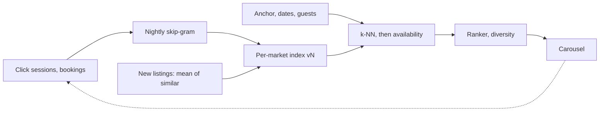

Skip-gram with booked-listing context and same-market negatives; k-NN fetches ~200 neighbours in the anchor's market; the calendar service removes unavailable or too-small ones; a GBDT ranker (similarity, session similarity, price ratio, quality) plus a host-diversity rule picks ~12.
- **Per-market indexes**: search never crosses a market, so one small index per market; most hold hundreds to a few thousand listings — exact search suffices; only the largest need ANN (13.9).
- **Availability is the expensive filter**: fetch 200, check the calendar, rank. In peak season many neighbours are booked — fetch more when the filter empties the list (18.6's filtered-ANN issue).
- **Versioning**: a retrained skip-gram yields a *new, unrelated* (possibly rotated) space. Swap vectors and index together atomically (18.6), or **warm-start** each night's training from the previous vectors to keep neighbours stable.
- **Precompute for popular anchors**: nightly top-200 neighbour lists, cached; only availability filtering and ranking per request.

### 9. Scale numbers
| Quantity | Arithmetic | Result |
|---|---|---|
| Carousel QPS | 50M page views/day ÷ 86,400 | ≈ 580/s average, ~1,700/s at a 3× peak |
| Vectors | 5M × 32 dims × 4 B | 640 MB — the whole catalogue fits in memory on each server |
| Largest market | e.g. 60K listings × 32 dims | ~2M multiply-adds per exact k-NN query — well under a millisecond |
| Training pairs | e.g. 300M sessions/month × 8 clicks × 4 context listings | ~10B pairs/month — a few hours per nightly run on a small cluster, or incremental training |
| Availability checks | 1,700/s × 200 candidates | 340K listing-date lookups/s → cache calendars; precompute "available next 30 days" **bitmaps** (one bit per night) |

32 dimensions suffice: the space only separates listings *within* a market.

### 10. Monitoring and failure modes
- **Neighbour stability**: overlap of each listing's top-10 between yesterday's and today's model; a sudden drop = training bug or rotated space served with an old index.
- **Cold-start share**: fraction of carousel slots filled by averaged (not learned) vectors, and their booking rate.
- **Seasonality**: summer vs winter sessions differ (beach houses vs ski chalets); train on a recent window; watch per-market hit rate.

| Failure | Fallback / effect |
|---|---|
| Embedding job fails | Keep yesterday's vectors and index (both, as a pair) |
| Calendar service slow | Precomputed availability bitmaps; confirm at booking |
| Empty carousel after filters (peak season) | Widen: more neighbours, then attribute nearest neighbours, then nearby markets |
| Model–index version skew | Atomic promotion; per-request version check |

### 11. Interview follow-ups
- **"Why not just attributes?"** → They miss taste; sessions capture what guests treat as substitutes — style, neighbourhood feel, kind of trip — with no labelling. Attributes remain filters, ranker features and the cold-start fallback.
- **"Why same-market negatives if you filter by market anyway?"** → The filter is exactly why: with random negatives the model spends capacity separating markets (which the filter already does) instead of ordering listings within one.
- **"Personalise the carousel?"** → Add the guest's **in-session** vector (mean of recent clicks) as a ranker feature (Grbovic & Cheng used similar in-session features for search ranking); long-term preferences (always books whole homes) from booking history.
- **"Relation to search ranking?"** → Same embeddings, different anchor (query + dates vs anchor listing): share the embedding pipeline, keep separate rankers.

### Toy — skip-gram listing vectors, market negatives, cold start (`code/listing_embeddings_toy.py`)
20 synthetic cities × 100 listings with hidden attributes (price tier, style, size). A session stays in one city and clicks 8 listings near the guest's hidden taste; 30% end in a booking. Skip-gram (window 2, 5 negatives) three ways, evaluated on held-out sessions with the same-city filter serving would apply.

```python
n = torch.randint(0, N, (len(b), neg))                            # catalogue-wide negatives
if same_city_neg:                                                 # half the negatives from a's own city
    local = city_t[a][:, None] * PER + torch.randint(0, PER, (len(b), neg // 2 + 1))
    n = torch.cat([n[:, : neg - local.shape[1]], local], 1)
loss = (-logsigmoid((va * emb_out(p)).sum(1)).mean()               # pull real co-clicks together
        - logsigmoid(-(va[:, None] * emb_out(n)).sum(2)).mean())   # push negatives apart

# cold start: a new listing = mean vector of the 3 closest known listings in its city by attributes
near = cand[np.argsort(((obs[cand] - obs[i]) ** 2).sum(1))[:3]]
E[i] = E[near].mean(0)
```

```
2000 listings in 20 cities; 20,000 training sessions, 2,000 held out

                                               top-10 in          after same-city filter
variant                                        same city next-click HR@10  booking HR@10
random vectors                                     0.054            0.100          0.075
a) skip-gram, catalogue-wide negatives             1.000            0.337          0.310
b) + same-city negatives                           0.957            0.380          0.387
c) + booked listing as global context              0.969            0.378          0.383

cold start: 200 listings treated as new (no clicks); next-click HR@10 starting from them
  random vector                         0.089
  mean of 3 similar nearby listings     0.326
  (vector learned from real clicks      0.353)
```

- **Sessions alone learn geography perfectly**: with catalogue-wide negatives 100% of top-10 neighbours share the city — nobody told the model about cities.
- **Same-city negatives trade that for better within-city order**: next-click 0.337 → 0.380, booking 0.310 → 0.387 after the filter. A few neighbours now come from other cities (95.7% same city) — irrelevant, since serving filters by market.
- **Booked-listing context adds nothing here** (0.378 vs 0.380) — honestly, because in this toy the booked listing is a random clicked one with no extra signal. In real logs bookings differ from clicks (guests click attractive photos, book good value), which is why the technique exists; test it on your data.
- **Cold start by averaging** recovers most of the quality: 0.326 vs 0.353 learned, far above random (0.089).

### Common mistakes
| Weak | Strong |
|---|---|
| Similarity by attributes only | "Considered together" from sessions; attributes as filters, features, cold-start fallback |
| Random negatives from the whole catalogue | Same-market negatives so the space orders listings inside a market |
| Ignores new listings | Averaged neighbour vectors on day one, a content encoder later |
| Optimises carousel clicks | Site-wide bookings at launch; anchor bookings as cannibalisation guardrail |
| Forgets dates | Per-request availability filter; fetch more neighbours in peak season |
| Retrains embeddings like a normal deploy | Version vectors and index together; monitor neighbour stability |

### Same design, other questions
- **"Customers also viewed"** — same session embeddings; categories play markets, stock replaces availability.
- **Next-song or next-video "up next"** — sessions become sequences to *predict* (18.5's radio), not just co-occurrence to embed.
- **Hotel search personalisation** — listing vectors as ranker features, compared with the guest's in-session vector.

---

## Comparison across all thirteen case studies (Chapters 17–18)

| Case study | Task type | Key features | Model (baseline → advanced) | Main metric (offline / online) | Hardest challenge |
|---|---|---|---|---|---|
| **Video recommendations** (17.1) | Retrieval + learning-to-rank | Watch history, item embeddings, user×item similarity, session state | Popularity → two-tower ANN + co-occurrence → GBDT / deep multi-objective ranker | Recall@K, AUC / watch time, return rate | Cold start and position bias; clickbait proxy trap |
| **Feed ranking** (17.2) | Multi-task ranking over a social candidate pool | Viewer–author closeness, content embeddings, live engagement counts, integrity scores | Chronological / P(like) LR → shared-body multi-task net + value formula | Per-head AUC + calibration / sessions per user or worthwhileness, with hide/report guardrails | Many goals without rewarding bait; ~87K ranking calls/s |
| **Search ranking** (17.3) | Query understanding + learning-to-rank | Query–item match (BM25, embedding similarity, attributes), item quality, capped personalisation | BM25 + popularity → hybrid retrieval, L1 GBDT → L2 LambdaMART/deep, cross-encoder on top-k | NDCG@k / session success, revenue per search, reformulation | Position-biased clicks; revenue vs relevance |
| **Text-to-video search** (17.4) | Cross-modal retrieval + learning-to-rank | Per-channel match (title, ASR, OCR, visual), channel availability, satisfied-watch rate, freshness | BM25 on metadata → + ASR → + CLIP-style text–frame embeddings (video + segment) → learned fusion ranker | Recall@K per channel, NDCG@10 / searches ending in a satisfied watch | Indexing cost; missing or misleading text; moments inside long videos |
| **Ad click prediction** (18.1) | Binary classification with calibrated probabilities feeding an auction | Sparse user/context/ad IDs, crosses, advertiser history, streaming counters | LR → GBDT+LR / deep CTR, pCTR+pCVR heads, calibration layer | Log loss, calibration by segment / RPM, advertiser ROI | Calibration per segment; delayed conversions; 100K QPS in 50–100 ms |
| **Fraud detection** (18.2) | Imbalanced binary classification + cost-based action policy | Velocity counters, impossible travel, device and graph links | Rules + LR → GBDT + graph features (GNN for rings) | PR-AUC, expected $ loss / fraud bps, false-decline rate | Adaptive adversary; weeks-late and censored labels |
| **Harmful content** (18.3) | Multi-label multimodal classification in a cost cascade | Text/image/audio/OCR embeddings, hashes, account history, share velocity, weighted reports | Hashes + rules → fast per-modality classifiers → heavy multimodal/LLM → humans | Per-category precision/recall / prevalence of violating views, false-removal & overturn rates | Harm both ways at huge scale; reviewer capacity; evasion |
| **People You May Know** (18.4) | Link prediction + two-sided ranking | Mutual count, Adamic-Adar, shared affiliations, accept history, graph embeddings | Mutual-count sort → two-head P(send)×P(accept) over FoF+affiliation+contacts+ANN candidates | Recall of future edges / accepted invites per impression, "don't know" reports | Two-sided objective; privacy fail-closed; graph-scale batch; rich-get-richer |
| **Music discovery** (18.5) | Batch + online sequential recommendation | Collaborative vectors, audio embeddings, metadata/playlist text, session context | Cohort popularity → MF/two-tower + audio encoder → sequence model (GRU4Rec/SASRec) for radio | Recall/Hit@K, diversity / saves, skip rate, long-term repeat listening | New-track cold start; skip-responsive radio; diversity and artist fairness |
| **Visual search** (18.6) | Representation learning + ANN retrieval + ranking | Image and text embeddings, price proximity, condition, seller quality, live status | Pretrained CLIP-style → contrastive fine-tune with hard negatives + light ranker | Judged NDCG per category / contact-seller rate, sold-item impressions | Index churn (sold = deleted), encoder upgrades needing re-embeds |
| **Privacy blurring** (18.7) | Object detection (batch), recall-first | Tiled multi-scale panoramas, neighbouring views, geometry priors | Off-the-shelf detectors → fine-tuned one-stage detector at low threshold → context classifier + multi-view tracking + human review | Recall by size/region, object-level recall, pixel coverage / audited misses per 1,000 panoramas, report rate | Misses are privacy breaches; tiny faces; per-person recall across views; no A/B tests |
| **Event recommendation** (18.8) | Content- and context-based pointwise ranking | Topic affinity, distance, date fit, friends going, organiser quality, momentum (as of impression) | Nearby-popular rules → GBDT → content two-tower retrieval + deep multi-task (register, attend) | AUC, hit@k on newly created events / registrations per user, attendance, events with ≥1 registration | Every item cold and perishable; point-in-time leakage; two-sided marketplace |
| **Similar listings** (18.9) | Item-to-item representation learning + ranking | Session-embedding similarity, in-session vector, price ratio, distance, availability, quality | Attribute k-NN → skip-gram on click sessions (booked context, same-market negatives) → GBDT ranker on bookings | Next-click / booking hit rate / site-wide bookings, anchor cannibalisation | Learning 'substitutes' without labels; cold-start listings; availability filtering |

**Patterns that repeat** — learn once, reuse everywhere:
- **Funnels and cascades**: cheap high-recall stage → expensive precise stage (17.1–17.4, 18.3, 18.5–18.9).
- **Rules outside the model**: re-rank rules, integrity layers, eligibility filters, fraud rules, action ladders, availability and capacity filters — policy changes without retraining.
- **Biased and late labels**: position bias (search, recs, visual grids), delayed conversions (ads, PYMK acceptance, event registrations), weeks-late chargebacks and attendance, censored blocks, selective appeals.
- **Two-sided or multi-goal objectives**: value formulas (feeds), bid × pCTR (ads), P(send) × P(accept) (PYMK), organiser exposure (events), costs of both error types (fraud, moderation, blurring).
- **Fail-safe defaults decided in advance**: yesterday's index, light-ranker order, segment CTR tables, risk-based timeout policy, privacy fail-closed (PYMK, blurring), genre station.
- **Perishable items and render-time checks**: sold listings, sold-out events, unavailable dates, taken-down videos — filter in the index *and* re-check when the page is built (17.4, 18.6, 18.8, 18.9).

## Chapter TL;DR
Across all thirteen: name the shape, tie the ML objective to the business goal, be honest about labels, keep policy outside the model, decide failure behaviour in advance. One-line reminders — **ads**: the probability is priced, calibrate per segment; **fraud**: rules + GBDT, two cost thresholds, late censored labels; **moderation**: flag rate = compute, review threshold = headcount, prevalence of *views*; **PYMK**: P(send) × P(accept), privacy fails closed; **music**: one funnel, two serving modes, audio for new tracks; **visual search**: perishable index, version model and index together; **blurring**: recall per person and pixel, fail closed; **events**: features not IDs, point-in-time; **similar listings**: skip-gram on sessions with same-market negatives, launch on site-wide bookings.
