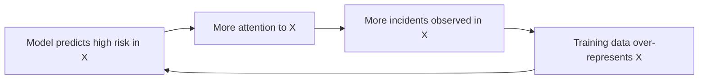
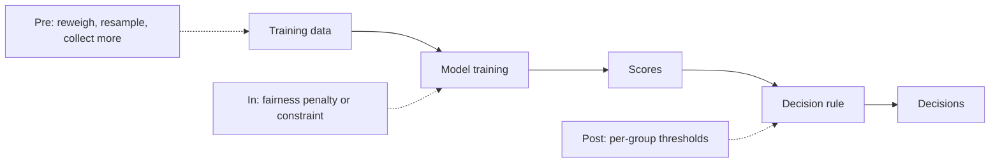
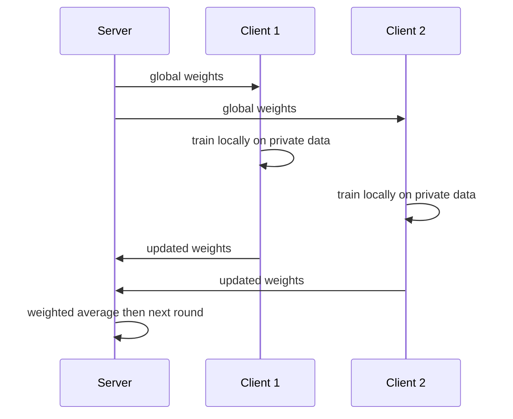

# Chapter 19 — Responsible ML: Fairness, Explainability, Privacy and Security

Every chapter so far asked "is the model accurate?". This one asks what decides whether a model *should ship*: Is it fair to every group it touches? Can we explain its decisions? Does it leak the private data it learned from? Can someone fool, poison or steal it? Which laws apply? A credit model that quietly rejects qualified applicants from one neighbourhood, or a medical model that reveals who was in its training set, is *broken* however good its AUC — and these failures have measurable symptoms and concrete fixes.

**What you'll learn:** where bias enters; fairness definitions, why they can't all hold, and measuring them in code; mitigation (reweighing, fairness penalties, group thresholds); explainability (permutation importance, partial dependence, exact SHAP, LIME); privacy (why "anonymised" often isn't, k-anonymity, differential privacy, federated learning); security (FGSM, poisoning, extraction, inversion, membership inference, generative-AI misuse); model cards, datasheets, regulation (**GDPR**, the EU AI Act, US rules), real incidents and a pre-launch checklist.

All code is in `code/` (one script per section), figures in `img/`. Every output is real (Python 3.14, scikit-learn 1.9, PyTorch 2.14, NumPy 2.5). The optional libraries `shap`, `lime` and `fairlearn` are not installed in the book environment, so their snippets are marked **(not run)**; each has a runnable from-scratch equivalent.


*Figure — bias can enter at every stage of the ML lifecycle, and deployment feeds back into the next round of data.*

---

## 19.1 Where bias comes from

### What it is
Here **bias** means a *systematic* difference in how a model treats or performs for different groups that the task doesn't justify (not the statistical bias of the bias–variance trade-off, Chapter 6). A **protected** or **sensitive attribute** is a characteristic anti-discrimination law or ethics says shouldn't drive decisions — race, sex, age, religion, disability. A **group** shares a value of it. A model learns only by watching past decisions: if they were unfair, or it watched only one kind of customer, it reproduces that — at scale, with an air of objectivity.

### Why it matters
1. **Data encodes past decisions.** Hiring, lending and arrest records carry the inequalities of their time: a résumé screener trained on "who we hired" learns "who we used to prefer".
2. **Some groups are thin in the data**, so the training loss barely notices their errors. *Gender Shades* (Buolamwini & Gebru, 2018): commercial gender classifiers erred on up to 34.7% of darker-skinned women vs at most 0.8% of lighter-skinned men.
3. **Stereotyped associations get learned and amplified.** Web-trained word embeddings place "nurse" near "she" and "programmer" near "he" (Bolukbasi et al., 2016); job recommendations, ad targeting and autocomplete built on them inherit it.

Harm (denied loans, misidentification, worse service) tends to land on the already disadvantaged; for the organisation it means legal exposure and lost trust.

### How it works — a taxonomy of sources
(Suresh & Guttag's framework.)

| Source | What goes wrong | Example |
|---|---|---|
| **Historical bias** | The world was unequal; even perfect data reproduces it | Past hiring favoured men, so "good hire" labels skew male |
| **Sampling / representation bias** | Groups under-sampled or missing | Face datasets dominated by lighter skin; a voice assistant trained mostly on one accent |
| **Measurement bias** | A feature or **proxy** (stand-in for something unmeasurable) is measured differently, or means different things, across groups | "Prior arrests" reflects policing intensity, not just behaviour |
| **Label bias** | The target is a flawed proxy or recorded unevenly | Health *cost* as a stand-in for health *need* (Obermeyer et al., 2019): less was spent on Black patients at the same illness level, so the algorithm under-rated their need |
| **Aggregation bias** | One model for groups whose feature–outcome relationship differs | A single HbA1c (blood-sugar test) threshold across ethnicities with different typical values |
| **Evaluation bias** | Benchmark doesn't represent users; only an overall metric reported | 95% overall accuracy hiding 70% on a minority group |
| **Deployment bias** | Used for a purpose or population it wasn't built for | A risk score designed to target help used to set punishment |
| **Feedback loops** | The model's decisions shape the next training data | Predictive policing (below) |

**Feedback loops.** Predictive policing is the textbook case (Lum & Isaac, 2016, simulated on Oakland drug-crime data): the model flags district X partly because X was patrolled more; more officers go there, more incidents are *recorded*, the next training set shows even more crime in X. Nothing checks whether X really has more crime — the data reflects where you looked. The same pattern appears in lending (never-approved people never show they'd repay — the **selective labels** problem) and recommenders (never-shown items get no clicks). Retraining more often just reinforces the loop; you need exploration or external ground truth.



**Representative data is the first defence**: coverage across ages, accents, skin tones, dialects, devices and regions.

### Common mistakes
- "The algorithm is just maths, so it's neutral" — the data carries the bias.
- Checking only overall accuracy; bias shows per group.
- "More data fixes it" — more of the same skewed data makes the model *more confident* in the skew.
- Ignoring the label: if the target is biased (arrests, past hires, cost), no model choice rescues it.

### In the interview
**30-second answer:** "Bias usually comes from data, not the algorithm: past decisions, thin coverage, proxy labels or features, feedback loops. I audit per-group coverage and metrics, question whether the label measures what we care about, and watch for loops after launch."

- *Hiring model trained on who managers promoted — which bias?* → Historical and label bias.
- *Speech model poor for Scottish accents?* → Sampling/representation bias (and evaluation bias if nobody measured per accent).
- *Breaking a feedback loop?* → A small randomised exploration slice, log what you *didn't* show or approve, monitor whether inputs drift toward the model's own predictions.

### TL;DR
Bias enters at every stage, from history to feedback loops. Representative data and per-group evaluation come first; no algorithm fixes a biased label.

---

## 19.2 Fairness definitions and the impossibility trade-off

### What it is
A **fairness criterion** is a precise statistical condition on predictions across groups. Notation: **A** group, **Y** true outcome (1 = good, e.g. repays), **Ŷ** decision (1 = approve), **S** score. TPR, FPR, FNR = 1 − TPR and PPV are the Chapter 6 confusion-matrix rates computed per group. Three families (Barocas, Hardt & Narayanan, *Fairness and Machine Learning*):
- **Independence** — the decision doesn't depend on the group.
- **Separation** — errors don't depend on the group, given the true outcome.
- **Sufficiency** — a given score means the same in every group.

| Criterion | Family | Condition (equal across groups) | Plain meaning |
|---|---|---|---|
| **Demographic (statistical) parity** | Independence | P(Ŷ=1 \| A=a) | Same approval rate in every group |
| **Disparate impact ratio** | Independence | P(Ŷ=1 \| B) / P(Ŷ=1 \| A) ≥ 0.8 | The US "four-fifths rule" of thumb (1978 Uniform Guidelines on employee selection); e.g. 35% vs 50% → 0.70, failing |
| **Equal opportunity** | Separation (half) | TPR = P(Ŷ=1 \| Y=1, A=a) | Qualified people approved at the same rate |
| **Equalized odds** | Separation | TPR *and* FPR = P(Ŷ=1 \| Y=0, A=a) | Same hit rate and same false-alarm rate |
| **Predictive parity** | Sufficiency (at the threshold) | PPV = P(Y=1 \| Ŷ=1, A=a) | An approval is equally reliable in each group |
| **Calibration within groups** | Sufficiency | P(Y=1 \| S=s, A=a) = s for all s | A score of 0.7 means 70%, whatever the group |

Also by name:
- **Individual fairness** (Dwork et al., 2012): similar individuals get similar predictions — hard because "similar" must be defined.
- **Counterfactual fairness** (Kusner et al., 2017): the prediction wouldn't change if the person's group were different, with everything causally downstream adjusted — needs a causal model.

### Why it matters
"Make it fair" isn't actionable; "equalise TPR within 2 points" is. Picking a definition is a **values decision** tied to the harm:
- Hiring shortlist where **base rates** (true positive share per group) are themselves products of discrimination → **demographic parity** may be justified.
- Loans, medical screening, where missing a qualified person is the key harm → **equal opportunity**.
- Criminal justice, where false accusations and missed risks both matter → **equalized odds**.
- Risk scores read by humans (doctor, judge) → **calibration**.

### How it works — the impossibility result
With **different base rates**, you generally can't have calibration *and* equal FPR *and* equal FNR unless the model is perfect (Kleinberg, Mullainathan & Raghavan, 2016; Chouldechova, 2017 — prompted by COMPAS, §19.10). Chouldechova's identity, for base rate p:

  FPR = p / (1 − p) · (1 − PPV) / PPV · (1 − FNR)

If PPV and FNR are equal across groups but p differs, FPR *must* differ.

`code/impossibility.py` builds scores **perfectly calibrated by construction** (outcome drawn with probability = score) for two groups with base rates 0.6 and 0.4:

```python
groups = {"A": rng.beta(6, 4, n), "B": rng.beta(4, 6, n)}   # mean score 0.6 vs 0.4
data = {g: (s, (rng.random(n) < s).astype(int)) for g, s in groups.items()}
# ... one shared threshold 0.5, then group thresholds chosen so FPR = 0.20 in both
```

```
group  base_rate  calib(0.7-0.8 bin)  FPR    FNR    PPV   selection
  A      0.601      0.746->0.748     0.624  0.171  0.667  0.747
  B      0.399      0.737->0.728     0.171  0.623  0.594  0.253

Group thresholds chosen so FPR = 0.20 in both groups:
  A: threshold=0.673  FPR=0.200  FNR=0.574  PPV=0.762
  B: threshold=0.483  FPR=0.200  FNR=0.582  PPV=0.582
```

Both groups are calibrated (scores near 0.74 come true ~74% of the time), yet one shared threshold gives FPR 0.62 for A and 0.17 for B. Group thresholds equalise FPR (and here FNR), but PPV splits, 0.76 vs 0.58 — an approval "means" different things per group. Identity check for A at 0.5: 0.601/0.399 × 0.333/0.667 × 0.829 ≈ 1.506 × 0.499 × 0.829 ≈ **0.623**, matching the measured 0.624.

### Trade-offs
| If you enforce… | You typically give up… |
|---|---|
| Demographic parity | Calibration and accuracy when base rates truly differ; may approve less-qualified people in one group |
| Equalized odds | Calibration / predictive parity; usually needs group-specific thresholds |
| Calibration | Equal error rates when base rates differ |
| Any constraint | Some overall accuracy (often small, §19.4) |

### When not to use a given metric
- Demographic parity when base-rate differences are real and legitimate (disease prevalence by age).
- Equal opportunity when labels are biased — you'd equalise against a distorted target.
- The 4/5 rule as a legal **safe harbour** — it's only a screening heuristic.

### Common mistakes
- One fairness number without saying which definition.
- Comparing tiny groups — 10-point gaps can be noise; report confidence intervals.
- Forgetting **intersectional** groups (older women), where gaps are often largest.

### In the interview
**30-second answer:** "Criteria fall into independence (demographic parity), separation (equal opportunity, equalized odds) and sufficiency (predictive parity, calibration). With different base rates, calibration and equal error rates can't both hold (Kleinberg; Chouldechova), so I pick the criterion matching the harm, document why, and report the rest."

- *Loan approvals?* → Usually equal opportunity plus calibration checks; confirm with legal and domain experts.
- *Is fairness hopeless, then?* → No; trade-offs must be chosen explicitly, and a more accurate model shrinks all gaps.

### TL;DR
Parity = equal approval rates; equal opportunity = equal TPR; equalized odds = equal TPR and FPR; calibration = scores mean the same everywhere. With unequal base rates they conflict: choose by harm, report the rest.

---

## 19.3 Measuring fairness in code

### What it is
A **fairness audit** computes confusion-matrix rates per group and compares them, making gaps visible and trackable like accuracy. It needs the true label, the decision (and score) and the group — even if the model never sees the group.

### How it works
1. Hold out a test set including the sensitive attribute (collected with consent for auditing).
2. Per group: n, base rate, selection rate, TPR, FPR, PPV, accuracy.
3. Gaps: demographic-parity difference, disparate-impact ratio, equal-opportunity difference, equalized-odds difference (larger of the TPR and FPR gaps), predictive-parity difference.
4. Per-group calibration, and **proxies**: how well do other features predict the group?

**Dataset.** `code/credit_data.py` generates 20,000 synthetic applicants whose true repayment depends *only on finances*, with two injected biases: group B has lower average income (historical inequality), and 20% of B applicants who repaid are *recorded* as defaults (label bias). `zip_region` correlates strongly with group — a proxy.

```
       income_k  zip_region  y_true      y
group
0        58.048       0.145   0.534  0.534
1        45.310       0.796   0.425  0.340
```

Core of `code/fairness_metrics.py`:

```python
def group_report(y, y_hat, group):
    rows = []
    for g in np.unique(group):
        m = group == g
        yt, yp = y[m], y_hat[m]
        tp = np.sum((yt == 1) & (yp == 1)); fp = np.sum((yt == 0) & (yp == 1))
        fn = np.sum((yt == 1) & (yp == 0)); tn = np.sum((yt == 0) & (yp == 0))
        rows.append({"group": "AB"[g], "n": m.sum(), "base_rate": yt.mean(),
                     "selection_rate": yp.mean(), "TPR": tp / (tp + fn),
                     "FPR": fp / (fp + tn), "PPV": tp / (tp + fp),
                     "accuracy": (tp + tn) / m.sum()})
    return pd.DataFrame(rows).set_index("group")

def fairness_summary(r):
    a, b = r.loc["A"], r.loc["B"]
    return {"demographic_parity_diff": a.selection_rate - b.selection_rate,
            "disparate_impact_ratio": b.selection_rate / a.selection_rate,
            "equal_opportunity_diff": a.TPR - b.TPR,
            "equalized_odds_diff": max(abs(a.TPR - b.TPR), abs(a.FPR - b.FPR)),
            "predictive_parity_diff": a.PPV - b.PPV}

# the model is "group-blind": FEATURES excludes `group`
model = make_pipeline(StandardScaler(), LogisticRegression()).fit(train[FEATURES], train.y)
```

```
Group report vs RECORDED labels (what an auditor can see):
          n  base_rate  selection_rate    TPR    FPR    PPV  accuracy
group
A      4245      0.538           0.516  0.709  0.292  0.739     0.709
B      1755      0.349           0.281  0.436  0.198  0.542     0.675
  demographic_parity_diff  +0.235
  disparate_impact_ratio   +0.544
  equal_opportunity_diff   +0.273
  equalized_odds_diff      +0.273
  predictive_parity_diff   +0.197

Same predictions vs the hidden TRUE labels:
       base_rate  selection_rate    TPR    FPR
group
A          0.538           0.516  0.709  0.292
B          0.435           0.281  0.439  0.159

AUC for predicting group from the 'group-blind' features: 0.886
calibration A: (0.13->0.13) (0.30->0.33) (0.50->0.53) (0.70->0.73) (0.89->0.89)
calibration B: (0.12->0.14) (0.30->0.30) (0.50->0.45) (0.69->0.59) (0.87->0.66)
```


*Figure — left: selection rate, TPR, FPR and PPV per group at threshold 0.5. Right: calibration curves; group B's sags below the diagonal at high scores.*

1. **Every criterion fails.** B approved 28% vs 52% (ratio 0.54, far below 0.8); qualified B applicants approved 44% vs 71%.
2. **"Group-blind" didn't work.** The features predict `group` with AUC 0.886, mostly via `zip_region`. Dropping the sensitive column (**fairness through unawareness**) doesn't remove its influence — and stops you measuring it.
3. **Label bias is invisible to the auditor**: recorded B base rate 0.349, truth 0.435. Only knowing *how labels were produced* reveals artefactual "defaults".
4. **Calibration differs**: a 0.89 score comes true 89% of the time for A, 66% for B — a human reading it is misled for one group.

Fairlearn's `MetricFrame` **(not run — `fairlearn` not installed)**:

```python
from fairlearn.metrics import MetricFrame, selection_rate, true_positive_rate, false_positive_rate
mf = MetricFrame(metrics={"sel": selection_rate, "tpr": true_positive_rate, "fpr": false_positive_rate},
                 y_true=y_test, y_pred=y_pred, sensitive_features=group_test)
print(mf.by_group); print(mf.difference())
```

### Trade-offs
| Choice | Pro | Con |
|---|---|---|
| Collect the sensitive attribute | Lets you measure and fix bias (store separately, strict access) | Privacy risk; restricted in some jurisdictions; needs consent and access controls |
| Don't collect it | Simpler legally | Bias still happens through proxies — you just can't see it |
| Infer it (e.g. **BISG** — Bayesian Improved Surname Geocoding, surname + geography, used by US regulators) | Audits without collection | Error-prone; auditing use only |

### Common mistakes
- Auditing on training data instead of held-out data.
- Gaps without group sizes and confidence intervals.
- Treating recorded labels as ground truth when the labelling process is suspect.
- Checking once before launch — drift changes gaps.

### Real-world examples
Fairlearn (from Microsoft) and IBM's AIF360 are open-source fairness toolkits; Google's What-If Tool visualises per-group metrics. US lenders run fair-lending analyses on underwriting models for compliance.

### In the interview
**30-second answer:** "I slice held-out data by group, compute selection rate, TPR, FPR, PPV and calibration per group and the gaps, and predict the sensitive attribute from the features to find proxies. I report group sizes and confidence intervals and keep tracking in production."

- *Finding proxies?* → Predict the group from features (AUC), check feature–group correlations, inspect importances.

### TL;DR
Slice metrics by group, compute gaps and per-group calibration, test for proxies, never trust "we removed the sensitive column".

---

## 19.4 Mitigating bias: before, during and after training

### What it is
**Bias mitigation** changes the data, objective or decision rule so a chosen criterion improves at acceptable accuracy cost:

| Stage | Idea | Techniques |
|---|---|---|
| **Pre-processing** (fix the data) | Change what the model learns from | Collect more data for thin groups, re-sample, **reweighing** (Kamiran & Calders, 2012), relabel suspect labels, learn fair representations, synthetic augmentation for rare groups |
| **In-processing** (fix the training) | Add fairness to the objective | **Fairness penalties / constraints** (Zafar et al., 2017), **reductions** (Agarwal et al., 2018; Fairlearn's `ExponentiatedGradient` — the constraint becomes a series of reweighted ordinary training runs), **adversarial debiasing** (Zhang et al., 2018; a second network tries to guess the group from the output and the model learns to defeat it) |
| **Post-processing** (fix the decisions) | Keep the model, change score → decision | **Group-specific thresholds** (Hardt, Price & Srebro, 2016), **reject-option classification** (flip uncertain decisions near the threshold toward the disadvantaged group) |



Measurement without mitigation only documents harm. Post-processing needs no retraining (good for vendor models); pre-processing leaves training code untouched; in-processing usually gives the best accuracy–fairness trade-off but needs custom training.

### How it works
**Reweighing.** Weight each (group, label) cell so label and group are independent in the weighted data:

  w(g, y) = P(A=g) · P(Y=y) / P(A=g, Y=y)

Cells rarer than independence predicts (group B with a good outcome) get weights > 1 (e.g. P(B)=0.3, P(Y=1)=0.5, P(B,Y=1)=0.1 → 1.5); train with `sample_weight=w`.

**Fairness penalty.** Loss = logistic loss + λ·(mean score of A − mean score of B)²; larger λ → more parity, less accuracy.

**Threshold adjustment.** Keep scores; fit a threshold per group on a *validation* set (never the test set — that overfits the adjustment to evaluation data):
1. Fix A's threshold (0.5).
2. Measure A's target rate on validation — TPR (equal opportunity) or selection rate (demographic parity).
3. For B, pick the threshold at the matching **quantile** of its scores (among its true positives for TPR, among all members for selection rate).
4. Apply both on test and re-audit.

From `code/mitigation.py`:

```python
def reweighing_weights(y, g):
    w = np.empty(len(y))
    for gv in (0, 1):
        for yv in (0, 1):
            m = (g == gv) & (y == yv)
            w[m] = (np.mean(g == gv) * np.mean(y == yv)) / np.mean(m)
    return w

def fair_logreg(X, y, g, lam, epochs=300, seed=0):
    # ... torch Linear layer + Adam
        p = torch.sigmoid(logits)
        gap = p[gA].mean() - p[gB].mean()
        loss = F.binary_cross_entropy_with_logits(logits, y_t) + lam * gap ** 2

def threshold_for_rate(score, target, positives_only_mask=None):
    s = score if positives_only_mask is None else score[positives_only_mask]
    return np.quantile(s, 1 - target)           # the top `target` fraction clears it

# equal opportunity: B's threshold makes TPR_B (validation) = TPR_A
tpr_A = np.mean(s_va[(gva == 0) & (yva == 1)] >= 0.5)
tB = threshold_for_rate(s_va[gva == 1], tpr_A, yva[gva == 1] == 1)
y_eo = np.where(gte == 0, s_te >= 0.5, s_te >= tB).astype(int)
```

Output (`acc` vs recorded labels, `acc_true` vs hidden true labels; `EO_diff` = TPR gap):
```
reweighing weights  (A,y=0) (A,y=1) (B,y=0) (B,y=1): [1.123, 0.892, 0.791, 1.413]
equal-opportunity thresholds: A=0.500  B=0.356
demographic-parity thresholds: A=0.500  B=0.340
                            acc  acc_true  sel_A  sel_B  DP_diff  EO_diff  EO_diff_true
method
baseline (t=0.5)          0.704     0.701  0.532  0.269    0.263    0.290         0.291
pre: reweighing           0.703     0.704  0.501  0.349    0.153    0.155         0.159
in: DP penalty (lam=5)    0.690     0.695  0.472  0.420    0.053    0.055         0.059
post: equal opportunity   0.694     0.702  0.532  0.481    0.051    0.041         0.044
post: demographic parity  0.690     0.699  0.532  0.511    0.021    0.017         0.024
```

1. **Reweighing** roughly halves both gaps with no accuracy loss (B positives weighted 1.41).
2. **The penalty** closes the parity gap to 5 points for ~1.4 points of recorded accuracy.
3. **Threshold adjustment** closes the TPR gap 29 → 4 points by lowering B's threshold to 0.356; accuracy on *true* labels is unchanged (0.701 → 0.702) because part of the "unfairness" was label bias.
4. The accuracy cost is often **smaller than expected**, but data-dependent — measure it.

Fairlearn equivalents **(not run — `fairlearn` not installed)**:

```python
from fairlearn.postprocessing import ThresholdOptimizer
from fairlearn.reductions import ExponentiatedGradient, EqualizedOdds
post = ThresholdOptimizer(estimator=base_model, constraints="true_positive_rate_parity",
                          prefit=True, predict_method="predict_proba")
post.fit(X_val, y_val, sensitive_features=g_val)
y_hat = post.predict(X_test, sensitive_features=g_test, random_state=0)

inproc = ExponentiatedGradient(LogisticRegression(), constraints=EqualizedOdds())
inproc.fit(X_train, y_train, sensitive_features=g_train)
```

**Process controls matter as much as algorithms:** audit who's in the data (per group and intersection) before training; collect more examples for thin groups (synthetic data only as a supplement); give humans authority to review and override high-stakes decisions; document data choices for outside audit.

### Trade-offs
| Method | Pros | Cons |
|---|---|---|
| Reweighing / resampling | Simple, model-agnostic, no group needed at prediction time | Limited control over which criterion improves |
| Fairness penalty / constraints | Directly targets a criterion; good trade-offs | Custom training; hyperparameter λ; can be unstable |
| Group thresholds | No retraining; precise; works on vendor models | Uses the group at decision time — **may be unlawful disparate treatment** in some settings (e.g. US employment law) |
| Better data / labels | Fixes the cause | Slow and costly |

### When not to use it
Don't bolt on post-processing when the real issue is a broken label (fix the label); don't deploy group thresholds without legal review.

### Common mistakes
- Fitting thresholds on the test set.
- Tiny groups: noisy thresholds — pool data or use Bayesian estimates (shrinking a small group toward the population).
- Declaring victory on one metric while another worsens.

### Real-world examples
LinkedIn described re-ranking for gender-representative candidate results in LinkedIn Recruiter. Fairlearn's `ThresholdOptimizer` implements Hardt et al.; AIF360 implements reweighing, adversarial debiasing and reject-option classification.

### In the interview
**30-second answer:** "Pre-processing reweighs or improves the data; in-processing adds a fairness penalty or constraint; post-processing sets per-group thresholds on validation data. Post-processing is cheap and precise but uses the attribute at decision time, with legal implications. Afterwards I re-audit every metric and the accuracy cost."

- *Which is best?* → Fix data and labels first; in-processing usually gives the best trade-off; post-processing when you can't retrain (e.g. a vendor model).
- *Accuracy cost?* → Measure it; often a point or two, especially with biased labels.

### TL;DR
Pre fixes data (reweighing), in fixes the loss (penalty), post fixes the decision (group thresholds). Measure the cost, re-audit every criterion.

---

## 19.5 Explainability

### What it is
**Explainability** (**interpretability**) is saying *why* a model made a prediction in terms a human can check. **Global** explanations describe overall behaviour (which features matter, how); **local** ones explain a single prediction (why *this* applicant was declined) — a recipe book vs why tonight's dish was salty. **Intrinsically interpretable** models are readable directly (linear models, small trees, rule lists, **GAMs** — generalised additive models); **post-hoc** methods explain a **black box** from outside.

### Why it matters
- **Debugging**: spot leakage, shortcuts (spurious cues) and proxies.
- **Trust**: doctors, underwriters, judges need reasons.
- **Law**: US lenders must state principal reasons for denying credit (**ECOA/Regulation B** adverse-action notices); GDPR requires meaningful information about the logic of solely automated significant decisions (§19.9).
- **Recourse**: telling a person what would change the decision.

### How it works

**1. Permutation importance (global).** Score the model on held-out data (e.g. ROC-AUC); shuffle one column (breaking its link to the target) and re-score; importance = the drop, averaged over shuffles. Unlike tree impurity importance (Chapter 7) it is model-agnostic and uses held-out data (training-set importance rewards overfitting).

**2. Partial dependence (PDP) and ICE.** PD(x_s) = (1/n) Σᵢ f(x_s, x_c⁽ⁱ⁾): set feature s to a value for *every* row, average predictions, repeat over a grid. **ICE** (individual conditional expectation) curves show each row separately; the PDP is their average. ICE reveals interactions the average hides.

**3. SHAP (local, adds up to global).** **Shapley values** (game theory, Shapley, 1953): features are "players" sharing the "payout" f(x) − E[f]; feature i gets its average marginal contribution over all orders of adding features:

  φᵢ = Σ over subsets S not containing i of |S|!(M−|S|−1)!/M! · [v(S ∪ {i}) − v(S)]

v(S) = expected prediction when only features in S are known (others drawn from background data); the weight is the fraction of the M! orderings in which exactly S precedes i. Properties: **efficiency** (φ's sum to f(x) − E[f] — e.g. baseline 0.40 + 0.10 − 0.05 + 0.20 = 0.65), **symmetry**, **dummy** (a feature that never changes the output gets 0), **additivity**. Exact computation needs 2^M subsets, so the SHAP library (Lundberg & Lee, 2017) approximates: **KernelSHAP** (any model, sampling), **TreeSHAP** (exact and fast for tree ensembles).

**4. LIME (local).** Ribeiro et al., 2016: perturb the input around x, weight the black box's predictions by closeness to x, fit a sparse linear model whose coefficients are the explanation. Fast, but shifts with **kernel width** (how fast closeness weight falls off) and seed.

**5. Counterfactual explanations (local).** "Approved if your debt ratio were 0.25 instead of 0.40" — the smallest *actionable* change that flips the decision.

`code/explainability.py` trains a histogram gradient-boosting model on the credit data (without `group`):

```python
pi = permutation_importance(model, Xte, yte, scoring="roc_auc", n_repeats=10, random_state=0)
PartialDependenceDisplay.from_estimator(model, Xte, [0, 1, 4], feature_names=FEATURES,
                                        kind="both", subsample=300, random_state=0)

def exact_shapley(f, x, background):
    M = len(x)
    def v(S):                                   # expected output with features S fixed to x
        Z = background.copy(); Z[:, list(S)] = x[list(S)]
        return f(Z).mean()
    phi = np.zeros(M)
    for i in range(M):
        others = [j for j in range(M) if j != i]
        for size in range(M):
            for S in combinations(others, size):
                w = factorial(size) * factorial(M - size - 1) / factorial(M)
                phi[i] += w * (v(S + (i,)) - v(S))
    return phi, v(())

def lime_like(f, x, X_ref, n=5000, width=0.75, seed=0):
    # ... Gaussian samples around x, proximity weights, weighted Ridge on standardised offsets
```

```
test accuracy: 0.705

Permutation importance (drop in test ROC-AUC when a column is shuffled):
  income_k        0.1472 +/- 0.0044
  debt_ratio      0.0596 +/- 0.0028
  prior_defaults  0.0573 +/- 0.0035
  years_employed  0.0132 +/- 0.0019
  zip_region      0.0019 +/- 0.0010

Applicant: {'income_k': 70.9, 'debt_ratio': 0.27, 'years_employed': 10.0, 'prior_defaults': 1.0, 'zip_region': 0.0}
model score f(x) = 0.816   baseline E[f] = 0.471
Shapley values (push towards approval if +):
  income_k        +0.178
  years_employed  +0.120
  debt_ratio      +0.111
  prior_defaults  -0.090
  zip_region      +0.027
check: baseline + sum(phi) = 0.816  (equals f(x))

LIME-style local slopes (score change per +1 sd):
  income_k        +0.195
  debt_ratio      -0.089
  prior_defaults  -0.069
  years_employed  +0.055
  zip_region      -0.016
```


*Figure — PDP (dashed) and ICE curves (thin): approval probability rises with income, falls with debt ratio, dips slightly for zip region 1.*

1. Income dominates globally. `zip_region` has small permutation importance yet is a strong group proxy (§19.3) — **low importance doesn't mean "fair"**; much group signal flows through income.
2. Shapley values add up exactly: 0.471 + 0.178 + 0.120 + 0.111 − 0.090 + 0.027 = 0.816 (efficiency).
3. SHAP and LIME frame things differently but consistently: Shapley says living in zip 0 helped vs an average applicant (+0.027); LIME's slope says moving *toward* zip 1 lowers the score. (Gaussian perturbation of a 0/1 column is crude; real LIME samples categoricals properly.)

SHAP library version **(not run — `shap` not installed)**:

```python
import shap
explainer = shap.TreeExplainer(model)          # exact, fast for tree ensembles
sv = explainer(X_test)                         # Explanation object, one row per sample
shap.plots.waterfall(sv[3])                    # local: one applicant
shap.plots.beeswarm(sv)                        # global: distribution of impacts per feature
```

### Trade-offs
| Method | Scope | Pros | Cons |
|---|---|---|---|
| Interpretable model | Both | Faithful by construction | May lose accuracy on complex data |
| Permutation importance | Global | Model-agnostic, held-out data | Misleading with correlated features (unrealistic shuffled rows; importance split between twins, each looking unimportant) |
| PDP / ICE | Global / local | Shows the shape of an effect | Assumes feature independence; averages hide interactions (use ICE) |
| SHAP | Local → global | Principled, additive, consistent | Costly for non-tree models; depends on background data; still correlational |
| LIME | Local | Fast, any model | Unstable; depends on kernel and sampling — check across seeds |
| Counterfactuals | Local | Actionable recourse | Many possible answers; must respect feasibility |

### When not to use it
- Don't present post-hoc explanations as *causal* — they explain the model, not the world.
- For high-stakes decisions consider an interpretable model first (Rudin, 2019).
- Don't show raw SHAP plots to customers; translate into plain-language reasons.

### Common mistakes
- Importance on training data; ignoring correlated features; one LIME run as truth.
- Explaining the wrong output (**log-odds** — log of p/(1−p), a logistic model's raw output — vs probability).

### Real-world examples
Lenders produce "reason codes" for adverse-action notices; Vertex AI, SageMaker Clarify and Azure ML offer SHAP-style attributions; TreeSHAP is built into XGBoost and LightGBM (`pred_contribs=True` / `pred_contrib=True`).

### In the interview
**30-second answer:** "Global — permutation importance on held-out data, PDP and ICE — describes the whole model. Local explains one prediction: SHAP splits it into additive contributions with game-theory guarantees; LIME fits a local linear **surrogate**. Both are correlational, so I use them for debugging and reason codes, not causal claims."

- *SHAP vs LIME?* → SHAP has axioms and consistent results; LIME is faster, less stable. TreeSHAP is exact for trees.
- *Explaining a decline to a customer?* → Top negative SHAP contributors mapped to plain-language reason codes, plus a counterfactual if possible.
- *PDP vs waterfall plot?* → PDP global; waterfall local.

### TL;DR
Global: permutation importance, PDP. Local: SHAP (sums to f(x) − E[f]), LIME, counterfactuals. Explanations describe the model, not causality.

---

## 19.6 Privacy

### What it is
**Privacy** in ML = controlling what personal information is collected, how it's used, and what the trained model can leak. **PII** (personally identifiable information) identifies a person directly (name, email, national ID) or in combination; **quasi-identifiers** (ZIP code, birth date, sex) are harmless alone but identifying together; **sensitive attributes** (health, finances, religion, biometrics) do great harm if revealed.

### Why it matters
1. **Consent and ownership** — did people agree to their data training a model? If company data goes to a third-party AI service, is it used to train the vendor's models, and where can it flow?
2. **Legal duties** — GDPR, California's **CCPA/CPRA** and similar laws require transparency, a lawful basis, and rights to access, delete or opt out.
3. **Harms** — identity theft, harassment, discrimination; fines and lost trust.
4. **Models memorise** — a trained model can reveal training records (§19.7); "we only ship the model" is no guarantee.

### How it works

**Anonymisation pitfalls.** Removing names is **pseudonymisation**, not anonymisation; GDPR still treats it as personal data (hashed user IDs included). Famous failures:
- Latanya Sweeney estimated 87% of Americans are likely unique on 5-digit ZIP + birth date + sex (1990 census), and re-identified the Massachusetts governor's hospital record by linking "anonymised" health data with a public voter roll.
- AOL's "anonymised" 2006 search logs let journalists identify users; Netflix Prize ratings were re-identified via public IMDb reviews (Narayanan & Shmatikov, 2008).
- Strava's 2018 global heatmap exposed military bases from soldiers' runs: aggregates leak too.

**k-anonymity** (Sweeney, 2002): every quasi-identifier combination is shared by ≥ k records, via **generalisation** (ZIP 02138 → 021\*\*, age 29 → "≤35") and **suppression** (dropping outliers). Weaknesses led to **l-diversity** (each group has ≥ l distinct sensitive values) and **t-closeness** (each group's sensitive-value distribution close to the overall one).

**Differential privacy (DP)** (Dwork et al., 2006) is a guarantee about an *algorithm*: its output distribution barely changes whether or not any one person's record is in the data. M is ε-DP if for all datasets D, D′ differing in one record and every output set O:

  P[M(D) ∈ O] ≤ e^ε · P[M(D′) ∈ O]

Small ε = strong privacy (ε = 1: any outcome at most e ≈ 2.72× likelier with you in the data).

The **Laplace mechanism** for a numeric query f:
1. **Sensitivity** Δf = the most one person can change f: a count has Δf = 1; a mean of values clipped to [L, U] over n people has Δf = (U − L)/n (e.g. [0, 100] → 100/n).
2. Add Laplace(0, b) noise with b = Δf/ε (count at ε = 0.5 → b = 2).
3. Release f(D) + noise; expected absolute error b, standard deviation √2·b.

DP properties: **composition** (k queries at ε each cost up to kε — the **privacy budget**; ten at 0.2 = 2.0) and **post-processing** (anything computed from a DP output stays DP).

`code/privacy_dp.py`:

```python
def laplace_count(true_count, eps, rng):
    return true_count + rng.laplace(0.0, 1.0 / eps)            # sensitivity of a count = 1

def laplace_mean(x, lo, hi, eps, rng):
    x = np.clip(x, lo, hi)                                      # clipping bounds the sensitivity
    sens = (hi - lo) / len(x)
    return x.mean() + rng.laplace(0.0, sens / eps)

gen = df.assign(zip=df.zip.str[:3] + "**",
                age=pd.cut(df.age, [0, 35, 120], labels=["<=35", ">35"]).astype(str))
```

```
raw table: k = 1
generalised (zip prefix + age band): k = 4
zip    age   sex
021**  <=35  F                     [flu]
       >35   M      [cancer, flu, heart]

exact: count(all)=54  count(all except Bob)=53  -> Bob's status leaked: 1
DP (eps=0.5 each): 52.8 vs 48.8 -> difference +4.0 (noise sd ~ 2.8 per query)

true count(hiv) = 54,  true mean income = 61.69k
eps     noisy count (3 draws)        mean |err| count   noisy mean income
0.01       96.8,   122.2,  -155.1         96.54          62.01k
0.1        58.2,    57.6,    60.9          9.83          62.20k
1.0        54.4,    54.3,    54.6          1.06          61.56k
10.0       53.9,    54.0,    53.9          0.10          61.68k
```


*Figure — the Laplace mechanism's mean absolute error on a count follows 1/ε: ten times more privacy costs ten times more error.*

1. Generalisation lifts k from 1 to 4, but everyone in "021\*\*, ≤35, F" has flu — knowing a woman of that profile is in the table reveals her diagnosis: a **homogeneity attack**, which l-diversity guards against.
2. Two exact counts ("all patients", "all except Bob") reveal Bob's HIV status: a **differencing attack**. With DP noise the difference (+4.0) says nothing reliable.
3. The mean-income query stays accurate even at ε = 0.01 because its sensitivity is tiny (300/10,000 = 0.03). **DP is cheap for large aggregates and expensive for small groups** — the central trade-off.

**DP in training.** **DP-SGD** (Abadi et al., 2016) clips each example's gradient and adds Gaussian noise before each update (Opacus for PyTorch, TensorFlow Privacy). Costs accuracy, especially on small datasets and rare classes.

**Federated learning (FL)** (McMahan et al., 2017) keeps raw data on devices or at institutions and moves the *model*: the server sends global weights, each client trains a few epochs locally and returns updated weights, the server averages them weighted by client data size (**FedAvg**), repeat.



`code/federated_avg.py` (three "hospitals" of different sizes and non-identical data):

```python
for rnd in range(1, 31):
    updates, sizes = [], []
    for Xc, yc in clients:                                 # runs ON each client
        updates.append(local_train(w_global.copy(), Xc, yc))
        sizes.append(len(yc))
    w_global = np.average(updates, axis=0, weights=sizes)  # server: weighted average
```

```
round  1: global test accuracy = 0.786
round  5: global test accuracy = 0.815
round 10: global test accuracy = 0.823
round 30: global test accuracy = 0.826

centralised (all data pooled, 150 epochs): 0.824
client 0 alone (n=2500):            0.810
client 1 alone (n=1500):            0.767
client 2 alone (n=1000):            0.775
```

The federated model matches pooling (0.826 vs 0.824) and beats every client alone — no raw row leaves a client. Caveat: updates can leak (**gradient inversion** rebuilds training examples from shared updates), so production FL adds **secure aggregation** (server sees only the sum of updates) and often DP noise.

### Trade-offs
| Technique | Protects against | Cost / limits |
|---|---|---|
| Data minimisation, access control, encryption | Breaches, misuse | Discipline; doesn't stop model leakage |
| Pseudonymisation | Casual identification | Easily reversed by linkage |
| k-anonymity (+ l-diversity, t-closeness) | Linkage on quasi-identifiers | Loses detail; weak against background knowledge; no formal guarantee |
| Differential privacy | Any attacker, any side information (formal bound) | Noise reduces accuracy; budget accounting; hard for small groups |
| Federated learning | Raw data centralisation | Communication cost, **non-IID** client data, updates can leak — add secure aggregation/DP |
| Synthetic data | Sharing raw records | Can memorise real records unless generated with DP |

### When not to use it
- DP on tiny datasets where noise swamps signal — restrict access instead.
- Claiming "anonymous" because names were removed.
- FL when data can legally and safely be centralised — real engineering complexity.

### Common mistakes
- Forgetting composition: many queries at ε = 1 add up to a weak guarantee.
- Not clipping inputs — unbounded sensitivity makes the "DP" fake.
- Raw PII in feature stores, debug logs or LLM prompts.
- Keeping training data forever "just in case" (violates GDPR storage limitation).

### Real-world examples
The US Census Bureau protected 2020 census results with DP ("TopDown" algorithm). Apple uses **local DP** (noise added on-device before sending) to learn popular emoji and new words; Google's RAPPOR (2014) collected Chrome statistics with local DP. Google's Gboard trains next-word prediction with FL; hospitals form FL consortia for medical imaging.

### In the interview
**30-second answer:** "Removing names isn't anonymisation — quasi-identifiers link back to people. k-anonymity resists linkage without a formal guarantee. Differential privacy bounds any one person's influence: Laplace noise of scale sensitivity/ε, with ε budgeted across queries; DP-SGD applies it to training. Federated learning keeps data local and averages updates, with secure aggregation and DP because updates can leak."

- *A 5-anonymous table where a group shares one diagnosis?* → No l-diversity: homogeneity attack.

### TL;DR
Pseudonymised ≠ anonymous. k-anonymity resists linkage but not background knowledge; DP adds noise of scale Δf/ε for a provable bound; FL moves the model, not the data.

---

## 19.7 Security: attacks on ML models

### What it is
**Adversarial ML** studies attackers who target the model itself. A **threat model** states what the attacker wants and can do: **white-box** (knows weights and code) or **black-box** (only queries and answers); at **training time** (the data) or **inference time** (the inputs).

| Attack | When | Goal |
|---|---|---|
| **Adversarial examples (evasion)** | Inference | Misclassify a crafted input (white-box via gradients; black-box via queries or a substitute model) |
| **Data poisoning** | Training | Degrade the model or plant a **backdoor** trigger |
| **Model extraction (stealing)** | Inference, via queries | Copy a paid or proprietary model |
| **Model inversion** | Inference, via queries | Reconstruct sensitive features or typical training inputs |
| **Membership inference** | Inference, via queries | Learn whether a record was in the training set |
| **Training-data extraction** | Inference, via queries | Make a generative model emit memorised training text or images |

Models guard money and safety (fraud filters, malware detection, moderation, driving perception), so each attack maps to real harm: fraud slipping through, a stolen model, proof that a named person was in a cancer study.

### How it works

**1. Adversarial examples and FGSM.** Szegedy et al. (2013) found tiny targeted perturbations flip neural-network predictions; Goodfellow, Shlens & Szegedy (2015) explained it by near-linear behaviour in high dimensions — many tiny aligned changes add up to a large logit change — and introduced the **Fast Gradient Sign Method**:

  x_adv = clip( x + ε · sign( ∇ₓ L(θ, x, y) ), 0, 1 )

1. Gradient of the loss w.r.t. the *input* pixels (not the weights).
2. Its sign: +1/−1 per pixel — the loss-increasing direction.
3. Move every pixel by ε (an **L∞ budget**: cap on the largest change to any pixel) and clip to the valid range.

Their famous image: a panda at 57.7% confidence becomes "gibbon" at 99.3% after an imperceptible perturbation. **PGD** (Madry et al., 2018) repeats FGSM-style steps — the standard strong attack. The main defence is **adversarial training**: include adversarial examples in each batch (cost: slower training, sometimes lower clean accuracy, robustness only within the trained budget).

`code/fgsm_attack.py` (an MLP on sklearn's 8×8 digits, pixels in [0, 1]):

```python
def fgsm(model, x, y, eps):
    x = x.clone().requires_grad_(True)
    loss = nn.functional.cross_entropy(model(x), y)
    grad, = torch.autograd.grad(loss, x)
    return (x + eps * grad.sign()).clamp(0, 1).detach()

# adversarial training: each batch = clean examples + their FGSM versions
if adversarial:
    xb = torch.cat([xb, fgsm(model, xb, yb, eps)]); yb = torch.cat([yb, yb])
```

```
eps    plain-model acc   adversarially-trained acc
0.0    0.976             0.989
0.05   0.796             0.946
0.1    0.365             0.826
0.2    0.061             0.298
0.3    0.017             0.019

example: true=1  clean pred=1 (1.00)  adversarial pred=8 (1.00)
```


*Figure — a "1" (left), the FGSM perturbation with ε = 0.2 (middle, red = brighter, blue = darker), and the result classified as "8" with full confidence (right).*

A per-pixel budget of 0.1 cuts the plain model from 97.6% to 36.5%; adversarial training at ε = 0.1 keeps 82.6% but gives little protection at larger budgets it never saw. (On 8×8 images ε = 0.2 is visible; on high-resolution photos far smaller budgets suffice and are invisible.)

**Physical-world versions**: Eykholt et al. (2018) made stop signs misread with sticker patterns; adversarial patches and glasses frames fool face recognition.

**2. Data poisoning.** **Label flipping** changes labels; a **backdoor** (e.g. BadNets, Gu et al., 2017) adds a trigger pattern with a chosen label, so the model behaves normally until it sees the trigger. Risk grows with scraped web data, user feedback, crowd-sourced labels. Microsoft's Tay chatbot (2016) was withdrawn within a day after users deliberately taught it offensive content.

**3. Model extraction.** Tramèr et al. (2016): prediction APIs ([System Design Fundamentals](../../../system-design-patterns/modules/00-system-design-fundamentals/README.md)) can be copied by querying them and training a surrogate on the answers; the copy also enables white-box attacks on the original.

**4. Model inversion.** Fredrikson et al. (2015) reconstructed recognisable face images from a face-recognition model's confidence scores.

**5. Membership inference.** Shokri et al. (2017): models are more confident on training examples, so high confidence on the true label suggests membership; overfitting drives it. Carlini et al. (2021) extracted verbatim memorised training text — including personal contact details — from GPT-2 (OpenAI, 2019).

`code/attacks_demo.py`:

```python
# poisoning: random vs targeted (class 1 relabelled as 0)
y_tgt[rng.choice(ones, int(frac * len(ones)), replace=False)] = 0
# extraction: query the victim, train a copy on its answers
answers = victim.predict(Q); stolen = DecisionTreeClassifier(max_depth=10).fit(Q, answers)
# membership inference: confidence on the true label, members vs non-members
conf_in = model.predict_proba(X_in)[np.arange(len(y_in)), y_in]
auc = roc_auc_score(np.r_[np.ones(len(conf_in)), np.zeros(len(conf_out))], np.r_[conf_in, conf_out])
```

```
1) label-flip poisoning (logistic regression, test accuracy / recall of class 1)
   poisoned  0%:  random flips 0.843/0.838   targeted 1->0 0.843/0.838
   poisoned 10%:  random flips 0.846/0.835   targeted 1->0 0.841/0.778
   poisoned 20%:  random flips 0.843/0.854   targeted 1->0 0.812/0.689
   poisoned 30%:  random flips 0.840/0.835   targeted 1->0 0.769/0.574

2) model extraction - victim test accuracy 0.870
     100 queries: agreement with victim - random queries 0.659, look-alike queries 0.820
    1000 queries: agreement with victim - random queries 0.720, look-alike queries 0.892
    5000 queries: agreement with victim - random queries 0.845, look-alike queries 0.933

3) membership inference (attack = 'high confidence on the true label means member')
   overfit forest (no depth limit)  train acc 1.000  test acc 0.902  attack AUC 0.842
   regularised forest (depth 4)     train acc 0.896  test acc 0.851  attack AUC 0.556
```

**Random** label noise barely hurts, but **targeted** flipping of 10–30% of positives drags recall 0.84 → 0.57 — a fraud filter can be taught to miss exactly the attacker's class. **Extraction** reaches 93% agreement with 5,000 realistic queries. **Membership inference** is strong (AUC 0.84) against an overfit model and near chance (0.56) after regularisation (a depth limit): generalisation is also a privacy defence.

**6. Generative-AI misuse.** **Deepfakes** (fake video, audio or images impersonating real people for fraud, blackmail or non-consensual imagery) and cheap **misinformation at scale**. Responses: detection classifiers (an arms race), **provenance** standards such as C2PA "Content Credentials", **watermarking** (e.g. Google DeepMind's SynthID), platform policies, labelling duties such as the EU AI Act's (§19.9), media literacy.

### Defences at a glance
| Threat | Defences |
|---|---|
| Evasion | Adversarial training (PGD), input preprocessing (weak alone), **certified robustness** (randomised smoothing), ensembles, human review for high stakes |
| Poisoning / backdoors | Data provenance and access control, outlier and label-noise detection, robust training, dataset versioning, backdoor scanning |
| Extraction | Rate limits, authentication, labels instead of full probabilities, query-pattern monitoring, model watermarking |
| Inversion / membership | Regularisation, DP-SGD, limiting confidence outputs, deduplicating training data |
| Generative misuse | Provenance and watermarking, usage policies, abuse monitoring, **red-teaming** |

### Common mistakes
- Testing robustness only against weak attacks (FGSM) — use PGD and adaptive attacks.
- Relying on **gradient masking** defences that merely hide gradients; routinely broken.
- Returning full-precision probability vectors from public APIs when a label would do.
- Training on unvetted scraped or user-feedback data with no provenance.

### Real-world examples
Spam and malware detection are adversarial by nature. MITRE ATLAS catalogues real attacks on ML systems; the **OWASP** Top 10 for LLM Applications lists data/model poisoning and sensitive-information disclosure among its risks.

### In the interview
**30-second answer:** "Evasion uses adversarial examples — FGSM moves each input feature by ε along the sign of the loss gradient — countered by adversarial training. Poisoning corrupts training data or plants backdoors; defend with provenance and anomaly checks. Through a query API attackers can extract, invert or probe for membership; rate limits, label-only outputs, regularisation and DP help."

### TL;DR
Adversarial training vs evasion; provenance vs poisoning; rate limits and label-only outputs vs extraction; regularisation and DP vs membership inference; provenance and policy vs generative misuse.

---

## 19.8 Documentation: model cards and datasheets

### What it is
- A **model card** (Mitchell et al., 2019): a short document shipped with a model — purpose, evaluation *broken down by group and conditions*, limits.
- A **datasheet for datasets** (Gebru et al., 2018; *Communications of the ACM*, 2021): how a dataset was created, what's in it, how it should (not) be used — modelled on electronics datasheets.

Most harms come from use outside a model's intended conditions; versioned documentation makes intended use, known gaps and results visible to downstream teams, auditors and regulators (the EU AI Act requires technical documentation for high-risk systems).

### How it works
**Model card sections** (Mitchell et al.):

| Section | Our credit model |
|---|---|
| Model details, intended use | Logistic regression v1.3, owner, date; pre-screening loan applications with human review, *not* employment or insurance |
| Factors, metrics | Groups: sex, age band, region and intersections; AUC, per-group TPR/FPR, disparate impact, calibration |
| Training and evaluation data | Sources and time range, known label issues; held-out 2024 applications (n = 6,000) |
| Quantitative analyses | Per-group metrics with confidence intervals |
| Ethics, caveats | Proxy features (zip region), mitigation applied, residual gaps; re-audit quarterly, not for other populations |

**Datasheet sections**: *motivation* (why, by whom, funded by whom), *composition* (contents, gaps, sensitive data, identifiability), *collection process* (how, consent), *preprocessing and labelling*, *uses*, *distribution*, *maintenance*.

### Common mistakes
- Writing it once for launch — keep it in the repo, generate metric tables in the training pipeline, version it with each release.
- Only aggregate metrics — the point is disaggregated results.
- Omitting out-of-scope uses.

### Real-world examples
Hugging Face model cards (a README on every model page) and dataset cards, Google's Model Card Toolkit, and system cards published by AI labs for large language models.

### In the interview
**30-second answer:** "A model card documents intended and out-of-scope uses, training and evaluation data, per-group metrics and limitations; a datasheet documents a dataset's motivation, composition, collection, labelling, uses and maintenance. I generate the metric sections in the pipeline and version them with the model."

### TL;DR
Model cards and datasheets make intended use, data provenance and per-group performance explicit and versioned.

---

## 19.9 Regulation overview

*An engineer's orientation, not legal advice. Laws change — check official texts and your legal team.*

### What it is and why it matters
Laws govern the **data** ML uses (privacy law) and the **systems** it produces (AI and anti-discrimination law); engineering artefacts — logs, human review, documentation, explanations — are often what compliance actually requires.

### GDPR (EU General Data Protection Regulation, applies since 25 May 2018)
- Covers **personal data** of people in the EU, including processing by non-EU companies serving them. Truly anonymous data is out of scope; pseudonymised data is not.
- **Principles**: purpose limitation, **data minimisation**, accuracy, storage limitation, accountability; every use needs a **lawful basis** (consent, contract, legitimate interests…), with stricter rules for "special categories" (health, biometrics, ethnicity).
- **Rights**: access, rectification, **erasure** ("right to be forgotten"), restriction, portability, objection.
- **Article 22**: the right not to be subject to decisions based *solely* on automated processing with legal or similarly significant effects; the exceptions (contract, law, explicit consent) need safeguards — human intervention, the chance to give one's view and contest. Articles 13–15 require "meaningful information about the logic involved"; whether that's a full "right to explanation" is debated.
- High-risk processing needs a **DPIA** (data protection impact assessment); fines up to €20 million or 4% of worldwide annual turnover, whichever is higher.

### EU AI Act (Regulation (EU) 2024/1689)
In force since 1 August 2024, obligations phased in; classifies AI systems by **risk**:

| Tier | Examples | Obligations |
|---|---|---|
| **Unacceptable (prohibited)** | Social scoring; harmful manipulation or exploitation of vulnerabilities; untargeted scraping of face images; emotion recognition at work or school; biometric inference of sensitive traits; crime prediction purely from profiling; real-time remote biometric identification in public by police (narrow exceptions) | Banned (applied from 2 February 2025) |
| **High risk** | Safety components of regulated products (Annex I), and Annex III areas: biometrics, critical infrastructure, education, **employment** (e.g. hiring screeners), access to essential services including **credit scoring**, law enforcement, migration, justice | Risk management, data governance (including bias checks), documentation, logging, **human oversight**, accuracy and robustness, conformity assessment, registration |
| **Transparency (limited) risk** | Chatbots, AI-generated or manipulated content (deepfakes), emotion recognition | Tell people they're interacting with AI; label synthetic content |
| **Minimal risk** | Spam filters, game AI, most business ML | No new obligations (voluntary codes) |

Providers of **general-purpose AI models** (e.g. LLMs) have documentation and copyright-policy duties from 2 August 2025, with extra duties for models posing systemic risk. Top fines: €35 million or 7% of worldwide turnover for prohibited practices.

**Timeline update (2026).** The "Digital Omnibus on AI" (Regulation (EU) 2026/1744, in force since 27 July 2026) postponed high-risk obligations to **2 December 2027** for stand-alone Annex III systems and **2 August 2028** for AI in Annex I products; added prohibitions on AI generating non-consensual intimate imagery or child sexual abuse material (from 2 December 2026); and gave generative systems placed on the market before 2 August 2026 until 2 December 2026 to meet the Article 50 duty to mark output as AI-generated. Check the consolidated text for current dates.

### Other rules worth knowing
- **CCPA/CPRA (California)**: rights to know, delete, correct and opt out of the sale or sharing of personal information.
- **US anti-discrimination law**: disparate *treatment* (using a protected attribute) and disparate *impact* (a neutral rule with unequal effect and no business necessity); under ECOA/Regulation B lenders must give specific denial reasons, and the **CFPB** says complex algorithms are no excuse (Circular 2022-03).
- **NYC Local Law 144** (enforced from July 2023): automated employment decision tools for NYC jobs need an annual independent bias audit, published results and candidate notice.
- **Sector rules**: HIPAA (US health data); model-risk-management guidance for banks (US SR 11-7).
- **Voluntary frameworks**: NIST AI Risk Management Framework (2023), ISO/IEC 42001 (AI management systems, 2023).

### In the interview
**30-second answer:** "GDPR governs personal data: lawful basis, minimisation, rights such as erasure, and Article 22 safeguards for solely automated significant decisions. The EU AI Act is risk-based: some uses are banned; high-risk systems such as credit scoring and hiring need risk management, data governance, documentation, logging and human oversight; chatbots and deepfakes carry transparency duties. In the US, fair-lending and employment law (adverse-action reasons, disparate impact, NYC's bias audits) shape design."

### TL;DR
GDPR governs personal data (lawful basis, minimisation, rights, Art. 22); the EU AI Act sorts systems into risk tiers, credit and hiring high-risk; US fair-lending and employment law add their own duties.

---

## 19.10 Real-world incidents

### COMPAS recidivism scores (2016)
- **What happened**: ProPublica analysed COMPAS recidivism-risk scores (by Northpointe, now Equivant) for defendants in Broward County, Florida, against two-year re-arrest. Among those who did **not** reoffend, Black defendants were labelled higher risk about twice as often as white defendants (44.9% vs 23.5%); among those who **did**, white defendants were more often labelled lower risk (47.7% vs 28.0%) — i.e. unequal error rates (FPR/FNR).
- **Response**: Northpointe argued the scores were equally predictive for both groups — a given score meant similar reoffence rates (calibration/predictive parity).
- **Lesson**: *both sides were right about their own metric*; with different base rates calibration and equal error rates can't both hold — this debate triggered the impossibility proofs (§19.2). And "re-arrest" is a proxy label shaped by policing (measurement bias).

### Amazon's experimental résumé-screening tool (reported 2018)
- **What happened**: Reuters reported that from 2014 Amazon built a tool rating candidates, trained on ten years of mostly male résumés. It penalised the word "women's" ("women's chess club captain") and downgraded graduates of two all-women's colleges. Engineers removed those terms but couldn't rule out other proxies; the team was disbanded; Amazon said recruiters never used it to evaluate candidates.
- **Lesson**: historical label bias and proxies — removing explicit terms doesn't remove the pattern.

### Apple Card credit limits (2019–2021)
- **What happened**: In November 2019 David Heinemeier Hansson complained his credit limit was 20× his wife's despite shared finances; Steve Wozniak reported similar. New York's Department of Financial Services (**NYDFS**) investigated the issuer, Goldman Sachs.
- **Outcome**: In March 2021 NYDFS found **no fair-lending violation** (individual credit histories explained the differences) but criticised the lack of transparency and poor customer service.
- **Lesson**: even a lawful model loses trust if it can't explain decisions; spouses with shared finances can still have very different individual credit files.

Gender Shades and the Obermeyer health-risk algorithm (§19.1) complete the set interviewers most often cite.

### TL;DR
COMPAS = the impossibility result in real life; Amazon = historical bias and proxies; Apple Card = explainability and trust.

---

## 19.11 Responsible-ML checklist

Use before launch and at every major retrain.

**Problem framing**
- [ ] Is ML appropriate? Who could be harmed? High-risk under the EU AI Act or similar?
- [ ] Does the label measure what we care about? Which fairness criterion fits the harm (agreed with legal/domain experts)?

**Data**
- [ ] Datasheet: source, lawful basis, collection, labelling, known gaps; coverage audit per group and intersection.
- [ ] PII minimised and access-controlled; sensitive attributes stored separately for auditing; provenance and poisoning checks.

**Model and evaluation**
- [ ] Per-group metrics with confidence intervals; proxy check; mitigation chosen, cost measured, all criteria re-audited.
- [ ] Explanations reviewed for leakage and proxies; reason codes where decisions affect people.
- [ ] Robustness tests where attackers exist; membership-inference risk; DP/FL where needed.

**Deployment and monitoring**
- [ ] Model card with intended and out-of-scope uses; human oversight and an appeal path.
- [ ] API hardening (authentication, rate limits, minimal outputs).
- [ ] Per-group monitoring, drift and feedback-loop checks; incident and rollback plan; scheduled re-audits.

---

## 19.12 Interview Q&A

Cross-cutting questions that combine the sections above:

1. **Your model is 94% accurate. Is it fair?** → Unknown until you slice by group: selection rate, TPR, FPR, PPV and calibration per group, the gaps, and a proxy check. Accuracy hides group disparities.
2. **Explain SHAP to a product manager.** → It splits one prediction into per-feature contributions that add up from the average prediction to this one: "income added +0.18, a prior default took away −0.09".
3. **Is hashing user IDs anonymisation?** → No — pseudonymisation; linkage attacks re-identify people and GDPR still applies.
4. **Someone is scraping our pricing model's API. Risks and defences?** → Model extraction, which then enables white-box attacks. Rate limits, authentication, label-only responses, query-pattern monitoring, contractual terms.
5. **Design a fair hiring screener.** → Question whether to automate at all; define the label carefully (job performance, not past hiring decisions); audit coverage; choose a criterion (often selection-rate parity plus equal TPR) with legal input; mitigate and re-audit; give candidates reasons; keep human review; run bias audits (NYC LL 144 if applicable) and meet EU AI Act high-risk duties; monitor per-group outcomes after launch.

---

## Chapter TL;DR
- **Bias** enters via history, sampling, measurement, labels, aggregation, evaluation, deployment and feedback loops; a biased label can't be fixed by a better model.
- **Fairness criteria** (parity, equal opportunity, equalized odds, predictive parity, calibration) conflict when base rates differ — choose by harm, audit per group, test for proxies.
- **Mitigate** before (reweighing, better data), during (penalties, constraints) or after (group thresholds); measure the cost, re-audit.
- **Explain** globally (permutation importance, PDP/ICE) and locally (SHAP, LIME, counterfactuals) — never as causal claims.
- **Privacy**: pseudonymised ≠ anonymous; k-anonymity + l-diversity; DP (noise Δf/ε, budgets compose), DP-SGD, FedAvg with secure aggregation.
- **Security**: evasion (FGSM/PGD, adversarial training), poisoning, extraction, inversion, membership inference, generative misuse.
- **Document and comply**: model cards, datasheets, GDPR Art. 22, EU AI Act risk tiers, US fair-lending and hiring-audit rules; COMPAS, Amazon, Apple Card.
