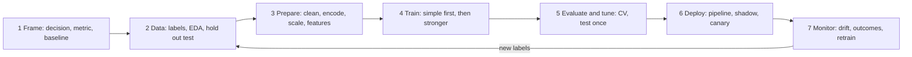

# Chapter 20 — Cheat Sheets and Glossary

This last chapter squeezes Chapters 1–19 into pages you can scan in a minute or two: one **cheat sheet** per topic, **decision tables** for "which algorithm / which metric for this problem?", the **50 interview questions** that come up most often with short answers, and an alphabetical **glossary** of 348 terms. Nothing here is new. Every line points back to where the idea is taught properly, written like **§6.3** (= Chapter 6, section 6.3); if a line doesn't make sense, follow the reference.

Every formula or number on a sheet that can be computed was recomputed by [`code/cheatsheet_checks.py`](code/cheatsheet_checks.py) (it also asserts the library defaults quoted here, for scikit-learn 1.9, PyTorch 2.x and NumPy 2.x):

```
OK  sheet_20_2_math
OK  sheet_20_3_api
OK  sheet_20_4_data_prep
OK  sheet_20_5_algorithms
OK  sheet_20_6_losses
OK  sheet_20_7_metrics
OK  sheet_20_8_validation
OK  sheet_20_9_deep_learning
OK  sheet_20_10_cnn_rnn_attention
OK  sheet_20_11_recommenders
OK  sheet_20_12_rl
OK  sheet_20_13_system_design
OK  sheet_20_14_production
OK  sheet_20_15_responsible
all 14 cheat-sheet checks passed
```

**What's inside**

| # | Sheet | Built from |
|---|---|---|
| 20.1 | The ML workflow | Ch 1, 4, 6, 15, 16 |
| 20.2 | Math essentials (key formulas) | Ch 2 |
| 20.3 | NumPy, pandas and scikit-learn API | Ch 3, 4 |
| 20.4 | Data preparation and feature engineering | Ch 4 |
| 20.5 | Every algorithm in one table | Ch 5, 7–14 |
| 20.6 | Loss functions | Ch 2, 5, 8, 10, 13, 14 |
| 20.7 | Metrics: regression, classification, ranking and more | Ch 6, 9, 11, 13, 16 |
| 20.8 | Validation and tuning | Ch 4, 6 |
| 20.9 | Deep learning: layers, activations, optimizers, regularisation, debugging | Ch 10 |
| 20.10 | CNN, RNN and attention: shapes and formulas | Ch 11, 12 |
| 20.11 | Recommenders | Ch 13, 17 |
| 20.12 | Reinforcement-learning update rules | Ch 14 |
| 20.13 | ML system design: the 7-step framework and napkin math | Ch 15, 17, 18 |
| 20.14 | Production and MLOps checklist | Ch 16 |
| 20.15 | Responsible-ML checklist | Ch 19 |
| 20.16 | Decision tables: which algorithm, which metric | all |
| 20.17 | Top 50 interview questions | all |
| 20.18 | Glossary (A–Z) | all |

**Chapter links:** [1](../01-what-is-ml/README.md) · [2](../02-math-for-ml/README.md) · [3](../03-python-ml-stack/README.md) · [4](../04-data-eda-feature-engineering/README.md) · [5](../05-linear-and-logistic-regression/README.md) · [6](../06-evaluation-and-tuning/README.md) · [7](../07-trees-and-ensembles/README.md) · [8](../08-knn-svm-naive-bayes/README.md) · [9](../09-unsupervised-learning/README.md) · [10](../10-neural-networks-and-deep-learning/README.md) · [11](../11-cnns-and-computer-vision/README.md) · [12](../12-sequences-rnns-and-attention/README.md) · [13](../13-recommenders-and-embeddings/README.md) · [14](../14-reinforcement-learning/README.md) · [15](../15-ml-system-design-framework/README.md) · [16](../16-ml-in-production/README.md) · [17](../17-ml-case-studies-1/README.md) · [18](../18-ml-case-studies-2/README.md) · [19](../19-responsible-ml/README.md)

Notation used throughout: x = feature vector, y = true label, ŷ = prediction, w = weights, b = bias, η = learning rate, σ = sigmoid, n = number of examples, d = number of features, k = number of neighbours / clusters / results (the context says which).

---

## 20.1 The ML workflow (§1.9, §4.10, §6.11, §15.3, §16.1)



| Step | Do | Don't | Where |
|---|---|---|---|
| 1. Frame | Name the decision the prediction drives, the task type (classification / regression / ranking / clustering), the metric tied to business value, and the **baseline** (current rule, human, "predict the mean") | Start by picking a model | §1.9, §15.3 |
| 2. Data | Find where labels come from and how late they arrive; set the test split aside **before** deep EDA; check legality and privacy | Explore the test set; assume labels "exist" | §4.1, §4.2 |
| 3. Prepare | Dedupe, impossible values → NaN, impute, encode, scale — all inside one `Pipeline` | Fit anything on the full dataset (leakage) | §4.3–4.6, §4.10 |
| 4. Train | Linear/logistic model first, then a random forest and gradient boosting; deep nets for images/text/audio | Jump to the fanciest model | §5.1, §8.4 |
| 5. Evaluate | Cross-validate on train, tune on validation folds, report the test score **once**, next to the baseline, per segment | Tune on the test set; quote accuracy on imbalanced data | §6.1, §6.6, §6.9 |
| 6. Deploy | Ship preprocessing + model as one artifact; offline gate → shadow → canary → ramp, with a fallback | Re-implement features in another language (skew) | §16.2, §16.6 |
| 7. Monitor | Health → inputs → predictions → outcomes; investigate alerts; retrain through the same gates | Auto-promote on a drift alert | §16.8, §16.10 |

**Diagnosing a model from two numbers (§1.10, §6.7):**

| Train error | Validation error | Diagnosis | First fixes |
|---|---|---|---|
| High | High (close) | Underfitting (high bias) | More capacity, better features, less regularisation, train longer |
| Low | Much higher | Overfitting (high variance) | More data, more regularisation, simpler model, early stopping, bagging |
| Low | Low (close) | Good fit | Test once, ship |
| Suspiciously perfect | Suspiciously perfect | Probably **leakage** | Check feature timestamps, splits, duplicates, top importances (§4.8) |

**Supervision types (§1.4):** supervised (labels) · unsupervised (no labels: clusters, dimensions, anomalies) · semi-supervised (few labels + many unlabelled) · self-supervised (labels made from the data, e.g. next token) · reinforcement (rewards from actions). **Classification** predicts a category, **regression** a number (§1.5). **Batch** learning retrains on everything periodically; **online** learning updates with `partial_fit` (§1.7). **Instance-based** (k-NN) keeps the data; **model-based** keeps parameters (§1.8).

---

## 20.2 Math essentials (Ch 2)

**Linear algebra (§2.1–2.3)**

| Idea | Formula | Worked value |
|---|---|---|
| Dot product | a·b = Σ aᵢbᵢ = ‖a‖‖b‖cos θ | [1,2,3]·[4,5,6] = **32** |
| L2 / L1 / L∞ norm | √Σaᵢ² · Σ\|aᵢ\| · max\|aᵢ\| | ‖[1,2,3]‖₂ = √14 ≈ 3.74 |
| Cosine similarity | a·b / (‖a‖‖b‖) | 32 / (3.74·8.77) ≈ **0.975** |
| Linear model | ŷ = w·x + b; batch: ŷ = Xw + b | shapes (n×d)(d,) → (n,) |
| Matrix product | (m×n)(n×p) → m×p; entry = row·column; **AB ≠ BA** | (100×20)(20×5) → 100×5 |
| 2×2 determinant / inverse | det = ad − bc; A⁻¹ = (1/det)[[d, −b], [−c, a]] | [[1,2],[3,4]]: det −2, inverse [[−2,1],[1.5,−0.5]] |
| Solve Ax = c | `np.linalg.solve(A, c)` (never `inv`) | x₁+2x₂=5, 3x₁+4x₂=11 → x = [1, 2] |
| Eigenvector | Av = λv | [[2,1],[1,2]]: λ = 3 on [1,1], λ = 1 on [1,−1] |
| SVD | M = UΣVᵀ (rotate, stretch, rotate) | top-k singular values = best rank-k approximation |
| Normal equation | θ = (XᵀX)⁻¹Xᵀy (use `lstsq`) | Ridge: (XᵀX + αI)⁻¹Xᵀy |

**Calculus and optimisation (§2.4–2.5)**

| Idea | Formula |
|---|---|
| Power / chain rule | (xⁿ)′ = nxⁿ⁻¹ · (f(g(x)))′ = f′(g(x))·g′(x) |
| Sigmoid and derivative | σ(z) = 1/(1 + e⁻ᶻ); σ′ = σ(1 − σ); σ(0) = 0.5, σ′(0) = 0.25 (its maximum) |
| Gradient | ∇f = vector of partial derivatives; points **uphill** |
| Gradient descent | w ← w − η∇L(w). On f = (w−3)², η = 0.1: 0 → 0.6 → 1.08 (each step keeps 80% of the gap) |
| MSE gradient | ∇ = (2/n)Xᵀ(Xw − y) |
| Log-loss gradient | ∇ = (1/n)Xᵀ(σ(Xw) − y) — "features × (prediction − truth)" |
| Numerical gradient check | f′(x) ≈ (f(x+h) − f(x−h)) / 2h |
| Convergence (MSE) | GD converges if η < 2/λ_max of the Hessian (§5.4) |

**Probability and statistics (§2.6–2.11)**

| Idea | Formula / rule | Worked value |
|---|---|---|
| Bernoulli / binomial / normal | mean p, var p(1−p) · mean np, var np(1−p) · mean μ, var σ² | P(3 of 10, p = 0.3) = C(10,3)·0.3³·0.7⁷ ≈ **0.2668** |
| 68–95–99.7 rule | ±1σ, ±2σ, ±3σ of a normal | P(z > 2) ≈ 2.3% |
| Expectation rules | E[aX+b] = aE[X]+b; Var[aX+b] = a²Var[X]; independent: Var[X+Y] = Var X + Var Y | Var[3X] = 9·Var[X] |
| Conditional probability | P(A\|B) = P(A∩B)/P(B) | |
| Bayes | P(A\|B) = P(B\|A)P(A)/P(B) — posterior ∝ likelihood × prior | 1% disease, 90% sensitivity, 5% FPR → P(sick\|+) ≈ **0.154**; a 2nd positive → 0.766 |
| z-score | z = (x − μ)/σ | 130 with μ 100, σ 15 → 2 |
| Standard error (CLT) | σ/√n; 4× the data halves it | σ 20, n 100 → 2 |
| Population vs sample std | NumPy `ddof=0` (÷n), pandas `ddof=1` (÷(n−1)) | |
| Hypothesis test | p-value = P(data this extreme \| H₀); reject if p < α; Type I = α, power = 1 − β | p is **not** P(H₀ true) |
| Confidence interval | estimate ± critical value × SE (1.96 for 95%, large n) | bootstrap: resample, take 2.5th–97.5th percentiles |
| Multiple testing | Bonferroni: use α/m | 20 tests at 0.05 → expect 1 false hit |
| Correlation | Pearson r (linear), Spearman (ranks, monotonic); r = 0 ≠ independent | y = x² can give r = 0 |

**Information theory (§2.12)**

| Idea | Formula | Worked value (bits) |
|---|---|---|
| Entropy | H(p) = −Σ p log p | fair coin 1; 90/10 coin 0.469; p = [0.7, 0.2, 0.1] → 1.157 |
| Cross-entropy | H(p, q) = −Σ p log q ≥ H(p) | q = [0.5, 0.3, 0.2] → 1.280 |
| KL divergence | KL(p‖q) = H(p,q) − H(p) ≥ 0, **not symmetric** | 0.123 |
| Log loss (one-hot p) | −(1/n) Σ [y ln p + (1−y) ln(1−p)] | labels [1,0,1,1], p [0.9,0.2,0.6,0.99] → **0.2123** (nats) |

---

## 20.3 NumPy, pandas and scikit-learn API (Ch 3, §4.10)

**NumPy (§3.2)**

| Task | Code | Remember |
|---|---|---|
| Create | `np.array`, `zeros`, `ones`, `eye`, `arange`, `linspace(0, 1, 5)` | one dtype per array; `float32` = 4 bytes, `float64` = 8 |
| Inspect | `a.shape`, `a.dtype`, `a.ndim`, `a.size`, `a.nbytes` | shape `(n,)` ≠ `(n, 1)` |
| Reshape | `a.reshape(3, 4)`, `a.reshape(-1, 1)`, `a[:, None]`, `a.T` | scikit-learn wants 2-D `X` |
| Index | `M[0]`, `M[:2, 1:3]` → **view**; `M[M > 5]`, `M[[0, 2]]` → **copy** | `.copy()` when you need independence |
| Reduce | `M.sum(axis=0)` (one per column), `axis=1` (one per row), `keepdims=True` | the named axis disappears |
| Broadcast | align shapes from the right; equal or 1 → OK | (3,1)+(1,4) → (3,4); (3,2)+(3,) → error |
| Matrix product | `A @ B` (not `*`, which is element-wise) | |
| Standardise columns | `(X - X.mean(axis=0)) / X.std(axis=0)` | fit statistics on training data only |
| Random | `rng = np.random.default_rng(42)`; `rng.normal`, `rng.integers`, `rng.permutation` | seed once, draw everything from `rng` |
| Floats | `np.isclose(0.1 + 0.2, 0.3)` | `int8` 127 + 1 wraps to −128 |

**pandas (§3.3)**

| Task | Code |
|---|---|
| Load / first look | `pd.read_csv(path)`; `df.head()`, `df.info()`, `df.dtypes`, `df.describe()`, `df.isnull().sum()`, `df["c"].value_counts()` |
| Fix types | `pd.to_numeric(s, errors="coerce")`, `pd.to_datetime(s)`, `s.astype("category")` |
| Select | `df["c"]` (Series), `df[["a", "b"]]` (DataFrame), `df.loc[rows, cols]` (labels, **end inclusive**), `df.iloc[0:2]` (positions, end exclusive) |
| Filter | `df[(df.a > 1) & (df.b == "x")]` — `&`, `\|`, `~` with parentheses |
| Missing values | `dropna()`, `fillna(v)`, `df.groupby(g)["x"].transform("median")`, `df["x_missing"] = df.x.isna()` |
| Group | `df.groupby("g").agg(n=("x", "size"), mean_x=("x", "mean"))` (one row per group); `transform` keeps the original length |
| Join / stack | `a.merge(b, on="k", how="left", validate="many_to_one")`; `pd.concat([a, b])` |
| Vectorise | column arithmetic, `np.where`, `pd.cut`, `.str`, `.dt` — avoid row-wise `apply` |
| pandas 3 | copy-on-write: assign (`df["c"] = df["c"].fillna(0)`), don't chain in-place calls |

**scikit-learn estimator API (§3.5, §4.10)**

| Convention | Meaning |
|---|---|
| `Model(hyper=...)` | hyperparameters go in the constructor |
| `fit(X, y)` → `self` | learns; learned attributes end in `_` (`coef_`, `mean_`, `classes_`) |
| `transform` / `fit_transform` | `fit_transform` on **train only**; `transform` on validation/test/production |
| `predict`, `predict_proba`, `decision_function`, `score` | `score` = accuracy (classifiers), R² (regressors) |
| `Pipeline` / `make_pipeline` | preprocessing + model = one estimator; refit per CV fold (no leakage), one artifact to save |
| `ColumnTransformer` | different preprocessing per column group; default `remainder="drop"` |
| `step__param` | address a parameter inside a pipeline, e.g. `prep__num__impute__strategy`, `model__C` |
| `set_output(transform="pandas")` | named DataFrame outputs for debugging |
| `joblib.dump(pipe, "m.joblib")` | save the whole pipeline; only load files you trust |

```python
pre = ColumnTransformer([
    ("num", make_pipeline(SimpleImputer(strategy="median", add_indicator=True), StandardScaler()), num_cols),
    ("cat", OneHotEncoder(handle_unknown="ignore"), cat_cols),
])
pipe = Pipeline([("pre", pre), ("model", LogisticRegression(max_iter=1000))])
search = GridSearchCV(pipe, {"model__C": [0.01, 0.1, 1, 10]}, cv=StratifiedKFold(5), scoring="average_precision")
search.fit(X_train, y_train)                 # CV refits the preprocessing inside every fold
print(search.best_params_, search.score(X_test, y_test))   # test set used once
```

Defaults worth knowing (checked by the script): `LogisticRegression` C = 1.0 (L2), solver `lbfgs` · `RandomForestClassifier` `max_features="sqrt"` (regressor: 1.0) · `HistGradientBoosting*` learning_rate 0.1, `max_leaf_nodes` 31, `min_samples_leaf` 20 · `SVC` RBF kernel, C = 1, `gamma="scale"` · `KNeighbors*` k = 5, Minkowski p = 2 · `KMeans` `init="k-means++"`.

| Module | Tools you'll use constantly |
|---|---|
| `model_selection` | `train_test_split`, `cross_val_score`, `cross_validate`, `KFold`, `StratifiedKFold`, `GroupKFold`, `TimeSeriesSplit`, `GridSearchCV`, `RandomizedSearchCV` |
| `preprocessing` | `StandardScaler`, `MinMaxScaler`, `RobustScaler`, `OneHotEncoder`, `OrdinalEncoder`, `TargetEncoder`, `PolynomialFeatures`, `KBinsDiscretizer`, `FunctionTransformer` |
| `impute` | `SimpleImputer`, `KNNImputer`, `IterativeImputer` |
| `metrics` | `accuracy_score`, `precision_score`, `recall_score`, `f1_score`, `roc_auc_score`, `average_precision_score`, `log_loss`, `brier_score_loss`, `mean_absolute_error`, `mean_squared_error`, `r2_score`, `ndcg_score`, `confusion_matrix`, `classification_report` |
| `calibration` | `CalibratedClassifierCV`, `calibration_curve` |
| `inspection` | `permutation_importance`, `PartialDependenceDisplay` |

**Frameworks (§3.7):** scikit-learn (and XGBoost / LightGBM / CatBoost) for tables; PyTorch or TensorFlow/Keras for images, text, audio, GPUs and custom networks. Jupyter: seed first, Restart & Run All before sharing, move stable code into `.py` modules (§3.6).

---

## 20.4 Data preparation and feature engineering (Ch 4)

**Labels (§4.1, §16.3)**

| Source | Speed | Weakness | Handle with |
|---|---|---|---|
| Natural outcomes (delivery time, chargeback) | Minutes → weeks | Late, incomplete, outcome ≠ truth | Train on mature rows; proxy labels for fresh data |
| Behaviour / implicit (clicks, watch time) | Seconds | Exposure and position bias | Log impressions and positions; correct bias (IPW) |
| Human annotation | Hours → days | Cost, reviewer quality | Versioned guidelines, Cohen's κ = (p_o − p_e)/(1 − p_e), gold questions, active learning |
| Weak supervision (labelling functions + label model) | Instant | Noisy, correlated rules | Snorkel-style label model; audit |
| LLM-assisted | Seconds | Correlated, systematic errors | Humans review samples, hard cases and per-subgroup slices |

κ example: agreement 0.8, chance 0.5 → κ = **0.6**. Retrieval negatives: random (easy), in-batch (cheap, popularity-biased → logQ correction), hard (sharp, some false negatives).

**EDA checklist (§4.2):** shape & types → missingness (and is it related to the target?) → distributions (skew, sentinels like 999 / 9,999,999, cardinality) → target balance → feature–target and feature–feature relationships (**Spearman** for skewed data) → duplicates, impossible values, leaky IDs. Do detailed EDA on the training split.

**Cleaning (§4.3)**

| Problem | Default fix |
|---|---|
| Exact duplicates | `drop_duplicates()`, then check the entity key is unique; dedupe **across** splits |
| Impossible values (age 999) | Set to NaN — they are errors, not outliers |
| Outliers | IQR fences (Q1 − 1.5·IQR, Q3 + 1.5·IQR), \|z\| > 3, or log first; cap at training-set percentiles; never blindly delete (fraud *is* the outlier) |
| Missing: MCAR / MAR / MNAR | Median (numbers) or `"missing"` (categories) **+ missing indicator**; KNN or iterative imputation when other columns predict it; HistGradientBoosting/XGBoost/LightGBM handle NaN natively |
| Judging an imputer | Hide known values, measure error, and compare downstream CV scores |

**Encoding (§4.4)**

| Encoder | Use for | Risk |
|---|---|---|
| One-hot (`handle_unknown="ignore"`) | Nominal, low–moderate cardinality | Width; dummy trap for unregularised OLS (`drop="first"`) |
| Ordinal | Ordered categories; fine for trees | Fake order for linear models / k-NN |
| Target encoding (`TargetEncoder`) | High cardinality | **Leakage** unless cross-fitted and smoothed |
| Hashing (`FeatureHasher`) | Unbounded IDs, streaming | Collisions, not reversible |
| Embeddings | IDs in deep models / recommenders | Needs data per ID; versioning |

**Scaling (§4.5)**

| Scaler | Formula | Use when |
|---|---|---|
| Standard | (x − mean)/std | Default for linear models, SVMs, neural nets, PCA, k-NN, k-means |
| Min-max | (x − min)/(max − min) | Bounded inputs (pixels ÷ 255), no big outliers |
| Robust | (x − median)/IQR | Outliers you keep: [10,11,11,12,12,13,100] → 100 ↦ (100 − 12)/1.5 = 58.67 |
| Log / power | log1p(x), `PowerTransformer` | Heavy right tails (income, counts) — scaling alone never fixes skew |
| None | — | Trees and tree ensembles |

**Feature creation (§4.6)**

| Technique | Example |
|---|---|
| Interactions / polynomials | price × quantity; `PolynomialFeatures(2)` on 10 features → 65 columns |
| Binning | age buckets let a linear model fit a U-shape |
| Log transform | `log1p(income)` |
| Dates and cycles | day of week, is_weekend, "days since signup"; hour h → (sin 2πh/24, cos 2πh/24): hour 6 → (1, 0) |
| Text | Bag-of-words, TF-IDF: idf(t) = ln((1+n)/(1+df)) + 1, rows L2-normalised (n = 4, df = 2 → 1.511) |
| Aggregates and ratios | orders in last 30 min, tickets per month of tenure — must be **point-in-time correct** |
| Production groups | **entity** (batch), **behavioural aggregates** (streaming), **context** (request time), **cross** (pairs) — §4.6, §16.4 |

**Splits (§4.7):** random (i.i.d. data) · **stratified** (classification, keeps class ratios) · **time-based** (anything predicting the future) · **group** (all rows of one user/patient together, to generalise to new entities). Millions of rows → 98/1/1 is fine; a few thousand → cross-validation.

**Leakage checklist (§4.8, §16.3):** (1) would I know this value at prediction time? (2) split first, then fit everything inside a `Pipeline`; (3) time/group splits when deployment needs them; (4) dedupe across splits; (5) aggregates whose window includes the label moment; (6) label-adjacent fields (refund flag, resolution code); (7) distrust any single dominant feature or a score far above published baselines.

**Imbalance (§4.9)**

| Technique | Effect on probabilities |
|---|---|
| Better metrics (precision, recall, PR-AUC) | — |
| Threshold moving | None — often all you need |
| Class weights (`class_weight="balanced"`) | Inflated → recalibrate |
| Negative downsampling (keep fraction w) | Inflated → **p_true = p·w / (p·w + 1 − p)**; w = 0.1, p = 0.5 → 0.091 |
| Oversampling / SMOTE (a + u·(b − a) between minority neighbours) | Inflated; resample the **training** data only, after splitting |

---

## 20.5 Every algorithm in one table (Ch 5, 7–14)

n = rows, d = features, k = neighbours/clusters, B = trees, M = boosting rounds, T = sequence length, h = hidden width. Complexities are rough orders of magnitude for intuition, not exact bounds.

| Algorithm | What it does | Use when | Key hyperparameters | Pros | Cons | Cost (train / predict) | § |
|---|---|---|---|---|---|---|---|
| Linear regression (OLS) | ŷ = w·x + b minimising MSE | Roughly linear trends, baselines, explaining effects | none (fit_intercept) | Fast, interpretable, extrapolates a trend | Misses curves; outliers; multicollinearity | O(nd² + d³) solver or O(nd)/epoch GD / O(d) | 5.2–5.3 |
| Ridge / Lasso / ElasticNet | OLS + L2 / L1 / both penalty | Many or correlated features; want sparsity (L1) | α (and `l1_ratio`) | Less overfitting; Lasso selects features | Must scale; α tuned by CV | As OLS / O(d) | 5.7 |
| Polynomial regression | Linear model on powers/products | Smooth curves, few features | degree | Same solvers | Feature explosion; wild at the edges | As OLS on expanded d | 5.6 |
| Logistic regression | p = σ(w·x + b), log-loss | Binary baseline, calibrated probabilities, sparse text | C (= 1/strength), class_weight | Convex, fast, odds ratios, roughly calibrated | Linear boundary | O(nd) per iteration / O(d) | 5.8 |
| Softmax regression | K linear scores → softmax | Mutually exclusive classes | C | Coherent probabilities | Linear boundaries | O(ndK) / O(dK) | 5.9 |
| k-NN | Vote/average of k nearest points | Small low-dimensional data, similarity search | k, metric, weights | No training, any boundary | Slow prediction, needs scaling, curse of dimensionality | O(1) / O(nd) brute force | 8.1 |
| Linear SVM | Max-margin hyperplane, hinge loss | High-dimensional sparse text | C | Fast, strong on text | No probabilities | ~O(nd) / O(d) | 8.2 |
| Kernel SVM (RBF) | Max margin in an implicit feature space | Small/medium data with curved boundaries | C, γ (tune jointly, log scale) | Convex, flexible, compact (support vectors) | Slow beyond tens of thousands of rows; scaling; no native probabilities | ~O(n²d) to O(n³d) / O(n_SV·d) | 8.2 |
| SVR | Fit inside an ε-tube | Small-data regression with noise | C, ε, γ | Ignores small errors | As kernel SVM | As SVM | 8.2 |
| Naive Bayes | Bayes + "features independent given class" | Text, tiny data, streaming baselines | α (smoothing), variant (Multinomial/Bernoulli/Gaussian) | Fastest to train, few data needed | Over-confident probabilities, no interactions | O(nd) / O(dK) | 8.3 |
| Decision tree (CART) | Greedy binary splits maximising impurity decrease | Readable rules, quick look | max_depth, min_samples_leaf, ccp_alpha | Interpretable, no scaling, non-linear | High variance, axis-aligned, no extrapolation | ~O(nd log n) / O(depth) | 7.1 |
| Random forest | Bagged deep trees + random feature subset per split | Strong default with little tuning | n_estimators, max_features, max_depth / min_samples_leaf | Robust, parallel, free OOB score, more trees never hurt | Bigger/slower; less accurate than tuned boosting; no extrapolation | B × tree / O(B·depth) | 7.3 |
| AdaBoost | Re-weight misclassified samples; weighted vote of stumps | Clean data, simple baseline | n_estimators, learning_rate | Simple | Sensitive to noise/outliers (exponential loss) | M × stump / O(M) | 7.4 |
| Gradient boosting (sklearn HGB, XGBoost, LightGBM, CatBoost) | Sequential shallow trees fitted to the negative gradient | **Best default for tabular data** | learning_rate, n_estimators (+ early stopping), depth/leaves, min leaf size, subsample, L1/L2 | Top tabular accuracy, native NaN/categoricals | Overfits with too many rounds; sequential | M × histogram tree ≈ O(M·nd) / O(M·depth) | 7.4, 7.7 |
| Voting / stacking | Combine different model families (stacking: meta-model on out-of-fold predictions) | Diverse models with different errors | base models, meta-model, cv | Reduces risk | More latency and upkeep; not guaranteed to win | Sum of models | 7.5 |
| k-means | Assign to nearest centroid, move centroids, repeat | Round, similar-sized clusters | k, n_init (k-means++) | Fast, scales (MiniBatch) | Must pick k; spherical assumption; outliers | O(nkd) per iteration | 9.1 |
| Agglomerative | Merge closest clusters bottom-up (dendrogram) | Small data, nested structure | linkage, n_clusters or cut height | No k up front, interpretable tree | O(n²) memory | ≥ O(n²) | 9.2 |
| DBSCAN / HDBSCAN | Clusters = dense regions; noise = −1 | Odd shapes, outliers, unknown k | eps, min_samples (HDBSCAN: min_cluster_size) | Any shape, labels noise | One global density (DBSCAN); eps hard in high-d | ~O(n log n) with an index | 9.3 |
| Gaussian mixture (EM) | Soft assignment to k Gaussians | Elliptical/overlapping clusters, need probabilities | k (by BIC), covariance_type | Soft, elliptical | Local optima; k to choose | O(nkd²) per EM step (full cov.) | 9.4 |
| PCA | Project onto top eigenvectors of the covariance | Compression, denoising, pre-step, quick 2-D look | n_components (e.g. 0.95 variance) | Fast, deterministic, `transform` | Linear only; scale first | full SVD ~O(nd·min(n,d)) | 9.5 |
| t-SNE / UMAP | Non-linear 2-D maps preserving neighbours | Visualisation only | perplexity / n_neighbors, min_dist | Reveals clusters | Sizes and gaps meaningless; seed-dependent | t-SNE ~O(n log n) (Barnes-Hut) | 9.6 |
| Isolation Forest | Anomalies isolate in few random splits | Multivariate anomaly default | n_estimators, max_samples (256), contamination | Fast, no scaling | Misses anomalies visible only in combinations | ~linear | 9.7 |
| LOF / One-Class SVM | Local density vs neighbours / boundary around normal data | Mixed densities / novelty on clean data | k / ν, γ | Local / flexible | O(n²)-ish / slow on big n | — | 9.7 |
| Apriori / FP-Growth | Frequent itemsets → rules ranked by lift | Market-basket analysis | min_support, min_confidence | Readable rules | Many trivial rules | Grows with candidates | 9.8 |
| MLP (neural network) | Layers of h = f(Wx + b), trained by backprop | Large data; building block of deep nets | depth, width, lr, batch size, dropout, weight decay | Learns features, very flexible | Data-hungry, many knobs; usually loses to GBDT on small tables | O(params) per example per step | 10.1 |
| CNN | Shared convolution kernels + pooling | Images, spatial grids | depth, channels, kernel size, augmentation | Few parameters, translation equivariance | Needs data or a pretrained backbone | O(k²·C_in·C_out·H·W) per layer | 11.1–11.2 |
| RNN / LSTM / GRU | Hidden state carried step by step | Streaming/small sequence models, time series | hidden size, layers, clipping | Constant memory per step | Sequential (no parallelism over time) | O(T·h²) | 12.2–12.4 |
| Transformer | Self-attention + feed-forward blocks | Text, speech, vision at scale | layers, d_model, heads, context length | Parallel, O(1) path between tokens | O(T²·d) attention cost | O(T²d + Td²) per layer | 12.7 |
| Matrix factorisation (SGD/ALS) | r̂ = μ + bᵤ + bᵢ + pᵤ·qᵢ | Collaborative filtering baseline | k factors, λ, (α for implicit) | Strong, compact embeddings | Cold start; no context | SGD O(\|R\|·k)/epoch | 13.5 |
| Two-tower | User and item encoders meeting at a dot product | Retrieval over millions of items | embedding dim, temperature, negatives | Items precomputed → ANN | Weak feature crosses; versioning | Per request: user tower + ANN | 13.7 |
| Multi-armed bandits (ε-greedy, UCB, Thompson) | Explore/exploit over k arms | Headlines, thumbnails, new-item traffic | ε, c, priors | Less regret than A/B | Non-stationarity handling | O(k) per step | 14.4 |
| Q-learning / SARSA | TD control on a Q-table | Small discrete MDPs | α, γ, ε schedule | Model-free, simple | Table must fit; sample-hungry | O(1) per update | 14.7 |
| DQN | Neural Q-function + replay + target network | Discrete actions, large state spaces | replay size, target sync C, ε | Scales to pixels | Unstable (deadly triad) | Network forward/backward | 14.8 |
| Policy gradient / actor-critic / PPO | Gradient ascent on expected return | Continuous actions, RLHF | lr, clip ε, entropy bonus, GAE λ | Stochastic and continuous policies | High variance, on-policy | Network forward/backward | 14.9 |
| ARIMA / ETS | AR + differencing + MA / smoothing | Single short time series | (p, d, q), seasonality | Built-in intervals, little data | One series at a time, few extra features | Small | 12.10 |

---

## 20.6 Loss functions (Ch 2, 5, 8, 10, 13, 14)

| Loss | Formula (one example) | Task / model | Notes | § |
|---|---|---|---|---|
| MSE (squared error) | (ŷ − y)² | Regression, linear regression, neural nets | Punishes big errors; optimal constant = **mean**; MLE under Gaussian noise | 5.2, 10.3 |
| MAE (L1) | \|ŷ − y\| | Robust regression | Optimal constant = **median** | 6.2, 10.3 |
| Huber | ½e² if \|e\| ≤ δ, else δ(\|e\| − ½δ) | Regression with outliers; DQN | Quadratic near 0, linear far away | 10.3, 14.8 |
| Quantile (pinball) | max(τ·e, (τ − 1)·e), e = y − ŷ | Prediction intervals, p90 forecasts | τ = 0.9 → 90th percentile | 12.10 |
| Log loss / binary cross-entropy | −[y ln p + (1−y) ln(1−p)] | Logistic regression, sigmoid outputs, multi-label | Convex for LR; gradient at logit = p − y; PyTorch: `BCEWithLogitsLoss` (logits in) | 5.8, 10.3 |
| Categorical cross-entropy | −ln p_true | Softmax classifiers, language models | Uniform guess = ln K (ln 10 = 2.303); gradient = p − one_hot; PyTorch `CrossEntropyLoss` takes logits + class indices | 5.9, 10.3 |
| Hinge | max(0, 1 − y·f(x)), y ∈ {−1, +1} | SVM | Zero for points beyond the margin | 8.2 |
| ε-insensitive | max(0, \|y − f(x)\| − ε) | SVR | Errors inside the tube are free | 8.2 |
| Exponential | e^(−y·f(x)) | AdaBoost | Explains its outlier sensitivity | 7.4 |
| Regularised squared error | Σ(r − r̂)² + λ(‖p‖² + ‖q‖² + b²) over observed cells | Matrix factorisation | Implicit version weights every cell by confidence | 13.5 |
| Sampled softmax / InfoNCE | −ln [e^(s⁺/τ) / Σ e^(s/τ)] over in-batch items (logits − log Q for popularity) | Two-tower retrieval, CLIP-style contrastive learning | Temperature τ ≈ 0.05–0.1 | 13.7, 18.6 |
| Skip-gram negative sampling | −ln σ(v·u⁺) − Σ ln σ(−v·u⁻) | word2vec, item2vec | Negatives ∝ frequency^0.75 | 12.9, 13.6 |
| Pairwise / listwise ranking | pairwise: which of two items is better (RankNet/LambdaMART); listwise: optimise NDCG-like list metrics | Learning-to-rank | Pointwise = predict each label independently | 17.3 |
| Regularisation terms | L2: λΣw² · L1: λΣ\|w\| | Any | L1 → exact zeros; L2 → shrinkage; AdamW = decoupled L2 | 5.7, 10.7 |
| TD / Q-learning target | (r + γ maxₐ′ Q(s′,a′; θ⁻) − Q(s,a; θ))² (Huber in DQN) | Value-based RL | θ⁻ = frozen target network | 14.8 |
| Policy gradient | −log π(a\|s)·Aₜ | REINFORCE, actor-critic | A = G − V(s) or the TD error | 14.9 |
| Reward model (preferences) | −ln σ(s_preferred − s_rejected) | RLHF | PPO then maximises reward − β·KL(π ‖ π_SFT) | 14.10 |
| Fairness penalty | loss + λ·(mean score A − mean score B)² | In-processing bias mitigation | Larger λ → more parity, less accuracy | 19.4 |

Rule of thumb: pick the output layer and the loss together — identity + MSE/MAE/Huber (regression), sigmoid + BCE (binary, multi-label), softmax + cross-entropy (one label out of K) (§10.2). Never train on accuracy: its gradient is zero almost everywhere.

---

## 20.7 Metrics: formula and when to use (Ch 6, 9, 11, 13, 16)

**Regression (§6.2, §16.7)** — worked on y = (30, 25, 40, 35, 50), ŷ = (28, 27, 35, 35, 60):

| Metric | Formula | Value | Use when |
|---|---|---|---|
| MAE | (1/n)Σ\|e\| | 3.8 | Cost grows linearly with error; label outliers shouldn't dominate |
| MSE / RMSE | (1/n)Σe² / √MSE | 26.6 / 5.16 | Big misses are disproportionately bad (a 40-min miss adds 16× what a 10-min miss adds to MSE) |
| R² | 1 − Σe²/Σ(y − ȳ)² | 0.641 | Share of variance explained; 0 = predicting the mean, < 0 = worse |
| MAPE | (100/n)Σ\|e/y\| | — | Relative error; breaks near y = 0 |
| p90 absolute error | 90th percentile of \|e\| | — | Promises made on the tail (ETAs) |
| Per-cohort error | Any of the above per segment | — | Always: averages hide failing segments |

**Classification (§6.3, §6.5)** — worked on 1,000 transactions, 100 fraud, 80 flagged, 60 correct (TP 60, FP 20, FN 40, TN 880):

| Metric | Formula | Value | Use when |
|---|---|---|---|
| Accuracy | (TP + TN)/all | 0.94 ("flag nothing" = 0.90) | Balanced classes, equal costs only |
| Precision (PPV) | TP/(TP + FP) | 0.75 | False alarms are expensive |
| Recall (sensitivity, TPR) | TP/(TP + FN) | 0.60 | Misses are expensive |
| F1 / Fβ | 2PR/(P + R) / (1+β²)PR/(β²P + R) | 0.667 | One number, imbalanced data; F2 favours recall |
| Specificity / FPR | TN/(TN + FP) / FP/(FP + TN) | 0.978 / 0.022 | Screening; ROC axes |
| ROC-AUC | P(random positive scored above random negative) | positives (0.9, 0.7, 0.4) vs negatives (0.8, 0.3, 0.2) → 7/9 = 0.778 | Threshold-free ranking quality, moderate imbalance |
| PR-AUC (average precision) | Area under precision–recall curve; no-skill = base rate | — | **Rare positives** (fraud, ads, disease) |
| Log loss | −mean[y ln p + (1−y) ln(1−p)] | — | Probabilities feed decisions |
| Brier score | mean((p − y)²) | y (1,0,1,1), p (0.9,0.2,0.6,0.3) → 0.175; p ≡ 0.5 → 0.25 | Calibration quality (proper scoring rule) |
| ECE | Weighted gap between mean score and observed rate per bin | — | Calibration monitoring (ads) |
| Macro / weighted averages | Mean of per-class metrics (unweighted / by support) | — | Multiclass; macro exposes weak minority classes |

**Choosing a threshold (§6.3):** with calibrated p, flag when **p > C_FP / (C_FP + C_FN)** (review $5, missed fraud $100 → p > 0.048). Fraud and moderation use **two thresholds**: approve / review or step-up / block.

**Ranking and retrieval (§6.4, §13.11, §17.3)**

| Metric | Formula | Use when |
|---|---|---|
| Precision@k | relevant in top k ÷ k | Fixed number of slots |
| Recall@k | relevant in top k ÷ all relevant | Candidate generation (did the good items survive?) |
| Hit rate@k | 1 if any relevant item in top k | Leave-one-out recommender tests |
| AP / MAP | mean of precision@i at each relevant rank ÷ #relevant; MAP = mean over queries | Binary relevance, whole list |
| MRR | mean of 1/rank of the first relevant result | One good answer fast (Q&A, navigation) |
| NDCG@k | DCG/IDCG, DCG = Σ relᵢ / log₂(i + 1) (exponential variant: (2^rel − 1)) | Graded relevance, position matters |
| Coverage, diversity, novelty | share of catalogue recommended; 1 − mean pairwise similarity; mean popularity | Beyond-accuracy health of a recommender |

Worked: relevances [3, 0, 2, 1, 0, 0], one relevant grade-2 document not retrieved → DCG@5 = 4.431, NDCG@5 = **0.778**; `sklearn.metrics.ndcg_score` builds the ideal only from items you pass it and reports 0.930 — always say which NDCG. With exponential gain, [3, 0, 2] → NDCG@3 = 0.956. Recs A–E with relevant {A, C, F}: P@5 0.4, R@5 0.667, AP@5 0.556, NDCG@5 0.704.

**Other families**

| Area | Metrics | § |
|---|---|---|
| Clustering (no labels) | Silhouette s = (b − a)/max(a, b) (higher), Davies–Bouldin (lower), Calinski–Harabasz (higher), inertia/BIC (compare k only) — all favour convex clusters | 9.1, 9.9 |
| Clustering (some labels) | Adjusted Rand Index (0 random, 1 perfect), NMI | 9.9 |
| Dimensionality reduction | Explained variance, reconstruction error, trustworthiness | 9.5, 9.9 |
| Anomaly detection | Precision@k, average precision on a reviewed sample | 9.7 |
| Detection / segmentation | IoU = intersection/union (worked 0.5625); mAP over IoU thresholds (VOC 0.5; COCO 0.5–0.95); Dice for masks | 11.7 |
| Association rules | support, confidence = supp(A∪B)/supp(A), **lift** = confidence/supp(B) (> 1 positive) | 9.8 |
| Online / business | CTR, watch time, retention, revenue per search, resolution rate, promise-kept rate + guardrails | 6.1, 16.9 |
| Drift | PSI = Σ(cur − ref)·ln(cur/ref): < 0.1 stable, 0.1–0.25 watch, > 0.25 investigate; KS statistic D; null rates | 16.8 |
| Fairness | Selection rate, TPR, FPR, PPV and calibration per group; disparate-impact ratio (four-fifths rule) | 19.2–19.3 |

---

## 20.8 Validation and tuning (Ch 4, 6)

| Splitter | Folds | Use for |
|---|---|---|
| `train_test_split(stratify=y)` | One hold-out | Final test set |
| `KFold(5, shuffle=True)` | Random equal folds | Regression, i.i.d. rows |
| `StratifiedKFold` | Same class mix in every fold | Classification (default in `cross_val_score` for classifiers) |
| `GroupKFold` / `StratifiedGroupKFold` | One entity per fold | Users, patients, devices |
| `TimeSeriesSplit(gap=…)` | Train on past, validate on the next block | Anything time-ordered; gap mimics label delay |
| `RepeatedStratifiedKFold` / `LeaveOneOut` | Repeats / k = n | Small data / tiny data only |
| Nested CV | Outer loop around the whole tuning procedure | Unbiased estimate of "tune then train" |

Report CV as **mean ± std**; differences under about one std are not clearly real (§6.6). Expected test error = **bias² + variance + irreducible noise**; averaging B models with variance σ² and correlation ρ gives variance ρσ² + (1 − ρ)σ²/B — bagging shrinks the second term, random feature subsets shrink ρ (§6.7, §7.2).

| Tool | Answers | Read it |
|---|---|---|
| Learning curve (score vs training size) | Would more data help? | Curves converge low → more capacity; big persistent gap → more data / regularisation |
| Validation curve (score vs one hyperparameter) | Where is the sweet spot? | Pick the peak of the validation curve |

**Tuning strategies (§6.9)**

| Method | Budget control | Best for |
|---|---|---|
| Grid search | Product of grid sizes (4 × 5 values × 5 folds = 100 fits) | 1–2 hyperparameters, cheap models |
| Random search | `n_iter` | Default for 3+ hyperparameters (explores each dimension more finely) |
| Successive halving / Hyperband | Resource per round | Many candidates, scalable resource (rows, epochs) |
| Bayesian optimisation (Optuna TPE, Gaussian process + expected improvement) | Trials | Expensive trials (boosting on big data, deep nets) |

Recipe: defaults + baseline → tune the few that matter (boosting: learning rate + tree size; linear/SVM: C, γ; trees: depth/leaf size) → log-uniform ranges → widen a range if the best value sits on its edge → refit on all training data → test once. **Early stopping** (§6.10): monitor validation loss, stop after `patience` rounds without improvement, restore the best weights; never early-stop on the test set.

**Probability calibration (§6.5):** reliability diagram + Brier/log-loss on held-out data; fix with **Platt scaling** (sigmoid on the score, small data) or **isotonic regression** (step function, roughly ≥ 1,000 examples) via `CalibratedClassifierCV`; recheck when the base rate shifts. ROC-AUC is unchanged by any strictly increasing map.

---

## 20.9 Deep learning: layers, activations, optimizers, regularisation, debugging (Ch 10)

**Building blocks (§10.1, §10.3, §10.4)**

| Piece | Formula / rule |
|---|---|
| Neuron | z = w·x + b, a = f(z) |
| Dense layer | h = f(Wx + b); batch: H = f(XWᵀ + b); params = inputs × outputs + outputs (256 → 128: 32,896) |
| Why nonlinearity | Without f, W₂(W₁x + b₁) + b₂ is still one linear map; one perceptron can't learn XOR, one hidden layer can |
| Forward → loss → backward → update | θ ← θ − η·∂L/∂θ; backprop = chain rule from the loss backwards, ≈ 2–3× a forward pass |
| Output gradient | sigmoid + BCE and softmax + CE: ∂L/∂logits = p − y |
| Weight gradient | (layer input)ᵀ @ (gradient at the layer's pre-activation) |
| Gradient check | (L(θ + ε) − L(θ − ε))/2ε ≈ analytic gradient |

**Activations (§10.2)**

| Name | Formula | Range | Use |
|---|---|---|---|
| Sigmoid | 1/(1 + e⁻ᶻ); σ′ ≤ 0.25 | (0, 1) | Binary / multi-label output; LSTM gates |
| Tanh | (eᶻ − e⁻ᶻ)/(eᶻ + e⁻ᶻ); max slope 1 | (−1, 1) | RNN hidden states |
| ReLU | max(0, z) | [0, ∞) | **Default hidden layer**; can "die" |
| Leaky ReLU / PReLU / ELU | z or αz (α ≈ 0.01) / α learned / α(eᶻ − 1) | — | When many ReLUs die |
| GELU / SiLU (Swish) | z·Φ(z) / z·σ(z) | — | Transformers (BERT, GPT), EfficientNet, SwiGLU in LLMs |
| Softmax | e^zᵢ / Σ e^zⱼ (subtract max first) | sums to 1 | One label out of K; (2, 1, 0.1) → (0.659, 0.242, 0.099) |
| Identity | z | ℝ | Regression output |

**Optimizers (§10.5)** — g = mini-batch gradient

| Optimizer | Update | Default / note |
|---|---|---|
| SGD | θ ← θ − ηg | Set lr explicitly |
| Momentum | v ← μv + g; θ ← θ − ηv | μ = 0.9 ≈ averaging ~10 steps; Nesterov = look-ahead |
| AdaGrad | s ← s + g²; θ ← θ − ηg/(√s + ε) | Sparse features; step shrinks forever |
| RMSProp | s ← ρs + (1 − ρ)g²; θ ← θ − ηg/(√s + ε) | PyTorch lr 0.01, α (ρ) 0.99 |
| Adam | m ← β₁m + (1−β₁)g; s ← β₂s + (1−β₂)g²; m̂ = m/(1−β₁ᵗ), ŝ = s/(1−β₂ᵗ); θ ← θ − ηm̂/(√ŝ + ε) | lr 1e-3, β = (0.9, 0.999), ε = 1e-8 |
| AdamW | Adam + θ ← θ − ηλθ (decoupled) | weight_decay 0.01; the correct "Adam with weight decay" |

Schedules: step decay (÷10 at milestones), exponential, reduce-on-plateau, **cosine annealing**, **linear warmup + cosine decay** (transformers/LLMs), one-cycle. LR finder: grow lr exponentially per batch, pick ≈ one-tenth of the lr at the loss minimum.

**Initialisation and gradient flow (§10.6)**

| Scheme | Weight variance | For |
|---|---|---|
| Xavier / Glorot | 2/(fan_in + fan_out) | tanh, sigmoid, linear |
| He / Kaiming | 2/fan_in (fan_in 256 → 0.0078, std 0.088) | ReLU family |
| LeCun | 1/fan_in | SELU, linear |

Never initialise all weights equal (symmetry never breaks). Vanishing/exploding gradients (ten sigmoid layers scale gradients by ≤ 0.25¹⁰ ≈ 9.5 × 10⁻⁷) → ReLU, He/Xavier init, BatchNorm/LayerNorm, residual connections, gradient clipping (`clip_grad_norm_(params, 1.0)`), gates (LSTM/GRU).

**Regularisation (§10.7)**

| Technique | How | Watch out |
|---|---|---|
| Dropout (p) | Zero units at random in training; survivors × 1/(1 − p) (inverted dropout) | Call `model.eval()` for inference |
| Weight decay | λΣw² or AdamW's decoupled shrinkage (1e-4…1e-2 SGD; 0.01–0.1 AdamW) | Often skip biases and norm parameters |
| BatchNorm | x̂ = (x − μ_batch)/√(σ²_batch + ε), y = γx̂ + β; running stats at eval | Small batches; LayerNorm in transformers/RNNs, GroupNorm for small-batch vision |
| Early stopping | Stop after `patience` epochs without validation improvement; restore best | Report on a separate test set |
| Data augmentation | Label-preserving transforms (flips, crops, colour jitter, noise, Mixup/CutMix) | Training data only; don't flip a 6 into a 9 |
| More data / smaller model | — | Often the most effective of all |

**Debugging checklist (§10.8)**

1. Look at a few raw examples and labels **after** the data pipeline.
2. Initial loss ≈ chance: ln K for K classes (ln 10 = 2.303). Much higher → bad init/scale, wrong labels or loss.
3. **Overfit one mini-batch** to ~0 loss. Can't → a bug (labels, loss, no gradient flow, missing `optimizer.step()`).
4. LR range test; start with Adam 1e-3 (or SGD + momentum at the suggested lr).
5. Train with a validation set; plot both curves; normalise inputs with **training** statistics.
6. Only then add regularisation and tune; keep a simple baseline (logistic regression / GBDT) for "what good means".

| Curve looks like | Likely cause | Try |
|---|---|---|
| Flat from step 0, near ln K | lr far too small; bug (frozen weights, shuffled labels, no step) | Overfit one batch; check the data pipeline |
| Rising, NaN, spikes | lr too high, exploding gradients, log(0) | Lower lr, clip gradients, logit-based losses |
| Train ↓, validation ↓ then ↑ | Overfitting | Regularise, early stop, more data |
| Both high and close | Underfitting | Bigger model, train longer, higher lr, better features |
| Validation better than train | Dropout/augmentation only in training | Usually fine — check the split |
| Jagged | Small batch or high lr | Larger batch, lower lr |

**PyTorch loop (§10.9):** `model.train()` → for each batch: `logits = model(xb)`; `loss = loss_fn(logits, yb)`; `opt.zero_grad()`; `loss.backward()`; `opt.step()` (then `scheduler.step()`). Evaluate under `model.eval()` + `torch.no_grad()`. Save `state_dict()`. `CrossEntropyLoss` wants `long` class indices; `BCEWithLogitsLoss` wants float targets shaped like the logits. Batch size 32–256 to start; imbalance → `weight=` / `pos_weight=` or `WeightedRandomSampler`.

---

## 20.10 CNN, RNN and attention: shapes and formulas (Ch 11, 12)

**Convolutional networks (§11.1–11.2)**

| Quantity | Formula | Example |
|---|---|---|
| Output size | out = ⌊(n + 2p − k)/s⌋ + 1 | n 5, k 3: s 1 p 0 → 3; s 2 → 2; p 1 → 5 ("same"); 224, k 7, s 2, p 3 → 112 |
| Conv weights | k·k·C_in·C_out + C_out | `Conv2d(64, 128, 3)` → 73,856; `Conv2d(3, 16, 3)` → 448 vs 49,168 for a dense layer on 32×32×3 |
| Tensor layout | PyTorch N×C×H×W; TensorFlow/NumPy images N×H×W×C | `permute(0, 3, 1, 2)` |
| Pooling | 2×2 max, stride 2 halves H and W; no parameters; global average pooling before the head | |
| Receptive field | each k×k layer adds (k − 1) × product of earlier strides | stacked 3×3 (stride 1): 3, 5, 7 — three 3×3 = one 7×7 with 27C² vs 49C² weights |
| 1×1 conv | mixes channels only | bottlenecks (Inception, ResNet) |
| Depthwise-separable | per-channel spatial conv + 1×1 | ≈ 8–9× less compute for 3×3 (MobileNet) |
| Residual block | y = ReLU(x + F(x)) | identity gradient highway (ResNet) |
| ViT patches | (H/P)·(W/P) tokens | 224×224, 16×16 → 196 |

**Architecture timeline (§11.4):** LeNet-5 (1998, conv-pool) → AlexNet (2012, ReLU + dropout + GPUs, top-5 15.3%) → VGG (2014, stacked 3×3) → Inception/GoogLeNet (2014, parallel branches, 1×1, GAP) → **ResNet** (2015, skip connections, 3.57% top-5 ensemble) → MobileNet (2017, depthwise-separable) → EfficientNet (2019, compound scaling of depth/width/resolution) → ViT (2020, patches + transformer) → ConvNeXt (2022).

**Transfer learning (§11.5):** small data similar to ImageNet → freeze backbone, train a new head; more or different data → fine-tune (all or top blocks) with a ~10× smaller lr; preprocess exactly like the pretraining data. **Augmentation (§11.6):** `RandomResizedCrop`, `RandomHorizontalFlip`, `ColorJitter`, `RandomErasing`, Mixup/CutMix, RandAugment — training only.

**Vision tasks (§11.7):** classification (label) · detection (box + class; IoU, **NMS**: keep the best box, drop overlaps above an IoU threshold, repeat; two-stage Faster R-CNN vs one-stage YOLO grid; mAP) · semantic segmentation (class per pixel; **U-Net** encoder–decoder with concatenated skip connections) · instance segmentation (mask per object; Mask R-CNN, SAM).

**Recurrent networks (§12.2–12.5)**

| Model | Equations | Notes |
|---|---|---|
| RNN | hₜ = tanh(W_xh xₜ + W_hh hₜ₋₁ + b) | Shared weights over time; BPTT; truncated BPTT for long sequences |
| LSTM | fₜ, iₜ, oₜ = σ(W[hₜ₋₁, xₜ] + b); c̃ₜ = tanh(…); **cₜ = fₜ⊙cₜ₋₁ + iₜ⊙c̃ₜ**; hₜ = oₜ⊙tanh(cₜ) | Additive cell path fixes vanishing gradients; forget-gate bias 1; 4 weight blocks |
| GRU | zₜ, rₜ = σ(…); h̃ₜ = tanh(W[rₜ⊙hₜ₋₁, xₜ]); hₜ = (1 − zₜ)⊙hₜ₋₁ + zₜ⊙h̃ₜ | 3 weight blocks, similar accuracy |
| Seq2seq | Encoder → context → decoder; teacher forcing in training; greedy / **beam search** / sampling at inference | Fixed-size bottleneck → attention |

Worked LSTM unit: c = 2.0, f 0.9, i 0.2, c̃ 0.5 → c_new = 1.9; o 0.7 → h = 0.7·tanh(1.9) = 0.669. PyTorch `nn.LSTM(input, hidden, num_layers, batch_first=True)` takes (batch, time, features) and returns (output, (h_n, c_n)). Parameter ratio RNN : GRU : LSTM = 1 : 3 : 4.

**Attention and transformers (§12.6–12.7)**

| Idea | Formula / fact |
|---|---|
| Scaled dot-product attention | **Attention(Q, K, V) = softmax(QKᵀ/√d_k)·V** — score, softmax, weighted sum |
| Why √d_k | Dot products of random unit-variance vectors have std √d_k; scaling keeps softmax out of saturation |
| Worked example | Q = K = [[1,0],[0,1],[1,1]], V = [[1,2],[3,4],[5,6]] → query 1 weights (0.401, 0.198, 0.401), output [3.0, 4.0] |
| Self- vs cross-attention | Q, K, V from the same sequence / Q from decoder, K and V from encoder |
| Causal mask | Upper triangle set to −∞ before softmax (decoders) |
| Multi-head | h heads of size d_model/h, concatenated and projected |
| Positional encoding | PE(pos, 2i) = sin(pos/10000^(2i/d)), PE(pos, 2i+1) = cos(…); or learned / RoPE |
| Block | Multi-head attention and a position-wise FFN (≈ 4× wider), each wrapped in a residual connection + LayerNorm; original: 6 + 6 layers, d_model 512, 8 heads |
| Families | Encoder-only (BERT), decoder-only (GPT, Claude, LLaMA), encoder–decoder (T5, Whisper) |
| Cost | Attention O(T²·d) vs RNN O(T·d²); path length O(1) vs O(T); KV cache grows with context |

**Text (§12.8–12.9):** normalise → tokenize → vocabulary (+ `<pad>`, `<unk>`, `<sos>`, `<eos>`) → ids → pad + mask. Subword tokenizers (BPE: merge the most frequent adjacent pair repeatedly; WordPiece; SentencePiece) have no OOV problem; ≈ 0.75 English words per token. word2vec: skip-gram (centre → context) or CBOW (context → centre) with negative sampling; GloVe, fastText (character n-grams), contextual embeddings (BERT).

**Time series (§12.10):** past-only features (lags, **shifted** rolling means, calendar); chronological splits (`TimeSeriesSplit`); beat naive and **seasonal-naive** baselines; ARIMA(p, d, q) = autoregression + differencing + moving average; trees can't extrapolate a trend → model differences.

---

## 20.11 Recommenders (Ch 13, 17.1)

| Topic | Key facts |
|---|---|
| Framing | Fill a huge, sparse user–item matrix; optimise **top-K ranking** on an outcome closer to value than clicks (watch time, saves, purchases) |
| Feedback | Explicit (stars, real negatives, scarce) vs implicit (clicks/plays, abundant, unobserved ≠ negative → confidence c = 1 + α·count and sampled negatives) |
| Similarity | Cosine (direction), dot product (includes magnitude/popularity), adjusted cosine (subtract each user's mean), Jaccard \|A∩B\|/\|A∪B\| for sets; for unit vectors ‖a−b‖² = 2 − 2cos |
| Content-based vs CF | Attributes (handles new items, over-specialises) vs other users' behaviour (quality and surprise; cold start, popularity bias); hybrids win |
| Item-based CF | r̂(u,i) = mean(u) + Σⱼ S(i,j)(r(u,j) − mean(u)) / Σⱼ\|S(i,j)\|; precompute item–item neighbours (Amazon, 2003) |
| Matrix factorisation | r̂ = μ + bᵤ + bᵢ + pᵤ·qᵢ; train on **observed** cells with L2; SGD: err = r − r̂, pᵤ ← pᵤ + η(err·qᵢ − λpᵤ); ALS: fix one side, solve ridge per user/item (parallel); implicit ALS covers all cells with confidence weights |
| Embeddings | Short learned vectors; routes: MF, two-tower, graph (PinSage), pretrained content encoders; item2vec = word2vec on sessions; "near" only means near for the training objective |
| Two-tower | User tower and item tower meet only at a dot product → item vectors precomputed into an ANN index, user tower per request; in-batch softmax with temperature, **logQ correction**, a few hard negatives; ship tower + index as **one version** |
| Funnel | Retrieval 10⁸ → 10³ (recall) → ranking 10³ → 10² (precision/NDCG, rich crosses; GBDT, DLRM, Wide & Deep, DCN) → re-ranking → 10–50 (diversity, freshness, policy) |
| MMR | next = argmax [λ·rel(j) − (1 − λ)·maxₛ sim(j, s)] |
| ANN | IVF (k-means lists; `nprobe` ↑ = recall ↑), HNSW (layered graph; M, ef_search), PQ (compressed codes; IVF-PQ), trees (Annoy); always report recall vs exact search with latency |
| Cold start | New user: popularity, onboarding, context, fast session updates; new item: content features + controlled exploration (bandits) |
| Evaluation | Time-based split, full-catalogue ranking (sampled metrics mislead); P/R/hit rate@k, MAP, NDCG, coverage, diversity, novelty; **popularity baseline**; then A/B or interleaving |
| Bias | Popularity bias + feedback loops → measure (coverage, Gini of exposure), correct (logQ, IPS), explore, re-rank; log impressions and positions |

---

## 20.12 Reinforcement-learning update rules (Ch 14)

| Idea | Formula | Notes / worked value |
|---|---|---|
| MDP | (S, A, P(s′\|s,a), R, γ); Markov: next state depends only on current state and action | §14.2 |
| Return | Gₜ = Σₖ γᵏ rₜ₊ₖ₊₁ = rₜ₊₁ + γGₜ₊₁ | γ = 0.9: horizon ≈ 1/(1−γ) = 10; 0.9¹⁰ ≈ 0.35 |
| Value functions | V^π(s) = E[G \| s]; Q^π(s,a) = E[G \| s, a]; π*(s) = argmaxₐ Q*(s,a) | Q needs no model to act |
| Bellman expectation | V^π(s) = Σₐ π(a\|s) Σₛ′ P(s′\|s,a)[R + γV^π(s′)] | Policy evaluation |
| Bellman optimality | V*(s) = maxₐ Σₛ′ P[R + γV*(s′)]; Q*(s,a) = Σₛ′ P[R + γ maxₐ′ Q*(s′,a′)] | Treasure grid: 10, 8, 6.2, 4.58, …, −0.43 at the start |
| ε-greedy | random arm with probability ε, else best | Decay ε |
| UCB1 | argmaxₐ [Q(a) + c√(ln t / Nₐ)], c = √2 in theory | Tune c for your horizon |
| Thompson sampling | Sample θₐ ~ Beta(wins + 1, losses + 1), pull argmax | Probability matching |
| Value iteration | V(s) ← maxₐ Σ P[R + γV(s′)] until stable | Needs the model (DP) |
| Policy iteration | Evaluate π, make π greedy on V, repeat | Few rounds |
| Monte Carlo | V(s) ← V(s) + α[Gₜ − V(s)] | Unbiased, high variance, end of episode |
| TD(0) | V(s) ← V(s) + α[r + γV(s′) − V(s)]; **δ = r + γV(s′) − V(s)** | Bootstraps, lower variance, every step |
| Q-learning (off-policy) | Q(s,a) ← Q(s,a) + α[r + γ maxₐ′ Q(s′,a′) − Q(s,a)] | Learns the greedy policy; cliff edge path |
| SARSA (on-policy) | Q(s,a) ← Q(s,a) + α[r + γQ(s′,a′) − Q(s,a)], a′ = next action taken | Learns what it does; safer path |
| DQN | Minimise Huber(r + γ maxₐ′ Q(s′,a′; θ⁻) − Q(s,a; θ)) on replay mini-batches | Experience replay + target network; Double DQN: select with online, evaluate with target |
| REINFORCE | θ ← θ + α·Gₜ·∇log π(aₜ\|sₜ) | High variance → baseline: Aₜ = Gₜ − V(sₜ) |
| Actor-critic | actor: θ ← θ + α·δ·∇log π; critic: TD learning on V | PPO = clipped actor-critic update |
| RLHF | SFT → reward model (−ln σ(s_w − s_l)) → PPO on reward − β·KL(π ‖ π_SFT) | DPO skips the RL loop; GRPO uses group-mean baselines |

Pitfalls (§14.12): reward hacking (a re-collectable +3 per step is worth 3/(1 − 0.9) = 30), sample inefficiency, sparse rewards, credit assignment, seed instability, sim-to-real gap, unsafe exploration, the **deadly triad** (function approximation + bootstrapping + off-policy).

---

## 20.13 ML system design: the 7-step framework and napkin math (Ch 15, 17, 18)


| Step | Say out loud | § |
|---|---|---|
| 1. Frame | Family (predictive / generative / agentic — does it output a score, content or an action?); the known system it resembles; scope; ML task: input, output, category, **ML objective** | 15.2, 15.3 |
| 2. Success | Online business metric + offline ML metric + guardrails; latency (p95/p99); scale (QPS, peak); cost per request or per completed task | 15.3 |
| 3. Data | Sources; **label source and delay**; freshness (batch / streaming / request-time); feature groups; leakage and privacy | 15.3, 16.3, 16.4 |
| 4. Model | Baseline (popularity, rules, LR) → GBDT → deep (two-tower, multi-task); name the trigger to upgrade | 15.3 |
| 5. Serving | What's offline vs per request; caches (with permissions); cheaper paths; timeouts and fallbacks; funnel if the catalogue is big | 15.3, 16.5, 16.6 |
| 6. Keep it working | Log inputs/outputs/versions → join outcomes → monitor 4 layers → gated retraining → shadow → canary → ramp | 15.3, 16.8, 16.9 |
| 7. Failures and cost | Specific failure list with controls; cost = requests × share × calls × price, in the same unit as the benefit | 15.3 |

**Business goal → ML objective (§15.3):** time spent → P(watch ≥ X s) or expected watch time (not raw clicks) · fraud losses → P(fraud) + cost-based thresholds · delivery promise → minutes to delivery + a product-owned buffer · search revenue → P(purchase \| query, item) · churn → P(cancel within 30 days) (label is 30 days late).

**Four assumptions that break with a model (§15.1):** correctness is a spectrum (need quality metrics) · behaviour depends on data (drift) · compute is not cheap (model calls cost money) · failures are silent (a wrong answer is HTTP 200).

**Napkin numbers (illustrative, from the chapters)**

| Quantity | Arithmetic | Result | § |
|---|---|---|---|
| QPS | requests/day ÷ 86,400; peak ≈ 2–3× | 10 M/day → 116 avg, ~347 peak (3×) | 15.3 |
| Homepage recs | 100 M DAU × 5 loads ÷ 86,400 | ≈ 5,800 avg, ~17 K peak (3×); × 500 candidates ≈ 8.7 M scores/s | 17.1 |
| Feed ranking | 500 M DAU × 5 sessions × 3 calls ÷ 86,400 | ≈ 86.8 K/s; × 500 posts ≈ 43 M scores/s | 17.2 |
| Ads scoring | 100 K requests/s × 300 candidates | 30 M scores/s in a 50–100 ms auction | 18.1 |
| Vector memory | N × dims × 4 bytes (float32) | 50 M × 128 → 25.6 GB; 100 M × 512 → 204.8 GB; PQ to 64 B → 6.4 GB | 17.1, 18.6 |
| Batch precompute | users × items per user | 25 M × 500 = 12.5 B rows; active 5 M only → 2.5 B | 16.5 |
| LLM cost | 10 M req/day × $0.01 | $100 K/day ≈ $3 M/month | 15.1 |
| Support bot | 500 K orders × 8% contacts × 10 calls × $0.01 | 40 K conversations, $4 K/day; compare **per resolved issue** | 15.4 |
| Moderation cascade | 200 M uploads/day, 1% flagged to heavy models, 0.1% to humans | 2 M heavy/day (≈ 23/s), 200 K human decisions/day (~670 reviewer-days) | 18.3 |
| A/B sample size | n ∝ 1/δ² | 5% CTR, +1% relative lift → ~3.0 M users per arm; half the lift → ~4× users | 16.9 |
| Latency budget (small model) | inference 1–10 ms, online-store lookup 2–10 ms, inline features 0–15 ms, routing/auth 1–5 ms, logging 1–2 ms | batch KV lookup ~1 ms vs online 10–100 ms | 16.5, 16.6 |
| Fraud | 10 K tx/s × 0.2% fraud; ~50 ms authorisation, ~10 ms for the model | ~20 fraud attempts/s | 18.2 |
| Video indexing | 1 M uploads/day × 600 s ÷ 2 s per sampled frame | 300 M frame encodings/day ≈ 3,500/s — indexing, not querying, dominates | 17.4 |
| Blurring batch | 5 M panoramas × 24 tiles × 10 ms | 1.2 M GPU-s/day ≈ 14 GPUs busy all day | 18.7 |

**Thirteen case studies in one line each (§17.1–18.9)**

| Design | Shape | Signature idea |
|---|---|---|
| Video recommendations | Multi-source retrieval → ranker → rules | Recall@K + watch time; cold start; position bias; judge sources by marginal recall |
| Feed ranking | Social fan-in → multi-task heads → value formula → integrity layer | Product-owned weights over calibrated heads; hide/report guardrails |
| Search ranking | Query understanding → BM25 + semantic retrieval → L1/L2 rankers | NDCG on judged sets; IPW for position-biased clicks; relevance floor for ads |
| Text-to-video search | Index title/ASR/OCR + CLIP-style frame vectors → fuse channels → ranker | Indexing dominates cost; learned fusion with channel-availability flags; segment vectors for moments |
| Ad click prediction | Eligibility → retrieval → pCTR/pCVR → auction → pacing | **Calibration** per segment (bid × pCTR); delayed conversions |
| Fraud detection | Rules + GBDT per transaction → two thresholds | Velocity/graph features; late and censored labels; PR-AUC and $ loss |
| Harmful content | Hash/rules → fast classifiers → heavy models → humans (cascade) | Prevalence of violating **views**; action ladder; flag rate = compute bill |
| People You May Know | FoF + affiliations + contacts + embeddings | Score = P(send) × P(accept \| sent); Adamic-Adar; privacy fails closed |
| Music discovery | Weekly batch + online radio | Audio embeddings for new tracks; skip-driven re-ranking; diversity guardrail |
| Visual search | Image/text encoder → ANN → light ranker | Shared image–text space (CLIP-style); the index churns; re-embed on encoder upgrade |
| Privacy blurring | Tiled detector at a low threshold → context classifier → multi-view tracking → padded blur → audit | Recall per person across views and per pixel; fail closed; audits instead of A/B tests |
| Event recommendation | Geo + time filter + content two-tower → GBDT → re-rank → capacity check | Every item is cold: score content, place, time, friends; point-in-time features; organiser exposure |
| Similar listings | Per-market k-NN on session embeddings → availability filter → ranker | Skip-gram with booked-listing context and same-market negatives; averaged vectors for new listings |

---

## 20.14 Production and MLOps checklist (Ch 16)

**Architecture**
- [ ] Five pieces named: training pipeline, feature layer, inference path, serving platform, monitoring loop; offline plane vs online plane (§16.1).
- [ ] Training pipeline: data preparation with **point-in-time-correct joins** → training → evaluation vs production → model registry with lineage (§16.2).
- [ ] One feature definition for training and serving; serving features logged and reused for training (Rules of ML #29, #32, #37) (§16.2).
- [ ] Feature store: offline history for training, online latest values for serving; batch vs streaming vs request-time features with freshness alerts (§16.4).
- [ ] Inference mode chosen by the deciding question "does it need request-time information?": batch, online, streaming, or precompute-then-rerank (§16.5).

**Serving**
- [ ] Stateless, versioned model service; itemised latency budget; batched feature reads; hot-entity caches (§16.6).
- [ ] Timeouts and an agreed **fallback** (previous model, cached score, heuristic); fail-open vs fail-closed decided per risk (§16.2, §16.6).
- [ ] CPU benchmark before GPUs; distillation / quantisation / pruning if needed (§16.6).
- [ ] Model version logged with every prediction (§16.6).

**Evaluation and release**
- [ ] Offline metric matches the problem (PR-AUC + threshold, recall@k + NDCG, MAE/RMSE + p90 + cohorts), calibration if scores are used as probabilities, naive and production baselines (§16.7).
- [ ] Release ladder: offline gate (overall **and per segment**) → shadow → sticky canary → ramp with a pre-agreed abort rule; rehearsed rollback of model + features + config (§16.6).
- [ ] A/B test: randomisation unit, one primary metric, guardrails, power (MDE, α, 1 − β), whole weeks, no peeking (or a sequential test), sample-ratio-mismatch check; interleaving / switchback / holdback when appropriate (§16.9).

**Monitoring and retraining**
- [ ] Four layers: service health → input distributions (PSI, KS, **null rates**) → prediction distribution → outcomes as labels arrive (§16.8).
- [ ] Data drift vs label shift vs concept drift vs plain bugs; alerts start investigations (§16.8).
- [ ] Retraining cadence set by measured decay and label maturity; triggered retrains go through the same gates; never auto-promote (§16.8).
- [ ] Feedback loops: log impressions and selection probabilities; small risk-approved exploration (§16.8).

**MLOps (§16.10)**
- [ ] Experiment tracking (code version, params, **data hash**, metrics, artifacts) — MLflow, W&B.
- [ ] Data and model versioning (DVC, lakeFS, Delta), data validation that fails the pipeline (TFDV, Great Expectations, Pandera).
- [ ] Registry with stages and owners; orchestration (Airflow, Kubeflow, Dagster); CI with feature unit tests and training–serving consistency tests; CD with shadow/canary/auto-rollback; continuous training (MLOps level 1 → 2).
- [ ] Test the infrastructure independently from the ML: push a trivial model through, confirm identical offline and online predictions (Rules of ML #5).
- [ ] Labels: source, delay, cost; downsample-then-recalibrate; temporal splits; PII minimised, deletion path defined (§16.3).

---

## 20.15 Responsible-ML checklist (Ch 19)

**Problem framing**
- [ ] Is ML appropriate at all? Who is harmed by a wrong output? Is it high-risk (credit, hiring, …) under the EU AI Act or similar law? (§19.9)
- [ ] Does the label measure what we care about (not arrests, past hires or cost as proxies)? (§19.1)
- [ ] Which fairness criterion fits the harm — demographic parity, equal opportunity, equalized odds, calibration — agreed with legal and domain experts? (§19.2)

**Data**
- [ ] Datasheet: motivation, composition, collection, labelling, uses, distribution, maintenance (§19.8).
- [ ] Coverage audit per group **and intersection**; lawful basis; PII minimised; sensitive attributes stored separately for auditing (§19.1, §19.6).
- [ ] Provenance and poisoning checks on scraped or user-generated data (§19.7).

**Model and evaluation**
- [ ] Per-group selection rate, TPR, FPR, PPV and calibration with confidence intervals; disparate-impact ratio (< 0.8 is a warning); proxy test (predict the group from the features) (§19.3).
- [ ] Mitigation chosen (reweighing w(g, y) = P(g)P(y)/P(g, y), fairness penalty, group thresholds on validation data), its accuracy cost measured, every criterion re-audited (§19.4).
- [ ] Explanations: permutation importance on held-out data, PDP/ICE, SHAP (values add up to f(x) − E[f]), counterfactuals; reason codes for adverse decisions; never causal claims (§19.5).
- [ ] Robustness (FGSM/PGD, adversarial training), membership-inference risk, DP-SGD / federated learning where needed (§19.6, §19.7).

**Deployment and monitoring**
- [ ] Model card with intended and out-of-scope uses and disaggregated metrics; human oversight and an appeal path (GDPR Art. 22) (§19.8, §19.9).
- [ ] API hardening: authentication, rate limits, label-only outputs (§19.7).
- [ ] Per-group monitoring, drift and feedback-loop checks, incident and rollback plan, scheduled re-audits (§19.11).

Key formulas: disparate impact = P(Ŷ=1 \| B)/P(Ŷ=1 \| A) (0.35/0.50 = 0.70) · Chouldechova: FPR = p/(1−p)·(1−PPV)/PPV·(1−FNR) · ε-DP: P[M(D) ∈ O] ≤ e^ε·P[M(D′) ∈ O]; Laplace noise scale Δf/ε (count, ε 0.5 → 2); k queries at ε each cost kε · FGSM: x_adv = clip(x + ε·sign(∇ₓL), 0, 1) · FedAvg = data-size-weighted average of client weights.

---

## 20.16 Decision tables: which algorithm, which metric

**Which algorithm for which problem**

| Problem | Start with (baseline) | Then try | Avoid / notes | § |
|---|---|---|---|---|
| Tabular classification or regression, < ~1 M rows | Logistic / linear regression; majority-class or mean baseline | Random forest → **gradient boosting** (LightGBM, XGBoost, CatBoost, `HistGradientBoosting`) | Deep nets usually lose on small tables; k-NN beyond ~20–50 features | 7.6, 8.4 |
| Many categorical features | CatBoost or `HistGradientBoosting` with native categoricals | Target encoding (cross-fitted) + GBDT | One-hot of 100 K levels for a linear model | 4.4, 7.4 |
| High-dimensional sparse text | TF-IDF + logistic regression / linear SVM; Naive Bayes for tiny data | Fine-tuned transformer if data and budget allow | RBF SVM on sparse text | 4.6, 8.2, 8.3 |
| Images | Fine-tune a pretrained CNN/ViT (ResNet-50, EfficientNet) with augmentation | Bigger backbone, more data | Training from scratch on a small dataset | 11.5 |
| Detection / segmentation | YOLO-style one-stage (real time) or Faster R-CNN; U-Net for masks | Transformer detectors (DETR) | Judging detectors by accuracy (use mAP) | 11.7 |
| Sequences / text generation | Transformer (pretrained) | LSTM/GRU for small, streaming or on-device models | Simple RNN for long dependencies | 12.4, 12.7 |
| Time-series forecast | Naive and seasonal-naive; ETS / ARIMA for one series | Global GBDT on lag features (model differences); deep models with lots of data | Random splits; trees on trending levels | 12.10 |
| Clustering, round groups | k-means (k-means++, scaled, silhouette/elbow for k) | GMM (ellipses, soft), agglomerative (hierarchy) | k-means on moons/rings | 9.1–9.4 |
| Clustering, odd shapes / noise | DBSCAN / HDBSCAN | — | One eps for mixed densities (use HDBSCAN) | 9.3 |
| Compression / pre-step | PCA (standardise first; ~95% variance) | Kernel PCA, TruncatedSVD for sparse | PCA for visualising non-linear structure | 9.5 |
| 2-D visualisation | PCA first, then t-SNE / UMAP | UMAP for big data or new points | Reading cluster sizes/gaps in t-SNE | 9.6 |
| Anomaly detection, unlabelled | Robust z / IQR per feature; Isolation Forest multivariate | LOF (mixed densities), One-Class SVM (clean novelty data), autoencoders | Plain z-scores on tiny or skewed samples | 9.7 |
| Rare-event classification (fraud) | Rules + logistic regression → GBDT with velocity and graph features | Graph neural nets for rings, anomaly scores | Accuracy; single threshold | 18.2 |
| Recommendations | Popularity + item-based CF / co-occurrence | Implicit MF (ALS) → two-tower retrieval + GBDT/deep ranker | Pure CF for always-new catalogues | 13.4–13.8 |
| Search ranking | BM25 + popularity | Hybrid lexical + semantic retrieval, LambdaMART / deep L2, cross-encoder top-k | Training on raw position-biased clicks | 17.3 |
| Choosing among a few options with live feedback | A/B test | Bandits (Thompson, UCB, contextual LinUCB) | Fixed ε forever | 14.4 |
| Sequential decisions with a simulator | Value iteration (known model) / Q-learning (small) | DQN (discrete), PPO/SAC (continuous) | Full online RL on live money or people | 14.5–14.9 |
| Must explain every decision | Linear/logistic model, small tree, rule list, GAM | GBDT + SHAP reason codes | Deep black box without oversight | 19.5 |

**Which metric for which problem**

| Situation | Primary metric | Also report | Don't | § |
|---|---|---|---|---|
| Balanced classes, equal costs | Accuracy + confusion matrix | F1, log loss | — | 6.3 |
| False positives costly (spam hiding real mail) | Precision at a recall floor | PR curve | Quote precision without threshold and base rate | 6.3 |
| Misses costly (screening, fraud) | Recall at a precision floor | Expected cost | — | 6.3 |
| Rare positives (≤ ~1%) | PR-AUC / average precision + P/R at the operating threshold | Base rate, expected $ loss | Accuracy; ROC-AUC alone | 6.3, 16.7 |
| Comparing rankers, moderate imbalance | ROC-AUC | PR-AUC | — | 6.3 |
| Probabilities used in arithmetic (auctions, expected cost) | Log loss, Brier, ECE per segment | Reliability diagram | Trust AUC for calibration | 6.5, 18.1 |
| Multiclass with weak minority classes | Macro-F1 / per-class P, R | `classification_report` | Micro-average only | 6.3 |
| Regression, errors cost linearly | MAE | p90 error, per cohort | — | 6.2 |
| Regression, big misses very costly | RMSE | MAE, p90, per cohort | R² alone | 6.2 |
| Retrieval / candidate generation | Recall@k | Coverage | NDCG at this stage | 6.4, 13.8 |
| Ranked list with graded relevance | NDCG@k (state the gain and ideal) | MAP, MRR | Sampled-negative metrics | 6.4, 17.3 |
| One right answer fast | MRR | Hit rate@k | — | 6.4 |
| Recommender health | NDCG/MAP + coverage, diversity, novelty | Popularity baseline | Accuracy alone | 13.11 |
| Clustering without labels | Silhouette / DB / CH to compare settings | Stability, downstream value | Trust them on non-convex shapes | 9.9 |
| Object detection | mAP at IoU thresholds | Per-class AP | Accuracy | 11.7 |
| Moderation | Prevalence of violating views per category | Wrongful removals; share of appeals won | Items removed | 18.3 |
| Launch decision | Online business metric in an A/B test | Guardrails (latency, complaints, fairness) | Offline metric alone | 16.9 |
| Fairness | The criterion that matches the harm (equal opportunity, equalized odds, parity, calibration) | All others + group sizes and CIs | One unnamed "fairness" number | 19.2 |

---

## 20.17 Top 50 interview questions

Crisp answers; each points to the full treatment.

**Foundations**

1. **What's the difference between AI, ML and deep learning?** → AI is the goal of intelligent behaviour (including rules and search); ML learns behaviour from data; deep learning is ML with many-layer neural networks that learn their own features. (§1.1)
2. **Supervised vs unsupervised vs self-supervised vs reinforcement?** → Labels / no labels / labels generated from the data (next token) / rewards from actions in an environment. (§1.4)
3. **Parameters vs hyperparameters?** → Parameters are learned in training (weights); hyperparameters are set before it (learning rate, depth, C) and tuned on validation data. (§1.6)
4. **Why three data splits?** → Train fits parameters, validation chooses hyperparameters and models, the test set is used once so its score stays unbiased. (§1.6, §4.7)
5. **What is data leakage? Give examples.** → Information unavailable at prediction time reaching training or evaluation: post-outcome features, scaling or feature selection fitted before splitting, random splits of time series, duplicates across splits. Prevent with point-in-time features, split-first pipelines and time/group splits. (§1.10, §4.8)
6. **Explain the bias–variance trade-off.** → Test error = bias² + variance + noise. Simple models underfit (high bias), flexible ones overfit (high variance); total error is U-shaped in complexity. (§6.7)
7. **How do you detect and fix overfitting?** → Train score much better than validation; fix with more data, regularisation, a simpler model, early stopping, bagging or augmentation. (§1.10, §6.7)
8. **Explain gradient descent and the learning rate.** → Repeat w ← w − η∇L. Too small is slow, too large diverges; mini-batches are the practical default; scale features for a rounder loss surface. (§2.5, §5.4)
9. **Explain Bayes' theorem with an example.** → Posterior ∝ likelihood × prior. A 90%-sensitive, 5%-false-positive test for a 1%-prevalence disease gives only ~15% P(sick \| positive) — the base-rate effect behind low precision on rare events. (§2.7)
10. **What is a p-value — and what isn't it?** → P(data at least this extreme \| H₀). It is not P(H₀ is true); significance ≠ importance; correct for multiple tests and don't peek. (§2.11)
11. **Correlation vs causation?** → Correlation can come from confounders, reverse causation or chance; causal claims need randomised experiments. Models find correlations — fine for prediction, risky for decisions. (§2.9)
12. **What is cross-entropy and why is it the classification loss?** → −ln of the probability given to the true class; it's the maximum-likelihood loss, convex for logistic regression, and punishes confident mistakes hardest, with gradient p − y at the logits. (§2.12, §10.3)

**Data**

13. **How do you handle missing values?** → Ask why they're missing (MCAR/MAR/MNAR); median or "missing" category plus a missing indicator as a default; KNN/iterative imputation when other columns predict it; fit imputers inside the pipeline; measure by masking known values. (§4.3)
14. **One-hot vs target encoding vs hashing?** → One-hot for small nominal sets; target encoding for high cardinality (cross-fitted and smoothed to avoid leakage); hashing for unbounded IDs (collisions); embeddings in deep models. (§4.4)
15. **Which models need feature scaling?** → Anything using distances, gradients or penalties: k-NN, k-means, SVM, linear/logistic with regularisation, neural nets, PCA. Trees don't. Fit the scaler on training data only. (§4.5)
16. **How do you deal with class imbalance?** → Change the metric (precision/recall, PR-AUC); move the threshold; class weights or downsampling (then recalibrate: p·w/(p·w + 1 − p)); SMOTE sometimes; resample training data only. (§4.9)
17. **Where do labels come from, and what goes wrong?** → Outcomes (late), behaviour (biased by exposure and position), human annotation (costly, needs agreement checks), weak supervision and LLMs (correlated errors). (§4.1, §16.3)

**Classic models**

18. **Linear vs logistic regression?** → Linear predicts a number by minimising MSE; logistic predicts a probability through a sigmoid by minimising log loss; its boundary is w·x + b = 0 and e^w is an odds ratio. (§5.2, §5.8)
19. **Normal equation vs gradient descent?** → Exact θ = (XᵀX)⁻¹Xᵀy, O(d³), no tuning — fine for small d; GD scales to huge n and d and any differentiable loss but needs a learning rate and scaled features. (§5.3)
20. **Ridge vs Lasso?** → L2 shrinks all weights and shares weight among correlated features; L1 sets some weights exactly to zero (feature selection). ElasticNet mixes both. More regularisation → more bias, less variance. (§5.7)
21. **How does a decision tree choose a split?** → It tries every feature and threshold and keeps the split with the largest impurity decrease (Gini or entropy; variance for regression); greedy, then prune by depth/leaf size or ccp_alpha. (§7.1)
22. **Bagging vs boosting?** → Bagging trains deep trees in parallel on bootstrap samples and averages (cuts variance); boosting adds shallow trees sequentially, each fitting the current errors (cuts bias). (§7.2–7.4)
23. **Random forest vs gradient boosting?** → RF: robust, little tuning, doesn't overfit by adding trees, free OOB score. GBDT: usually the most accurate on tables but needs a small learning rate and early stopping. (§7.3, §7.4)
24. **Why can feature importance mislead?** → Impurity importance is computed on training data, favours high-cardinality features and splits credit among correlated ones; use permutation importance on held-out data or SHAP. (§7.3, §19.5)
25. **Explain SVMs and the kernel trick.** → Maximise the margin 2/‖w‖ (C trades width for violations); the dual needs only dot products, so a kernel K(x, z) = φ(x)·φ(z) gives non-linear boundaries without building φ. Tune C and γ together. (§8.2)
26. **Why is Naive Bayes "naive", and why does it still work?** → It assumes features are independent given the class; classification only needs the argmax right, so it works well for text, but its probabilities are over-confident. (§8.3)
27. **How does k-NN work and when does it fail?** → Vote/average of the k closest scaled points; prediction is O(nd) and distances concentrate in high dimensions (curse of dimensionality). (§8.1)
28. **How does k-means work and how do you choose k?** → Assign to nearest centroid, recompute means, repeat (local optimum; k-means++ and restarts). Choose k by silhouette, elbow and domain sense; it assumes round, similar clusters. (§9.1)
29. **What does PCA do?** → Rotates standardised data onto orthogonal directions of maximum variance (eigenvectors of the covariance / SVD); keep enough components for e.g. 95% variance. Linear and unsupervised. (§9.5)

**Evaluation**

30. **Precision vs recall — which do you optimise?** → Depends on error costs: precision when false alarms hurt, recall when misses hurt; set the threshold where p > C_FP/(C_FP + C_FN) with calibrated scores, or use two thresholds with a review band. (§6.3)
31. **ROC-AUC vs PR-AUC?** → ROC-AUC = P(a positive outranks a negative), insensitive to base rate; with rare positives, FPR's huge denominator hides false alarms, so PR-AUC (no-skill = base rate) is the honest metric. (§6.3, §16.7)
32. **What is calibration and when does it matter?** → Predicted probabilities matching observed frequencies — separate from ranking. Needed when scores feed arithmetic (auctions, expected cost, human-read risk scores). Fix with Platt or isotonic on held-out data. (§6.5, §18.1)
33. **Explain k-fold cross-validation and its variants.** → k train/validate rounds averaged (mean ± std); stratified for classes, group folds for entities, forward-in-time splits with a gap for temporal data; nested CV for an unbiased tuned estimate. (§6.6)
34. **Grid vs random search vs Bayesian optimisation?** → Grid for 1–2 parameters; random search explores each dimension better on the same budget; Bayesian (Optuna) models score vs hyperparameters for expensive trials; log scales; test once. (§6.9)
35. **Explain NDCG.** → DCG sums graded relevance discounted by log₂(rank + 1); dividing by the ideal DCG normalises to [0, 1]. Rewards putting the most relevant items at the top. (§6.4, §17.3)

**Deep learning**

36. **How does backpropagation work?** → The chain rule applied from the loss backwards through the computational graph, reusing intermediate values, giving every gradient for about the cost of an extra forward pass; an optimizer then updates the weights. (§10.4)
37. **Why do we need non-linear activations, and which ones?** → Without them any stack is one linear map. ReLU for hidden layers (GELU/SiLU in transformers); sigmoid/softmax/identity at the output by task. (§10.2)
38. **Vanishing and exploding gradients — causes and fixes?** → Gradients are products of per-layer (or per-time-step) factors. Fix with ReLU, He/Xavier initialisation, normalisation, residual connections, gating (LSTM/GRU) and gradient clipping. (§10.6, §12.3)
39. **SGD vs momentum vs Adam vs AdamW?** → Momentum accumulates velocity; RMSProp/Adam scale each parameter's step by its recent gradient size (Adam adds bias correction); AdamW decouples weight decay. Adam(W) is the default for transformers; SGD + momentum stays strong for CNNs. (§10.5)
40. **What do dropout and batch normalisation do?** → Dropout zeroes random units in training so the net can't rely on co-adapted features (off at eval); BatchNorm normalises activations per mini-batch, allowing higher learning rates and adding mild regularisation (running stats at eval). (§10.7)
41. **Why CNNs for images?** → Weight sharing and local connectivity give far fewer parameters and translation equivariance; stacked 3×3 convs with downsampling grow the receptive field; ResNet skip connections make very deep nets trainable. (§11.1, §11.4)
42. **What is transfer learning?** → Start from a model pretrained on a big dataset, replace the head, freeze then fine-tune with a small learning rate; biggest gains when labels are scarce. (§11.5)
43. **How does an LSTM fix the RNN's problems?** → An additive cell state cₜ = f⊙cₜ₋₁ + i⊙c̃ₜ controlled by sigmoid gates lets information and gradients flow across many steps. (§12.4)
44. **Explain attention and the transformer.** → softmax(QKᵀ/√d_k)V is a learned weighted lookup; transformers stack multi-head self-attention and feed-forward layers with residuals and LayerNorm plus positional encodings — parallel over the sequence, O(1) path between tokens, O(n²) cost. (§12.6, §12.7)

**Recommenders, RL and systems**

45. **Content-based vs collaborative filtering, and cold start?** → Attributes vs co-behaviour; CF finds quality and surprise but fails on new users/items. Cold start: popularity, onboarding, content features and controlled exploration. (§13.4, §13.10)
46. **How do you retrieve candidates from 100 M items in milliseconds?** → Two-tower model: item vectors precomputed into an ANN index (HNSW/IVF), user tower per request; in-batch negatives with logQ correction; tower and index shipped as one version; then a ranker. (§13.7–13.9)
47. **Q-learning vs SARSA? Exploration vs exploitation?** → Q-learning bootstraps from the max next action (off-policy, learns the optimal policy); SARSA from the action actually taken (on-policy, safer while exploring). Exploration: ε-greedy, UCB, Thompson sampling. (§14.4, §14.7)
48. **Walk me through designing an ML system.** → Frame → success metrics → data and labels → baseline → serving path → keep-it-working loop → failures and cost, translating the business goal into an observable ML objective and keeping product knobs (thresholds, buffers) outside the model. (§15.3)
49. **How do you monitor a model in production, and when do you retrain?** → Health → input drift (PSI/KS/nulls) → prediction drift → outcomes; alerts trigger investigation (often a broken pipeline); retrain on measured decay through offline, shadow and canary gates. (§16.8)
50. **Your model is 94% accurate — is it fair?** → Unknown until you slice by group: selection rate, TPR, FPR, PPV and calibration per group, proxy checks; criteria conflict when base rates differ, so choose by harm and mitigate (reweighing, penalties, thresholds). (§19.2–19.4, §19.12)

---

## 20.18 Glossary (A–Z)

352 terms. Each entry: **term** — plain meaning — the section that teaches it (the link opens that chapter).

| Term | Meaning | Where |
|---|---|---|
| A/B test | Randomised experiment splitting units between control and treatment to measure a business metric | [16.9](../16-ml-in-production/README.md) |
| Accuracy | Share of predictions that are correct, (TP + TN)/all; misleading on imbalanced data | [6.3](../06-evaluation-and-tuning/README.md) |
| Action ladder | Graded moderation responses (remove, review, reduce reach/age-gate/warn, allow) set per category and region | [18.3](../18-ml-case-studies-2/README.md) |
| Activation function | Non-linear function applied to a neuron's pre-activation (ReLU, sigmoid, tanh, GELU) | [10.2](../10-neural-networks-and-deep-learning/README.md) |
| Active learning | Routing the examples with the most model uncertainty (or annotator disagreement) to human labellers first | [4.1](../04-data-eda-feature-engineering/README.md) |
| Actor-critic | Policy-gradient method where a critic's TD error δ serves as the advantage for the actor's update | [14.9](../14-reinforcement-learning/README.md) |
| AdaBoost | Boosting by re-weighting misclassified samples; each stump gets a vote α = ½ ln((1 − ε)/ε) | [7.4](../07-trees-and-ensembles/README.md) |
| Adam | Optimizer combining momentum and RMSProp-style per-parameter step sizes, with bias correction | [10.5](../10-neural-networks-and-deep-learning/README.md) |
| Adamic-Adar | Link-prediction score summing 1/log(degree) over shared neighbours, so rare mutual friends count more | [18.4](../18-ml-case-studies-2/README.md) |
| AdamW | Adam with decoupled weight decay applied directly to the weights | [10.5](../10-neural-networks-and-deep-learning/README.md) |
| Adjusted cosine | Cosine similarity after subtracting each user's mean rating | [13.3](../13-recommenders-and-embeddings/README.md) |
| Adjusted Rand Index (ARI) | Agreement between two clusterings corrected for chance: about 0 random, 1 perfect | [9.9](../09-unsupervised-learning/README.md) |
| Adversarial example | Input perturbed slightly, on purpose, so that a model misclassifies it | [19.7](../19-responsible-ml/README.md) |
| Adversarial training | Including adversarial examples in each training batch to gain robustness | [19.7](../19-responsible-ml/README.md) |
| Agentic AI | Systems that plan and take multi-step actions toward a goal using tools | [1.1](../01-what-is-ml/README.md) |
| Agglomerative clustering | Bottom-up clustering that repeatedly merges the two closest clusters | [9.2](../09-unsupervised-learning/README.md) |
| ALS (alternating least squares) | Matrix-factorisation solver that fixes one side and solves a ridge regression for the other, alternately | [13.5](../13-recommenders-and-embeddings/README.md) |
| ANN (approximate nearest neighbour) | Search that returns almost the exact nearest vectors while scanning only a fraction of them | [13.9](../13-recommenders-and-embeddings/README.md) |
| Anomaly detection | Finding rare points that differ markedly from the majority, usually without labels | [9.7](../09-unsupervised-learning/README.md) |
| Apriori | Frequent-itemset algorithm that prunes candidates because every subset of a frequent set must be frequent | [9.8](../09-unsupervised-learning/README.md) |
| ARIMA | Time-series model: autoregression on p lags, d differences, moving average on q past errors | [12.10](../12-sequences-rnns-and-attention/README.md) |
| Attention | Weighted average of value vectors with weights softmax(q·k/√d_k) from query–key similarity | [12.6](../12-sequences-rnns-and-attention/README.md) |
| AUC (ROC-AUC) | Probability a random positive is scored above a random negative; 0.5 random, 1 perfect | [6.3](../06-evaluation-and-tuning/README.md) |
| Autograd | Automatic differentiation that records tensor operations and runs backprop on `.backward()` | [10.9](../10-neural-networks-and-deep-learning/README.md) |
| Automatic speech recognition (ASR) | Converting speech audio into a (timestamped) transcript, e.g. to make videos searchable | [17.4](../17-ml-case-studies-1/README.md) |
| Average precision (AP) | Area under the precision–recall curve, the usual PR-AUC; no-skill value equals the base rate | [6.3](../06-evaluation-and-tuning/README.md) |
| Backpropagation | Chain rule applied from the loss backwards to get every parameter's gradient efficiently | [10.4](../10-neural-networks-and-deep-learning/README.md) |
| Backpropagation through time (BPTT) | Backprop through an RNN unrolled over the sequence; gradients summed over time steps | [12.2](../12-sequences-rnns-and-attention/README.md) |
| Bagging | Training copies of a model on bootstrap samples and averaging them to cut variance | [7.3](../07-trees-and-ensembles/README.md) |
| Bandit (multi-armed) | One-state RL problem of choosing among arms with unknown payoffs; isolates exploration vs exploitation | [14.4](../14-reinforcement-learning/README.md) |
| Baseline | Score of a trivial predictor (majority class, mean, last value, popularity) every model must beat | [6.1](../06-evaluation-and-tuning/README.md) |
| Base rate | How often the positive class occurs in the population; drives precision and PR-AUC | [6.3](../06-evaluation-and-tuning/README.md) |
| Batch inference | Predictions precomputed on a schedule and stored so a request becomes a lookup | [16.5](../16-ml-in-production/README.md) |
| Batch learning | Training on the full dataset at once and redeploying a frozen model periodically | [1.7](../01-what-is-ml/README.md) |
| Batch normalisation | Layer normalising activations over the mini-batch, then scaling and shifting with learned γ and β | [10.7](../10-neural-networks-and-deep-learning/README.md) |
| Bayesian optimisation | Tuning with a surrogate model of score vs hyperparameters and an acquisition function | [6.9](../06-evaluation-and-tuning/README.md) |
| Bayes' theorem | P(A\|B) = P(B\|A)·P(A)/P(B): posterior ∝ likelihood × prior | [2.7](../02-math-for-ml/README.md) |
| Beam search | Decoding that keeps the k most probable partial sequences at each step | [12.5](../12-sequences-rnns-and-attention/README.md) |
| Bellman equation | Value now = expected reward now + γ × value of the next state | [14.3](../14-reinforcement-learning/README.md) |
| Bias (fairness) | Systematic, unjustified difference in how a model treats or performs for groups | [19.1](../19-responsible-ml/README.md) |
| Bias (statistical) | Error from wrong assumptions; distance of the average model from the truth | [6.7](../06-evaluation-and-tuning/README.md) |
| BIC | Bayesian Information Criterion: likelihood penalised by parameter count, lower is better (choose k in GMMs) | [9.4](../09-unsupervised-learning/README.md) |
| BM25 | Lexical relevance score rewarding rare query terms, with diminishing returns and length normalisation | [17.3](../17-ml-case-studies-1/README.md) |
| Boosting | Building an ensemble sequentially, each weak model correcting the current errors | [7.4](../07-trees-and-ensembles/README.md) |
| Bootstrap sample | n rows drawn with replacement from n rows; about 36.8% of rows are left out | [7.3](../07-trees-and-ensembles/README.md) |
| BPE (byte-pair encoding) | Subword tokenizer that repeatedly merges the most frequent adjacent symbol pair | [12.8](../12-sequences-rnns-and-attention/README.md) |
| Brier score | Mean squared error of predicted probabilities; a proper scoring rule for calibration | [6.5](../06-evaluation-and-tuning/README.md) |
| Broadcasting | NumPy rule for combining arrays of different shapes by stretching size-1 dimensions | [3.2](../03-python-ml-stack/README.md) |
| Calibration | Predicted probabilities matching observed frequencies; separate from ranking quality | [6.5](../06-evaluation-and-tuning/README.md) |
| Canary release | Giving a new model to a small slice of real traffic before ramping up | [16.6](../16-ml-in-production/README.md) |
| Candidate generation | First funnel stage that retrieves a few hundred plausible items from millions, judged by recall | [13.8](../13-recommenders-and-embeddings/README.md) |
| Cascade | Cheap checks on everything, expensive checks only on what earlier stages flag | [18.3](../18-ml-case-studies-2/README.md) |
| CatBoost | Gradient-boosting library with ordered boosting and strong native categorical handling | [7.4](../07-trees-and-ensembles/README.md) |
| Censored label | Outcome never observed because your own action (e.g. blocking a payment) prevented it | [18.2](../18-ml-case-studies-2/README.md) |
| Central limit theorem (CLT) | Sample means are approximately normal around the true mean with spread σ/√n | [2.10](../02-math-for-ml/README.md) |
| Chain rule | Derivative of nested functions = product of the local derivatives | [2.4](../02-math-for-ml/README.md) |
| Classification | Supervised task predicting a category | [1.5](../01-what-is-ml/README.md) |
| Class imbalance | One class much rarer than the other(s), as in fraud or disease | [4.9](../04-data-eda-feature-engineering/README.md) |
| Class weights | Loss weights that make mistakes on the rare class cost more | [4.9](../04-data-eda-feature-engineering/README.md) |
| CLIP | Image–text model trained contrastively so images and captions share one embedding space | [18.6](../18-ml-case-studies-2/README.md) |
| Cohen's kappa | Chance-corrected agreement between two annotators, (p_o − p_e)/(1 − p_e) | [4.1](../04-data-eda-feature-engineering/README.md) |
| Cold start | Recommending with little or no history for a new user, item or system | [13.10](../13-recommenders-and-embeddings/README.md) |
| Collaborative filtering | Recommending from other users' behaviour: people who liked what you liked also liked X | [13.4](../13-recommenders-and-embeddings/README.md) |
| ColumnTransformer | scikit-learn tool applying different preprocessing to different column groups | [3.5](../03-python-ml-stack/README.md) |
| Concept drift | Change in the relationship between inputs and the label, P(Y\|X) | [16.8](../16-ml-in-production/README.md) |
| Confidence interval | Range built by a procedure that captures the true value a stated share of the time | [2.11](../02-math-for-ml/README.md) |
| Confusion matrix | Table of TP, FP, FN and TN counts from which classification metrics are computed | [6.3](../06-evaluation-and-tuning/README.md) |
| Content-based filtering | Recommending items whose attributes resemble what the user liked | [13.4](../13-recommenders-and-embeddings/README.md) |
| Contextual bandit | Bandit whose choice depends on context features (e.g. LinUCB) | [14.4](../14-reinforcement-learning/README.md) |
| Contrastive loss | Loss pulling matching pairs together and pushing non-matching pairs apart (e.g. InfoNCE) | [18.6](../18-ml-case-studies-2/README.md) |
| Convolution | Sliding a small shared kernel over an input and summing element-wise products into a feature map | [11.1](../11-cnns-and-computer-vision/README.md) |
| Correlation | Strength of co-movement; Pearson for linear, Spearman for monotonic (ranks) | [2.9](../02-math-for-ml/README.md) |
| Cosine similarity | Dot product divided by both lengths; compares direction only | [2.1](../02-math-for-ml/README.md) |
| Cost-complexity pruning | Removing tree branches that don't pay for their leaves, controlled by ccp_alpha | [7.1](../07-trees-and-ensembles/README.md) |
| Counterfactual explanation | Smallest actionable input change that flips a decision | [19.5](../19-responsible-ml/README.md) |
| Covariance matrix | Matrix of how each pair of features varies together; PCA takes its eigenvectors | [9.5](../09-unsupervised-learning/README.md) |
| Cross-attention | Attention with queries from the decoder and keys/values from the encoder | [12.7](../12-sequences-rnns-and-attention/README.md) |
| Cross-entropy | Average surprise −Σ p log q when reality is p and the prediction is q; the classification loss | [2.12](../02-math-for-ml/README.md) |
| Cross-validation | Rotating the validation role across k folds and averaging the scores | [6.6](../06-evaluation-and-tuning/README.md) |
| Curse of dimensionality | In high dimensions space empties and distances concentrate, so "nearest" loses meaning | [8.1](../08-knn-svm-naive-bayes/README.md) |
| Cyclical encoding | Encoding periodic values as (sin, cos) so December sits next to January | [4.6](../04-data-eda-feature-engineering/README.md) |
| Data augmentation | Creating extra training examples with label-preserving transformations | [10.7](../10-neural-networks-and-deep-learning/README.md) |
| Data drift | Change in the input distribution P(X) (covariate shift) | [16.8](../16-ml-in-production/README.md) |
| Data leakage | Information unavailable at prediction time reaching training or evaluation | [4.8](../04-data-eda-feature-engineering/README.md) |
| Data poisoning | Attack that corrupts training data, possibly planting a backdoor trigger | [19.7](../19-responsible-ml/README.md) |
| Datasheet for datasets | Document describing how a dataset was created, what it contains and how it should be used | [19.8](../19-responsible-ml/README.md) |
| DBSCAN | Density-based clustering: core points with ≥ min_samples neighbours within eps; others border or noise | [9.3](../09-unsupervised-learning/README.md) |
| Deadly triad | Function approximation + bootstrapping + off-policy learning, which can make RL diverge | [14.8](../14-reinforcement-learning/README.md) |
| Decision boundary | Where the classifier's decision changes; for logistic regression, w·x + b = 0 | [5.8](../05-linear-and-logistic-regression/README.md) |
| Decision tree | Model predicting by a sequence of feature-threshold questions ending in leaves | [7.1](../07-trees-and-ensembles/README.md) |
| Deep learning | Machine learning with many-layer neural networks that learn their own features | [1.1](../01-what-is-ml/README.md) |
| Delayed feedback | Labels (conversions, chargebacks) arriving long after the prediction | [18.1](../18-ml-case-studies-2/README.md) |
| Demographic parity | Fairness criterion requiring equal approval (selection) rates across groups | [19.2](../19-responsible-ml/README.md) |
| Dendrogram | Tree of agglomerative merges; slicing it at a chosen height yields the clusters | [9.2](../09-unsupervised-learning/README.md) |
| Differential privacy | Guarantee that an algorithm's output barely changes whether any one person is in the data (parameter ε) | [19.6](../19-responsible-ml/README.md) |
| Dimensionality reduction | Describing data with fewer numbers (PCA, t-SNE, UMAP) | [9.5](../09-unsupervised-learning/README.md) |
| Discount factor (γ) | Weight on future rewards; horizon ≈ 1/(1 − γ) | [14.2](../14-reinforcement-learning/README.md) |
| Disparate impact ratio | Selection rate of one group divided by another's; below 0.8 fails the four-fifths rule of thumb | [19.2](../19-responsible-ml/README.md) |
| Distillation | Training a small student model to mimic a large teacher | [16.6](../16-ml-in-production/README.md) |
| DPO | Direct Preference Optimization: trains a policy on preference pairs without a separate reward model or RL loop | [14.10](../14-reinforcement-learning/README.md) |
| DQN | Deep Q-Network: neural Q-function trained with experience replay and a target network | [14.8](../14-reinforcement-learning/README.md) |
| Dropout | Randomly zeroing units during training so the network can't rely on co-adapted features | [10.7](../10-neural-networks-and-deep-learning/README.md) |
| Dummy-variable trap | One-hot columns summing to 1 are collinear with the intercept; drop one for unregularised OLS | [4.4](../04-data-eda-feature-engineering/README.md) |
| Dynamic programming (RL) | Computing optimal values from a known model by repeated Bellman backups | [14.5](../14-reinforcement-learning/README.md) |
| Early stopping | Halting training when validation loss stops improving for a set patience | [6.10](../06-evaluation-and-tuning/README.md) |
| ε-greedy | Explore a random action with probability ε, otherwise exploit the best known | [14.4](../14-reinforcement-learning/README.md) |
| Eigenvector | Direction a matrix only stretches, Av = λv; λ is the eigenvalue | [2.3](../02-math-for-ml/README.md) |
| ElasticNet | Linear regression with a mix of L1 and L2 penalties | [5.7](../05-linear-and-logistic-regression/README.md) |
| Embedding | Short dense learned vector representing a discrete thing (word, user, item) | [13.6](../13-recommenders-and-embeddings/README.md) |
| Ensemble | Combination of several models' predictions | [7.5](../07-trees-and-ensembles/README.md) |
| Entropy | Average uncertainty of a distribution, −Σ p log₂ p (bits) | [2.12](../02-math-for-ml/README.md) |
| Epoch | One full pass over the training data | [2.5](../02-math-for-ml/README.md) |
| Equalized odds | Fairness criterion requiring equal TPR and FPR across groups | [19.2](../19-responsible-ml/README.md) |
| Equal opportunity | Fairness criterion requiring equal true-positive rates across groups | [19.2](../19-responsible-ml/README.md) |
| EU AI Act | EU regulation sorting AI systems into risk tiers; credit scoring and hiring are high-risk | [19.9](../19-responsible-ml/README.md) |
| Experience replay | Storing transitions and training on random mini-batches of them to decorrelate updates | [14.8](../14-reinforcement-learning/README.md) |
| Explainability | Ability to say why a model made a prediction in human-checkable terms | [19.5](../19-responsible-ml/README.md) |
| Exploration–exploitation | Trade-off between trying options to learn and using the best-known option | [14.4](../14-reinforcement-learning/README.md) |
| Exposure bias | Logs only show outcomes for items the system chose to show | [4.1](../04-data-eda-feature-engineering/README.md) |
| F1 score | Harmonic mean of precision and recall | [6.3](../06-evaluation-and-tuning/README.md) |
| Fail closed | On failure, block the action (don't publish, don't suggest) rather than proceed; used where errors harm people | [18.7](../18-ml-case-studies-2/README.md) |
| Feature | Measurable input property used by a model | [1.6](../01-what-is-ml/README.md) |
| Feature engineering | Creating new inputs that make the pattern easier to learn | [4.6](../04-data-eda-feature-engineering/README.md) |
| Feature hashing | Mapping categories to a fixed number of buckets with a hash function (hashing trick) | [4.4](../04-data-eda-feature-engineering/README.md) |
| Feature importance | Score of how much each feature contributes (impurity-based, permutation, SHAP) | [7.3](../07-trees-and-ensembles/README.md) |
| Feature map | Output grid of one convolution kernel applied across the input | [11.1](../11-cnns-and-computer-vision/README.md) |
| Feature store | System serving consistent features: offline history for training, online latest values for serving | [16.4](../16-ml-in-production/README.md) |
| Federated learning | Training across devices or institutions by averaging locally trained model updates (FedAvg) | [19.6](../19-responsible-ml/README.md) |
| Feedback loop | A model's outputs shaping its own future training data | [16.8](../16-ml-in-production/README.md) |
| FGSM | Fast Gradient Sign Method: x + ε·sign(∇ₓ loss) creates an adversarial example | [19.7](../19-responsible-ml/README.md) |
| Fine-tuning | Continuing training of a pretrained model on your task with a small learning rate | [11.5](../11-cnns-and-computer-vision/README.md) |
| Forget gate | LSTM gate deciding which cell-state entries to keep or erase | [12.4](../12-sequences-rnns-and-attention/README.md) |
| FP-Growth | Frequent-itemset mining without candidate generation, using a prefix tree | [9.8](../09-unsupervised-learning/README.md) |
| Funnel | Multi-stage pipeline: cheap high-recall retrieval, heavy ranking, rule-based re-ranking | [13.8](../13-recommenders-and-embeddings/README.md) |
| GELU | Smooth ReLU-like activation z·Φ(z) used in transformers | [10.2](../10-neural-networks-and-deep-learning/README.md) |
| Generalisation | Performing well on new, unseen data | [1.3](../01-what-is-ml/README.md) |
| Generative AI | Models that produce new content such as text, images, audio or code | [1.1](../01-what-is-ml/README.md) |
| Gini impurity | 1 − Σ pₖ², the chance of mislabelling a random sample from the node's class mix | [7.1](../07-trees-and-ensembles/README.md) |
| Global average pooling | Averaging each feature map to one number before the classifier head | [11.2](../11-cnns-and-computer-vision/README.md) |
| GMM (Gaussian mixture model) | Clustering as a mix of Gaussians fitted with EM, giving soft assignments | [9.4](../09-unsupervised-learning/README.md) |
| Gradient | Vector of partial derivatives; points in the direction of steepest increase | [2.4](../02-math-for-ml/README.md) |
| Gradient boosting | Boosting where each new tree fits the negative gradient of the loss (residuals for MSE) | [7.4](../07-trees-and-ensembles/README.md) |
| Gradient clipping | Rescaling gradients whose norm exceeds a threshold to prevent explosions | [10.6](../10-neural-networks-and-deep-learning/README.md) |
| Gradient descent | Minimising a loss by repeated steps w ← w − η∇L | [2.5](../02-math-for-ml/README.md) |
| Graph neural network | Neural network over a graph of entities, used e.g. to spot fraud rings | [18.2](../18-ml-case-studies-2/README.md) |
| Grid search | Trying every combination of listed hyperparameter values with cross-validation | [6.9](../06-evaluation-and-tuning/README.md) |
| Group split | Keeping all rows of one entity in the same split | [4.7](../04-data-eda-feature-engineering/README.md) |
| GRU | Gated recurrent unit with update and reset gates; lighter than an LSTM | [12.4](../12-sequences-rnns-and-attention/README.md) |
| Guardrail metric | Metric that must not get worse in an experiment, even if the primary improves | [16.9](../16-ml-in-production/README.md) |
| Hallucination | Generated content that is false or unsupported | [15.2](../15-ml-system-design-framework/README.md) |
| He initialisation | Weight variance 2/fan_in, designed for ReLU layers | [10.6](../10-neural-networks-and-deep-learning/README.md) |
| Hierarchical clustering | Clustering that builds a nested tree of merges (see agglomerative) | [9.2](../09-unsupervised-learning/README.md) |
| Hinge loss | max(0, 1 − y·f(x)); the SVM loss | [8.2](../08-knn-svm-naive-bayes/README.md) |
| HNSW | Hierarchical Navigable Small World graph index for approximate nearest-neighbour search | [13.9](../13-recommenders-and-embeddings/README.md) |
| Holdback | Small slice kept on the old experience for months to measure long-term effects | [16.9](../16-ml-in-production/README.md) |
| Huber loss | Quadratic for small errors, linear for large; robust regression and DQN | [10.3](../10-neural-networks-and-deep-learning/README.md) |
| Hyperparameter | Setting chosen before training, e.g. learning rate, depth or C | [1.6](../01-what-is-ml/README.md) |
| Hypothesis test | Checking whether an observed effect could plausibly be noise under a null hypothesis | [2.11](../02-math-for-ml/README.md) |
| Imputation | Filling missing values (mean, median, KNN, iterative) | [4.3](../04-data-eda-feature-engineering/README.md) |
| In-batch negatives | Using the other items in a training batch as negatives for each user | [13.7](../13-recommenders-and-embeddings/README.md) |
| Inference | Using a trained model to make predictions | [1.3](../01-what-is-ml/README.md) |
| Information gain | Entropy of the parent minus the weighted entropy of the children after a split | [7.1](../07-trees-and-ensembles/README.md) |
| Instance-based learning | Predicting from stored similar examples rather than a fitted formula (e.g. k-NN) | [1.8](../01-what-is-ml/README.md) |
| Interleaving | Merging two rankers' results into one list and seeing whose items get clicked | [16.9](../16-ml-in-production/README.md) |
| Inverse propensity weighting (IPW) | Weighting each logged example by 1/P(it was exposed/examined) to remove selection or position bias | [17.3](../17-ml-case-studies-1/README.md) |
| IoU (intersection over union) | Overlap of two boxes divided by their union; matches detections to ground truth | [11.7](../11-cnns-and-computer-vision/README.md) |
| Isolation Forest | Anomaly detector: anomalies are isolated by random splits in fewer steps | [9.7](../09-unsupervised-learning/README.md) |
| Isotonic regression | Non-decreasing step-function calibration mapping; needs more data than Platt | [6.5](../06-evaluation-and-tuning/README.md) |
| Item2vec | word2vec's skip-gram applied to sessions or playlists to learn item embeddings | [13.6](../13-recommenders-and-embeddings/README.md) |
| Jaccard similarity | \|A ∩ B\| / \|A ∪ B\| for sets | [13.3](../13-recommenders-and-embeddings/README.md) |
| k-anonymity | Every quasi-identifier combination shared by at least k records | [19.6](../19-responsible-ml/README.md) |
| Kernel trick | Replacing dot products with a kernel K(x, z) = φ(x)·φ(z) without computing φ | [8.2](../08-knn-svm-naive-bayes/README.md) |
| k-fold cross-validation | Cross-validation with k equal folds, each used once for validation | [6.6](../06-evaluation-and-tuning/README.md) |
| KL divergence | Extra surprise from predicting with q instead of p; non-negative and asymmetric | [2.12](../02-math-for-ml/README.md) |
| k-means | Clustering by alternately assigning points to the nearest centroid and recomputing centroids | [9.1](../09-unsupervised-learning/README.md) |
| k-means++ | Initialisation picking centroids with probability ∝ squared distance to those already chosen | [9.1](../09-unsupervised-learning/README.md) |
| k-nearest neighbours (k-NN) | Predicting by majority vote or average of the k closest training points | [8.1](../08-knn-svm-naive-bayes/README.md) |
| KS test | Kolmogorov–Smirnov: maximum gap between two empirical CDFs, used for drift | [16.8](../16-ml-in-production/README.md) |
| L1 regularisation | Penalty λΣ\|w\| that drives some weights exactly to zero | [5.7](../05-linear-and-logistic-regression/README.md) |
| L2 regularisation | Penalty λΣw² that shrinks all weights smoothly (weight decay) | [5.7](../05-linear-and-logistic-regression/README.md) |
| Label | Target value to predict (y) | [1.6](../01-what-is-ml/README.md) |
| Label encoding | Mapping categories to integer codes; `LabelEncoder` is meant for targets | [4.4](../04-data-eda-feature-engineering/README.md) |
| Label shift | Change in the outcome distribution P(Y) | [16.8](../16-ml-in-production/README.md) |
| Laplace mechanism | Adding Laplace noise with scale sensitivity/ε to achieve ε-differential privacy | [19.6](../19-responsible-ml/README.md) |
| Laplace smoothing | Adding α (usually 1) to every count so unseen words don't get zero probability | [8.3](../08-knn-svm-naive-bayes/README.md) |
| Lasso | Linear regression with an L1 penalty; performs feature selection | [5.7](../05-linear-and-logistic-regression/README.md) |
| Latency budget | Milliseconds the whole prediction path may take, itemised by stage | [16.6](../16-ml-in-production/README.md) |
| LayerNorm | Normalisation across the features of each example; standard in transformers | [10.7](../10-neural-networks-and-deep-learning/README.md) |
| Leaky ReLU | ReLU variant with a small slope α for negative inputs | [10.2](../10-neural-networks-and-deep-learning/README.md) |
| Learning curve | Training and validation score vs training-set size | [6.8](../06-evaluation-and-tuning/README.md) |
| Learning rate | Step size η of gradient descent | [2.5](../02-math-for-ml/README.md) |
| Learning-rate schedule | Changing the learning rate during training (step, cosine, warmup, one-cycle) | [10.5](../10-neural-networks-and-deep-learning/README.md) |
| Learning to rank | Training models to order items (pointwise, pairwise, listwise losses) | [17.3](../17-ml-case-studies-1/README.md) |
| Lift | Confidence(A → B) divided by support(B); above 1 means a positive association | [9.8](../09-unsupervised-learning/README.md) |
| LightGBM | Gradient-boosting library with leaf-wise histogram trees, GOSS and EFB | [7.4](../07-trees-and-ensembles/README.md) |
| LIME | Local explanation fitting a sparse linear surrogate around one prediction | [19.5](../19-responsible-ml/README.md) |
| Linear regression | Predicting a number as w·x + b by minimising squared error | [5.2](../05-linear-and-logistic-regression/README.md) |
| Local Outlier Factor (LOF) | Anomaly score comparing a point's local density with its neighbours' | [9.7](../09-unsupervised-learning/README.md) |
| Logistic regression | Linear score passed through a sigmoid to give a class probability | [5.8](../05-linear-and-logistic-regression/README.md) |
| Logit | Raw pre-sigmoid or pre-softmax score; for logistic regression, the log-odds | [5.8](../05-linear-and-logistic-regression/README.md) |
| Log loss | Negative log-likelihood of labels under predicted probabilities; binary cross-entropy | [5.8](../05-linear-and-logistic-regression/README.md) |
| logQ correction | Subtracting log(sampling probability) from logits so popular items aren't over-penalised as negatives | [13.7](../13-recommenders-and-embeddings/README.md) |
| LSTM | Recurrent cell with an additive cell state and forget, input and output gates | [12.4](../12-sequences-rnns-and-attention/README.md) |
| MAE | Mean absolute error; optimal constant prediction is the median | [6.2](../06-evaluation-and-tuning/README.md) |
| MAP | Mean average precision over queries or users | [6.4](../06-evaluation-and-tuning/README.md) |
| Matrix factorisation | Approximating the user–item matrix by user and item factor vectors whose dot product predicts affinity | [13.5](../13-recommenders-and-embeddings/README.md) |
| Max pooling | Downsampling by keeping the largest value in each window | [11.2](../11-cnns-and-computer-vision/README.md) |
| Membership inference | Attack deciding whether a record was in the training set | [19.7](../19-responsible-ml/README.md) |
| Mini-batch | Small subset of examples used for one gradient update | [5.4](../05-linear-and-logistic-regression/README.md) |
| Minimum detectable effect (MDE) | Smallest lift an experiment is sized to detect; sample size ∝ 1/MDE² | [16.9](../16-ml-in-production/README.md) |
| MLOps | DevOps practices (versioning, testing, CI/CD, monitoring) applied to data and models | [16.10](../16-ml-in-production/README.md) |
| MLP (multi-layer perceptron) | Feed-forward network of fully connected layers with non-linear activations | [10.1](../10-neural-networks-and-deep-learning/README.md) |
| MMR (maximal marginal relevance) | Greedy re-ranking trading relevance against similarity to items already chosen | [13.8](../13-recommenders-and-embeddings/README.md) |
| Model card | Short document with a model's intended use, per-group evaluation and limits | [19.8](../19-responsible-ml/README.md) |
| Model extraction | Copying a model by querying its API and training a surrogate | [19.7](../19-responsible-ml/README.md) |
| Model registry | Store of model versions with metrics, lineage, stages and owners | [16.10](../16-ml-in-production/README.md) |
| Momentum | Optimizer that accumulates a velocity of past gradients | [10.5](../10-neural-networks-and-deep-learning/README.md) |
| Monte Carlo (RL) | Updating value estimates toward the actual return at the end of an episode | [14.6](../14-reinforcement-learning/README.md) |
| MRR (mean reciprocal rank) | Mean of 1/rank of the first relevant result | [6.4](../06-evaluation-and-tuning/README.md) |
| MSE | Mean squared error; optimal constant prediction is the mean | [6.2](../06-evaluation-and-tuning/README.md) |
| Multicollinearity | Features that are near-copies of each other, making coefficients unstable | [5.5](../05-linear-and-logistic-regression/README.md) |
| Multi-head attention | Several attention heads in parallel subspaces, concatenated and projected | [12.7](../12-sequences-rnns-and-attention/README.md) |
| Multi-task learning | One shared network body with a head per task or event | [17.2](../17-ml-case-studies-1/README.md) |
| Naive Bayes | Bayes' theorem with features assumed independent given the class | [8.3](../08-knn-svm-naive-bayes/README.md) |
| NDCG | Normalised discounted cumulative gain: position-discounted graded relevance ÷ ideal | [6.4](../06-evaluation-and-tuning/README.md) |
| Negative sampling | Training against a few sampled negatives instead of a full softmax | [12.9](../12-sequences-rnns-and-attention/README.md) |
| Nested cross-validation | Outer CV loop around the whole tuning procedure for an unbiased estimate | [6.6](../06-evaluation-and-tuning/README.md) |
| NMS (non-maximum suppression) | Keeping the most confident detection and removing boxes that overlap it above an IoU threshold | [11.7](../11-cnns-and-computer-vision/README.md) |
| Normal equation | Closed-form least-squares solution θ = (XᵀX)⁻¹Xᵀy | [5.3](../05-linear-and-logistic-regression/README.md) |
| Novelty effect | Temporary change in behaviour because something is new; fades over time | [16.9](../16-ml-in-production/README.md) |
| Odds ratio | e^w for a logistic-regression coefficient: factor by which the odds change per unit | [5.8](../05-linear-and-logistic-regression/README.md) |
| Off-policy | Learning about one policy (e.g. greedy) while following another (e.g. ε-greedy) | [14.7](../14-reinforcement-learning/README.md) |
| One-hot encoding | One 0/1 column per category | [4.4](../04-data-eda-feature-engineering/README.md) |
| One-vs-rest | K binary classifiers, one per class against the rest | [5.9](../05-linear-and-logistic-regression/README.md) |
| Online learning | Updating a model continuously from small chunks of data (`partial_fit`) | [1.7](../01-what-is-ml/README.md) |
| Out-of-bag (OOB) score | Validation from the rows each bootstrap tree never saw | [7.3](../07-trees-and-ensembles/README.md) |
| Overfitting | Fitting training noise; low training error, much higher validation error | [1.10](../01-what-is-ml/README.md) |
| Partial dependence (PDP) | Average prediction as one feature is varied over a grid | [19.5](../19-responsible-ml/README.md) |
| PCA | Projection onto orthogonal directions of maximum variance | [9.5](../09-unsupervised-learning/README.md) |
| Perceptron | Single neuron with a step activation; can't learn XOR | [10.1](../10-neural-networks-and-deep-learning/README.md) |
| Permutation importance | Drop in held-out score when one feature's values are shuffled | [7.3](../07-trees-and-ensembles/README.md) |
| Pipeline | scikit-learn object chaining preprocessing and a model into one estimator | [3.5](../03-python-ml-stack/README.md) |
| Platt scaling | Calibration by fitting a logistic curve on the model's scores | [6.5](../06-evaluation-and-tuning/README.md) |
| Point-in-time join | Joining each training example to feature values as they were at its timestamp | [4.8](../04-data-eda-feature-engineering/README.md) |
| Policy | Rule mapping states to actions (deterministic or stochastic) | [14.3](../14-reinforcement-learning/README.md) |
| Policy gradient | Gradient ascent on expected return, raising the log-probability of good actions | [14.9](../14-reinforcement-learning/README.md) |
| Pooling | Parameter-free downsampling of feature maps (max or average) | [11.2](../11-cnns-and-computer-vision/README.md) |
| Popularity bias | Recommenders over-recommending already-popular items | [13.12](../13-recommenders-and-embeddings/README.md) |
| Positional encoding | Position information added to token embeddings because attention ignores order | [12.7](../12-sequences-rnns-and-attention/README.md) |
| Position bias | Items shown higher get more clicks regardless of relevance | [17.3](../17-ml-case-studies-1/README.md) |
| PPO | Proximal Policy Optimization: actor-critic that clips how far each update moves the policy | [14.9](../14-reinforcement-learning/README.md) |
| PR-AUC | Area under the precision–recall curve; the metric for rare positives | [6.3](../06-evaluation-and-tuning/README.md) |
| Precision | TP/(TP + FP): share of flagged items that are truly positive | [6.3](../06-evaluation-and-tuning/README.md) |
| Prevalence (of violating views) | Share of all views that land on violating content, estimated by sampling | [18.3](../18-ml-case-studies-2/README.md) |
| Principal component | New axis in PCA; a linear combination of the original features | [9.5](../09-unsupervised-learning/README.md) |
| Product quantisation (PQ) | Compressing vectors into short codes for memory-efficient approximate search | [13.9](../13-recommenders-and-embeddings/README.md) |
| Proxy feature | Feature that stands in for a sensitive attribute (e.g. ZIP region for group) | [19.3](../19-responsible-ml/README.md) |
| Pruning (trees) | Stopping growth early or cutting back branches to reduce overfitting | [7.1](../07-trees-and-ensembles/README.md) |
| Pseudonymisation | Replacing identifiers (e.g. hashing IDs); still personal data, not anonymous | [19.6](../19-responsible-ml/README.md) |
| PSI (population stability index) | Σ(cur − ref)·ln(cur/ref) over bins; > 0.25 means investigate | [16.8](../16-ml-in-production/README.md) |
| p-value | Probability of data at least this extreme if the null hypothesis were true | [2.11](../02-math-for-ml/README.md) |
| Q-learning | Off-policy TD control updating Q toward r + γ·max Q(s′, ·) | [14.7](../14-reinforcement-learning/README.md) |
| Quantisation | Storing weights/activations with fewer bits (e.g. int8) to shrink and speed up a model | [16.6](../16-ml-in-production/README.md) |
| R² | Coefficient of determination: share of target variance explained, 1 − SSE/SST | [6.2](../06-evaluation-and-tuning/README.md) |
| Random forest | Bagged decision trees with a random subset of features considered at each split | [7.3](../07-trees-and-ensembles/README.md) |
| Random search | Tuning by sampling hyperparameter combinations from distributions | [6.9](../06-evaluation-and-tuning/README.md) |
| Ranking | Ordering items for a user or query; also the precise funnel stage after retrieval | [13.8](../13-recommenders-and-embeddings/README.md) |
| Recall | TP/(TP + FN): share of true positives that were caught (sensitivity) | [6.3](../06-evaluation-and-tuning/README.md) |
| Recall@k | Share of relevant items that appear in the top k | [6.4](../06-evaluation-and-tuning/README.md) |
| Receptive field | Region of the input that can influence a unit | [11.2](../11-cnns-and-computer-vision/README.md) |
| Reciprocal rank fusion (RRF) | Merging ranked lists by summing 1/(k + rank) per list (k ≈ 60); needs no training or score calibration | [17.4](../17-ml-case-studies-1/README.md) |
| Recommender system | System predicting which items a user will want from a large catalogue | [13.1](../13-recommenders-and-embeddings/README.md) |
| Regression | Supervised task predicting a number | [1.5](../01-what-is-ml/README.md) |
| Regularisation | Anything that limits a model's freedom to fit noise (penalties, dropout, early stopping) | [5.7](../05-linear-and-logistic-regression/README.md) |
| Reinforcement learning | Learning a policy by trial and error to maximise long-run reward | [14.1](../14-reinforcement-learning/README.md) |
| Reliability diagram | Plot of mean predicted probability vs observed frequency per bin | [6.5](../06-evaluation-and-tuning/README.md) |
| ReLU | max(0, z); the default hidden-layer activation | [10.2](../10-neural-networks-and-deep-learning/README.md) |
| Residual | Difference between a true value and the prediction | [5.5](../05-linear-and-logistic-regression/README.md) |
| Residual connection | Skip path y = x + F(x) that gives gradients an identity highway | [11.4](../11-cnns-and-computer-vision/README.md) |
| Retrieval | Candidate generation: narrowing millions of items to hundreds, graded on recall | [17.1](../17-ml-case-studies-1/README.md) |
| Return (RL) | Discounted sum of future rewards Gₜ = rₜ₊₁ + γGₜ₊₁ | [14.2](../14-reinforcement-learning/README.md) |
| Reward hacking | Agent maximising the reward as written rather than the intended goal | [14.12](../14-reinforcement-learning/README.md) |
| Reward model | Model trained on human preference comparisons to score responses in RLHF | [14.10](../14-reinforcement-learning/README.md) |
| Reweighing | Weighting (group, label) cells so group and label are independent in the weighted data | [19.4](../19-responsible-ml/README.md) |
| Ridge regression | Linear regression with an L2 penalty | [5.7](../05-linear-and-logistic-regression/README.md) |
| RLHF | Reinforcement learning from human feedback: SFT, reward model, then PPO with a KL penalty | [14.10](../14-reinforcement-learning/README.md) |
| RMSE | Root mean squared error, in the target's units; weighs big misses more | [6.2](../06-evaluation-and-tuning/README.md) |
| RMSProp | Optimizer dividing each step by a running RMS of recent gradients | [10.5](../10-neural-networks-and-deep-learning/README.md) |
| RNN (recurrent neural network) | Network that reads a sequence step by step, carrying a hidden state | [12.2](../12-sequences-rnns-and-attention/README.md) |
| SARSA | On-policy TD control updating Q toward r + γ·Q(s′, a′) for the action actually taken | [14.7](../14-reinforcement-learning/README.md) |
| Scaled dot-product attention | softmax(QKᵀ/√d_k)V | [12.6](../12-sequences-rnns-and-attention/README.md) |
| Seasonal naive | Forecast repeating the value from one season ago (e.g. same weekday last week) | [12.10](../12-sequences-rnns-and-attention/README.md) |
| Self-attention | Attention where queries, keys and values all come from the same sequence | [12.7](../12-sequences-rnns-and-attention/README.md) |
| Self-supervised learning | Learning from labels generated from the data itself (e.g. next-token prediction) | [1.4](../01-what-is-ml/README.md) |
| Semi-supervised learning | Learning from a few labelled examples plus many unlabelled ones | [1.4](../01-what-is-ml/README.md) |
| Seq2seq | Encoder–decoder model mapping an input sequence to an output sequence | [12.5](../12-sequences-rnns-and-attention/README.md) |
| Session embeddings | Item vectors learned by skip-gram over browsing sessions, so items considered together are close | [18.9](../18-ml-case-studies-2/README.md) |
| Shadow deployment | New model scores live traffic in parallel; outputs are logged but not used | [16.6](../16-ml-in-production/README.md) |
| SHAP | Shapley-value attributions splitting one prediction into additive feature contributions | [19.5](../19-responsible-ml/README.md) |
| Sigmoid | σ(z) = 1/(1 + e⁻ᶻ), squashing a score into (0, 1) | [2.4](../02-math-for-ml/README.md) |
| Silhouette score | Average over points of (b − a)/max(a, b), where a = own-cluster distance and b = nearest-other-cluster distance | [9.1](../09-unsupervised-learning/README.md) |
| SMOTE | Oversampling by creating synthetic minority points between minority neighbours | [4.9](../04-data-eda-feature-engineering/README.md) |
| Softmax | e^zₖ/Σe^zⱼ: turns K scores into probabilities that sum to 1 | [5.9](../05-linear-and-logistic-regression/README.md) |
| Sparsity (user–item matrix) | Most user–item cells are empty because each user touches few items | [13.1](../13-recommenders-and-embeddings/README.md) |
| Stacking | Meta-model trained on out-of-fold predictions of diverse base models | [7.5](../07-trees-and-ensembles/README.md) |
| Standard error | Spread of a sample statistic, σ/√n for a mean | [2.10](../02-math-for-ml/README.md) |
| Standardisation | Rescaling to mean 0, std 1: z = (x − μ)/σ | [2.8](../02-math-for-ml/README.md) |
| Stochastic gradient descent (SGD) | Gradient descent using one example or a mini-batch per step | [2.5](../02-math-for-ml/README.md) |
| Stratified split | Split keeping class proportions equal in every part | [4.7](../04-data-eda-feature-engineering/README.md) |
| Stride | How many pixels a kernel moves between positions | [11.1](../11-cnns-and-computer-vision/README.md) |
| Supervised learning | Learning from inputs paired with correct labels | [1.4](../01-what-is-ml/README.md) |
| Support (association rules) | Fraction of baskets containing an itemset | [9.8](../09-unsupervised-learning/README.md) |
| Support vector | Training point on or inside the margin that defines an SVM's boundary | [8.2](../08-knn-svm-naive-bayes/README.md) |
| SVM (support vector machine) | Classifier finding the maximum-margin hyperplane, optionally with kernels | [8.2](../08-knn-svm-naive-bayes/README.md) |
| Target encoding | Replacing a category with a smoothed, out-of-fold mean of the target | [4.4](../04-data-eda-feature-engineering/README.md) |
| Target network | Frozen copy of the Q-network used to compute stable TD targets in DQN | [14.8](../14-reinforcement-learning/README.md) |
| Teacher forcing | Feeding the true previous token to the decoder during training | [12.5](../12-sequences-rnns-and-attention/README.md) |
| Temporal difference (TD) learning | Updating a value toward reward + γ·(estimate of next value) after every step | [14.6](../14-reinforcement-learning/README.md) |
| Test set | Data used once at the end to estimate real-world performance | [1.6](../01-what-is-ml/README.md) |
| TF-IDF | Term frequency × inverse document frequency: down-weights words common across documents | [4.6](../04-data-eda-feature-engineering/README.md) |
| Thompson sampling | Sampling each arm's payoff from its posterior and pulling the best sample | [14.4](../14-reinforcement-learning/README.md) |
| Threshold (decision) | Score cut-off turning probabilities into decisions; sets the precision–recall trade-off | [6.3](../06-evaluation-and-tuning/README.md) |
| Time-based split | Training on the past and testing on the future | [4.7](../04-data-eda-feature-engineering/README.md) |
| Tokenization | Splitting text into tokens mapped to integer ids from a vocabulary | [12.8](../12-sequences-rnns-and-attention/README.md) |
| Training–serving skew | Features computed differently in production than in training | [16.2](../16-ml-in-production/README.md) |
| Transfer learning | Reusing a model pretrained on a large task as the starting point for yours | [11.5](../11-cnns-and-computer-vision/README.md) |
| Transformer | Architecture of stacked self-attention and feed-forward blocks with residuals and LayerNorm | [12.7](../12-sequences-rnns-and-attention/README.md) |
| t-SNE | Non-linear 2-D visualisation preserving local neighbourhoods | [9.6](../09-unsupervised-learning/README.md) |
| Two-tower model | Separate user and item encoders whose embeddings meet at a dot product | [13.7](../13-recommenders-and-embeddings/README.md) |
| UCB (upper confidence bound) | Bandit strategy adding an optimism bonus that shrinks as an arm is tried | [14.4](../14-reinforcement-learning/README.md) |
| UMAP | Non-linear dimensionality reduction for visualisation that can transform new points | [9.6](../09-unsupervised-learning/README.md) |
| Underfitting | Model too simple to capture the pattern; training and validation error both high | [1.10](../01-what-is-ml/README.md) |
| U-Net | Encoder–decoder segmentation network with concatenated skip connections | [11.7](../11-cnns-and-computer-vision/README.md) |
| Universal approximation theorem | One hidden layer with enough units can approximate any continuous function on a bounded region | [10.1](../10-neural-networks-and-deep-learning/README.md) |
| Unsupervised learning | Finding structure in data without labels | [1.4](../01-what-is-ml/README.md) |
| Validation curve | Training and validation score vs one hyperparameter | [6.8](../06-evaluation-and-tuning/README.md) |
| Validation set | Data used to compare models and tune hyperparameters | [1.6](../01-what-is-ml/README.md) |
| Value function | Expected return from a state, V(s), or from a state–action pair, Q(s, a) | [14.3](../14-reinforcement-learning/README.md) |
| Value iteration | Repeating the Bellman optimality update until values converge | [14.5](../14-reinforcement-learning/README.md) |
| Vanishing gradient | Gradients shrinking exponentially through many layers or time steps | [10.6](../10-neural-networks-and-deep-learning/README.md) |
| Variance (model) | How much the model changes when trained on a different sample | [6.7](../06-evaluation-and-tuning/README.md) |
| Vectorisation | Replacing Python loops with whole-array operations | [3.2](../03-python-ml-stack/README.md) |
| Version skew | A new user tower querying an index built by an old item tower; silently degrades quality | [13.7](../13-recommenders-and-embeddings/README.md) |
| Vision Transformer (ViT) | Transformer applied to image patches treated as tokens | [11.4](../11-cnns-and-computer-vision/README.md) |
| Weak learner | Model only slightly better than chance, e.g. a stump, used inside boosting | [7.4](../07-trees-and-ensembles/README.md) |
| Weak supervision | Many noisy labelling functions combined by a label model into training labels | [4.1](../04-data-eda-feature-engineering/README.md) |
| Weight decay | Shrinking weights each step, equivalent to an L2 penalty for SGD | [10.7](../10-neural-networks-and-deep-learning/README.md) |
| Word2vec | Shallow model learning word embeddings from context (skip-gram or CBOW) | [12.9](../12-sequences-rnns-and-attention/README.md) |
| Xavier initialisation | Weight variance 2/(fan_in + fan_out), designed for tanh and sigmoid | [10.6](../10-neural-networks-and-deep-learning/README.md) |
| XGBoost | Gradient-boosting library with a regularised second-order objective | [7.4](../07-trees-and-ensembles/README.md) |
| YOLO | One-stage detector predicting boxes and classes over a grid in a single pass | [11.7](../11-cnns-and-computer-vision/README.md) |
| z-score | (x − mean)/std: how many standard deviations from the mean | [2.8](../02-math-for-ml/README.md) |

---

## Chapter TL;DR

- **20.1–20.4**: the workflow (frame → data → prepare → train → evaluate → deploy → monitor), the math you need (dot products, gradients, Bayes, entropy), the NumPy/pandas/scikit-learn API and data preparation — split first, pipeline everything, fit on training data only.
- **20.5–20.8**: every algorithm with its knobs and costs, every loss, every metric with a worked number, and how to validate and tune honestly (CV, nested CV, calibration, early stopping).
- **20.9–20.12**: deep learning (activations, optimizers, init, regularisation, the debugging checklist), CNN/RNN/attention formulas, recommenders (MF, two-tower, funnel, ANN) and the RL update rules.
- **20.13–20.15**: the 7-step system-design framework with napkin numbers and the thirteen case studies, then the production/MLOps and responsible-ML checklists to run before every launch.
- **20.16–20.17**: decision tables for picking an algorithm and a metric, and 50 interview questions with crisp answers.
- **20.18**: the glossary — follow each **§** back to the chapter where the idea is explained properly.
