# Python — Capstone Projects

## How to use this book

A **capstone** is a project big enough to force you to combine many topics at once: data structures, files, classes, typing, testing, concurrency and packaging. Reading chapters teaches you the pieces; a capstone teaches you how the pieces fit, where they rub against each other, and what you do when the textbook answer is not enough. Each of the 40 briefs below describes **what to build and why** — the problem, the requirements, an architecture, the data model, the hard parts and how to test it. It does **not** give you the code. You write the code. That is the point.

**How to pick one.** Start from the project map below. If you have finished Chapters 1–9, any Beginner project is in reach. Intermediate projects assume Chapters 10–16 (classes, generators, decorators, type hints, the standard library, testing and asyncio). Advanced projects assume you are comfortable with all of that and are ready to read CPython documentation, PEPs and the source of real libraries. Pick something you would actually use: a todo CLI you run every day will teach you more than an impressive project you abandon. If you are preparing for interviews, pick one project from each level and be able to talk through its design for ten minutes.

**How to use a brief.**
1. Read the whole brief once, including the deep dive and trade-offs, so you know where the traps are before you start.
2. Build the **milestones in order**. Each has a "done when" check: do not move on until it passes. A working small version beats a half-working big one.
3. Write the tests described in the testing strategy as you go, not at the end.
4. Only then attempt the **stretch goals**. They are where most of the learning about scale and polish happens.
5. Finally, answer the **In the interview** questions out loud without looking at the answers, and do the self-check where there is one.

**Versions.** Every brief targets **Python 3.14** (released 7 October 2025), and most projects run on 3.12+. Where a brief uses a 3.14 feature it says so and names the PEP: template strings (t-strings, PEP 750), deferred evaluation of annotations and the `annotationlib` module (PEP 649 and PEP 749), the officially supported but still optional free-threaded build (PEP 779), the `concurrent.interpreters` module for multiple interpreters (PEP 734), the `compression.zstd` module for Zstandard compression (PEP 784), plus smaller additions such as `Path.copy()`/`Path.move()`, `uuid.uuid7()`, `python -m pdb -p PID` remote attach (PEP 768) and `asyncio` task introspection. Third-party libraries are named without version numbers — use their current release.

**Colour code (in the PDF).** Section headings are coloured by role so you can scan a page: green for **What it is**, coral for **The problem it solves** and **Requirements**, violet for **Real-world examples**, blue for **The architecture** and the **Deep dive**, amber for **Trade-offs**, pink for **In the interview**, teal for **Self-check** and a yellow box for **TL;DR**.

**Level legend.**

| Level | You should know | Typical size |
|---|---|---|
| Beginner | Ch 1–9: syntax, collections, functions, files, exceptions | 200–600 lines, 1–2 weekends |
| Intermediate | Ch 10–16: classes, generators, decorators, typing, stdlib, pytest, asyncio | 600–2,000 lines, 1–3 weeks |
| Advanced | Everything, plus reading PEPs and library source | 2,000+ lines, 3–6 weeks |

**Real-world examples** link to official documentation, PEPs, papers and open-source projects so you can compare your design with a production one. Treat them as reading, not as code to copy.

**Using these projects in interviews.** Interviewers want proof you understand your build, not a tour of it. Lead with the **30-second answer**: what it does, the key design decision and why, the hardest problem and how you solved it, and one concrete number. Be able to explain every term in **Key terms to know** in one plain sentence, because follow-ups start there. Practise the Q&As out loud until you can answer without reading. Quote your own numbers from the build (latency, data size, throughput, test counts), not the brief's targets. Be ready for "what would you change at 10x?" and "what breaks first?".

## Project map

| # | Project | Level | Time | Prerequisites (chapters) |
|---|---|---|---|---|
| 1 | Todo list CLI with argparse and JSON | Beginner | 1 weekend | Ch 3, 6, 9, 14 |
| 2 | File organiser | Beginner | 1 weekend | Ch 3, 9, 14 |
| 3 | Password and passphrase generator | Beginner | 1 weekend | Ch 4, 7, 14 |
| 4 | CSV expense report | Beginner | 1 weekend | Ch 5, 6, 9, 14 |
| 5 | Web server log analyser | Beginner | 1–2 weekends | Ch 4, 6, 11 |
| 6 | Flashcards with spaced repetition | Beginner | 1–2 weekends | Ch 6, 9, 10 |
| 7 | Duplicate file finder | Beginner | 1 weekend | Ch 6, 9, 11 |
| 8 | Weather CLI with a response cache | Beginner | 1 weekend | Ch 9, 14 |
| 9 | Habit tracker on SQLite | Beginner | 1–2 weekends | Ch 9, 10, 14 |
| 10 | Incremental backup tool with zstd | Beginner | 2 weekends | Ch 9, 14, 17 |
| 11 | Async web scraper with httpx | Intermediate | 2 weeks | Ch 9, 11, 16 |
| 12 | REST API with FastAPI and PostgreSQL | Intermediate | 2–3 weeks | Ch 10, 13, 15, 16 |
| 13 | Markdown static site generator | Intermediate | 2 weeks | Ch 4, 9, 11, 14 |
| 14 | Plugin system with entry points | Intermediate | 1–2 weeks | Ch 8, 10, 13 |
| 15 | Typed configuration loader | Intermediate | 1–2 weeks | Ch 10, 12, 13 |
| 16 | Publish a library to PyPI with uv | Intermediate | 1 week | Ch 8, 13, 15 |
| 17 | Resilient HTTP client library | Intermediate | 1–2 weeks | Ch 7, 12, 16 |
| 18 | Async chat server | Intermediate | 2 weeks | Ch 9, 16 |
| 19 | Safe templating with t-strings | Intermediate | 1–2 weeks | Ch 4, 10, 13 |
| 20 | Structured logging library | Intermediate | 1–2 weeks | Ch 12, 14 |
| 21 | Mini Git | Intermediate | 2–3 weeks | Ch 6, 9, 14 |
| 22 | LRU and TTL caching library | Intermediate | 1–2 weeks | Ch 6, 7, 12, 16 |
| 23 | Full-text search engine | Intermediate | 2–3 weeks | Ch 4, 6, 11, 17 |
| 24 | Webhook receiver and event dispatcher | Intermediate | 2 weeks | Ch 12, 14, 16 |
| 25 | Database schema migration tool | Intermediate | 2 weeks | Ch 8, 9, 14 |
| 26 | Async job queue on PostgreSQL | Advanced | 3–4 weeks | Ch 9, 15, 16 |
| 27 | Mini ORM with descriptors and metaclasses | Advanced | 3 weeks | Ch 10, 12, 13 |
| 28 | Interpreter for a small language | Advanced | 4–6 weeks | Ch 3, 10, 19 |
| 29 | Sampling and tracing profiler | Advanced | 3 weeks | Ch 16, 17 |
| 30 | Free-threaded parallel pipeline | Advanced | 2–3 weeks | Ch 16, 17 |
| 31 | Data pipeline with pandas and polars | Advanced | 3 weeks | Ch 13, 15, 18 |
| 32 | Distributed task runner | Advanced | 4–6 weeks | Ch 9, 16, 17 |
| 33 | LSP-style linter with ast | Advanced | 3–4 weeks | Ch 12, 13, 14 |
| 34 | A testing framework | Advanced | 3–4 weeks | Ch 8, 12, 15 |
| 35 | Plugin host on subinterpreters | Advanced | 3 weeks | Ch 8, 16 |
| 36 | Log-structured key-value store | Advanced | 4 weeks | Ch 6, 9, 17 |
| 37 | Debugger on sys.monitoring | Advanced | 3–4 weeks | Ch 12, 15, 17 |
| 38 | ASGI web framework from scratch | Advanced | 3–4 weeks | Ch 12, 13, 16 |
| 39 | Collaborative editor backend with CRDTs | Advanced | 4–6 weeks | Ch 16, 19 |
| 40 | Vector similarity search engine | Advanced | 4 weeks | Ch 17, 18, 19 |

## 1. Todo list CLI with argparse and JSON
**Level:** Beginner · **Time:** 1 weekend · **Prerequisites:** Ch 3, Ch 6, Ch 9, Ch 14

### What it is
A command-line program, `todo`, that lets you add, list, complete, edit and delete tasks from the terminal: `todo add "Buy milk" --due 2026-10-03 --tag home`, `todo list --tag home`, `todo done 4`. Tasks are stored in a single JSON file in your home directory. A **CLI** (command-line interface) is a program you drive by typing commands and flags instead of clicking buttons, and **JSON** (JavaScript Object Notation) is a plain-text format for nested lists and dictionaries that Python reads and writes with the `json` module.

### The problem it solves
Most people keep tasks in their head, on sticky notes or in a heavy app. Developers live in the terminal, so a tool that is one command away and stores data in a readable file they can back up or put under version control is genuinely useful. For you as a learner, it is the smallest project that exercises the full loop of a real program: parse input, validate it, load state, change it, save it safely and print a clear result.

### Real-world examples
- [Taskwarrior](https://taskwarrior.org/) is a mature terminal task manager with tags, due dates, priorities, filters and reports — a good model for which features matter once you use the tool every day.
- The [`argparse` documentation](https://docs.python.org/3/library/argparse.html) shows sub-commands (`add_subparsers`), which is exactly how `git commit` / `git push` style CLIs are built. In 3.14, `argparse` prints coloured help by default and can suggest the closest valid choice when the user mistypes (`suggest_on_error=True`).

### Requirements
**Functional**
- Sub-commands: `add`, `list`, `done`, `undo`, `edit`, `rm`, `clear-done`.
- Each task has an id, title, optional due date, tags, priority (low/normal/high), created and completed timestamps.
- `list` filters by tag, status and "overdue", and sorts by due date then priority.
- Clear error messages and a non-zero exit code on bad input (`todo done 999` → "no task 999", exit code 1).

**Non-functional**
- Start-up and any command complete in under 100 ms for 10,000 tasks.
- The data file is never left half-written, even if the program is killed mid-save.
- Zero third-party dependencies, so it runs anywhere Python 3.12+ runs.

### The architecture
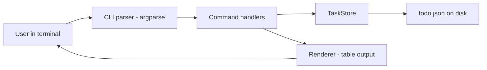
- **CLI parser** turns `sys.argv` into a `Namespace` with the chosen sub-command and its options. It knows nothing about tasks.
- **Command handlers** are plain functions, one per sub-command (`cmd_add(store, args)`), holding the business rules: ids are unique, due dates are parsed, completed tasks cannot be completed twice.
- **TaskStore** loads and saves the JSON file and hands out `Task` objects. Swapping JSON for SQLite later should only touch this box.
- **Renderer** formats tasks into aligned columns with f-string format specs, so output logic stays out of the handlers.

### Data model
| Field | Type | Notes |
|---|---|---|
| `id` | `int` | Monotonic, never reused (store `next_id` in the file) |
| `title` | `str` | Non-empty, stripped |
| `due` | `date \| None` | Stored as ISO 8601 text `"2026-10-03"` |
| `tags` | `list[str]` | Lower-cased, de-duplicated |
| `priority` | `str` | `"low"`, `"normal"`, `"high"` |
| `created_at`, `done_at` | `datetime`, `datetime \| None` | Stored as ISO text with timezone |

The file is `{"version": 1, "next_id": 42, "tasks": [...]}`. The `version` key lets a future release migrate old files.

### Tech stack
| Component | Choice | Why |
|---|---|---|
| Argument parsing | `argparse` | Standard library, sub-commands, generated help |
| Storage | `json` + `pathlib` | Human-readable, diff-able, no install |
| Dates | `datetime` | ISO parsing with `date.fromisoformat` |
| Tests | pytest + `tmp_path` | Each test gets its own throwaway data file |

### Milestones
1. **Parse and echo.** Build the parser with all sub-commands and print the parsed namespace. *Done when* `todo --help` and `todo add --help` show every option.
2. **Add and list.** Implement `Task`, `TaskStore.load/save` and the `add`/`list` handlers. *Done when* added tasks survive a restart.
3. **Change state.** `done`, `undo`, `edit`, `rm`, with proper errors for unknown ids. *Done when* each bad input prints one clear line and exits with status 1.
4. **Filters and sorting.** Tags, overdue, priority ordering. *Done when* `todo list --overdue` shows only past-due open tasks, earliest first.
5. **Safe saves.** Atomic write and a file lock or "last writer wins" note. *Done when* killing the process during a save never corrupts the file.

### Deep dive: the hard parts
- **Atomic saves.** Writing directly over `todo.json` and crashing halfway leaves a truncated, unparseable file. Instead write to `todo.json.tmp` in the same directory, call `flush()` and `os.fsync()`, then `os.replace(tmp, real)`. `os.replace` is atomic on POSIX and Windows when both paths are on the same filesystem: readers see either the old file or the new one, never a mix.
- **Dates and time zones.** A due date is a calendar day, so store a `date`, not a `datetime`. Timestamps like `created_at` should be timezone-aware (`datetime.now(UTC)`) so sorting stays correct if you travel. JSON has no date type, so convert to and from ISO strings at the store boundary and nowhere else.
- **Stable ids.** If ids are list positions, deleting task 2 renames task 3. Keep a `next_id` counter in the file so ids are permanent, the way a database sequence works.

### Testing strategy
Unit-test handlers with an in-memory store, and test `TaskStore` with pytest's `tmp_path` fixture. Test the parser by calling `parser.parse_args([...])` with lists of strings. Add an end-to-end test that runs `main(["add", "x"])` and asserts on captured output (`capsys`). Write one test that simulates a crash: monkeypatch `os.replace` to raise and check the old file is intact.

### Trade-offs, scaling and failure modes
Loading and rewriting the whole file on every command is O(n), which is fine up to tens of thousands of tasks. Two terminals running `todo` at once can lose an update (both read, both write); a lock file or moving to SQLite (Project 9) fixes that. JSON is readable but slow to parse at very large sizes and cannot express dates natively.

### Stretch goals
- Recurring tasks (`--every week`) and natural dates (`--due friday`).
- Shell completion and a `todo export --csv` command.
- A `--json` output flag so other scripts can consume the list.

### Skills practised
- [Ch 3 — Control flow](../chapters/03-control-flow/README.md): `match` on the sub-command.
- [Ch 6 — Dicts, sets and collections](../chapters/06-dicts-sets-collections/README.md): tags as sets, lookup by id.
- [Ch 9 — Errors, exceptions and files](../chapters/09-errors-exceptions-files/README.md): custom exceptions, `pathlib`, JSON, atomic writes.
- [Ch 14 — Standard library tour](../chapters/14-standard-library-tour/README.md): `argparse`, `datetime`.

### In the interview
**30-second answer:** I built `todo`, a zero-dependency task manager CLI that uses `argparse` sub-commands and keeps all state in one versioned JSON file. The main design decision was to put every byte of file I/O behind a `TaskStore` class, so handlers only ever deal with `Task` objects and the format can change later without touching them. The hardest part was not corrupting data, which I solved with a temp-file, `fsync`, `os.replace` atomic save that a test proves by crashing mid-save. Every command finishes in under 100 ms with 10,000 tasks.

**Key terms to know:**
- **Sub-command parser** — `argparse.add_subparsers()` gives `todo add`, `todo done` their own options and help. It builds the CLI layer.
- **Namespace** — the object `parse_args()` returns, with one attribute per option. Handlers read it and never touch `sys.argv`.
- **Atomic write** — the new file is written beside the old one and swapped in with `os.replace`, so readers see the old file or the new one, never half of one. Used by every save.
- **`fsync`** — forces the operating system to push buffered bytes to the disk before the rename, so a power cut cannot leave a renamed but empty file.
- **Exit code** — the number a process returns to the shell: 0 means success and non-zero means failure. `todo done 999` exits with 1 so scripts can detect the error.
- **ISO 8601** — the `2026-10-03` / `2026-10-03T09:00:00+00:00` text format for dates. JSON has no date type, so the store converts at its boundary.
- **Timezone-aware datetime** — a `datetime` that carries its UTC offset (`datetime.now(UTC)`). Used for `created_at`/`done_at` so sorting stays correct across zones.
- **Monotonic id** — a `next_id` counter saved in the file and never reused, like a database sequence, so ids stay stable after deletes.
- **Schema version** — the `"version": 1` key that lets a later release recognise and migrate old files.
- **Lost update** — two processes both read, both change, and the second write erases the first. This is the known concurrency gap of this design.

**Q:** How do you make sure a crash never corrupts the data file?

**A:** I write the whole document to `todo.json.tmp` in the same directory, call `flush()` and `os.fsync()`, then `os.replace(tmp, real)`. The rename is atomic on the same filesystem, so a reader sees either the complete old file or the complete new one. The temp file must be in the same directory, because a rename across filesystems is really a copy and is not atomic.

**Q:** Why not use the list index as the task id?

**A:** Indices shift when items are deleted, so `todo done 3` could complete a different task after an `rm`. A persisted `next_id` counter gives permanent ids, the same idea as a database sequence or auto-increment column.

**Q:** Where would you change the code to switch from JSON to SQLite?

**A:** Only in `TaskStore`. Handlers call `store.add()`, `store.get()` and `store.save()`, and the renderer only sees `Task` objects, so the file format is an implementation detail behind one interface. That is the repository pattern in its smallest form.

**Q:** Why store the due date as a `date` but `created_at` as a timezone-aware `datetime`?

**A:** A due date is a calendar day ("Friday"), not an instant, so a `date` avoids midnight and time-zone off-by-one bugs. `created_at` is a real moment, so it should be an aware `datetime` in UTC. A naive `datetime` has no offset and cannot be compared safely with an aware one: Python raises `TypeError` if you try.

**Q:** Two terminals run `todo add` at the same moment. What happens?

**A:** Both load the same file, each adds its task, and the second `os.replace` wins, so one task is silently lost. The atomic write prevents corruption but not lost updates. Fixes are a lock file (created with `O_CREAT | O_EXCL`, or `fcntl.flock` on POSIX) held across read-modify-write, or moving to SQLite, which serialises writers in transactions.

**Q:** What breaks first at 100x the data, say a million tasks?

**A:** Start-up time, because every command parses and re-serialises the whole JSON file, which is O(n) per command. At that size the 100 ms target is gone. The fix is a store with indexed, partial reads (SQLite), which the `TaskStore` boundary makes a local change.

**Q:** How do you test a CLI without spawning processes?

**A:** I make `main(argv: list[str] | None = None) -> int` and call it directly with lists like `["add", "x"]`, using pytest's `tmp_path` for the data file and `capsys` to capture output. The parser can also be tested alone with `parser.parse_args([...])`. For the crash test I monkeypatch `os.replace` to raise and assert the old file is still valid JSON.

**Q:** How do you make `argparse` call the right handler without a long `if` chain?

**A:** Attach the handler to each sub-parser with `set_defaults`, then dispatch once.
```python
add = sub.add_parser("add")
add.add_argument("title")
add.set_defaults(func=cmd_add)
args = parser.parse_args(argv)
return args.func(store, args)
```
A `match args.command:` statement works too, but `set_defaults` keeps each command's wiring in one place.

**Common mistakes in answers:**
- Saying "I open the file with `"w"` and write it": opening with `"w"` truncates the file first, so a crash leaves it empty. The correct answer is temp file plus `fsync` plus `os.replace`.
- Claiming the atomic write also solves concurrent edits. It only prevents torn files; two writers can still lose an update without a lock.
- Using `datetime.now()` (naive) for timestamps and then comparing them with parsed aware values, which raises `TypeError`.

### TL;DR
A small, dependency-free CLI that teaches the full program loop: parse arguments, validate, load, mutate and atomically save state, with storage hidden behind one class.

## 2. File organiser
**Level:** Beginner · **Time:** 1 weekend · **Prerequisites:** Ch 3, Ch 9, Ch 14

### What it is
A tool that tidies a messy folder such as `~/Downloads` by moving files into sub-folders according to rules: images to `Pictures/2026-10/`, PDFs to `Documents/`, installers older than 30 days to the trash. Rules live in a small TOML file, and every run can be previewed with `--dry-run` and reversed with `undo`. **TOML** is a simple configuration format (`key = "value"` plus `[sections]`) that Python reads with the built-in `tomllib` module.

### The problem it solves
Download folders grow to thousands of files and nobody sorts them by hand. A script that does it on demand, or every night, saves real time. The learning value is in doing destructive file operations **safely**: never losing a file, handling name clashes, and being able to explain and undo what happened.

### Real-world examples
- [organize](https://pypi.org/project/organize-tool/) is an open-source Python file-management automation tool driven by a rules file with filters and actions — the same idea, much further developed.
- The [`pathlib` documentation](https://docs.python.org/3/library/pathlib.html) covers the 3.14 additions `Path.copy()`, `Path.copy_into()`, `Path.move()` and `Path.move_into()`, which replace many uses of `shutil` for this kind of tool.

### Requirements
**Functional**
- Rules match on extension, name pattern (glob), size and age, and choose a destination template like `Pictures/{year}-{month:02}`.
- First matching rule wins. Unmatched files stay put.
- `--dry-run` prints the plan without touching anything. Every real run writes a journal used by `undo`.
- Name clashes are resolved by adding ` (1)`, ` (2)` instead of overwriting.

**Non-functional**
- Handle a folder of 50,000 files in under 10 seconds on an SSD.
- Never overwrite or delete a file without a journal entry.
- Works on Linux, macOS and Windows.

### The architecture
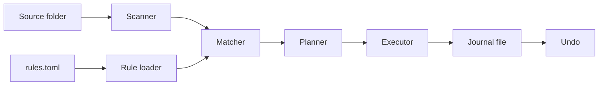
- **Rule loader** parses TOML into a list of `Rule` objects and rejects bad rules early with a line-specific message.
- **Scanner** walks the folder with `Path.iterdir()` (or `Path.walk()` for recursion) and yields file info lazily.
- **Matcher** returns the first rule that matches a file.
- **Planner** turns matches into a list of `Move(src, dst)` operations and resolves clashes. Planning without acting is what makes `--dry-run` trivial.
- **Executor** performs the moves and appends each to the **journal**, a JSON Lines file (one JSON object per line).
- **Undo** reads the latest journal backwards and moves files back.

### Data model
| Type | Fields | Purpose |
|---|---|---|
| `Rule` | name, extensions, glob, min_age_days, max_size, dest_template | One line of policy |
| `FileInfo` | path, size, mtime, suffix | What the scanner saw |
| `Move` | src, dst, rule_name | One planned action |
| Journal line | run_id, src, dst, timestamp | What actually happened |

### Tech stack
| Component | Choice | Why |
|---|---|---|
| Paths and moves | `pathlib` (3.14 `Path.move`) | Object-oriented paths, cross-platform |
| Config | `tomllib` | Built in since 3.11, read-only and safe |
| Patterns | `fnmatch` / `Path.match` | Shell-style globs users already know |
| CLI | `argparse` | `run`, `plan`, `undo` sub-commands |

### Milestones
1. **Scan and print.** List every file with size, age and suffix. *Done when* the scan is lazy (a generator) and skips hidden files on request.
2. **Rules and dry run.** Load TOML rules and print the plan. *Done when* `--dry-run` output matches what a human expects for a sample folder.
3. **Execute with clashes.** Move files, creating folders as needed, renaming on clash. *Done when* two files named `a.pdf` both survive.
4. **Journal and undo.** *Done when* `undo` restores the folder exactly, verified by comparing a before/after listing in a test.
5. **Schedule.** Document a cron or Task Scheduler entry. *Done when* a nightly run works unattended and logs to a file.

### Deep dive: the hard parts
- **Moves across filesystems.** A rename is instant and atomic on the same disk, but moving to another disk is really copy-then-delete. If it fails midway you can end up with two copies or a partial copy. `Path.move()` (and `shutil.move`) falls back to copy-and-delete automatically, so log before and after and verify the size of the copy.
- **Clash resolution races.** Checking `dst.exists()` and then moving is a classic **time-of-check to time-of-use** bug: another process can create the file in between. For a personal tool, plan clashes against the set of names already planned in this run *and* re-check right before each move. Treat a failed move as a logged skip, not a crash.
- **Templated destinations.** `"{year}-{month:02}"` uses `str.format` with values from the file's modification time. Validate templates at load time by formatting them against a dummy file, so a typo fails before any file moves.

### Testing strategy
Use `tmp_path` to build fake folders with known files, set modification times with `os.utime`, run the planner and assert on the plan (pure, fast tests). Run the executor on the same folder, then `undo`, and compare directory listings. Parametrize rule-matching tests over many file names.

### Trade-offs, scaling and failure modes
First-match-wins is easy to explain but means rule order matters. A journal per run makes undo safe but grows forever, so rotate old journals. Watching the folder continuously (with the `watchfiles` package) gives instant sorting but adds a long-running process that must survive errors.

### Stretch goals
- Sort photos by EXIF date taken instead of modification time.
- Detect duplicates before moving (see Project 7).
- A `--watch` mode that reacts to new files.

### Skills practised
- [Ch 3 — Control flow](../chapters/03-control-flow/README.md): rule matching loops.
- [Ch 9 — Errors, exceptions and files](../chapters/09-errors-exceptions-files/README.md): `pathlib`, handling `OSError`.
- [Ch 11 — Iterators, generators and functional tools](../chapters/11-iterators-generators-functional/README.md): lazy scanning.
- [Ch 14 — Standard library tour](../chapters/14-standard-library-tour/README.md): `argparse`, `datetime`, `logging`.

### In the interview
**30-second answer:** I built a rule-driven file organiser that reads rules from TOML and moves files from a messy folder through a scan → match → plan → execute → journal pipeline. The key decision was to separate planning from execution: the plan is a plain list of `Move` objects, so `--dry-run`, logging and tests are trivial, and the executor is a thin loop. The hardest part was doing destructive moves safely: clashes get ` (1)` suffixes, cross-disk moves are verified, and every real move is journalled so `undo` can reverse a run. It sorts 50,000 files in under 10 seconds.

**Key terms to know:**
- **TOML / `tomllib`** — a simple config format and the read-only standard-library parser for it (3.11+). The rules file is TOML.
- **Glob pattern** — shell-style wildcards like `*.pdf` matched with `fnmatch` or `Path.match`. Rules use them on file names.
- **First-match-wins** — rules are tried in order and the first one that matches decides. Simple to explain, but rule order matters.
- **Dry run** — print the plan without changing anything. Possible here because planning is pure.
- **Journal (JSON Lines)** — an append-only file with one JSON object per line recording each move. `undo` reads it backwards.
- **Atomic rename vs copy-and-delete** — a move on the same filesystem is a rename (instant, atomic). Across disks it becomes copy then delete, which can fail halfway.
- **TOCTOU** — time-of-check to time-of-use: checking `dst.exists()` and then moving leaves a gap where another process can create `dst`.
- **Generator (lazy scan)** — the scanner yields one `FileInfo` at a time instead of building a list, so memory stays flat.
- **`Path.move()` (3.14)** — the new `pathlib` method that renames, or copies and deletes when crossing filesystems.

**Q:** Why separate planning from execution?

**A:** The plan is pure data computed from a snapshot of the folder and the rules, so I can unit-test it with no disk changes, print it for `--dry-run` and log it. The executor becomes a short loop with error handling. It is the same idea as Terraform's `plan` and `apply`.

**Q:** What happens when the move crosses disks?

**A:** It stops being a single rename and becomes copy then delete, which is not atomic. If it fails midway you can have a partial copy or two copies. I journal the intent before the move, check the copy's size (or hash) before deleting the source, and treat failures as a logged skip.

**Q:** How does undo stay correct if the user moved files afterwards?

**A:** Undo reads the journal for the run in reverse and, for each entry, checks that the destination still exists and the original path is free. Conflicts are reported instead of guessed, and the user can rerun once they are resolved. A partly applied undo is itself journalled.

**Q:** What is a TOCTOU race here and how do you handle it?

**A:** I check `dst.exists()`, decide the name is free, then move, but another process could create `dst` in between and I would overwrite it. I plan names against the set already chosen in this run and re-check right before each move. On POSIX, `os.rename` silently replaces an existing file, so for full safety you can create the destination exclusively first or use `os.link` plus unlink, which fails if the target exists.

**Q:** Why TOML instead of JSON or YAML for the rules?

**A:** TOML allows comments, is easy to hand-edit, and `tomllib` ships with Python, so there is no dependency. JSON has no comments and is noisy to edit. YAML is powerful but has surprising implicit typing (for example `no` becoming a boolean in YAML 1.1 parsers) and needs a third-party package. The trade-off is that `tomllib` is read-only, which is fine for config.

**Q:** What changes at 10x, say 500,000 files, or with a network share?

**A:** Scanning with `os.scandir` stays fast because it returns cached file type information, but each `stat` and move on a network share costs a round trip. I would batch the scan, show progress, and make the executor resumable from the journal. Rotating old journals also matters because they grow forever.

**Q:** How do you test destructive file operations safely?

**A:** Every test builds a fake folder in `tmp_path`, sets modification times with `os.utime`, and asserts on the plan first. Then it runs the executor and `undo` and compares a sorted listing of (relative path, size, hash) before and after. Rule matching is parametrized over many file names.

**Q:** How do you resolve a clash name like `report (2).pdf`?

**A:** Use `Path.stem` and `Path.suffix` and count up until a name is free both on disk and in this run's planned set.
```python
def free_name(dst: Path, taken: set[Path]) -> Path:
    n, cand = 1, dst
    while cand.exists() or cand in taken:
        cand = dst.with_name(f"{dst.stem} ({n}){dst.suffix}")
        n += 1
    return cand
```

**Common mistakes in answers:**
- Saying `shutil.move` or `Path.move` is always atomic. It is only a rename on the same filesystem; across disks it is copy plus delete.
- Planning name clashes only against the disk and forgetting that two files in the same run can target the same name.
- Treating `undo` as "move everything back" without checking whether the world changed since the run.

### TL;DR
Rules in TOML drive a scan → plan → execute → journal pipeline, which makes destructive file moves previewable, safe on clashes and reversible.

## 3. Password and passphrase generator
**Level:** Beginner · **Time:** 1 weekend · **Prerequisites:** Ch 4, Ch 7, Ch 14

### What it is
A CLI and small library that generates strong random passwords (`k#9Qv!r2...`), memorable passphrases (`correct-horse-battery-staple` style, from a word list), and PINs, and reports the **entropy** of each: a measure, in bits, of how many guesses an attacker needs. Each extra bit doubles the guesses.

### The problem it solves
People reuse weak passwords because strong ones are hard to invent. A generator solves that, but only if it uses a **cryptographically secure** random source — one whose output cannot be predicted even by someone who has seen earlier outputs. The project teaches the difference between `random` (fast, predictable, fine for games and simulations) and `secrets` (unpredictable, meant for security), which is a common interview question.

### Real-world examples
- The [`secrets` module documentation](https://docs.python.org/3/library/secrets.html) explains why `random` must not be used for security and shows password recipes.
- [NIST SP 800-63B](https://pages.nist.gov/800-63-4/sp800-63b.html) is the US government's digital identity guideline. It favours length over forced complexity rules and recommends checking new passwords against lists of known-compromised ones.
- The [EFF dice-generated passphrase page](https://www.eff.org/dice) publishes word lists designed for passphrases, with words chosen to be easy to type and distinguish.

### Requirements
**Functional**
- Passwords: length, character classes (lower, upper, digits, symbols), "at least one of each class", exclude look-alikes (`0O1lI`).
- Passphrases: word count, separator, optional capitalisation and number, custom word list.
- Print entropy in bits and a plain-English strength label.
- `--count N` generates many at once. `--copy` puts one on the clipboard (optional dependency).

**Non-functional**
- Every random choice comes from `secrets`. A test enforces that `random` is never imported.
- Generate 10,000 passwords in under 1 second.
- Never write generated secrets to logs or disk.

### The architecture
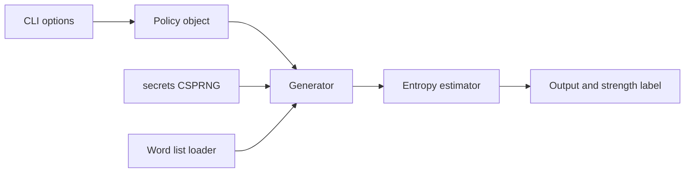
- **Policy** is a frozen dataclass describing what to generate. Validation (length at least 8, at least one class) lives here.
- **Generator** builds the alphabet from the policy and draws characters or words with `secrets.choice`.
- **Word list loader** reads and de-duplicates a list, rejecting lists that are too short to be useful.
- **Entropy estimator** computes bits from the alphabet size and length, which is accurate only because the output is truly random.

### Data model
| Type | Key fields | Notes |
|---|---|---|
| `PasswordPolicy` | length, use_lower, use_upper, use_digits, use_symbols, exclude_ambiguous, require_each | Frozen dataclass |
| `PassphrasePolicy` | words, separator, capitalize, add_number, wordlist_path | Frozen dataclass |
| `Result` | value, entropy_bits, label | Returned by every generator |

### Tech stack
| Component | Choice | Why |
|---|---|---|
| Randomness | `secrets.choice`, `secrets.randbelow` | OS-backed CSPRNG |
| Alphabets | `string.ascii_letters`, `string.digits`, `string.punctuation` | No hand-typed lists |
| Maths | `math.log2` | Entropy in bits |
| CLI | `argparse` with mutually exclusive groups | `password` vs `passphrase` modes |

### Milestones
1. **Basic password.** Fixed length from letters and digits. *Done when* 1,000 outputs are all distinct and the right length.
2. **Policies.** All character-class options and look-alike exclusion. *Done when* invalid policies raise a clear `ValueError`.
3. **Guarantee each class.** *Done when* every output contains each requested class, without biasing the result (see deep dive).
4. **Passphrases.** Word list loading and options. *Done when* a 6-word passphrase from a 7,776-word list reports about 77.5 bits.
5. **Entropy and labels.** *Done when* labels match thresholds documented in the README.

### Deep dive: the hard parts
- **Entropy, correctly.** For a uniformly random string of length L from an alphabet of N symbols, entropy is `L × log2(N)`. A 16-character password over 94 printable symbols has about 105 bits. A 6-word passphrase from 7,776 words has `6 × log2(7776)` ≈ 77.5 bits. This formula only applies to random output — a human-chosen password has far less entropy than its length suggests.
- **"At least one of each" without bias.** The naive fix — replace a random position with a digit if none exists — slightly changes the distribution. Two clean approaches: **rejection sampling** (generate, and if a class is missing, throw it away and try again) or "one from each class, fill the rest from the full alphabet, then shuffle with `secrets.SystemRandom().shuffle`". Rejection sampling is simplest to reason about.
- **Modulo bias.** If you turned random bytes into indices with `byte % N`, values below `256 % N` would appear more often. `secrets.randbelow` and `secrets.choice` already avoid this, which is one reason to use them rather than rolling your own.

### Testing strategy
Property tests with Hypothesis: for any valid policy, the output has the right length and only allowed characters. A statistical smoke test: over 100,000 draws each character appears with roughly equal frequency (a chi-squared test with a loose threshold, so it does not flake). A test that greps the source for `import random`. Test entropy maths against hand-computed values.

### Trade-offs, scaling and failure modes
Passphrases are easier to remember and type on phones but need more characters for the same entropy. Symbol-heavy passwords are rejected by some websites, so allow per-site policies. Clipboard support leaks secrets to clipboard history on some systems — warn about it. The biggest real-world failure is using `random`, which is a Mersenne Twister whose future output can be predicted after observing 624 outputs of 32 bits.

### Stretch goals
- Check candidates against the "Have I Been Pwned" range API using k-anonymity (only the first 5 characters of the SHA-1 hash leave your machine).
- A deterministic "password from master secret + site name" mode using `hashlib.scrypt`, and a write-up of its risks.
- A tiny GUI with `tkinter`.

### Skills practised
- [Ch 4 — Strings](../chapters/04-strings/README.md): `string` constants, joining.
- [Ch 7 — Functions](../chapters/07-functions/README.md): keyword-only arguments for policies.
- [Ch 10 — OOP in Python](../chapters/10-oop-in-python/README.md): frozen dataclasses.
- [Ch 14 — Standard library tour](../chapters/14-standard-library-tour/README.md): `random` vs `secrets`.
- [Ch 15 — Testing and debugging](../chapters/15-testing-and-debugging/README.md): Hypothesis property tests.

### In the interview
**30-second answer:** I built a password and passphrase generator, as a CLI and a small library, that draws every random choice from the `secrets` module and reports entropy in bits with a strength label. The key decision was to describe each request as a frozen policy dataclass and keep generation separate, so validation and maths are easy to test. The hardest part was the "at least one digit, one symbol" rule without biasing the output, which I solved with rejection sampling. A 16-character password over 94 symbols reports about 105 bits, and a 6-word EFF passphrase about 77.5 bits.

**Key terms to know:**
- **CSPRNG** — cryptographically secure pseudo-random number generator: its output cannot be predicted even after seeing earlier output. `secrets` uses the operating system's one.
- **Mersenne Twister** — the algorithm behind `random`. Fast and good for simulations, but its full internal state can be reconstructed from 624 consecutive 32-bit outputs.
- **Entropy (bits)** — `L × log2(N)` for L symbols drawn uniformly from N choices. Each extra bit doubles the attacker's guesses. Shown with every result.
- **Uniform distribution** — every allowed output is equally likely. The entropy formula is only true when this holds.
- **Rejection sampling** — generate, throw away outputs that break a constraint, try again. Keeps the accepted outputs uniform.
- **Modulo bias** — turning random bytes into indices with `% N` makes small values more likely unless 256 is a multiple of N. `secrets.randbelow` avoids it.
- **Frozen dataclass** — `@dataclass(frozen=True)` makes policy objects immutable and hashable, and validation runs in `__post_init__`.
- **Passphrase / word list** — several random words from a list such as EFF's 7,776-word list, about 12.9 bits per word.
- **Property-based test** — Hypothesis generates many random valid policies and checks invariants like length and allowed characters.

**Q:** Why `secrets` and not `random`?

**A:** `random` uses the Mersenne Twister, which is deterministic: anyone who sees enough outputs (624 32-bit values) can reconstruct its state and predict all future ones. `secrets` draws from the operating system's CSPRNG (via `os.urandom` / `random.SystemRandom`), which is designed to be unpredictable. Use `random` for games and simulations, `secrets` for passwords, tokens and keys.

**Q:** How strong is a 12-character password of lowercase letters?

**A:** `12 × log2(26)` ≈ 56.4 bits, if it is truly random. That is a little more than four words from a 7,776-word list (about 51.7 bits) and far less than 16 characters over 94 symbols (about 104.9 bits).

**Q:** How do you force one digit without biasing the result?

**A:** Rejection sampling: generate from the full alphabet and regenerate if the constraint fails. Every accepted password is then uniformly random among all valid ones. The naive "overwrite a random position with a digit" makes some outputs more likely than others. Rejection is cheap here because most long random passwords already contain each class.

**Q:** Why is the entropy number meaningless for a password a human chose?

**A:** The formula assumes every character was picked uniformly at random. People pick words, names and patterns like `Summer2026!`, which attackers try first, so the real search space is far smaller than `L × log2(94)`. That is why the tool only reports entropy for passwords it generated.

**Q:** Passphrase or password: which would you recommend and why?

**A:** For something a human types and remembers, a passphrase: six random words give about 77.5 bits and are easy to type on a phone. For a password manager entry nobody types, a long random character password packs more entropy per character. NIST SP 800-63B also favours length over composition rules, which supports passphrases.

**Q:** How do you test that output is random without flaky tests?

**A:** I test properties, not values: length, allowed characters, each required class present, and that 1,000 outputs are distinct. A chi-squared test over 100,000 draws checks roughly equal character frequencies with a loose threshold so it practically never fails by chance. A source check asserts `random` is never imported.

**Q:** What happens if the word list is short or has duplicates?

**A:** Duplicates silently lower entropy because some words become more likely, and a short list gives weak phrases. The loader de-duplicates, refuses lists below a minimum size, and computes entropy from the de-duplicated count, never the raw line count.

**Q:** How do you generate a password with `secrets` in a few lines?

**A:** Build the alphabet from `string` constants and call `secrets.choice` per character.
```python
import secrets, string
alphabet = string.ascii_letters + string.digits + string.punctuation
pw = "".join(secrets.choice(alphabet) for _ in range(16))
```
For URL-safe tokens, `secrets.token_urlsafe(32)` gives 32 random bytes encoded as text.

**Common mistakes in answers:**
- Saying `random.seed(time.time())` makes `random` secure. Seeding with a guessable value makes it even easier to predict.
- Computing entropy from the length of a human-chosen password, or from a word list without removing duplicates.
- Claiming "replace one character with a digit" is fine. It biases the distribution; rejection sampling does not.

### TL;DR
Secure generation is one line (`secrets.choice`) — the real lessons are entropy maths, unbiased constraints and why `random` is unsafe for anything security-related.

## 4. CSV expense report
**Level:** Beginner · **Time:** 1 weekend · **Prerequisites:** Ch 5, Ch 6, Ch 9, Ch 14

### What it is
A tool that reads bank or card exports in **CSV** (comma-separated values — a text table, one row per line), categorises each transaction with keyword rules, and prints a monthly report: totals by category, top merchants, month-over-month change and a list of transactions it could not categorise. It can also write the report as Markdown or a new CSV.

### The problem it solves
Banks export transactions in slightly different CSV layouts and nobody wants to sum them by hand in a spreadsheet each month. The project teaches messy real-world input (different column names, date formats, thousands separators, negative signs) and correct money arithmetic, which floating-point numbers get wrong.

### Real-world examples
- [csvkit](https://csvkit.readthedocs.io/) is a suite of Python command-line tools for converting and querying CSV files — a reference for robust CSV handling.
- The [`csv` module documentation](https://docs.python.org/3/library/csv.html) explains dialects, quoting and why files must be opened with `newline=""`.
- The [`decimal` module documentation](https://docs.python.org/3/library/decimal.html) explains exact decimal arithmetic for money.

### Requirements
**Functional**
- Import one or more CSV files using a per-bank **profile** (column mapping, date format, decimal separator, sign convention).
- Categorise with ordered keyword or regex rules from a config file. Unmatched rows go to "Uncategorised".
- Report per month: total in, total out, per-category totals and share, top 5 merchants, change versus previous month.
- De-duplicate transactions when overlapping exports are imported twice.

**Non-functional**
- Totals are exact to the cent — no float rounding errors.
- 100,000 rows processed in under 2 seconds.
- A malformed row produces a warning with file and line number, not a crash.

### The architecture
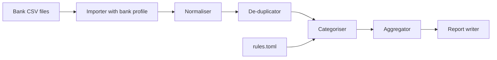
- **Importer** uses `csv.DictReader` and a profile to map bank-specific columns to standard fields.
- **Normaliser** parses dates and amounts into `date` and `Decimal`, and cleans merchant names (upper-case, strip card numbers).
- **De-duplicator** drops rows whose (date, amount, merchant) key was already seen.
- **Categoriser** applies the first matching rule.
- **Aggregator** groups by (month, category) using dictionaries or `Counter`.
- **Report writer** renders Markdown tables or CSV.

### Data model
| Type | Fields |
|---|---|
| `Transaction` | date, amount (`Decimal`, negative = spend), merchant, raw_description, source_file, line_no, category |
| `BankProfile` | date_column, date_format, amount_column or debit/credit columns, decimal_sep, encoding |
| `Rule` | category, pattern, is_regex |
| `MonthlySummary` | month, income, spend, by_category (dict), top_merchants (list) |

### Tech stack
| Component | Choice | Why |
|---|---|---|
| Reading | `csv.DictReader` | Handles quoting and embedded commas |
| Money | `decimal.Decimal` | Exact base-10 arithmetic |
| Grouping | `collections.Counter`, `defaultdict` | Totals in one pass |
| Encoding | `open(..., encoding="utf-8-sig")` | Strips the byte-order mark Excel adds |

### Milestones
1. **Read one bank.** Hard-code one profile and print parsed transactions. *Done when* dates and amounts are real `date`/`Decimal` objects.
2. **Profiles.** Load profiles from config and support two banks. *Done when* both sample files normalise to identical structures.
3. **Categorise.** *Done when* at least 90 % of your own sample rows are categorised and the rest are listed.
4. **Report.** Monthly summary in the terminal and as Markdown. *Done when* totals match a spreadsheet check to the cent.
5. **De-duplicate and warn.** *Done when* importing the same file twice gives the same report, and a corrupted row prints `file:line` and continues.

### Deep dive: the hard parts
- **Why not float?** `0.1 + 0.2` is `0.30000000000000004` because binary floating point cannot represent most decimal fractions exactly. Summing thousands of amounts accumulates such errors. Parse amounts with `Decimal("12.34")` from the **string** (never from a float) and keep them as `Decimal` until display.
- **Locale-formatted numbers.** `1.234,56` in a German export means one thousand two hundred thirty-four and 56 cents. Strip the thousands separator, replace the decimal separator with `.`, then parse. Handle debit and credit in separate columns, parentheses for negatives, and trailing minus signs — profile flags make each explicit.
- **De-duplication keys.** Two real coffees for the same price on the same day look identical. Include an occurrence counter in the key (`(date, amount, merchant, n)`, where `n` counts repeats within one file) so genuine repeats survive but overlapping imports do not double-count.

### Testing strategy
Small fixture CSVs for each bank profile, including nasty rows (quoted commas, BOM, blank lines). Assert exact `Decimal` totals. Parametrize amount parsing over many formats. Golden-file test: the Markdown report for a fixture month must match a committed expected file.

### Trade-offs, scaling and failure modes
Keyword rules are transparent but need upkeep; a learned classifier (stretch) is smarter but harder to trust. Loading everything into memory is fine for personal data. For millions of rows, stream with generators or use pandas/polars (Project 31). Bank format changes silently break parsing, so validate headers and fail loudly when expected columns are missing.

### Stretch goals
- Budgets per category with warnings when exceeded.
- A bar chart per month with matplotlib.
- Suggest rules for uncategorised merchants based on frequency.

### Skills practised
- [Ch 5 — Lists, tuples and arrays](../chapters/05-lists-tuples-arrays/README.md): sorting by key.
- [Ch 6 — Dicts, sets and collections](../chapters/06-dicts-sets-collections/README.md): `Counter`, `defaultdict`.
- [Ch 9 — Errors, exceptions and files](../chapters/09-errors-exceptions-files/README.md): `csv`, encodings, warnings.
- [Ch 14 — Standard library tour](../chapters/14-standard-library-tour/README.md): `decimal`, `datetime`.

### In the interview
**30-second answer:** I built an expense reporter that imports CSV exports from several banks through per-bank profiles, normalises them into `Transaction` objects with `date` and `Decimal` amounts, categorises them with ordered rules and prints a monthly report. The key decision was profiles: each bank's column names, date format and decimal separator are config, so adding a bank needs no code. The hardest part was messy input, like `1.234,56`, BOMs, debit/credit columns and overlapping exports, which I solved with an explicit normaliser and an occurrence-counted de-duplication key. Totals match a spreadsheet to the cent, and 100,000 rows take under 2 seconds.

**Key terms to know:**
- **`Decimal`** — exact base-10 arithmetic from the `decimal` module. All amounts are `Decimal`, created from strings, never floats.
- **Binary floating point** — `float` stores numbers in base 2, so `0.1 + 0.2 != 0.3`. That is why money is not a float.
- **`csv.DictReader`** — reads rows as dicts keyed by header, handling quoting and commas inside quoted fields. The importer uses it.
- **`newline=""`** — the required way to open a file for `csv`, so the module sees raw line endings, including newlines inside quoted fields.
- **BOM / `utf-8-sig`** — Excel adds a byte-order mark at the start of UTF-8 files. `utf-8-sig` strips it so the first header is not `Date`.
- **Bank profile** — config describing one bank's columns, date format, separators and sign convention.
- **De-duplication key** — `(date, amount, merchant, n)` where `n` counts repeats within one file, so real repeats survive but re-imports do not double-count.
- **`Counter` / `defaultdict`** — dicts that count or create default values. Used to total by (month, category) in one pass.
- **Golden-file test** — compare generated output with a committed expected file.

**Q:** Why use `Decimal` for money?

**A:** Floats are binary and cannot represent values like 0.10 exactly, so sums of thousands of amounts drift by fractions of a cent. `Decimal` does exact base-10 arithmetic with controllable rounding (for example `ROUND_HALF_EVEN`, also called banker's rounding). An alternative is integer cents, which is also exact.

**Q:** Why must you build `Decimal` from a string, not a float?

**A:** `Decimal(0.1)` copies the float's exact binary value, `0.1000000000000000055511151231257827...`, so the error is already baked in. `Decimal("0.1")` is exactly one tenth. The importer passes the cleaned text from the CSV straight to `Decimal`.

**Q:** Why open CSV files with `newline=""`?

**A:** The `csv` module handles line endings itself, including newlines inside quoted fields. If Python's universal-newline translation runs first, a quoted multi-line field can be split or altered, and on Windows writing without it adds blank lines between rows.

**Q:** How do you avoid double-counting overlapping exports?

**A:** Build a deterministic key per transaction and skip keys already seen. A plain `(date, amount, merchant)` key would drop two genuine identical coffees, so the key includes `n`, the occurrence number of that triple within its file. Importing the same file twice gives the same `n` values and is ignored, while two real coffees get `n=1` and `n=2`.

**Q:** Why profiles in config instead of one smart auto-detecting parser?

**A:** Auto-detection guesses, and a wrong guess about `1.234` (one thousand or one point two?) silently corrupts totals. Profiles make every assumption explicit and testable, and the importer validates headers so a bank changing its format fails loudly. The cost is writing a profile per bank.

**Q:** What happens with a malformed row?

**A:** The normaliser raises a specific error for that row, the importer catches it, records `file:line` and the reason as a warning, and continues. The report lists the skipped rows so totals are never silently wrong. Missing required columns, by contrast, stop the import immediately.

**Q:** What changes at 100x, say ten million rows?

**A:** Loading all rows into a list first becomes the memory problem. I would stream rows through generators straight into the aggregators, which only keep per-(month, category) totals, or switch to polars/pandas for vectorised parsing (Project 31). De-duplication keys still need memory, so a key set per month or a SQLite table helps.

**Q:** How do you parse `1.234,56` and `(12.50)` correctly?

**A:** Normalise the text using the profile, then build the `Decimal`.
```python
def parse_amount(s: str, thou: str, dec: str) -> Decimal:
    s = s.strip()
    neg = s.startswith(("(", "-")) or s.endswith("-")
    s = s.strip("()-").replace(thou, "").replace(dec, ".")
    d = Decimal(s)
    return -d if neg else d
```

**Common mistakes in answers:**
- Saying "I round floats at the end", which hides but does not remove accumulated errors and fails exact-to-the-cent checks.
- Writing `Decimal(float_value)`, which keeps the binary error.
- De-duplicating on `(date, amount, merchant)` alone and deleting genuine repeated purchases.

### TL;DR
Map messy bank CSVs through profiles into clean `Transaction` objects with `Decimal` amounts, then categorise, de-duplicate and aggregate into a monthly report that is correct to the cent.

## 5. Web server log analyser
**Level:** Beginner · **Time:** 1–2 weekends · **Prerequisites:** Ch 4, Ch 6, Ch 11

### What it is
A CLI that reads web server **access logs** — text files where each line records one HTTP request (client IP, time, method, path, status code, bytes, user agent) — and produces a report: requests per minute, top paths, error rate, slowest endpoints, top clients and a list of suspicious patterns. It works on plain and gzip-compressed files and can follow a live log like `tail -f`.

### The problem it solves
When a site slows down or gets attacked, the first evidence is in the access log, which can be gigabytes. Engineers need answers in seconds: which endpoint is failing, who is hammering us, when did it start. The project teaches regular expressions, streaming large files with generators, and aggregation with counters — all core interview topics.

### Real-world examples
- [GoAccess](https://goaccess.io/) is an open-source real-time log analyser for terminals and browsers. It shows the kind of report users expect.
- The [`re` module documentation](https://docs.python.org/3/library/re.html) covers named groups and compiled patterns used for parsing each line.

### Requirements
**Functional**
- Parse the Common and Combined Log Formats, with optional response-time field. Unknown lines are counted, not fatal.
- Filters: time range, status class (`5xx`), path prefix.
- Report: totals, requests per minute (peak and average), top N paths/IPs/user agents, status code breakdown, p50/p95/p99 latency per path.
- Read `.log` and `.gz` files, multiple files in time order, and `--follow`.

**Non-functional**
- Constant memory regardless of file size (except per-key counters).
- At least 200,000 lines per second on a laptop for a simple report.
- Output as a text table or JSON.

### The architecture

- **Line reader** is a generator that opens each file (using `gzip.open` for `.gz`) and yields lines one at a time.
- **Parser** turns a line into a `Hit` object using one compiled regex with named groups. Malformed lines increment a counter.
- **Filter chain** is a list of predicate functions applied lazily (`filter`).
- **Aggregators** are small objects with `add(hit)` and `result()`: counter of paths, per-minute histogram, latency collectors.
- **Reporter** formats the results.

### Data model
| Type | Fields |
|---|---|
| `Hit` | ip, ts (`datetime`), method, path, status, size, referrer, user_agent, duration_ms |
| `Aggregator` protocol | `add(hit) -> None`, `result() -> dict` |
| Report | totals, per_minute, top_paths, status_counts, latency_percentiles |

### Tech stack
| Component | Choice | Why |
|---|---|---|
| Parsing | `re` with named groups | One pass per line, readable |
| Streaming | generators, `itertools` | Constant memory |
| Counting | `collections.Counter` with `most_common` | Top-N in one call |
| Percentiles | `statistics.quantiles` or sorted list | Built in |
| Compression | `gzip` | Read rotated logs directly |

### Milestones
1. **Parse.** Regex for Combined Log Format. *Done when* 100 % of a sample file parses and a deliberately broken line is counted as malformed.
2. **Stream and count.** Top paths and status codes. *Done when* memory stays flat on a 1 GB synthetic log.
3. **Time buckets.** Requests per minute and peak minute. *Done when* the peak matches a manual check.
4. **Latency percentiles.** *Done when* p95 per path is reported, matching `statistics.quantiles`.
5. **Follow mode and JSON.** *Done when* `--follow` updates counts as new lines are appended.

### Deep dive: the hard parts
- **Regex performance.** Compile once at module level, anchor it (`^...$`), and avoid patterns with nested quantifiers like `(.*)*` that cause **catastrophic backtracking**, where the engine tries exponentially many ways to match. Use specific classes like `[^"]*` for quoted fields.
- **Parsing timestamps fast.** `datetime.strptime` is slow when called millions of times. Logs use a fixed format like `10/Oct/2026:13:55:36 +0000`, so slice the string and map the month name with a dict, or cache parsed minute prefixes: many lines share the same minute.
- **Percentiles without storing everything.** Exact percentiles need all values. For a beginner version, keep a list per path. For huge logs, use a fixed-size **histogram** of latency buckets (for example 1 ms, 2 ms, 5 ms, 10 ms...) and estimate percentiles from bucket counts, trading a little precision for constant memory.

### Testing strategy
Fixture lines covering every field variant. Parametrized parser tests, including malformed lines. Test each aggregator in isolation. Generate a synthetic log with a known distribution and check the report. Benchmark lines per second with `time.perf_counter` and fail the test only if it drops dramatically.

### Trade-offs, scaling and failure modes
A single process is enough for a few GB. Beyond that, split files across processes with `multiprocessing` and merge counters (counters add up, which is why they parallelise well). Log formats vary per server configuration — make the regex configurable. Log lines contain personal data (IPs), so be careful where reports go.

### Stretch goals
- Detect bursts (requests per IP per minute above a threshold) as a crude attack detector.
- Render an HTML report with a small chart.
- Parallel mode with `ProcessPoolExecutor` merging `Counter` objects.

### Skills practised
- [Ch 4 — Strings](../chapters/04-strings/README.md): regex basics.
- [Ch 6 — Dicts, sets and collections](../chapters/06-dicts-sets-collections/README.md): `Counter`, `defaultdict`.
- [Ch 11 — Iterators, generators and functional tools](../chapters/11-iterators-generators-functional/README.md): generator pipelines.
- [Ch 17 — Performance, memory and internals](../chapters/17-performance-memory-internals/README.md): profiling the hot loop.

### In the interview
**30-second answer:** I built a log analyser that streams web server access logs, plain or gzipped, through a generator pipeline of read → parse → filter → aggregate and prints traffic, error rates, top paths and latency percentiles. The key decision was streaming: memory depends on the number of distinct keys, not on file size, so a 20 GB log works on a laptop. The hardest parts were throughput and accuracy, which I solved with one anchored, compiled regex, a cached timestamp parser, and histogram buckets for percentiles. It handles over 200,000 lines per second.

**Key terms to know:**
- **Combined Log Format** — the standard access-log line: IP, time, request, status, bytes, referrer, user agent.
- **Generator pipeline** — each stage is a generator that yields to the next, so only one line is in memory at a time.
- **Compiled regex with named groups** — `re.compile(r'(?P<ip>\S+) ...')` compiled once and read with `m["ip"]`. The parser uses it.
- **Catastrophic backtracking** — a regex with ambiguous nested repetition tries exponentially many paths on a failing line. Avoided with precise classes like `[^"]*`.
- **`Counter.most_common(k)`** — top-k from a counter, using a heap for small k.
- **Percentile (p50/p95/p99)** — the value below which that share of requests fall. p95 latency shows what slow users feel.
- **Histogram buckets** — fixed latency ranges with counts. Gives approximate percentiles in constant memory.
- **Follow mode** — like `tail -f`, keep reading as new lines are appended, and handle log rotation.
- **Mergeable aggregates** — counters add up, so per-process results can be combined. Enables parallel mode.

**Q:** How do you process a 20 GB log on a machine with 8 GB of RAM?

**A:** Stream it line by line with generators and keep only aggregates. Iterating a file object reads buffered chunks, and `gzip.open` decompresses on the fly. Memory then depends on the number of distinct paths and IPs, not on file size.

**Q:** How would you find the top 10 IPs?

**A:** Count with a `Counter` while streaming, then call `most_common(10)`, which uses `heapq.nlargest` and runs in O(n log k) for n distinct keys. Sorting all keys would be O(n log n), which is wasteful when k is tiny.

**Q:** What is catastrophic backtracking?

**A:** When a regex like `(.*)*x` or `(a+)+` fails to match, the engine tries every way to split the input between the nested quantifiers, which can take exponential time. One bad line can stall the analyser. Anchor the pattern, use precise character classes like `[^"]*` for quoted fields, and test with deliberately malformed long lines.

**Q:** How do you compute p95 latency without storing every value?

**A:** Exact percentiles need all values or a sort. For large logs I keep a fixed histogram of buckets per path (1, 2, 5, 10, 20, 50 ms ...) and walk the cumulative counts to the bucket containing the 95th percentile. Memory is constant per path and the error is bounded by bucket width. Sketches like HDR Histogram or t-digest are the production versions of this idea.

**Q:** Why is `datetime.strptime` a bottleneck and how do you fix it?

**A:** It is general-purpose and slow when called millions of times. Log timestamps have a fixed layout, so I slice the string and map the month name with a dict, or cache the parsed result by the minute prefix, since thousands of lines share the same minute. Profiling with `cProfile` shows this as one of the top costs before the fix.

**Q:** How would you make it use all CPU cores?

**A:** Parsing is CPU-bound, so threads do not help on the standard GIL build. I would split files (or byte ranges aligned to newlines) across a `ProcessPoolExecutor`, have each worker return its `Counter`s and histograms, and merge them with `+`. That works because counts are associative: the merge order does not matter.

**Q:** What happens with a malformed line, or log rotation during `--follow`?

**A:** A line the regex does not match increments a `malformed` counter and is skipped, so one bad line never stops a report. For follow mode, I watch the file's inode and size: if the inode changes or the size shrinks, the log was rotated or truncated, so I reopen the path from the start.

**Q:** How do you test it?

**A:** Parametrized parser tests over fixture lines for every field variant, including malformed ones. Each aggregator is tested alone. A synthetic log with a known distribution checks the whole report, and a benchmark measures lines per second with `time.perf_counter`, failing only on a large regression.

**Q:** Write a streaming top-paths counter.

**A:**
```python
LINE = re.compile(r'^(?P<ip>\S+) \S+ \S+ \[(?P<ts>[^\]]+)\] "(?P<m>\S+) (?P<path>\S+)[^"]*" (?P<st>\d{3})')
def paths(lines):
    for line in lines:
        if m := LINE.match(line):
            yield m["path"]
top = Counter(paths(open("access.log"))).most_common(10)
```

**Common mistakes in answers:**
- Reading the file with `readlines()` or `read()`, which loads everything into memory.
- Proposing threads to speed up regex parsing; on the default build the GIL means only one thread runs Python bytecode at a time.
- Averaging per-file p95 values to get an overall p95. Percentiles do not average; merge the histograms instead.

### TL;DR
A streaming generator pipeline — read, parse with a compiled regex, filter, aggregate — that answers operational questions about huge logs in constant memory.

## 6. Flashcards with spaced repetition
**Level:** Beginner · **Time:** 1–2 weekends · **Prerequisites:** Ch 6, Ch 9, Ch 10

### What it is
A terminal flashcard app. You keep decks of question/answer cards in a text file, and each day the app shows only the cards that are **due**. After each answer you grade yourself (again, hard, good, easy), and a **spaced-repetition** algorithm schedules the card's next review: cards you know well come back after weeks, cards you miss come back tomorrow.

### The problem it solves
Memory fades quickly unless you review at the right moment, just before you forget. Reviewing everything every day wastes time; reviewing randomly misses the hard cards. Spaced repetition is one of the most reliable study techniques, and building it teaches state machines, date arithmetic and persistence — and you can use the app to learn this book's glossary.

### Real-world examples
- [Anki's FAQ on its scheduling algorithms](https://faqs.ankiweb.net/what-spaced-repetition-algorithm.html) describes its modified SM-2 scheduler and FSRS (Free Spaced Repetition Scheduler), available since Anki 23.10, which fits a memory model to your review history.
- SM-2, the algorithm from SuperMemo that Anki's classic scheduler is based on, is simple enough to implement in an afternoon, which is why this brief uses it.

### Requirements
**Functional**
- Import decks from a simple format (`question :: answer` per line, or CSV).
- Daily session: show due cards, then up to N new cards. Reveal answer on Enter, then grade 1–4.
- Schedule with SM-2: track interval, ease factor and repetition count per card.
- Statistics: cards due today and in the next 7 days, retention rate, streak.

**Non-functional**
- Review state saved after every answer, so quitting mid-session loses nothing.
- A deck of 10,000 cards loads in under 300 ms.
- Editing a card's text must not reset its schedule.

### The architecture
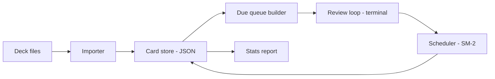
- **Importer** reads deck files and gives each card a stable id (a hash of the question text plus deck name), so re-importing updates rather than duplicates.
- **Card store** keeps cards and their review state.
- **Due queue builder** selects cards with `due <= today`, oldest first, plus a capped number of new cards.
- **Review loop** handles input and display.
- **Scheduler** is a pure function `schedule(state, grade, today) -> new_state`. Keeping it pure makes it trivial to test.

### Data model
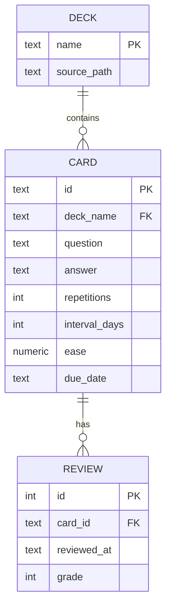
Storing every review (not just the current state) lets you change the algorithm later and replay history.

### Tech stack
| Component | Choice | Why |
|---|---|---|
| Storage | JSON file (or `sqlite3` as stretch) | Simple, inspectable |
| Dates | `datetime.date`, `timedelta` | Day-level scheduling |
| Ids | `hashlib.sha1` of question text | Stable across edits of answer |
| Modelling | dataclasses | Clear state objects |

### Milestones
1. **Import and show.** Load a deck and loop through cards. *Done when* a 50-card deck plays end to end.
2. **SM-2.** Implement the scheduler as a pure function. *Done when* unit tests reproduce a hand-worked sequence of intervals.
3. **Persistence.** Save after each grade. *Done when* killing the app mid-session and restarting resumes correctly.
4. **Due queue and new-card cap.** *Done when* a session shows only due cards plus at most N new ones.
5. **Stats.** *Done when* the forecast for the next 7 days matches the stored due dates.

### Deep dive: the hard parts
- **SM-2 in plain words.** Each card has an **ease factor** (starts at 2.5) and an **interval**. On a correct answer, the interval grows: 1 day, then 6 days, then previous interval × ease. The ease rises slightly for easy answers and falls for hard ones, but never below 1.3. A failed answer resets repetitions and the interval to 1 day. That is the entire algorithm. The subtlety is clamping and rounding consistently.
- **"Today" is a moving target.** If you study at 00:30, is that today or yesterday? Many apps define a day as starting at 4 a.m. local time. Make "today" a parameter of the scheduler instead of calling `date.today()` inside it — this also makes tests deterministic.
- **Card identity.** If the id is the line number, inserting a card shifts all ids. Hashing the question gives stability, but editing the question then creates a "new" card. Decide explicitly, document it, and offer a `rename` command that moves history.

### Testing strategy
Table-driven tests for `schedule()` covering each grade from each state. Freeze "today" by passing dates. Simulate 100 days of reviews with a fake student who answers correctly with some probability, and assert intervals grow and due counts stay bounded. Round-trip tests for the store.

### Trade-offs, scaling and failure modes
SM-2 is simple and predictable but ignores your actual forgetting curve; FSRS-style models adapt but need history and optimisation. A JSON store rewrites the whole file per answer, which is fine for thousands of cards; SQLite scales better and supports queries for stats. Overdue backlogs after a holiday can be overwhelming — cap daily reviews and spread the backlog.

### Stretch goals
- Cloze deletions (`The GIL was made optional in {{3.13}}`).
- Load this book's glossary as a deck.
- Replace JSON with SQLite and add a "leech" flag for cards failed many times.

### Skills practised
- [Ch 6 — Dicts, sets and collections](../chapters/06-dicts-sets-collections/README.md): indexing cards by id.
- [Ch 9 — Errors, exceptions and files](../chapters/09-errors-exceptions-files/README.md): persistence and safe saves.
- [Ch 10 — OOP in Python](../chapters/10-oop-in-python/README.md): dataclasses for state.
- [Ch 15 — Testing and debugging](../chapters/15-testing-and-debugging/README.md): deterministic tests with injected dates.

### In the interview
**30-second answer:** I built a terminal flashcard app that shows only the cards due today and schedules each card's next review with the SM-2 spaced-repetition algorithm. The key design decision was making the scheduler a pure function, `schedule(state, grade, today) -> new_state`, with "today" passed in, so every rule is unit-testable without clocks or files. The hardest parts were card identity and the meaning of "today", solved with a hash-based card id and a configurable day boundary. Review state is saved after every answer, and a 10,000-card deck loads in under 300 ms.

**Key terms to know:**
- **Spaced repetition** — reviewing an item just before you would forget it, with gaps that grow as you remember it better.
- **SM-2** — the SuperMemo 2 algorithm: intervals of 1 day, 6 days, then previous interval × ease. This is the scheduler.
- **Ease factor** — a per-card multiplier starting at 2.5, nudged up for easy answers and down for hard ones, never below 1.3.
- **Pure function** — output depends only on inputs and it has no side effects. `schedule()` is pure, so it is trivial to test and replay.
- **Dependency injection of time** — passing `today` (or a clock) as a parameter instead of calling `date.today()` inside the code.
- **Stable id** — a SHA-1 of deck name plus question, so re-importing a deck updates cards instead of duplicating them.
- **Review log** — every grade stored with a timestamp. It lets you compute stats and re-run a better algorithm over history.
- **Due queue** — cards with `due <= today`, oldest first, plus a capped number of new cards.
- **FSRS** — Free Spaced Repetition Scheduler, a newer model (in Anki since 23.10) that fits a forgetting curve to your own history.

**Q:** Why make the scheduler a pure function?

**A:** Its output depends only on `(state, grade, today)`, so I can test every grade from every state with a table of cases and no files, clocks or user input. It also lets me replay the stored review history through a new scheduler to compare algorithms. Side effects like saving live in the review loop, not in the maths.

**Q:** How do you test date-dependent code?

**A:** Inject the current date instead of calling `date.today()` internally. Tests pass fixed dates and can simulate 100 days in a loop in milliseconds. If a clock object is needed, a fake clock with an `advance()` method does the same job; libraries like `freezegun` exist, but injection is simpler and explicit.

**Q:** Why store every review and not just the current state?

**A:** History lets me compute retention and streaks, debug odd schedules ("why is this card due in 200 days?") and re-run an improved algorithm over the same data. Current state can always be rebuilt from history, but history cannot be rebuilt from state. It is the event-sourcing idea in miniature.

**Q:** Walk me through SM-2 for one card.

**A:** A new card has ease 2.5. Answered correctly, its interval goes 1 day, then 6 days, then the previous interval times ease, so 15, then about 38 days. Each grade adjusts ease slightly up or down, clamped at 1.3. A failed answer resets repetitions to zero and the interval to 1 day, but keeps the lowered ease, so a hard card grows slowly afterwards.

**Q:** Hashing the question gives a stable id. What is the trade-off?

**A:** Line numbers would shift when a card is inserted, so hashing fixes that. But editing the question now creates a "new" card and loses its history. I chose hashing, documented it, and added a `rename` command that moves history from the old id to the new one. Editing only the answer keeps the schedule.

**Q:** What happens after a three-week holiday?

**A:** Hundreds of cards become due at once, and showing them all in one day is discouraging. I cap daily reviews and order the backlog by how overdue each card is relative to its interval, so short-interval cards (most at risk) come first. The rest spill to following days.

**Q:** What happens if the app is killed mid-session?

**A:** Every grade is saved immediately with an atomic write (temp file plus `os.replace`), so at most the current card's answer is lost. On restart the due queue is rebuilt from stored due dates, so the session continues naturally.

**Q:** How would you change storage to scale to 100,000 cards and years of reviews?

**A:** A JSON file rewritten on every answer becomes the bottleneck. I would move to SQLite with an index on `due_date`, so "due today" is a range query and each answer is one small `UPDATE` plus one `INSERT` into the review table inside a transaction.

**Q:** Write the core interval rule.

**A:**
```python
def next_interval(reps: int, prev: int, ease: float) -> int:
    if reps == 0:
        return 1
    if reps == 1:
        return 6
    return round(prev * ease)
```
`reps` is the number of successful reviews in a row before this one.

**Common mistakes in answers:**
- Calling `date.today()` inside the scheduler, which makes tests depend on the day they run.
- Saying a failed card resets ease to 2.5. In SM-2 the interval and repetitions reset, but the lowered ease is kept.
- Using the line number or list position as the card id.

### TL;DR
A due-queue plus a pure SM-2 scheduler and a review log: small code, real usefulness, and a clean lesson in testable state transitions.

## 7. Duplicate file finder
**Level:** Beginner · **Time:** 1 weekend · **Prerequisites:** Ch 6, Ch 9, Ch 11

### What it is
A CLI that scans one or more folders and reports groups of files with identical content — the same photo copied into three places, the same installer downloaded twice — with the space you would save by removing extras. Optional actions: delete, replace with **hard links** (several directory entries pointing at the same data on disk), or move to a quarantine folder.

### The problem it solves
Disks fill up with copies. Comparing every file with every other file byte by byte is O(n²) and hopelessly slow. The project teaches a classic engineering technique: use cheap filters first (size), then progressively more expensive ones (partial hash, full hash), so expensive work only happens on real candidates.

### Real-world examples
- [rmlint](https://rmlint.readthedocs.io/) finds duplicate files and directories plus other filesystem "lint" (empty files, broken symlinks), and lets you choose the hash function or demand a byte-by-byte comparison — the same knobs this project exposes.
- The [`hashlib` documentation](https://docs.python.org/3/library/hashlib.html) covers `hashlib.file_digest`, which hashes a file efficiently in chunks.

### Requirements
**Functional**
- Recursive scan with include/exclude globs and a minimum size.
- Group by identical content and print groups sorted by wasted space.
- Actions: report only (default), delete all but one (with a "keep" policy: oldest, shortest path, inside a preferred folder), hard-link, quarantine.
- JSON output for scripting.

**Non-functional**
- Read each byte at most once for full hashing, and only for files that share a size.
- 100,000 files scanned in under a minute on an SSD when few are duplicates.
- Never delete the last copy of anything, and default to dry run.

### The architecture

- **Walker** yields regular files only, skipping symlinks to avoid loops and counting each inode once.
- **Group by size**: files with a unique size cannot have a duplicate, which usually eliminates most files without reading them.
- **Partial hash** reads a small chunk from the start and end. Different chunks prove files differ.
- **Full hash** reads the remaining candidates completely.
- **Keep policy** chooses the survivor in each group. **Action** applies the change.

### Data model
| Type | Fields | Notes |
|---|---|---|
| `FileEntry` | path, size, mtime, inode, device | `(device, inode)` identifies hard links |
| Size index | `dict[int, list[FileEntry]]` | First filter |
| Hash index | `dict[bytes, list[FileEntry]]` | Final groups |
| `DuplicateGroup` | digest, size, files, wasted_bytes | Report unit |

### Tech stack
| Component | Choice | Why |
|---|---|---|
| Walking | `os.scandir` / `Path.walk` | `scandir` returns cached stat info cheaply |
| Hashing | `hashlib.blake2b` via `file_digest` | Fast, collision-resistant |
| Grouping | `defaultdict(list)` | Natural fit |
| Parallel reads | `ThreadPoolExecutor` (stretch) | Hashing releases the GIL during I/O and on large buffers |

### Milestones
1. **Walk.** List files with size and inode. *Done when* symlinks and already-hard-linked files are handled.
2. **Size groups.** *Done when* the report shows how many files were eliminated without reading.
3. **Hashing stages.** Partial then full. *Done when* results equal a brute-force byte comparison on a test folder.
4. **Report.** Sorted by wasted space, human-readable sizes. *Done when* totals add up.
5. **Actions.** Delete, hard-link, quarantine with dry run. *Done when* a test proves no group ever loses its last copy.

### Deep dive: the hard parts
- **Why staged hashing works.** Real folders have few files sharing an exact size. Size grouping is free (it comes from the directory scan), partial hashing touches a tiny slice, and full hashing runs on a small remaining set. This **funnel** pattern — cheap filter, then expensive check — appears everywhere, from databases (bloom filters) to search.
- **Hash collisions.** Two different files with the same BLAKE2b or SHA-256 digest is astronomically unlikely, so trusting the hash is reasonable for reporting. Before **deleting**, a paranoid mode can still do a byte-by-byte comparison with `filecmp.cmp(a, b, shallow=False)`. Never use a weak checksum like CRC32 for this decision.
- **Hard links and identity.** Two paths may already be the same file (same device and inode). Counting them as duplicates would make you "save" space by deleting data that only exists once. Group by `(st_dev, st_ino)` first.

### Testing strategy
Build fixture folders in `tmp_path`: identical files, same-size different files, files differing only in the middle (defeats partial hash, must still be caught by full hash), symlinks and hard links. Compare results with a brute-force oracle. Test every keep policy and confirm dry run changes nothing.

### Trade-offs, scaling and failure modes
Partial hashing saves time on big media but adds a pass; for many tiny files skip it. Hashing is I/O-bound on spinning disks, so threads help little there but help on SSDs and network drives. Files changing during the scan can produce wrong groups — re-check size and mtime before acting. Hard-linking makes edits to one path affect all, which surprises users.

### Stretch goals
- A cache of hashes keyed by (path, size, mtime) so rescans are instant.
- Near-duplicate image detection with perceptual hashes.
- Parallel hashing with a thread pool and a progress bar.

### Skills practised
- [Ch 6 — Dicts, sets and collections](../chapters/06-dicts-sets-collections/README.md): grouping with `defaultdict`.
- [Ch 9 — Errors, exceptions and files](../chapters/09-errors-exceptions-files/README.md): binary I/O, `pathlib`, permissions errors.
- [Ch 11 — Iterators, generators and functional tools](../chapters/11-iterators-generators-functional/README.md): lazy walking.
- [Ch 17 — Performance, memory and internals](../chapters/17-performance-memory-internals/README.md): measuring the funnel.

### In the interview
**30-second answer:** I built a duplicate file finder that reports groups of identical files and can safely delete, hard-link or quarantine the extras. The key design is a funnel: group by size (free from the directory scan), then hash the first and last 64 KB, then BLAKE2b-hash the full content only for files that still collide, so most files are never read. The hardest part was safety: I group by `(device, inode)` so existing hard links are not "duplicates", default to dry run, and test that no group ever loses its last copy. It scans 100,000 files in under a minute on an SSD.

**Key terms to know:**
- **Funnel / staged filtering** — cheap checks first, expensive checks only on survivors. Size → partial hash → full hash.
- **Cryptographic hash (BLAKE2b, SHA-256)** — a fixed-size fingerprint where finding two inputs with the same output is infeasible. Used for final grouping.
- **Collision** — two different inputs with the same hash. Practically impossible for BLAKE2b, easy for CRC32.
- **Inode** — the filesystem record for a file's data. `(st_dev, st_ino)` identifies the actual file, whatever its name.
- **Hard link** — another directory entry for the same inode. Space is freed only when the last link is removed.
- **Symlink** — a small file pointing to a path. The walker skips them to avoid loops and double counting.
- **`os.scandir`** — directory iteration that returns entries with cached type information, cheaper than `listdir` plus `stat`.
- **`hashlib.file_digest`** — hashes an open binary file efficiently in chunks (3.11+).
- **Keep policy** — the rule for which copy survives: oldest, shortest path, or inside a preferred folder.

**Q:** How do you find duplicate files among millions efficiently?

**A:** Group by size, then by a hash of a small chunk, then by a full cryptographic hash. A file with a unique size cannot have a duplicate, which usually eliminates most files without reading a byte. Only the small remaining set is read in full, and each byte at most once.

**Q:** Is a hash match proof of identical content?

**A:** For BLAKE2b or SHA-256, an accidental collision is so unlikely it can be ignored for reporting. For destructive actions I offer a paranoid mode that does a final byte comparison with `filecmp.cmp(a, b, shallow=False)`, which removes even the theoretical doubt. A weak checksum like CRC32 must never be used for this decision.

**Q:** What is a hard link and why does it matter here?

**A:** It is another name for the same data on disk. Two paths with the same `(st_dev, st_ino)` are already one file, so deleting one name frees no space and reporting them as duplicates would show fake savings. So I collapse identical inodes into one entry before grouping, and the hard-link action itself creates exactly this situation on purpose.

**Q:** Why hash the first and last chunk, not just the first?

**A:** Many formats share identical headers: videos from one camera, ZIPs or database files can start with the same bytes. The end of the file often differs (trailers, indexes), so sampling both ends eliminates more candidates cheaply. Files that differ only in the middle still get caught by the full hash, and I have a test for exactly that case.

**Q:** Would threads speed up hashing?

**A:** Often yes. `hashlib` releases the GIL while hashing large buffers, and file reads release it while waiting on I/O, so a `ThreadPoolExecutor` overlaps work on SSDs and network drives. On a spinning disk, parallel reads cause seeks and can be slower, so I measure and make the worker count configurable.

**Q:** What happens if a file changes during the scan?

**A:** The group could be wrong: two files hashed equal, then one was edited. Before acting I re-check size and `st_mtime_ns` against the scan, and in paranoid mode re-compare bytes. Any mismatch turns the action into a skip with a warning.

**Q:** How do you prove the tool never deletes the last copy?

**A:** The action layer asserts that each group keeps at least one survivor, and a test runs every keep policy over fixture folders and checks each group still has one file. Results are also compared with a brute-force oracle that compares every pair of files byte by byte on small test folders.

**Q:** Show the core grouping step.

**A:**
```python
by_size: defaultdict[int, list[Path]] = defaultdict(list)
for p in files:
    by_size[p.stat().st_size].append(p)
candidates = [g for g in by_size.values() if len(g) > 1]
def digest(p: Path) -> bytes:
    with p.open("rb") as f:
        return hashlib.file_digest(f, "blake2b").digest()
```

**Common mistakes in answers:**
- Comparing every file with every other file (O(n²)) instead of grouping by a key.
- Following symlinks during the walk, which can loop forever or count one file twice.
- Using a fast checksum like CRC32 or MD5-of-first-block as proof before deleting.

### TL;DR
A size → partial hash → full hash funnel finds duplicates while reading as little data as possible, with careful identity checks so cleanup never destroys the last copy.

## 8. Weather CLI with a response cache
**Level:** Beginner · **Time:** 1 weekend · **Prerequisites:** Ch 9, Ch 14

### What it is
A command `wx "Lisbon"` that looks up a place, calls a free public weather **API** (application programming interface — a web address that returns data, here JSON, instead of a web page), and prints current conditions and a 7-day forecast. Responses are cached on disk for a few minutes so repeated calls are instant and polite to the provider.

### The problem it solves
Almost every real program talks to a web service. This is the gentlest way to learn how: build URLs with query parameters, handle timeouts and HTTP errors, parse JSON into typed objects and avoid hammering a free service. Using only the standard library (`urllib.request`) shows what libraries like `requests` and `httpx` do for you.

### Real-world examples
- [Open-Meteo's API documentation](https://open-meteo.com/en/docs) describes a free weather API that needs no key for non-commercial use, plus a geocoding endpoint to turn place names into coordinates.
- The [`urllib.request` documentation](https://docs.python.org/3/library/urllib.request.html) covers `urlopen`, timeouts and `HTTPError`.

### Requirements
**Functional**
- Geocode a place name to latitude/longitude (show choices when ambiguous).
- Current temperature, wind and condition plus a daily forecast table.
- Units: metric or imperial. Remember a default location in a config file.
- `--no-cache` and `--json` flags.

**Non-functional**
- Network timeout of 5 seconds, with a clear message when offline.
- A cached answer prints in under 50 ms.
- At most one request per location per 10 minutes by default (respect the provider).

### The architecture
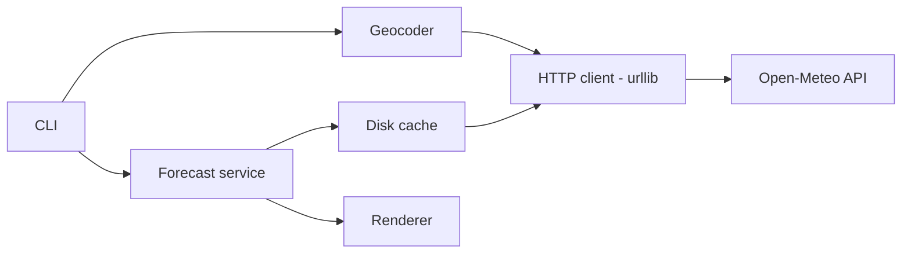
- **Geocoder** turns a name into coordinates using the geocoding endpoint.
- **Forecast service** builds the forecast request and converts JSON into `Forecast` objects.
- **Disk cache** stores responses keyed by URL, with an expiry time. It sits in front of the HTTP client, so callers do not know whether data was cached.
- **HTTP client** wraps `urlopen` with timeouts, a `User-Agent` header and error translation.
- **Renderer** prints tables with weather-code descriptions.

### Data model
| Type | Fields |
|---|---|
| `Location` | name, country, latitude, longitude, timezone |
| `CurrentWeather` | time, temperature, wind_speed, weather_code |
| `DailyForecast` | date, t_min, t_max, precipitation_mm, weather_code |
| Cache entry | key (hash of URL), fetched_at, expires_at, body |

### Tech stack
| Component | Choice | Why |
|---|---|---|
| HTTP | `urllib.request` | Standard library, teaches the basics |
| URLs | `urllib.parse.urlencode` | Correct escaping of query strings |
| JSON | `json` | Parse responses |
| Cache dir | `pathlib`, platform cache folder | Survives restarts |
| Config | `tomllib` | Default location and units |

### Milestones
1. **One request.** Hard-coded coordinates, print raw JSON. *Done when* a timeout and an HTTP 4xx are both handled with friendly messages.
2. **Geocoding.** *Done when* `wx Paris` asks you to choose between Paris, France and Paris, Texas.
3. **Typed parsing and rendering.** *Done when* the forecast prints as an aligned table with dates and units.
4. **Cache.** *Done when* a second call within 10 minutes makes no network request (verified in a test).
5. **Config.** *Done when* `wx` with no argument uses your saved default.

### Deep dive: the hard parts
- **Cache keys and expiry.** Key the cache by the **full** request URL (after sorting parameters), hashed to a safe file name. Store the fetch time in the entry and treat it as stale after the TTL (time to live). Write cache files atomically (temp file plus `os.replace`) so a crash cannot leave a corrupt entry that breaks every later run — and if an entry fails to parse, delete it and refetch.
- **Error taxonomy.** Network failures come in kinds: DNS failure or no connection (`URLError`), timeout (`TimeoutError`), server says no (`HTTPError` with a status code), and bad data (`json.JSONDecodeError`, missing keys). Map each to one clear message, and on network errors fall back to a stale cache entry with a warning — stale weather beats no weather.
- **Time zones.** Forecast days are in the location's local time zone, not yours. Ask the API to return local times (`timezone=auto` style parameter) and display them with `zoneinfo`.

### Testing strategy
Never hit the network in unit tests: inject the HTTP function and feed recorded JSON fixtures. Test the cache with a fake clock (advance time past the TTL and assert a refetch). Test the error mapping by making the fake raise each exception type. Keep one optional "live" test marked to run only on demand.

### Trade-offs, scaling and failure modes
A file-per-entry cache is simple but needs cleanup of old files. Short TTLs give fresher data but more requests. `urllib` lacks connection pooling and retries; for anything bigger use `httpx` (Project 17 builds retries yourself). Free APIs change or rate-limit — handle HTTP 429 (too many requests) by honouring `Retry-After`.

### Stretch goals
- Hourly sparkline charts in the terminal using Unicode blocks.
- Severe-weather alerts when precipitation or wind cross thresholds.
- Async fetching of several cities at once with `asyncio.to_thread` or `httpx`.

### Skills practised
- [Ch 9 — Errors, exceptions and files](../chapters/09-errors-exceptions-files/README.md): exception mapping, JSON, atomic cache writes.
- [Ch 10 — OOP in Python](../chapters/10-oop-in-python/README.md): dataclasses for API results.
- [Ch 14 — Standard library tour](../chapters/14-standard-library-tour/README.md): `urllib`, `datetime`, `zoneinfo`.
- [Ch 15 — Testing and debugging](../chapters/15-testing-and-debugging/README.md): fakes instead of network calls.

### In the interview
**30-second answer:** I built `wx`, a standard-library-only weather CLI that geocodes a place name, calls the Open-Meteo API and prints current conditions and a 7-day forecast. The key design decision was a TTL disk cache sitting in front of a small HTTP client, so callers do not know whether data was cached and the provider gets at most one request per location every 10 minutes. The hardest part was failure handling: I map DNS errors, timeouts, HTTP errors and bad JSON to clear messages, and fall back to stale cache when offline. A cached answer prints in under 50 ms.

**Key terms to know:**
- **REST/JSON API** — a URL that returns data (here JSON) instead of a web page.
- **Query string / `urlencode`** — the `?lat=..&lon=..` part of a URL. `urllib.parse.urlencode` escapes values correctly.
- **Timeout** — the maximum time to wait for the network. Every request has 5 seconds.
- **TTL cache** — cached entries carry a "time to live" and become stale after it. Keyed by the full sorted request URL.
- **Stale-if-error** — serving an expired cache entry, with a warning, when the network fails.
- **`URLError` / `HTTPError`** — `urllib`'s exceptions for "could not reach the server" and "server answered with an error status". `HTTPError` is a subclass of `URLError`.
- **HTTP 429 and `Retry-After`** — "too many requests" and the header telling you how long to wait.
- **Geocoding** — turning a place name into latitude and longitude.
- **`zoneinfo`** — the standard-library IANA time-zone database, used to show forecast days in the location's time zone.

**Q:** How do you unit-test code that calls an HTTP API?

**A:** Inject the HTTP layer (a function or small class) and replace it in tests with a fake that returns recorded JSON fixtures or raises specific errors. Tests are then fast, offline and deterministic. One optional live test, skipped by default, checks the real API still matches the fixtures.

**Q:** What should happen when the API is down?

**A:** Time out quickly, then serve a stale cached answer with a clear "data from 2 hours ago" warning if one exists. If not, exit non-zero with one friendly line, not a traceback. Stale weather is more useful than no weather.

**Q:** Why always set a timeout?

**A:** Without one, `urlopen` waits on the global socket default, which is usually "forever", so a dead connection can hang the program. With a timeout the failure becomes an exception I can handle. The same rule applies to every network call in every project.

**Q:** In what order do you catch `HTTPError` and `URLError`, and why?

**A:** `HTTPError` first, because it is a subclass of `URLError`; if `URLError` came first it would swallow HTTP errors too.
```python
try:
    with urlopen(req, timeout=5) as r:
        body = json.load(r)
except HTTPError as e:      # server answered, e.g. 404/429/503
    ...
except (URLError, TimeoutError) as e:  # DNS, refused, timeouts
    ...
```

**Q:** How do you design the cache key and make the cache crash-safe?

**A:** I sort the query parameters, build the full URL, hash it to a safe file name and store `fetched_at` with the body. Writes use a temp file plus `os.replace`, so a crash cannot leave a half-written entry. If an entry still fails to parse, I delete it and refetch, so one corrupt file never breaks every later run.

**Q:** Why is the cache keyed on the full URL rather than the city name?

**A:** The same city with different units or forecast days is a different response. Keying on the canonical URL means any parameter change is a cache miss automatically, and two names that geocode to the same coordinates share the forecast entry.

**Q:** What changes if this became a web service with 10,000 users?

**A:** The per-user disk cache becomes a shared cache (Redis or in-process LRU) so popular cities are fetched once for everyone. I would need connection pooling (`httpx`), retries with backoff, request coalescing so 100 simultaneous misses for Lisbon cause one upstream call, and an API key or paid tier to respect the provider's limits.

**Q:** How do you handle forecast dates in the right time zone?

**A:** Forecast days belong to the location's local day, not mine. I ask the API for the location's time zone and convert with `zoneinfo.ZoneInfo(name)`. Mixing local and UTC dates is the usual cause of "the forecast is shifted by one day" bugs.

**Common mistakes in answers:**
- Catching `URLError` before `HTTPError`, so 404s and 503s are reported as "no connection".
- Caching responses forever or keying by city name only, then serving wrong-unit or stale data.
- Letting tests hit the real API, which makes them slow and flaky and can get you rate-limited.

### TL;DR
A stdlib-only API client that teaches URL building, timeouts, error mapping, typed parsing and a TTL disk cache that keeps the tool fast and polite.

## 9. Habit tracker on SQLite
**Level:** Beginner · **Time:** 1–2 weekends · **Prerequisites:** Ch 9, Ch 10, Ch 14

### What it is
A CLI for tracking daily habits (`habit check reading`, `habit week`) that stores data in **SQLite**, a full SQL database contained in a single file and built into Python as the `sqlite3` module. It shows streaks, completion rates and a calendar heat-map in the terminal.

### The problem it solves
Habit apps are simple on the surface but full of interesting questions: how to count a streak, how to handle habits that are only due on weekdays, what "today" means after midnight. Moving from JSON files to a real database teaches schemas, constraints, transactions and queries — the foundation of almost every backend.

### Real-world examples
- The [`sqlite3` module documentation](https://docs.python.org/3/library/sqlite3.html) covers connections, placeholders, transactions and adapters.
- SQLite's [write-ahead logging (WAL) page](https://www.sqlite.org/wal.html) explains the journal mode that lets readers and a writer work at the same time.

### Requirements
**Functional**
- Create habits with a schedule (daily, specific weekdays, N times per week).
- Check in for today or a past date, undo a check-in, add a note.
- Show current and longest streaks, completion rate over 30 days, and a week or month grid.
- Archive habits without losing history.

**Non-functional**
- Any command under 100 ms with five years of data.
- Data integrity enforced by the database: no duplicate check-ins for the same habit and day.
- Schema upgrades without data loss (a `user_version` based migration).

### The architecture
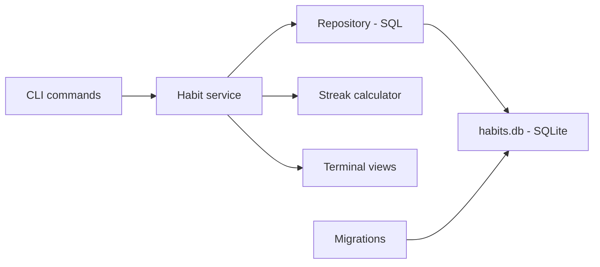
- **Habit service** holds rules: you cannot check in to an archived habit, a habit due on weekdays does not break its streak on Saturday.
- **Repository** is the only place with SQL. It returns dataclasses.
- **Streak calculator** is a pure function over a sorted list of dates and a schedule.
- **Migrations** run at start-up, upgrading the schema step by step using SQLite's `PRAGMA user_version`.

### Data model
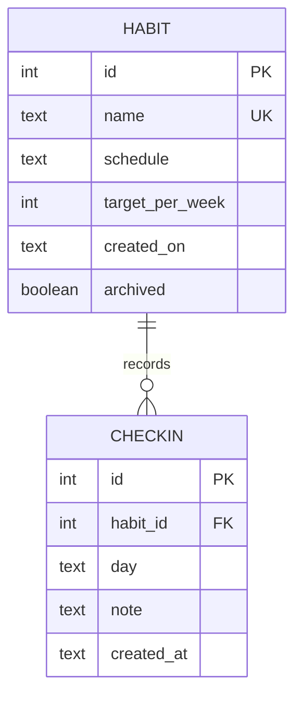
A `UNIQUE (habit_id, day)` constraint on `CHECKIN` makes double check-ins impossible, whatever the code does.

### Tech stack
| Component | Choice | Why |
|---|---|---|
| Database | `sqlite3` | Zero setup, ACID transactions |
| Dates | ISO text columns | Sort correctly as strings |
| Modelling | dataclasses | Rows become typed objects |
| CLI | `argparse` | Sub-commands |

### Milestones
1. **Schema and add.** Create tables and add habits. *Done when* adding a duplicate name fails with a friendly message from the unique constraint.
2. **Check-ins.** *Done when* checking in twice the same day is rejected by the database and reported nicely.
3. **Streaks.** *Done when* tests cover daily and weekday schedules, including streaks spanning month and year boundaries.
4. **Views.** Week grid and 30-day rate. *Done when* output matches the data.
5. **Migrations.** Add a `note` column in version 2. *Done when* an old database upgrades automatically and keeps its data.

### Deep dive: the hard parts
- **Parameterised queries.** Never build SQL with f-strings — `f"... WHERE name = '{name}'"` lets a name like `x' OR '1'='1` change the query (**SQL injection**). Use placeholders: `conn.execute("SELECT ... WHERE name = ?", (name,))`. The driver sends values separately from the SQL text.
- **Transactions.** Several statements that must succeed or fail together (archive a habit and its reminders) belong in one transaction. Using the connection as a context manager (`with conn:`) commits on success and rolls back on exception. Also run `PRAGMA foreign_keys = ON` per connection — SQLite does not enforce foreign keys by default.
- **Streaks with schedules.** Walk backwards from today over **due** days only: for a weekday habit, Saturday and Sunday are skipped rather than counted as misses. Today not yet checked should not break the streak until the day is over. Write the rule down in words before coding, then turn each sentence into a test.

### Testing strategy
Use an in-memory database (`sqlite3.connect(":memory:")`) per test for speed, running the real migrations. Pure tests for the streak calculator with many schedules. A migration test that builds a version 1 database file, runs the app and checks the data in version 2.

### Trade-offs, scaling and failure modes
SQLite is perfect for a single user and many readers, and handles far more data than a habit tracker needs. It allows only one writer at a time, which matters for web apps with many concurrent writes (then use PostgreSQL, Project 12). Text dates are simple and sortable, but you must always store the same format.

### Stretch goals
- Reminders via desktop notifications.
- Export and import as CSV.
- A tiny local web UI using `http.server` or FastAPI.

### Skills practised
- [Ch 9 — Errors, exceptions and files](../chapters/09-errors-exceptions-files/README.md): handling `sqlite3.IntegrityError`.
- [Ch 10 — OOP in Python](../chapters/10-oop-in-python/README.md): repository and service classes.
- [Ch 12 — Decorators, context managers and metaprogramming](../chapters/12-decorators-context-managers-metaprogramming/README.md): connections as context managers.
- [Ch 14 — Standard library tour](../chapters/14-standard-library-tour/README.md): `sqlite3`, `datetime`.

### In the interview
**30-second answer:** I built a habit tracker CLI on SQLite that records daily check-ins and shows streaks, 30-day completion rates and a calendar grid. The key decision was to let the database enforce the rules that must never break, such as `UNIQUE (habit_id, day)` so a double check-in is impossible whatever the code does. The hardest part was a correct streak rule for schedules like "weekdays only", which I wrote down in plain sentences and turned into tests. Schema changes run as `PRAGMA user_version` migrations, and every command stays under 100 ms with five years of data.

**Key terms to know:**
- **SQLite** — a full SQL database in one file, built into Python as `sqlite3`. One writer at a time, many readers.
- **Parameterised query** — SQL with `?` placeholders and values passed separately. Prevents SQL injection.
- **SQL injection** — user input changing the meaning of a query, e.g. a name like `x' OR '1'='1`.
- **Transaction / ACID** — a group of statements that all commit or all roll back. `with conn:` gives that.
- **Constraint** — a rule the database enforces: `UNIQUE`, `NOT NULL`, `FOREIGN KEY`. Breaking one raises `sqlite3.IntegrityError`.
- **`PRAGMA foreign_keys = ON`** — SQLite does not enforce foreign keys unless you turn this on for each connection.
- **`PRAGMA user_version`** — an integer stored in the database file that the migration runner uses as the schema version.
- **Repository** — the only class that contains SQL. It returns dataclasses to the service layer.
- **WAL mode** — write-ahead logging, a journal mode that lets readers keep reading while one writer writes.

**Q:** How do you prevent SQL injection?

**A:** Always use placeholders, never f-strings or `%` formatting, so the driver sends the SQL text and the values separately and input is always treated as data.
```python
conn.execute("SELECT id FROM habit WHERE name = ?", (name,))
```
Note the trailing comma: `(name,)` is a one-element tuple, while `(name)` is just a string.

**Q:** Why put a unique constraint in the database when the code already checks?

**A:** A code check is check-then-insert, which can race with another process, and code can have bugs or be bypassed by another client. The constraint is enforced atomically for every writer, so it is the last line of defence. The code then catches `IntegrityError` and turns it into a friendly "already checked in today".

**Q:** When would you outgrow SQLite?

**A:** When many processes or servers need to write concurrently, since SQLite allows only one writer at a time, or when you need network access, users and roles. Then a server database like PostgreSQL fits better. For a single-user CLI, even years of data is tiny for SQLite.

**Q:** What does `with conn:` do in `sqlite3`, and what does it not do?

**A:** It commits the open transaction if the block succeeds and rolls back if it raises. It does not close the connection, which surprises people coming from file objects. I close connections explicitly or wrap them in `contextlib.closing`.

**Q:** How do you define and compute a streak for a weekdays-only habit?

**A:** Walk backwards from today over due days only: Saturday and Sunday are skipped, not counted as misses. Today without a check-in does not break the streak until the day ends. I wrote each rule as a sentence and turned each into a test, including streaks across month and year boundaries.

**Q:** How do migrations work and what if one fails halfway?

**A:** At start-up I read `PRAGMA user_version`, then apply each numbered migration above it in order, setting the new version in the same transaction as the schema change. SQLite supports transactional DDL, but in its default (legacy) mode Python's `sqlite3` does not open a transaction before `CREATE`/`ALTER`, so I issue an explicit `BEGIN` (or use `autocommit=False`, 3.12+). A failing migration then rolls back and leaves the old version intact. A test builds a version-1 file, runs the app and checks the data in version 2.

**Q:** Why store dates as ISO text?

**A:** SQLite has no native date type. ISO 8601 strings like `2026-10-01` sort correctly as text, are readable and work with SQLite's date functions. The rule is to always write the same format; mixing formats breaks sorting silently.

**Q:** How do you test the repository quickly?

**A:** Each test opens `sqlite3.connect(":memory:")`, runs the real migrations and then exercises the repository. In-memory databases take milliseconds, and using real migrations means tests cover the schema that ships. The streak calculator has pure unit tests with no database at all.

**Common mistakes in answers:**
- Assuming foreign keys are enforced in SQLite by default. They are not without `PRAGMA foreign_keys = ON`.
- Believing `with conn:` closes the connection. It only commits or rolls back.
- Using check-then-insert in code as the only protection against duplicates.

### TL;DR
A habit tracker that moves you from files to a real database: schemas, constraints, parameterised queries, transactions, migrations and a carefully specified streak rule.

## 10. Incremental backup tool with zstd
**Level:** Beginner · **Time:** 2 weekends · **Prerequisites:** Ch 9, Ch 14, Ch 17

### What it is
A tool that backs up a folder to another disk. The first run copies everything; later runs copy only files that changed (**incremental** backup). Each run produces a **snapshot** you can list and restore from. Files are compressed with **Zstandard** (zstd), a fast modern compression algorithm, using the `compression.zstd` module that is new in Python 3.14 (PEP 784).

### The problem it solves
Losing files to a dead disk or a mistaken delete is common and painful. Copying everything each time is slow and wastes space; copying only changes needs a way to detect changes and to rebuild any past state. This project teaches change detection, manifests, compression trade-offs and verification with checksums.

### Real-world examples
- [restic](https://restic.net/) and [BorgBackup](https://www.borgbackup.org/) are open-source backup programs that use content-defined chunking, de-duplication, compression and encryption — the "grown-up" version of this design.
- [PEP 784](https://peps.python.org/pep-0784/) added the `compression` package with `compression.zstd`. In 3.14, `tarfile`, `zipfile` and `shutil` can also read and write Zstandard archives.

### Requirements
**Functional**
- `backup SRC DEST` creates a snapshot. Unchanged files are referenced, not copied again.
- `snapshots` lists snapshots with date, file count and size. `restore SNAPSHOT [PATH] TARGET` restores all or part.
- `verify` re-hashes stored objects and reports corruption.
- `prune --keep-daily 7 --keep-weekly 4` deletes old snapshots and unreferenced objects.

**Non-functional**
- A no-change run over 100,000 files finishes in under 10 seconds (no file content read).
- Each stored object's integrity is checkable by its hash.
- An interrupted backup never damages earlier snapshots.

### The architecture
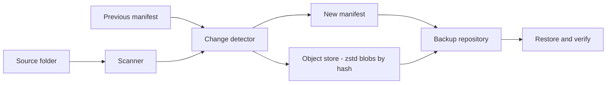
- **Scanner** collects path, size and modification time for every file.
- **Change detector** compares with the previous **manifest** (a list of files in a snapshot). Same size and mtime means unchanged; otherwise hash the file.
- **Object store** saves each unique file content once, compressed, named by its SHA-256 hash (**content-addressed storage**). Identical files anywhere share one object.
- **Manifest** maps every path in the snapshot to an object hash plus metadata. It is written last, so a snapshot exists only once all its objects are stored.

### Data model
| Item | Contents |
|---|---|
| `objects/ab/cdef...zst` | zstd-compressed file content, name = SHA-256 of the uncompressed content |
| `snapshots/2026-10-01T10-00-00.json` | `{"created": ..., "source": ..., "files": {path: {hash, size, mtime, mode}}}` |
| `ManifestEntry` dataclass | path, hash, size, mtime_ns, mode |

### Tech stack
| Component | Choice | Why |
|---|---|---|
| Compression | `compression.zstd` (3.14) | Fast with good ratios, tunable level |
| Hashing | `hashlib.sha256` | Integrity and de-duplication |
| Files | `pathlib`, `os.scandir` | Fast metadata |
| Manifests | `json` | Readable, diff-able |

### Milestones
1. **Full copy with manifest.** *Done when* a restore reproduces the source exactly (compare with `filecmp.dircmp`).
2. **Content-addressed objects.** *Done when* two identical files are stored once.
3. **Incremental runs.** *Done when* a second run with no changes reads no file contents (count reads in a test).
4. **Compression.** *Done when* objects are zstd-compressed and you have measured ratio and speed at a few levels on your data.
5. **Verify and prune.** *Done when* corrupting one object is detected by `verify`, and pruning keeps every object still referenced.

### Deep dive: the hard parts
- **Crash safety by ordering.** Write objects first (each via temp file then rename), then write the manifest last, also atomically. If the backup dies halfway, you have some orphan objects but every existing snapshot is still complete. `prune` later removes orphans. This "data first, pointer last" ordering is the same idea databases use.
- **Change detection shortcuts.** Size plus `st_mtime_ns` is the usual quick check (rsync works this way by default). It can be fooled by tools that preserve mtime, so offer `--checksum` to hash everything. Hash in chunks to keep memory flat on big files.
- **Choosing a compression level.** Zstandard levels trade CPU time for size. Low levels are very fast and still compress text well. Already-compressed files (JPEG, MP4, ZIP) barely shrink, so skip compression for known extensions or when a trial compression saves less than a few percent.

### Testing strategy
Fixture trees with nested folders, empty files, unusual names and binary data. Round-trip tests: backup, restore, compare. Crash simulation: make the object store raise after N objects and check previous snapshots restore fine. Corruption test: flip a byte in an object and run `verify`.

### Trade-offs, scaling and failure modes
Whole-file objects re-store a 10 GB file if one byte changes; restic and Borg split files into **content-defined chunks** to fix that (stretch goal). A backup on the same disk protects against mistakes, not disk failure — keep a copy elsewhere. Without encryption, anyone with the backup disk reads your files.

### Stretch goals
- Content-defined chunking with a rolling hash.
- Encryption with a key derived from a password (`hashlib.scrypt` plus an authenticated cipher from the `cryptography` package).
- Parallel compression of objects with a thread pool.

### Skills practised
- [Ch 9 — Errors, exceptions and files](../chapters/09-errors-exceptions-files/README.md): binary files, atomic writes.
- [Ch 6 — Dicts, sets and collections](../chapters/06-dicts-sets-collections/README.md): manifests as dicts, reference sets for pruning.
- [Ch 14 — Standard library tour](../chapters/14-standard-library-tour/README.md): `hashlib`, `json`, `datetime`.
- [Ch 17 — Performance, memory and internals](../chapters/17-performance-memory-internals/README.md): measuring compression speed and ratio.

### In the interview
**30-second answer:** I built an incremental backup tool: the first run stores everything, later runs store only changed files, and each run produces a restorable snapshot. The key design is content-addressed storage: each file's content is saved once, zstd-compressed with Python 3.14's `compression.zstd`, under its SHA-256 hash, and a snapshot is just a JSON manifest mapping paths to hashes. The hardest part was crash safety, which I solved by writing objects first and the manifest last, each atomically. A no-change run over 100,000 files finishes in under 10 seconds without reading any file contents.

**Key terms to know:**
- **Incremental backup** — only data changed since the last run is copied.
- **Snapshot / manifest** — a JSON file listing every path in one backup with its hash, size, mtime and mode.
- **Content-addressed storage** — data stored under the hash of its content. Gives de-duplication and integrity checks for free.
- **Zstandard (zstd)** — a fast compression algorithm with tunable levels. `compression.zstd` is new in 3.14 (PEP 784).
- **Compression level** — trades CPU time for smaller output. zstd's default is 3.
- **Quick check** — treat a file as unchanged if size and `st_mtime_ns` match the previous manifest, as rsync does by default.
- **Orphan object** — a stored object no manifest references, left by an interrupted backup. `prune` removes it.
- **Retention policy** — rules like "keep 7 daily, 4 weekly" that decide which snapshots `prune` deletes.
- **Content-defined chunking** — splitting files at boundaries chosen by a rolling hash so a small edit changes only nearby chunks.

**Q:** What is content-addressed storage?

**A:** Each object is stored under the hash of its content, like `objects/ab/cdef...`. Identical content gets the same name, so it is stored once wherever it appears. Re-hashing an object and comparing with its name detects corruption, which is how `verify` works. Git uses the same idea.

**Q:** How does your backup stay consistent if it crashes?

**A:** Objects are written first (temp file then rename), and the manifest is written last, also atomically. A snapshot only exists once its manifest exists, and by then every object it references is on disk. An interrupted run leaves only orphan objects, which `prune` cleans up. This "data first, pointer last" ordering is the same idea databases use with logs and commit records.

**Q:** Why not compress everything at the highest level?

**A:** Higher zstd levels cost far more CPU for small extra savings, and already-compressed formats like JPEG, MP4 or ZIP barely shrink at any level. I measured ratio and speed on my own data and default to a low level, skipping known compressed extensions or files where a trial compression saves only a few percent.

**Q:** How do you detect changes without reading every file?

**A:** Compare size and `st_mtime_ns` with the previous manifest. If both match, reuse the old hash. Only changed files are read and hashed, in chunks to keep memory flat. Tools that preserve mtime can fool this, so `--checksum` forces a full re-hash.

**Q:** What is the weakness of whole-file objects, and the fix?

**A:** If one byte changes in a 10 GB file, the whole file is stored again. restic and Borg split files into content-defined chunks using a rolling hash, so boundaries move with the content and an edit changes only a few chunks. Fixed-size chunks would not work well because an insertion shifts every later boundary.

**Q:** How does `prune` decide what is safe to delete?

**A:** First apply the retention policy to choose snapshots to remove. Then build the set of every hash referenced by the remaining manifests (mark) and delete objects not in that set (sweep). An object shared by a kept snapshot is never deleted, and a test proves every kept snapshot still restores after pruning.

**Q:** What failure modes does this design not protect against?

**A:** A backup on the same disk does not survive disk failure, so a copy must live elsewhere. Without encryption anyone with the backup disk reads the files. Ransomware that encrypts the source will be backed up as "changes", so retention of old snapshots matters.

**Q:** Show compressing an object with the 3.14 module.

**A:**
```python
from compression import zstd
data = path.read_bytes()
digest = hashlib.sha256(data).hexdigest()
blob = zstd.compress(data, level=3)
assert zstd.decompress(blob) == data
```
For large files I stream with `zstd.open(dst, "wb")` and hash in chunks instead of reading everything into memory.

**Common mistakes in answers:**
- Writing the manifest before all objects are stored, so a crash produces a snapshot that cannot be restored.
- Hashing the compressed bytes for the object name, which ties de-duplication to the compression level. Hash the original content.
- Claiming a backup on the same disk protects against hardware failure.

### TL;DR
Snapshots as manifests pointing at hash-named, zstd-compressed objects give incremental, de-duplicated, verifiable backups — and show off Python 3.14's new `compression.zstd`.

## 11. Async web scraper with httpx
**Level:** Intermediate · **Time:** 2 weeks · **Prerequisites:** Ch 9, Ch 11, Ch 16

### What it is
A **crawler**: a program that starts from seed URLs, downloads pages, extracts links and data, and follows links within limits. It uses `asyncio` (Python's single-threaded concurrency framework where tasks pause at `await` while waiting for I/O) and the `httpx` async client to keep hundreds of requests in flight at once, while staying polite: obeying `robots.txt`, limiting requests per host and backing off on errors.

### The problem it solves
Price comparison, search indexing, dataset building and link checking all need many pages fetched quickly. Fetching one page at a time spends almost all its time waiting on the network. Async I/O lets one process overlap those waits, but uncontrolled concurrency gets you blocked or crashes a small site. The real lesson is **bounded, fair concurrency**.

### Real-world examples
- The [httpx async documentation](https://www.python-httpx.org/async/) covers `AsyncClient`, connection pooling and timeouts.
- [RFC 9309](https://www.rfc-editor.org/rfc/rfc9309.html) standardises the Robots Exclusion Protocol (`robots.txt`).
- [Scrapy](https://docs.scrapy.org/en/latest/) is the best-known Python crawling framework. Its docs on per-domain concurrency, download delays and AutoThrottle describe exactly the politeness problems you will meet.

### Requirements
**Functional**
- Seeds, allowed domains, maximum depth and page count.
- Fetch with `httpx.AsyncClient`, extract links and a configurable set of fields (title, prices, meta tags) with an HTML parser.
- Obey `robots.txt` per host and a per-host delay. Retry transient failures with backoff.
- De-duplicate URLs after normalisation. Write results as JSON Lines, resumable after a crash.

**Non-functional**
- At least 50 pages per second overall against fast hosts, while never exceeding 2 concurrent requests per host by default.
- Memory bounded: the frontier (queue of URLs to visit) spills to disk beyond 100,000 entries.
- Clean shutdown on Ctrl-C: in-flight tasks finish or are cancelled, state is saved.

### The architecture
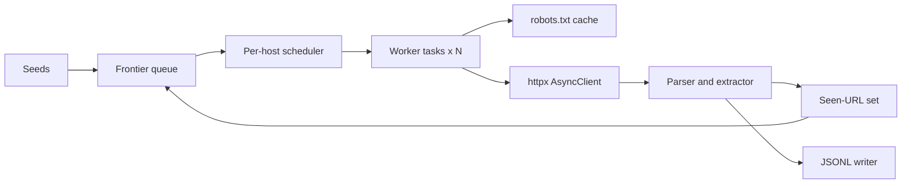
- **Frontier** is an `asyncio.Queue` of `(url, depth)` items.
- **Per-host scheduler** enforces "at most K requests per host" with one `asyncio.Semaphore` per host and a minimum delay between requests to the same host.
- **Worker tasks** are N coroutines in a `TaskGroup`, each looping: take a URL, check robots, fetch, parse, enqueue new links.
- **robots.txt cache** fetches and parses each host's rules once (`urllib.robotparser`).
- **Seen-URL set** stores normalised URLs so each page is fetched once.
- **JSONL writer** appends results. One writer task avoids interleaved lines.

### Data model
| Type | Fields |
|---|---|
| `CrawlItem` | url, depth, referrer, attempts |
| `Page` | url, final_url, status, fetched_at, content_type, elapsed_ms |
| `Record` | url, extracted fields (dict), links_found |
| Checkpoint | frontier snapshot, seen set (or bloom filter), counters |

### Tech stack
| Component | Choice | Why |
|---|---|---|
| HTTP | `httpx.AsyncClient` | Async, pooling, HTTP/2 option, timeouts |
| Concurrency | `asyncio.TaskGroup`, `Semaphore`, `Queue` | Structured concurrency, backpressure |
| Parsing | `selectolax` or `html.parser` | Fast or dependency-free |
| robots | `urllib.robotparser` | Standard library |
| Debugging | `python -m asyncio ps PID` (3.14) | Lists running tasks of a live process |

### Milestones
1. **Sequential crawler.** Fetch, parse, follow links to depth 2. *Done when* it crawls a local test site correctly.
2. **Async workers.** N workers over a queue. *Done when* a crawl of a slow test server is roughly N times faster.
3. **Politeness.** robots.txt, per-host semaphore, delays. *Done when* a test server records never more than K concurrent connections per host.
4. **Robustness.** Timeouts, retries with exponential backoff and jitter, error records. *Done when* injected 500s and timeouts are retried then logged.
5. **Resume and shutdown.** *Done when* Ctrl-C then restart continues without refetching.

### Deep dive: the hard parts
- **Knowing when you are done.** Workers block on `queue.get()` forever if nobody tells them the crawl is over. Use `queue.join()` together with `task_done()`: when every enqueued item has been processed (including the links it produced), `join()` returns and you cancel the workers. In 3.13+ you can also call `queue.shutdown()`.
- **URL normalisation.** `HTTP://Example.com:80/a/../b?y=2&x=1#top` and `http://example.com/b?x=1&y=2` are the same page. Lower-case scheme and host, drop default ports and fragments, resolve dot segments with `urljoin`, and optionally sort query parameters. Without this the seen-set fails and you crawl loops.
- **Backpressure.** If parsing finds links faster than fetching consumes them, the frontier grows without bound. A bounded queue makes producers wait (`await queue.put`) — that is **backpressure**. For very large crawls, keep an in-memory buffer and spill the rest to disk.
- **Never block the loop.** CPU-heavy parsing of huge pages stalls every other task. Measure with asyncio debug mode, and move heavy parsing to `asyncio.to_thread` or a process pool.

### Testing strategy
Run a local test site (an ASGI app or `http.server` in a thread) that serves known link graphs, robots rules, slow endpoints and failures, so tests never touch the internet. Use `httpx.MockTransport` for unit tests of the fetcher. Assert per-host concurrency by having the test server count simultaneous connections.

### Trade-offs, scaling and failure modes
Asyncio scales to thousands of connections in one process, but parsing is CPU-bound — for heavy extraction, combine async fetching with a process pool. A Python `set` of seen URLs costs about 100 bytes per URL; at hundreds of millions use a bloom filter (a compact probabilistic set that can say "maybe seen" but never misses a seen item) or a database. JavaScript-rendered sites need a headless browser, which is far slower. Respect terms of service and legal limits on scraping personal data.

### Stretch goals
- HTTP/2 and conditional requests (`If-Modified-Since`, `ETag`) for recrawls.
- Distributed crawling with Redis as a shared frontier.
- Sitemap discovery and priority by depth or page importance.

### Skills practised
- [Ch 16 — Concurrency and async](../chapters/16-concurrency-and-async/README.md): `TaskGroup`, queues, semaphores, cancellation.
- [Ch 11 — Iterators, generators and functional tools](../chapters/11-iterators-generators-functional/README.md): async iteration over results.
- [Ch 9 — Errors, exceptions and files](../chapters/09-errors-exceptions-files/README.md): `ExceptionGroup`, JSON Lines.
- [Ch 14 — Standard library tour](../chapters/14-standard-library-tour/README.md): `urllib.parse`, `urllib.robotparser`.

### In the interview
**30-second answer:** I built an async web crawler on `asyncio` and `httpx` that starts from seed URLs, fetches and parses pages, and follows links within depth and domain limits while writing results as JSON Lines. The key design is a frontier queue feeding N worker tasks in a `TaskGroup`, with one `asyncio.Semaphore` per host and a per-host delay, so the crawl is fast overall but polite to each site. The hardest parts were knowing when the crawl is finished, URL normalisation and backpressure, solved with `queue.join()`, a canonical URL function and a bounded queue. It reaches over 50 pages per second while never exceeding 2 concurrent requests per host.

**Key terms to know:**
- **Event loop** — the scheduler inside `asyncio` that runs one coroutine at a time and switches at each `await` that waits on I/O.
- **Coroutine** — a function defined with `async def`. Calling it returns an object that runs only when awaited or wrapped in a task.
- **`TaskGroup`** — structured concurrency (3.11+): tasks started in the group are awaited together, and if one fails the rest are cancelled and errors are raised as an `ExceptionGroup`.
- **`asyncio.Semaphore`** — a counter that lets at most K holders in at once. One per host limits per-host concurrency.
- **`asyncio.Queue` / `join()` / `task_done()`** — the frontier. `join()` returns when every item put has been marked done.
- **Backpressure** — a bounded queue makes producers wait when consumers are behind, so memory cannot grow without limit.
- **URL normalisation** — rewriting equivalent URLs to one canonical form so the seen-set works.
- **robots.txt** — a site's crawl rules (RFC 9309), read with `urllib.robotparser`.
- **Exponential backoff with jitter** — retry delays that grow (1, 2, 4 s...) with randomness so clients do not retry in waves.
- **Bloom filter** — a compact probabilistic set: may say "seen" wrongly, never misses a seen item. For huge seen-sets.

**Q:** Why asyncio rather than threads for a crawler?

**A:** The work is I/O-bound: most of the time is spent waiting for servers. One event loop can keep thousands of sockets in flight with coroutines that cost a few KB each, while each OS thread reserves its own stack and adds scheduling overhead. Threads also work, and are simpler with blocking libraries, but asyncio gives explicit, cheap concurrency and easy cancellation.

**Q:** How do you limit concurrency per host?

**A:** A `dict[str, asyncio.Semaphore]` keyed by host, acquired with `async with` around each request, plus a per-host "next allowed time" for the minimum delay. A global semaphore or the worker count bounds total concurrency. A test server counts simultaneous connections and the test asserts it never exceeds K.

**Q:** How do workers know the crawl is finished?

**A:** Each worker calls `queue.task_done()` after processing an item, including enqueuing the links it found. `await queue.join()` returns only when every item ever put has been marked done, so no worker can still be about to add work. Then I cancel the workers, or on 3.13+ call `queue.shutdown()`, which makes blocked `get()` calls raise `QueueShutDown`.

**Q:** What happens if you call `requests.get` inside a coroutine?

**A:** It blocks the event loop, so every other task freezes until it returns, and concurrency drops to one. Use an async client like `httpx.AsyncClient`, or push the blocking call to a thread with `await asyncio.to_thread(requests.get, url)`. asyncio debug mode (`PYTHONASYNCIODEBUG=1`) logs callbacks that run too long, which finds these bugs.

**Q:** What is backpressure and how does your crawler apply it?

**A:** Parsing can discover links much faster than fetching consumes them, so an unbounded frontier grows until memory runs out. With `asyncio.Queue(maxsize=N)`, `await queue.put()` suspends the producer until there is room. Beyond an in-memory limit I spill the frontier to disk. Careful: if every worker blocks on `put` while no one is getting, you deadlock, so workers put links into a separate overflow buffer rather than blocking.

**Q:** What happens on Ctrl-C or when a task raises inside the `TaskGroup`?

**A:** If one task raises, the `TaskGroup` cancels its siblings and re-raises all errors together as an `ExceptionGroup`, which I handle with `except*`. On Ctrl-C, `asyncio.run` cancels the main task; workers catch `CancelledError` only to clean up (save the frontier checkpoint) and then re-raise it. Swallowing `CancelledError` would stop shutdown from working.

**Q:** What breaks first at 100x, say a billion URLs?

**A:** The seen-set: a Python `set` of URL strings costs roughly 100 bytes or more per URL, so a billion URLs need hundreds of GB. Use a bloom filter or a key-value store, shard the frontier by host across machines (for example in Redis), and move parsing to a process pool because CPU becomes the limit before the network does.

**Q:** How do you test a crawler without the internet?

**A:** I run a local test site that serves a known link graph, robots rules, slow endpoints and failures, and assert exactly which URLs were fetched. Unit tests for the fetcher use `httpx.MockTransport` to script responses (500, then timeout, then 200). Fake clocks keep backoff tests instant.

**Q:** Write the per-host limited fetch.

**A:**
```python
limits: defaultdict[str, asyncio.Semaphore] = defaultdict(lambda: asyncio.Semaphore(2))
async def fetch(client: httpx.AsyncClient, url: str) -> httpx.Response:
    host = httpx.URL(url).host
    async with limits[host]:
        return await client.get(url, timeout=10)
```

**Common mistakes in answers:**
- Saying asyncio runs coroutines in parallel. It runs one at a time on one thread and overlaps only the waiting.
- Using `asyncio.gather` over every URL at once with no semaphore, which opens thousands of connections and gets you blocked.
- Catching `CancelledError` (or bare `except BaseException`) and not re-raising, which breaks clean shutdown.

### TL;DR
A frontier queue feeding N async workers, with per-host semaphores, robots.txt and backoff, teaches bounded and polite concurrency — the hard part of scraping is not fetching, it is restraint.

## 12. REST API with FastAPI and PostgreSQL
**Level:** Intermediate · **Time:** 2–3 weeks · **Prerequisites:** Ch 10, Ch 13, Ch 15, Ch 16

### What it is
A backend for a small "reading list" service: users save links, tag them, mark them read and search them. It exposes a **REST API** — HTTP endpoints where URLs name resources (`/links/42`) and HTTP methods name actions (GET reads, POST creates, PATCH updates, DELETE removes) — built with FastAPI and backed by PostgreSQL, with authentication, pagination, validation and an OpenAPI spec generated automatically.

### The problem it solves
Most Python jobs involve a web API in front of a database. Getting one right means far more than routing: input validation, consistent errors, authentication, database transactions, migrations, connection pooling, pagination that does not slow down, and tests that run against a real database. This project collects all of those in one service.

### Real-world examples
- The [FastAPI documentation](https://fastapi.tiangolo.com/) shows how type hints drive validation (via Pydantic), dependency injection and the generated OpenAPI docs.
- [Psycopg 3](https://www.psycopg.org/psycopg3/docs/) is the PostgreSQL driver for Python with sync and async APIs and a connection pool.
- Roy Fielding's [dissertation chapter on REST](https://www.ics.uci.edu/~fielding/pubs/dissertation/rest_arch_style.htm) defines the architectural style the term comes from.

### Requirements
**Functional**
- Users sign up and log in. Requests carry a bearer token.
- CRUD (create, read, update, delete) for links and tags. Each user sees only their own data.
- List with filters (tag, read/unread), full-text search on title and notes, and cursor pagination.
- Consistent error bodies (`{"error": {"code": ..., "message": ...}}`) and correct status codes (400, 401, 404, 409, 422).

**Non-functional**
- p95 latency under 50 ms for reads at 200 requests per second on one machine.
- Zero downtime schema migrations for additive changes.
- Passwords stored with a slow hash (argon2 or bcrypt). Nothing secret in logs.

### The architecture
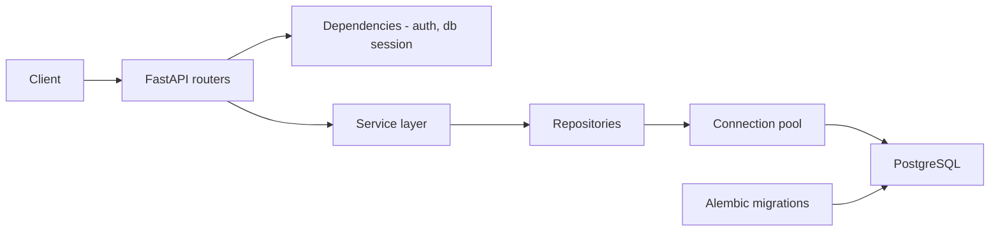
- **Routers** declare endpoints with Pydantic request and response models. They translate HTTP into service calls and nothing more.
- **Dependencies** are FastAPI's way of injecting shared things: the current user (from the token) and a database connection from the pool for the request's duration.
- **Service layer** holds business rules (a user cannot tag someone else's link) and owns transactions.
- **Repositories** contain the SQL (hand-written or via SQLAlchemy).
- **Migrations** version the schema with Alembic.

### Data model
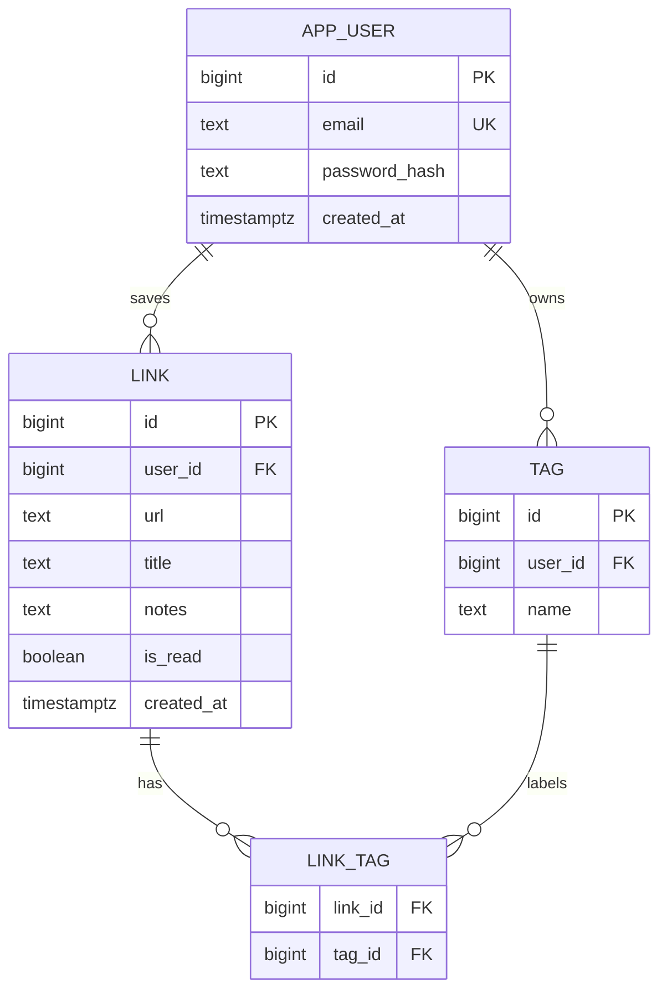
Add `UNIQUE (user_id, url)` on links, `UNIQUE (user_id, name)` on tags, a composite primary key on `LINK_TAG`, and a GIN index on a `tsvector` of title and notes for search.

### Tech stack
| Component | Choice | Why |
|---|---|---|
| Framework | FastAPI | Type-hint-driven validation, async, OpenAPI |
| Validation | Pydantic | Parses and validates request bodies |
| Database | PostgreSQL | Constraints, full-text search, robust concurrency |
| Driver | psycopg 3 with pool | Async support, server-side parameters |
| Migrations | Alembic | Versioned schema changes |
| Server | Uvicorn | ASGI server |
| Tests | pytest + a throwaway Postgres (container) | Real SQL behaviour |

### Milestones
1. **Hello API.** Health endpoint, settings from environment, OpenAPI docs. *Done when* `/docs` lists the endpoint.
2. **Schema and CRUD for links.** *Done when* create, read, update, delete work with validation errors returning 422.
3. **Auth.** Sign-up, login, token, current-user dependency. *Done when* user A gets 404 for user B's link.
4. **Tags, filters, search, pagination.** *Done when* listing 100,000 links pages through without slowing down.
5. **Hardening.** Error format, logging with request ids, rate limit on login. *Done when* a load test meets the latency target.

### Deep dive: the hard parts
- **Async and the database.** FastAPI runs `async def` endpoints on the event loop. Calling a blocking driver there stalls all requests. Either use an async driver (psycopg's async connection and pool) or declare the endpoint with plain `def`, which FastAPI runs in a thread pool. Mixing them carelessly is the most common FastAPI performance bug.
- **Cursor pagination.** `OFFSET 50000 LIMIT 50` makes PostgreSQL read and discard 50,000 rows. Instead return a cursor encoding the last seen `(created_at, id)` and query `WHERE (created_at, id) < (%s, %s) ORDER BY created_at DESC, id DESC LIMIT 50`. With a matching index, every page costs the same.
- **Authorisation in queries.** Always include `user_id = current_user` in the SQL rather than fetching then checking. Returning 404 (not 403) for someone else's resource avoids revealing that it exists.
- **Idempotency and conflicts.** Saving the same URL twice should return 409 or the existing link, enforced by the unique constraint and `INSERT ... ON CONFLICT`, not by a check-then-insert that races.

### Testing strategy
Unit-test services with fake repositories. Integration-test the API with `httpx` against the app and a real PostgreSQL started for the test session (for example with Testcontainers), wrapping each test in a transaction that is rolled back. Test auth boundaries explicitly. Run a short load test with a tool like Locust to check latency.

### Trade-offs, scaling and failure modes
FastAPI plus async shines for I/O-heavy APIs, but CPU-heavy work in a handler blocks everything. The database is usually the bottleneck: watch the connection pool size (too big overloads PostgreSQL, too small queues requests). JWTs avoid a session lookup but cannot be revoked easily; opaque tokens in a table are simpler to revoke. Scale reads with replicas and caching later.

### Stretch goals
- Background job to fetch page titles (Project 26's queue).
- ETags and conditional GETs.
- Row-level security in PostgreSQL as defence in depth.

### Skills practised
- [Ch 13 — Type hints](../chapters/13-type-hints/README.md): Pydantic models, typed dependencies.
- [Ch 16 — Concurrency and async](../chapters/16-concurrency-and-async/README.md): async endpoints and blocking calls.
- [Ch 10 — OOP in Python](../chapters/10-oop-in-python/README.md): service and repository layers.
- [Ch 15 — Testing and debugging](../chapters/15-testing-and-debugging/README.md): fixtures, integration tests.

### In the interview
**30-second answer:** I built a reading-list REST API with FastAPI and PostgreSQL: users sign up, save and tag links, search them and page through results, with an OpenAPI spec generated from type hints. The key design is layering: routers only translate HTTP, a service layer owns business rules and transactions, and repositories own the SQL, with the current user and a pooled database connection injected as FastAPI dependencies. The hardest parts were async-safe database access and pagination that stays fast, solved with psycopg 3's async pool and keyset cursors. Reads hit a p95 under 50 ms at 200 requests per second, and integration tests run against a real PostgreSQL.

**Key terms to know:**
- **REST** — URLs name resources and HTTP methods name actions (GET, POST, PATCH, DELETE).
- **ASGI / Uvicorn** — the async server interface Python web apps speak, and the server that runs FastAPI.
- **Pydantic model** — a typed class that parses and validates request and response bodies. Invalid input becomes a 422.
- **Dependency injection (`Depends`)** — FastAPI calls a function to provide the current user or a DB connection per request.
- **Connection pool** — a set of open database connections reused across requests, because opening one per request is slow.
- **Keyset (cursor) pagination** — "give me rows after `(created_at, id)`" instead of `OFFSET`. Every page costs the same with an index.
- **Idempotency / `ON CONFLICT`** — saving the same URL twice has one effect, enforced by a unique constraint and `INSERT ... ON CONFLICT`.
- **GIN index on `tsvector`** — PostgreSQL's full-text search index, used for search on title and notes.
- **Password hashing (argon2/bcrypt)** — slow, salted hashes so stolen hashes are expensive to crack.
- **Alembic migration** — a versioned, ordered schema change script.

**Q:** What happens if an `async def` endpoint calls a blocking database driver?

**A:** The blocking call runs on the event loop thread, so every other request on that worker waits until it returns. Throughput collapses under load even though CPU is idle. Use an async driver (psycopg's `AsyncConnectionPool`) or declare the endpoint with plain `def`, which FastAPI runs in a thread pool.

**Q:** Why cursor pagination over offset?

**A:** `OFFSET 50000` makes PostgreSQL read and discard 50,000 rows, so deep pages get slower, and new inserts shift rows between pages, causing duplicates or gaps. A keyset cursor encodes the last `(created_at, id)` and queries `WHERE (created_at, id) < (...)` with a matching index, so each page is an index range scan of constant cost and stable under inserts. The trade-off is no "jump to page 37".

**Q:** How do you stop users seeing each other's data?

**A:** Every query includes `user_id = %(current_user)s` in the repository layer, rather than fetching a row and checking ownership afterwards. Foreign resources return 404, not 403, so the API does not reveal that an id exists. PostgreSQL row-level security is a defence-in-depth stretch goal.

**Q:** Where do validation errors come from in FastAPI?

**A:** FastAPI reads the type hints on path, query and body parameters, and Pydantic parses the incoming data against them. Any failure becomes a 422 Unprocessable Content response listing each bad field. I add a custom exception handler so these follow the same `{"error": {...}}` shape as my other errors.

**Q:** How do you handle saving the same URL twice, including two simultaneous requests?

**A:** A `UNIQUE (user_id, url)` constraint plus `INSERT ... ON CONFLICT (user_id, url) DO NOTHING RETURNING id`, then fetch the existing row if nothing was returned, and answer 409 or the existing link. A check-then-insert in Python would race: both requests see "not found" and both insert. The database decides atomically.

**Q:** JWT or opaque session tokens?

**A:** A JWT is a signed token the server can verify without a database lookup, which is fast and stateless, but it cannot be revoked before it expires without adding a blocklist. An opaque random token stored (hashed) in a table costs one lookup per request but can be revoked instantly on logout or compromise. For this app I chose opaque tokens; short-lived JWTs plus refresh tokens are the usual compromise at larger scale.

**Q:** What breaks first at 10x traffic?

**A:** Usually the database: the connection pool runs out (requests queue) or PostgreSQL saturates. I would size the pool against PostgreSQL's `max_connections` across all app workers, add PgBouncer, check slow queries with `EXPLAIN ANALYZE`, cache hot reads and add read replicas. App servers scale horizontally because they are stateless.

**Q:** How do you test it against a real database quickly?

**A:** Start one PostgreSQL container per test session (Testcontainers), run the migrations once, and wrap each test in a transaction that is rolled back at the end, so tests are isolated and fast. Use `httpx` against the app for API tests, and override dependencies with `app.dependency_overrides` to inject a test user. Services get unit tests with fake repositories.

**Q:** Show a dependency that provides the current user.

**A:**
```python
async def current_user(token: str = Depends(oauth2_scheme), db=Depends(get_db)) -> User:
    user = await users.by_token(db, token)
    if user is None:
        raise HTTPException(401, "invalid token")
    return user

@app.get("/links/{link_id}")
async def get_link(link_id: int, user: User = Depends(current_user)): ...
```

**Common mistakes in answers:**
- Saying `async def` makes every endpoint faster. It only helps if everything awaited inside is truly non-blocking.
- Returning 403 for another user's resource, which leaks that it exists.
- Making the connection pool as large as possible; too many connections overload PostgreSQL and slow everything down.

### TL;DR
A production-shaped API — typed models, layered code, real constraints, keyset pagination, async-aware database access and integration tests — is the most job-relevant project in this book.

## 13. Markdown static site generator
**Level:** Intermediate · **Time:** 2 weeks · **Prerequisites:** Ch 4, Ch 9, Ch 11, Ch 14

### What it is
A tool that turns a folder of Markdown files with **front matter** (a block of metadata like title and date at the top of each file) into a complete static website: HTML pages from templates, an index, tag pages, an RSS feed, copied assets and a local preview server that rebuilds when files change. **Static** means the output is plain files any web server can host — no database, no server code.

### The problem it solves
Blogs, documentation and personal sites rarely need a dynamic backend. Static sites are fast, cheap and secure. Building a generator teaches text processing, templating, dependency tracking (which pages must be rebuilt when one file changes) and a clean plugin-friendly pipeline.

### Real-world examples
- [Pelican](https://getpelican.com/) is a Python static site generator using Markdown or reStructuredText and Jinja templates.
- [MkDocs](https://www.mkdocs.org/) builds documentation sites from Markdown with a YAML configuration and a live-reload dev server.
- [markdown-it-py](https://pypi.org/project/markdown-it-py/) is a Python port of markdown-it that follows the CommonMark specification and supports plugins.

### Requirements
**Functional**
- Parse front matter (title, date, tags, draft, template) and Markdown body.
- Render with templates (layouts, partials), generate index and tag pages, RSS/Atom feed, sitemap.
- Copy static assets. Pretty URLs (`/posts/hello/`).
- `serve` command: local server plus rebuild on change.

**Non-functional**
- Full build of 1,000 pages in under 5 seconds. Incremental rebuild of one edited page in under 300 ms.
- Deterministic output: same input gives byte-identical output.
- Broken internal links fail the build with file and line.

### The architecture
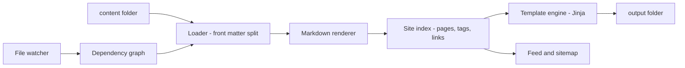
- **Loader** splits each file into metadata and body, validates metadata and builds `Page` objects.
- **Markdown renderer** converts the body to HTML and collects headings and links.
- **Site index** is the in-memory model of the whole site: all pages, tags, dates, URL map. Templates query it.
- **Template engine** renders each page with its layout.
- **Dependency graph** records which outputs depend on which inputs (a post, its template, the tag pages listing it), so an edit rebuilds only affected outputs.

### Data model
| Type | Fields |
|---|---|
| `Page` | source_path, url, title, date, tags, draft, template, html, toc, links_out |
| `Site` | pages_by_url, tags (dict tag to pages), config, build_time |
| `Config` | base_url, title, theme, permalink pattern |
| Dependency edge | output path to set of input paths |

### Tech stack
| Component | Choice | Why |
|---|---|---|
| Markdown | markdown-it-py | CommonMark compliant, plugins |
| Front matter | `tomllib` (TOML) or PyYAML | Structured metadata |
| Templates | Jinja | Inheritance, autoescape |
| Watching | `watchfiles` | Efficient change events |
| Serving | `http.server` | Good enough locally |

### Milestones
1. **One page.** Markdown plus front matter to HTML with a layout. *Done when* output validates and has the right title.
2. **Whole site.** Index, tag pages, pretty URLs, assets. *Done when* the site browses correctly from the output folder.
3. **Feeds and checks.** RSS, sitemap, broken-link checker. *Done when* a deliberately broken link fails the build.
4. **Serve and watch.** *Done when* saving a file refreshes the browser output within a second.
5. **Incremental builds.** *Done when* editing one post rebuilds only that post, its tag pages and the index.

### Deep dive: the hard parts
- **Two-pass builds.** A page may link to another page's title or show "related posts", so you cannot render page A before every page is loaded. Pass 1 loads and parses everything into the site index. Pass 2 renders. This also lets you check links before writing output.
- **Escaping.** Markdown authors may write raw HTML, but data from front matter (titles, tags) must be escaped when inserted into templates or a title like `<script>` executes. Jinja's autoescape handles template variables; mark only the rendered Markdown body as safe.
- **Incremental correctness.** The danger of incremental builds is stale output — a tag page still listing a post whose tag was removed. Track dependencies conservatively (a change to any template rebuilds everything that uses it, a change to front matter rebuilds index and tag pages) and keep a `--clean` full build as the ground truth. Test that incremental output equals a clean build.

### Testing strategy
Golden-file tests: a fixture site builds to an expected output folder (compare file trees). Unit tests for front matter parsing edge cases (no front matter, invalid date). A property: incremental build after random edits equals full build. Link checker tests with broken and valid links.

### Trade-offs, scaling and failure modes
Static output cannot do per-user content or search on the server; client-side search with a prebuilt JSON index covers many sites. Rebuilding everything is simplest and often fast enough — incremental builds add complexity and stale-output bugs. Large image folders dominate build time, so cache processed images by content hash.

### Stretch goals
- Syntax highlighting with Pygments and a table of contents.
- Client-side search index.
- Plugins via entry points (Project 14) for shortcodes.

### Skills practised
- [Ch 4 — Strings](../chapters/04-strings/README.md): text processing, slugs.
- [Ch 9 — Errors, exceptions and files](../chapters/09-errors-exceptions-files/README.md): walking folders, encodings.
- [Ch 11 — Iterators, generators and functional tools](../chapters/11-iterators-generators-functional/README.md): pipelines over pages.
- [Ch 14 — Standard library tour](../chapters/14-standard-library-tour/README.md): `http.server`, `datetime`.

### In the interview
**30-second answer:** I built a static site generator that turns a folder of Markdown files with front matter into a complete site: pages from Jinja templates, an index, tag pages, an RSS feed, a sitemap and a live-reload preview server. The key design is a two-pass build: load every page into an in-memory site index first, then render, so pages can reference each other and broken links fail the build before anything is written. The hardest part was incremental rebuilds without stale output, solved with a conservative dependency graph and a test that incremental output equals a clean build. It builds 1,000 pages in under 5 seconds and rebuilds one edited page in under 300 ms.

**Key terms to know:**
- **Front matter** — a metadata block (title, date, tags) at the top of a Markdown file, parsed with `tomllib` or YAML.
- **CommonMark** — a precise Markdown specification. markdown-it-py follows it.
- **Template inheritance** — Jinja layouts with `` sections that child templates override.
- **Autoescaping** — Jinja converts `<` to `&lt;` in variables so data cannot inject HTML. Only rendered Markdown is marked safe.
- **XSS (cross-site scripting)** — injecting a script into a page that runs in visitors' browsers.
- **Two-pass build** — pass 1 loads everything into a site index, pass 2 renders.
- **Dependency graph** — which outputs depend on which inputs (post, template, tag pages). Drives incremental rebuilds.
- **Deterministic output** — the same input gives byte-identical output, so diffs and caches work.
- **Slug / pretty URL** — `hello-world` and `/posts/hello-world/` generated from a title.

**Q:** Why render in two passes?

**A:** Pages reference each other (links, "related posts", the index lists every post), so no page can be rendered until all are loaded. Pass 1 builds the full site index; pass 2 renders from it. Having the whole index first also lets me validate every internal link and fail with file and line before writing output.

**Q:** How do you prevent XSS in a static site generator?

**A:** Turn on Jinja autoescape for HTML templates, so every variable from front matter (titles, tags) is escaped. Only the rendered Markdown body is marked safe with `Markup` (or `|safe`), because that is trusted author content. A title like `<script>` then shows as text.

**Q:** How do you know an incremental build is correct?

**A:** The ground truth is a clean full build. A property-style test applies random edits, runs an incremental build, then a clean build into another folder and compares the trees byte for byte. Dependencies are tracked conservatively: a template change rebuilds everything that uses it, and a front-matter change rebuilds the index and tag pages.

**Q:** Why make output deterministic, and what usually breaks it?

**A:** Deterministic output makes golden-file tests possible, keeps git diffs of the output meaningful and lets CDNs cache unchanged files. Common culprits are iterating a `set` (string hashes are randomised per process), using the current time in the page, and file-system listing order. Sort everything and take dates from front matter.

**Q:** What happens with malformed front matter or a missing date?

**A:** The loader raises a `ContentError` with file and line, collects all such errors across the site, and fails the build listing them together. Silently skipping a page would publish a site with a missing post. Drafts are excluded deliberately, not by accident.

**Q:** Why Jinja rather than f-strings or `string.Template`?

**A:** Templates need inheritance, loops, includes, filters and autoescaping. Building HTML with f-strings mixes logic and markup and makes escaping manual, so one forgotten escape is an XSS bug. Jinja compiles templates to Python code, so it is also fast enough for thousands of pages.

**Q:** What changes at 100x, say 100,000 pages with many images?

**A:** Full builds become minutes, mostly image processing and template rendering. I would cache processed images by content hash, render pages in parallel with a process pool (rendering is CPU-bound), and rely on incremental builds. Memory for the site index also grows, so I would keep bodies on disk and only metadata in memory.

**Q:** How does the watch-and-serve loop work?

**A:** `watchfiles` yields batches of changed paths. The dependency graph maps them to affected outputs, which are rebuilt, and the preview server (`http.server` in a thread) serves the output folder. Batching matters because editors save several files at once.

**Q:** Split front matter from the body.

**A:**
```python
def split(text: str) -> tuple[dict, str]:
    if not text.startswith("+++\n"):
        return {}, text
    meta, _, body = text[4:].partition("\n+++\n")
    return tomllib.loads(meta), body
```

**Common mistakes in answers:**
- Marking every template variable `|safe` to "fix" escaped HTML, which reopens XSS.
- Claiming incremental builds are "obviously correct" without comparing against a clean build.
- Rendering pages as they are loaded, then discovering links to pages not yet loaded.

### TL;DR
Load everything, build a site index, render through templates, and track dependencies for fast rebuilds — a compact lesson in text pipelines and build systems.

## 14. Plugin system with entry points
**Level:** Intermediate · **Time:** 1–2 weeks · **Prerequisites:** Ch 8, Ch 10, Ch 13

### What it is
A small host application — say, a CLI that converts data between formats — whose features come from **plugins**: separately installed packages that register themselves through **entry points**, a packaging standard where a package's `pyproject.toml` advertises named objects that other programs can discover at runtime with `importlib.metadata.entry_points()`. Installing `pip install myapp-yaml` adds YAML support without touching the host.

### The problem it solves
Successful tools grow more features than one team can maintain. A plugin system lets others extend your tool safely, keeps the core small and lets users install only what they need. Designing one well teaches interfaces (what a plugin must provide), discovery, versioning and fault isolation.

### Real-world examples
- The Python Packaging User Guide's [Creating and discovering plugins](https://packaging.python.org/en/latest/guides/creating-and-discovering-plugins/) compares naming conventions, namespace packages and entry points.
- [pytest's plugin guide](https://docs.pytest.org/en/stable/how-to/writing_plugins.html) shows a large ecosystem built on entry points and hook specifications (via the `pluggy` library).
- The [`importlib.metadata` documentation](https://docs.python.org/3/library/importlib.metadata.html) documents `entry_points(group=...)`.

### Requirements
**Functional**
- Plugins provide readers and writers for formats, and optional CLI sub-commands.
- Discovery via the entry point group `convertkit.formats`. List installed plugins with versions.
- Plugins declare an API version. Incompatible ones are skipped with a warning.
- Users can disable a plugin via config. Built-in formats use the same mechanism.

**Non-functional**
- Discovery adds under 50 ms to start-up (load plugins lazily).
- A crashing plugin cannot crash the host at import time.
- The plugin interface is typed and checked by mypy.

### The architecture
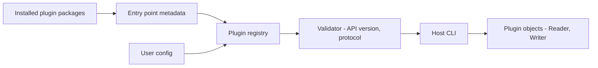
- **Entry point metadata** is written into each installed package's `entry_points.txt` at install time, so discovery reads small text files instead of importing code.
- **Plugin registry** lists entry points, but only loads (imports) a plugin when its format is needed — **lazy loading**.
- **Validator** checks the loaded object satisfies the `FormatPlugin` protocol and API version.
- **Host** asks the registry for "reader for .yaml" and calls it.

### Data model
| Type | Contents |
|---|---|
| `FormatPlugin` (Protocol) | `name`, `api_version`, `extensions`, `read(stream) -> Records`, `write(records, stream)` |
| `PluginInfo` | entry point name, value (`pkg.module:attr`), distribution name and version, loaded flag, error |
| Registry | `dict[str, PluginInfo]` keyed by format name |
| Config | disabled plugins, preferred plugin per extension |

### Tech stack
| Component | Choice | Why |
|---|---|---|
| Discovery | `importlib.metadata.entry_points` | Standard, no import needed to list |
| Interface | `typing.Protocol` | Structural typing, no inheritance required |
| Packaging | `pyproject.toml` `[project.entry-points."convertkit.formats"]` | Standard metadata |
| Hooks (stretch) | `pluggy` | Battle-tested hook calling |

### Milestones
1. **Protocol and built-ins.** Define `FormatPlugin`, implement CSV and JSON in the host. *Done when* conversion works with built-ins registered by hand.
2. **Entry point discovery.** Register built-ins through the host's own `pyproject.toml`. *Done when* listing shows them via metadata.
3. **External plugin.** A separate package `convertkit-yaml` in a sibling folder, installed in editable mode. *Done when* installing it adds the format with no host change.
4. **Validation and isolation.** *Done when* a plugin that raises on import or has the wrong API version is reported and skipped.
5. **Config and CLI extension.** *Done when* plugins can add sub-commands and users can disable them.

### Deep dive: the hard parts
- **Lazy loading.** `entry_points()` returns `EntryPoint` objects with a `name` and `value` string; calling `.load()` imports the module. Listing is cheap, loading may be expensive. Load on first use, and cache the result. This keeps start-up fast even with dozens of plugins installed.
- **Versioning the plugin API.** Your interface will change. Give it an integer `API_VERSION`, accept a range, and add new optional methods rather than changing existing ones. Check `hasattr` or protocol membership at load time. Document a deprecation window.
- **Isolation limits.** Plugins run in your process with full power — a plugin can do anything your user can. Wrapping `load()` and calls in `try/except` stops a buggy plugin from crashing the host, but not a malicious one. True isolation needs separate processes or interpreters (Project 35).

### Testing strategy
Create test plugin distributions in a temporary directory, or monkeypatch `entry_points` to return fake `EntryPoint` objects pointing to test modules. Test discovery, lazy loading (assert a module is not in `sys.modules` until used), bad plugins and version mismatches. Run mypy against the protocol and the example plugin.

### Trade-offs, scaling and failure modes
Entry points need installation, so dropping a `.py` file in a folder will not work — a folder scan is friendlier for scripts but bypasses dependency management. Two plugins claiming the same format need a deterministic rule (config preference, then name). Plugins can pin conflicting dependencies; you cannot fix that inside the host.

### Stretch goals
- Hook-based extension with `pluggy` (before-write, after-read hooks).
- A `plugins doctor` command checking versions and conflicts.
- A cookiecutter-style template for new plugins.

### Skills practised
- [Ch 8 — Modules, packages and environments](../chapters/08-modules-packages-environments/README.md): imports, `pyproject.toml`, editable installs.
- [Ch 10 — OOP in Python](../chapters/10-oop-in-python/README.md): protocols and ABCs.
- [Ch 13 — Type hints](../chapters/13-type-hints/README.md): `Protocol`, checking plugins with mypy.
- [Ch 9 — Errors, exceptions and files](../chapters/09-errors-exceptions-files/README.md): isolating failures.

### In the interview
**30-second answer:** I built a format-conversion CLI whose readers and writers come from plugins: separately installed packages that advertise themselves under the `convertkit.formats` entry point group, so `pip install convertkit-yaml` adds YAML with no host change. The key design is a typed `FormatPlugin` Protocol plus lazy loading: listing plugins reads only metadata, and a plugin is imported only when its format is needed. The hardest part was robustness, solved with an API version check, validation at load time and catching plugin errors so one broken plugin is reported and skipped. Discovery adds under 50 ms to start-up.

**Key terms to know:**
- **Entry point** — a named object a package advertises in its metadata (`[project.entry-points."group"]` in `pyproject.toml`), discoverable without importing the package.
- **`importlib.metadata.entry_points(group=...)`** — the standard-library call that lists entry points of installed distributions.
- **`EntryPoint.load()`** — imports the module named in `value` (`pkg.module:attr`) and returns the object.
- **Lazy loading** — import a plugin on first use and cache it, keeping start-up fast.
- **`typing.Protocol`** — structural typing: any object with the right methods matches, no inheritance needed.
- **`@runtime_checkable`** — lets `isinstance` check a Protocol, but only that the attributes exist, not their signatures.
- **Plugin API version** — an integer the plugin declares so the host can reject incompatible ones.
- **Editable install** — `pip install -e .` installs a package that points at its source folder, used while developing a plugin.
- **pluggy** — the hook library behind pytest's plugins.

**Q:** How does a program find plugins installed by pip?

**A:** Each plugin package declares an entry point in its `pyproject.toml`; at install time it is written into the distribution's `entry_points.txt` metadata. The host calls `importlib.metadata.entry_points(group="convertkit.formats")`, which reads that metadata for every installed distribution without importing their code, and calls `.load()` only on the ones it needs.

**Q:** Why use `Protocol` instead of a base class?

**A:** Plugins do not need to import or inherit from a host class, which avoids version coupling between the plugin and the host. Type checkers still verify the shape statically. The trade-off is that runtime checks are weak, so I validate `api_version` and required attributes explicitly at load time.

**Q:** Can try/except make plugins safe?

**A:** It contains bugs, not malice. A plugin runs in my process with my user's permissions, so it can read files, open sockets or call `os._exit()`. `try/except` around `load()` and each call stops an exception from crashing the host. Real isolation needs a separate process or a sandbox (Project 35 explores subinterpreters).

**Q:** What does `isinstance(obj, MyProtocol)` actually check?

**A:** With `@runtime_checkable`, it only checks that the named attributes exist on the object. It does not check method signatures or return types, so a `read` that takes the wrong arguments still passes. That is why I also call mypy on example plugins and keep explicit checks for `api_version`.

**Q:** How do you evolve the plugin API without breaking existing plugins?

**A:** Give it an integer `API_VERSION`, accept a range (for example 1 to 2), and add new methods as optional with defaults rather than changing existing signatures. The host checks with `getattr(plugin, "new_method", None)`. Breaking changes bump the major version with a documented deprecation window.

**Q:** Two plugins both claim `.yaml`. What happens?

**A:** There must be a deterministic rule, never "whichever loaded last". I pick the user's configured preference first, then a built-in, then sort by plugin name, and print a warning naming both. `plugins list` shows which one won.

**Q:** How do you test discovery and lazy loading?

**A:** Monkeypatch `entry_points` to return fake `EntryPoint` objects pointing at test modules, or build tiny plugin distributions in a temporary directory and install them. To prove laziness, assert the plugin module is not in `sys.modules` after listing, and is after first use. Bad plugins (raise on import, wrong version) must appear in the report as skipped.

**Q:** Why not just scan a `plugins/` folder for `.py` files?

**A:** A folder scan is friendlier for quick scripts but bypasses packaging: no dependency resolution, no versions, no uninstall. Entry points work with any installer and environment, and are the standard used by pytest, Flask and many other tools. The cost is that a plugin must be installed, even if only in editable mode.

**Q:** Show discovery with lazy loading.

**A:**
```python
from importlib.metadata import entry_points
eps = {ep.name: ep for ep in entry_points(group="convertkit.formats")}

@functools.cache
def plugin(name: str) -> FormatPlugin:
    return eps[name].load()
```

**Common mistakes in answers:**
- Saying discovery imports every plugin. Listing reads metadata only; importing happens on `.load()`.
- Believing `@runtime_checkable` verifies method signatures.
- Calling `try/except` a security boundary.

### TL;DR
Entry points give discovery without imports, a Protocol gives a typed contract, and lazy loading plus validation keeps the host fast and robust as the ecosystem grows.

## 15. Typed configuration loader
**Level:** Intermediate · **Time:** 1–2 weeks · **Prerequisites:** Ch 10, Ch 12, Ch 13

### What it is
A library that loads application settings from several **layers** — built-in defaults, a TOML file, environment variables and command-line flags — and turns them into a typed, validated, immutable settings object defined by a plain dataclass. It reads the dataclass's type hints at runtime to know how to convert `"8080"` to `int`, `"true"` to `bool` and `"a,b"` to `list[str]`, using the `annotationlib` module that arrives with deferred annotations in Python 3.14 (PEP 649 and PEP 749).

### The problem it solves
Configuration bugs cause many outages: a typo in a key silently ignored, a port read as a string, a secret printed in logs. A loader that validates everything at start-up and reports *all* errors at once, with where each value came from, turns those runtime surprises into immediate, clear failures.

### Real-world examples
- [pydantic-settings](https://docs.pydantic.dev/latest/concepts/pydantic_settings/) loads settings from environment variables and files into validated models — the established library for this job.
- [The Twelve-Factor App on config](https://12factor.net/config) argues for keeping deploy-specific config in environment variables.
- The [`annotationlib` documentation](https://docs.python.org/3/library/annotationlib.html) explains the 3.14 formats (`VALUE`, `FORWARDREF`, `STRING`) for reading annotations safely.

### Requirements
**Functional**
- Define settings as nested frozen dataclasses with defaults.
- Layers in precedence order: defaults < file < environment (`APP_DB__PORT=5433`) < CLI.
- Types: `str`, `int`, `float`, `bool`, `Path`, `Enum`, `Literal`, `list[T]`, `dict[str, T]`, `T | None`, nested dataclasses, and a `Secret[str]` wrapper that never prints its value.
- Collect all validation errors and report them together with the source of each value. Unknown keys are errors.
- `explain` command shows each final value and which layer set it.

**Non-functional**
- Loading takes under 20 ms for a 100-field config.
- Zero required dependencies beyond the standard library.
- Fully typed: `load(Settings)` returns `Settings` for the type checker.

### The architecture
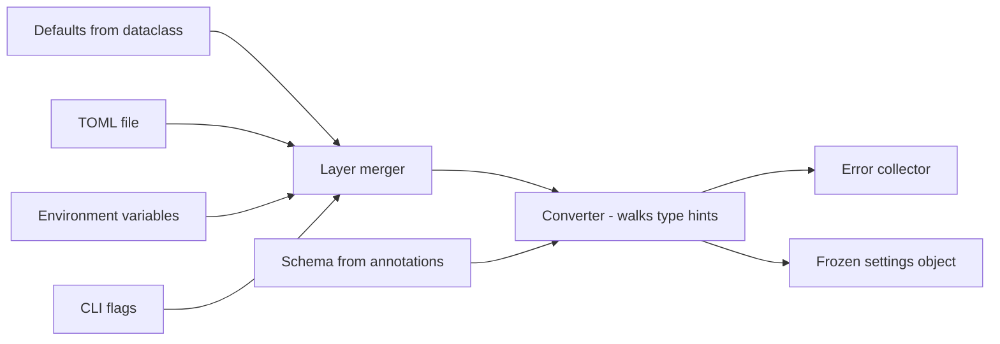
- **Schema from annotations** inspects the dataclass with `dataclasses.fields()` and `annotationlib.get_annotations()` to get the type of every field, recursing into nested dataclasses.
- **Layer merger** produces one nested dict, remembering the source of each leaf value (provenance).
- **Converter** walks the schema and converts each raw value according to its type, dispatching on `typing.get_origin()` and `get_args()` for generics like `list[int]`.
- **Error collector** gathers every failure with its dotted path (`db.port`) and source, raised together as one exception (or an `ExceptionGroup`).

### Data model
| Type | Purpose |
|---|---|
| `Settings` (user dataclass) | The target, e.g. `db: DbSettings`, `debug: bool = False` |
| `RawValue` | value, source (default / file:line / env:NAME / cli) |
| `FieldSpec` | path, type, default, required |
| `ConfigError` | path, message, source |
| `Secret[T]` | Wrapper with masked `__repr__` and a `.get()` method |

### Tech stack
| Component | Choice | Why |
|---|---|---|
| File format | `tomllib` | Standard, typed values |
| Schema | `dataclasses`, `annotationlib` (3.14) | No dependency, safe annotation access |
| Generics | `typing.get_origin`, `get_args` | Inspect `list[int]`, unions |
| CLI | `argparse` generated from schema | One source of truth |

### Milestones
1. **Flat dataclass from TOML.** Convert basic types. *Done when* wrong types produce path-specific errors.
2. **Nesting and generics.** *Done when* nested dataclasses, lists, dicts, optionals and literals convert correctly.
3. **Layers and provenance.** *Done when* `explain` shows the source of every value, and env overrides file.
4. **All errors at once.** *Done when* a config with five mistakes reports all five.
5. **Secrets and CLI.** *Done when* `repr(settings)` never shows the password and `--db-port` overrides everything.

### Deep dive: the hard parts
- **Deferred annotations in 3.14.** Before 3.14, annotations were evaluated when the class was defined, so referring to a class defined later needed quotes or `from __future__ import annotations` (which turned all annotations into strings). With PEP 649/749, annotations are evaluated lazily, on first access. `annotationlib.get_annotations(cls, format=Format.FORWARDREF)` returns real types where it can and `ForwardRef` placeholders where a name is not yet defined, instead of raising `NameError`. Your loader should use `Format.VALUE` at load time (by then everything is defined) and handle `ForwardRef` gracefully in error messages.
- **Unions and bool parsing.** Converting `"0"` to `bool` with `bool("0")` gives `True` — a classic bug. Accept an explicit set (`true/false/1/0/yes/no/on/off`). For `int | None`, decide what string means `None` (empty string, or the literal `null`). For unions of several types, try them in order and report all failures if none match.
- **Environment variable mapping.** Env vars are flat strings. A convention like `APP_DB__PORT` (double underscore for nesting) maps to `db.port`. Lists need a format: comma-separated or JSON. Be explicit and document it, because guessing causes surprises.

### Testing strategy
Parametrized tests per type with valid and invalid raw values. Property-based tests: generate random settings values, serialise to TOML and env, load back, compare. Snapshot tests for error messages. A type-checking test: run mypy or pyright on an example using `load(Settings)` and assert the inferred type.

### Trade-offs, scaling and failure modes
Writing your own loader teaches typing internals but pydantic-settings is more complete. Frozen settings prevent accidental mutation but make hot reload harder (you swap the whole object instead). Strict "unknown key is an error" catches typos but makes rolling upgrades harder when new config keys appear before the code — allow a warn-only mode.

### Stretch goals
- Hot reload on file change with a callback that receives old and new settings.
- JSON Schema export for editor completion of the TOML file.
- Secret providers (read `Secret` values from files or a vault).

### Skills practised
- [Ch 13 — Type hints](../chapters/13-type-hints/README.md): generics, `get_origin`/`get_args`, `Literal`, deferred annotations.
- [Ch 10 — OOP in Python](../chapters/10-oop-in-python/README.md): dataclasses, `__repr__`.
- [Ch 12 — Decorators, context managers and metaprogramming](../chapters/12-decorators-context-managers-metaprogramming/README.md): introspection.
- [Ch 9 — Errors, exceptions and files](../chapters/09-errors-exceptions-files/README.md): `ExceptionGroup`, TOML.

### In the interview
**30-second answer:** I built a typed configuration loader that merges defaults, a TOML file, environment variables and CLI flags into an immutable, validated settings object defined by a plain frozen dataclass. The key design is that the dataclass's type hints are the schema: the converter walks them at runtime with `annotationlib` and `typing.get_origin`/`get_args`, so `"8080"` becomes `int` and `"a,b"` becomes `list[str]`. The hardest part was useful errors: I collect every failure with its dotted path and source, like `db.port from env:APP_DB__PORT`, and report them all at once. A 100-field config loads in under 20 ms with no dependencies.

**Key terms to know:**
- **Layered configuration** — defaults < file < environment < CLI, where later layers override earlier ones.
- **Provenance** — the record of which layer set each final value. The `explain` command prints it.
- **Deferred annotations (PEP 649/749)** — in 3.14, annotations are evaluated lazily on first access, so forward references no longer fail at class creation.
- **`annotationlib.get_annotations(format=...)`** — reads annotations as real values (`VALUE`), values with `ForwardRef` placeholders (`FORWARDREF`), or strings (`STRING`).
- **`typing.get_origin` / `get_args`** — split `list[int]` into `list` and `(int,)`, and `int | None` into the union and its members.
- **Frozen dataclass** — immutable settings, so no code can change config at runtime by accident.
- **`ExceptionGroup`** — raise several errors at once (3.11+). Used to report every config mistake together.
- **Secret wrapper** — a type with a masked `__repr__`/`__str__` and an explicit `.get()`.
- **Fail fast** — validate everything at start-up, not when a value is first used.

**Q:** What changed about annotations in Python 3.14?

**A:** Annotations are no longer evaluated when the class or function is defined. The compiler stores an `__annotate__` function and evaluates it on first access of `__annotations__` (PEP 649, finalised by PEP 749). Forward references work without quotes, and `annotationlib.get_annotations()` can return values, `ForwardRef` placeholders or strings. `from __future__ import annotations` still works but is no longer needed for this.

**Q:** Why validate all config at start-up?

**A:** Fail fast: a bad value found at start-up is a failed deploy that the deployer sees immediately and can roll back. One found at 3 a.m. in a rarely used code path is an outage. Reporting all errors at once also saves the "fix one, run, find the next" loop.

**Q:** How do you keep secrets out of logs?

**A:** Wrap them in a `Secret[str]` type whose `__repr__` and `__str__` return `***`, so printing the settings object or an f-string shows nothing sensitive. Code that really needs the value calls `.get()`, which is easy to search for in review. Frozen dataclasses' generated `__repr__` calls the field's `repr`, so the mask carries through.

**Q:** What is the `bool("0")` bug and how do you avoid it?

**A:** `bool()` on any non-empty string is `True`, so `bool("0")` and `bool("false")` are both `True`. Environment variables are always strings, so naive conversion turns `DEBUG=false` into debug mode. I accept an explicit set (`true/false/1/0/yes/no/on/off`, case-insensitive) and raise a clear error for anything else.

**Q:** How does the converter handle `list[int]` and `int | None`?

**A:** It dispatches on `get_origin(tp)`: for `list` it splits the raw value and converts each item with `get_args(tp)[0]`; for a union it tries each member in order, treating an empty string or `null` as `None` when `NoneType` is a member, and reports all failures if none match. In 3.14, `int | None` and `Optional[int]` produce the same `typing.Union` object, but code that supports older versions must also check `types.UnionType`.

**Q:** Strict unknown keys: is that a good idea?

**A:** It catches typos like `prot = 8080` that would otherwise silently fall back to defaults, which is a common cause of outages. But during a rolling deploy, new config may reach old code that does not know the key yet. So the default is "error", with a warn-only mode for that situation.

**Q:** Why frozen settings, and what does it cost?

**A:** Frozen settings cannot be mutated by accident, are hashable and are safe to share between threads. The cost is hot reload: you cannot change one field, so a reload builds a whole new settings object and swaps a reference, notifying subscribers with old and new values.

**Q:** How do you test it?

**A:** Parametrized tests per type with valid and invalid raw strings, a test that a config with five mistakes reports five errors, and a property test that generates random settings, writes them as TOML and env vars, loads them back and compares. A typing test runs mypy on `load(Settings)` and checks the inferred type is `Settings`, which I get by annotating `def load[T](cls: type[T]) -> T`.

**Q:** Show reading field types safely in 3.14.

**A:**
```python
from annotationlib import get_annotations, Format
def field_types(cls: type) -> dict[str, object]:
    # then get_origin(list[int]) is list, get_args(list[int]) == (int,)
    return get_annotations(cls, format=Format.VALUE)
```
At load time every class is defined, so `Format.VALUE` is right; `FORWARDREF` is for tooling that may run earlier.

**Common mistakes in answers:**
- Reading `cls.__annotations__` directly and claiming that is always safe; in 3.14 accessing it evaluates annotations and can raise `NameError` for undefined names, which `annotationlib` handles.
- Converting env strings with `bool()` or `int()` without explicit, documented rules.
- Raising on the first error, forcing users to fix config one mistake at a time.

### TL;DR
Use dataclass type hints as the schema, merge layered sources with provenance, convert by walking the types, and report every error at once — a deep, practical tour of runtime typing in 3.14.

## 16. Publish a library to PyPI with uv
**Level:** Intermediate · **Time:** 1 week · **Prerequisites:** Ch 8, Ch 13, Ch 15

### What it is
Take a small useful library — for example the typed config loader (Project 15) or a slugify helper — and ship it properly: a `pyproject.toml`-based package with a `src/` layout, type information, tests across several Python versions, documentation, semantic versioning, a changelog, and automated publishing to **PyPI** (the Python Package Index, where `pip install` downloads from) using **uv**, a fast Python package and project manager, and **Trusted Publishing**, which lets a CI job upload without a stored password.

### The problem it solves
Code on your laptop helps one person. A package anyone can `pip install` helps everyone, but publishing badly breaks people: missing files in the wheel, wrong Python version bounds, unpinned build tools, leaked API tokens. This project teaches the packaging pipeline that every professional Python developer eventually needs.

### Real-world examples
- The Python Packaging User Guide's [publishing with GitHub Actions guide](https://packaging.python.org/en/latest/guides/publishing-package-distribution-releases-using-github-actions-ci-cd-workflows/) walks through building and uploading from CI.
- The [uv packaging guide](https://docs.astral.sh/uv/guides/package/) covers `uv build` and `uv publish`.
- [PyPI's Trusted Publishers documentation](https://docs.pypi.org/trusted-publishers/) explains how short-lived OpenID Connect tokens from CI replace long-lived API tokens.

### Requirements
**Functional**
- `pyproject.toml` with name, version, description, readme, license, `requires-python`, dependencies, optional extras, classifiers and URLs.
- `src/` layout, a `py.typed` marker, a console script entry point if relevant.
- Build an sdist (source distribution) and a wheel (pre-built installable archive). Publish to TestPyPI, then PyPI, from a tagged release.
- Docs site and a changelog following "Keep a Changelog" style.

**Non-functional**
- CI tests on Python 3.12, 3.13 and 3.14 (plus 3.14t, the free-threaded build, as a bonus) on Linux, macOS and Windows.
- A fresh `pip install` of the wheel into a clean venv passes a smoke test.
- No secrets stored in the repository or CI settings for publishing.

### The architecture
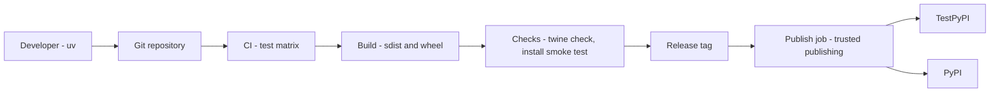
- **uv** manages the virtual environment, lock file and dev dependencies locally (`uv sync`, `uv run pytest`).
- **CI matrix** runs lint, type check and tests on every push.
- **Build** uses the build backend declared in `[build-system]` (for example hatchling or uv's own backend) to produce artifacts.
- **Checks** validate metadata rendering and install the built wheel in a clean environment — testing the artifact, not the source tree.
- **Publish job** runs only on version tags, with permission to request an OIDC token that PyPI trusts for this repository and workflow.

### Data model
| Artifact | Contents |
|---|---|
| `pyproject.toml` | `[build-system]`, `[project]`, `[project.optional-dependencies]`, `[project.scripts]`, tool configs |
| sdist (`.tar.gz`) | Source plus `PKG-INFO` metadata |
| Wheel (`.whl`) | Installable files plus `METADATA`, `RECORD`, `entry_points.txt` |
| `uv.lock` | Exact resolved dev environment (not shipped to users) |
| `CHANGELOG.md` | Human summary per version |

### Tech stack
| Component | Choice | Why |
|---|---|---|
| Env and tasks | uv | Fast installs, lock file, `uv build`, `uv publish` |
| Build backend | hatchling or uv_build | Standard PEP 517 backends |
| Tests | pytest, coverage | Standard |
| Types | mypy or pyright, `py.typed` | Ship type info |
| Lint and format | Ruff | One fast tool |
| Docs | MkDocs | Markdown docs |

### Milestones
1. **Local package.** `src/` layout, `pyproject.toml`, `uv sync`, tests pass. *Done when* `uv build` produces both artifacts.
2. **Artifact test.** *Done when* installing the wheel in a clean venv and importing it works, and the wheel contains `py.typed`.
3. **CI matrix.** *Done when* tests pass on three Python versions and three operating systems.
4. **TestPyPI release.** Configure trusted publishing. *Done when* `pip install -i https://test.pypi.org/simple/ yourpkg` works.
5. **Real release.** Tag `v1.0.0`, publish, docs live. *Done when* a stranger can install and follow the README.

### Deep dive: the hard parts
- **Why `src/` layout.** With the package at the repository root, `import yourpkg` in tests imports the source folder from the current directory, not the installed package. Tests pass even when the wheel is missing files. Moving the package one level down into `src/` takes it off the default import path, so the only copy tests can find is the one you installed — and a wheel with missing files fails its tests straight away.
- **Version bounds.** Libraries should declare **loose** dependency ranges (`httpx>=0.27`) so they can coexist with other libraries; applications pin exactly via lock files. Upper bounds like `<2` on dependencies often cause more harm than good because they block users from upgrading. Set `requires-python` honestly — pip uses it to pick a compatible version of your package.
- **Single source of version.** The version must match in metadata, the tag and the changelog. Either keep it only in `pyproject.toml` and read it at runtime with `importlib.metadata.version("yourpkg")`, or derive it from git tags with a plugin. Never hard-code it in two places.

### Testing strategy
Unit tests as usual, plus **artifact tests**: build, install into a fresh venv, run a smoke script. Test the console script entry point by invoking it as a subprocess. Use `twine check` (or uv's checks) to validate metadata. Run the publish workflow against TestPyPI before the first real release.

### Trade-offs, scaling and failure modes
Pure-Python wheels are universal (`py3-none-any`); C extensions need a wheel per platform and Python version, typically built with cibuildwheel. A version on PyPI can be yanked but never replaced, so a broken release must be fixed with a new version. Too-strict pins make your library uninstallable alongside others.

### Stretch goals
- Automated changelog and version bump from conventional commits.
- Build provenance attestations.
- A free-threaded test job and a note in the README about thread safety.

### Skills practised
- [Ch 8 — Modules, packages and environments](../chapters/08-modules-packages-environments/README.md): `pyproject.toml`, venvs, uv, publishing.
- [Ch 13 — Type hints](../chapters/13-type-hints/README.md): shipping `py.typed`.
- [Ch 15 — Testing and debugging](../chapters/15-testing-and-debugging/README.md): CI test matrix.

### In the interview
**30-second answer:** I took a small library and shipped it properly to PyPI: a `src/` layout, honest `pyproject.toml` metadata, a `py.typed` marker, a CI matrix on Python 3.12–3.14 across three operating systems, and tag-triggered publishing with uv and Trusted Publishing. The key decision was to test the built artifact, not the source tree: CI installs the wheel into a clean venv and runs a smoke test, which catches missing files. The hardest part was the release pipeline, which publishes to TestPyPI first and uses short-lived OIDC tokens so no API token is stored anywhere. A stranger can `pip install` it and follow the README.

**Key terms to know:**
- **`pyproject.toml`** — the standard project file: `[build-system]` names the build backend, `[project]` holds metadata and dependencies.
- **Build backend (PEP 517)** — the tool that turns source into artifacts, e.g. hatchling or uv_build. `uv build` calls it.
- **sdist** — source distribution (`.tar.gz`) that must be built on install.
- **Wheel** — a pre-built `.whl` archive that installers just unpack. Its tag (`py3-none-any`) says which Pythons and platforms it fits.
- **`src/` layout** — the package lives under `src/`, so tests cannot accidentally import the working copy.
- **`py.typed`** — an empty marker file (PEP 561) telling type checkers the package ships inline type hints.
- **`requires-python`** — the Python versions the package supports. Installers use it to pick a compatible release.
- **Lock file (`uv.lock`)** — exact versions of the dev environment. Applications pin, libraries declare ranges.
- **Trusted Publishing / OIDC** — PyPI trusts a specific CI workflow, which proves its identity with a short-lived OpenID Connect token instead of a stored password.
- **Semantic versioning** — MAJOR.MINOR.PATCH, where a major bump signals breaking changes.

**Q:** What is the difference between an sdist and a wheel?

**A:** An sdist is source plus metadata that the installer must build, which may need compilers and runs build code. A wheel is a pre-built archive that is simply unpacked, so it is faster and needs no build tools. I publish both: the wheel for normal installs, the sdist for platforms without a matching wheel and for downstream packagers.

**Q:** Why the `src/` layout?

**A:** With the package at the repository root, the current directory is on `sys.path`, so `import yourpkg` in tests imports the working copy, not the installed one. Tests can then pass even when the wheel is missing a module or data file. Under `src/`, the only importable copy is the installed package, so packaging mistakes fail tests immediately.

**Q:** How does trusted publishing work?

**A:** On PyPI I register the repository, workflow file and environment as a trusted publisher. When the release job runs, it requests an OIDC token from GitHub Actions (the job needs `id-token: write` permission), sends it to PyPI, and PyPI returns a short-lived upload token valid only for this project. No long-lived secret exists to leak.

**Q:** Should a library pin its dependencies exactly?

**A:** No. A library is installed alongside other libraries, so exact pins (`httpx==0.27.2`) make it impossible to satisfy everyone and cause resolver conflicts. Libraries declare the lowest version they need (`httpx>=0.27`) and avoid upper caps unless a known break exists. Applications pin exact versions with a lock file. The project's own `uv.lock` is for development only and is not shipped.

**Q:** You published 1.2.0 with a broken wheel. What now?

**A:** A file on PyPI can never be replaced, and a deleted filename cannot be re-uploaded, so I release 1.2.1 with the fix. I also yank 1.2.0, which hides it from resolvers that do not pin it exactly but keeps existing pinned installs working. Then I add the missing check (usually an artifact test) to CI.

**Q:** How do you keep the version in one place?

**A:** I keep it only in `pyproject.toml` (or derive it from the git tag with a plugin), and read it at runtime with `importlib.metadata.version("yourpkg")`. The release job checks that the tag matches the metadata version and fails otherwise. Two hard-coded copies always drift.

**Q:** What changes if the library has a C extension?

**A:** A pure-Python wheel works everywhere (`py3-none-any`), but a C extension needs a wheel per OS, CPU architecture and Python version, including free-threaded builds (`cp314t`). Tools like cibuildwheel build that matrix in CI. Without a matching wheel, users fall back to the sdist and need a compiler, which is the most common install failure.

**Q:** How do you prove the published package works?

**A:** CI builds the sdist and wheel, runs `twine check` (or uv's checks) on metadata, installs the wheel into a fresh venv on each OS and Python version, runs the test suite against it, and calls the console script as a subprocess. The first release goes to TestPyPI and is installed from there before the real one.

**Q:** Show the minimum `pyproject.toml`.

**A:**
```toml
[build-system]
requires = ["hatchling"]
build-backend = "hatchling.build"
[project]
name = "slugkit"
version = "1.0.0"
requires-python = ">=3.12"
dependencies = []
```

**Common mistakes in answers:**
- Saying you can re-upload a fixed file with the same version. PyPI never allows that.
- Pinning exact dependency versions in a library's `[project.dependencies]`.
- Testing only the source tree and never the built wheel.

### TL;DR
Ship a small library the professional way: `src/` layout, honest metadata, artifact tests on a version matrix, and tag-triggered publishing through uv and trusted publishing.

## 17. Resilient HTTP client library
**Level:** Intermediate · **Time:** 1–2 weeks · **Prerequisites:** Ch 7, Ch 12, Ch 16

### What it is
A thin library on top of `httpx` that makes calls to unreliable web services safe: **timeouts** on everything, **retries** with exponential backoff and jitter for transient failures, a client-side **rate limiter** (token bucket), a **circuit breaker** that stops calling a service that is clearly down, and structured logging of every attempt. It works in both sync and async code, exposed as decorators and a client wrapper.

### The problem it solves
Networks fail in small ways all the time: a dropped connection, a 503 during a deploy, a 429 "slow down". Naive code either crashes on the first error or retries in a tight loop, making outages worse for everyone. Production systems survive by retrying carefully and failing fast when retrying will not help. These patterns appear in almost every backend interview.

### Real-world examples
- AWS's architecture blog post [Exponential Backoff and Jitter](https://aws.amazon.com/blogs/architecture/exponential-backoff-and-jitter/) shows with simulations why adding randomness to retry delays reduces load and completion time.
- [httpx](https://pypi.org/project/httpx/) provides the transports and timeouts this library builds on.
- [stripe-python](https://pypi.org/project/stripe/) retries network errors with backoff and sends idempotency keys so retried writes are safe — a real-world reference for the API design.

### Requirements
**Functional**
- Configurable per-call timeouts (connect, read, total).
- Retry policy: which exceptions and status codes are retryable, maximum attempts, base and cap delay, full jitter, honouring `Retry-After`.
- Retries only for idempotent methods (GET, PUT, DELETE) unless the caller supplies an idempotency key.
- Token-bucket rate limiter per host. Circuit breaker per host with closed, open and half-open states.
- Sync and async APIs with the same configuration.

**Non-functional**
- Overhead per successful call under 0.2 ms.
- Thread-safe and task-safe state (limiter and breaker shared across threads or tasks).
- Every attempt logged with attempt number, delay and reason.

### The architecture
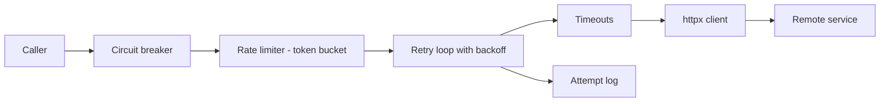
- **Circuit breaker** fails immediately with `CircuitOpen` when recent calls mostly failed, protecting both caller and service.
- **Rate limiter** waits (or fails) until a token is available, keeping you under the service's limit.
- **Retry loop** classifies each failure, sleeps with jittered backoff and tries again up to the limit.
- **Timeouts** bound every network wait.
- **Attempt log** emits structured events for observability.

### Data model
| Type | Fields |
|---|---|
| `RetryPolicy` | max_attempts, base_delay, max_delay, retry_on_status, retry_on_exceptions, respect_retry_after |
| `TokenBucket` | capacity, refill_rate, tokens, last_refill |
| `CircuitBreaker` | state, failure_count, window, open_until, half_open_probes |
| `Attempt` | number, started_at, outcome, status, delay_before_next |

```mermaid
stateDiagram-v2
    [*] --> Closed
    Closed --> Open: failures over threshold
    Open --> HalfOpen: cool-down elapsed
    HalfOpen --> Closed: probe succeeds
    HalfOpen --> Open: probe fails
```

### Tech stack
| Component | Choice | Why |
|---|---|---|
| HTTP | httpx (sync and async clients) | Same API in both worlds |
| Clock | `time.monotonic` | Not affected by system clock changes |
| Sync locking | `threading.Lock` | Shared limiter across threads |
| Async waiting | `asyncio.sleep`, `asyncio.Lock` | Non-blocking delays |
| Decorators | `functools.wraps` | Preserve function metadata |

### Milestones
1. **Timeouts and classification.** *Done when* every failure is classified as retryable or not, with tests for each status and exception.
2. **Retries with jitter.** *Done when* delays follow `random.uniform(0, min(cap, base * 2**attempt))` and `Retry-After` overrides them.
3. **Token bucket.** *Done when* 1,000 calls at 10 per second take about 100 seconds of simulated time.
4. **Circuit breaker.** *Done when* the state machine passes tests for every transition.
5. **Async parity and decorators.** *Done when* `@resilient(policy)` works on both `def` and `async def` functions.

### Deep dive: the hard parts
- **Why jitter.** If 1,000 clients fail at the same moment and all retry after exactly 1, 2, 4 seconds, they hit the recovering service in synchronised waves. **Full jitter** (a random delay between 0 and the exponential cap) spreads them out. The AWS post shows it cuts total work significantly.
- **Idempotency.** Retrying a POST that timed out may create a second order if the first actually succeeded. Only retry non-idempotent requests when the server supports an **idempotency key** — a unique id sent with the request so the server can recognise and ignore duplicates.
- **Time and testing.** Real sleeps make tests slow and flaky. Inject a clock and a sleep function. Tests then advance a fake clock instantly and assert on the exact delays requested.
- **One decorator for sync and async.** Detect coroutine functions with `inspect.iscoroutinefunction` and return an `async def` wrapper for them, a plain wrapper otherwise. Share the policy logic in pure functions so the two wrappers differ only in how they sleep.

### Testing strategy
`httpx.MockTransport` to script responses (two 503s then 200, a 429 with `Retry-After: 3`). Fake clock for limiter and breaker. Concurrency test: 50 threads sharing a limiter never exceed the rate. Property test: delays are always within bounds.

### Trade-offs, scaling and failure modes
Retries multiply load: three retries at each of four layers can turn one request into 4^4 = 256 calls (**retry amplification**). Retry at one layer only, and use a total deadline. Client-side rate limits are per process; across many processes you need a shared limiter (Redis) or server feedback. Circuit breakers need tuning — too sensitive and they open on noise.

### Stretch goals
- Retry budgets (retries limited to a percentage of recent calls).
- Hedged requests: send a second request if the first is slow, use whichever returns first.
- OpenTelemetry spans per attempt.

### Skills practised
- [Ch 7 — Functions](../chapters/07-functions/README.md): closures and higher-order functions.
- [Ch 12 — Decorators, context managers and metaprogramming](../chapters/12-decorators-context-managers-metaprogramming/README.md): parametrised decorators.
- [Ch 16 — Concurrency and async](../chapters/16-concurrency-and-async/README.md): locks, async sleeps, thread safety.
- [Ch 15 — Testing and debugging](../chapters/15-testing-and-debugging/README.md): fake clocks and mock transports.

### In the interview
**30-second answer:** I built a thin resilience layer on top of `httpx` that adds timeouts, classified retries with exponential backoff and full jitter, a per-host token-bucket rate limiter and a circuit breaker, exposed as a client wrapper and a `@resilient(policy)` decorator that works on both `def` and `async def`. The key decision was to retry only idempotent requests unless the caller passes an idempotency key, because retrying a POST can double-charge someone. The hardest part was testing time-based behaviour, which I solved by injecting a clock and sleep function so tests run instantly. Overhead per successful call is under 0.2 ms.

**Key terms to know:**
- **Transient failure** — an error that may succeed on retry: connection reset, timeout, 502/503/504, 429.
- **Exponential backoff** — waiting `base × 2^attempt` between retries, capped at a maximum.
- **Full jitter** — choosing a random delay between 0 and the backoff cap, so clients do not retry in sync.
- **Idempotent request** — repeating it has the same effect as doing it once (GET, PUT, DELETE). POST usually is not.
- **Idempotency key** — a unique id sent with a write so the server can detect and ignore duplicates.
- **Token bucket** — a rate limiter: tokens refill at a fixed rate up to a capacity, and each call spends one.
- **Circuit breaker** — a state machine (closed, open, half-open) that fails fast while a dependency is down.
- **`Retry-After`** — a header on 429/503 giving seconds or an HTTP date to wait.
- **Retry amplification** — retries at several layers multiplying load during an outage.
- **`time.monotonic`** — a clock that never goes backwards, used for all delays and windows.

**Q:** Which errors should you retry?

**A:** Transient ones: connection errors, timeouts, 502, 503, 504 and 429 (after the indicated delay). Not 400, 401, 403, 404 or 422, because the same request will get the same answer. A timeout on a non-idempotent request is special: the server may have done the work, so only retry it with an idempotency key.

**Q:** What is a circuit breaker?

**A:** A per-dependency state machine. Closed: calls pass and failures are counted. Open: after failures cross a threshold, calls fail immediately with `CircuitOpen` for a cool-down, protecting both my threads and the struggling service. Half-open: after the cool-down, a few probe calls go through; success closes it, failure re-opens it.

**Q:** Why add jitter to backoff?

**A:** Without jitter, 1,000 clients that failed together retry together at exactly 1, 2 and 4 seconds, hitting the recovering service in waves that knock it over again. Full jitter, `random.uniform(0, min(cap, base * 2**attempt))`, spreads retries evenly over the window. AWS's simulations show it cuts both total calls and completion time.

**Q:** How does a token bucket work, and why not a fixed window?

**A:** The bucket holds up to `capacity` tokens and refills at `rate` per second, computed lazily from `monotonic()` on each call. A call takes a token or waits until one is available. It allows short bursts up to capacity while keeping the long-run rate. A fixed per-second window lets a client send double the limit across a window boundary.

**Q:** How does one decorator support both sync and async functions?

**A:** Check `inspect.iscoroutinefunction(fn)` at decoration time and return an `async def` wrapper that uses `await asyncio.sleep`, or a plain wrapper that uses `time.sleep`. The retry decision (classify, compute delay) lives in shared pure functions, so the two wrappers differ only in how they wait. `functools.wraps` keeps the name and docstring.

**Q:** What is retry amplification and how do you prevent it?

**A:** If four layers each retry three times (four attempts), one user request can become 4^4 = 256 calls to the bottom service during an outage, making it worse. Retry at one layer only (usually closest to the failing call), use a total deadline across attempts, and consider a retry budget that caps retries at a percentage of recent traffic.

**Q:** Is the limiter correct when shared by many threads, or many processes?

**A:** Across threads, the refill-and-take step is a compound read-modify-write, so I protect it with a `threading.Lock` (an `asyncio.Lock` for the async version). A test with 50 threads asserts the rate is never exceeded. Across processes or servers each has its own bucket, so the combined rate is N times higher; a shared limiter in Redis or server-side limits are needed there.

**Q:** How do you test retries without slow, flaky sleeps?

**A:** Inject `clock` and `sleep` callables. Tests pass a fake clock and a fake sleep that records the requested delays and advances the clock, then assert the exact sequence. `httpx.MockTransport` scripts responses: two 503s then 200, or a 429 with `Retry-After: 3`.

**Q:** Write the full-jitter delay.

**A:**
```python
def delay(attempt: int, base: float = 0.1, cap: float = 10.0,
          rnd: random.Random = random.Random()) -> float:
    return rnd.uniform(0, min(cap, base * 2 ** attempt))
```
Using `random` here is fine: jitter needs spread, not unpredictability.

**Common mistakes in answers:**
- Retrying every error, including 400s and 401s, or retrying POSTs blindly.
- Using `time.time()` for delays and windows, which breaks when the wall clock jumps.
- Forgetting a total deadline, so retries outlive the caller's own timeout.

### TL;DR
Timeouts, classified retries with jittered backoff, idempotency, a token bucket and a circuit breaker — packaged as one decorator that works for sync and async code.

## 18. Async chat server
**Level:** Intermediate · **Time:** 2 weeks · **Prerequisites:** Ch 9, Ch 16

### What it is
A multi-room chat server built directly on `asyncio` streams (TCP sockets wrapped as `StreamReader`/`StreamWriter`), with a simple line-based text protocol inspired by IRC: `/nick alice`, `/join #python`, `/msg bob hi`, plain lines go to the current room. Clients can be `telnet`, `nc` or a small Python client you write. Later you add a WebSocket gateway so a browser can join too.

### The problem it solves
Real-time systems — chat, games, live dashboards, trading — must hold many long-lived connections and push messages to them. Doing this with one thread per connection works but scales poorly. An asyncio server handles thousands of idle connections in one thread. The project teaches protocol design, broadcast fan-out, slow-consumer handling and graceful shutdown.

### Real-world examples
- [RFC 1459](https://datatracker.ietf.org/doc/html/rfc1459) defines the original Internet Relay Chat protocol: nicknames, channels, line-based commands.
- The [asyncio streams documentation](https://docs.python.org/3/library/asyncio-stream.html) shows `start_server`, `readline`, `drain` and closing.

### Requirements
**Functional**
- Commands: `/nick`, `/join`, `/part`, `/msg`, `/who`, `/rooms`, `/quit`. Plain text broadcasts to the room.
- Unique nicknames, room membership, join and leave notices.
- Message history: the last 50 messages of a room on join.
- Optional WebSocket bridge sharing the same rooms.

**Non-functional**
- 5,000 concurrent idle connections on one process with under 200 MB of memory.
- Broadcast latency under 50 ms at 1,000 messages per second.
- A slow client must never delay others. Maximum line length 4 KB.

### The architecture
```mermaid
flowchart LR
    C1["TCP clients"] --> ACC["start_server - accept"]
    ACC --> SES["Session task per client"]
    SES --> PAR["Command parser"]
    PAR --> HUB["Room hub"]
    HUB --> OQ["Per-client outbound queue"]
    OQ --> WR["Writer task per client"]
    WR --> C1
    WS["WebSocket gateway"] --> HUB
```
- **Session task** reads lines from one client, parses commands and calls the hub.
- **Room hub** owns state: nick to session, room to members, room history. Because asyncio runs one task at a time between `await`s, hub methods that do not `await` need no locks.
- **Per-client outbound queue** decouples broadcasting from slow sockets: the hub puts messages on each member's bounded queue, and a **writer task** per client drains it to the socket.
- **WebSocket gateway** (stretch) adapts browser connections to the same session interface.

### Data model
| Type | Fields |
|---|---|
| `Session` | id, nick, reader, writer, outbound (`asyncio.Queue`), rooms (set), connected_at |
| `Room` | name, members (set of session ids), history (`deque(maxlen=50)`) |
| `Message` | ts, room, sender, text, kind (chat, notice, private) |
| `Hub` | sessions_by_nick, rooms |

### Tech stack
| Component | Choice | Why |
|---|---|---|
| Networking | `asyncio.start_server` | Streams API, built in |
| Structure | `TaskGroup` per session (reader plus writer) | Cancels both together |
| Buffers | `asyncio.Queue(maxsize=...)` | Backpressure per client |
| History | `collections.deque(maxlen=50)` | Bounded ring buffer |
| WebSockets | `websockets` library (stretch) | Mature asyncio implementation |

### Milestones
1. **Echo server.** *Done when* several `nc` clients connect and get their lines echoed.
2. **Nicknames and one room.** *Done when* messages broadcast to everyone else with nick prefixes.
3. **Rooms, private messages, history.** *Done when* all commands work and history replays on join.
4. **Slow consumers and limits.** *Done when* a client that stops reading is disconnected after its queue fills, without affecting others.
5. **Graceful shutdown and load test.** *Done when* Ctrl-C sends a goodbye to every client and a load script holds 5,000 connections.

### Deep dive: the hard parts
- **Slow consumers.** `writer.write()` only buffers; `await writer.drain()` waits until the OS buffer has room. If the hub awaited `drain()` for each member during a broadcast, one stalled client would freeze the room. With per-client bounded queues, the hub uses `put_nowait` and, on `QueueFull`, disconnects (or drops messages for) that client. Choose and document the policy.
- **Framing and limits.** TCP is a byte stream, not messages. For line-based framing, prefer `readuntil(b"\n")` over `readline()`: it raises `LimitOverrunError` when a line exceeds the stream limit (64 KiB by default — pass a smaller `limit` to `start_server`) and `IncompleteReadError` when the client disconnects mid-line, whereas `readline()` silently returns a partial line at EOF and turns an over-long line into a plain `ValueError`.
- **Cleanup on every exit path.** A session can end by `/quit`, network error, server shutdown or cancellation. Put the leave-rooms and release-nick logic in `finally` so state never keeps ghosts. Remember `CancelledError` is a `BaseException` in modern Python — do not swallow it with `except Exception` hopes, and re-raise it after cleanup.

### Testing strategy
Start the server on port 0 (the OS picks a free port) inside the test, connect real client streams with `asyncio.open_connection`, and assert on received lines with timeouts. Test the hub separately with fake sessions. A slow-consumer test: a client that never reads must be disconnected while others keep receiving.

### Trade-offs, scaling and failure modes
One process holds all state, so it is a single point of failure and cannot scale horizontally. To scale out, put a pub/sub broker (Redis, NATS) between servers so rooms span processes. Line protocols are easy to debug but need escaping rules. History in memory disappears on restart; persist to SQLite or PostgreSQL if it matters.

### Stretch goals
- TLS with `ssl.SSLContext`.
- WebSocket gateway and a tiny HTML client.
- Multi-process scaling with Redis pub/sub.

### Skills practised
- [Ch 16 — Concurrency and async](../chapters/16-concurrency-and-async/README.md): streams, tasks, queues, cancellation, `TaskGroup`.
- [Ch 6 — Dicts, sets and collections](../chapters/06-dicts-sets-collections/README.md): `deque`, sets for membership.
- [Ch 9 — Errors, exceptions and files](../chapters/09-errors-exceptions-files/README.md): `finally` cleanup, exception groups.

### In the interview
**30-second answer:** I built a multi-room chat server on raw `asyncio` streams with an IRC-style line protocol (`/nick`, `/join`, `/msg`), which you can use from `nc` or a small client. The key design is one reader task and one writer task per client, with a bounded outbound queue in between, so the room hub broadcasts with `put_nowait` and never waits on any socket. The hardest parts were slow consumers and cleanup on every exit path, solved with "disconnect when your queue is full" and `finally` blocks that release nicks and rooms. One process holds 5,000 idle connections in under 200 MB.

**Key terms to know:**
- **`asyncio.start_server` / streams** — the high-level TCP API giving a `StreamReader` and `StreamWriter` per connection.
- **Framing** — how a byte stream is split into messages. Here: one message per `\n`-terminated line, max 4 KB.
- **`write()` vs `drain()`** — `write` only buffers; `await drain()` waits until the OS buffer has room.
- **Slow consumer** — a client that stops reading. Without protection it blocks broadcasts or grows memory.
- **Bounded queue / backpressure** — each client's outbound `asyncio.Queue(maxsize=N)`. A full queue triggers a disconnect.
- **Fan-out** — delivering one message to every member of a room.
- **Cooperative scheduling** — asyncio switches tasks only at `await`, so code without `await` runs without interruption.
- **`deque(maxlen=50)`** — a ring buffer for room history that drops the oldest message automatically.
- **Graceful shutdown** — stop accepting, tell clients goodbye, cancel tasks, close sockets.
- **Pub/sub broker** — Redis or NATS relaying room messages between server processes when scaling out.

**Q:** Why do hub methods not need locks in asyncio?

**A:** Only one task runs at a time on the event loop, and a switch can only happen at an `await`. A hub method with no `await` (update dicts, `put_nowait` to queues) therefore runs atomically with respect to other tasks. If I ever added an `await` in the middle of a state change, I would need an `asyncio.Lock` or to restructure.

**Q:** How do you stop one slow client slowing everyone?

**A:** Give each client a bounded outbound queue and a dedicated writer task that does `write` plus `await drain()`. The hub only calls `put_nowait`, so a broadcast never waits on any socket. When a queue is full (`QueueFull`), that client is disconnected or has messages dropped, a documented policy, while everyone else carries on.

**Q:** How would you scale to several servers?

**A:** Room state can no longer live in one process. Each server publishes room messages to a broker such as Redis pub/sub and subscribes to the rooms its local clients are in. Nickname uniqueness then needs a shared store, and a load balancer spreads TCP connections. History moves to a database.

**Q:** Why use `readuntil(b"\n")` instead of `readline()`?

**A:** `readuntil` raises `LimitOverrunError` when a line exceeds the stream limit and `IncompleteReadError` when the client disconnects mid-line, so I can reject abuse cleanly. `readline()` silently returns a partial line at EOF and turns an over-long line into a plain `ValueError`. I also pass a small `limit` to `start_server` to enforce the 4 KB maximum.

**Q:** What happens when a client disconnects or the server is shut down mid-message?

**A:** The reader gets EOF or an exception, or the task is cancelled. Either way the session's `finally` block removes the nick, leaves every room (announcing it) and closes the writer. `CancelledError` is a `BaseException`, so `except Exception` does not catch it; I re-raise it after cleanup so cancellation still completes.

**Q:** Why a reader and writer task per client in a `TaskGroup`?

**A:** They have different lifetimes for blocking: the reader waits for input, the writer waits for queue items and socket space. Putting both in a `TaskGroup` means if either fails (socket error, queue overflow), the other is cancelled too, so a session never half-lives with only one direction working.

**Q:** What limits 5,000 connections, and what breaks at 50,000?

**A:** Per connection there are two tasks, a queue and socket buffers, so memory is roughly tens of KB per client. At 50,000 the first limits are the OS file-descriptor limit (`ulimit -n`), memory for buffers and the single event loop's CPU for fan-out to big rooms. Then I would raise limits, use uvloop, and shard across processes behind a broker.

**Q:** How do you test it?

**A:** Start the server on port 0 so the OS picks a free port, connect real clients with `asyncio.open_connection`, and assert on received lines using `asyncio.timeout` so a bug fails instead of hanging. The hub is tested alone with fake sessions. A slow-consumer test has one client never read and checks it is disconnected while others still receive.

**Q:** Show the per-client writer.

**A:**
```python
async def writer_loop(q: asyncio.Queue[str], w: asyncio.StreamWriter) -> None:
    while True:
        line = await q.get()
        w.write(line.encode() + b"\n")
        await w.drain()
```

**Common mistakes in answers:**
- Broadcasting with `await writer.drain()` per member inside the hub, so one stalled client freezes the room.
- Saying asyncio code never needs locks. It needs them when a critical section spans an `await`.
- Treating TCP as message-based and assuming one `read()` returns exactly one line.

### TL;DR
One task pair per connection, a lock-free hub and bounded per-client queues give a fast, fair chat server — and a clear lesson in backpressure and cleanup.

## 19. Safe templating with t-strings
**Level:** Intermediate · **Time:** 1–2 weeks · **Prerequisites:** Ch 4, Ch 10, Ch 13

### What it is
A small library of **template processors** built on Python 3.14's **template strings** (t-strings, PEP 750). A t-string looks like an f-string with a `t` prefix — `t"SELECT * FROM users WHERE name = {name}"` — but instead of producing a `str` it produces a `string.templatelib.Template` object that keeps the literal text parts and the interpolated values *separate*. Your library provides `html(t"...")` that escapes values safely, `sql(t"...")` that turns interpolations into database parameters, and `shell(t"...")` that quotes arguments.

### The problem it solves
f-strings are so convenient that developers use them to build SQL, HTML and shell commands — producing SQL injection, cross-site scripting (XSS) and command injection bugs. The fix has always been "use parameters or escaping", which is easy to forget. t-strings let a library see which parts the programmer wrote and which came from values, so the safe path is also the convenient one.

### Real-world examples
- [PEP 750](https://peps.python.org/pep-0750/) specifies template strings, with motivating examples of HTML and SQL processing.
- The [`string.templatelib` documentation](https://docs.python.org/3/library/string.templatelib.html) defines `Template`, `Interpolation` (with `value`, `expression`, `conversion` and `format_spec`) and iteration over parts.
- [Jinja](https://jinja.palletsprojects.com/) shows the established approach to safe HTML: autoescaping plus an explicit "markup is safe" type.

### Requirements
**Functional**
- `html(template) -> Markup`: escape every interpolated value unless it is already `Markup`. Support nested templates and lists of templates.
- `sql(template) -> (query, params)`: replace each interpolation with a placeholder (`%s` or `?`) and collect values. Allow identifiers only through an explicit `Identifier` wrapper that is validated and quoted.
- `shell(template) -> list[str]`: build an argument list with values as single arguments, never re-parsed by a shell.
- Honour format specs (`{price:.2f}`) and conversions (`{x!r}`) where it makes sense.

**Non-functional**
- Processing a template with 20 interpolations under 20 microseconds.
- No way to produce unsafe output without an explicit opt-in type.
- Fully typed, with a mypy test that passing a plain `str` to `sql()` is a type error.

### The architecture
```mermaid
flowchart LR
    TS["t-string literal"] --> T["Template object"]
    T --> IT["Iterate parts"]
    IT --> S["Static strings"]
    IT --> I["Interpolations"]
    I --> POL["Context policy - html, sql, shell"]
    S --> ASM["Assembler"]
    POL --> ASM
    ASM --> OUT["Safe result type"]
```
- **Template object**: Python evaluates the interpolated expressions eagerly (like an f-string) but does not join them. `template.strings` holds the literal parts and `template.interpolations` the values.
- **Context policy** decides what to do with each value for the target language: escape for HTML, parametrise for SQL, keep as one argument for shell.
- **Assembler** walks the parts in order and builds the output.
- **Safe result types** (`Markup`, `SqlQuery`, `Argv`) record that the output has been processed, so processors can compose without double-escaping.

### Data model
| Type | Role |
|---|---|
| `Template` (stdlib) | `strings: tuple[str, ...]`, `interpolations: tuple[Interpolation, ...]`, iterable |
| `Interpolation` (stdlib) | `value`, `expression` (source text), `conversion`, `format_spec` |
| `Markup(str)` | Already-safe HTML |
| `SqlQuery` | text with placeholders, params tuple |
| `Identifier` | Validated SQL identifier wrapper |

### Tech stack
| Component | Choice | Why |
|---|---|---|
| Templates | `string.templatelib` (3.14) | New standard type |
| Escaping | `html.escape` | Correct for text and attribute contexts |
| Shell | `shlex.quote` / argument lists | No shell parsing |
| DB test | `sqlite3` | Verify placeholders really work |
| Typing | mypy or pyright | Enforce `Template` not `str` |

### Milestones
1. **Explore.** Print parts of several t-strings. *Done when* you can explain `strings`, `interpolations` and iteration order, including why `strings` always has one more item than `interpolations` (empty strings fill the gaps) while iteration skips empty strings.
2. **HTML.** *Done when* `html(t"<p>{user_input}</p>")` escapes `<script>` and `Markup` passes through unchanged.
3. **SQL.** *Done when* `sql(t"... WHERE name = {name}")` runs against SQLite with injection attempts failing harmlessly.
4. **Shell and formats.** *Done when* a filename with spaces and quotes is passed as one argument, and format specs apply.
5. **Typing and composition.** *Done when* nested templates work and mypy rejects `sql("SELECT " + x)`.

### Deep dive: the hard parts
- **What t-strings are not.** A `Template` has no built-in render method that joins it into the final text. That is intentional: something must decide how each value is treated. Values are evaluated eagerly when the t-string runs, exactly like f-strings, so t-strings are not lazy templates you fill in later.
- **Context matters in HTML.** Escaping `<`, `>`, `&`, and quotes is correct for element text and quoted attributes but not for URLs (`href="javascript:..."`), inline scripts or CSS. A small library should refuse interpolation inside `<script>` or event-handler attributes, or require explicit wrappers. Be honest in docs about what contexts you support.
- **SQL identifiers vs values.** Placeholders work only for values, never for table or column names. Allow identifiers only through `Identifier("users")`, validated against a strict pattern and quoted with double quotes. This keeps "dynamic column" features possible without reopening injection.
- **Typing as a guard rail.** Annotate processors as accepting `Template`, not `str`. A type checker then flags `sql(f"...")` — the exact mistake t-strings exist to prevent.

### Testing strategy
Table tests of malicious inputs per context (OWASP-style XSS strings, SQL injection strings, shell metacharacters). Round-trip SQL tests against SQLite. Property tests: for any string value, `html()` output never contains an unescaped `<` from that value. Type-check tests with mypy in CI.

### Trade-offs, scaling and failure modes
t-strings need Python 3.14, so libraries supporting older versions must keep another API. A tiny homemade HTML escaper is not a full templating engine — for full pages Jinja is still the better tool; t-strings shine for small fragments and SQL. Contextual escaping bugs are subtle, so keep the supported contexts narrow.

### Stretch goals
- An HTML processor that parses the static parts to know the context of each interpolation.
- A structured-logging processor that records both the message template and the values (see Project 20).
- Benchmarks against f-strings plus manual escaping.

### Skills practised
- [Ch 4 — Strings](../chapters/04-strings/README.md): f-strings, format specs, escaping.
- [Ch 10 — OOP in Python](../chapters/10-oop-in-python/README.md): `str` subclasses, dunder methods.
- [Ch 13 — Type hints](../chapters/13-type-hints/README.md): using types to block unsafe calls.
- [Ch 14 — Standard library tour](../chapters/14-standard-library-tour/README.md): `html`, `shlex`, `sqlite3`.

### In the interview
**30-second answer:** I built safe template processors on Python 3.14's t-strings (PEP 750): `html(t"...")` escapes values, `sql(t"...")` turns them into driver parameters, and `shell(t"...")` builds an argument list. The key idea is that a t-string evaluates like an f-string but returns a `Template` that keeps literal text and values separate, so my processor knows which parts the programmer wrote and which came from data. The hardest parts were context rules (attributes, URLs, SQL identifiers), solved by supporting narrow contexts and explicit wrapper types like `Markup` and `Identifier`. Processors are typed to accept `Template`, so mypy rejects `sql(f"...")`.

**Key terms to know:**
- **t-string** — `t"..."` literal (3.14) that produces a `string.templatelib.Template`, not a `str`.
- **`Template`** — has `.strings` (literal parts), `.interpolations` and `.values`. Iterating yields `str` and `Interpolation` in order, skipping empty strings.
- **`Interpolation`** — one `{...}` slot, with `value`, `expression` (source text), `conversion` (`r`, `s`, `a` or `None`) and `format_spec`.
- **Processor** — a function that walks a `Template` and decides how to treat each value for a target language.
- **XSS** — cross-site scripting: user data inserted into HTML that runs as script.
- **SQL injection** — user data changing the meaning of a query. Prevented by parameters.
- **Command injection** — user data interpreted by a shell. Prevented by argument lists without `shell=True`.
- **`Markup`** — a `str` subclass meaning "already safe HTML", so composition does not double-escape.
- **Contextual escaping** — the correct escaping depends on where the value lands: text, attribute, URL, script.

**Q:** What is the difference between an f-string and a t-string?

**A:** Both evaluate their expressions immediately, at the point the literal runs. An f-string then joins everything into a `str`, losing which parts were data. A t-string returns a `Template` with literal parts and values kept separate, so a function decides how to combine them. A `Template` has no built-in render-to-text method on purpose.

**Q:** Why does that help with SQL injection?

**A:** The processor knows exactly which parts are values, so it replaces each interpolation with a placeholder and passes the values separately to the driver. `sql(t"SELECT * FROM users WHERE name = {name}")` becomes `("... WHERE name = ?", (name,))`. Whatever `name` contains, it is data and can never change the query.

**Q:** Can you parametrise a table name?

**A:** No. Database placeholders work only for values, not identifiers or keywords. I allow identifiers only through `Identifier("users")`, validated against a strict pattern like `^[A-Za-z_][A-Za-z0-9_]*$` and quoted with double quotes. A plain value in an identifier position is an error.

**Q:** Are t-strings lazy templates you fill in later?

**A:** No, a common misconception. Expressions are evaluated eagerly when the t-string runs, exactly like an f-string. For reusable templates filled later you still need a function that returns a t-string, or a templating engine like Jinja.

**Q:** Who applies `{price:.2f}` and `{x!r}` in a t-string?

**A:** The processor, not Python. The `Interpolation` carries `conversion` and `format_spec` but the value is untouched. My processors apply `repr`/`str`/`ascii` for the conversion and then `format(value, spec)`, and only then escape the result, so formatting cannot bypass escaping.

**Q:** Why is escaping `<`, `>`, `&` and quotes not enough for all HTML?

**A:** It is correct for element text and quoted attribute values, but not for a URL attribute (`href="javascript:alert(1)"` contains no special characters), inline `<script>` or CSS. My `html()` refuses interpolations in `<script>`, `<style>` and `on*` attributes, and requires a validated `SafeURL` wrapper for `href`/`src`. Being explicit about supported contexts is part of the design.

**Q:** How do you test that it is actually safe?

**A:** Table tests with known malicious payloads per context (XSS strings, `' OR 1=1 --`, `; rm -rf ~`). SQL tests run the generated query against SQLite and assert injection attempts match nothing. A Hypothesis property: for any string value, `html()` output contains no unescaped `<` coming from that value. A mypy test asserts that passing a `str` to `sql()` is a type error.

**Q:** What happens on Python 3.13 or earlier?

**A:** `t"..."` is a syntax error, so the module will not even import. A library supporting older Pythons must keep another API (for example explicit parameter tuples) and guard the t-string module behind a version check. That migration cost is the main trade-off today.

**Q:** Write a minimal HTML processor.

**A:**
```python
from string.templatelib import Template, Interpolation
def html(t: Template) -> Markup:
    def one(part):
        if isinstance(part, Interpolation):
            v = part.value
            return v if isinstance(v, Markup) else escape(str(v), quote=True)
        return part
    return Markup("".join(one(p) for p in t))
```

**Common mistakes in answers:**
- Saying t-strings are evaluated lazily. They are evaluated eagerly; only the joining is deferred.
- Assuming Python applies the format spec and conversion. The processor must.
- Claiming `html.escape` makes any HTML context safe, including `href` and `<script>`.

### TL;DR
PEP 750 t-strings keep code and data apart until a processor decides how to combine them, letting you build HTML, SQL and shell helpers where the safe way is the easy way.

## 20. Structured logging library
**Level:** Intermediate · **Time:** 1–2 weeks · **Prerequisites:** Ch 12, Ch 14

### What it is
A logging library that emits **structured logs** — each event is a set of key/value fields (`event="order_paid" order_id=42 amount=19.99 duration_ms=31`) rendered as JSON in production and as colourful readable lines in development. It adds **context propagation** (a request id set once appears on every log line in that request, even across `await`s), processors (redaction, sampling, timestamps) and integration with the standard `logging` module.

### The problem it solves
Plain text logs like `"Payment for order 42 took 31ms"` are easy to write and hard to query. At scale, logs go to search systems where you filter by fields: all errors for `order_id=42`, p95 of `duration_ms` per endpoint. Structured logging, plus correlation ids, makes logs data. Building the library teaches context variables, decorators, processors as function pipelines and how `logging` works inside.

### Real-world examples
- [structlog](https://www.structlog.org/) is a widely used Python structured-logging library built around processor chains and context binding.
- [OpenTelemetry for Python](https://opentelemetry.io/docs/languages/python/) standardises traces, metrics and logs, including correlating logs with trace and span ids.

### Requirements
**Functional**
- `log = get_logger(); log.info("order_paid", order_id=42)`. Bind context: `log = log.bind(user_id=7)`.
- Request-scoped context via `contextvars` that works across threads and asyncio tasks.
- Processor chain: add timestamp, level, logger name, caller info, redact keys like `password` or `token`, sample debug logs, render JSON or console.
- Bridge: records from the standard `logging` module go through the same processors.
- `@log_call` decorator logging entry, exit, duration and exceptions.

**Non-functional**
- Under 10 microseconds per event when the level is disabled, under 50 when enabled with JSON rendering.
- Never raise from a logging call. Rendering errors are reported once to stderr.
- Thread-safe output (no interleaved lines).

### The architecture
```mermaid
flowchart LR
    APP["App code - log.info"] --> BL["Bound logger"]
    CTX["contextvars - request context"] --> MRG["Context merge"]
    BL --> MRG
    MRG --> PROC["Processor chain"]
    PROC --> REN["Renderer - JSON or console"]
    REN --> SINK["Sink - stdout, file, logging handler"]
    STD["stdlib logging records"] --> PROC
```
- **Bound logger** is an immutable object holding bound key/values. `bind()` returns a new logger, so passing loggers between functions is safe.
- **Context merge** combines the `contextvars` dict (request id, user id) with bound values and call arguments.
- **Processor chain** is a list of functions `(logger, method, event_dict) -> event_dict`. Each adds, removes or transforms fields. Raising a special `DropEvent` stops the chain (sampling).
- **Renderer** is the last processor, turning the dict into a string.
- **Sink** writes it.

### Data model
| Type | Contents |
|---|---|
| Event dict | `{"event": str, "level": str, "timestamp": str, ...fields}` |
| `BoundLogger` | processors, bound context (immutable mapping), sink |
| Context var | `ContextVar[dict]` for request-scoped fields |
| Config | processor list, minimum level, renderer choice |

### Tech stack
| Component | Choice | Why |
|---|---|---|
| Context | `contextvars` | Correct per-task and per-thread isolation |
| Integration | `logging.Handler`, `logging.Formatter` | Capture third-party logs |
| JSON | `json` with a `default=` fallback | Never fail on unknown types |
| Decorators | `functools.wraps`, `inspect` | Sync and async `@log_call` |
| Time | `time.time_ns`, `datetime.isoformat` | Precise timestamps |

### Milestones
1. **Event dicts and JSON.** *Done when* `log.info("x", a=1)` prints one valid JSON line.
2. **Bind and processors.** *Done when* redaction and timestamp processors work and the chain is configurable.
3. **Context propagation.** *Done when* two concurrent asyncio tasks each log their own request id on every line.
4. **stdlib bridge.** *Done when* a `logging.getLogger("urllib3").warning(...)` appears as structured JSON.
5. **Decorator and performance.** *Done when* `@log_call` works on sync and async functions and benchmarks meet targets.

### Deep dive: the hard parts
- **Why `contextvars`, not thread-locals.** A thread-local is shared by all asyncio tasks on the same thread, so two concurrent requests would overwrite each other's request id. A `ContextVar` is copied into each task when it is created, so each task sees its own values. Set it in middleware at request start and reset it with the token returned by `set()` at the end.
- **Cheap when disabled.** Most debug logs are filtered out. Check the level *before* building the event dict, merging context or formatting anything. Avoid formatting values eagerly in call sites — pass them as fields and let the renderer do the work only if needed.
- **Never crash the app.** A field holding an unserialisable object (a socket, a custom class) would make `json.dumps` raise. Use `default=repr` as a fallback, wrap the whole chain in `try/except`, and on failure write a minimal line with the error. A logging library that can bring the app down is worse than none.

### Testing strategy
Capture sink output in tests and parse JSON lines to assert fields. Test context isolation with `asyncio.gather` on several tasks and with a thread pool. Test redaction with nested dicts. Microbenchmark disabled and enabled paths with `timeit`. Test that a broken processor does not raise into application code.

### Trade-offs, scaling and failure modes
JSON logs are verbose; at high volume, sampling and level control matter more than speed. Too many fields per event increase cost in log storage systems that charge per gigabyte. Logging personal data creates legal risk — redaction should be a default, not an afterthought. Synchronous writes to a slow disk or network block the app; a queue handler with a background thread decouples them.

### Stretch goals
- Queue-based async sink using `logging.handlers.QueueHandler`.
- Trace and span ids from OpenTelemetry automatically added.
- A t-string message processor that records both the template text and the values (Project 19).

### Skills practised
- [Ch 12 — Decorators, context managers and metaprogramming](../chapters/12-decorators-context-managers-metaprogramming/README.md): decorators for sync and async functions, context managers for scoped context.
- [Ch 14 — Standard library tour](../chapters/14-standard-library-tour/README.md): `logging` internals, `json`.
- [Ch 16 — Concurrency and async](../chapters/16-concurrency-and-async/README.md): `contextvars` across tasks and threads.
- [Ch 7 — Functions](../chapters/07-functions/README.md): processors as composable functions.

### In the interview
**30-second answer:** I built a structured-logging library where every event is a dict of fields, rendered as JSON in production and coloured lines in development. The key design is an immutable bound logger plus a processor chain, a list of small functions that add timestamps, merge request context, redact secrets, sample and finally render. The hardest part was per-request context in async code, solved with `contextvars` so two concurrent requests never mix their ids, and a bridge so stdlib `logging` records go through the same chain. A disabled log call costs under 10 microseconds and a logging call can never raise into the app.

**Key terms to know:**
- **Structured log** — an event as key/value fields (`event="order_paid" order_id=42`) instead of free text.
- **Correlation / request id** — an id attached to every log line of one request, so you can follow it across services.
- **`contextvars.ContextVar`** — a variable whose value is per execution context. Each asyncio task gets a copy of the context when created.
- **Thread-local** — per-thread storage. Wrong for asyncio, because all tasks on one thread share it.
- **Bound logger** — an immutable logger carrying fixed fields. `bind()` returns a new logger.
- **Processor chain** — functions `(logger, method, event_dict) -> event_dict` applied in order. The last one renders.
- **Redaction** — replacing values of keys like `password` or `token` before output.
- **Sampling** — keeping only a fraction of high-volume events, e.g. 1% of debug.
- **`QueueHandler` / `QueueListener`** — stdlib pieces that move slow log I/O to a background thread.

**Q:** What is structured logging and why use it?

**A:** Logging events as key/value data instead of sentences, so a log system can filter and aggregate by field: all errors for `order_id=42`, p95 of `duration_ms` per endpoint. Free-text logs need fragile regexes for the same questions. JSON lines are the usual transport format.

**Q:** How do you attach a request id to every log line in an async app?

**A:** Middleware sets it in a `ContextVar` at request start and resets it with the returned token at the end. Each asyncio task runs in a copy of the context taken when it was created, so concurrent requests on the same thread see their own ids. The logger merges that dict into every event.

**Q:** How do you keep logging cheap?

**A:** Check the level before doing anything else, before merging context or building strings. Pass values as fields instead of pre-formatted f-strings, so formatting happens only if the event is emitted. For slow sinks, a `QueueHandler` hands records to a background thread so the request path never waits on disk or network.

**Q:** Why not use a thread-local for request context?

**A:** All asyncio tasks on one thread share the same thread-local, so request B would overwrite request A's id mid-request and A's later lines would show B's id. `ContextVar` gives per-task isolation in asyncio and per-thread isolation for threads, so it is correct in both models.

**Q:** Does context follow work into a thread pool?

**A:** It depends on the API. `asyncio.to_thread` copies the current context into the worker, so the request id follows. `loop.run_in_executor` and a plain `ThreadPoolExecutor.submit` do not; you wrap the call with `contextvars.copy_context().run`. New `threading.Thread`s start with an empty context on the default build in 3.14 (the free-threaded build inherits it via the new `thread_inherit_context` flag), so I test each path.

**Q:** What happens if a field cannot be serialised, or a processor crashes?

**A:** `json.dumps(event, default=repr)` falls back to `repr` for unknown types, so sockets and custom objects never break rendering. The whole chain is wrapped in `try/except Exception`; on failure I write a minimal line with the error to stderr, once per error type. A logging library that can take down the app is worse than none.

**Q:** Why `logger.info("x=%s", x)` rather than `logger.info(f"x={x}")` in stdlib logging?

**A:** With `%s` arguments, the message is formatted only if the record is actually emitted, so disabled debug logs cost almost nothing. The f-string is always formatted, even when the level is off. Keeping the template constant also lets log tools group events by message.

**Q:** What changes at 100x log volume?

**A:** Cost moves from CPU to storage and ingestion bills. I would sample debug and info events, drop high-cardinality fields that do not answer real questions, ship logs asynchronously in batches, and alert on dropped-log counters. Redaction must stay on by default because logs end up in many systems.

**Q:** Show setting and using request context.

**A:**
```python
request_ctx: ContextVar[dict] = ContextVar("request_ctx", default={})
async def middleware(request, call_next):
    token = request_ctx.set({"request_id": new_id()})
    try:
        return await call_next(request)
    finally:
        request_ctx.reset(token)
```
The default `{}` is never mutated; the code always sets a new dict, which avoids sharing one dict between requests.

**Common mistakes in answers:**
- Using thread-locals or globals for request ids in async code.
- Building f-string messages for debug logs that are usually disabled.
- Letting a serialisation error in logging raise into business code.

### TL;DR
Events as dicts, a processor pipeline, immutable bound loggers and `contextvars` for request context — the design behind modern Python logging, built and benchmarked yourself.

## 21. Mini Git
**Level:** Intermediate · **Time:** 2–3 weeks · **Prerequisites:** Ch 6, Ch 9, Ch 14

### What it is
A minimal version-control system, `pygit`, that implements Git's core ideas: `init`, `add`, `commit`, `log`, `status`, `diff`, `branch`, `checkout` and a simple three-way `merge`. It stores data the way Git does — **blobs** (file contents), **trees** (directory listings) and **commits** (a tree plus parents, author and message), each named by the hash of its content and compressed with zlib.

### The problem it solves
Every developer uses Git, few understand it, and confusion about "detached HEAD" or "what a branch actually is" costs real time. Rebuilding the core shows that Git is a simple content-addressed object database plus a few movable pointers. It also teaches hashing, tree structures, graph traversal and diff algorithms in one project.

### Real-world examples
- *Pro Git*'s chapter [Git Internals — Git Objects](https://git-scm.com/book/en/v2/Git-Internals-Git-Objects) describes blobs, trees, commits, object headers and zlib storage.
- The [`difflib` documentation](https://docs.python.org/3/library/difflib.html) provides unified diffs you can use before writing your own diff.

### Requirements
**Functional**
- `init` creates `.pygit/` with `objects/`, `refs/heads/` and `HEAD`.
- `add` writes blobs and updates an index (staging area). `commit` writes trees and a commit and moves the branch.
- `log` follows parents. `status` compares working tree, index and HEAD. `diff` shows unified diffs.
- `branch` and `checkout` (refuse to overwrite uncommitted changes). `merge` with fast-forward and three-way merge with conflict markers.

**Non-functional**
- Object ids are SHA-1 of `"<type> <size>\0" + content`, so a blob's id matches what real Git computes for the same content (a good test).
- `status` on 10,000 files under 1 second when nothing changed (use cached stat data in the index).
- Repository corruption is detectable: every object's hash can be re-verified.

### The architecture
```mermaid
flowchart LR
    CLI["CLI"] --> PORC["Porcelain commands"]
    PORC --> IDX["Index - staging area"]
    PORC --> REFS["Refs and HEAD"]
    PORC --> ODB["Object database"]
    IDX --> ODB
    ODB --> FS["objects folder - zlib files"]
    PORC --> WT["Working tree"]
    PORC --> DIFF["Diff and merge engine"]
```
- **Object database** stores and loads objects by id. Path: `objects/ab/cdef...` (first two hex chars as folder).
- **Refs** are tiny files holding a commit id (`refs/heads/main`). `HEAD` holds either `ref: refs/heads/main` or, when detached, a commit id directly.
- **Index** lists staged paths with blob id and cached size and mtime — the snapshot that the next commit will record.
- **Porcelain commands** (Git's word for user-facing commands) combine these.
- **Diff and merge engine** compares trees and files.

### Data model
| Object | Content |
|---|---|
| Blob | Raw file bytes |
| Tree | Sorted entries: mode, name, object id (blob or subtree) |
| Commit | tree id, parent ids, author, committer, timestamp, message |
| Ref | File with a commit id |
| Index entry | path, blob id, size, mtime_ns, mode |

```mermaid
flowchart TD
    C2["commit c2"] --> C1["commit c1"]
    C2 --> T2["tree root"]
    T2 --> B1["blob README"]
    T2 --> T3["tree src"]
    T3 --> B2["blob main.py"]
    HEAD["HEAD"] --> MAIN["refs heads main"]
    MAIN --> C2
```

### Tech stack
| Component | Choice | Why |
|---|---|---|
| Hashing | `hashlib.sha1` | Same ids as Git's default format |
| Compression | `zlib` | Git's object compression |
| Diff | `difflib` first, then Myers diff yourself | Learn the algorithm |
| Files | `pathlib`, `os.stat` | Working tree scan |

### Milestones
1. **Objects.** `hash-object` and `cat-file`. *Done when* your blob id for a file equals `git hash-object file`.
2. **Commit.** Index, trees, commits, refs. *Done when* `log` shows a chain of commits.
3. **Status and diff.** *Done when* status correctly reports staged, unstaged and untracked files.
4. **Branches and checkout.** *Done when* switching branches rewrites the working tree and refuses when it would lose changes.
5. **Merge.** Fast-forward and three-way. *Done when* a conflicting merge writes conflict markers and a non-conflicting one creates a merge commit with two parents.

### Deep dive: the hard parts
- **Trees are recursive hashes.** A tree's id depends on its entries' ids, which depend on their contents. Changing one file changes its blob, its parent tree, every tree up to the root and therefore the commit. Unchanged subtrees keep their ids and are shared between commits — that is why Git snapshots are cheap. Sort entries consistently or the same directory gets different ids.
- **Three-way merge.** Find the **merge base** (the nearest common ancestor of both branch tips) with a breadth-first search over parents. For each file: if only one side changed it relative to the base, take that side. If both changed it identically, take it. Otherwise merge line by line, and mark overlapping changes as conflicts.
- **Fast status.** Hashing every file on every `status` is slow. The index caches size and mtime: if they match the file on disk, assume unchanged. Git has extra protection for files modified in the same second as the index was written ("racy" entries) — re-hash those.
- **Diff algorithm.** The **Myers algorithm** finds the shortest edit script between two sequences by exploring diagonals in an edit graph. Implement it once — it is a great dynamic-programming exercise — then compare with `difflib`, which uses a different heuristic matcher.

### Testing strategy
Interoperability tests: compare blob ids with real `git hash-object`. Scenario tests in temp folders: commit, branch, modify, merge, check working tree contents. Property test: committing then checking out any commit reproduces exactly the committed files. Corruption tests: modify an object file and verify detection.

### Trade-offs, scaling and failure modes
Loose objects (one file each) are simple but waste space; Git packs them into packfiles with delta compression. SHA-1 has known collision attacks; Git supports SHA-256 repositories. No locking means two concurrent commands can corrupt refs — write refs atomically via temp file and rename, as Git does with lock files.

### Stretch goals
- Read real Git loose objects and show `log` of a real repository.
- Packfiles with delta compression.
- `push` and `pull` between two local repositories by copying missing objects.

### Skills practised
- [Ch 9 — Errors, exceptions and files](../chapters/09-errors-exceptions-files/README.md): binary files, atomic writes.
- [Ch 6 — Dicts, sets and collections](../chapters/06-dicts-sets-collections/README.md): object caches, sets of visited commits.
- [Ch 19 — Python for coding interviews](../chapters/19-python-for-coding-interviews/README.md): BFS for merge bases, DP for diff.
- [Ch 14 — Standard library tour](../chapters/14-standard-library-tour/README.md): `hashlib`, `zlib`, `difflib`.

### In the interview
**30-second answer:** I built `pygit`, a mini Git with `init`, `add`, `commit`, `log`, `status`, `diff`, `branch`, `checkout` and a three-way `merge`. The key design is Git's own: a content-addressed object database of zlib-compressed blobs, trees and commits named by SHA-1, plus refs, which are tiny files holding a commit id. The hardest parts were three-way merge (finding the merge base with a BFS and marking conflicts) and a fast `status` using cached stat data in the index. My blob ids match real `git hash-object`, which is my interoperability test.

**Key terms to know:**
- **Blob** — an object holding raw file bytes. Its id is SHA-1 of `"blob <size>\0" + content`.
- **Tree** — a sorted directory listing of (mode, name, object id). Subtrees are trees.
- **Commit** — an object with a tree id, parent ids, author, committer and message.
- **Ref / branch** — a file such as `refs/heads/main` containing a commit id.
- **HEAD** — usually `ref: refs/heads/main`; when detached it holds a commit id directly.
- **Index (staging area)** — the list of paths, blob ids and cached size/mtime that the next commit will record.
- **Merge base** — the nearest common ancestor of two commits, the reference point for a three-way merge.
- **Three-way merge** — compare each side with the base. One-sided changes win; overlapping different changes conflict.
- **Fast-forward** — when the current branch is an ancestor of the other, just move the pointer, no merge commit.
- **Myers diff** — the classic algorithm for the shortest edit script between two sequences, O(ND).

**Q:** What is a Git branch?

**A:** A file containing a commit id, nothing more. Committing writes a new commit whose parent is that id and then moves the branch file to the new id. Creating a branch is writing a 41-byte file, which is why branches are cheap.

**Q:** Why are Git snapshots cheap if each commit stores the whole tree?

**A:** Objects are content-addressed, so an unchanged file has the same blob id and an unchanged directory has the same tree id in every commit. A new commit only writes the changed blobs and the trees on the path from them to the root; everything else is shared by id.

**Q:** How does a three-way merge decide what to keep?

**A:** It compares each side with the merge base. If only one side changed a file (or a region of lines), that side wins. If both made the same change, take it. If both changed the same region differently, write conflict markers and stop for the user. Without the base, you could not tell "added on one side" from "deleted on the other".

**Q:** What is a detached HEAD?

**A:** `HEAD` holds a commit id directly instead of `ref: refs/heads/<branch>`. You can commit, but no branch moves, so once you check out something else those commits are reachable only by id (and later garbage-collected). Creating a branch at that point saves them.

**Q:** How does `status` stay fast on 10,000 files?

**A:** The index caches each file's size and `mtime_ns`. If both match the file on disk, I assume the content is unchanged and skip hashing. A file modified within the same timestamp tick as the index write is "racy", so those entries are re-hashed.

**Q:** How do you find the merge base?

**A:** Walk ancestors of both tips breadth-first, marking which side reached each commit; the first commits reached from both sides are common ancestors, and I pick one that is not an ancestor of another. Real Git handles criss-cross histories with several merge bases (its "recursive"/"ort" strategy merges them); I document that I take one.

**Q:** What happens if two commands update a ref at the same time, or the process crashes mid-commit?

**A:** Objects are written before the ref, so a crash leaves only unreferenced objects, never a ref pointing at missing data. Refs are written to a `.lock` file and renamed atomically, as Git does; a second command that finds the lock fails instead of racing.

**Q:** What breaks at Linux-kernel scale?

**A:** Millions of loose object files waste disk and inodes, and whole-file blobs make history huge. Git solves this with packfiles that delta-compress similar objects, commit-graph files to speed up history walks, and SHA-256 repositories because SHA-1 has practical collision attacks.

**Q:** Compute a blob id like Git does.

**A:**
```python
def blob_id(data: bytes) -> str:
    header = f"blob {len(data)}\0".encode()
    # stored at objects/<id[:2]>/<id[2:]> as zlib.compress(header + data)
    return hashlib.sha1(header + data).hexdigest()
```

**Common mistakes in answers:**
- Saying Git stores diffs between commits. It stores snapshots; deltas only appear inside packfiles as a storage optimisation.
- Describing a branch as a copy of the code instead of a movable pointer.
- Hashing only the file content without the `blob <size>\0` header, so ids never match real Git.

### TL;DR
Git is a content-addressed store of blobs, trees and commits plus movable refs — build that core and branching, status, diff and merge stop being magic.

## 22. LRU and TTL caching library
**Level:** Intermediate · **Time:** 1–2 weeks · **Prerequisites:** Ch 6, Ch 7, Ch 12, Ch 16

### What it is
A caching library with an in-memory **LRU** cache (least recently used — when full, evict the entry unused for longest), **TTL** expiry (time to live — entries vanish after a set time), a `@cached` decorator for sync and async functions, statistics, and protection against the **thundering herd** (many callers missing at once and all recomputing the same expensive value).

### The problem it solves
Caching is the easiest big performance win and the most common source of stale-data bugs. `functools.lru_cache` is great but has no expiry, no async support and caches per process forever. Building your own teaches O(1) data structure design (an interview classic), concurrency control and the policy decisions — what to key on, when to expire, what to do on errors.

### Real-world examples
- [`functools.lru_cache`](https://docs.python.org/3/library/functools.html#functools.lru_cache) is the standard library's memoising decorator, implemented in C.
- [cachetools](https://pypi.org/project/cachetools/) provides LRU, LFU, TTL and other cache classes plus decorators, and is a good API reference.

### Requirements
**Functional**
- `LRUCache(maxsize)`, `TTLCache(maxsize, ttl)` with `get`, `set`, `delete`, `clear`, `__contains__`, `__len__`.
- `@cached(cache, key=...)` for functions and methods, sync and `async`. Custom key functions. `cache_info()` with hits, misses, evictions.
- Single-flight: concurrent misses for the same key share one computation.
- Optional "stale while revalidate": serve an expired value briefly while refreshing in the background.

**Non-functional**
- `get` and `set` O(1), with a target of under 2 microseconds of overhead per cache hit in pure Python.
- Thread-safe and asyncio-safe variants.
- Exceptions are not cached by default.

### The architecture
```mermaid
flowchart LR
    CALL["Decorated call"] --> KEY["Key builder"]
    KEY --> LOOK["Cache lookup"]
    LOOK --> HIT["Hit - return value"]
    LOOK --> MISS["Miss"]
    MISS --> SF["Single-flight table"]
    SF --> FN["Compute function"]
    FN --> STORE["Store with expiry"]
    STORE --> EV["Eviction policy"]
```
- **Key builder** turns arguments into a hashable key (a tuple of args and sorted kwargs), with a hook for custom keys.
- **Cache lookup** checks presence and expiry. An expired entry is treated as a miss.
- **Single-flight table** maps keys in progress to a future. Later callers await that future instead of recomputing.
- **Eviction policy** removes the least recently used entry when size exceeds `maxsize`.

### Data model
| Type | Fields |
|---|---|
| Entry | key, value, expires_at (monotonic seconds) |
| `LRUCache` | `OrderedDict[key, Entry]`, maxsize, lock, stats |
| In-flight table | `dict[key, Future]` (concurrent or asyncio) |
| `CacheInfo` | hits, misses, evictions, currsize, maxsize |

### Tech stack
| Component | Choice | Why |
|---|---|---|
| Ordering | `collections.OrderedDict.move_to_end` | O(1) recency updates |
| Clock | `time.monotonic` | Immune to wall-clock jumps |
| Thread safety | `threading.Lock` | Protect compound operations |
| Async single-flight | `asyncio.Future` | Share one result between tasks |
| Sync single-flight | `concurrent.futures.Future` | Same for threads |

### Milestones
1. **LRU core.** *Done when* tests show O(1) behaviour (timing roughly flat from 1,000 to 1,000,000 entries) and correct eviction order.
2. **TTL.** *Done when* a fake clock expires entries exactly on time.
3. **Decorator.** Sync functions, methods, custom keys, `cache_info`. *Done when* it matches `lru_cache` behaviour in shared tests.
4. **Async and single-flight.** *Done when* 100 concurrent awaits of a cold key call the function once.
5. **Thread safety.** *Done when* a stress test with 16 threads finds no corrupted state or wrong counts.

### Deep dive: the hard parts
- **O(1) LRU.** You need fast lookup (a hash map) and fast "move to most recent" and "remove least recent" (a doubly linked list). `OrderedDict` is exactly that combination. In interviews you may be asked to build it from a dict plus your own linked-list nodes — do both versions.
- **Expiry strategy.** Checking expiry on read (**lazy expiry**) is cheap but leaves dead entries using memory. Add an occasional sweep (every N operations) or a heap of expiry times. Never use `time.time()`: if the system clock jumps backwards, entries live far too long.
- **Thundering herd and single-flight.** When a hot key expires, hundreds of callers miss at once and all hit the database. With single-flight, the first caller registers a future in the in-flight table, computes, sets the result and removes the entry; others await the same future. If the computation raises, every waiter receives the exception and nothing is cached.
- **Caching methods.** Decorating a method makes `self` part of the key, which keeps instances alive forever (a memory leak) and fails for unhashable objects. Offer a per-instance cache or a key function that excludes `self`.

### Testing strategy
Unit tests with a fake clock. Model-based testing with Hypothesis stateful testing: random sequences of get/set/delete compared against a simple reference model. Concurrency stress tests with threads and with `asyncio.gather`. Benchmarks with `timeit` against `functools.lru_cache`.

### Trade-offs, scaling and failure modes
LRU suits most workloads; LFU (least frequently used) is better when a few keys are always hot but adapts slowly. In-process caches are fastest but not shared between processes or servers and vanish on restart — use Redis or memcached for shared caches. Every cache risks serving stale data; pick TTLs with the business, and add explicit invalidation for writes you control.

### Stretch goals
- A size-aware cache that evicts by total bytes, not item count.
- A two-level cache: in-process LRU in front of Redis.
- An implementation of a modern policy such as W-TinyLFU and a hit-rate comparison on a real trace.

### Skills practised
- [Ch 6 — Dicts, sets and collections](../chapters/06-dicts-sets-collections/README.md): `OrderedDict`, hashing.
- [Ch 7 — Functions](../chapters/07-functions/README.md): closures and `functools`.
- [Ch 12 — Decorators, context managers and metaprogramming](../chapters/12-decorators-context-managers-metaprogramming/README.md): parametrised decorators.
- [Ch 16 — Concurrency and async](../chapters/16-concurrency-and-async/README.md): locks, futures.

### In the interview
**30-second answer:** I built a caching library with an O(1) LRU cache, TTL expiry, a `@cached` decorator for sync and async functions, hit/miss statistics and single-flight protection against the thundering herd. The key design is an `OrderedDict` for recency plus a monotonic-clock expiry per entry, with a separate in-flight table of futures so 100 concurrent misses for one key call the function once. The hardest parts were concurrency and correctness edge cases: compound operations under a lock, exceptions not cached, and methods not leaking `self`. A cache hit costs under 2 microseconds in pure Python.

**Key terms to know:**
- **LRU** — least recently used: when full, evict the entry unused the longest.
- **TTL** — time to live: entries expire after a fixed time.
- **Hash map + doubly linked list** — the O(1) LRU structure: lookup by key, move/remove nodes in constant time. `OrderedDict` combines both.
- **Lazy expiry** — check expiry on read. Cheap but dead entries use memory until swept.
- **Thundering herd / cache stampede** — many callers miss the same key at once and all recompute it.
- **Single-flight** — the first caller computes; others wait on its future.
- **`time.monotonic`** — a clock that never goes backwards, used for TTLs.
- **Hit rate** — hits / (hits + misses). The number that says whether the cache helps.
- **Cache invalidation** — removing entries when the source data changes.
- **Stale-while-revalidate** — serve an expired value briefly while refreshing in the background.

**Q:** Design an LRU cache with O(1) get and put.

**A:** A hash map from key to node, plus a doubly linked list ordered by recency. `get` finds the node in O(1) and moves it to the front; `put` inserts at the front and, if over capacity, removes the tail node and its map entry. In Python, `OrderedDict.move_to_end(key)` and `popitem(last=False)` give the same O(1) operations.

**Q:** What is the thundering herd problem?

**A:** When a hot key expires, hundreds of requests miss at the same moment and all hit the database to recompute the same value, which can take it down. Single-flight makes the first caller compute while the others await its future. Jittered TTLs also help, so many keys do not expire at once.

**Q:** Why use `time.monotonic` for TTLs?

**A:** It never goes backwards, unlike wall-clock time from `time.time()`, which can jump with NTP corrections or manual changes. If the clock jumped back an hour, entries would live an hour too long; jumping forward would expire everything at once.

**Q:** Why is the thread-safe version not just "the GIL makes dict operations atomic"?

**A:** A single dict operation is atomic on the GIL build, but `get` is a compound operation: look up, check expiry, move to end, update stats. Another thread can evict or replace the entry in between. So the whole operation runs under one `threading.Lock`. On the free-threaded build you cannot rely on the GIL at all.

**Q:** What happens if the cached function raises?

**A:** Nothing is cached, so the next call retries. With single-flight, every waiter receives the same exception through the shared future, and the in-flight entry is removed so a later caller starts fresh. Caching errors briefly ("negative caching") is a separate, opt-in policy.

**Q:** What goes wrong when you decorate a method with `lru_cache`?

**A:** `self` becomes part of the key, so the cache holds a strong reference to every instance and they are never garbage-collected, which is a memory leak. It also fails for unhashable instances. Use a per-instance cache (for example `functools.cached_property` for no-argument values) or a key function that excludes `self`.

**Q:** LRU or LFU, and what changes at 10x data?

**A:** LRU adapts quickly to changing access patterns and suits most workloads; LFU keeps always-hot keys but reacts slowly to change, and policies like W-TinyLFU combine both. When the working set no longer fits one process, or several servers need the same cache, I add Redis or memcached behind the in-process LRU as a two-level cache.

**Q:** How do you test it?

**A:** A fake clock tests TTL boundaries exactly. Hypothesis stateful testing runs random get/set/delete sequences against a simple reference model (a dict plus a list). Concurrency tests run 16 threads and `asyncio.gather` with 100 tasks on a cold key and assert the function ran once. `timeit` compares hit overhead with `functools.lru_cache`.

**Q:** Write the `OrderedDict` LRU.

**A:**
```python
class LRU:
    def __init__(self, maxsize: int): self.d, self.max = OrderedDict(), maxsize
    def get(self, k, default=None):
        if k not in self.d: return default
        self.d.move_to_end(k); return self.d[k]
    def put(self, k, v):
        self.d[k] = v; self.d.move_to_end(k)
        if len(self.d) > self.max: self.d.popitem(last=False)
```

**Common mistakes in answers:**
- Using a plain list for recency and calling it O(1); `list.remove` is O(n).
- Using `time.time()` for expiry.
- Claiming the GIL makes a cache with compound operations thread-safe.

### TL;DR
An `OrderedDict`-backed LRU with lazy TTL expiry, a sync/async decorator and single-flight protection — the classic interview structure turned into a real, concurrency-safe library.

## 23. Full-text search engine
**Level:** Intermediate · **Time:** 2–3 weeks · **Prerequisites:** Ch 4, Ch 6, Ch 11, Ch 17

### What it is
A search engine for a collection of documents (for example this book's chapters, or Wikipedia abstracts). It builds an **inverted index** — a map from each word to the list of documents containing it — and answers queries with ranked results using **BM25**, the standard relevance formula used by search engines like Lucene. It supports phrase queries, boolean operators, prefix search and highlighted snippets.

### The problem it solves
`grep` finds exact strings but cannot rank results, handle word variants or search a million documents instantly. Search is everywhere — in-app search, documentation, log tools — and understanding how it works tells you when SQL `LIKE` is enough and when you need a real engine. The project mixes text processing, data structures, ranking maths and performance work.

### Real-world examples
- [Apache Lucene](https://lucene.apache.org/) is the search library behind Elasticsearch, OpenSearch and Solr. Its design (inverted index segments, BM25 by default) is the reference.
- [Okapi BM25 on Wikipedia](https://en.wikipedia.org/wiki/Okapi_BM25) gives the scoring formula and its parameters `k1` and `b`.

### Requirements
**Functional**
- Index documents from a folder (Markdown, text) or JSON Lines. Fields: title, body, path.
- Analysis pipeline: lower-casing, Unicode normalisation, tokenisation, stop words, optional stemming.
- Queries: terms (OR by default), `AND`, `NOT`, `"exact phrases"`, `prefix*`, field boosts (title matches score higher).
- Ranked results with BM25, highlighted snippets and pagination. Incremental add and delete.

**Non-functional**
- Index 100,000 short documents in under 60 seconds. Query latency p95 under 50 ms.
- Index persisted to disk and loaded in under 2 seconds.
- Memory usage reported, with a target under 500 MB for the 100,000-document set.

### The architecture
```mermaid
flowchart LR
    DOCS["Documents"] --> AN["Analyzer"]
    AN --> IW["Index writer"]
    IW --> SEG["Segments on disk"]
    Q["Query string"] --> QP["Query parser"]
    QP --> AN2["Analyzer - same rules"]
    AN2 --> EX["Executor - postings intersect"]
    SEG --> EX
    EX --> RK["BM25 ranker - top K heap"]
    RK --> SN["Snippet highlighter"]
```
- **Analyzer** turns text into tokens with positions. The same analyzer must run on documents and queries, or "Running" will never match "running".
- **Index writer** builds postings lists in memory and flushes immutable **segments** (self-contained mini-indexes).
- **Query parser** turns the query string into a tree (AND, OR, NOT, PHRASE, PREFIX).
- **Executor** fetches postings and intersects or unions them.
- **Ranker** computes BM25 scores and keeps the top K with a heap.
- **Highlighter** finds the best window of matched positions for a snippet.

### Data model
| Structure | Shape |
|---|---|
| Postings list | term to sorted list of (doc_id, term_frequency, positions) |
| Document store | doc_id to stored fields (title, path, length) |
| Field stats | document count, average field length |
| Term dictionary | sorted terms (enables prefix search with `bisect`) |
| Deletions | set of deleted doc_ids per segment |

### Tech stack
| Component | Choice | Why |
|---|---|---|
| Tokenising | `re`, `unicodedata.normalize` | Unicode-aware splitting |
| Postings | lists of ints, `array` module for compactness | Lower memory than lists of objects |
| Top K | `heapq.nlargest` | O(n log k) |
| Prefix search | `bisect` on sorted term list | Logarithmic range lookup |
| Persistence | `struct` plus `compression.zstd` or `pickle` for a first version | Compact files |

### Milestones
1. **In-memory index and term queries.** *Done when* single-word queries return matching documents.
2. **BM25 ranking.** *Done when* rankings on a small labelled set look right and match a hand calculation for two documents.
3. **Query language.** AND, NOT, phrases, prefixes. *Done when* parser tests cover precedence and quoting.
4. **Persistence and segments.** *Done when* the index survives restart and adding documents writes a new segment.
5. **Snippets and performance.** *Done when* latency and memory targets are met and documented.

### Deep dive: the hard parts
- **BM25 in plain words.** Each matching term contributes `IDF × (tf × (k1 + 1)) / (tf + k1 × (1 − b + b × len/avglen))`. **IDF** (inverse document frequency) rewards rare words. **tf** (term frequency) rewards repetition but with diminishing returns controlled by `k1` (often about 1.2). `b` (often 0.75) penalises long documents that match just because they are long. Precompute IDF per term and length norms per document.
- **Fast intersection.** For `python AND asyncio`, walk the two sorted postings lists in step (like merge in merge sort), starting from the shorter one. Skip lists or galloping search speed up very unequal lengths. Phrase queries additionally check that positions are consecutive.
- **Immutable segments.** Updating one giant index in place is slow and fragile. Instead write new small segments, mark deletions in a bitmap or set, and occasionally **merge** segments in the background. Queries search all segments and combine results. This is the core of Lucene's design.
- **Memory.** Millions of Python `int` objects in tuples cost far more than the numbers themselves. Store postings as `array('I')` or delta-encoded bytes and decode lazily.

### Testing strategy
Analyzer tests with tricky text (accents, punctuation, hyphens). Query parser tests. Ranking tests on a tiny hand-scored corpus. Property test: results of `a AND b` are exactly the intersection of results for `a` and `b`. Benchmarks with a fixed corpus checked into the repo.

### Trade-offs, scaling and failure modes
Stemming improves recall (finding more relevant documents) but can hurt precision (`universe` and `university` may stem together). Stop-word removal shrinks the index but breaks phrase queries like "to be or not to be". PostgreSQL full-text search or SQLite FTS5 is often enough for an application — a custom engine wins only when you need control. Semantic search (Project 40) handles synonyms that keyword search misses; hybrid systems use both.

### Stretch goals
- Fuzzy matching with Levenshtein automata or n-gram indexes.
- A web UI with as-you-type suggestions.
- Hybrid ranking combining BM25 with vector similarity.

### Skills practised
- [Ch 4 — Strings](../chapters/04-strings/README.md): Unicode normalisation, regex tokenising.
- [Ch 6 — Dicts, sets and collections](../chapters/06-dicts-sets-collections/README.md): dicts of lists, heaps, `bisect`.
- [Ch 11 — Iterators, generators and functional tools](../chapters/11-iterators-generators-functional/README.md): streaming postings merge.
- [Ch 17 — Performance, memory and internals](../chapters/17-performance-memory-internals/README.md): object overhead, `array`, profiling.

### In the interview
**30-second answer:** I built a full-text search engine with an inverted index, BM25 ranking, a small query language (AND, NOT, phrases, prefixes, field boosts) and highlighted snippets. The key design is Lucene's: the same analyzer for documents and queries, and immutable on-disk segments that are added and merged instead of updating one big index in place. The hardest parts were fast query execution and memory, solved with sorted postings intersected by a two-pointer merge, a top-K heap, and postings stored in `array('I')` instead of lists of Python ints. It indexes 100,000 documents in under a minute and answers queries at p95 under 50 ms.

**Key terms to know:**
- **Inverted index** — a map from each term to the sorted list of documents (and positions) containing it.
- **Postings list** — the per-term list of (doc id, term frequency, positions).
- **Analyzer** — the text pipeline: normalise Unicode, lower-case, tokenise, drop stop words, optionally stem. Must match on index and query.
- **TF / IDF** — term frequency in a document, and inverse document frequency, which rewards rare terms.
- **BM25** — the standard ranking formula with saturation (`k1`) and length normalisation (`b`).
- **Segment** — an immutable mini-index on disk. New documents create new segments; merges combine them.
- **Top-K heap** — `heapq.nlargest(k, ...)` keeps the k best scores in O(n log k).
- **Precision / recall** — the share of results that are relevant, and the share of relevant documents that are found.
- **Stemming** — reducing words to a root (`running` to `run`). Raises recall, can hurt precision.

**Q:** What is an inverted index?

**A:** A map from each term to the sorted list of documents (and positions) that contain it, like the index at the back of a book. A query reads only the postings for its terms instead of scanning every document. Positions make phrase queries possible.

**Q:** Why does BM25 beat raw term counts?

**A:** It rewards rare terms through IDF, so "asyncio" matters more than "the". Term frequency saturates through `k1`, so the 20th repetition adds little. And `b` normalises by document length, so long documents do not win just by containing more words.

**Q:** How do you answer an AND query quickly?

**A:** Intersect sorted postings lists with a two-pointer walk, starting from the rarest term because the result can be no longer than the shortest list. For very unequal lengths, galloping (exponential) search or skip pointers jump ahead instead of stepping one by one. Phrase queries then check that positions are consecutive.

**Q:** Why must the same analyzer run on documents and queries?

**A:** Matching is exact on tokens. If documents are lower-cased and stemmed but the query is not, "Running" never matches the indexed `run`. Accents and Unicode forms are the same trap: `café` can be one code point or `e` plus a combining accent, so both sides use `unicodedata.normalize("NFKC", ...)` (or NFC) plus case folding.

**Q:** Why immutable segments instead of updating the index in place?

**A:** Inserting into sorted postings in a large file means rewriting it, which is slow and dangerous on crash. Writing a new small segment is append-only and atomic; deletes go into a per-segment deleted set; a background merge combines small segments and drops deleted documents. Readers see consistent segments without locks. It is the same idea as LSM trees (Project 36).

**Q:** Why does memory explode with naive postings, and how do you fix it?

**A:** Each Python `int` is an object of about 28 bytes, and each tuple or list adds pointers, so millions of postings cost many times their real size. Storing doc ids as `array('I')` uses 4 bytes each, and delta-encoding sorted ids (storing gaps) plus variable-length bytes shrinks them further. `tracemalloc` shows the before and after.

**Q:** What are the trade-offs of stop-word removal and stemming?

**A:** Removing stop words shrinks the index, but breaks phrase queries like "to be or not to be". Stemming finds more relevant documents (recall), but may merge unrelated words like `universe` and `university` (precision). Both are configurable per field and evaluated on a small labelled query set.

**Q:** When would you not build your own engine?

**A:** For most applications PostgreSQL full-text search or SQLite FTS5 is enough, and Elasticsearch/OpenSearch handle large clusters. A custom engine makes sense when you need full control over ranking or embedding. For synonyms and meaning, add vector search (Project 40) in a hybrid ranker.

**Q:** Show the two-pointer intersection.

**A:**
```python
def intersect(a: list[int], b: list[int]) -> list[int]:
    i = j = 0; out = []
    while i < len(a) and j < len(b):
        if a[i] == b[j]: out.append(a[i]); i += 1; j += 1
        elif a[i] < b[j]: i += 1
        else: j += 1
    return out
```
It runs in O(len(a) + len(b)) because both lists are sorted.

**Common mistakes in answers:**
- Proposing SQL `LIKE '%term%'` for search; it cannot use a normal index and has no ranking.
- Forgetting to apply the same analyzer to queries.
- Sorting all scored documents instead of keeping a top-K heap.

### TL;DR
Analyzer, inverted index, BM25 and segment-based storage — the core of every search engine, small enough to build and measure in Python.

## 24. Webhook receiver and event dispatcher
**Level:** Intermediate · **Time:** 2 weeks · **Prerequisites:** Ch 12, Ch 14, Ch 16

### What it is
A service that receives **webhooks** — HTTP POST requests that other services (GitHub, Stripe, a payment provider) send to you when something happens — verifies each one's signature, stores it durably, acknowledges quickly and dispatches it to handler functions registered with a decorator (`@on("payment.succeeded")`). It handles retries, duplicates and out-of-order delivery.

### The problem it solves
Integrations with third-party services are built on webhooks, and they fail in predictable ways: forged requests, slow handlers causing the sender to time out and retry, the same event delivered twice, events arriving out of order. A receiver that gets these right is reusable across every integration you build. The project teaches HMAC signatures, idempotency, the outbox/inbox pattern and decorator-based registries.

### Real-world examples
- GitHub's [validating webhook deliveries](https://docs.github.com/en/webhooks/using-webhooks/validating-webhook-deliveries) guide explains HMAC-SHA256 signatures in the `X-Hub-Signature-256` header and constant-time comparison.
- [Stripe's webhook documentation](https://docs.stripe.com/webhooks) covers signature verification with timestamps to prevent replay, retries and handling duplicate events.

### Requirements
**Functional**
- Endpoints per provider (`/hooks/github`, `/hooks/stripe`) with pluggable signature verifiers.
- Store every verified event in an **inbox** table before acknowledging with 2xx.
- Dispatch to handlers registered by event type. Multiple handlers per type. Retry failed handlers with backoff, then move to a dead-letter list.
- De-duplicate by provider event id. Admin commands to list, replay and inspect events.

**Non-functional**
- Acknowledge within 200 ms (providers time out after a few seconds).
- No event lost after a 2xx response, even if the process crashes.
- Reject events older than 5 minutes (replay protection) where the provider signs timestamps.

### The architecture
```mermaid
sequenceDiagram
    participant P as Provider
    participant R as Receiver
    participant DB as Inbox table
    participant W as Dispatcher worker
    participant H as Handlers
    P->>R: POST event with signature
    R->>R: Verify HMAC and timestamp
    R->>DB: Insert if event id is new
    R-->>P: 200 OK
    W->>DB: Claim pending events
    W->>H: Call handlers for event type
    H-->>W: Success or error
    W->>DB: Mark done or schedule retry
```
- **Receiver** does the minimum synchronously: read the raw body, verify, insert, respond. No business logic, so it stays fast.
- **Inbox table** is the durable buffer. A unique constraint on `(provider, event_id)` makes duplicates harmless.
- **Dispatcher worker** claims pending rows, calls handlers, records results and schedules retries.
- **Handler registry** maps event types to functions via a decorator.

### Data model
```mermaid
erDiagram
    INBOX_EVENT ||--o{ HANDLER_RUN : triggers
    INBOX_EVENT {
        bigint id PK
        text provider
        text event_id
        text event_type
        jsonb payload
        timestamptz received_at
        text status
    }
    HANDLER_RUN {
        bigint id PK
        bigint inbox_event_id FK
        text handler_name
        int attempts
        text last_error
        timestamptz next_attempt_at
        text status
    }
```
`event_id` is the provider's own id and is unique only per provider, so the de-duplication rule is a composite `UNIQUE (provider, event_id)` constraint (an erDiagram cannot mark a two-column key, hence no `UK` tag). `HANDLER_RUN.inbox_event_id` points at the inbox row's own `id`.

### Tech stack
| Component | Choice | Why |
|---|---|---|
| HTTP | FastAPI or Starlette | Access to raw request body, async |
| Signatures | `hmac.new`, `hmac.compare_digest` | Standard, constant-time comparison |
| Storage | PostgreSQL (or SQLite to start) | Durable, unique constraints |
| Worker | asyncio loop or Project 26's queue | Retry scheduling |
| Registry | decorator plus dict of lists | Simple and explicit |

### Milestones
1. **Verify.** *Done when* a GitHub-style signed request passes and a tampered body fails, using test vectors.
2. **Store and ack.** *Done when* events are stored before the 200 and duplicates return 200 without a second row.
3. **Dispatch.** Decorator registry and worker. *Done when* handlers run once per event.
4. **Retries and dead letters.** *Done when* a handler failing three times lands in dead letters and `replay` works.
5. **Hardening.** Replay window, size limits, metrics. *Done when* a load test of 200 events per second keeps ack latency under target.

### Deep dive: the hard parts
- **Verify the raw bytes.** The signature is computed over the exact bytes sent. Parsing JSON and re-serialising changes whitespace and key order, and the signature no longer matches. Read the raw body first, verify, then parse. Compare signatures with `hmac.compare_digest`, which takes the same time whether the first or last byte differs, so attackers cannot guess the signature byte by byte from response times (a **timing attack**).
- **Ack fast, process later.** If you run business logic before responding and it takes 10 seconds, the provider times out and resends — now you process twice. Storing first and processing asynchronously (the **inbox pattern**) decouples sender timeouts from your work.
- **Idempotent handlers.** Even with de-duplication on event id, a handler can run twice: it succeeds, then the worker crashes before marking it done. Handlers must therefore be **idempotent** — running them twice has the same effect as once (check "already applied" by a business key, use upserts).
- **Ordering.** Providers do not guarantee order: `subscription.updated` may arrive before `subscription.created`. Either fetch the current state from the provider's API in the handler, or compare event timestamps or versions and ignore older updates.

### Testing strategy
Signature tests with known vectors from provider docs. Integration tests posting signed requests to the app. Crash tests: kill the worker between handler success and status update, restart, verify idempotent outcome. Out-of-order tests delivering events in shuffled order.

### Trade-offs, scaling and failure modes
A database-backed inbox is simple and transactional; a message broker scales further but adds infrastructure. Storing full payloads helps debugging and replay but may store personal data — set a retention policy. Failing to return 2xx quickly causes provider retries and, for some providers, automatic disabling of your endpoint.

### Stretch goals
- Outgoing webhooks: your service sending signed events to customers, with retries and a delivery log.
- Per-handler concurrency limits and priorities.
- A small dashboard of events and failures.

### Skills practised
- [Ch 12 — Decorators, context managers and metaprogramming](../chapters/12-decorators-context-managers-metaprogramming/README.md): registration decorators.
- [Ch 14 — Standard library tour](../chapters/14-standard-library-tour/README.md): `hmac`, `hashlib`, `json`.
- [Ch 16 — Concurrency and async](../chapters/16-concurrency-and-async/README.md): background workers.
- [Ch 9 — Errors, exceptions and files](../chapters/09-errors-exceptions-files/README.md): retry and error recording.

### In the interview
**30-second answer:** I built a reusable webhook receiver that verifies each provider's HMAC signature over the raw body, stores the event in an inbox table, answers 200 quickly, and dispatches it from a background worker to handlers registered with `@on("payment.succeeded")`. The key design is the inbox pattern: store first, acknowledge, process later, so slow handlers never cause provider timeouts and retries. The hardest parts were duplicates and ordering, solved with a `UNIQUE (provider, event_id)` constraint, idempotent handlers and version checks. Acknowledgement stays under 200 ms, and no event is lost after a 2xx even if the process crashes.

**Key terms to know:**
- **Webhook** — an HTTP POST a provider sends to your URL when something happens.
- **HMAC** — a keyed hash (e.g. HMAC-SHA256) of the body with a shared secret. Proves the sender knows the secret and the body was not changed.
- **Constant-time comparison** — `hmac.compare_digest` takes the same time wherever bytes differ, defeating timing attacks.
- **Replay attack** — re-sending a captured valid request. Blocked by a signed timestamp and a 5-minute window.
- **Inbox pattern** — store verified events durably before acknowledging, process them asynchronously.
- **At-least-once delivery** — providers retry until they get a 2xx, so duplicates are normal.
- **Idempotent handler** — running it twice has the same effect as once.
- **Dead-letter list** — events whose handlers failed all retries, kept for inspection and replay.
- **Registry decorator** — `@on("type")` appends the function to a `dict[str, list[Callable]]`.

**Q:** How do you verify a webhook is genuine?

**A:** Read the raw request bytes, recompute the HMAC with the shared secret, and compare it with the header using `hmac.compare_digest`. Where the provider signs a timestamp (Stripe does), check it is within a few minutes to block replays. Only then parse the JSON.

**Q:** Why respond before running handlers?

**A:** Providers time out after a few seconds and retry. If handlers run before the response and take 10 seconds, the provider resends, and now the event is processed twice. Storing then acknowledging keeps the response fast and moves all slow work to the worker.

**Q:** How do you handle duplicates?

**A:** A `UNIQUE (provider, event_id)` constraint with `INSERT ... ON CONFLICT DO NOTHING` makes a repeated delivery a harmless no-op that still gets 200. But a handler can still run twice (it succeeds, then the worker crashes before marking it done), so handlers are idempotent too, for example by upserting on a business key.

**Q:** Why verify the raw bytes and not the parsed JSON?

**A:** The signature covers the exact bytes sent. Parsing and re-serialising changes whitespace, key order and number formatting, so the recomputed HMAC would not match. In FastAPI that means `await request.body()` before any model parsing.

**Q:** Why `hmac.compare_digest` instead of `==`?

**A:** `==` on strings can stop at the first differing byte, so response time leaks how many leading bytes were right. An attacker could, in principle, guess a valid signature byte by byte. `compare_digest` takes time depending only on length.

**Q:** Events arrive out of order. How do you cope?

**A:** Providers do not guarantee order, so `subscription.updated` can arrive before `created`. Either the handler fetches the current state from the provider's API and acts on that, or it stores a version or timestamp per object and ignores updates older than what it has. Designing handlers as "sync to latest state" is the most robust.

**Q:** What happens if the database is down when an event arrives?

**A:** The receiver cannot store it, so it must return a 5xx, not a 2xx. The provider will retry later, and nothing is lost. Returning 200 without storing would silently drop the event, which breaks the main guarantee.

**Q:** What changes at 100x, say 20,000 events per second?

**A:** The receiver scales horizontally since it is stateless, but the inbox table and workers become the bottleneck. I would batch inserts, partition the table by time, claim work with `SKIP LOCKED` across many workers (Project 26), or put a durable broker like Kafka between receiver and handlers. Archiving old events keeps the hot table small.

**Q:** Show GitHub-style verification.

**A:**
```python
def verify(secret: bytes, body: bytes, header: str) -> bool:
    expected = "sha256=" + hmac.new(secret, body, hashlib.sha256).hexdigest()
    return hmac.compare_digest(expected, header)
```

**Common mistakes in answers:**
- Parsing the JSON body before verifying, then signing the re-serialised data.
- Doing business logic synchronously in the request and then wondering why events are delivered twice.
- Believing de-duplication by event id removes the need for idempotent handlers.

### TL;DR
Verify raw bytes with constant-time HMAC, store before acknowledging, dispatch from a durable inbox with retries, and write idempotent, order-tolerant handlers.

## 25. Database schema migration tool
**Level:** Intermediate · **Time:** 2 weeks · **Prerequisites:** Ch 8, Ch 9, Ch 14

### What it is
A command-line tool, `migrate`, that manages changes to a database schema over time. Each change is a numbered **migration** file (SQL or Python) with an `up` step and optionally a `down` step. The tool records which migrations have been applied in a table, applies pending ones in order inside transactions, detects edited or missing files with checksums and prevents two deploys from migrating at the same time.

### The problem it solves
Code and database schema must evolve together. Without tooling, teams run ad-hoc SQL by hand, environments drift apart and deploys fail because a column is missing. A migration tool makes schema changes reviewable, repeatable and ordered. Building one teaches transactional DDL (data definition language — `CREATE`, `ALTER`), locking, checksums and module loading.

### Real-world examples
- [Alembic](https://alembic.sqlalchemy.org/) is SQLAlchemy's migration tool, with revision files forming a chain (or graph) and autogeneration from models.
- Django's [migrations documentation](https://docs.djangoproject.com/en/stable/topics/migrations/) explains dependency graphs between migrations across apps and the recorded-migrations table.

### Requirements
**Functional**
- `new "add users email index"` creates a timestamped file. `status` shows applied and pending. `up [target]` and `down [target]`.
- SQL migrations and Python migrations (a function receiving a connection, for data changes).
- Checksums of applied files: warn or fail if an applied migration was edited.
- Advisory lock so concurrent runs wait or fail. `--dry-run` prints the SQL.
- Support PostgreSQL and SQLite.

**Non-functional**
- Each migration runs in its own transaction where the database allows it, and a failure leaves the database at the previous version.
- Tool start-up and status under 200 ms.
- Works offline in CI to verify that migrations apply cleanly to an empty database.

### The architecture
```mermaid
flowchart LR
    DIR["migrations folder"] --> LD["Loader - SQL and Python"]
    LD --> PLAN["Planner"]
    DB["Database"] --> HIST["History table reader"]
    HIST --> PLAN
    PLAN --> LOCK["Advisory lock"]
    LOCK --> RUN["Runner - one transaction each"]
    RUN --> DB
    RUN --> REC["Record applied with checksum"]
```
- **Loader** reads files, parses ids and names, computes SHA-256 checksums and imports Python migrations with `importlib.util.spec_from_file_location`.
- **History table reader** loads the `schema_migrations` table.
- **Planner** compares the two: which are pending, which applied files changed, which applied migrations are missing from disk.
- **Advisory lock** (PostgreSQL `pg_advisory_lock`) ensures one runner at a time.
- **Runner** executes each migration and its history insert in one transaction, so both happen or neither does.

### Data model
```mermaid
erDiagram
    SCHEMA_MIGRATIONS {
        text version PK
        text name
        text checksum
        timestamptz applied_at
        int duration_ms
        text applied_by
    }
```
In-memory types: `Migration(version, name, kind, up_sql_or_callable, down, checksum, path)` and `Plan(to_apply, changed, missing)`.

### Tech stack
| Component | Choice | Why |
|---|---|---|
| Drivers | psycopg 3 and `sqlite3` behind a small adapter | Two real databases |
| Python migrations | `importlib.util` | Load files outside packages |
| Checksums | `hashlib.sha256` | Detect edits |
| CLI | `argparse` | Sub-commands |
| Locking | `pg_advisory_lock`, SQLite `BEGIN IMMEDIATE` | Prevent concurrent runs |

### Milestones
1. **History and SQL up.** *Done when* pending SQL files apply in order and are recorded.
2. **Transactions.** *Done when* a failing migration leaves no partial schema and no history row (on PostgreSQL).
3. **Checksums and status.** *Done when* editing an applied file is reported clearly.
4. **Python migrations and down.** *Done when* a data migration backfills a column and `down` reverts the previous step.
5. **Locking and CI.** *Done when* two concurrent `up` commands never apply the same migration twice, and a CI job runs all migrations on an empty database.

### Deep dive: the hard parts
- **Transactional DDL varies.** PostgreSQL runs most DDL inside transactions, so a failed migration rolls back fully. Some statements cannot run in a transaction (`CREATE INDEX CONCURRENTLY`), so allow a per-migration "no transaction" flag. MySQL commits implicitly on DDL, which is why tools for it warn about partial failures. Know what your database does.
- **Locking.** Two app instances starting at once could both see migration 7 as pending. A session-level advisory lock taken before planning serialises them: the second waits, re-reads the history and finds nothing to do.
- **Zero-downtime changes.** Renaming a column breaks old code still running during a rolling deploy. Use **expand and contract**: add the new column, deploy code writing both, backfill, switch reads, then drop the old column in a later release. Your tool can't enforce this, but your docs and a lint rule (warn on `DROP COLUMN` or `RENAME`) can encourage it.
- **Ordering with branches.** Two developers create migrations on separate branches with the same "next number". Timestamps as versions reduce clashes; detecting out-of-order unapplied migrations (an older version pending after newer ones applied) and refusing by default avoids surprises.

### Testing strategy
Integration tests against real PostgreSQL (container) and SQLite. Fault injection: a migration with a syntax error halfway. Concurrency test with two processes. Round-trip test: apply all, revert all, apply all, and compare the schema dump each time.

### Trade-offs, scaling and failure modes
Down migrations are nice in development but often impossible to make safe for data (a dropped column's data is gone) — many teams roll forward only. Autogeneration from models saves time but misses renames and data moves. Long-running migrations on big tables lock writes; use online techniques and small batches.

### Stretch goals
- Schema diff between a database and a target SQL file.
- A lint step that flags dangerous operations.
- Dependency graphs between migrations instead of a linear list.

### Skills practised
- [Ch 8 — Modules, packages and environments](../chapters/08-modules-packages-environments/README.md): importing files by path.
- [Ch 9 — Errors, exceptions and files](../chapters/09-errors-exceptions-files/README.md): rollback on error.
- [Ch 14 — Standard library tour](../chapters/14-standard-library-tour/README.md): `sqlite3`, `hashlib`, `argparse`.
- [Ch 12 — Decorators, context managers and metaprogramming](../chapters/12-decorators-context-managers-metaprogramming/README.md): transactions and locks as context managers.

### In the interview
**30-second answer:** I built `migrate`, a schema migration tool for PostgreSQL and SQLite that applies numbered SQL or Python migrations in order and records each one, with a checksum, in a `schema_migrations` table. The key design is that each migration and its history row commit in one transaction, so the database is always at a well-defined version. The hardest parts were concurrency and drift, solved with a PostgreSQL advisory lock around planning and applying, and checksums that flag edited migrations. CI applies every migration to an empty database on each push.

**Key terms to know:**
- **Migration** — a versioned, ordered schema change with an `up` and optionally a `down` step.
- **History table** — `schema_migrations` records which versions ran, when, by whom and their checksum.
- **DDL** — data definition language: `CREATE`, `ALTER`, `DROP`.
- **Transactional DDL** — schema changes that can roll back. PostgreSQL supports most; MySQL commits implicitly on DDL.
- **Advisory lock** — an application-defined lock in PostgreSQL (`pg_advisory_lock(key)`) used to serialise migration runs.
- **Checksum** — SHA-256 of a migration file. A change after it was applied means environments may have diverged.
- **Expand and contract** — add new schema, migrate code and data, then remove old schema in a later release, for zero downtime.
- **Rolling deploy** — old and new code versions run at the same time during a deploy.
- **`importlib.util.spec_from_file_location`** — loads a Python migration file that is not inside a package.

**Q:** How do you stop two deploys from running migrations together?

**A:** Take a session-level advisory lock with a fixed key before reading the history table, and release it after applying. The second runner waits, then re-reads the history and finds nothing pending. On SQLite, `BEGIN IMMEDIATE` takes the write lock up front for the same effect.

**Q:** How do you rename a column without downtime?

**A:** Expand and contract: add the new column, deploy code that writes both, backfill old rows in batches, switch reads to the new column, then drop the old column in a later release. A direct `RENAME` breaks the old code that is still running during the rolling deploy.

**Q:** Why record checksums of applied migrations?

**A:** If someone edits a migration that already ran, environments that ran the old version now differ from new ones built from scratch. The checksum detects that drift and `status` fails loudly. The fix is a new migration, never editing history.

**Q:** What happens if a migration fails halfway?

**A:** On PostgreSQL, the migration and its history insert run in one transaction, so the failure rolls back both and the database stays at the previous version. Some statements, like `CREATE INDEX CONCURRENTLY`, cannot run in a transaction, so those migrations are flagged "no transaction" and must be written to be safely re-runnable (`IF NOT EXISTS`). On MySQL partial failure is possible, which is why tools warn about it.

**Q:** Are down migrations worth writing?

**A:** They are handy in development, but in production many are not truly reversible: a dropped column's data is gone, and a down migration can lose data written since. Many teams roll forward only, fixing problems with a new migration. I support `down` but warn when it is missing or destructive.

**Q:** How do you load a Python migration file?

**A:**
```python
spec = importlib.util.spec_from_file_location(f"mig_{version}", path)
mod = importlib.util.module_from_spec(spec)
spec.loader.exec_module(mod)
mod.up(conn)
```
The file does not need to be in a package or on `sys.path`.

**Q:** Two developers both create migration 0042 on different branches. Then what?

**A:** Using timestamps as versions makes exact clashes rare. The planner also detects an unapplied migration older than the newest applied one and refuses by default, telling the user to renumber or explicitly allow out-of-order. Silent application in a different order on different machines is the real danger.

**Q:** What breaks on a 500-million-row table?

**A:** Some `ALTER TABLE` forms rewrite the whole table under a lock that blocks writes for minutes. Adding a nullable column with no default is fast in PostgreSQL; adding an index needs `CONCURRENTLY`; backfills run in small batches outside the schema transaction. A lint step warns about dangerous operations before review.

**Q:** How do you test the tool?

**A:** Integration tests against real PostgreSQL (in a container) and SQLite, including a migration with a syntax error halfway. A two-process test checks the lock. A round-trip test applies all, reverts all and applies all again, comparing schema dumps each time.

**Common mistakes in answers:**
- Assuming every database rolls back DDL; MySQL does not.
- Editing an already-applied migration to "fix" it.
- Renaming or dropping a column in the same release that changes the code using it.

### TL;DR
Versioned files, a history table with checksums, one transaction per migration and an advisory lock — plus expand-and-contract discipline — make schema changes safe and repeatable.

## 26. Async job queue on PostgreSQL
**Level:** Advanced · **Time:** 3–4 weeks · **Prerequisites:** Ch 9, Ch 15, Ch 16

### What it is
A background **job queue**: application code enqueues work (`send_email.defer(user_id=7)`), and separate **worker** processes pick jobs up and run them, with retries, scheduling ("run at 9:00"), priorities, timeouts, concurrency limits and a dead-letter state for jobs that keep failing. Instead of Redis or RabbitMQ, the queue lives in PostgreSQL and uses `SELECT ... FOR UPDATE SKIP LOCKED` so many workers can claim jobs concurrently without blocking each other. Workers are asyncio-based and run many jobs concurrently.

### The problem it solves
Web requests must return quickly, but much work is slow or unreliable: sending email, generating reports, calling partner APIs. Moving it to a queue makes the app responsive and lets failed work retry. Using the database you already have avoids a new piece of infrastructure and gives a superpower: enqueuing a job in the *same transaction* as the business change, so you never send an email for an order that was rolled back.

### Real-world examples
- The PostgreSQL [`SELECT` documentation](https://www.postgresql.org/docs/current/sql-select.html#SQL-FOR-UPDATE-SHARE) describes `FOR UPDATE` with `SKIP LOCKED`, noting it is suited to queue-like tables.
- [Celery](https://docs.celeryq.dev/) is the long-standing Python distributed task queue, with retries, routing, scheduling (beat) and result backends.
- [RQ (Redis Queue)](https://python-rq.org/) is a simpler Redis-backed queue whose docs show the essential job lifecycle.

### Requirements
**Functional**
- Decorator `@task(queue="email", retries=5, timeout=30)` registers a function. `.defer(**kwargs)` enqueues, `.defer(run_at=...)` schedules.
- Workers claim jobs by queue and priority, run them with a timeout, mark success or schedule a retry with exponential backoff.
- Dead-letter state after max attempts, with a CLI to inspect, retry or cancel.
- Unique jobs (at most one pending job per key). Periodic jobs (cron-like).
- Transactional enqueue using the caller's connection.

**Non-functional**
- At least 1,000 trivial jobs per second with 8 workers on one PostgreSQL instance.
- At-least-once execution: no job lost if a worker crashes. Stuck jobs recovered within 1 minute.
- Graceful shutdown: a worker stops claiming, finishes or re-queues in-flight jobs within 30 seconds.

### The architecture
```mermaid
flowchart LR
    APP["Application"] --> ENQ["Enqueue - same transaction"]
    ENQ --> JT["jobs table"]
    W1["Worker process 1"] --> CL["Claim - SKIP LOCKED"]
    W2["Worker process 2"] --> CL
    CL --> JT
    W1 --> EXE["Executor - asyncio tasks"]
    EXE --> RES["Result - done, retry, dead"]
    RES --> JT
    REAP["Reaper"] --> JT
    SCHED["Periodic scheduler"] --> JT
    JT --> NOTIFY["LISTEN and NOTIFY wake-up"]
    NOTIFY --> W1
```
- **Enqueue** inserts a row. If the caller passes its own connection, the insert joins the caller's transaction.
- **Claim** runs one SQL statement that selects the next available jobs with `FOR UPDATE SKIP LOCKED`, marks them `running` with a lease expiry and returns them.
- **Executor** runs up to N jobs concurrently in a `TaskGroup` (sync functions go to a thread pool), each with `asyncio.timeout`.
- **Result** updates status in a short transaction.
- **Reaper** finds `running` jobs whose lease expired (worker died) and returns them to `queued`.
- **LISTEN/NOTIFY** is PostgreSQL's built-in pub/sub: enqueue sends a notification so idle workers wake immediately instead of polling every second.

### Data model
```mermaid
erDiagram
    JOB ||--o{ JOB_ATTEMPT : has
    JOB {
        bigint id PK
        text queue
        text task_name
        jsonb args
        int priority
        text status
        int attempts
        int max_attempts
        timestamptz run_at
        timestamptz lease_until
        text unique_key
        timestamptz created_at
    }
    JOB_ATTEMPT {
        bigint id PK
        bigint job_id FK
        int attempt
        text worker_id
        timestamptz started_at
        timestamptz finished_at
        text error
    }
    PERIODIC_SCHEDULE {
        text name PK
        text cron
        timestamptz last_enqueued_at
    }
```
Index `(queue, status, priority, run_at)` for claims. `unique_key` deliberately has no `UK` tag in the diagram: a plain unique constraint would forbid ever enqueuing the same key again, even after the first job finished. The rule is "at most one *pending* job per key", so enforce it with a **partial unique index** — an index that covers only rows matching a `WHERE` clause: `CREATE UNIQUE INDEX job_unique_pending ON job (unique_key) WHERE status IN ('queued', 'running')`. Rows with a NULL `unique_key` never conflict, so ordinary jobs are unaffected. An erDiagram has no notation for partial indexes, which is why the rule lives here.

### Tech stack
| Component | Choice | Why |
|---|---|---|
| Storage and locking | PostgreSQL | `SKIP LOCKED`, transactions, `LISTEN/NOTIFY` |
| Driver | psycopg 3 async | Async connections and notifications |
| Worker runtime | asyncio `TaskGroup`, `to_thread` | Many concurrent I/O jobs |
| Serialisation | JSON args | Language-neutral, inspectable |
| Testing | pytest, real Postgres container | Locking behaviour cannot be faked |

### Milestones
1. **Enqueue and single worker.** *Done when* jobs run once and are marked done.
2. **Concurrent claims.** *Done when* 8 workers process 10,000 jobs with zero duplicates and no deadlocks (checked from attempt rows).
3. **Retries, timeouts, dead letters.** *Done when* a flaky task succeeds on attempt 3 and a broken one ends as `dead` after max attempts.
4. **Leases and reaper.** *Done when* `kill -9` on a worker mid-job leads to the job re-running within a minute.
5. **Scheduling, uniqueness, NOTIFY, shutdown.** *Done when* delayed jobs run on time, duplicates are rejected, latency from enqueue to start is under 50 ms, and SIGTERM drains cleanly.

### Deep dive: the hard parts
- **Why `SKIP LOCKED`.** With plain `FOR UPDATE`, all workers try to lock the same first row and queue up behind each other. `SKIP LOCKED` lets each worker skip rows another worker has locked and take the next one, so claims proceed in parallel. Claim and mark in one statement (`UPDATE jobs SET status='running' ... WHERE id IN (SELECT id ... FOR UPDATE SKIP LOCKED LIMIT 10) RETURNING *`) and commit immediately — do not hold the row lock while the job runs.
- **At-least-once and idempotency.** A worker can finish a job and crash before recording success. The reaper re-queues it and it runs again. Exactly-once execution is not achievable in general across a crash boundary, so job functions must be idempotent, or record their effect in the same database transaction as the status update.
- **Leases vs heartbeats.** A lease (`lease_until = now() + 60s`) marks how long a worker owns a job. Long jobs must extend the lease periodically (heartbeat) or the reaper will hand them to another worker while the first is still running. Pick the lease length from your longest normal job, not the average.
- **Table bloat.** In PostgreSQL every update writes a new row version, so a busy queue table accumulates dead rows. Keep the hot table small: move finished jobs to an archive table or delete them in batches, and make sure autovacuum keeps up.

### Testing strategy
Integration tests against real PostgreSQL. Concurrency tests with multiple worker processes asserting each job's attempt count. Chaos tests: kill workers randomly during a run of 10,000 jobs and verify every job is eventually done or dead and none is lost. Time-dependent tests with an injectable clock for scheduling. Load test to measure throughput and enqueue-to-start latency.

### Trade-offs, scaling and failure modes
PostgreSQL queues are simple, transactional and fine into thousands of jobs per second, but they share load with your main database; a dedicated broker (Redis, RabbitMQ, Kafka) scales further and isolates load. Polling adds latency and load; NOTIFY reduces both but notifications are lost if nobody listens, so keep a slow poll as a backstop. Priorities can starve low-priority jobs — add aging or per-queue worker pools.

### Stretch goals
- Job chaining and fan-out/fan-in (a job that waits for children).
- Rate limits per task type shared across workers.
- A web dashboard showing queue depth, latency and failures.

### Skills practised
- [Ch 16 — Concurrency and async](../chapters/16-concurrency-and-async/README.md): `TaskGroup`, timeouts, cancellation, `to_thread`, signals.
- [Ch 12 — Decorators, context managers and metaprogramming](../chapters/12-decorators-context-managers-metaprogramming/README.md): task registration decorators.
- [Ch 9 — Errors, exceptions and files](../chapters/09-errors-exceptions-files/README.md): error capture and retry policy.
- [Ch 15 — Testing and debugging](../chapters/15-testing-and-debugging/README.md): integration and chaos tests.

### In the interview
**30-second answer:** I built a background job queue that lives in PostgreSQL: application code calls `send_email.defer(user_id=7)`, and asyncio worker processes claim and run jobs with retries, scheduling, priorities, timeouts and a dead-letter state. The key design is claiming with `UPDATE ... WHERE id IN (SELECT ... FOR UPDATE SKIP LOCKED)`, so many workers take different jobs in parallel without blocking, plus transactional enqueue so a job exists only if the business change committed. The hardest part was crashes, solved with leases, a reaper and idempotent jobs, because the honest guarantee is at-least-once. With 8 workers it runs over 1,000 trivial jobs per second, and `kill -9` on a worker leads to the job re-running within a minute.

**Key terms to know:**
- **`FOR UPDATE SKIP LOCKED`** — lock the selected rows and skip rows another transaction already locked. The core of concurrent claiming.
- **Transactional enqueue** — inserting the job in the same transaction as the business change (the outbox idea).
- **At-least-once** — every job runs one or more times; a crash can cause a repeat. Exactly-once is not achievable in general.
- **Idempotent job** — running it twice has the same effect as once.
- **Lease / heartbeat** — `lease_until` says how long a worker owns a job; long jobs extend it periodically.
- **Reaper** — a periodic task that re-queues `running` jobs whose lease expired.
- **`LISTEN` / `NOTIFY`** — PostgreSQL pub/sub used to wake idle workers instantly instead of polling.
- **Dead-letter** — the final state after max attempts, for humans to inspect.
- **Partial unique index** — a unique index with a `WHERE` clause, enforcing "one pending job per key".
- **Table bloat / autovacuum** — PostgreSQL keeps old row versions after updates; vacuum cleans them up.

**Q:** How do several workers take jobs from one table without double-processing?

**A:** Each claim is one statement: select the next available jobs with `FOR UPDATE SKIP LOCKED LIMIT n`, mark them `running` with a lease, and `RETURNING` them, then commit immediately. Rows locked by another worker's claim are skipped instead of waited on, so workers never take the same row and never queue behind each other. The row lock is released at commit; the `running` status and lease protect the job after that.

**Q:** Can you guarantee exactly-once execution?

**A:** Not across crashes in general. A worker can finish sending an email and die before recording success; the reaper re-queues it and it runs again. So I guarantee at-least-once and make jobs idempotent, or, when the job's effect is in the same database, record the effect and the status update in one transaction.

**Q:** Why enqueue in the same transaction as the business change?

**A:** So the job exists if and only if the change committed. No confirmation email for an order that was rolled back, and no missing email for one that committed. With Redis as a separate queue you would need an outbox table to get the same guarantee.

**Q:** What happens if a worker dies mid-job?

**A:** Its lease expires, and the reaper sets the job back to `queued` (incrementing attempts), so another worker picks it up. Long-running jobs heartbeat to extend their lease; otherwise a slow but healthy job would be handed to a second worker while the first is still running.

**Q:** Why not hold the row lock for the whole job instead of using leases?

**A:** That keeps a transaction open for minutes, which holds a connection per running job, blocks vacuum from cleaning old row versions and makes the table bloat. Claiming and committing quickly, then tracking ownership with a lease column, keeps transactions short.

**Q:** How do workers learn about new jobs quickly?

**A:** Enqueue runs `NOTIFY jobs` in the same transaction; PostgreSQL delivers notifications only when that transaction commits, so a worker is never woken for a job it cannot see yet. Idle workers `LISTEN` and wake immediately. Notifications are lost if no one is listening, so workers also poll slowly as a backstop.

**Q:** What breaks first at 10x throughput?

**A:** The jobs table: every status change writes a new row version, so dead rows pile up, indexes bloat and claims slow down. I keep the hot table small by moving finished jobs to an archive table or deleting them in batches, tune autovacuum, and use a partial index on queued jobs. Beyond that, the queue's load competes with the main database, and a dedicated broker becomes worth its complexity.

**Q:** How do sync job functions run in an asyncio worker?

**A:** Async jobs run as tasks in a `TaskGroup`, each wrapped in `async with asyncio.timeout(job.timeout)`. Sync functions go through `asyncio.to_thread` so they do not block the loop. Note that a timeout cannot kill a thread: the awaiting task is cancelled but the thread runs on, so CPU-heavy sync jobs belong in a process pool.

**Q:** How do you test it?

**A:** Against a real PostgreSQL container, because locking behaviour cannot be faked. A concurrency test runs 8 worker processes over 10,000 jobs and checks every job has exactly one successful attempt row. A chaos test kills workers randomly and asserts each job ends `done` or `dead` and none is lost. Scheduling uses an injectable clock.

**Q:** Write the claim query.

**A:**
```sql
UPDATE job SET status = 'running', attempts = attempts + 1,
       lease_until = now() + interval '60 seconds'
WHERE id IN (SELECT id FROM job
             WHERE queue = %s AND status = 'queued' AND run_at <= now()
             ORDER BY priority DESC, run_at
             FOR UPDATE SKIP LOCKED LIMIT %s)
RETURNING id, task_name, args;
```

**Common mistakes in answers:**
- Claiming "my queue gives exactly-once delivery".
- Using plain `FOR UPDATE` without `SKIP LOCKED`, so every worker blocks on the same first row.
- Keeping the transaction open while the job runs.

### TL;DR
`SKIP LOCKED` claims, leases with a reaper, retries with backoff and transactional enqueue turn PostgreSQL into a reliable at-least-once job queue for asyncio workers.

## 27. Mini ORM with descriptors and metaclasses
**Level:** Advanced · **Time:** 3 weeks · **Prerequisites:** Ch 10, Ch 12, Ch 13

### What it is
A small **ORM** (object-relational mapper — a library that maps database rows to Python objects and builds SQL from Python expressions). You declare models as classes with typed fields, and the ORM creates tables, inserts, updates and queries them: `User.objects.filter(User.age >= 18).order_by(User.name).limit(10)`. Under the hood it uses **descriptors** (objects that control attribute access on a class through `__get__`/`__set__`), `__set_name__`, `__init_subclass__` or a **metaclass** (the class of a class, which can customise class creation), and operator overloading to build query expressions.

### The problem it solves
Every Django or SQLAlchemy user relies on this machinery without seeing it. Building it yourself demystifies Python's most powerful features — descriptors, metaclasses, dunder methods — and shows the real costs of ORMs: N+1 queries, identity, lazy loading and the difference between Python expressions and SQL.

### Real-world examples
- Django's [model field reference](https://docs.djangoproject.com/en/stable/ref/models/fields/) shows the declarative style: fields as class attributes with options like `null`, `default` and `unique`.
- [SQLAlchemy](https://docs.sqlalchemy.org/) builds SQL expressions from overloaded Python operators (`User.age >= 18`) and separates its Core expression language from the ORM.
- The [`annotationlib` documentation](https://docs.python.org/3/library/annotationlib.html) matters here: in 3.14, class annotations are evaluated lazily, so reading them inside a metaclass needs care.

### Requirements
**Functional**
- Declare models: `class User(Model): id = IntegerField(primary_key=True)`, `name = TextField()`, `email = TextField(unique=True)`, or via type hints `name: Mapped[str]`.
- Validation on assignment via descriptors (type, nullability, max length).
- `create_table`, `save` (insert or update), `delete`, `get(pk)`.
- Query builder: `filter` with `==, !=, <, <=, >, >=`, `&`, `|`, `~`, `in_`, `like`, plus `order_by`, `limit`, `offset`, `count`. All values bound as parameters.
- Foreign keys with lazy loading and an explicit `select_related` to avoid N+1 queries. Identity map per session.

**Non-functional**
- Works with SQLite and PostgreSQL via a dialect object.
- Hydrating 10,000 rows into objects in under 100 ms.
- Type-checker friendly: `User.objects.get(1)` is typed as `User`.

### The architecture
```mermaid
classDiagram
    class ModelMeta {
        +collect_fields()
        +build_table_metadata()
    }
    class Model {
        +save()
        +delete()
        +objects
    }
    class Field {
        +name
        +column_type
        +set_name()
        +get()
        +set()
    }
    class Expr {
        +and_op()
        +or_op()
        +to_sql()
    }
    class Query {
        +filter()
        +order_by()
        +limit()
        +all()
    }
    class Session {
        +identity_map
        +execute()
    }
    ModelMeta ..> Model : creates
    Model o-- Field : declares
    Field --> Expr : comparison returns
    Query o-- Expr : where clause
    Query --> Session : runs via
```
- **ModelMeta** (or `__init_subclass__`; in the diagram `set_name`, `get`, `set`, `and_op` and `or_op` stand for the dunder methods `__set_name__`, `__get__`, `__set__`, `__and__` and `__or__`) runs once per model class: it collects `Field` instances, builds table metadata and attaches a `Manager` as `objects`.
- **Field** is a descriptor. On the class (`User.age`) it returns itself, so `User.age >= 18` calls `Field.__ge__` and builds an `Expr`. On an instance (`user.age`) it returns the stored value.
- **Expr** is a small tree (column, operator, value) that compiles to SQL text plus a parameter list.
- **Query** is immutable: each method returns a new `Query`, so partial queries can be reused.
- **Session** runs SQL through a dialect and keeps an **identity map** (one Python object per primary key per session).

### Data model
| Type | Role |
|---|---|
| `TableMeta` | table name, ordered fields, primary key, indexes |
| `Field` | name, python type, SQL type, nullable, default, unique |
| `ForeignKey(Field)` | target model, on_delete |
| `Expr` | `Column`, `BinaryOp`, `BoolOp`, `Not`, `Value` nodes |
| `Dialect` | placeholder style, type mapping, quoting |

### Tech stack
| Component | Choice | Why |
|---|---|---|
| Attribute control | descriptors with `__set_name__` | Per-field validation and query expressions |
| Class creation | `__init_subclass__` first, metaclass if needed | Simplest tool that works |
| Annotations | `annotationlib.get_annotations` (3.14) | Safe access to lazy annotations |
| Drivers | `sqlite3`, psycopg 3 | Two dialects |
| Typing | `Generic`, `Self`, overloads on `__get__` | Precise types for class vs instance access |

### Milestones
1. **Fields and validation.** *Done when* assigning a string to an `IntegerField` raises a clear error and values are stored per instance.
2. **Model metadata and DDL.** *Done when* `create_table(User)` emits correct SQL for both dialects.
3. **CRUD.** *Done when* save, get, update and delete round-trip with an identity map.
4. **Query expressions.** *Done when* complex filters compile to parameterised SQL and match hand-written queries.
5. **Relations.** *Done when* lazy loading works and `select_related` turns N+1 queries into one join (count queries in a test).

### Deep dive: the hard parts
- **Descriptors on class vs instance.** `__get__(self, instance, owner)` receives `instance=None` when accessed on the class. Return the field itself in that case (so you can build expressions) and the value otherwise. Store values in the instance's `__dict__` under the field name; since `Field` defines `__set__`, it is a **data descriptor** and takes priority over the instance dict, so your `__get__` still runs. `__set_name__` tells each field its attribute name automatically.
- **`__eq__` returning expressions.** Overloading `==` on fields to return `Expr` objects means `Field.__eq__` no longer returns a bool. If you also need fields in sets or dicts, define `__hash__` explicitly (defining `__eq__` sets `__hash__` to `None`). Never use Python's `and`/`or`/`not` in filters — they cannot be overloaded — which is why ORMs use `&`, `|`, `~`. Remember operator precedence: `(a == 1) & (b == 2)` needs parentheses.
- **Lazy annotations in 3.14.** If fields come from type hints (`name: Mapped[str]`), the metaclass reads annotations while the class is being created. With deferred evaluation, a hint that refers to a class defined later (`author: Mapped["User"]` or even unquoted) is not resolvable yet. Use `annotationlib.get_annotations(ns_or_cls, format=Format.FORWARDREF)` during class creation and resolve forward references lazily, on first query.
- **N+1 queries.** Looping over 100 posts and touching `post.author` runs 100 extra queries when relations load lazily. Provide `select_related` (join and hydrate both objects) or `prefetch_related` (one extra query with `IN`), and add a debug mode that logs a warning when the same query shape repeats many times in one request.

### Testing strategy
Compile-only tests: expressions to SQL and params, no database. Round-trip tests on SQLite in memory and PostgreSQL in a container. Query-count assertions via a session hook. mypy tests confirming `User.name` is typed as a field and `user.name` as `str`. Property tests generating random filter trees and comparing results with filtering in Python.

### Trade-offs, scaling and failure modes
ORMs speed up common CRUD and keep SQL injection away, but hide query costs and make complex SQL awkward; good ORMs let you drop to raw SQL. Identity maps prevent duplicate objects but grow with the session — keep sessions short. Metaclasses conflict when two libraries each want one for the same class; `__init_subclass__` avoids that in most cases.

### Stretch goals
- Migrations generated by diffing model metadata with the live schema (link to Project 25).
- Async session using psycopg's async API.
- Unit of work: track dirty objects and flush all changes in one transaction.

### Skills practised
- [Ch 12 — Decorators, context managers and metaprogramming](../chapters/12-decorators-context-managers-metaprogramming/README.md): descriptors, metaclasses, `__init_subclass__`.
- [Ch 10 — OOP in Python](../chapters/10-oop-in-python/README.md): data model, operator overloading, `__hash__` and `__eq__`.
- [Ch 13 — Type hints](../chapters/13-type-hints/README.md): generics and overloads for descriptors, lazy annotations.
- [Ch 14 — Standard library tour](../chapters/14-standard-library-tour/README.md): `sqlite3`.

### In the interview
**30-second answer:** I built a mini ORM where models are classes with typed fields, and queries are Python expressions like `User.objects.filter(User.age >= 18).order_by(User.name)` that compile to parameterised SQL for SQLite and PostgreSQL. The key design is that each `Field` is a data descriptor: on the class it returns itself so its overloaded operators build expression trees, and on an instance it returns the validated value. The hardest parts were Python data-model details (`__eq__` and `__hash__`, `and`/`or` not being overloadable, lazy annotations in 3.14) and the N+1 query problem, solved with `select_related` and a query-count test. It hydrates 10,000 rows in under 100 ms.

**Key terms to know:**
- **ORM** — object-relational mapper: maps rows to objects and builds SQL from Python code.
- **Descriptor** — an object with `__get__`/`__set__`/`__delete__` stored on a class, controlling attribute access.
- **Data descriptor** — defines `__set__` or `__delete__`; it wins over the instance `__dict__`. Non-data descriptors (only `__get__`, like functions) lose to it.
- **`__set_name__`** — called at class creation so each field learns its attribute name.
- **`__init_subclass__`** — a hook on the base class that runs for every subclass; the simpler alternative to a metaclass.
- **Metaclass** — the class of a class (`type` by default); it can customise how classes are created.
- **Expression tree** — `BinaryOp(Column, ">=", Value)` nodes built by overloaded operators and compiled to SQL plus parameters.
- **Identity map** — one Python object per primary key per session.
- **N+1 queries** — one query for a list, then one per item for a relation.
- **Lazy annotations (3.14)** — annotations evaluated on access, so a metaclass must read them with `annotationlib`.

**Q:** How does `User.age >= 18` become SQL?

**A:** `User.age` is a descriptor; accessed on the class, `__get__` receives `instance=None` and returns the field itself. `Field.__ge__` then returns an expression node instead of a bool. The query compiles that node to `"age" >= ?` with `18` in the parameter list, so the value never enters the SQL text.

**Q:** What is a data descriptor and why does it matter here?

**A:** A descriptor that defines `__set__` (or `__delete__`). Attribute lookup checks data descriptors on the type before the instance `__dict__`, so even though I store the value in `instance.__dict__["age"]`, `user.age` still goes through `Field.__get__` and `user.age = "x"` through validation in `__set__`. A non-data descriptor would be shadowed by the instance dict.

**Q:** Metaclass or `__init_subclass__`?

**A:** Prefer `__init_subclass__` together with `__set_name__`: it runs for each subclass, collects fields and attaches the manager without a metaclass, and avoids metaclass conflicts when a model also inherits from another library's class. Use a metaclass only when you must control class creation itself, such as providing a custom namespace via `__prepare__`.

**Q:** What is the N+1 problem?

**A:** Fetching 100 posts is one query; touching `post.author` in a loop lazily loads each author, adding 100 more. Fix with `select_related` (a join that hydrates both objects) or `prefetch_related` (one extra `WHERE id IN (...)` query). A test hook counts queries and a debug mode warns when the same query shape repeats.

**Q:** Why do ORMs use `&`, `|` and `~` instead of `and`, `or`, `not`?

**A:** `and`, `or` and `not` cannot be overloaded; they call `__bool__` on the operands and short-circuit. So `(User.age > 18) and (User.active == True)` would silently evaluate to just one of the expressions. I overload `&`, `|`, `~`, and make `Expr.__bool__` raise `TypeError` so the mistake fails loudly. Parentheses are required because `&` binds tighter than `==`.

**Q:** What does overloading `__eq__` on `Field` break?

**A:** Defining `__eq__` in a class sets `__hash__` to `None`, so fields become unhashable and cannot go in sets or dict keys, which the metadata code needs. I define `__hash__` explicitly (identity-based). Also `field == other_field` no longer returns a bool, so code that compares fields must use `is`.

**Q:** How do lazy annotations in 3.14 affect a hint-based model like `author: Mapped["User"]`?

**A:** While the class body is being created, a referenced class may not exist yet, so evaluating annotations with `Format.VALUE` can raise `NameError`. I read them with `annotationlib.get_annotations(cls, format=Format.FORWARDREF)`, keep `ForwardRef` placeholders and resolve them lazily on first query, when all models are defined.

**Q:** What happens with a huge session or long-running process?

**A:** The identity map holds every loaded object, so a long session grows without limit and also serves stale data if another process changed rows. Sessions should be short (one per request or unit of work), and bulk operations should bypass object hydration and stream rows.

**Q:** Write the descriptor's `__get__`.

**A:**
```python
class Field:
    def __set_name__(self, owner, name): self.name = name
    def __get__(self, instance, owner=None):
        if instance is None:
            return self                      # class access: build expressions
        return instance.__dict__[self.name]  # instance access: the value
    def __set__(self, instance, value):
        instance.__dict__[self.name] = self.validate(value)
```

**Common mistakes in answers:**
- Saying descriptors are looked up on the instance; they live on the class.
- Writing filters with `and`/`or` and believing the ORM sees both sides.
- Reaching for a metaclass when `__init_subclass__` plus `__set_name__` is enough.

### TL;DR
Descriptors give fields both validation and query-building powers, class hooks collect them into table metadata, and immutable expression trees compile to safe SQL — the core of every Python ORM.

## 28. Interpreter for a small language
**Level:** Advanced · **Time:** 4–6 weeks · **Prerequisites:** Ch 3, Ch 10, Ch 19

### What it is
A complete interpreter for a small dynamically typed language — call it *Lox-like*: numbers, strings, booleans, `nil`, variables, `if`/`while`/`for`, functions with closures, and classes with methods and inheritance. You write a **lexer** (turns source text into tokens), a **parser** (turns tokens into an **AST**, an abstract syntax tree representing program structure), a **resolver** (works out which variable each name refers to) and a **tree-walking interpreter** (evaluates the AST directly), plus a REPL and helpful error messages.

### The problem it solves
Interpreters and compilers sit behind every language, template engine, query language and configuration DSL (domain-specific language). Building one gives you deep intuition for how Python itself works — scopes, closures, call stacks, objects — and the techniques (recursive descent parsing, visitors, environments) reappear whenever you need to parse anything.

### Real-world examples
- [Crafting Interpreters](https://craftinginterpreters.com/) by Robert Nystrom is a free online book that builds a tree-walking interpreter and then a bytecode VM for the Lox language — the best companion to this project.
- The [`ast` module documentation](https://docs.python.org/3/library/ast.html) shows Python's own AST node types, a useful model for designing yours.

### Requirements
**Functional**
- Lexer with line and column tracking, string escapes, comments.
- Recursive-descent parser with correct precedence and associativity, error recovery (report several syntax errors per run).
- Static resolver for lexical scoping; errors for using a local in its own initialiser or `return` outside a function.
- Interpreter: expressions, statements, functions, closures, classes, `this`, `super`, built-ins like `clock()` and `print`.
- REPL with multi-line input and file execution mode.

**Non-functional**
- Errors show file, line, column and a caret under the problem.
- Recursive Fibonacci of 25 in under 5 seconds in CPython (tree-walkers are slow, that is fine).
- Deep recursion in user programs produces a language-level "stack overflow" error, not a Python crash.

### The architecture
```mermaid
flowchart LR
    SRC["Source text"] --> LEX["Lexer"]
    LEX --> TOK["Tokens"]
    TOK --> PAR["Parser - recursive descent"]
    PAR --> AST["AST"]
    AST --> RES["Resolver - scope depths"]
    RES --> INT["Interpreter - tree walker"]
    INT --> ENV["Environments chain"]
    INT --> RT["Runtime objects - functions, classes, instances"]
    INT --> OUT["Output and errors"]
```
- **Lexer** scans characters into tokens (`IDENTIFIER`, `NUMBER`, `LEFT_PAREN`...), keeping position for errors.
- **Parser** has one method per grammar rule, from lowest to highest precedence (`expression → assignment → or → and → equality → comparison → term → factor → unary → call → primary`).
- **Resolver** walks the AST once, recording for each variable use how many scopes up its declaration lives. This fixes closure bugs and makes lookups faster.
- **Interpreter** evaluates nodes; `match` on node types (or a visitor) dispatches.
- **Environments** are dictionaries linked to their enclosing environment.

### Data model
| Type | Contents |
|---|---|
| `Token` | kind, lexeme, literal, line, column |
| Expression nodes | `Literal`, `Variable`, `Assign`, `Binary`, `Logical`, `Unary`, `Call`, `Get`, `Set`, `This`, `Super`, `Grouping` |
| Statement nodes | `ExprStmt`, `Print`, `Var`, `Block`, `If`, `While`, `Function`, `Return`, `Class` |
| `Environment` | values dict, enclosing environment |
| Runtime | `LoxFunction(decl, closure)`, `LoxClass(name, superclass, methods)`, `LoxInstance(cls, fields)` |

### Tech stack
| Component | Choice | Why |
|---|---|---|
| AST nodes | frozen dataclasses with `slots=True` | Compact, immutable, pattern-matchable |
| Dispatch | structural `match`/`case` on node classes | Readable evaluator |
| Errors | custom exception hierarchy | Syntax vs runtime errors |
| Control flow | exceptions for `return` | Unwind nested evaluation simply |
| REPL | `input` loop or `code` module | Interactive testing |

### Milestones
1. **Lexer.** *Done when* every token kind is tested, including unterminated strings reporting the right line.
2. **Expressions.** Parser and evaluator for arithmetic, comparison, logic. *Done when* `1 + 2 * 3 == 7` is true and precedence tests pass.
3. **Statements and scope.** Variables, blocks, `if`, `while`, `for`. *Done when* shadowing and nested blocks behave correctly.
4. **Functions and closures.** With the resolver. *Done when* a counter-making closure works and the classic closure-capture test from Crafting Interpreters passes.
5. **Classes.** Methods, `this`, initialisers, inheritance, `super`. *Done when* a small object-oriented program runs.
6. **Polish.** Error recovery, REPL, stack overflow handling. *Done when* a test suite of 100 small programs with expected output passes.

### Deep dive: the hard parts
- **Precedence by grammar layering.** Each precedence level is a function that calls the next-higher level for its operands and loops over operators at its own level. That loop makes operators left-associative (`1 - 2 - 3` is `(1 - 2) - 3`). Right-associative assignment uses recursion instead of a loop. Getting this structure right removes most parser bugs.
- **Closures and the resolver.** A closure captures the *environment* where a function was defined, not the values. Without static resolution, a variable declared later in an enclosing block can change which binding an earlier closure sees. The resolver fixes the depth of each variable reference at parse time, and the interpreter then looks up exactly that many environments up.
- **Return via exceptions.** `return` deep inside nested loops and blocks must unwind to the function call. Raising a private `ReturnSignal(value)` and catching it in `call()` is simple and correct. It is slow in hot loops; a bytecode VM uses explicit jumps instead.
- **Host recursion limits.** A tree-walker uses Python recursion for both parsing and evaluation, so a deeply nested user program hits Python's recursion limit. Track your own call depth and raise a language-level "stack overflow" error before Python's limit, rather than raising the limit and risking a real crash.

### Testing strategy
Golden tests: a folder of `.lox` programs, each with expected stdout and errors in comments, run by a pytest parametrised test. Unit tests per lexer and parser rule. Fuzz the parser with random token streams to check it never raises an unexpected Python exception — only language errors.

### Trade-offs, scaling and failure modes
Tree-walking is simple and great for learning but 10–100× slower than a bytecode VM; the second half of Crafting Interpreters shows the VM approach. Dynamic typing keeps the interpreter small but moves all type errors to runtime. Error recovery adds complexity but makes the language usable.

### Stretch goals
- Compile to a stack-based bytecode and run a VM loop, then compare speed.
- A standard library (lists, maps, string methods) written partly in the language itself.
- Use the same lexer/parser architecture to build a configuration language or a query DSL.

### Skills practised
- [Ch 3 — Control flow](../chapters/03-control-flow/README.md): structural pattern matching for dispatch.
- [Ch 10 — OOP in Python](../chapters/10-oop-in-python/README.md): dataclasses, class hierarchies for nodes and runtime objects.
- [Ch 7 — Functions](../chapters/07-functions/README.md): scopes and closures, mirrored in your language.
- [Ch 19 — Python for coding interviews](../chapters/19-python-for-coding-interviews/README.md): recursion and tree traversal.

### In the interview
**30-second answer:** I built an interpreter for a small dynamically typed language with variables, control flow, closures and classes with inheritance: a lexer, a recursive-descent parser producing an AST, a static resolver and a tree-walking evaluator, plus a REPL. The key design is the classic pipeline with a resolver pass that fixes, for each variable use, how many scopes up its declaration is, which makes closures correct and lookups fast. The hardest parts were precedence and associativity in the parser and protecting the host from deep recursion, solved with one function per precedence level and a language-level stack-overflow error. A golden suite of 100 small programs passes, and `fib(25)` runs in under 5 seconds.

**Key terms to know:**
- **Lexer (scanner)** — turns characters into tokens, tracking line and column.
- **Parser** — turns tokens into an AST following the grammar.
- **AST** — abstract syntax tree: the program's structure as nested nodes.
- **Recursive descent** — one function per grammar rule, calling each other; precedence comes from the call order.
- **Associativity** — `1 - 2 - 3` groups as `(1 - 2) - 3` (left); assignment groups right.
- **Environment** — a dict of variables linked to its enclosing environment.
- **Closure** — a function plus the environment where it was defined.
- **Resolver** — a static pass that records each variable's scope depth.
- **Tree-walking interpreter** — evaluates AST nodes directly, versus compiling to bytecode for a VM.
- **Structural pattern matching** — `match node: case Binary(left, op, right):` used for dispatch.

**Q:** What are the phases of an interpreter?

**A:** Lexing into tokens, parsing into an AST, static analysis such as scope resolution and error checks, then evaluation, either by walking the tree or by compiling to bytecode and running a VM loop. CPython does the same: tokenizer, parser to AST, compiler to bytecode, then its evaluation loop.

**Q:** How does a recursive-descent parser handle precedence?

**A:** One function per precedence level, from loosest to tightest: `expression → assignment → or → and → equality → comparison → term → factor → unary → call → primary`. Each level calls the next tighter level for its operands, so tighter operators are grouped first. A loop at each level makes operators left-associative; recursion makes assignment right-associative.

**Q:** How are closures implemented?

**A:** A function value stores a reference to the environment in which it was declared. Each call creates a new environment whose parent is that captured one, not the caller's. That is lexical scoping, and it is why a counter-making function keeps its count between calls.

**Q:** Why is a tree-walking interpreter slow?

**A:** Every node evaluation is a method call, a dynamic dispatch and pointer chasing through objects scattered in memory, and in Python each of those is itself slow. A bytecode VM flattens the program into compact instructions executed by one tight loop, typically 10–100 times faster.

**Q:** Why do you need a resolver pass?

**A:** Without it, the interpreter looks names up dynamically by walking environments at run time. If a block later declares a variable with the same name as an outer one, a closure created earlier can start seeing the new binding, which breaks lexical scoping. The resolver fixes each reference's depth once, statically, and also reports errors like reading a local in its own initialiser or `return` outside a function.

**Q:** How do you implement `return` inside nested loops?

**A:** Raise a private `ReturnSignal(value)` exception and catch it in the function-call code. It unwinds all nested statement evaluation simply and correctly. It is slow if used in hot loops, which is one reason bytecode VMs use explicit jump instructions instead.

**Q:** What happens with a deeply recursive user program?

**A:** The tree-walker uses Python recursion for every nested call, so the user program would hit Python's recursion limit and raise `RecursionError` from inside my interpreter. I count call depth myself and raise a language-level "stack overflow" with the user's line number well before that, rather than raising `sys.setrecursionlimit` and risking a real crash.

**Q:** How do you report several syntax errors per run?

**A:** Panic-mode recovery: when the parser hits an error, it records it, then skips tokens until a likely statement boundary (a `;` or a keyword like `var`, `fun`, `if`) and continues. Only errors are collected after that point, no AST is executed. Users fix several mistakes per run instead of one.

**Q:** Show one precedence level.

**A:**
```python
def term(self) -> Expr:
    expr = self.factor()                 # tighter level first
    while self.match("PLUS", "MINUS"):   # loop => left-associative
        op = self.previous()
        expr = Binary(expr, op, self.factor())
    return expr
```

**Common mistakes in answers:**
- Saying a closure captures the values of variables at creation time. It captures the environment, so later changes are visible.
- Encoding precedence with a big table of `if`s in one function, which usually gets associativity wrong.
- "Fixing" deep recursion by raising Python's recursion limit.

### TL;DR
Lexer, recursive-descent parser, resolver and tree-walking evaluator with environments — the classic pipeline that explains how every language, including Python, actually runs.

## 29. Sampling and tracing profiler
**Level:** Advanced · **Time:** 3 weeks · **Prerequisites:** Ch 16, Ch 17

### What it is
A Python profiler with two modes. A **tracing** (deterministic) mode records every function call and return using the `sys.monitoring` API (PEP 669, Python 3.12+), giving exact call counts. A **sampling** mode wakes up many times per second, captures every thread's current call stack and counts which stacks appear most, giving low-overhead statistics. Both produce text reports, a **flame graph** (a visualisation where each box is a function, width shows time spent) and the "collapsed stack" format other tools read.

### The problem it solves
"Measure, don't guess" is the first rule of performance work, but profilers themselves can distort what they measure: deterministic profilers slow programs heavily, especially those with many small calls. Building both kinds teaches why sampling is the tool of choice in production, how Python stacks and frames work, and how to present performance data so humans can act on it.

### Real-world examples
- [py-spy](https://pypi.org/project/py-spy/) is a sampling profiler that reads a running Python process's memory from outside, so it can profile production without code changes.
- [Scalene](https://pypi.org/project/scalene/) profiles CPU, GPU and memory, separating time spent in Python from time in native code.
- [PEP 669](https://peps.python.org/pep-0669/) introduced `sys.monitoring`, a low-overhead event API for profilers and debuggers. The standard [`profile` and `cProfile` documentation](https://docs.python.org/3/library/profile.html) covers the built-in deterministic profiler.

### Requirements
**Functional**
- `pyprof run script.py` and a context manager/decorator API.
- Tracing mode: per-function call counts, total time and own time (excluding callees), caller–callee pairs.
- Sampling mode: configurable rate (default 100 Hz), all threads, wall-clock or CPU time, idle frames filtered.
- Outputs: top-N table, collapsed stacks, an SVG or HTML flame graph.
- Annotate time spent waiting in asyncio vs running.

**Non-functional**
- Sampling overhead under 5 % at 100 Hz on a CPU-bound benchmark.
- Tracing overhead measured and reported (expect much higher, especially on call-heavy code).
- The profiler never changes program results and is safe to stop at any time.

### The architecture
```mermaid
flowchart LR
    TGT["Target program"] --> TR["Tracer - sys.monitoring callbacks"]
    TGT --> SMP["Sampler thread"]
    SMP --> FR["sys current frames snapshot"]
    TR --> AGG["Aggregator"]
    FR --> AGG
    AGG --> CS["Collapsed stacks"]
    AGG --> TBL["Top-N table"]
    CS --> FG["Flame graph renderer"]
```
- **Tracer** registers a tool id with `sys.monitoring` and enables `PY_START`, `PY_RETURN` (and related) events, maintaining a shadow stack with timestamps per thread.
- **Sampler** is a background thread that sleeps for the interval, then calls `sys._current_frames()` to get each thread's top frame and walks `f_back` to build the stack.
- **Aggregator** converts stacks to tuples of `(file, function, first line)` keys and counts them in a `Counter`.
- **Renderers** produce tables and flame graphs.

### Data model
| Type | Contents |
|---|---|
| `FrameKey` | filename, qualname, first line number |
| Stack | tuple of `FrameKey` from root to leaf |
| Sample counts | `Counter[Stack]` |
| Tracing stats | per function: calls, total_ns, own_ns, callers (dict) |
| Collapsed line | `root;child;leaf 42` (semicolon-separated frames and a count) |

### Tech stack
| Component | Choice | Why |
|---|---|---|
| Event tracing | `sys.monitoring` | Lower overhead than `sys.setprofile`, per-code-object control |
| Sampling | `threading`, `sys._current_frames` | In-process, no extra privileges |
| Timing | `time.perf_counter_ns`, `time.thread_time_ns` | Wall vs CPU time |
| Flame graph | own SVG writer | Learn the layout algorithm |
| Comparison | cProfile, py-spy | Validate your numbers |

### Milestones
1. **Tracing basics.** *Done when* call counts on a known program match cProfile.
2. **Own vs total time.** *Done when* a function calling a slow child shows small own time and large total time.
3. **Sampler.** *Done when* a busy loop in one function receives roughly 100 % of samples and overhead is measured.
4. **Flame graph.** *Done when* the SVG for a recursive program shows the expected nested shape.
5. **Threads and asyncio.** *Done when* samples are attributed per thread and tasks awaiting I/O are labelled idle.

### Deep dive: the hard parts
- **Why sampling has low overhead.** Tracing runs code on every call and return — for code making millions of small calls, the profiler's work dwarfs the program's. Sampling does a fixed amount of work per interval regardless of how many calls happen. The cost is statistical error: a function using 1 % of time gets about 1 sample per second at 100 Hz, so short runs need higher rates or longer runs.
- **`sys.monitoring` vs `sys.setprofile`.** The older hooks call your function for every event in every code object. `sys.monitoring` lets tools enable events globally or per code object and return `sys.monitoring.DISABLE` from a callback to switch off that event at that location, which makes targeted tracing cheap. Several tools (a debugger and a profiler) can coexist using separate tool ids.
- **In-process sampling and the GIL.** On the default build, the sampler thread needs the GIL to read frames, so it samples only at points where the interpreter switches threads and can be delayed by long-running C calls that hold the GIL. External samplers like py-spy avoid this by reading memory from another process. On the free-threaded build (3.14t), reading another thread's frames while it runs needs extra care — document what your sampler guarantees.
- **Flame graph layout.** Sort sibling frames alphabetically (not by time) so the same code always appears in the same place, merge identical prefixes into one box, and make width proportional to sample count. This is a straightforward recursive tree layout once stacks are counted.

### Testing strategy
Synthetic programs with known profiles (one function spinning for 70 % of the time, another for 30 %), asserting sample shares within tolerance. Compare tracing counts with cProfile. Overhead benchmarks run with and without the profiler. Snapshot tests of collapsed stack output.

### Trade-offs, scaling and failure modes
Tracing gives exact counts but distorts timings; sampling gives realistic timings but misses rare short calls. In-process profilers need code changes or a launcher; external ones need OS permissions. Python 3.14 adds `sys.remote_exec` (PEP 768), which lets a tool ask a running process to execute code at a safe point — useful for attaching an in-process profiler to a live program, but it requires appropriate permissions and should be used carefully.

### Stretch goals
- Memory profiling with `tracemalloc` snapshots, diffed between two points.
- Attach to a running process with `sys.remote_exec` to start and stop sampling.
- A differential flame graph comparing two runs.

### Skills practised
- [Ch 17 — Performance, memory and internals](../chapters/17-performance-memory-internals/README.md): frames, profiling, overhead.
- [Ch 16 — Concurrency and async](../chapters/16-concurrency-and-async/README.md): threads, the GIL, asyncio scheduling.
- [Ch 6 — Dicts, sets and collections](../chapters/06-dicts-sets-collections/README.md): `Counter` of stacks.
- [Ch 12 — Decorators, context managers and metaprogramming](../chapters/12-decorators-context-managers-metaprogramming/README.md): profiler as context manager.

### In the interview
**30-second answer:** I built a profiler with two modes: a tracing mode using `sys.monitoring` (PEP 669) that records every call for exact counts and own/total time, and a sampling mode where a background thread snapshots every thread's stack 100 times a second and counts stacks. Both feed one aggregator that produces top-N tables, collapsed stacks and flame graphs. The key lesson was overhead: tracing cost grows with the number of calls, sampling costs a fixed amount per interval, which I measured at under 5% at 100 Hz. My tracing counts match cProfile on the same programs.

**Key terms to know:**
- **Tracing (deterministic) profiler** — runs code on every call and return. Exact counts, distorted timings.
- **Sampling profiler** — records stacks at intervals. Low, bounded overhead; statistical results.
- **`sys.monitoring` (PEP 669)** — the 3.12+ event API: tools register an id, enable events (`PY_START`, `PY_RETURN`...) globally or per code object, and can return `DISABLE` per location.
- **`sys._current_frames()`** — returns the current frame of every thread, used by the sampler.
- **Frame / `f_back`** — a frame object holds one function call's state; `f_back` points to the caller.
- **Own (self) time vs total (cumulative) time** — time in the function's own code, versus including its callees.
- **Flame graph** — stacked boxes per function, width proportional to samples.
- **Collapsed stacks** — `root;child;leaf 42` lines, the input format for flame-graph tools.
- **Wall-clock vs CPU time** — elapsed time (includes waiting) versus time on the CPU.
- **Observer effect** — the profiler changing the program's timing by measuring it.

**Q:** Sampling or tracing profiler for production?

**A:** Sampling. Its cost is a fixed amount of work per interval regardless of how many calls happen, so overhead is bounded and low, and timings stay realistic. Tracing runs on every call and return, which can slow call-heavy code several times and distort where time appears to go.

**Q:** What is the difference between own time and total time?

**A:** Own time counts only the function's own lines; total time includes everything it calls. High own time means the function itself is slow. High total but low own time means the cost is in its callees, so drill down.

**Q:** What does `sys.monitoring` improve over `sys.settrace` / `sys.setprofile`?

**A:** The old hooks call your Python function for every event in every frame. `sys.monitoring` lets a tool enable only the events it needs, globally or per code object, and return `sys.monitoring.DISABLE` from a callback to switch that event off at that location. Tools get separate ids, so a debugger and a profiler can run together.

**Q:** How accurate is a sampling profiler?

**A:** It is statistical: a function taking 1% of time gets about 1 sample per second at 100 Hz, so it needs a long enough run. Error shrinks roughly with the square root of the sample count. Very short, rare calls may never be sampled, which tracing would catch. Sampling exactly in step with a periodic workload can also bias results, which a small random jitter on the interval avoids.

**Q:** What is the problem with in-process sampling on the GIL build?

**A:** The sampler thread needs the GIL to read frames, so it runs only when the interpreter lets it switch, and a long C call holding the GIL delays samples, under-reporting that call. External samplers like py-spy read the process's memory from outside and avoid this. On the free-threaded build, frames of running threads change underneath you, so the sampler's guarantees must be documented.

**Q:** How do you separate asyncio waiting from running?

**A:** In a sampled stack, the event loop thread sitting in the selector call (waiting on I/O) is idle, not work. I label those samples idle. For tasks, 3.14's asyncio introspection (`python -m asyncio ps` / `pstree`) shows which tasks are awaiting what, which complements CPU samples.

**Q:** How do you render a flame graph?

**A:** Merge collapsed stacks into a tree where identical prefixes share nodes, then lay it out recursively: each node's width is its sample count divided by the total, children sit above their parent, and siblings are sorted alphabetically so the same code always lands in the same place. Colour carries no meaning beyond grouping.

**Q:** How do you prove the profiler is right and cheap?

**A:** Synthetic programs with known shapes (one function spinning 70% of the time, another 30%) must produce sample shares within tolerance. Tracing call counts are compared with cProfile. Overhead is measured by running a benchmark with and without the profiler, several times, reporting the median.

**Q:** Show the sampler's core.

**A:**
```python
def sample(counts: Counter, me: int) -> None:
    for tid, frame in sys._current_frames().items():
        if tid == me: continue          # skip the sampler thread
        stack = []
        while frame:
            stack.append((frame.f_code.co_filename, frame.f_code.co_qualname))
            frame = frame.f_back
        counts[tuple(reversed(stack))] += 1
```

**Common mistakes in answers:**
- Trusting cProfile timings of call-heavy code as "real"; the profiler's own overhead inflates them.
- Confusing own time with total time when choosing what to optimise.
- Forgetting to skip the sampler's own thread, so the profiler profiles itself.

### TL;DR
Build both a `sys.monitoring` tracer and a stack sampler, compare them honestly, and render flame graphs — you will understand profiler overhead and Python frames for good.

## 30. Free-threaded parallel pipeline
**Level:** Advanced · **Time:** 2–3 weeks · **Prerequisites:** Ch 16, Ch 17

### What it is
A CPU-bound data-processing pipeline — for example, parse millions of JSON log records, compute features, and aggregate statistics — that runs truly in parallel on threads using the **free-threaded build** of Python 3.14 (`python3.14t`), in which the **GIL** (global interpreter lock, which normally lets only one thread run Python bytecode at a time) is disabled. You design stages connected by bounded queues, make shared state safe, and benchmark against the default build, multiprocessing and sub-interpreters.

### The problem it solves
For decades, CPU-bound Python could only use multiple cores through processes, paying for pickling data between them. PEP 703 made the GIL optional in 3.13 as an experiment, and PEP 779 made the free-threaded build officially supported (though still optional, not the default) in 3.14. Knowing when it helps, what it costs and what new bugs it exposes is now a practical skill and a hot interview topic.

### Real-world examples
- [PEP 779](https://peps.python.org/pep-0779/) sets the criteria under which the free-threaded build became supported in 3.14, and [PEP 703](https://peps.python.org/pep-0703/) describes the design (biased reference counting, per-object locks, a thread-safe allocator).
- The Python docs' [free-threading HOWTO](https://docs.python.org/3/howto/free-threading-python.html) explains how to identify the build, how the GIL can be re-enabled by incompatible extensions, and known limitations.
- The community-run [py-free-threading guide](https://py-free-threading.github.io/) tracks library compatibility and porting advice.

### Requirements
**Functional**
- Stages: reader (file chunks), parser, transformer, aggregator, writer. Each stage has N worker threads.
- Bounded queues between stages for backpressure; clean shutdown with sentinels or `Queue.shutdown()` (3.13+).
- Per-worker local aggregation merged at the end (no shared hot counters).
- A switch to run the same stages with `ProcessPoolExecutor` and with `InterpreterPoolExecutor` (3.14) for comparison.
- Report the build type and whether the GIL is actually disabled at runtime.

**Non-functional**
- On 3.14t with 8 cores, at least 5× speed-up over a single thread for the CPU-heavy stages.
- Identical output across all modes and thread counts.
- No data races detected under a stress test with randomised thread counts.

### The architecture
```mermaid
flowchart LR
    F["Input files"] --> RD["Reader threads"]
    RD --> Q1["Bounded queue"]
    Q1 --> PS["Parser threads"]
    PS --> Q2["Bounded queue"]
    Q2 --> TF["Transform threads"]
    TF --> LA["Thread-local aggregates"]
    LA --> MG["Merge step"]
    MG --> WR["Writer"]
    CFG["Mode switch - threads, processes, interpreters"] --> PS
```
- **Readers** read files in large chunks (I/O is fine on any build).
- **Parser and transform threads** do the CPU-heavy work. On the free-threaded build they run simultaneously on different cores.
- **Bounded queues** (`queue.Queue(maxsize=...)`) stop fast stages from flooding memory.
- **Thread-local aggregates** keep each worker's counts in its own dict, avoiding lock contention, merged once at the end.
- **Mode switch** reuses the stage functions with other executors so you can compare honestly.

### Data model
| Type | Contents |
|---|---|
| `Chunk` | file id, byte range, list of raw lines |
| `Record` | parsed fields (timestamp, user, endpoint, latency) |
| `Features` | derived numbers per record |
| `Partial` | per-worker `Counter` and sums |
| `RunReport` | mode, threads, GIL enabled flag, wall time, CPU time, records per second |

### Tech stack
| Component | Choice | Why |
|---|---|---|
| Interpreter | CPython 3.14t (free-threaded) and 3.14 (default) | Compare GIL vs no GIL |
| Threads | `threading`, `concurrent.futures.ThreadPoolExecutor` | Shared memory parallelism |
| Queues | `queue.Queue` with `shutdown()` | Thread-safe, bounded |
| Comparison | `ProcessPoolExecutor`, `InterpreterPoolExecutor` | Alternatives to compare |
| Detection | `sys._is_gil_enabled()`, `sysconfig.get_config_var("Py_GIL_DISABLED")` | Know what you are measuring |

### Milestones
1. **Single-threaded baseline.** *Done when* output is correct and you have a timed baseline on both builds.
2. **Threaded stages.** *Done when* the pipeline gives identical results with 1, 2, 4 and 8 threads per stage.
3. **Free-threaded speed-up.** *Done when* a scaling chart shows speed-up vs thread count on 3.14t and flat performance on the default build.
4. **Contention fixes.** *Done when* replacing a shared locked counter with per-thread partials measurably improves scaling.
5. **Comparison.** *Done when* a table compares threads (both builds), processes and interpreters on time, memory and code complexity.

### Deep dive: the hard parts
- **Races become real.** With the GIL, many races were rare because threads switched only at certain points. Without it, two threads truly run at the same moment. Built-in containers are protected by internal per-object locks, so a `dict` will not be corrupted, but compound operations like `d[k] = d.get(k, 0) + 1` are still not atomic. Use per-thread state and merge, or explicit locks around compound updates.
- **Contention kills scaling.** A single lock or even a single shared object written by every thread becomes a bottleneck: threads queue for it and cache lines bounce between cores. The fastest parallel code shares nothing during the hot loop. Measure with thread counts 1 to N and look for where the curve flattens.
- **Single-thread cost and extensions.** The free-threaded build runs single-threaded code somewhat slower (the docs give a rough figure of a 5–10 % penalty, depending on platform). Importing a C extension not marked as free-threading-compatible re-enables the GIL for the whole process, with a warning — your speed-up silently disappears. Check `sys._is_gil_enabled()` at runtime and print it in the report.
- **Picking the right tool.** Processes isolate memory and work on every build but pay to pickle data. Sub-interpreters (`InterpreterPoolExecutor`) each have their own GIL and isolated state, cheaper than processes but with limits on sharing objects. Free-threaded threads share everything directly — fastest data sharing, highest race risk. Your comparison table should show these trade-offs with numbers.

### Testing strategy
Determinism tests: outputs identical across modes and thread counts (sort before comparing). Stress tests running many iterations with random thread counts and small queue sizes to shake out races. Benchmarks repeated several times with median and spread reported. A test that fails if the GIL is unexpectedly enabled on the free-threaded run.

### Trade-offs, scaling and failure modes
Free-threading helps pure-Python CPU work; numpy-heavy code already releases the GIL inside C, so the gain is smaller. Memory use is higher on the free-threaded build. Library support is improving but uneven — check every dependency. If stages are imbalanced, the slowest stage limits throughput; give it more threads.

### Stretch goals
- Dynamic thread allocation per stage based on queue depth.
- A version using `concurrent.interpreters` directly with interpreter queues.
- Profile with your Project 29 profiler on 3.14t.

### Skills practised
- [Ch 16 — Concurrency and async](../chapters/16-concurrency-and-async/README.md): the GIL, free-threading, executors, queues, locks.
- [Ch 17 — Performance, memory and internals](../chapters/17-performance-memory-internals/README.md): benchmarking, reference counting internals.
- [Ch 11 — Iterators, generators and functional tools](../chapters/11-iterators-generators-functional/README.md): staged processing.

### In the interview
**30-second answer:** I built a CPU-bound data pipeline (reader, parser, transformer, aggregator, writer) where each stage runs on several threads connected by bounded queues, and benchmarked it on Python 3.14's free-threaded build (`python3.14t`) against the default build, `ProcessPoolExecutor` and `InterpreterPoolExecutor`. The key design is share-nothing: every worker aggregates into its own local `Counter` and results are merged once at the end, because a shared hot counter destroys scaling. The hardest part was trustworthy measurement, so the report prints `sys._is_gil_enabled()` and output is checked identical across all modes. On 8 cores the CPU-heavy stages reach over 5x speed-up on 3.14t, while the default build stays flat.

**Key terms to know:**
- **GIL** — global interpreter lock: on the default build only one thread runs Python bytecode at a time.
- **Free-threaded build (3.14t)** — CPython built without the GIL (PEP 703). Officially supported but optional in 3.14 (PEP 779), not the default.
- **Biased reference counting** — the free-threaded build's cheaper refcounting: the owning thread updates counts without atomics, others use atomic operations.
- **Per-object locks** — built-in containers like `dict` and `list` lock internally, so they cannot be corrupted, but compound operations are still not atomic.
- **Data race** — two threads access shared data, at least one writes, with no synchronisation.
- **Contention** — threads waiting for the same lock or cache line, which flattens the speed-up curve.
- **Share-nothing / local aggregation** — each worker keeps private state, merged once at the end.
- **Bounded queue + `Queue.shutdown()`** — backpressure between stages, and clean shutdown (3.13+).
- **`InterpreterPoolExecutor`** — 3.14 executor running tasks in isolated sub-interpreters, each with its own GIL.
- **Amdahl's law** — the serial part of a program limits the maximum speed-up.

**Q:** Is the free-threaded build the default in 3.14?

**A:** No. PEP 779 made it officially supported but it is still optional: you install it separately and run `python3.14t`. The default `python3.14` still has the GIL. `sysconfig.get_config_var("Py_GIL_DISABLED")` tells you which build you have, and `sys._is_gil_enabled()` whether the GIL is actually off right now.

**Q:** Does removing the GIL make my code thread-safe?

**A:** No, rather the opposite. Built-in objects stay internally consistent thanks to per-object locks, but compound operations like `d[k] = d.get(k, 0) + 1` or check-then-act still race, and now they race on truly simultaneous threads, so bugs that were rare become frequent. You still need locks, queues or share-nothing designs.

**Q:** Why did my free-threaded program not speed up?

**A:** The usual causes: a C extension that is not marked free-threading-compatible was imported and re-enabled the GIL for the whole process (with a warning); threads contend on shared state or one lock; the work is I/O-bound or already runs in C that releases the GIL; or one slow stage limits the whole pipeline. Check `sys._is_gil_enabled()` first, then measure scaling from 1 to N threads.

**Q:** Threads, processes or sub-interpreters for CPU work?

**A:** Free-threaded threads share memory directly, so passing data is free, but races are your problem and every dependency must support free-threading. Processes work on every build and isolate crashes, but pickling data between them costs time and memory. Sub-interpreters (`InterpreterPoolExecutor`) are cheaper than processes and isolated, each with its own GIL, but can share only limited kinds of objects and need extension support.

**Q:** Why is a shared counter with a lock slow even on 3.14t?

**A:** Every increment needs the same lock, so threads queue for it, and the lock's memory bounces between CPU cores' caches. The work becomes effectively serial, and Amdahl's law caps the speed-up. Per-thread `Counter`s merged at the end touch no shared data in the hot loop, which is why that fix improved scaling measurably.

**Q:** What does free-threading cost?

**A:** Single-threaded code runs somewhat slower on the free-threaded build (the 3.14 docs give roughly 5–10%, depending on platform), memory use is higher, and library support is still uneven. So it pays off only for CPU-bound pure-Python work that actually runs on several threads.

**Q:** How do you test for data races?

**A:** Run the pipeline many times with random thread counts and tiny queue sizes to force interleavings, and assert the output (sorted) is identical to the single-threaded baseline every time. A test fails if the GIL turns out to be enabled on the 3.14t run. Benchmarks are repeated and reported as median and spread.

**Q:** How do stages shut down cleanly?

**A:** When the reader finishes, it calls `queue.shutdown()` on its output queue (3.13+). Consumers get `queue.ShutDown` from `get()` once the queue is drained, finish, and shut down their own output queue, so shutdown flows down the pipeline. Before 3.13 you put one sentinel object per consumer thread.

**Q:** Show per-thread aggregation.

**A:**
```python
def worker(inq: Queue, partials: list[Counter]) -> None:
    local = Counter()
    try:
        while True:
            local.update(parse(inq.get()))
    except ShutDown:
        partials.append(local)    # list.append is safe; one call per thread
total = sum(partials, Counter())
```

**Common mistakes in answers:**
- Saying 3.14 removed the GIL. The free-threaded build is optional; the default build still has it.
- Claiming free-threading makes `+=` on shared objects atomic.
- Benchmarking without checking `sys._is_gil_enabled()`, and reporting a "no speed-up" result caused by an incompatible extension.

### TL;DR
A staged, share-nothing pipeline benchmarked on 3.14t against the default build, processes and sub-interpreters — the practical way to learn what PEP 779's free-threading buys and costs.

## 31. Data pipeline with pandas and polars
**Level:** Advanced · **Time:** 3 weeks · **Prerequisites:** Ch 13, Ch 15, Ch 18

### What it is
A batch **ETL** pipeline (extract, transform, load) that ingests raw data — for example a year of public bike-share trip CSVs plus weather data — validates it, cleans it, joins and aggregates it, and writes analysis-ready **Parquet** files (a compressed, column-oriented file format) and a small report. You implement the transformation layer twice, once in **pandas** and once in **polars** (a DataFrame library written in Rust with a lazy, query-optimised API), behind a common interface, and compare correctness, speed and memory.

### The problem it solves
Data work in companies is mostly pipelines: messy inputs, schema drift, duplicates, time zones, joins that silently multiply rows, and jobs that must re-run safely. Notebook code rarely survives that. This project turns analysis code into a tested, reproducible, incremental pipeline, and teaches when the eager pandas model or the lazy polars model fits better.

### Real-world examples
- The [Polars user guide](https://docs.pola.rs/) explains its expression API, lazy execution with query optimisation (predicate and projection pushdown) and streaming for larger-than-memory data.
- The [pandas documentation](https://pandas.pydata.org/docs/) covers groupby, merge, reshaping, time series and, in pandas 3.x, copy-on-write semantics by default.
- [Apache Arrow](https://arrow.apache.org/) is the columnar memory format polars is built on and pandas can use, which makes zero-copy exchange between tools possible.

### Requirements
**Functional**
- Extract: download or read monthly CSVs, record source file checksums.
- Validate: schema (columns, types), ranges (duration > 0), uniqueness of trip ids, referential checks (stations exist). Failed rows go to a quarantine file with reasons.
- Transform: parse timestamps to UTC, derive duration and distance, join hourly weather, aggregate per station per day.
- Load: partitioned Parquet (`year=2026/month=10/`), idempotent re-runs per partition, a summary report.
- Backend switch: `--engine pandas|polars`, same outputs.

**Non-functional**
- Process 12 months (about 20–50 million rows, depending on the city) on a 16 GB laptop.
- Re-running a month replaces its partition atomically and produces identical output.
- Each stage logs row counts in and out; unexpected drops above 1 % fail the run.

### The architecture
```mermaid
flowchart LR
    RAW["Raw CSV files"] --> EX["Extract - checksums"]
    EX --> VAL["Validate - schema and rules"]
    VAL --> QUAR["Quarantine rows"]
    VAL --> TR["Transform - engine adapter"]
    WX["Weather data"] --> TR
    TR --> AGG["Aggregate"]
    AGG --> LD["Load - partitioned Parquet"]
    LD --> REP["Report and metrics"]
    TR --> PD["pandas engine"]
    TR --> PL["polars engine"]
```
- **Extract** records what was read so runs are reproducible and incremental (skip unchanged files).
- **Validate** applies declarative rules and splits good and bad rows rather than failing on the first problem.
- **Engine adapter** is a `Protocol` with methods like `clean_trips`, `join_weather`, `daily_station_stats`, implemented by `PandasEngine` and `PolarsEngine`.
- **Load** writes each partition to a temporary folder, then renames it into place.
- **Report** summarises counts, quarantine reasons and timings.

### Data model
```mermaid
erDiagram
    STATION ||--o{ TRIP : starts_at
    WEATHER_HOUR ||--o{ TRIP : during
    TRIP {
        text trip_id PK
        timestamptz started_at
        timestamptz ended_at
        text start_station_id FK
        text end_station_id FK
        text rider_type
        numeric duration_min
    }
    STATION {
        text station_id PK
        text name
        numeric lat
        numeric lon
    }
    WEATHER_HOUR {
        timestamptz hour PK
        numeric temp_c
        numeric precip_mm
    }
    DAILY_STATION_STATS {
        text station_id PK
        text day PK
        int trips
        numeric avg_duration_min
        numeric rain_share
    }
```

### Tech stack
| Component | Choice | Why |
|---|---|---|
| DataFrames | pandas and polars | Compare eager and lazy models |
| Storage | Parquet via pyarrow | Columnar, compressed, typed |
| Validation | own rules or pandera | Declarative checks |
| Typing | `Protocol` for engines | Swap implementations safely |
| Tests | pytest, small fixture frames | Fast, exact comparisons |

### Milestones
1. **pandas end to end on one month.** *Done when* the daily stats for a fixture match hand-computed values.
2. **Validation and quarantine.** *Done when* bad rows are quarantined with reasons and counts reconcile (in = good + bad).
3. **Polars engine.** *Done when* both engines produce identical Parquet output for the same input (compared after sorting).
4. **Scale.** Twelve months within memory limits. *Done when* polars lazy/streaming handles the full year and you have measured peak memory for both engines.
5. **Idempotent, incremental runs.** *Done when* re-running unchanged months is skipped and re-running a changed month replaces only its partition.

### Deep dive: the hard parts
- **Eager vs lazy.** pandas executes each step immediately and materialises intermediate DataFrames, so memory can spike to several times the data size. Polars' lazy API builds a query plan, then optimises it: it pushes filters down to the CSV/Parquet scan, reads only needed columns and can stream in chunks. Write the polars version as one lazy expression chain and call `.collect()` once at the end.
- **Join explosions.** Joining trips to weather on hour should keep the trip count unchanged. If the weather table has two rows for one hour (daylight-saving duplicates, data errors), the join silently duplicates trips. Assert row counts after every join and validate uniqueness of join keys first (pandas `merge(validate="many_to_one")` does exactly this).
- **Time zones.** Bike data is usually local time without an offset; weather is often UTC. Localise with the correct zone, handle the non-existent hour in spring and the repeated hour in autumn explicitly, then convert to UTC before joining.
- **Types and nulls.** CSV readers guess types. A station id like `"00123"` becomes the integer 123; a column with one blank becomes float. Declare dtypes explicitly. pandas 3.x uses a dedicated string dtype by default and copy-on-write; polars has strict types and a single null representation — differences you must reconcile when comparing outputs.

### Testing strategy
Small fixture CSVs covering edge cases (DST boundaries, negative durations, missing stations). Unit tests per transformation for both engines from one parametrised test. Engine parity test comparing outputs with `polars.testing` or `pandas.testing` helpers after conversion. A data-quality test suite that runs in production too (counts, null rates, ranges).

### Trade-offs, scaling and failure modes
pandas has the largest ecosystem and is familiar; polars is usually faster and more memory-efficient on large data thanks to Rust, multithreading and lazy optimisation. Beyond one machine, move to DuckDB, Spark or a warehouse. Pipelines fail silently more often than loudly — row-count checks and quarantine reports are what catch bad upstream data.

### Stretch goals
- Orchestrate with a scheduler and data freshness alerts.
- Query the Parquet output with DuckDB from the report step.
- Add a dashboard of daily trends with matplotlib or a notebook.

### Skills practised
- [Ch 18 — The data stack](../chapters/18-data-stack/README.md): pandas selection, groupby, merge, dates.
- [Ch 13 — Type hints](../chapters/13-type-hints/README.md): `Protocol` for interchangeable engines.
- [Ch 15 — Testing and debugging](../chapters/15-testing-and-debugging/README.md): data tests and parametrisation.
- [Ch 17 — Performance, memory and internals](../chapters/17-performance-memory-internals/README.md): measuring memory and speed.

### In the interview
**30-second answer:** I built a batch ETL pipeline that ingests a year of bike-share trip CSVs plus hourly weather, validates and quarantines bad rows, joins and aggregates them, and writes partitioned Parquet plus a report. The key design is an engine `Protocol` with two implementations, pandas and polars, that must produce identical output, which made correctness testable and the speed and memory comparison honest. The hardest parts were silent data bugs (join explosions, time zones, type guessing), solved with join-key validation, row-count assertions at every stage and explicit dtypes. The polars lazy engine processes the full year of tens of millions of rows on a 16 GB laptop, and re-running a month atomically replaces only its partition.

**Key terms to know:**
- **ETL** — extract, transform, load: read raw data, clean and reshape it, write it somewhere useful.
- **Parquet** — a compressed, column-oriented file format with a schema. Fast for reading a few columns of many rows.
- **Eager vs lazy execution** — pandas runs each step immediately; polars' lazy API builds a plan and runs it optimised at `.collect()`.
- **Predicate / projection pushdown** — moving filters and column selection into the file scan so less data is read.
- **Join explosion** — duplicate keys on the "one" side of a join silently multiply rows.
- **Idempotent run** — re-running gives the same output with no duplicates. Achieved by replacing whole partitions atomically.
- **Partitioning** — storing data in folders like `year=2026/month=10/` so one month can be rewritten or read alone.
- **Quarantine** — bad rows written aside with a reason, instead of crashing or silently dropping them.
- **Apache Arrow** — the columnar in-memory format polars uses and pandas can use, enabling zero-copy exchange.
- **Copy-on-write (pandas 3)** — derived DataFrames share data until modified, removing the "view or copy?" ambiguity.

**Q:** Why might polars be faster than pandas on the same task?

**A:** It is written in Rust, runs operations across all cores, and its lazy engine optimises the whole query: it pushes filters and column selection into the CSV/Parquet scan, avoids materialising intermediate DataFrames and can stream data in chunks. pandas executes step by step, mostly on one core, and each step can create a full copy. For small data the difference matters little.

**Q:** How do you catch a join that duplicated rows?

**A:** Validate that the join key is unique on the "one" side before joining, and assert the row count after. In pandas, `trips.merge(weather, on="hour", validate="many_to_one")` raises if `weather` has duplicate hours. A daylight-saving repeated hour is a classic cause.

**Q:** What makes a pipeline idempotent?

**A:** Each run computes a whole partition from its inputs and atomically replaces the previous output: write to a temporary folder, then rename into place. Re-running the same month gives the same files without duplicates, and a crash never leaves a half-written partition. Appending rows to existing output is what breaks idempotency.

**Q:** How do you handle local timestamps across daylight-saving changes?

**A:** Trip data is usually local time without an offset. I localise with the city's zone and explicitly decide what to do with the non-existent spring hour (shift or flag) and the repeated autumn hour (infer from order or flag as ambiguous), then convert to UTC before joining with UTC weather. Joining naive local times to UTC is a silent one-hour error.

**Q:** Why declare dtypes instead of letting the CSV reader guess?

**A:** Guessing turns station id `"00123"` into the integer 123, makes a column with one blank a float, and can differ between files and engines. Explicit schemas make outputs reproducible and make the pandas and polars engines comparable. Unexpected types then fail validation instead of producing wrong joins.

**Q:** What happens when upstream data quality drops?

**A:** Each stage logs rows in and out, and a drop above 1% fails the run instead of publishing incomplete data. Bad rows go to a quarantine file with reasons, so I can see "40% of rows have negative duration" and contact the source. Pipelines more often fail silently than loudly, so these checks are the real safety net.

**Q:** What changes at 100x data, beyond one machine?

**A:** Even lazy streaming on one laptop eventually runs out of disk bandwidth and time. Next steps are DuckDB for larger-than-memory SQL on one machine, then Spark or a cloud warehouse. Partitioned Parquet carries over unchanged, which is one reason to choose it.

**Q:** How do you test two engines for parity?

**A:** One parametrised test suite runs every transformation with both engines on small fixture CSVs covering edge cases (DST boundaries, negative durations, missing stations). Outputs are converted to the same form, sorted, and compared with `polars.testing.assert_frame_equal` or `pandas.testing.assert_frame_equal`, with explicit tolerance for floats.

**Q:** Write a lazy polars aggregation.

**A:**
```python
daily = (pl.scan_parquet("trips/*.parquet")
         .filter(pl.col("duration_min") > 0)
         .group_by("start_station_id", pl.col("started_at").dt.date().alias("day"))
         .agg(pl.len().alias("trips"), pl.col("duration_min").mean())
         .collect())
```
Nothing is read until `collect()`, so the filter and column selection are pushed into the scan.

**Common mistakes in answers:**
- Calling `.collect()` after every step in polars, which throws away the optimiser's benefits.
- Trusting a join without validating key uniqueness or checking row counts.
- Making a pipeline "idempotent" by deleting and appending rows non-atomically.

### TL;DR
A validated, partitioned, idempotent ETL pipeline implemented in both pandas and polars behind one interface — learn the data-quality habits and when lazy beats eager.

## 32. Distributed task runner
**Level:** Advanced · **Time:** 4–6 weeks · **Prerequisites:** Ch 9, Ch 16, Ch 17

### What it is
A small cluster computing system: a **scheduler** process accepts a **DAG** (directed acyclic graph — tasks with dependencies, no cycles) of Python function calls, and **worker** processes on one or more machines execute tasks, passing results to dependent tasks. Clients write `fut = client.submit(f, x)`, `client.map(g, items)`, and `client.gather(futures)`. It handles worker failures, retries, data locality and result spilling to disk.

### The problem it solves
Some jobs are too big for one process or one machine: hyperparameter sweeps, rendering, simulations, large data transforms. Tools like Dask and Ray let Python developers scale out with familiar APIs. Building a mini version teaches distributed-systems fundamentals in a concrete way: serialisation, heartbeats, failure detection, scheduling heuristics and the cost of moving data.

### Real-world examples
- [Dask's documentation](https://docs.dask.org/) covers its distributed scheduler, futures API, task graphs and how it decides where to run tasks based on data locality.
- [Ray's documentation](https://docs.ray.io/) describes remote functions and actors, an object store for sharing results, and fault tolerance through lineage.

### Requirements
**Functional**
- Client API: `submit`, `map`, `gather`, futures that can be passed as arguments to other tasks (forming the DAG).
- Scheduler: tracks task states (waiting, ready, running, done, failed), assigns ready tasks to workers, retries on failure.
- Workers: connect to scheduler, execute tasks in a process pool, store results locally, serve them to other workers on request.
- Failure handling: heartbeat-based worker death detection, re-run lost tasks (including lost results needed downstream).
- Dashboard or CLI status: tasks per state, worker load.

**Non-functional**
- Scheduling overhead under 1 ms per task; 10,000 small tasks per minute through one scheduler.
- Worker death detected within 10 seconds and its tasks rescheduled.
- Results larger than 100 MB spilled to disk on the worker.

### The architecture
```mermaid
flowchart LR
    CL["Client"] --> SCH["Scheduler"]
    SCH --> GR["Task graph and state machine"]
    SCH --> PLC["Placement - locality and load"]
    SCH --> W1["Worker 1"]
    SCH --> W2["Worker 2"]
    W1 --> ST1["Result store - memory and disk"]
    W2 --> ST2["Result store - memory and disk"]
    W1 --> W2
    W1 --> HB["Heartbeats"]
    W2 --> HB
    HB --> SCH
```
- **Client** serialises functions and arguments, submits task specs and receives completion events.
- **Scheduler** holds the graph and a state machine per task. When a task's dependencies are done it becomes ready and the placement policy picks a worker.
- **Placement** prefers the worker already holding the largest input (data locality), balanced against worker queue length.
- **Workers** run tasks in a local process pool (or threads on 3.14t), store results and fetch missing inputs directly from peer workers, not via the scheduler.
- **Heartbeats** from workers let the scheduler detect failures.

### Data model
| Type | Fields |
|---|---|
| `TaskSpec` | key, function (pickled reference), args with dependency keys, retries, resources |
| Task state | waiting, ready, processing (worker), memory (where results live), erred |
| `WorkerInfo` | address, nthreads, memory used, last heartbeat, tasks assigned |
| Message | type, payload (msgpack or pickle), request id |

```mermaid
stateDiagram-v2
    [*] --> Waiting
    Waiting --> Ready: dependencies done
    Ready --> Processing: assigned
    Processing --> InMemory: finished
    Processing --> Ready: worker lost
    Processing --> Erred: retries exhausted
    InMemory --> Ready: holder lost and still needed
```

### Tech stack
| Component | Choice | Why |
|---|---|---|
| Networking | asyncio streams with length-prefixed frames | Full control, no broker |
| Serialisation | `pickle` (cloudpickle for lambdas) plus msgpack for control | Python objects and fast metadata |
| Execution | `ProcessPoolExecutor` per worker | Isolation, CPU parallelism |
| Spilling | files plus `compression.zstd` | Bounded memory |
| Monitoring | small HTTP status endpoint | Visibility |

### Milestones
1. **Single worker, no dependencies.** *Done when* `submit` and `gather` work over the network.
2. **DAG execution.** *Done when* a diamond-shaped graph (A → B, A → C, B and C → D) runs in the right order with results passed along.
3. **Multiple workers and locality.** *Done when* tasks run where their inputs live, measured by bytes transferred.
4. **Failure handling.** *Done when* killing a worker mid-run still completes the graph, re-running lost tasks.
5. **Spilling and throughput.** *Done when* memory stays under a limit with large results and 10,000 tiny tasks meet the throughput target.

### Deep dive: the hard parts
- **Lineage-based recovery.** When a worker dies, both its running tasks *and* the results it held are lost. Results still needed by unfinished tasks must be recomputed, which may cascade to their inputs if those were also lost. Because the scheduler keeps the graph (the **lineage**), it can walk backwards and re-schedule exactly what is needed. This is how Dask and Ray (and Spark) recover without replicating every result.
- **Framing and serialisation safety.** TCP has no message boundaries, so prefix each message with its length. `pickle` can execute arbitrary code when loading, so only unpickle data from trusted peers: run the cluster on a private network, or add TLS and authentication. Never expose a pickle-speaking port to the internet.
- **Scheduling heuristics.** Optimal scheduling of DAGs is NP-hard, so use heuristics: run tasks in an order that frees memory early (depth-first along chains), place tasks near their largest inputs, and **work stealing** — idle workers take queued tasks from busy ones. Measure; heuristics that look smart can be slower than simple round-robin for tiny tasks.
- **Scheduler overhead.** A central scheduler that does milliseconds of work per task caps throughput at about a thousand tasks per second. Batch messages, keep state transitions O(1) with dicts and sets, and encourage users to make tasks coarse (seconds, not microseconds).

### Testing strategy
In-process cluster tests (scheduler and workers as asyncio tasks in one process) for fast state-machine tests. Multi-process tests with real sockets. Fault-injection: kill workers at random points and assert the graph completes with correct results. Property tests on random DAGs comparing distributed results with local execution.

### Trade-offs, scaling and failure modes
A single scheduler is simple and consistent but a single point of failure and a throughput limit; Ray distributes scheduling to scale further. Recomputing lost results is cheap for cheap tasks but expensive for long ones — allow optional replication of precious results. Pickle ties workers to the same Python and library versions as the client; mismatches cause obscure errors, so check versions on connect.

### Stretch goals
- Actors: long-lived stateful workers (a model loaded once, called many times).
- Resource tags (GPU, memory) used in placement.
- A web dashboard showing the task stream in real time.

### Skills practised
- [Ch 16 — Concurrency and async](../chapters/16-concurrency-and-async/README.md): asyncio networking, process pools, cancellation.
- [Ch 9 — Errors, exceptions and files](../chapters/09-errors-exceptions-files/README.md): pickle, error propagation.
- [Ch 17 — Performance, memory and internals](../chapters/17-performance-memory-internals/README.md): serialisation costs, memory limits.
- [Ch 19 — Python for coding interviews](../chapters/19-python-for-coding-interviews/README.md): topological ordering of graphs.

### In the interview
**30-second answer:** I built a mini Dask: a scheduler accepts a DAG of Python function calls through `submit`, `map` and `gather`, and workers on one or more machines run tasks in process pools, keep results locally and fetch inputs directly from peers. The key design is a per-task state machine in the scheduler plus locality-aware placement, because moving large intermediate results often costs more than computing them. The hardest part was failure recovery, solved with heartbeats to detect dead workers and lineage to recompute exactly the lost results still needed. A killed worker is detected within 10 seconds and the graph still completes with correct results.

**Key terms to know:**
- **DAG** — directed acyclic graph: tasks with dependencies and no cycles.
- **Future** — a handle to a result that will exist later; passing it to another task creates a dependency.
- **Task state machine** — waiting → ready → processing → in memory, or erred.
- **Data locality** — running a task on the worker that already holds its largest input.
- **Heartbeat** — a periodic "I am alive" message. Missing heartbeats mark a worker dead.
- **Lineage** — the graph of how each result was computed, used to recompute lost results.
- **Work stealing** — idle workers take queued tasks from busy ones.
- **Length-prefixed framing** — each message starts with its size, because TCP has no message boundaries.
- **pickle / cloudpickle** — Python object serialisation; cloudpickle also handles lambdas and closures. Unsafe on untrusted data.
- **Spilling** — writing results to disk when worker memory passes a limit.

**Q:** How do you recover when a worker holding intermediate results dies?

**A:** The scheduler moves that worker's running tasks back to ready. For results it held, any still needed by unfinished tasks are recomputed using the lineage, walking back to their inputs if those were also lost. Results nobody needs any more are simply forgotten. This is how Dask, Ray and Spark recover without replicating every result.

**Q:** Why schedule tasks near their data?

**A:** Moving a 1 GB intermediate result over the network can take longer than the computation that uses it. Placing a task on the worker that holds its largest input avoids that transfer. The heuristic is balanced against load, otherwise one worker gets everything.

**Q:** Why is unpickling untrusted data dangerous?

**A:** Pickle can call arbitrary callables while loading (via `__reduce__`), so a crafted payload can run shell commands on the worker. The cluster must only accept connections from trusted peers on a private network, ideally with TLS and authentication. A pickle-speaking port must never be exposed to the internet.

**Q:** When is a distributed runner slower than a single machine?

**A:** When tasks are tiny or data movement dominates. Each task pays scheduling, serialisation and network costs, roughly a millisecond or more, so microsecond tasks run far slower distributed. Tasks should take at least hundreds of milliseconds, and many tiny tasks should be batched.

**Q:** How do you detect a dead worker, and what about a slow one?

**A:** Workers send heartbeats every second or two; if none arrives within a timeout (say 10 seconds), the scheduler declares the worker dead and reschedules. A merely slow or partitioned worker may come back and report results for tasks already reassigned, so the scheduler ignores results for tasks no longer assigned to that worker. Duplicate execution therefore must be harmless.

**Q:** What limits throughput on a single scheduler?

**A:** Every task passes through it, so a millisecond of scheduler work per task caps the system near a thousand tasks per second. I keep state transitions O(1) with dicts and sets, batch messages, and avoid scanning all tasks on each event. Beyond that, the scheduler is also a single point of failure; Ray distributes scheduling to scale further.

**Q:** Why process pools on workers rather than threads?

**A:** Tasks are usually CPU-bound Python, which threads cannot parallelise on the GIL build, and a crashing task should not take down the worker's network loop. On 3.14t, threads become an option for shared-memory work if all libraries support free-threading.

**Q:** How do you test a distributed system?

**A:** Run the scheduler and workers as asyncio tasks in one process for fast state-machine tests, then multi-process tests over real sockets. Fault injection kills workers at random points and asserts the graph completes with the same results as local execution. Property tests generate random DAGs and compare distributed and local results.

**Q:** How do you read one length-prefixed frame with asyncio?

**A:**
```python
async def read_frame(reader: asyncio.StreamReader) -> bytes:
    header = await reader.readexactly(4)
    (size,) = struct.unpack("!I", header)   # 4-byte big-endian length
    return await reader.readexactly(size)
```
`readexactly` raises `IncompleteReadError` if the peer disconnects mid-frame.

**Common mistakes in answers:**
- Assuming TCP delivers one `send` as one `recv`; you need framing.
- Re-running only the dead worker's running tasks and forgetting the finished results it held.
- Distributing microsecond tasks and expecting a speed-up.

### TL;DR
A scheduler with a task state machine, locality-aware placement, heartbeats and lineage-based recovery — the essence of Dask and Ray in a few thousand lines.

## 33. LSP-style linter with ast
**Level:** Advanced · **Time:** 3–4 weeks · **Prerequisites:** Ch 12, Ch 13, Ch 14

### What it is
A Python linter that parses code with the standard `ast` module and reports problems — unused imports and variables, mutable default arguments, `except:` without a type, shadowed built-ins, f-strings without placeholders, comparisons to `None` with `==` — with precise locations, and offers **auto-fixes** for some. It runs as a CLI and as a minimal **language server** speaking the **Language Server Protocol** (LSP, a JSON-RPC protocol editors use to talk to language tools), so diagnostics appear as you type in VS Code, Neovim or any LSP editor.

### The problem it solves
Linters catch real bugs before tests run and keep codebases consistent. Writing one teaches how Python code is represented as a tree, how scopes and name binding really work, and how editors integrate tools. The LSP part teaches incremental document sync and responsive design: the editor must never freeze.

### Real-world examples
- [Ruff](https://docs.astral.sh/ruff/) is a very fast Python linter and formatter written in Rust, implementing hundreds of rules and shipping its own language server.
- [Pyflakes](https://pypi.org/project/pyflakes/) is a classic pure-Python linter focused on errors (unused imports, undefined names) via scope analysis over the AST — the closest model for this project.
- The [Language Server Protocol specification](https://microsoft.github.io/language-server-protocol/) defines messages such as `textDocument/didChange` and `textDocument/publishDiagnostics`.

### Requirements
**Functional**
- Rules as plugins: each rule declares a code (`PY001`), message, severity and the AST node types it visits.
- Scope analysis: module, class, function, comprehension scopes, `global`/`nonlocal`, imports and `__all__`.
- Suppressions with `# noqa: PY001` comments. Configuration in `pyproject.toml` under a `[tool.minilint]` table.
- Auto-fix for safe rules (remove unused import, `== None` to `is None`), applied with `--fix` and as LSP code actions.
- Language server: initialize, didOpen, didChange, publishDiagnostics, codeAction.

**Non-functional**
- Lint 100,000 lines in under 10 seconds single-process, faster with a process pool.
- Diagnostics in the editor within 200 ms of the user pausing typing for a 2,000-line file.
- Never crash on syntax errors; report them as diagnostics instead.

### The architecture
```mermaid
flowchart LR
    SRC["Source text"] --> PARSE["ast.parse with positions"]
    PARSE --> SCOPE["Scope and binding analysis"]
    SCOPE --> RULES["Rule visitors"]
    PARSE --> RULES
    RULES --> DIAG["Diagnostics"]
    DIAG --> SUP["noqa filter"]
    SUP --> CLI["CLI reporter"]
    SUP --> LSP["Language server - JSON-RPC over stdio"]
    RULES --> FIX["Fix edits"]
    FIX --> LSP
```
- **Parse** produces the AST, with `lineno`, `col_offset`, `end_lineno` and `end_col_offset` on nodes.
- **Scope analysis** walks the tree once, recording every binding (assignment, import, parameter, `def`, `class`) and every use, per scope, following Python's LEGB rules.
- **Rule visitors** subscribe to node types. A single traversal dispatches each node to the interested rules — not one traversal per rule.
- **Diagnostics** carry code, message, range and optional fix (a list of text edits).
- **Language server** reads JSON-RPC messages from stdin, keeps open documents in memory and re-lints with a debounce.

### Data model
| Type | Fields |
|---|---|
| `Diagnostic` | code, message, severity, start (line, col), end, fix |
| `Fix` / `TextEdit` | range, new_text, applicability (safe, unsafe) |
| `Binding` | name, kind, node, scope, used (bool) |
| `Scope` | kind, bindings dict, parent, uses list |
| `Document` (LSP) | uri, version, text, last diagnostics |

### Tech stack
| Component | Choice | Why |
|---|---|---|
| Parsing | `ast` | Exact Python grammar for the running version |
| Traversal | `ast.NodeVisitor` or a custom dispatcher | Familiar pattern |
| LSP transport | own JSON-RPC over stdio (or pygls) | Learn the protocol |
| Config | `tomllib` reading `pyproject.toml` | Standard place |
| Parallel CLI | `ProcessPoolExecutor` | Files are independent |

### Milestones
1. **Parse and two rules.** Bare `except` and `== None`. *Done when* diagnostics have exact ranges matching editor columns.
2. **Scope analysis.** Unused imports and variables, undefined names. *Done when* tests cover closures, comprehensions, `global`, `nonlocal`, `__all__` and `del`.
3. **Rule plugin system and config.** *Done when* rules can be enabled or disabled per project and `noqa` works.
4. **Fixes.** *Done when* `--fix` removes unused imports without breaking formatting of the rest of the line or file.
5. **Language server.** *Done when* diagnostics and quick fixes appear in a real editor while typing.

### Deep dive: the hard parts
- **Scopes are subtle.** Class bodies do not create enclosing scopes for methods (a method cannot see class variables by bare name). Comprehensions have their own scope, though PEP 709 in 3.12 inlined them for speed while keeping the same visible behaviour. Names used before assignment in a function are local for the whole function (`UnboundLocalError`). Annotations in 3.14 are evaluated lazily, so a name used only in annotations still counts as "used" for an import. Write a test per rule of the language reference's naming and binding section.
- **Positions and encodings.** `ast` column offsets are in UTF-8 bytes; LSP positions default to UTF-16 code units. A line containing `é` or an emoji will put squiggles in the wrong place unless you convert. Negotiate the position encoding during LSP initialisation (newer clients support UTF-8) or convert carefully.
- **Fixes without destroying formatting.** Regenerating code with `ast.unparse` loses comments and formatting. Fixes must be text edits on the original source using node ranges. Removing one name from `from x import a, b, c` needs token-level care; the `tokenize` module helps locate commas.
- **Responsiveness.** Re-linting on every keystroke wastes work. Debounce (wait 150 ms of inactivity), cancel stale runs when a newer document version arrives, and run analysis off the main loop so the server can still answer requests.

### Testing strategy
Fixture files with inline expectations (`x = 1  # expect: PY010`), checked by one parametrised test. Fix tests: input file, expected fixed output, and a check that the fixed output parses and has no remaining diagnostics for that rule. LSP tests driving the server over pipes with recorded JSON-RPC conversations. Run the linter over a large real codebase to find crashes.

### Trade-offs, scaling and failure modes
Pure-Python AST linting is fine for most projects, but Ruff's speed comes from Rust and a single-pass architecture — know where Python's limits are. Rules without type information produce false positives (is `x.append` a list?); type-aware linting needs a type checker. False positives erode trust faster than missed bugs, so keep rules conservative.

### Stretch goals
- Incremental analysis caching by file hash.
- Cross-file analysis: unused public functions in a package.
- A rule that flags f-string SQL and suggests t-strings (Project 19).

### Skills practised
- [Ch 12 — Decorators, context managers and metaprogramming](../chapters/12-decorators-context-managers-metaprogramming/README.md): introspection and rule registration.
- [Ch 7 — Functions](../chapters/07-functions/README.md): LEGB scope rules in depth.
- [Ch 13 — Type hints](../chapters/13-type-hints/README.md): annotations and deferred evaluation.
- [Ch 14 — Standard library tour](../chapters/14-standard-library-tour/README.md): `ast`, `tokenize`, `json`.

### In the interview
**30-second answer:** I built a Python linter on the standard `ast` module that reports unused imports and variables, bare `except:`, mutable default arguments, `== None` and more, with exact ranges and safe auto-fixes, and serves them to editors through a minimal Language Server Protocol server. The key design is one scope-analysis pass that records every binding and use, plus rule plugins that subscribe to node types, so the tree is walked once rather than once per rule. The hardest parts were Python's scoping rules and editor positions (UTF-8 byte columns versus UTF-16 in LSP), solved with a test per binding rule and explicit conversion. It lints 100,000 lines in under 10 seconds and shows diagnostics within 200 ms of a typing pause.

**Key terms to know:**
- **AST** — abstract syntax tree from `ast.parse`, with `lineno`, `col_offset`, `end_lineno`, `end_col_offset` on nodes.
- **`ast.NodeVisitor`** — base class whose `visit_<NodeType>` methods are called during a traversal.
- **Binding / use** — places a name is assigned (import, assignment, parameter, `def`) versus read.
- **LEGB** — Python's name lookup order: Local, Enclosing function, Global, Built-in.
- **Class scope rule** — methods cannot see class-body names by bare name.
- **LSP** — Language Server Protocol: JSON-RPC messages like `textDocument/didChange` and `publishDiagnostics`.
- **JSON-RPC over stdio** — messages framed with a `Content-Length` header on the server's stdin/stdout.
- **Text edit fix** — a change expressed as a range plus replacement text on the original source.
- **Debounce** — wait for a short pause in typing before re-linting.
- **`# noqa`** — an inline comment that suppresses a rule on that line.

**Q:** How does a linter know an import is unused?

**A:** While walking the AST it records, per scope, every binding (the import creates one) and every use of a name, resolving each use to a binding by Python's scoping rules. An import binding with no recorded use, not listed in `__all__`, and not re-exported is unused. Names used only in annotations still count as used.

**Q:** Why not fix code with `ast.unparse`?

**A:** The AST does not keep comments, blank lines or formatting, so `ast.unparse` would rewrite the whole file in its own style and delete comments. Fixes must be minimal text edits on the original source using node ranges, with the `tokenize` module for details like the comma in `from x import a, b`.

**Q:** How do you keep an LSP server responsive?

**A:** Debounce changes (about 150 ms of inactivity), cancel analysis for document versions that are already stale, and run linting off the message loop so the server can still answer requests. Editors send a change on every keystroke, so doing full work each time would lag.

**Q:** Why is a mutable default argument a bug worth a rule?

**A:** Default values are evaluated once, when the `def` runs, not on each call. So `def add(x, items=[])` shares one list across all calls and items accumulate. The rule flags list, dict and set literals (and calls like `list()`) as defaults and suggests `items: list | None = None` with `if items is None: items = []`.

**Q:** Name a scoping subtlety your linter must get right.

**A:** A name assigned anywhere in a function is local for the whole function, so reading it before the assignment raises `UnboundLocalError` even if a global with that name exists. Also, methods cannot see class-body variables by bare name, and comprehensions have their own scope (PEP 709 inlined them in 3.12 for speed without changing what code can see).
```python
x = 1
def f():
    print(x)   # UnboundLocalError: x is local because of the next line
    x = 2
```

**Q:** Why do squiggles land in the wrong column on lines with `é` or emoji?

**A:** `ast` column offsets are UTF-8 byte offsets, while LSP positions default to UTF-16 code units. `é` is 2 bytes in UTF-8 but 1 UTF-16 unit, and an emoji is 4 bytes but 2 units. I negotiate the position encoding at initialisation (newer clients accept UTF-8) or convert per line.

**Q:** What happens with a file that has a syntax error?

**A:** `ast.parse` raises `SyntaxError` with a line and offset. I catch it and publish it as a single diagnostic instead of crashing, and keep the last good diagnostics for other rules hidden until the file parses again. A linter that crashes while you type is unusable.

**Q:** What limits a pure-Python linter at 10x codebase size?

**A:** Parsing and visiting in Python is CPU-bound, so I parallelise across files with a process pool and cache results by file hash. Ruff is far faster because it is written in Rust and does everything in a single pass; pure Python cannot close that gap, but caching makes re-runs cheap.

**Q:** How do you test rules?

**A:** Fixture files with inline expectations like `x = 1  # expect: PY010`, checked by one parametrised test. Fix tests compare against an expected fixed file and check the output parses and no longer triggers the rule. LSP tests drive the server over pipes with recorded JSON-RPC conversations, and running over a large real codebase finds crashes.

**Common mistakes in answers:**
- Proposing `ast.unparse` or regex rewriting for auto-fixes.
- Forgetting the UTF-8 versus UTF-16 position mismatch.
- Running one full tree traversal per rule instead of dispatching nodes to all interested rules in one pass.

### TL;DR
Parse with `ast`, analyse scopes once, dispatch nodes to rule plugins, emit precise diagnostics and text-edit fixes, and serve them over LSP — how real linters and editors fit together.

## 34. A testing framework
**Level:** Advanced · **Time:** 3–4 weeks · **Prerequisites:** Ch 8, Ch 12, Ch 15

### What it is
A pytest-style test runner, `minitest`: it **discovers** test files and functions by naming convention, runs them, provides **fixtures** injected by parameter name (with setup/teardown and scopes), supports parametrisation, marks (skip, xfail), and shows detailed failure messages for plain `assert` statements by **rewriting assertions** at import time. It reports results in the terminal and as JUnit XML for CI, and can run tests in parallel.

### The problem it solves
Every Python developer uses pytest, but few know how a bare `assert a == b` can print both values, or how fixtures know what to inject. Building a framework exercises the deepest parts of Python: import hooks, AST transformation, introspection of function signatures, generators for setup/teardown and process-level parallelism.

### Real-world examples
- pytest's [assertion documentation](https://docs.pytest.org/en/stable/how-to/assert.html) explains that it rewrites `assert` statements in test modules via an import hook to produce detailed introspection.
- The [`unittest` documentation](https://docs.python.org/3/library/unittest.html) describes the standard library's xUnit-style framework: test cases, suites, loaders and runners.

### Requirements
**Functional**
- Discovery: `test_*.py` files, `test_*` functions and `Test*` classes, configurable roots and patterns.
- Fixtures: functions decorated with `@fixture`, injected by name, with `function`, `module` and `session` scopes and `yield`-based teardown. Fixtures can depend on fixtures.
- `@parametrize("x,expected", [...])` producing one test per case with readable ids.
- Assertion rewriting for helpful messages, plus `raises()` context manager.
- Marks: skip, skipif, xfail. Output: dots, summary, failures with source context, JUnit XML. `-k` name filter and `-x` stop on first failure.
- Parallel execution with `-n 4` across processes.

**Non-functional**
- Framework overhead under 1 ms per trivial test.
- A failing teardown is reported but never hides the original failure.
- Test isolation: one test's failure never stops others (unless `-x`).

### The architecture
```mermaid
flowchart LR
    CLI["CLI options"] --> DISC["Collector - files, modules, items"]
    DISC --> HOOK["Import hook - assertion rewriter"]
    HOOK --> MODS["Test modules"]
    MODS --> ITEMS["Test items with params"]
    ITEMS --> SCHED["Runner or parallel dispatcher"]
    SCHED --> FIX["Fixture manager - scopes and teardown"]
    FIX --> EXEC["Execute test"]
    EXEC --> REP["Reporters - terminal and JUnit XML"]
```
- **Collector** walks directories, imports matching modules and turns each test function (and each parameter set) into a **test item**.
- **Import hook** is a `MetaPathFinder` placed on `sys.meta_path` that intercepts imports of test modules, parses the source, rewrites `assert` nodes and compiles the new AST.
- **Fixture manager** resolves a test's parameter names to fixtures, builds a dependency graph, caches results per scope and runs teardowns in reverse order.
- **Runner** executes items, catching exceptions and classifying outcomes (passed, failed, error, skipped, xfailed, xpassed).
- **Parallel dispatcher** sends item ids to worker processes that each collect the same tests and run their share.

### Data model
| Type | Fields |
|---|---|
| `TestItem` | node id (`path::func[param-id]`), function, params, marks |
| `FixtureDef` | name, function, scope, is_generator, dependencies |
| `FixtureCache` | per-scope dict of name to value and pending teardowns |
| `TestReport` | node id, outcome, duration, longrepr (formatted failure), captured output |

### Tech stack
| Component | Choice | Why |
|---|---|---|
| Import hook | `importlib.abc.MetaPathFinder`, `importlib.machinery.SourceFileLoader` | Control module compilation |
| Rewriting | `ast.NodeTransformer`, `compile` | Instrument asserts |
| Signatures | `inspect.signature` | Fixture injection by name |
| Teardown | generators and `contextlib.ExitStack` | Ordered, exception-safe cleanup |
| Parallel | `multiprocessing` or `ProcessPoolExecutor` | Isolation per worker |
| Output capture | `contextlib.redirect_stdout` | Show output only for failures |

### Milestones
1. **Discover and run.** *Done when* plain test functions run and failures show tracebacks.
2. **Fixtures with scopes.** *Done when* a session fixture is created once, function fixtures per test, and teardown order is reverse of setup.
3. **Parametrize and marks.** *Done when* ids look like `test_add[2-3-5]` and skip/xfail behave like pytest.
4. **Assertion rewriting.** *Done when* `assert f(x) == [1, 2, 3]` reports the actual value of `f(x)` and a diff.
5. **Parallel and JUnit.** *Done when* `-n 4` speeds up a slow suite and a CI system parses your XML.

### Deep dive: the hard parts
- **Assertion rewriting.** `assert a.b == f(c)` normally raises a bare `AssertionError`. The rewriter transforms it into code that evaluates each sub-expression into a temporary variable, checks the condition, and on failure builds a message showing each intermediate value. It must preserve evaluation order and short-circuiting (`and`/`or`), must not evaluate anything twice (side effects), and must keep line numbers so tracebacks still point at the right line (`ast.copy_location`, `ast.fix_missing_locations`). Cache rewritten bytecode separately from normal `.pyc` files.
- **Fixture resolution.** Read the test's parameter names with `inspect.signature`, look up each fixture, recursively resolve its own parameters, and detect cycles. A narrower-scoped fixture cannot be used by a wider-scoped one (a session fixture depending on a function fixture is an error). Generator fixtures run up to `yield` for setup; teardown resumes them after the test — push them on an `ExitStack` per scope.
- **Robust error reporting.** Distinguish *failed* (assertion in the test) from *error* (exception in fixture setup). If teardown raises after a test failure, report both. Never let a reporter bug hide results: write results as they come.
- **Parallel collection.** Workers must collect exactly the same items in the same order as the controller, otherwise ids do not match. Send node ids, not function objects (functions do not pickle well), and have workers look them up after their own collection.

### Testing strategy
Test the framework with itself once it is stable (**bootstrapping**), and with pytest before that. Fixture projects in temp folders with known outcomes, run as subprocesses, asserting on the summary line and JUnit XML. Rewrite tests comparing messages for many assert forms. Tests for evaluation-order and side-effect preservation (a function with a counter called once).

### Trade-offs, scaling and failure modes
Import hooks are powerful but fragile: other hooks, zip imports and caching layers can interfere, so pytest only rewrites test modules and plugins by default. Parallel runs expose hidden test dependencies (shared files, global state, ordering) — a good thing, but painful. Session-scoped fixtures speed up suites but risk leaking state between tests.

### Stretch goals
- Plugin hooks (`pytest_collection_modifyitems`-style) via entry points (Project 14).
- Watch mode that re-runs affected tests on save.
- Snapshot testing and coverage integration with `sys.monitoring`.

### Skills practised
- [Ch 8 — Modules, packages and environments](../chapters/08-modules-packages-environments/README.md): the import system and meta path finders.
- [Ch 12 — Decorators, context managers and metaprogramming](../chapters/12-decorators-context-managers-metaprogramming/README.md): decorators for marks and fixtures, `ExitStack`, introspection.
- [Ch 15 — Testing and debugging](../chapters/15-testing-and-debugging/README.md): fixtures, parametrisation, xUnit concepts.
- [Ch 11 — Iterators, generators and functional tools](../chapters/11-iterators-generators-functional/README.md): generator-based setup and teardown.

### In the interview
**30-second answer:** I built `minitest`, a pytest-style runner with discovery by naming convention, fixtures injected by parameter name with function/module/session scopes and `yield` teardown, parametrisation, skip/xfail marks, JUnit XML output and parallel runs. The key design is an import hook on `sys.meta_path` that rewrites `assert` statements in test modules with an `ast.NodeTransformer`, so a bare `assert f(x) == [1, 2, 3]` reports the actual value and a diff. The hardest parts were preserving evaluation order and short-circuiting in rewritten asserts, and fixture teardown that never hides the original failure, solved with temporaries and per-scope `ExitStack`s. Framework overhead is under 1 ms per trivial test.

**Key terms to know:**
- **Discovery / collection** — finding `test_*.py` files, `test_*` functions and `Test*` classes, and turning them into test items.
- **Fixture** — a function providing a resource to tests, injected by parameter name, with a scope and optional teardown.
- **Fixture scope** — how long a fixture value lives: per test (`function`), per `module` or per `session`.
- **Yield fixture** — setup before `yield`, teardown after, implemented by resuming the generator.
- **Import hook (`MetaPathFinder`)** — an object on `sys.meta_path` that can take over how modules are found and loaded.
- **Assertion rewriting** — transforming `assert` nodes so failures show intermediate values.
- **`inspect.signature`** — reads a function's parameter names, used for fixture injection.
- **`contextlib.ExitStack`** — collects cleanup callbacks and runs them in reverse order, even on errors.
- **xfail / xpass** — expected failure, and a test marked xfail that unexpectedly passed.
- **JUnit XML** — the result format CI systems parse.

**Q:** How does pytest show values in a failing bare `assert`?

**A:** An import hook intercepts imports of test modules, parses their source, and rewrites each `assert` into code that stores sub-expressions in temporary variables, checks the condition and, on failure, builds a message showing each value. The rewritten AST is compiled and executed as the module. A plain `assert` without rewriting only raises a bare `AssertionError`.

**Q:** How are fixtures injected?

**A:** The runner reads the test function's parameter names with `inspect.signature`, looks up a registered fixture for each, and resolves the fixture's own parameters recursively, detecting cycles. Values are cached per scope, so a session fixture is created once and shared, and a wider-scoped fixture may not depend on a narrower one.

**Q:** How is a yield fixture torn down?

**A:** Setup runs the generator up to `yield`, and the yielded value goes to the test. After the test, the runner resumes the generator with `next()` so the code after `yield` runs, even if the test failed; a `StopIteration` is the normal end. Teardowns are pushed on an `ExitStack` per scope, so they run in reverse order of setup.

**Q:** What must assertion rewriting preserve?

**A:** Evaluation order, evaluating each sub-expression exactly once (a function with side effects must be called once), short-circuiting of `and`/`or`, and line numbers so tracebacks point at the right line (`ast.copy_location`, `ast.fix_missing_locations`). Breaking any of these changes test behaviour, which is worse than a plain message.

**Q:** Why does `python -O` matter for tests?

**A:** With `-O`, Python strips `assert` statements entirely, so plain asserts in tests (and in code) silently stop checking anything. Test runners must not be run with `-O`, and application code should never use `assert` for real validation.

**Q:** A test fails and then its fixture teardown also raises. What is reported?

**A:** Both. The test is reported as failed with its assertion message, and the teardown error is reported as an error attached to it. Teardown errors must never replace the original failure, which is the most useful information. An exception during fixture setup is classified as an error, not a failure.

**Q:** How does parallel execution work and what does it expose?

**A:** The controller collects items, then sends node ids such as `tests/test_math.py::test_add[2-3-5]` to worker processes, which collect the same tests themselves and run the ids they receive. Functions do not pickle well, so only ids cross processes. Parallel runs expose hidden dependencies between tests (shared files, global state, ordering), which is useful but painful.

**Q:** How do you test a testing framework?

**A:** First with pytest, then with itself once stable (bootstrapping). Fixture projects in temp folders with known outcomes are run as subprocesses, asserting on the summary line and the JUnit XML. Rewrite tests cover many assert forms, including one that calls a counting function to prove single evaluation.

**Q:** Show a fixture registry with injection.

**A:** `@fixture` stores each fixture function in `FIXTURES` by name; the runner then injects by parameter name.
```python
def call_test(test, stack: ExitStack):
    kwargs = {}
    for name in inspect.signature(test).parameters:
        gen = FIXTURES[name]()
        kwargs[name] = next(gen) if inspect.isgenerator(gen) else gen
        if inspect.isgenerator(gen): stack.callback(next, gen, None)
    return test(**kwargs)  # stack.close() later runs teardowns in reverse
```

**Common mistakes in answers:**
- Saying pytest "parses the traceback" to show values; it rewrites the assert AST at import time.
- Rewriting asserts in a way that evaluates expressions twice.
- Letting a teardown exception hide the original test failure.

### TL;DR
Discovery, signature-based fixture injection with scopes, AST assertion rewriting through an import hook and process-parallel runs — the inner workings of pytest, built by hand.

## 35. Plugin host on subinterpreters
**Level:** Advanced · **Time:** 3 weeks · **Prerequisites:** Ch 8, Ch 16

### What it is
A host application that runs untrusted-ish or crash-prone plugins (say, user-supplied data transformation scripts) in **subinterpreters** — independent Python interpreters inside the same process, each with its own modules, globals and (since 3.12) its own GIL. Python 3.14 exposes them in the standard library through the `concurrent.interpreters` module and `concurrent.futures.InterpreterPoolExecutor` (PEP 734). Each plugin gets its own interpreter; the host communicates through interpreter queues, enforces time limits and restarts misbehaving plugins.

### The problem it solves
Running plugins in your process (Project 14) is fast but gives no isolation: a plugin can mutate global state, monkey-patch modules or leak memory into your app. Processes isolate fully but are heavier to start and need serialisation for every message. Subinterpreters sit in between: separate module state and true parallelism per interpreter, at lower cost than processes. The project teaches what isolation they provide and — just as importantly — what they do not.

### Real-world examples
- [PEP 734](https://peps.python.org/pep-0734/) describes the `concurrent.interpreters` module, its `Interpreter` objects, queues and what can be shared between interpreters.
- The [`concurrent.interpreters` documentation](https://docs.python.org/3/library/concurrent.interpreters.html) covers creating interpreters, executing code and calling functions in them, and current limitations such as extension module compatibility.

### Requirements
**Functional**
- Load each plugin (a module path) into its own interpreter. Call its `transform(record)` on batches of records.
- Communicate via interpreter queues using shareable types (bytes, str, int, tuples of these) and avoid relying on implicit pickling for anything large.
- Per-call time limit; on timeout or crash, discard and recreate the interpreter and report the failure.
- Run several plugins in parallel; a pool mode using `InterpreterPoolExecutor` for stateless plugins.
- Metrics per plugin: calls, errors, restarts, average latency.

**Non-functional**
- Plugin start-up under 50 ms (measure against process start-up).
- A plugin modifying `sys.path`, global variables or monkey-patching modules has no effect on the host or other plugins.
- Throughput scales with the number of interpreters for CPU-bound plugins on multi-core machines.

### The architecture
```mermaid
flowchart LR
    HOST["Host - main interpreter"] --> MGR["Plugin manager"]
    MGR --> I1["Interpreter A - plugin A"]
    MGR --> I2["Interpreter B - plugin B"]
    MGR --> POOL["InterpreterPoolExecutor - stateless plugins"]
    MGR --> QIN["Request queues"]
    QIN --> I1
    QIN --> I2
    I1 --> QOUT["Response queues"]
    I2 --> QOUT
    QOUT --> MGR
    MGR --> WD["Watchdog - timeouts and restarts"]
```
- **Plugin manager** creates an interpreter per plugin (`interpreters.create()`), runs bootstrap code that imports the plugin, and starts a loop in a thread (`Interpreter.call_in_thread`) that reads requests from a queue and writes responses.
- **Queues** (`interpreters.create_queue()`) pass objects between interpreters, sharing or copying the simple types cheaply.
- **Watchdog** tracks in-flight calls and their deadlines and recycles stuck interpreters.
- **Pool** mode hands simple function calls to `InterpreterPoolExecutor`, which manages a pool of interpreters for you.

### Data model
| Type | Fields |
|---|---|
| `PluginSpec` | name, module path, mode (dedicated or pooled), timeout, max_restarts |
| `PluginHandle` | interpreter, request queue, response queue, worker thread, restarts, stats |
| Request | call id, method name, payload (bytes or simple tuple) |
| Response | call id, ok flag, payload or error text |

### Tech stack
| Component | Choice | Why |
|---|---|---|
| Interpreters | `concurrent.interpreters` (3.14) | Standard-library subinterpreters |
| Pooling | `concurrent.futures.InterpreterPoolExecutor` (3.14) | Executor API you already know |
| Messaging | interpreter queues, `json` or msgpack for complex data | Cross-interpreter safe |
| Threads | one host thread per dedicated interpreter | Interpreters run code on the calling thread |
| Comparison | `ProcessPoolExecutor` | Baseline for isolation and cost |

### Milestones
1. **Hello interpreter.** *Done when* code runs in a new interpreter and changes to its globals and `sys.modules` are invisible in the host.
2. **Request/response loop.** *Done when* a plugin transforms 10,000 records via queues with correct results.
3. **Parallelism.** *Done when* four CPU-bound plugins scale on four cores (measured), unlike four threads on the default build.
4. **Failure handling.** *Done when* a plugin raising, hanging or calling `sys.exit` is contained, reported and restarted.
5. **Benchmark.** *Done when* you have a table comparing start-up time, call latency and memory for interpreters vs processes.

### Deep dive: the hard parts
- **What is shared and what is not.** Each interpreter has its own modules, builtins and objects; Python objects cannot simply be passed by reference between them. Only certain types are shared or cheaply copied (`None`, `bool`, `int`, `float`, `str`, `bytes`, tuples of these, `memoryview` and queues themselves). Most other objects are copied with `pickle` behind the scenes, which costs time, and objects that cannot be pickled raise `NotShareableError`. Design your plugin protocol around bytes or simple tuples from day one.
- **Isolation is not a security sandbox.** Subinterpreters share the process: a plugin can still read files, open sockets, call `os._exit`, or crash the whole process through a C extension bug. They protect against accidental interference, not against malicious code. For hostile code you need OS-level isolation (separate processes with restricted permissions, containers).
- **Timeouts.** There is no way to forcibly kill code running in an interpreter the way you kill a process — `close()` finalises and destroys an interpreter but cannot interrupt code that is still executing in it. A pragmatic design runs each interpreter's loop in its own host thread; on timeout the host marks the plugin dead, stops sending it work and starts a fresh interpreter. The stuck thread may linger until the code returns — document this, or fall back to processes for plugins that may loop forever.
- **Extension modules.** Many C extensions do not yet support multiple interpreters (they keep global state). Importing such a module in a subinterpreter typically fails with an `ImportError`. Check plugin dependencies early and fail with a clear message.

### Testing strategy
Isolation tests: a plugin that modifies globals, `sys.path` and monkey-patches `json.dumps` must not affect the host. Fault tests for exceptions, `sys.exit`, infinite loops and huge outputs. Parallel scaling benchmarks. Comparison tests running the same plugins in a process pool to verify identical results.

### Trade-offs, scaling and failure modes
Subinterpreters start faster and use less memory than processes and avoid pickling for simple types, but have stricter rules about shared data and incomplete extension support. Free-threaded threads (Project 30) share everything and are fastest for shared data but give no isolation. Processes give the strongest isolation available within Python. Pick based on trust and data-sharing needs.

### Stretch goals
- Shared memory buffers via `memoryview` for large numeric batches.
- Hot reload: replace a plugin's interpreter with a new version without stopping the host.
- Resource accounting per plugin (CPU time, memory via `tracemalloc` inside the interpreter).

### Skills practised
- [Ch 16 — Concurrency and async](../chapters/16-concurrency-and-async/README.md): subinterpreters, executors, the GIL per interpreter.
- [Ch 8 — Modules, packages and environments](../chapters/08-modules-packages-environments/README.md): module state and `sys.modules`.
- [Ch 9 — Errors, exceptions and files](../chapters/09-errors-exceptions-files/README.md): containing and reporting failures.
- [Ch 17 — Performance, memory and internals](../chapters/17-performance-memory-internals/README.md): measuring start-up cost and memory.

### In the interview
**30-second answer:** I built a plugin host that runs each user plugin in its own subinterpreter using Python 3.14's `concurrent.interpreters` (PEP 734), with interpreter queues for requests and responses, a watchdog for time limits and automatic restarts, and an `InterpreterPoolExecutor` mode for stateless plugins. The key design is a protocol built on shareable types (bytes, str, ints and tuples), because objects cannot be passed by reference between interpreters and anything else is pickled. The hardest part was being honest about limits: an interpreter cannot be forcibly killed and is not a security sandbox, so a stuck plugin is abandoned and replaced, and hostile code goes to processes. Four CPU-bound plugins scale across four cores because each interpreter has its own GIL.

**Key terms to know:**
- **Subinterpreter** — a separate Python interpreter in the same process, with its own modules, builtins and globals.
- **Per-interpreter GIL (PEP 684, 3.12)** — each interpreter can have its own GIL, so interpreters run Python in parallel.
- **`concurrent.interpreters` (PEP 734, 3.14)** — the stdlib module to create interpreters, run code and call functions in them.
- **Interpreter queue** — `interpreters.create_queue()`, a cross-interpreter queue for passing shareable objects.
- **Shareable types** — `None`, `bool`, `int`, `float`, `str`, `bytes`, tuples of these, `memoryview` and queues; others are pickled or raise `NotShareableError`.
- **`InterpreterPoolExecutor`** — a `concurrent.futures` executor backed by a pool of interpreters.
- **Isolation vs sandbox** — separated Python state, but same process, files, memory space and permissions.
- **Watchdog** — tracks call deadlines and recycles stuck interpreters.
- **Extension-module compatibility** — C extensions with global state may fail to import in a subinterpreter.

**Q:** What is a subinterpreter?

**A:** A separate Python interpreter inside the same process, with its own `sys.modules`, builtins and globals, so changes in one do not affect another. Since 3.12 each can have its own GIL, and 3.14 adds `concurrent.interpreters` so Python code can create and use them directly instead of only through the C API.

**Q:** Are subinterpreters a security sandbox?

**A:** No. They isolate Python-level state but share the process: a plugin can still read files, open sockets, call `os._exit()` or crash the whole process through a C extension bug. They protect against accidental interference, not malice. Untrusted code needs OS-level isolation, such as a separate restricted process or a container.

**Q:** Subinterpreters vs processes vs free-threaded threads?

**A:** Processes isolate best and work with every extension, but start slowest and pickle every message. Subinterpreters start faster, use less memory and run in parallel, but share only simple types cheaply and some extensions are not supported. Free-threaded threads share all objects directly and are fastest for shared data, but give no isolation and the most race risk.

**Q:** How do you enforce a time limit on a plugin?

**A:** You cannot interrupt code running in an interpreter; `close()` cannot stop code that is still executing. So each interpreter's loop runs in its own host thread; on timeout the watchdog marks the plugin dead, stops sending it work, reports the failure and starts a fresh interpreter. The stuck thread lingers until the code returns, which I document; plugins that may loop forever belong in a process that can be killed.

**Q:** Why design the protocol around bytes and simple tuples?

**A:** Those types are shared or copied cheaply between interpreters. Anything else is pickled behind the scenes, which costs time on every call and raises `NotShareableError` for objects that cannot be pickled. For large numeric batches, a `memoryview` over a shared buffer avoids copies entirely.

**Q:** What happens if a plugin raises, calls `sys.exit` or imports an incompatible extension?

**A:** An exception inside the interpreter is caught by the plugin loop and sent back as an error response, so the host reports it and keeps going; anything that escapes the loop surfaces in the host as `interpreters.ExecutionFailed`. `sys.exit` raises `SystemExit` inside that interpreter, which the loop also catches and treats as a crash, recreating the interpreter. An extension that does not support subinterpreters raises `ImportError` at bootstrap, which I report clearly at load time rather than at first call.

**Q:** How do you prove isolation?

**A:** A test plugin modifies a global, appends to `sys.path` and monkey-patches `json.dumps`; the test asserts the host and another plugin see none of it. Fault tests cover exceptions, `sys.exit`, infinite loops and huge outputs. The same plugins also run in a process pool and must produce identical results.

**Q:** What changes with 100 plugins?

**A:** Memory per interpreter adds up (each imports its own copy of modules), and one host thread per dedicated interpreter becomes heavy. I would pool stateless plugins with `InterpreterPoolExecutor`, keep dedicated interpreters only for stateful ones, start them lazily, and retire idle ones.

**Q:** Run a function in a new interpreter.

**A:**
```python
from concurrent import interpreters
interp = interpreters.create()
interp.exec("import plugin_a")
q = interpreters.create_queue()
t = interp.call_in_thread(plugin_loop, q)   # plugin_loop must be importable there
```
For one-off stateless calls, `InterpreterPoolExecutor().submit(fn, arg)` hides all of this.

**Common mistakes in answers:**
- Calling subinterpreters a sandbox for untrusted code.
- Assuming arbitrary objects are shared by reference between interpreters.
- Promising you can kill a runaway plugin in an interpreter the way you kill a process.

### TL;DR
PEP 734's `concurrent.interpreters` gives each plugin its own interpreter and GIL in one process — learn the queue-based protocol, the parallelism gains and the honest limits of the isolation.

## 36. Log-structured key-value store
**Level:** Advanced · **Time:** 4 weeks · **Prerequisites:** Ch 6, Ch 9, Ch 17

### What it is
An embedded key-value database: `db.put(b"user:7", b"...")`, `db.get(...)`, `db.delete(...)`, `db.scan(start, end)`. It starts as a **Bitcask**-style store (an append-only log on disk plus an in-memory hash index pointing to each key's latest position) and grows into a small **LSM tree** (log-structured merge tree: writes go to a write-ahead log and an in-memory sorted table, which is flushed to immutable sorted files on disk and merged in the background), with crash recovery, compaction and a **bloom filter** per file.

### The problem it solves
Databases are the foundation of most systems, and storage engines are a favourite topic in senior interviews. Building one reveals why sequential writes are fast, why deleted data still uses space, how crash recovery works and what "write amplification" means. Everything you learn transfers directly to understanding RocksDB, Cassandra, SQLite's WAL mode and Kafka.

### Real-world examples
- The [Bitcask paper](https://riak.com/assets/bitcask-intro.pdf) from Basho describes the log-plus-hash-index design used by Riak.
- [RocksDB](https://rocksdb.org/) is a widely used LSM-tree storage engine (forked from Google's LevelDB) with memtables, SSTables, compaction and bloom filters.
- SQLite's [write-ahead logging](https://www.sqlite.org/wal.html) page explains how a WAL gives atomic commits and concurrent readers.

### Requirements
**Functional**
- `put`, `get`, `delete` (as a **tombstone** — a marker record meaning "deleted"), `scan` over key ranges (LSM version), batch writes applied atomically.
- Durability modes: fsync every write, every N ms, or never (for benchmarks).
- Crash recovery on open: replay the WAL, ignore a torn last record.
- Compaction: merge files, drop overwritten values and expired tombstones.
- `stats` command: number of files, live vs dead bytes, bloom filter hit rate.

**Non-functional**
- At least 50,000 small writes per second with batched fsync on an SSD (pure Python).
- Point reads in O(1) disk seeks for Bitcask; at most one disk read per level for LSM, most avoided by bloom filters.
- No acknowledged write lost in "fsync every write" mode after `kill -9` or power loss simulation.

### The architecture
```mermaid
flowchart LR
    API["put, get, delete, scan"] --> WAL["Write-ahead log"]
    API --> MEM["Memtable - sorted"]
    MEM --> FLUSH["Flush when full"]
    FLUSH --> L0["Level 0 SSTables"]
    L0 --> COMP["Compaction"]
    COMP --> L1["Level 1 SSTables"]
    API --> READ["Read path"]
    READ --> MEM
    READ --> BF["Bloom filters"]
    BF --> L0
    BF --> L1
    REC["Recovery on open"] --> WAL
```
- **WAL** appends every write with a length and checksum before acknowledging it. On restart it rebuilds the memtable.
- **Memtable** is an in-memory sorted structure (a sorted list with `bisect` to start, a skip list later).
- **SSTable** (sorted string table) is an immutable file of sorted key/value records plus a sparse index and a bloom filter in a footer.
- **Read path** checks the memtable, then SSTables from newest to oldest; the first hit wins (a tombstone means "not found").
- **Compaction** merges SSTables with a k-way merge, keeping only the newest version of each key.

### Data model
| Structure | Layout |
|---|---|
| Log record | crc32, timestamp, key length, value length, flags (tombstone), key bytes, value bytes |
| Bitcask keydir | `dict[bytes, (file_id, offset, size, timestamp)]` |
| SSTable | data blocks of sorted records, sparse index (every Nth key and offset), bloom filter, footer |
| Manifest | list of live SSTables per level, written atomically |

### Tech stack
| Component | Choice | Why |
|---|---|---|
| Binary encoding | `struct` | Fixed headers |
| Checksums | `zlib.crc32` | Detect torn or corrupt records |
| Durability | `os.fsync`, `os.replace` | Real persistence and atomic manifests |
| Sorted memtable | `bisect` on a list, then a skip list | Simple first, faster later |
| Merging | `heapq.merge` | k-way merge of sorted iterators |
| Bloom filter | own implementation on `bytearray` and `hashlib` | Learn the maths |

### Milestones
1. **Bitcask.** Append-only log and keydir. *Done when* data survives restart by rebuilding the keydir from the log.
2. **Crash safety.** CRCs, torn-write handling, fsync modes. *Done when* a fault-injection test truncating the file at random byte offsets always recovers to a consistent prefix.
3. **Bitcask compaction.** *Done when* disk usage drops after many overwrites while reads stay correct.
4. **LSM.** WAL plus memtable plus SSTable flush, range scans. *Done when* scans return sorted live keys across memtable and files.
5. **Bloom filters and leveled compaction.** *Done when* reads of missing keys mostly skip disk and stats report false-positive rates near the configured target.

### Deep dive: the hard parts
- **Torn writes and checksums.** A crash can leave the last record half-written. On recovery, read records sequentially, verify each CRC, and stop at the first bad or incomplete record, truncating the file there. Because records are only appended, everything before that point is intact.
- **Why LSM trees write fast and read slower.** Writes are sequential appends and in-memory inserts. Reads may have to look in several files. Bloom filters fix most of that for missing keys, and compaction limits the number of files. The cost moves into compaction: each value is rewritten several times as it moves down levels (**write amplification**). Every storage engine chooses a point on this triangle of write, read and space amplification.
- **Bloom filter maths.** A bloom filter with `m` bits and `k` hash functions holding `n` keys has a false-positive rate of about `(1 − e^(−kn/m))^k`. Around 10 bits per key with the best `k` (about 7) gives roughly a 1 % false-positive rate. Derive `k` hash positions from two hashes (`h1 + i × h2`) to keep it cheap.
- **Atomic file-set changes.** After compaction, readers must see either the old set of files or the new set, never a mix. Write the new SSTables, then atomically replace the manifest, then delete the old files only when no reader still uses them (reference counting).

### Testing strategy
Model-based testing: random sequences of operations applied to both your store and a Python dict, comparing results — including after simulated crashes (truncate files at random points). Fuzz the decoder with corrupted bytes. Benchmarks for throughput and read latency with and without bloom filters. Long-running soak test with continuous compaction.

### Trade-offs, scaling and failure modes
Bitcask needs all keys in memory, which limits it to key sets that fit in RAM but makes reads very fast. LSM trees handle huge key sets and range scans but need tuning. B-trees (used by most relational databases) read faster and write slower — a classic interview comparison. Pure Python limits absolute speed; the design lessons are what matter.

### Stretch goals
- Snapshots and MVCC (multi-version concurrency control) for consistent scans during writes.
- Block compression with `compression.zstd`.
- A network server exposing the store with a Redis-like protocol (link to Project 18).

### Skills practised
- [Ch 9 — Errors, exceptions and files](../chapters/09-errors-exceptions-files/README.md): binary I/O, fsync, atomic replace.
- [Ch 6 — Dicts, sets and collections](../chapters/06-dicts-sets-collections/README.md): hash index, `bisect`, `heapq.merge`.
- [Ch 17 — Performance, memory and internals](../chapters/17-performance-memory-internals/README.md): memory per key, benchmarking.
- [Ch 19 — Python for coding interviews](../chapters/19-python-for-coding-interviews/README.md): k-way merge, skip lists, bit manipulation.

### In the interview
**30-second answer:** I built an embedded key-value store in two stages: first a Bitcask-style append-only log with an in-memory hash index, then a small LSM tree with a write-ahead log, a sorted memtable, immutable SSTables, bloom filters and compaction. The key design is "append, never overwrite": writes are sequential appends with a CRC per record, which makes them fast and makes crash recovery a matter of replaying the log up to the first bad record. The hardest parts were proving durability and atomic file-set changes, solved with fault injection that truncates files at random offsets and an atomically replaced manifest. In fsync-every-write mode no acknowledged write is lost after `kill -9`, and batched fsync reaches over 50,000 writes per second in pure Python.

**Key terms to know:**
- **Append-only log** — records are only added at the end; updates and deletes are new records.
- **Bitcask keydir** — an in-memory dict from key to (file, offset, size) of its latest value. One disk seek per read.
- **WAL (write-ahead log)** — every write is logged durably before it is acknowledged, so it can be replayed after a crash.
- **Memtable** — the in-memory sorted table of recent writes, flushed to disk when full.
- **SSTable** — sorted string table: an immutable sorted file with a sparse index and a bloom filter.
- **Tombstone** — a record meaning "deleted", needed because older files may still hold the key.
- **Compaction** — merging files to drop overwritten values and tombstones, with a k-way merge.
- **Bloom filter** — a bit array that says "definitely not here" or "maybe here". No false negatives.
- **Write / read / space amplification** — extra bytes written, files read and disk used per user operation.
- **Torn write** — a record only partly written when the process or power died; detected by CRC or length.

**Q:** Why are LSM trees good for write-heavy workloads?

**A:** A write is a sequential append to the WAL plus an insert into the in-memory memtable, both cheap. Sorting to disk happens later in bulk when the memtable is flushed, and merging happens in background compaction. Disks and SSDs are much faster at sequential than random writes, so throughput is high.

**Q:** How does a bloom filter help reads?

**A:** Each SSTable has a bloom filter of its keys. Before reading a file, the store asks the filter; "definitely not here" skips the file without any disk read. It can give false positives (an unnecessary read) but never false negatives, so correctness is unaffected. Lookups for missing keys, which would otherwise touch every file, become nearly free.

**Q:** How do you recover after a crash?

**A:** On open, read the WAL from the start, verifying each record's length and CRC, and rebuild the memtable (or the Bitcask keydir). Stop at the first incomplete or corrupt record and truncate the file there. Because records are only appended, everything before that point is intact.

**Q:** What is write amplification?

**A:** The ratio of bytes the engine writes to disk to bytes the user wrote. In an LSM tree, a value is written to the WAL, to an SSTable on flush, and again each time compaction moves it down a level, so one user byte can become 10 or more disk bytes. It costs SSD lifetime and I/O bandwidth, and is the price of fast writes.

**Q:** LSM tree or B-tree?

**A:** A B-tree updates pages in place, so reads are fast and predictable (one tree walk) but random writes cost more. An LSM tree makes writes sequential and cheap but a read may check several files and compaction adds background I/O. Write-heavy workloads such as logs, metrics and time series favour LSM (RocksDB, Cassandra); read-heavy transactional ones favour B-trees (PostgreSQL, SQLite).

**Q:** How do you size a bloom filter?

**A:** With `m` bits, `n` keys and `k` hash functions, the false-positive rate is about `(1 − e^(−kn/m))^k`, minimised at `k = (m/n) × ln 2`. About 10 bits per key with k of about 7 gives roughly 1% false positives. I derive the k positions from two hashes as `h1 + i × h2` instead of computing k separate hashes.

**Q:** Why do you need tombstones?

**A:** Deleting a key from the newest file is not enough, because an older SSTable may still hold an earlier value and a read would find it. A tombstone in a newer file shadows older values. Compaction can drop the tombstone only once it reaches the oldest level, where no older value can exist.

**Q:** How do compaction and readers stay consistent?

**A:** Compaction writes new SSTables first, then atomically replaces the manifest (temp file plus `os.replace`) listing the live files. Readers use the manifest version they started with, and old files are deleted only when no reader still references them (reference counting). Readers never see a mix of old and new file sets.

**Q:** How do you test it?

**A:** Model-based testing: random sequences of put, get, delete and scan applied to both the store and a plain dict, compared after every step, including after simulated crashes that truncate files at random byte offsets. A fuzzer feeds corrupted bytes to the decoder. Benchmarks compare reads of missing keys with and without bloom filters.

**Q:** Encode one log record.

**A:**
```python
def encode(key: bytes, value: bytes, tombstone: bool = False) -> bytes:
    # layout: crc32 | key_len | value_len | flags | key | value
    body = struct.pack(">IIB", len(key), len(value), tombstone) + key + value
    return struct.pack(">I", zlib.crc32(body)) + body
```
The CRC covers lengths and data, so a torn or corrupted record fails the check.

**Common mistakes in answers:**
- Saying `write()` makes data durable. Without `fsync` it may still be in the OS page cache.
- Deleting a key by removing it only from the memtable, so an older SSTable value reappears.
- Claiming bloom filters can return false negatives.

### TL;DR
Append-only logs with checksums, a memtable flushed to immutable SSTables, bloom filters and compaction — the storage-engine design behind RocksDB and friends, built and crash-tested in Python.

## 37. Debugger on sys.monitoring
**Level:** Advanced · **Time:** 3–4 weeks · **Prerequisites:** Ch 12, Ch 15, Ch 17

### What it is
A command-line debugger, `pydbg`, built on the `sys.monitoring` API (PEP 669). It supports line breakpoints, conditional breakpoints, step into/over/out, inspecting and changing variables, evaluating expressions in a frame, watchpoints on variables, post-mortem debugging after an exception, and attaching to a running process using Python 3.14's safe external debugger interface (PEP 768, `sys.remote_exec`).

### The problem it solves
Debuggers feel magical until you build one. Doing so teaches frames, code objects, line tables, the event model of the interpreter, and why old debuggers slowed programs down so much. It also explains what `breakpoint()`, `pdb` and IDE debuggers do — knowledge that makes you much faster at debugging real systems.

### Real-world examples
- The [`pdb` documentation](https://docs.python.org/3/library/pdb.html) describes the standard debugger's commands and, in 3.14, the new `-p PID` option to attach to a running process.
- [debugpy](https://pypi.org/project/debugpy/) is the debugger behind VS Code's Python support, implementing the Debug Adapter Protocol.
- [PEP 768](https://peps.python.org/pep-0768/) specifies the safe external debugger interface and `sys.remote_exec()`. The [`sys.monitoring` documentation](https://docs.python.org/3/library/sys.monitoring.html) lists events and tool ids.

### Requirements
**Functional**
- `pydbg script.py`, `pydbg -p PID` (attach), `pydbg --post-mortem script.py`.
- Breakpoints by file and line, with optional condition and hit count. Temporary breakpoints.
- Step into, step over (next), step out (return), continue. Stack navigation (up, down, where).
- Print and set variables, evaluate expressions, display list of source around the current line.
- Watchpoints: stop when a variable's value changes.

**Non-functional**
- With no breakpoints in a function, near-zero overhead in that function (events disabled there).
- The debugger never alters program behaviour except where the user asks (setting variables).
- Clean detach: remove all hooks and let the program continue at full speed.

### The architecture
```mermaid
flowchart LR
    UI["Command loop - REPL"] --> CTL["Controller - step mode, breakpoints"]
    CTL --> MON["sys.monitoring tool registration"]
    MON --> EV["Event callbacks - LINE, PY_START, PY_RETURN, RAISE"]
    EV --> CTL
    CTL --> INS["Frame inspector"]
    INS --> UI
    ATT["Attach launcher - sys.remote_exec"] --> MON
    BP["Breakpoint table"] --> CTL
```
- **Tool registration** claims a debugger tool id (`sys.monitoring.DEBUGGER_ID`) and registers callbacks.
- **Event callbacks** receive the code object and line or offset. The controller decides whether to stop.
- **Controller** implements step modes as small state machines: "step over" means stop at the next `LINE` event in the same or a parent frame.
- **Frame inspector** finds the current frame (`sys._getframe` from inside the callback) and reads `f_locals`, `f_globals`, `f_lineno`, `f_back`.
- **Attach launcher** uses `sys.remote_exec(pid, script_path)` to make the target run a small bootstrap script that starts the debugger server, which the CLI then connects to over a socket.

### Data model
| Type | Fields |
|---|---|
| `Breakpoint` | id, file, line, condition, hit_count, temporary, enabled |
| Code index | `dict[code object, set of breakpoint lines]` for fast checks |
| `StepState` | mode (continue, step, next, return), target frame, start depth |
| `Watch` | expression, frame, last value |

### Tech stack
| Component | Choice | Why |
|---|---|---|
| Events | `sys.monitoring` | Per-code-object and per-location control |
| Line tables | `code.co_lines()`, `dis` | Map lines to bytecode |
| Source | `linecache` | Display source lines |
| Evaluation | `eval` / `exec` in frame dicts | Inspect and modify |
| Attach | `sys.remote_exec` (3.14), sockets | Debug running processes |

### Milestones
1. **Stop on a line.** *Done when* a breakpoint pauses the program and `print x` shows the value.
2. **Stepping.** *Done when* step, next and return behave like pdb on a test program with recursion and generators.
3. **Selective events.** *Done when* overhead measured on a hot loop without breakpoints is close to zero, using `DISABLE` and per-code-object enabling.
4. **Conditions, watchpoints, post-mortem.** *Done when* each works on scripted test sessions.
5. **Attach.** *Done when* `pydbg -p PID` stops a long-running script at its next line and detaching leaves it running normally.

### Deep dive: the hard parts
- **Cheap breakpoints.** The naive approach — check every line event against a breakpoint table — makes all code slow. With `sys.monitoring`, enable `LINE` events only for code objects that contain breakpoints (`set_local_events`), and when stepping, enable them globally only while stepping. Return `sys.monitoring.DISABLE` from a callback to turn off an event at a location you no longer care about, then call `restart_events()` when breakpoints change.
- **Stepping semantics.** "Next" must not stop inside called functions but must stop if the current function returns to its caller. Track the frame you started in and compare depths on each event. Generators and coroutines complicate this: a `yield` looks like a return, and resuming looks like a new start — handle `PY_YIELD` and `PY_RESUME` explicitly.
- **Changing locals.** Historically, writing to `frame.f_locals` of a function frame did not reliably change the real variables. PEP 667 (Python 3.13) made `frame.f_locals` a write-through proxy for function frames, so setting variables from a debugger now works consistently. Test it explicitly in your version.
- **Attach safely.** PEP 768 lets an external process ask the interpreter to run a script at a safe point (between bytecodes, when it is safe to run Python code). It needs operating-system permission to access the target process and can be disabled with an environment variable or build option. Handle permission errors with a clear message.

### Testing strategy
Scripted sessions: feed a list of commands to the debugger's input and assert on the output transcript. Tests for every step mode across functions, recursion, exceptions, generators and `async def`. Overhead benchmarks. Attach tests that start a subprocess, attach, set a breakpoint and detach.

### Trade-offs, scaling and failure modes
In-process debuggers are simple but can be broken by the program they debug (monkey-patching, closed stdin). Remote debuggers over sockets need security: never listen on public interfaces without authentication. Multi-threaded programs need a policy — stop all threads or only the current one.

### Stretch goals
- Implement the Debug Adapter Protocol so VS Code can drive your debugger.
- Reverse stepping for small programs by recording state at each line.
- Thread-aware breakpoints and an asyncio task view using 3.14's `asyncio.capture_call_graph`.

### Skills practised
- [Ch 17 — Performance, memory and internals](../chapters/17-performance-memory-internals/README.md): frames, code objects, bytecode.
- [Ch 15 — Testing and debugging](../chapters/15-testing-and-debugging/README.md): pdb, post-mortem debugging.
- [Ch 12 — Decorators, context managers and metaprogramming](../chapters/12-decorators-context-managers-metaprogramming/README.md): introspection.
- [Ch 11 — Iterators, generators and functional tools](../chapters/11-iterators-generators-functional/README.md): generator suspension and resumption.

### In the interview
**30-second answer:** I built `pydbg`, a command-line debugger on `sys.monitoring` (PEP 669) with line and conditional breakpoints, step into/over/out, variable inspection and editing, watchpoints, post-mortem mode, and attaching to a running process with 3.14's `sys.remote_exec` (PEP 768). The key design is selective events: `LINE` events are enabled only for code objects that contain breakpoints, and callbacks return `DISABLE` for locations they do not care about, so code without breakpoints runs at nearly full speed. The hardest part was stepping semantics across returns, generators and coroutines, solved with a small state machine that tracks the starting frame. Detaching removes every hook and the program continues at full speed.

**Key terms to know:**
- **`sys.monitoring`** — the 3.12+ event API: tools claim an id (`DEBUGGER_ID`), register callbacks and enable events globally or per code object.
- **`LINE` / `PY_START` / `PY_RETURN` / `PY_YIELD` / `PY_RESUME` / `RAISE`** — the interpreter events a debugger listens to.
- **`set_local_events`** — enables events for one code object only. The basis of cheap breakpoints.
- **`DISABLE` and `restart_events()`** — a callback returns `DISABLE` to switch off an event at that location; `restart_events()` turns them back on.
- **Frame** — one active call: `f_code`, `f_locals`, `f_globals`, `f_lineno`, `f_back`.
- **Code object** — compiled bytecode plus a line table (`co_lines()`), shared by every call of a function.
- **Step into / over / out** — stop at the next line anywhere, the next line in this frame or its caller, or when this frame returns.
- **Post-mortem debugging** — inspect the frames of a traceback after an uncaught exception.
- **PEP 667** — in 3.13, `frame.f_locals` became a write-through proxy, so setting locals from a debugger works.
- **PEP 768 / `sys.remote_exec`** — 3.14's safe way for an external process to make a running interpreter execute a script.

**Q:** How does a Python debugger stop on a line?

**A:** It asks the interpreter for `LINE` events in the code objects that contain breakpoints. In the callback it checks whether the line matches a breakpoint (and its condition and hit count), and if so it gets the current frame and runs an interactive command loop until the user continues. The program is paused simply because the callback has not returned yet.

**Q:** Why is `sys.monitoring` better for debuggers than `sys.settrace`?

**A:** `settrace` calls the trace function for every line of every frame, so all code slows down even where there are no breakpoints. `sys.monitoring` enables events only where needed and can disable them per location, so functions without breakpoints run at nearly full speed. Tool ids also let a debugger and a profiler or coverage tool coexist.

**Q:** How can you debug a process that is already running in 3.14?

**A:** `python -m pdb -p PID`. It uses PEP 768: the debugger asks the target interpreter, through `sys.remote_exec`, to run a small script at a safe point between bytecodes, which starts a debug server the CLI connects to. It needs OS permission to access the target, and can be disabled with `PYTHON_DISABLE_REMOTE_DEBUG`, `-X disable_remote_debug` or a build option.

**Q:** How do you implement "step over"?

**A:** Record the current frame when the user types `next`. On each `LINE` event, stop only if the event's frame is that frame (the next line here) or, after `PY_RETURN`, its caller. Lines in deeper frames are ignored. Generators complicate it: a `yield` looks like leaving the frame and resuming looks like a new start, so `PY_YIELD` and `PY_RESUME` are handled explicitly.

**Q:** Why did setting a local variable from a debugger used to fail?

**A:** Function locals live in fast slots, and before 3.13 `frame.f_locals` returned a snapshot dict, so writing to it often did not change the real variable. PEP 667 made `f_locals` a write-through proxy for function frames in 3.13, so `set x = 5` now changes the variable reliably. I test it explicitly.

**Q:** How do you implement a watchpoint?

**A:** Python has no hardware watchpoints, so I evaluate the watched expression in its frame on each `LINE` event of that code object and stop when the value changes. That is expensive, so watchpoints enable line events only for the code objects where the watched frame lives, and are documented as slow.

**Q:** What happens if the debugged program is multi-threaded?

**A:** `sys.monitoring` callbacks fire on whichever thread hits the event. I need a policy: stop only the thread that hit the breakpoint while others keep running (simple, but state can change underneath), or ask every thread to pause at its next event (consistent, slower). The command loop must also own the terminal, so other threads cannot interleave output.

**Q:** How do you test a debugger?

**A:** Scripted sessions: feed a list of commands to the debugger's input and compare the output transcript with an expected one. Each step mode is tested across functions, recursion, exceptions, generators and `async def`. Overhead is benchmarked on a hot loop with and without breakpoints, and attach tests start a subprocess, attach, break, and detach.

**Q:** Register a line-event callback for one function.

**A:**
```python
mon, TOOL = sys.monitoring, sys.monitoring.DEBUGGER_ID
mon.use_tool_id(TOOL, "pydbg")
def on_line(code, line):
    if line not in breakpoints.get(code, ()):
        return mon.DISABLE        # never call again for this location
    command_loop(sys._getframe(1))
mon.register_callback(TOOL, mon.events.LINE, on_line)
mon.set_local_events(TOOL, target.__code__, mon.events.LINE)
```

**Common mistakes in answers:**
- Describing a debugger that checks every line of every function against the breakpoint table.
- Forgetting to call `restart_events()` after adding breakpoints, so previously disabled locations never fire again.
- Assuming remote attach works without permissions or on a hardened build.

### TL;DR
Selective `sys.monitoring` events, a stepping state machine, frame inspection and 3.14's remote attach — a debugger you understand down to the bytecode.

## 38. ASGI web framework from scratch
**Level:** Advanced · **Time:** 3–4 weeks · **Prerequisites:** Ch 12, Ch 13, Ch 16

### What it is
A small async web framework that speaks **ASGI** (Asynchronous Server Gateway Interface — the standard contract between async Python web servers like Uvicorn and applications). You build routing with path parameters, request and response objects, middleware, dependency injection driven by type hints, JSON validation, WebSockets, streaming responses, lifespan events and a test client — essentially a mini Starlette/FastAPI.

### The problem it solves
Frameworks hide a lot: how a request becomes a function call, how middleware wraps everything, how `Depends` knows what to inject. Building one demystifies them, makes you better at debugging production web apps, and exercises decorators, type-hint introspection, async generators and protocol design all at once.

### Real-world examples
- The [ASGI specification](https://asgi.readthedocs.io/) defines the `scope`, `receive` and `send` interface, HTTP and WebSocket message types and lifespan events.
- [Starlette](https://pypi.org/project/starlette/) is a lightweight ASGI toolkit that FastAPI builds on — a readable reference for routing, middleware and test clients.
- [Uvicorn](https://pypi.org/project/uvicorn/) is an ASGI server you can run your framework under.

### Requirements
**Functional**
- Routing: `@app.get("/users/{id:int}")`, method matching, 404 and 405 handling, route groups.
- Request: headers, query params, body (bytes, JSON, form), streaming body. Response: JSON, HTML, streaming, files, cookies.
- Middleware: CORS, timing, error handling, GZip, as composable ASGI wrappers.
- Dependency injection from type hints and default markers (`db: Db = Depends(get_db)`), with per-request caching and cleanup via generators.
- WebSockets and lifespan startup/shutdown hooks. A test client that calls the app without a server.

**Non-functional**
- Routing cost independent of the number of routes for static prefixes (compiled matcher).
- At least 10,000 simple requests per second under Uvicorn on a laptop (framework overhead small vs server).
- Exceptions in handlers never leak stack traces to clients in production mode.

### The architecture
```mermaid
flowchart LR
    SRV["ASGI server - Uvicorn"] --> APP["App callable - scope receive send"]
    APP --> MW["Middleware stack"]
    MW --> RT["Router"]
    RT --> DI["Dependency resolver"]
    DI --> H["Handler function"]
    H --> RESP["Response object"]
    RESP --> MW
    APP --> LS["Lifespan - startup and shutdown"]
    RT --> WS["WebSocket endpoints"]
```
- **App callable**: an ASGI app is any `async def app(scope, receive, send)`. `scope` describes the connection, `receive` gets incoming messages (body chunks), `send` emits response messages.
- **Middleware stack** is a chain of ASGI apps each wrapping the next — the same interface all the way down.
- **Router** compiles route patterns into regexes (or a tree) and converts path parameters.
- **Dependency resolver** inspects handler signatures and builds arguments, resolving nested dependencies and running generator dependencies' cleanup after the response.
- **Response objects** know how to send themselves (`await response(scope, receive, send)`).

### Data model
| Type | Fields |
|---|---|
| `Route` | path pattern, compiled regex, param converters, methods, endpoint, name |
| `Request` | scope, receive, cached body, headers (case-insensitive multidict), path params |
| `Response` | status, headers, body or async iterator, background tasks |
| `Dependant` | callable, parameters, sub-dependencies, use_cache |
| `Scope` (ASGI) | type, method, path, query_string, headers (list of byte pairs) |

### Tech stack
| Component | Choice | Why |
|---|---|---|
| Server | Uvicorn | Standard ASGI server |
| Introspection | `inspect.signature`, `annotationlib` (3.14) | Read handler hints safely |
| Validation | dataclasses or Pydantic | Parse JSON bodies into types |
| Async | asyncio, `contextlib.AsyncExitStack` | Dependency cleanup |
| Testing | own test client built on httpx's ASGI transport | No network in tests |

### Milestones
1. **Raw ASGI.** *Done when* a bare ASGI function returns "hello" under Uvicorn and you can explain each message.
2. **Router, Request, Response.** *Done when* path params, 404, 405 and JSON bodies work.
3. **Middleware.** *Done when* timing and error middleware wrap all routes and a handler exception becomes a clean 500.
4. **Dependency injection.** *Done when* nested dependencies resolve, are cached per request, and generator dependencies close after the response.
5. **WebSockets, streaming, lifespan, test client.** *Done when* a chat echo endpoint and a streaming CSV download both work, and tests run with no server.

### Deep dive: the hard parts
- **ASGI is message passing.** A request body may arrive in many `http.request` messages with `more_body: True`. Responses are `http.response.start` (status and headers) then one or more `http.response.body` messages. Headers are lists of byte pairs, not dicts — duplicates are legal (`Set-Cookie`). Respecting these details is what makes streaming uploads and downloads work.
- **Middleware as onion.** Each middleware receives the next app and returns a new app. To modify responses (add a header, gzip a body) it must wrap `send` with its own function that intercepts messages. Order matters: error handling must sit outside everything else to catch failures from other middleware.
- **Dependency injection with types.** For each handler parameter decide where its value comes from: path parameter if the name matches the route, a `Request` if annotated so, a dependency if the default is `Depends(...)`, otherwise query string or JSON body. Resolve dependencies recursively with per-request caching. Generator dependencies (`yield db`) are entered on an `AsyncExitStack` so cleanup runs after the response, even on errors. In 3.14, read annotations with `annotationlib` or `inspect.signature(..., annotation_format=...)` so forward references do not break start-up.
- **Never block the loop.** Sync handlers must run in a thread pool (`asyncio.to_thread` or `anyio`), otherwise one slow handler freezes the server.

### Testing strategy
Test client that builds ASGI scopes and collects sent messages, so every test is in-process and fast. Tests for each ASGI message edge case (chunked bodies, duplicate headers, client disconnect). Middleware order tests. DI tests for caching and cleanup on exceptions. A load test with Uvicorn and a simple benchmark tool.

### Trade-offs, scaling and failure modes
Building your own framework is a learning exercise; for production use Starlette or FastAPI, which handle many edge cases and security details. Type-driven DI is convenient but hides control flow — good error messages at start-up (unresolvable parameters) matter. Async frameworks shine for I/O-bound APIs; CPU-heavy handlers need workers or processes.

### Stretch goals
- OpenAPI schema generation from routes and types.
- Server-sent events for one-way live updates.
- Run under the free-threaded build with a multi-threaded server and measure.

### Skills practised
- [Ch 16 — Concurrency and async](../chapters/16-concurrency-and-async/README.md): coroutines, async generators, `to_thread`.
- [Ch 12 — Decorators, context managers and metaprogramming](../chapters/12-decorators-context-managers-metaprogramming/README.md): route decorators, async context managers.
- [Ch 13 — Type hints](../chapters/13-type-hints/README.md): runtime annotation inspection.
- [Ch 4 — Strings](../chapters/04-strings/README.md): regex route compilation.

### In the interview
**30-second answer:** I built a mini Starlette/FastAPI: an ASGI framework with routing and path converters, request and response objects, onion-style middleware, dependency injection driven by type hints and `Depends`, WebSockets, streaming responses, lifespan hooks and an in-process test client. The key design is that everything is an ASGI app, `async def app(scope, receive, send)`, so middleware is just an app that wraps another app. The hardest part was dependency injection, solved by inspecting handler signatures once at start-up, resolving dependencies per request with caching, and entering generator dependencies on an `AsyncExitStack` so cleanup always runs. Framework overhead allows over 10,000 simple requests per second under Uvicorn.

**Key terms to know:**
- **ASGI** — the async server-application interface: an app is an async callable taking `scope`, `receive` and `send`.
- **`scope`** — a dict describing the connection: type (`http`, `websocket`, `lifespan`), method, path, query string, headers as byte pairs.
- **`receive` / `send`** — async functions for incoming messages (`http.request` body chunks) and outgoing ones (`http.response.start`, `http.response.body`).
- **Middleware (onion)** — an ASGI app wrapping the next one, optionally wrapping `send` to modify responses.
- **Router** — maps method and path to an endpoint; compiled to regexes or a tree.
- **Dependency injection** — parameters filled from path, query, body or dependency functions based on signature and type hints.
- **`AsyncExitStack`** — collects async cleanups (from `yield` dependencies) and runs them in reverse order.
- **Lifespan** — startup and shutdown messages for opening and closing shared resources like pools.
- **Streaming response** — sending the body in several `http.response.body` messages with `more_body: True`.

**Q:** What is ASGI?

**A:** A standard interface between async Python servers and applications. An app is an async callable taking a connection `scope` plus `receive` and `send` functions for messages, so any ASGI server (Uvicorn, Hypercorn) can run any ASGI app. Unlike WSGI it supports long-lived connections like WebSockets and streaming.

**Q:** How does middleware modify a response in ASGI?

**A:** It wraps the inner app and calls it with a wrapped `send` that intercepts outgoing messages: for example adding a header to `http.response.start`, or compressing `http.response.body` chunks. Order matters: error-handling middleware must be outermost so it can catch failures from other middleware too.

**Q:** How does FastAPI-style dependency injection work?

**A:** At start-up the framework inspects each handler's signature and type hints and decides where each parameter comes from: path parameter if the name matches the route, `Request` if annotated so, a dependency if the default is `Depends(fn)`, otherwise query or body. Per request it resolves them recursively, caching each dependency once per request, and runs generator dependencies' cleanup after the response.

**Q:** Show the smallest valid ASGI app.

**A:**
```python
async def app(scope, receive, send):
    assert scope["type"] == "http"
    await send({"type": "http.response.start", "status": 200,
                "headers": [(b"content-type", b"text/plain")]})
    await send({"type": "http.response.body", "body": b"hello"})
```

**Q:** Why are headers a list of byte pairs, not a dict?

**A:** HTTP allows repeated headers (several `Set-Cookie` lines), header names are case-insensitive, and values are bytes on the wire. A dict would lose duplicates. My `Request` exposes a case-insensitive multi-dict on top of the raw list.

**Q:** What happens if a handler is a plain `def` doing blocking work?

**A:** Calling it directly on the event loop would freeze every other request until it finished. The framework detects non-async handlers and runs them with `asyncio.to_thread` (or anyio's thread pool), the same thing FastAPI does. CPU-heavy work still needs a process pool or separate workers.

**Q:** What happens when the client disconnects mid-stream, or a handler raises?

**A:** On disconnect, `receive()` returns `http.disconnect` and further `send` calls fail, so a streaming response must stop producing and close its generator, and dependency cleanups must still run via the `AsyncExitStack`. If a handler raises before the response started, the error middleware sends a clean 500 without a stack trace in production; if headers were already sent, all it can do is close the connection.

**Q:** How do you keep routing fast with many routes?

**A:** Compile each route pattern to a regex once at start-up and group routes by static prefix or build a tree keyed on path segments, so matching cost depends on the path, not the number of routes. Path converters (`{id:int}`) are applied after matching, and a 405 is returned when the path matches but the method does not.

**Q:** How do you test the framework without a server?

**A:** A test client builds ASGI scopes directly, feeds `receive` messages and collects what the app sends, or uses httpx's `ASGITransport`. Every test is in-process and fast. There are tests for chunked bodies, duplicate headers, client disconnect, middleware order and dependency cleanup when a handler raises.

**Common mistakes in answers:**
- Treating the request body as available in one piece; it may arrive in many `http.request` messages.
- Putting error-handling middleware inside other middleware, so their failures escape.
- Calling sync handlers directly on the event loop.

### TL;DR
Speak raw ASGI, then layer routing, onion-style middleware, type-driven dependency injection and streaming on top — and frameworks like FastAPI stop being black boxes.

## 39. Collaborative editor backend with CRDTs
**Level:** Advanced · **Time:** 4–6 weeks · **Prerequisites:** Ch 16, Ch 19

### What it is
The server side (and a minimal client) of a Google Docs-style collaborative text editor. Several users edit the same document at once, even offline, and all copies converge to the same text without conflicts. It uses a **CRDT** (conflict-free replicated data type — a data structure whose operations can be applied in any order on any replica and still reach the same state) for text, WebSockets for live sync, and an append-only operation log for persistence.

### The problem it solves
Real-time collaboration is one of the hardest problems in application development: two people typing at the same position, one offline for an hour, messages arriving out of order. Naive "last write wins" loses work. CRDTs give a mathematically sound way to merge, and building one teaches ordering, causality, idempotency and the networking needed to keep many clients in sync.

### Real-world examples
- [crdt.tech](https://crdt.tech/) is a community hub collecting CRDT papers, implementations and talks.
- [Automerge](https://automerge.org/) is a CRDT library for JSON-like documents with local-first sync.
- [Yjs](https://docs.yjs.dev/) is a widely used CRDT framework for collaborative editors, with providers for WebSocket sync and editor bindings.

### Requirements
**Functional**
- Text CRDT supporting insert and delete at any position, with stable identifiers per character.
- WebSocket server: clients join a document, receive the current state, send operations, receive others' operations.
- Offline support: a client buffers operations and syncs on reconnect via a state-vector exchange (what have you seen?).
- Presence: show other users' cursors.
- Persistence: operation log plus periodic snapshots; load a document from snapshot plus newer operations.

**Non-functional**
- All replicas converge after delivering all operations, regardless of order or duplication (verified by tests).
- Operation broadcast latency under 50 ms for 50 users in one document.
- A 100,000-character document with long history loads in under 1 second.

### The architecture
```mermaid
sequenceDiagram
    participant A as Client A
    participant S as Sync server
    participant B as Client B
    participant L as Op log
    A->>S: Join doc with state vector
    S-->>A: Missing operations
    A->>S: Insert op with id A-17
    S->>L: Append op
    S-->>B: Broadcast op
    B->>S: Delete op with id B-9
    S->>L: Append op
    S-->>A: Broadcast op
    Note over A,B: Both apply ops and converge
```
- **Clients** apply their own operations immediately (optimistic local edits) and send them to the server.
- **Sync server** is an asyncio WebSocket server with rooms per document. It appends operations to the log, broadcasts them and answers "give me everything I have not seen" requests.
- **Op log** stores operations durably. Snapshots compact the history.
- **State vector**: for each replica id, the highest operation counter seen. Comparing vectors tells exactly which operations a client is missing.

### Data model
```mermaid
erDiagram
    DOCUMENT ||--o{ OPERATION : has
    DOCUMENT ||--o{ SNAPSHOT : has
    DOCUMENT {
        uuid id PK
        text title
        timestamptz created_at
    }
    OPERATION {
        uuid doc_id FK
        text replica_id PK
        bigint counter PK
        text kind
        text origin_left
        text origin_right
        text content
        timestamptz received_at
    }
    SNAPSHOT {
        uuid doc_id FK
        bigint id PK
        jsonb state_vector
        text encoded_state
        timestamptz created_at
    }
```
Each character's identity is `(replica_id, counter)`. An insert records which characters were immediately left and right of it when created (the "origins").

### Tech stack
| Component | Choice | Why |
|---|---|---|
| Transport | `websockets` on asyncio | Long-lived bidirectional connections |
| CRDT | your own sequence CRDT (RGA or YATA-style), compare with pycrdt (Yjs bindings) | Learn, then validate |
| Persistence | PostgreSQL or SQLite op log | Durable, ordered per document |
| Ids | `(replica_id, counter)` pairs, `uuid.uuid7()` (3.14) for documents | Unique, time-ordered |
| Testing | Hypothesis | Random concurrent histories |

### Milestones
1. **Local CRDT.** *Done when* two in-memory replicas receiving the same operations in different orders produce identical text (property test).
2. **Deletes and duplicates.** *Done when* tombstoned deletes and duplicate delivery still converge.
3. **Server sync.** *Done when* two browser or terminal clients edit live through the server.
4. **Offline and reconnect.** *Done when* a client edits offline for a while and merges cleanly on reconnect via state vectors.
5. **Persistence and snapshots.** *Done when* restart restores documents and load time meets the target with long histories.

### Deep dive: the hard parts
- **Why positions do not work.** "Insert 'x' at index 5" means different things on two replicas that have both changed the text. The fix is to stop talking about positions at all: each character is born with a permanent name, and an insert says where it goes by pointing at the named character beside it ("after character A-12"). Ties — two inserts after the same character — are broken by a deterministic rule (for example comparing replica ids), so every replica orders them the same way.
- **Deletes as tombstones.** Removing a character entirely would break inserts that reference it. Instead mark it deleted and keep it in the structure (a **tombstone**). This makes merges correct but grows memory — snapshots can garbage-collect tombstones once every replica has seen the delete, which requires knowing what everyone has seen.
- **Causality and delivery.** An operation may reference a character a replica has not received yet (an insert after a character created by a third user). Buffer such operations until their dependencies arrive. State vectors make catch-up efficient: a reconnecting client sends its vector, the server replies with exactly the missing operations.
- **Interleaving anomalies.** Some simple sequence CRDTs interleave characters when two users type words at the same spot concurrently ("hweolrlod"). Designs like YATA (used by Yjs) and recent research avoid this; test for it explicitly with concurrent multi-character inserts.

### Testing strategy
Property-based convergence tests: generate random edit sessions on N replicas, deliver operations in random orders with duplicates and delays, and assert all replicas end with identical text. Server tests with multiple WebSocket clients. Reconnection tests. Performance tests with large documents and long histories.

### Trade-offs, scaling and failure modes
CRDTs converge without a central authority and work offline, but carry metadata overhead per character and need tombstone management. **Operational transformation** (OT), used by classic Google Docs, transforms operations against each other through a central server — less metadata, more complex correctness reasoning. A single server per document scales well; across servers, route each document to one owner or use pub/sub. Rich text, undo and permissions add significant complexity.

### Stretch goals
- Rich-text formatting marks.
- Undo/redo per user that does not undo other users' changes.
- Interoperate with Yjs clients through pycrdt.

### Skills practised
- [Ch 16 — Concurrency and async](../chapters/16-concurrency-and-async/README.md): WebSocket servers, broadcast, backpressure.
- [Ch 19 — Python for coding interviews](../chapters/19-python-for-coding-interviews/README.md): linked structures, ordering and graph reasoning.
- [Ch 15 — Testing and debugging](../chapters/15-testing-and-debugging/README.md): Hypothesis property tests.
- [Ch 6 — Dicts, sets and collections](../chapters/06-dicts-sets-collections/README.md): indexes by id, state vectors as dicts.

### In the interview
**30-second answer:** I built the backend of a collaborative text editor: clients edit the same document live or offline over WebSockets, and every replica converges to the same text. The key design is a sequence CRDT where each character has a permanent id `(replica_id, counter)` and inserts point at neighbouring ids instead of indexes, with deletes kept as tombstones and a deterministic tie-break for concurrent inserts. The hardest parts were causality and catch-up, solved by buffering operations until their dependencies arrive and by state vectors that tell the server exactly which operations a reconnecting client is missing. Property tests with random histories, reordering and duplicates prove convergence, and broadcast latency stays under 50 ms for 50 users.

**Key terms to know:**
- **CRDT** — conflict-free replicated data type: replicas that apply the same operations in any order reach the same state.
- **Convergence** — all replicas end with identical state once they have seen the same operations.
- **Operation-based vs state-based CRDT** — send operations that commute, or send whole states merged by an associative, commutative, idempotent function.
- **Character id** — `(replica_id, counter)`, permanent and unique, used instead of positions.
- **Origin left / right** — the neighbouring characters at insert time, used to place the character on every replica.
- **Tombstone** — a deleted character kept as a marker so later operations can still reference it.
- **State vector** — for each replica, the highest counter seen; comparing vectors gives the missing operations.
- **Causal delivery** — an operation is applied only after the operations it depends on.
- **Interleaving anomaly** — concurrent multi-character inserts at the same spot getting mixed letter by letter.
- **OT (operational transformation)** — the alternative: a central server transforms concurrent operations against each other.

**Q:** What is a CRDT?

**A:** A replicated data type whose operations commute (or whose states merge with an associative, commutative and idempotent function), so replicas that receive the same updates in any order, even duplicated, reach the same state. That removes the need for a central lock or ordering service and makes offline editing possible.

**Q:** Why do CRDT text editors give each character an id?

**A:** Indices shift under concurrent edits: "insert at 5" means different places on two replicas that have both changed the text. Ids never change, so "insert after character A-12" means the same thing everywhere. Ties, two inserts after the same character, are broken by a deterministic rule such as comparing replica ids.

**Q:** CRDT or OT?

**A:** CRDTs suit offline and peer-to-peer sync because no central ordering is needed, at the cost of per-character metadata and tombstones. OT, used by classic Google Docs, needs a server to order and transform operations but keeps less metadata; its correctness reasoning is notoriously hard. With one sync server per document, either works; offline-first strongly favours CRDTs.

**Q:** What is a state vector used for?

**A:** It summarises which operations a replica has seen, as a dict of replica id to highest counter. A reconnecting client sends its vector, and the server replies with exactly the operations above those counters, no more and no less. It is also how you know when every replica has seen a delete, so its tombstone can be garbage-collected.

**Q:** What happens if an operation arrives before the one it depends on?

**A:** An insert may reference a character created by a third user that this replica has not received yet. The replica buffers the operation until its origin exists, then applies it and re-checks the buffer. Without that, it would either crash or place the character in the wrong position.

**Q:** Why keep deleted characters, and what does that cost?

**A:** Another replica may concurrently insert after a character that was just deleted; if the character were gone, that insert would have no anchor. Tombstones keep the anchor. The cost is memory and load time growing with history, so snapshots drop tombstones that every replica is known to have seen.

**Q:** What changes at 100x: many documents, many users per document?

**A:** Each document's state lives on one server, so I route every document to an owner server by hashing its id, with pub/sub only for cross-server presence. Per-document fan-out uses per-client bounded queues like the chat server. Load time is controlled by periodic snapshots plus the tail of the operation log.

**Q:** How do you prove convergence?

**A:** Hypothesis generates random edit sessions on N replicas, then delivers the operations to each replica in a different random order with duplicates and delays, and asserts all replicas end with identical text. A specific test types two words concurrently at the same position to catch interleaving.

**Q:** Compute what a client is missing from state vectors.

**A:**
```python
def missing(server_log: dict[str, list[Op]], client_sv: dict[str, int]) -> list[Op]:
    out = []
    for replica, ops in server_log.items():      # ops sorted by counter
        seen = client_sv.get(replica, 0)
        out.extend(op for op in ops if op.counter > seen)
    return out
```

**Common mistakes in answers:**
- Saying "last write wins" is fine for text; it silently loses one user's typing.
- Sending index-based operations and hoping they line up on other replicas.
- Deleting characters outright, which breaks concurrent inserts that reference them.

### TL;DR
Characters with stable ids, relative inserts, tombstones, causal buffering and state-vector sync over WebSockets give you a collaborative editor that converges no matter how messages arrive.

## 40. Vector similarity search engine
**Level:** Advanced · **Time:** 4 weeks · **Prerequisites:** Ch 17, Ch 18, Ch 19

### What it is
A search engine for **embeddings** — lists of numbers (vectors) that represent the meaning of text, images or products, produced by machine-learning models, where similar items have vectors pointing in similar directions. Given a query vector, it returns the k most similar stored vectors. You build exact search with numpy, then an approximate index (**HNSW**, hierarchical navigable small world graphs) that answers in milliseconds over a million vectors, plus metadata filters, persistence and an HTTP API.

### The problem it solves
Semantic search, recommendations, duplicate detection and retrieval-augmented generation (RAG — giving a language model relevant documents) all need nearest-neighbour search over high-dimensional vectors. Exact search compares the query with every vector, which is too slow at scale. Approximate methods trade a little accuracy (**recall**) for huge speed-ups. Building one teaches vectorised numpy, graph algorithms, heaps and how to measure quality versus speed.

### Real-world examples
- The HNSW paper, [Efficient and robust approximate nearest neighbor search using Hierarchical Navigable Small World graphs](https://arxiv.org/abs/1603.09320) by Malkov and Yashunin, defines the algorithm you will implement.
- [FAISS](https://pypi.org/project/faiss-cpu/) from Meta is a library for efficient similarity search with many index types (flat, IVF, HNSW, product quantisation).
- [hnswlib](https://pypi.org/project/hnswlib/) is a compact header-only C++ HNSW implementation with Python bindings — a good speed and recall baseline.

### Requirements
**Functional**
- Add vectors with ids and metadata. Delete by id (soft delete). Query top-k by cosine similarity or Euclidean distance.
- Exact (brute-force) index and HNSW index behind the same interface.
- Metadata filters (`category == "books"`) combined with vector search.
- Persistence: save and load the index. HTTP API for add and query.
- Evaluation tool: recall@k versus exact search, latency percentiles, build time, memory.

**Non-functional**
- Exact search over 100,000 vectors of 384 dimensions in under 50 ms with numpy.
- HNSW: recall@10 of at least 0.95 with p95 latency under 10 ms on 1 million vectors (pure-Python graph search with numpy distance batches; document what you achieve).
- Memory reported per vector, including graph links.

### The architecture
```mermaid
flowchart LR
    EMB["Embedding model - sentence transformers"] --> ING["Ingest - normalise vectors"]
    ING --> STORE["Vector store - numpy float32 matrix"]
    ING --> META["Metadata store"]
    ING --> HN["HNSW graph layers"]
    Q["Query vector"] --> QP["Query planner"]
    QP --> HN
    QP --> EX["Exact scan"]
    QP --> META
    HN --> RR["Re-rank and filter"]
    EX --> RR
    RR --> OUT["Top-k results"]
```
- **Vector store** keeps vectors in one contiguous `float32` numpy matrix, normalised to length 1 so cosine similarity becomes a dot product.
- **HNSW graph** stores, for each vector and each layer, a list of neighbour ids. Upper layers are sparse "highways", layer 0 contains everything.
- **Query planner** chooses exact scan for small or heavily filtered candidate sets and HNSW otherwise.
- **Re-rank and filter** computes exact distances for candidates and applies metadata filters.

### Data model
| Structure | Shape |
|---|---|
| Vectors | `np.ndarray` of shape (n, d), `float32` |
| Ids | array mapping row to external id, dict for reverse lookup |
| Graph | per layer: list or array of neighbour id arrays, max M per node (2M on layer 0) |
| Node levels | array of top layer per node, entry point id |
| Metadata | dict or columnar arrays per field, deleted flags |

### Tech stack
| Component | Choice | Why |
|---|---|---|
| Maths | numpy | Vectorised dot products, `argpartition` for top-k |
| Embeddings | sentence-transformers (any small model) | Realistic test data |
| Heaps | `heapq` | Candidate and result sets during search |
| Persistence | `np.save` plus JSON metadata | Simple, fast |
| API | FastAPI | Quick HTTP layer |
| Baselines | FAISS, hnswlib | Validate recall and speed |

### Milestones
1. **Exact search.** *Done when* top-k results match a naive Python loop and 100,000 vectors meet the latency target using matrix multiplication and `argpartition`.
2. **Evaluation harness.** *Done when* you can compute recall@k and latency percentiles for any index against exact search.
3. **HNSW build and search.** *Done when* recall@10 exceeds 0.9 on 100,000 vectors with tunable `M`, `ef_construction` and `ef_search`.
4. **Filters and deletes.** *Done when* filtered queries return only matching items with acceptable recall, and deleted items never appear.
5. **Scale and persistence.** *Done when* 1 million vectors build, save, load and meet documented recall and latency numbers, compared with hnswlib.

### Deep dive: the hard parts
- **Vectorise exact search.** A Python loop over 100,000 vectors is far too slow. Store normalised vectors as one matrix, compute all similarities with one `matrix @ query`, then take the top k with `np.argpartition` (O(n)) followed by sorting only those k. This is often fast enough up to hundreds of thousands of vectors and is your ground truth.
- **How HNSW searches.** Each node gets a random top level (exponentially fewer nodes on higher layers). A search starts at the entry point on the top layer, greedily moves to the neighbour closest to the query until no improvement, then drops a layer and repeats. On layer 0 it runs a **best-first search** with a candidate heap of size `ef_search`, returning the best k. Larger `ef_search` means higher recall and slower queries — the key tuning knob.
- **Neighbour selection.** When inserting, connecting a node to its M nearest neighbours tends to create clusters with poor connectivity between them. The paper's heuristic keeps a candidate only if it is closer to the new node than to any already-selected neighbour, which preserves "long" links that help navigation. Implement both and measure recall.
- **Filtering.** Applying a metadata filter after HNSW search may leave fewer than k results when the filter is selective. Options: increase `ef_search` adaptively, filter during graph traversal (skip non-matching results but still traverse through them), or fall back to exact scan over the filtered subset when it is small. A planner choosing by estimated selectivity is what production systems do.

### Testing strategy
Ground-truth tests with exact search. Recall regression tests on fixed random datasets (seeded). Property tests: results are sorted by similarity, never include deleted ids, always satisfy filters. Benchmarks for build time, query latency and memory at several sizes, compared with hnswlib.

### Trade-offs, scaling and failure modes
Exact search is simple and perfectly accurate but linear in data size. HNSW gives excellent recall and speed but uses a lot of memory for graph links and is slow to build; IVF and product quantisation (in FAISS) trade more accuracy for less memory. Embedding models change: vectors from different models are not comparable, so store the model name and version with the index and rebuild when it changes. Pure Python graph traversal is much slower than C++ — the goal is understanding; production uses FAISS, hnswlib or a vector database.

### Stretch goals
- Hybrid search combining BM25 from Project 23 with vector similarity.
- Product quantisation to compress vectors 8–32 times.
- Run graph search across threads on the free-threaded build and measure scaling.

### Skills practised
- [Ch 18 — The data stack](../chapters/18-data-stack/README.md): numpy arrays, broadcasting, vectorisation.
- [Ch 19 — Python for coding interviews](../chapters/19-python-for-coding-interviews/README.md): heaps, graph search, top-k.
- [Ch 17 — Performance, memory and internals](../chapters/17-performance-memory-internals/README.md): profiling, memory layout.
- [Ch 13 — Type hints](../chapters/13-type-hints/README.md): a typed index interface for exact and approximate backends.

### In the interview
**30-second answer:** I built a vector similarity search engine: exact search with numpy as ground truth, then an HNSW approximate index, plus metadata filters, soft deletes, persistence, an HTTP API and an evaluation tool for recall versus latency. The key design is normalising every vector to unit length and storing them in one `float32` matrix, so cosine similarity is a single matrix-vector product and the exact index is both fast and the reference for measuring HNSW. The hardest parts were tuning HNSW (`M`, `ef_construction`, `ef_search`) and selective filters, solved with an evaluation harness and a planner that switches to exact search on small filtered subsets. Exact search over 100,000 384-dimension vectors takes under 50 ms, and my HNSW reaches recall@10 above 0.95 against that ground truth.

**Key terms to know:**
- **Embedding** — a vector of numbers from a model, where similar meanings point in similar directions.
- **Cosine similarity** — the cosine of the angle between two vectors; equal to the dot product for unit-length vectors.
- **k-NN / ANN** — exact k nearest neighbours versus approximate nearest neighbours.
- **HNSW** — hierarchical navigable small world: layered proximity graphs searched greedily from a sparse top layer down.
- **`M`, `ef_construction`, `ef_search`** — links per node, candidate list size while building, candidate list size while searching.
- **Recall@k** — the share of the true top-k that the approximate search returned.
- **`np.argpartition`** — finds the k largest in O(n) without sorting everything.
- **Best-first search with heaps** — the layer-0 search keeping a candidate min-heap and a result max-heap of size `ef_search`.
- **Pre-filter vs post-filter** — apply metadata filters before or after vector search.
- **Product quantisation** — compressing vectors into short codes to cut memory, trading accuracy.

**Q:** How would you find the 10 most similar vectors among 100,000 quickly in Python?

**A:** Normalise all vectors to unit length once, keep them in one `float32` matrix, compute every similarity with one `matrix @ query` in numpy, then `np.argpartition(-scores, 10)[:10]` and sort only those 10. Matrix multiplication runs in optimised BLAS code, so this takes milliseconds, while a Python loop would take seconds.

**Q:** What does HNSW trade away?

**A:** Exactness and memory. It may miss some true neighbours (recall below 1), it stores a graph with up to `M` links per node per layer (2M on layer 0), and building it is slow. In exchange, queries visit only a small part of the data, with roughly logarithmic scaling instead of a full scan.

**Q:** What is recall@k?

**A:** The fraction of the true k nearest neighbours (from exact search) that the approximate search returned, averaged over many queries. Recall@10 of 0.95 means on average 9.5 of the true top 10 were found. It is always reported next to latency, because either alone is meaningless.

**Q:** How do metadata filters interact with ANN search?

**A:** If the filter is applied after HNSW and only 1% of items match, most of the `ef_search` candidates are thrown away and fewer than k results come back. Options are raising `ef_search` adaptively, filtering during traversal (still walking through non-matching nodes but not returning them), or exact search over the filtered subset when it is small. A planner picks by estimated selectivity.

**Q:** How does an HNSW search actually proceed?

**A:** Start at the entry point on the top layer and greedily move to whichever neighbour is closest to the query until nothing improves; then drop one layer and repeat from there. On layer 0, run a best-first search keeping the `ef_search` best candidates in heaps, and return the top k. Higher layers are sparse "highways" that get you near the target quickly.

**Q:** Why not just pick each node's M nearest neighbours when building?

**A:** In clustered data that links every node only inside its own cluster, so the graph has few bridges and greedy search gets stuck. The paper's heuristic keeps a candidate neighbour only if it is closer to the new node than to any neighbour already chosen, which preserves longer links between clusters and raises recall at the same `M`.

**Q:** What breaks at 100 million vectors?

**A:** Memory first: 100 million × 384 floats × 4 bytes is about 150 GB before graph links. Options are product quantisation or `float16` to shrink vectors, IVF indexes that only scan a few clusters, and sharding the index across machines with a merge of per-shard top-k. Pure-Python graph traversal also becomes too slow, so production uses FAISS, hnswlib or a vector database.

**Q:** What happens if you change the embedding model?

**A:** Vectors from different models live in different spaces and are not comparable, so mixing them gives nonsense results without any error. I store the model name and version with the index, refuse queries from a different model, and rebuild the index when the model changes.

**Q:** Write the exact top-k search.

**A:**
```python
def top_k(matrix: np.ndarray, q: np.ndarray, k: int) -> np.ndarray:
    q = q / np.linalg.norm(q)
    scores = matrix @ q                       # rows already unit length
    idx = np.argpartition(-scores, k)[:k]     # O(n), unordered top k
    return idx[np.argsort(-scores[idx])]      # sort only k items
```

**Common mistakes in answers:**
- Comparing cosine similarity without normalising, then wondering why long vectors always win dot products.
- Reporting HNSW latency without recall, or recall without latency.
- Using `np.argsort` on all scores for top-k, which is O(n log n) instead of O(n).

### TL;DR
Start with vectorised exact search as ground truth, then build and tune HNSW, measure recall against latency honestly, and add filtering — the core of every vector database.

## Appendix: Concepts you need

Every technical term, acronym, library and tool named in the 40 project briefs above is listed here alphabetically, with a short plain-English definition and the projects that use it. Networking, storage and distributed-systems ideas (HTTP, caching, queues, replication, idempotency) are explained in depth in [System Design Fundamentals](../../system-design-patterns/modules/00-system-design-fundamentals/README.md). Where this book teaches a concept, a chapter link points you to it.

### A

- **ACID** — The four guarantees of a database transaction: Atomic (all or nothing), Consistent (rules hold), Isolated (concurrent transactions don't see each other's half-done work) and Durable (committed data survives a crash). Used in project 9. ([Ch 14](../chapters/14-standard-library-tour/README.md))
- **Advisory lock** — A lock in PostgreSQL that means whatever your application decides (`pg_advisory_lock(key)`), used for example to let only one process run migrations at a time. Used in project 25.
- **Alembic** — The standard migration tool for SQLAlchemy projects: versioned Python scripts that change a database schema step by step. Used in projects 12, 25.
- **Amdahl's law** — The part of a program that must run serially limits the total speed-up, no matter how many cores you add. Used in project 30.
- **Analyzer (search)** — The text pipeline a search engine applies to documents and queries alike: normalise, lower-case, split into tokens, drop stop words, maybe stem. Used in project 23.
- **Anki** — Popular open-source flashcard app that uses spaced repetition. Used in projects 6, 23.
- **ANN (approximate nearest neighbours)** — Finding vectors that are *probably* the closest to a query, much faster than checking every vector; k-NN is the exact version. Used in project 40.
- **Apache Arrow** — A standard columnar in-memory data format that lets libraries such as polars, pandas and pyarrow share tables without copying. Used in project 31.
- **API (application programming interface)** — The set of functions, classes or URLs a program offers so other code can use it; a web API returns data (often JSON) instead of web pages. Used in projects 3, 8, 12, 14, 16, 17, 18, 19, 20, 22, 24, 26, 27, 29, 31, 32, 35, 36, 37, 38, 40. ([Ch 14](../chapters/14-standard-library-tour/README.md))
- **Append-only log** — A file where records are only ever added at the end; updates and deletes are written as new records, which makes writes fast and crash-safe. Used in projects 2, 23, 36, 39.
- **argparse** — Standard-library module that parses command-line options and sub-commands and generates `--help` text. Used in projects 1, 2, 3, 9, 15, 25. ([Ch 14](../chapters/14-standard-library-tour/README.md))
- **array (module)** — Standard-library compact array of numbers of one C type, using far less memory than a list of Python ints. Used in project 23. ([Ch 5](../chapters/05-lists-tuples-arrays/README.md))
- **Artifact (build)** — A file a build produces for distribution, such as a wheel or sdist. Used in project 16.
- **ASGI** — Asynchronous Server Gateway Interface: the standard contract between async Python web servers (Uvicorn) and apps — an async callable taking `scope`, `receive` and `send`. Used in projects 11, 12, 38.
- **Assertion rewriting** — Changing `assert` statements at import time (as pytest does) so a failure can show the values of each part of the expression. Used in project 34. ([Ch 15](../chapters/15-testing-and-debugging/README.md))
- **Associativity** — How repeated operators group: `1 - 2 - 3` means `(1 - 2) - 3` (left-associative), while `**` and assignment group right. Used in project 28. ([Ch 2](../chapters/02-variables-types-operators/README.md))
- **AST (abstract syntax tree)** — The tree form of parsed source code, where each node is a construct such as a function call or an `if`; Python exposes it through the `ast` module. Used in projects 28, 33, 34. ([Ch 1](../chapters/01-getting-started/README.md))
- **asyncio** — Python's standard library for single-threaded concurrency: coroutines pause at `await` while waiting for I/O and an event loop runs other tasks meanwhile. Used in projects 8, 11, 17, 18, 20, 22, 23, 24, 26, 29, 32, 37, 38, 39. ([Ch 16](../chapters/16-concurrency-and-async/README.md))
- **At-least-once delivery** — A guarantee that every message or job is processed one or more times, so duplicates can happen and handlers must be idempotent. Used in projects 24, 26.
- **Atomic write** — Writing a new file next to the old one and swapping it in with `os.replace`, so readers always see a complete old or new file, never half of one. Used in projects 1, 2, 6, 8, 9, 10, 12, 18, 21, 22, 23, 30, 31, 36. ([Ch 9](../chapters/09-errors-exceptions-files/README.md))
- **Autoescaping** — A template engine automatically turning characters such as `<` into `&lt;` in inserted data, so data cannot inject HTML. Used in projects 13, 19.
- **Autovacuum / table bloat** — PostgreSQL keeps old row versions after updates (bloat); the background vacuum process cleans them up. Used in project 26.

### B

- **Backpressure** — Making a fast producer wait when the consumer falls behind, usually with a bounded queue, so memory can't grow without limit. Used in projects 11, 18, 30, 39. ([Ch 16](../chapters/16-concurrency-and-async/README.md))
- **Bank profile / config** — A small configuration describing one source's format (columns, date format, separators) so one tool can read many inputs. Used in project 4.
- **Benchmark** — A repeatable measurement of speed or memory, used to compare designs or catch regressions. Used in projects 5, 19, 20, 22, 23, 29, 30, 35, 36, 37, 38, 40. ([Ch 17](../chapters/17-performance-memory-internals/README.md))
- **Best-first search** — Graph search that always expands the most promising candidate next, using a priority queue (heap). Used in project 40. ([Ch 19](../chapters/19-python-for-coding-interviews/README.md))
- **Biased reference counting** — The free-threaded build's cheaper refcounting: the thread that owns an object updates its count without atomic instructions; other threads use atomic ones. Used in project 30.
- **Bitcask** — A simple storage design: an append-only data file plus an in-memory hash index (the keydir) from each key to its latest record's position. Used in project 36.
- **BLAKE2b** — A fast cryptographic hash function in `hashlib`, a good choice for file fingerprints. Used in project 7. ([Ch 14](../chapters/14-standard-library-tour/README.md))
- **Blob** — A chunk of raw bytes stored as one object; in Git, the object that holds a file's contents, named by their hash. Used in projects 10, 21.
- **Bloom filter** — A compact bit-array structure that answers "definitely not present" or "maybe present"; it can give false positives but never false negatives. Used in projects 7, 11, 36.
- **BM25** — The standard formula for ranking search results by relevance, based on how often query terms appear in a document (with saturation) and how rare they are overall. Used in projects 23, 40.
- **BOM (byte-order mark)** — Invisible bytes some programs (e.g. Excel) put at the start of a UTF-8 file; open with `encoding="utf-8-sig"` to strip them. Used in project 4. ([Ch 4](../chapters/04-strings/README.md))
- **Bound logger** — A logger object that carries fixed key/value fields; `bind()` returns a new logger with extra fields. Used in project 20.
- **Bounded queue** — A queue with a maximum size; `put` waits (or fails) when it is full, which provides backpressure. Used in projects 11, 18, 22, 30, 39. ([Ch 16](../chapters/16-concurrency-and-async/README.md))
- **Branch / ref (Git)** — A branch is a small file (a ref) containing the id of a commit; moving the branch means rewriting that id. Used in project 21.
- **Broadcast** — Sending one message to many receivers at once (e.g. every member of a chat room). Used in projects 18, 39, 40.
- **Build backend** — The tool named in `pyproject.toml` (hatchling, setuptools, uv_build…) that turns source code into an sdist and a wheel. Used in project 16. ([Ch 8](../chapters/08-modules-packages-environments/README.md))

### C

- **Cache** — A fast store of results kept so repeated requests don't redo slow work; it must be kept small and fresh. Used in projects 2, 5, 7, 8, 11, 12, 13, 14, 21, 22, 30, 33, 34, 36, 38. ([Ch 7](../chapters/07-functions/README.md))
- **Cache invalidation** — Removing or refreshing cached entries when the underlying data changes. Used in project 22.
- **Cache stampede** — See *thundering herd*. Used in project 22.
- **Causal delivery** — Applying an operation only after every operation it depends on has been applied. Used in project 39.
- **Checksum** — A short value computed from data (CRC32, SHA-256) and stored with it, so later corruption or edits can be detected. Used in projects 7, 10, 25, 31, 36.
- **Chunking (content-defined)** — Splitting files at boundaries chosen by a rolling hash of the content, so a small edit changes only nearby chunks and the rest can be de-duplicated. Used in projects 5, 7, 10, 30, 31, 38.
- **CI (continuous integration)** — A service that automatically runs tests, linters and builds on every push or pull request (e.g. GitHub Actions). Used in projects 16, 19, 25, 34. ([Ch 15](../chapters/15-testing-and-debugging/README.md))
- **Circuit breaker** — A wrapper that stops calling a failing service for a while (open), then tries again carefully (half-open), so callers fail fast instead of piling up. Used in project 17.
- **CLI (command-line interface)** — A program you run by typing a command with options in a terminal, such as `todo add "Buy milk"`. Used in projects 1, 2, 3, 5, 7, 8, 9, 14, 15, 21, 25, 26, 32, 33, 34, 37. ([Ch 14](../chapters/14-standard-library-tour/README.md))
- **Closure** — A function that remembers variables from the scope where it was defined. Used in projects 17, 22, 28, 32, 33. ([Ch 7](../chapters/07-functions/README.md))
- **cloudpickle** — Third-party extension of `pickle` that can also serialise lambdas and closures, often used to ship functions to remote workers. Used in project 32.
- **Code object** — Compiled bytecode for one function or module, plus constants, names and a line table. Used in projects 29, 37. ([Ch 17](../chapters/17-performance-memory-internals/README.md))
- **Collision (hash)** — Two different inputs producing the same hash value. Used in projects 7, 21. ([Ch 6](../chapters/06-dicts-sets-collections/README.md))
- **Columnar format** — Storing a table column by column instead of row by row, so reading a few columns of many rows is fast and compresses well (Parquet, Arrow). Used in projects 31, 40.
- **Combined Log Format** — The standard text format of web-server access logs: client IP, time, request line, status, bytes, referrer and user agent. Used in project 5.
- **Command injection** — An attack where user input is interpreted by a shell as extra commands; prevented by passing argument lists and avoiding `shell=True`. Used in project 19. ([Ch 14](../chapters/14-standard-library-tour/README.md))
- **Commit (Git)** — A Git object recording a snapshot tree, its parent commits, author and message. Used in project 21.
- **CommonMark** — A precise, unambiguous specification of Markdown syntax. Used in project 13.
- **Compaction** — Rewriting storage files to drop overwritten values and deletion markers, reclaiming disk space. Used in project 36.
- **Compression level** — A setting that trades CPU time for smaller output; higher levels compress more but run slower. Used in project 10.
- **Concurrency** — Making progress on several tasks by interleaving them; not necessarily running them at the same instant. Used in projects 1, 9, 11, 12, 17, 18, 20, 21, 22, 24, 25, 26, 29, 30, 32, 35, 36, 38, 39. ([Ch 16](../chapters/16-concurrency-and-async/README.md))
- **Connection pool** — A set of open database or HTTP connections reused across requests, because opening a new one each time is slow. Used in projects 7, 8, 10, 11, 12, 13, 20, 26, 32, 33, 35, 38.
- **Constant-time comparison** — Comparing secrets in a way that takes the same time wherever they differ (`hmac.compare_digest`), so attackers can't learn them from timing. Used in project 24.
- **Constraint (database)** — A rule the database enforces, such as `UNIQUE`, `NOT NULL` or `FOREIGN KEY`; breaking it raises an error. Used in projects 3, 9, 12, 24, 26.
- **Content-addressed storage** — Storing each piece of data under the hash of its content, which gives de-duplication and integrity checks for free (Git, backup tools). Used in projects 10, 21.
- **Contention** — Threads waiting on the same lock or memory, which stops a program from getting faster as threads are added. Used in project 30.
- **Context manager** — An object used with `with` that guarantees setup and cleanup (closing files, committing transactions). Used in projects 9, 15, 17, 20, 22, 24, 25, 26, 27, 29, 33, 34, 37, 38. ([Ch 12](../chapters/12-decorators-context-managers-metaprogramming/README.md))
- **Context propagation** — Carrying values such as a request id automatically through all the code that handles one request, even across `await` and threads. Used in project 20.
- **contextvars** — Standard-library module for variables whose value is local to an execution context, so each asyncio task can have its own request id. Used in project 20. ([Ch 16](../chapters/16-concurrency-and-async/README.md))
- **Convergence** — All copies (replicas) of shared data ending in the same state once they have seen the same operations. Used in project 39.
- **Cooperative scheduling** — Tasks give up control only at explicit points (`await` in asyncio), so code between them runs without interruption. Used in project 18. ([Ch 16](../chapters/16-concurrency-and-async/README.md))
- **Copy-on-write** — Sharing data until someone modifies it, then copying; pandas 3 uses it so derived DataFrames behave like independent copies. Used in project 31. ([Ch 18](../chapters/18-data-stack/README.md))
- **Coroutine** — The object an `async def` function returns; the event loop runs it, pausing at each `await`. Used in projects 11, 17, 37, 38. ([Ch 16](../chapters/16-concurrency-and-async/README.md))
- **Correlation id** — An id attached to every log line of one request so you can follow it across functions and services. Used in project 20.
- **Cosine similarity** — The cosine of the angle between two vectors: 1 for the same direction, 0 for unrelated; equal to the dot product when vectors have length 1. Used in project 40.
- **Counter** — `collections` dict subclass for counting things; `most_common(k)` gives the top k. Used in projects 1, 4, 5, 11, 20, 28, 29, 30, 34, 39. ([Ch 6](../chapters/06-dicts-sets-collections/README.md))
- **cProfile** — Built-in tracing profiler that reports call counts and time per function. Used in projects 5, 29. ([Ch 17](../chapters/17-performance-memory-internals/README.md))
- **CPU-bound** — Work limited by computation speed rather than by waiting for I/O. Used in projects 5, 11, 13, 29, 30, 32, 33, 35. ([Ch 16](../chapters/16-concurrency-and-async/README.md))
- **Crawler** — A program that starts from some URLs, downloads pages, extracts links and keeps following them within limits. Used in project 11.
- **CRC32** — A fast, non-cryptographic checksum good for detecting accidental corruption, not tampering. Used in projects 7, 36.
- **CRDT (conflict-free replicated data type)** — A data structure whose operations can be applied in any order on any copy and still end in the same state — the basis of offline-friendly collaborative editing. Used in project 39.
- **CRUD** — Create, Read, Update, Delete — the four basic operations on stored records. Used in projects 12, 27.
- **CSPRNG** — Cryptographically secure pseudo-random number generator: its output can't be predicted even after seeing earlier output; Python's `secrets` uses the OS's one. Used in project 3. ([Ch 14](../chapters/14-standard-library-tour/README.md))
- **CSS** — The language that styles web pages (colours, layout, fonts). Used in project 19.
- **CSV** — Comma-separated values: a plain-text table with one row per line; read it with the `csv` module. Used in projects 4, 6, 9, 14, 31, 38. ([Ch 9](../chapters/09-errors-exceptions-files/README.md))
- **Cursor (keyset) pagination** — Fetching the next page as "rows after this last seen key" instead of `OFFSET`, so every page costs the same with an index. Used in project 12.

### D

- **DAG (directed acyclic graph)** — A graph of tasks connected by one-way dependencies with no cycles, so there is always a valid order to run them. Used in project 32. ([Ch 19](../chapters/19-python-for-coding-interviews/README.md))
- **Data descriptor** — A descriptor that defines `__set__` or `__delete__`; it takes priority over the instance's own `__dict__`. Used in project 27. ([Ch 12](../chapters/12-decorators-context-managers-metaprogramming/README.md))
- **Data locality** — Running a task on the machine that already holds its input, to avoid moving data over the network. Used in project 32.
- **Data race** — Two threads touching the same data at the same time, at least one writing, with no synchronisation — the result is unpredictable. Used in project 30. ([Ch 16](../chapters/16-concurrency-and-async/README.md))
- **dataclass** — `@dataclass` generates `__init__`, `__repr__` and `__eq__` from annotated fields; `frozen=True` makes instances immutable. Used in projects 3, 6, 8, 9, 10, 15, 28, 38. ([Ch 10](../chapters/10-oop-in-python/README.md))
- **DataFrame** — A 2-D labelled table in pandas or polars: named columns, each holding one type. Used in project 31. ([Ch 18](../chapters/18-data-stack/README.md))
- **datetime** — Standard-library types for dates, times and durations; "aware" datetimes carry a time zone. Used in projects 1, 2, 4, 5, 6, 8, 9, 10, 13, 20. ([Ch 14](../chapters/14-standard-library-tour/README.md))
- **DDL (data definition language)** — The SQL statements that change a database's structure: `CREATE`, `ALTER`, `DROP`. Used in projects 9, 25, 27.
- **Dead-letter queue** — Where jobs or events go after failing every retry, so humans can inspect and replay them. Used in projects 24, 26.
- **Debounce** — Waiting for a short pause in a burst of events (like keystrokes) before acting once. Used in project 33.
- **Decimal** — Exact base-10 number type from the `decimal` module, used for money; build it from strings. Used in project 4. ([Ch 14](../chapters/14-standard-library-tour/README.md))
- **Decorator** — A function that wraps another function (or class) to add behaviour, applied with `@name` above the definition. Used in projects 9, 15, 17, 20, 22, 24, 25, 26, 27, 29, 33, 34, 37, 38. ([Ch 12](../chapters/12-decorators-context-managers-metaprogramming/README.md))
- **Deferred / lazy annotations** — In Python 3.14, type annotations are evaluated only when first read (PEP 649/749), so forward references no longer fail; read them with `annotationlib`. Used in projects 15, 27, 38. ([Ch 13](../chapters/13-type-hints/README.md))
- **Dependency graph** — A record of which outputs depend on which inputs, used to rebuild only what changed. Used in projects 13, 25, 34.
- **Dependency injection** — Passing a piece of code the things it needs (clock, database, client) instead of letting it create them, so tests can supply fakes. Used in projects 5, 6, 12, 19, 20, 21, 38, 39. ([Ch 15](../chapters/15-testing-and-debugging/README.md))
- **deque** — Double-ended queue from `collections` with O(1) appends and pops at both ends; `maxlen` makes it a ring buffer. Used in project 18. ([Ch 6](../chapters/06-dicts-sets-collections/README.md))
- **Descriptor** — An object with `__get__`/`__set__`/`__delete__` stored on a class that controls how an attribute is read or written; `property` is one. Used in projects 18, 27. ([Ch 12](../chapters/12-decorators-context-managers-metaprogramming/README.md))
- **Deterministic** — Always producing the same output from the same input — essential for tests, caches and diffs. Used in projects 3, 4, 6, 8, 13, 14, 29, 39.
- **Diff** — The list of differences between two versions of a text or file (lines added, removed, changed). Used in projects 1, 10, 13, 21, 25, 34.
- **DNS** — The internet's phone book: turns host names like `example.com` into IP addresses. Used in project 8.
- **Docker / container** — A container packages a program with its dependencies so it runs the same anywhere; Docker is the common tool. Tests often start a throwaway database in one. Used in projects 12, 25, 26, 27, 30, 35.
- **Dry run** — Showing what a command *would* do without changing anything. Used in projects 2, 7, 25.
- **DST (daylight saving time)** — The seasonal clock shift that makes some local times repeat or not exist; store timestamps in UTC to avoid it. Used in project 31. ([Ch 14](../chapters/14-standard-library-tour/README.md))
- **Durable / durability** — Data that survives crashes and power loss once the system says it is saved (written and `fsync`ed). Used in projects 24, 36, 39.

### E

- **Eager vs lazy execution** — Eager runs each step immediately (pandas); lazy records the steps and runs an optimised plan only when results are requested (polars `.collect()`). Used in project 31. ([Ch 11](../chapters/11-iterators-generators-functional/README.md))
- **Ease factor** — In SM-2 spaced repetition, a per-card multiplier (starting at 2.5) that sets how fast review intervals grow. Used in project 6.
- **Embedding** — A list of numbers (a vector) produced by a machine-learning model to represent the meaning of text or images; similar things get similar vectors. Used in projects 23, 40.
- **Endpoint** — One URL plus HTTP method that a web API handles, such as `GET /links/42`. Used in projects 5, 8, 11, 12, 20, 24, 30, 32, 38.
- **Entropy (password)** — A measure in bits of how hard a secret is to guess; each extra bit doubles the number of guesses an attacker needs. Used in project 3.
- **Entry point (packaging)** — A named object a package advertises in its `pyproject.toml` metadata so other programs can discover it as a plugin with `importlib.metadata.entry_points()`. Used in projects 13, 14, 16, 34, 40. ([Ch 8](../chapters/08-modules-packages-environments/README.md))
- **Environment variable** — A named setting the operating system passes to a process (`os.environ["HOME"]`), often used for configuration and secrets. Used in projects 15, 37. ([Ch 14](../chapters/14-standard-library-tour/README.md))
- **Escaping** — Converting special characters so data can't change the meaning of the surrounding language (HTML, SQL, shell). Used in projects 8, 13, 18, 19, 28, 35, 38. ([Ch 4](../chapters/04-strings/README.md))
- **ETL (extract, transform, load)** — A data pipeline that reads raw data, cleans and reshapes it, and writes it somewhere useful. Used in project 31.
- **Event loop** — The asyncio scheduler that runs one coroutine at a time and switches to another whenever one waits on I/O. Used in projects 11, 12, 18, 29, 38. ([Ch 16](../chapters/16-concurrency-and-async/README.md))
- **Eviction policy** — The rule a full cache uses to decide what to throw out, such as least recently used (LRU). Used in project 22.
- **Exception** — An object signalling an error; it travels up the call stack until some `except` handles it. Used in projects 1, 2, 4, 6, 7, 8, 9, 10, 11, 12, 13, 14, 15, 17, 18, 20, 21, 22, 24, 25, 26, 28, 32, 34, 35, 36, 37, 38. ([Ch 9](../chapters/09-errors-exceptions-files/README.md))
- **ExceptionGroup** — An exception bundling several errors at once (3.11+), handled with `except*`; `TaskGroup` raises one. Used in projects 11, 15, 18. ([Ch 9](../chapters/09-errors-exceptions-files/README.md))
- **Executor** — A pool (`ThreadPoolExecutor`, `ProcessPoolExecutor`, `InterpreterPoolExecutor`) that runs functions on workers and returns futures. Used in projects 2, 5, 7, 20, 23, 26, 30, 32, 33, 34, 35. ([Ch 16](../chapters/16-concurrency-and-async/README.md))
- **Exit code** — The number a process returns when it ends: 0 means success, anything else means failure. Used in project 1. ([Ch 14](../chapters/14-standard-library-tour/README.md))
- **ExitStack** — `contextlib` tool that collects cleanup actions and runs them in reverse order, even if an error occurs; `AsyncExitStack` is the async version. Used in projects 34, 38. ([Ch 12](../chapters/12-decorators-context-managers-metaprogramming/README.md))
- **Expand and contract** — Changing a database schema safely: add the new structure, move code and data over, then remove the old structure in a later release. Used in project 25.
- **Exponential backoff** — Waiting longer after each failed retry (1 s, 2 s, 4 s…), usually up to a cap. Used in projects 8, 11, 17, 24, 26.

### F

- **Fail fast** — Detecting problems as early as possible (e.g. validating all config at start-up) and stopping with a clear error. Used in projects 15, 17.
- **FAISS / hnswlib** — Fast C++ libraries (with Python bindings) for vector similarity search, used as baselines in project 40. Used in project 40.
- **Fake** — A test double with a simple working implementation, such as an in-memory database or a fake clock. Used in projects 2, 6, 7, 8, 11, 12, 14, 17, 18, 22. ([Ch 15](../chapters/15-testing-and-debugging/README.md))
- **Fan-out** — Delivering one message or job to many receivers. Used in projects 18, 26, 39.
- **Fast-forward (Git)** — When one branch already contains the other, a merge just moves the branch pointer forward with no merge commit. Used in project 21.
- **FastAPI** — Python web framework that uses type hints to validate requests and generate API docs; runs on ASGI servers like Uvicorn. Used in projects 9, 12, 24, 38, 40. ([Ch 13](../chapters/13-type-hints/README.md))
- **Fixture (pytest)** — A function that prepares something a test needs (temp folder, database) and cleans it up afterwards; tests receive it by naming it as a parameter. Used in projects 1, 4, 5, 7, 8, 10, 12, 13, 31, 33, 34. ([Ch 15](../chapters/15-testing-and-debugging/README.md))
- **Flame graph** — A chart of profiled call stacks: each box is a function, its width shows how much time was spent there, callees stacked above callers. Used in project 29.
- **Framing** — How a continuous byte stream (like TCP) is split into separate messages, e.g. one per line or a length prefix before each. Used in projects 18, 32, 33.
- **Free-threaded build** — An optional CPython build (`python3.14t`) without the GIL, so threads can run Python code truly in parallel. Used in projects 16, 20, 22, 29, 30, 32, 35, 38, 40. ([Ch 16](../chapters/16-concurrency-and-async/README.md))
- **Front matter** — A metadata block (title, date, tags) at the top of a Markdown file. Used in project 13.
- **fsync** — An OS call that forces buffered data all the way to disk, so a power cut can't lose it. Used in projects 1, 36.
- **Full-text search** — Searching documents by the words they contain, with ranking — what search engines and PostgreSQL's `tsvector` do. Used in projects 12, 23.
- **Functional / non-functional requirements** — What a system must do (features) versus how well it must do it (speed, reliability, security). Used in projects 1, 2, 3, 4, 5, 6, 7, 8, 9, 10, 11, 12, 13, 14, 15, 16, 17, 18, 19, 20, 21, 22, 23, 24, 25, 26, 27, 28, 29, 30, 31, 32, 33, 34, 35, 36, 37, 38, 39, 40.
- **Future** — An object standing for a result that will be available later; `.result()` waits for it. Used in projects 1, 3, 22, 30, 32, 35. ([Ch 16](../chapters/16-concurrency-and-async/README.md))

### G

- **Generator** — A function containing `yield` that produces values lazily, one at a time, keeping memory flat. Used in projects 2, 3, 4, 5, 7, 11, 13, 23, 30, 34, 37, 38. ([Ch 11](../chapters/11-iterators-generators-functional/README.md))
- **Geocoding** — Turning a place name or address into latitude and longitude. Used in project 8.
- **GET / POST / PUT / PATCH / DELETE** — HTTP methods: read, create, replace, partially update and remove a resource. Used in projects 12, 16, 17, 24.
- **GIL (global interpreter lock)** — A lock in standard CPython that lets only one thread run Python bytecode at a time; I/O and some C code release it. Used in projects 5, 6, 7, 22, 29, 30, 32, 35. ([Ch 16](../chapters/16-concurrency-and-async/README.md))
- **GIN index / tsvector** — PostgreSQL's full-text search pieces: `tsvector` is a pre-processed list of a document's words, and a GIN index makes searching it fast. Used in project 12.
- **Git** — The most widely used version-control system: it records snapshots of a project's files as commits. Used in projects 1, 10, 13, 16, 21.
- **GitHub / GitHub Actions** — GitHub is a website that hosts Git repositories; GitHub Actions is its built-in CI service that runs tests, builds and releases on each push. Used in projects 16, 24, 30, 33.
- **Glob pattern** — Shell-style wildcard such as `*.pdf` or `**/*.py` for matching file names. Used in projects 2, 7. ([Ch 9](../chapters/09-errors-exceptions-files/README.md))
- **Golden-file test** — Comparing generated output with a saved, reviewed "expected" file. Used in projects 4, 13, 28.
- **Graceful shutdown** — Stopping cleanly: stop accepting new work, finish or cancel what's running, close connections and save state. Used in projects 15, 18, 26.
- **gzip / zlib** — Standard compression formats and modules; zlib is the algorithm underneath gzip and Git objects. Used in projects 5, 21, 36, 38.

### H

- **Hard link** — A second directory entry pointing at the same file data (inode); the data is freed only when the last link is removed. Used in project 7.
- **Hash function** — Turns any data into a fixed-size value; cryptographic ones (SHA-256, BLAKE2b) make finding two inputs with the same output infeasible. Used in projects 2, 3, 6, 7, 8, 10, 12, 13, 21, 22, 24, 25, 33, 36, 39. ([Ch 14](../chapters/14-standard-library-tour/README.md))
- **HEAD (Git)** — The pointer to what is currently checked out — usually a branch name, or a commit id when "detached". Used in project 21.
- **Heap / heapq** — A tree stored in a list that always keeps the smallest item at the front; `heapq` gives O(log n) push/pop and `nlargest` for top-k. Used in projects 5, 22, 23, 36, 40. ([Ch 6](../chapters/06-dicts-sets-collections/README.md))
- **Heartbeat** — A periodic "I'm alive" message; when heartbeats stop, the sender is presumed dead. Used in projects 26, 32.
- **Hit rate** — The share of cache lookups that find a stored value: hits / (hits + misses). Used in projects 22, 36.
- **HMAC** — A keyed hash of a message using a shared secret; it proves the sender knows the secret and the message wasn't changed. Used in project 24. ([Ch 14](../chapters/14-standard-library-tour/README.md))
- **HNSW** — Hierarchical navigable small world: a layered graph of vectors that is searched greedily from a sparse top layer down, giving fast approximate nearest-neighbour search. Used in project 40.
- **HTML** — The markup language of web pages. Used in projects 5, 11, 13, 18, 19, 29, 38.
- **HTTP** — The request/response protocol of the web: a client sends a method and URL, the server answers with a status code, headers and a body. Used in projects 5, 8, 11, 12, 17, 24, 32, 38, 40. ([Ch 14](../chapters/14-standard-library-tour/README.md))
- **HTTP status codes** — Three-digit results of an HTTP request: 2xx success, 4xx client error (404 not found, 422 invalid, 429 too many requests), 5xx server error. Used in projects 2, 5, 8, 11, 12, 16, 17, 23, 24, 25, 38.
- **httpx** — Third-party HTTP client library with both sync and async APIs, timeouts and connection pooling. Used in projects 8, 11, 12, 16, 17, 38. ([Ch 14](../chapters/14-standard-library-tour/README.md))
- **Hypothesis** — Library for property-based testing: it generates many random inputs and shrinks any failing one to a minimal example. Used in projects 3, 19, 22, 39. ([Ch 15](../chapters/15-testing-and-debugging/README.md))

### I

- **I/O-bound** — Work that spends most of its time waiting for disk, network or other input/output. Used in projects 1, 7, 11, 12, 20, 26, 29, 30, 36, 38. ([Ch 16](../chapters/16-concurrency-and-async/README.md))
- **Idempotency key** — A unique id sent with a request so the server can recognise and ignore duplicate retries. Used in project 17.
- **Idempotent** — Doing it twice has the same effect as doing it once — what makes retries safe. Used in projects 12, 17, 24, 26, 31, 39.
- **Identity map** — An ORM pattern keeping exactly one Python object per database row in a session. Used in project 27.
- **Import hook** — An object registered on `sys.meta_path` that takes part in finding and loading modules, e.g. to rewrite code as it is imported. Used in project 34. ([Ch 8](../chapters/08-modules-packages-environments/README.md))
- **importlib** — Standard-library package exposing the import system: load modules by path, read package metadata (`importlib.metadata`). Used in projects 14, 16, 25, 34. ([Ch 8](../chapters/08-modules-packages-environments/README.md))
- **Inbox pattern** — Storing each incoming event durably before acknowledging it, then processing it separately, so nothing is lost if processing fails. Used in project 24.
- **Incremental** — Doing only the work for what changed since last time (incremental backups, builds). Used in projects 10, 13, 23, 31, 33.
- **Index** — An extra lookup structure that finds things without scanning everything: an index on a database column, a search engine's inverted index, or a storage engine's key → file-position map. Used in projects 1, 6, 7, 12, 13, 16, 21, 23, 25, 26, 27, 36, 37, 39, 40.
- **Index (Git staging area)** — The list of files, with their content ids, that the next commit will record. Used in project 21.
- **Inode** — The filesystem record of a file's data and metadata; several names (hard links) can point at one inode. Used in projects 5, 7, 21.
- **inspect** — Standard-library module for examining live objects, e.g. `inspect.signature` reads a function's parameters. Used in projects 6, 15, 17, 20, 24, 26, 34, 37, 38. ([Ch 12](../chapters/12-decorators-context-managers-metaprogramming/README.md))
- **Integration test** — A test that checks several real pieces working together (e.g. code plus a real database). Used in projects 12, 24, 25, 26. ([Ch 15](../chapters/15-testing-and-debugging/README.md))
- **Interpreter** — A program that runs code by reading and executing it directly, rather than compiling it to machine code first. Used in projects 14, 28, 29, 30, 35, 37. ([Ch 1](../chapters/01-getting-started/README.md))
- **Inverted index** — A map from each word to the list of documents (and positions) containing it — the core of full-text search. Used in project 23.
- **IP address** — The numeric address of a machine on a network (e.g. `203.0.113.7`). Used in project 5.
- **ISO 8601** — The standard text format for dates and times, such as `2026-10-03T09:00:00+00:00`; it sorts correctly as a string. Used in projects 1, 9. ([Ch 14](../chapters/14-standard-library-tour/README.md))
- **Isolation vs sandbox** — Separating program state (isolation) is not the same as stopping code from harming the system (a security sandbox). Used in projects 14, 35.

### J

- **Jinja** — A popular Python template engine for generating HTML or text, with template inheritance and autoescaping. Used in projects 13, 19.
- **Jitter** — Random variation added to retry delays so many clients don't all retry at the same instant. Used in projects 11, 17, 22, 29.
- **Job queue** — A system where application code enqueues work and separate worker processes pick it up and run it in the background. Used in projects 11, 26.
- **Join (data)** — Combining two tables by matching key columns; duplicate keys can unexpectedly multiply rows (a "join explosion"). Used in projects 27, 31. ([Ch 18](../chapters/18-data-stack/README.md))
- **JSON** — JavaScript Object Notation: a text format for nested data made of objects, arrays, strings, numbers, booleans and null. Used in projects 1, 2, 5, 6, 7, 8, 9, 10, 11, 13, 14, 15, 20, 23, 24, 26, 30, 33, 38, 39, 40. ([Ch 9](../chapters/09-errors-exceptions-files/README.md))
- **JSON Lines (JSONL)** — A file with one JSON object per line, easy to append to and stream. Used in projects 2, 11, 20, 23.
- **JSON-RPC** — A simple protocol for remote procedure calls where requests and responses are JSON messages; LSP uses it. Used in project 33.
- **JUnit XML** — A test-result file format that CI systems read to display passes and failures. Used in project 34.
- **JWT (JSON Web Token)** — A signed token carrying claims such as a user id, used for stateless authentication. Used in project 12.

### K

- **Key-value store** — A database that maps keys to values with simple `get`/`put`/`delete` operations. Used in projects 11, 36.

### L

- **Language server (LSP)** — A background program that gives editors diagnostics, completion and fixes over the Language Server Protocol (JSON-RPC messages). Used in project 33.
- **Latency** — How long one request takes from start to finish; often reported as percentiles (p50, p95, p99). Used in projects 5, 12, 18, 23, 24, 26, 30, 35, 36, 39, 40.
- **Lazy loading** — Delaying work (like importing a plugin) until it is first needed, keeping start-up fast. Used in projects 2, 5, 14, 15, 17, 19, 23, 27, 33, 35.
- **Lease** — Time-limited ownership: a worker owns a job until its lease expires, so a crashed worker's job can be reclaimed. Used in project 26.
- **LEGB** — Python's name lookup order: Local, Enclosing function, Global, Built-in. Used in project 33. ([Ch 7](../chapters/07-functions/README.md))
- **Lexer** — The first stage of an interpreter or compiler: turns source characters into tokens (names, numbers, operators). Used in projects 23, 28, 33. ([Ch 1](../chapters/01-getting-started/README.md))
- **Lifespan (ASGI)** — Startup and shutdown messages an ASGI server sends so the app can open and close shared resources like connection pools. Used in project 38.
- **Lineage** — The record of how each result was computed, so a lost result can be recomputed. Used in project 32.
- **Linter** — A tool that flags likely bugs and style problems without running the code (Ruff, Pyflakes). Used in projects 7, 16, 25, 33. ([Ch 1](../chapters/01-getting-started/README.md))
- **LISTEN / NOTIFY** — PostgreSQL's built-in publish/subscribe: one session `NOTIFY`s a channel and listening sessions wake up immediately. Used in projects 15, 20, 26, 37.
- **Load test** — Running a system under heavy simulated traffic to find its limits (e.g. with Locust). Used in projects 12, 18, 24, 26, 38.
- **Lock** — A synchronisation object letting only one thread or task into a section of code at a time. Used in projects 1, 11, 12, 16, 17, 18, 21, 22, 23, 25, 26, 30, 38, 39. ([Ch 16](../chapters/16-concurrency-and-async/README.md))
- **Lock file** — A file pinning the exact version of every dependency (e.g. `uv.lock`) so installs are reproducible. Used in projects 1, 16, 21. ([Ch 8](../chapters/08-modules-packages-environments/README.md))
- **logging** — Standard-library module for leveled log messages, with loggers, handlers and formatters. Used in projects 2, 9, 12, 17, 19, 20, 36. ([Ch 14](../chapters/14-standard-library-tour/README.md))
- **Lost update** — Two writers both read the same data, both change it, and the second write silently erases the first. Used in project 1.
- **LRU (least recently used)** — Cache eviction rule: when full, remove the entry that has gone unused the longest. Used in projects 8, 22. ([Ch 6](../chapters/06-dicts-sets-collections/README.md))
- **LSM tree (log-structured merge tree)** — Storage design that buffers writes in memory, flushes them as sorted immutable files and merges those files in the background — great for write-heavy loads. Used in projects 23, 36.

### M

- **Manifest** — A file listing what a snapshot, package or build contains (paths, sizes, hashes). Used in projects 10, 36.
- **Markdown** — A lightweight text format where `# Heading`, `*emphasis*` and `- lists` are turned into HTML. Used in projects 4, 13, 16, 23.
- **Memtable** — The in-memory sorted table of recent writes in an LSM tree, flushed to disk when full. Used in project 36.
- **Merge base** — The nearest common ancestor of two branches, the reference point for a three-way merge. Used in project 21.
- **Mersenne Twister** — The pseudo-random algorithm behind Python's `random`: fine for simulations, but predictable, so never for passwords. Used in project 3.
- **Metaclass** — The class of a class (`type` by default); it can customise how classes are created. Used in project 27. ([Ch 12](../chapters/12-decorators-context-managers-metaprogramming/README.md))
- **Middleware** — Code that wraps every request and response of a web app (logging, auth, CORS) like layers of an onion. Used in projects 20, 38.
- **Migration (schema)** — A versioned, ordered script that changes a database's structure, with an `up` step and optionally a `down` step. Used in projects 1, 9, 12, 19, 25, 27.
- **Mock / mocking** — A test double that records how it was called and returns configured values, often installed with `unittest.mock.patch`. Used in projects 11, 17. ([Ch 15](../chapters/15-testing-and-debugging/README.md))
- **Modulo bias** — Turning random numbers into a range with `% n` makes some results more likely unless the source range is a multiple of n. Used in project 3.
- **Monotonic clock** — A clock that never goes backwards (`time.monotonic`), correct for timeouts and measuring durations. Used in projects 1, 17, 22. ([Ch 14](../chapters/14-standard-library-tour/README.md))
- **msgpack** — A compact binary serialisation format, like a faster, smaller JSON. Used in projects 32, 35.
- **multiprocessing** — Running work in separate processes, each with its own interpreter and GIL, for CPU-bound parallelism. Used in projects 5, 30, 32, 33, 34, 35. ([Ch 16](../chapters/16-concurrency-and-async/README.md))
- **Myers diff** — The classic algorithm for finding the shortest set of insertions and deletions turning one sequence into another; used by Git. Used in project 21.
- **mypy / pyright** — Static type checkers that read type hints and report mismatches without running the code. Used in projects 14, 15, 16, 19, 27. ([Ch 13](../chapters/13-type-hints/README.md))
- **MySQL** — A widely used open-source relational database. Used in project 25.

### N

- **N+1 queries** — Running one query for a list and then one more query per item — a common, slow ORM mistake. Used in project 27.
- **Namespace (argparse)** — The object `parse_args()` returns, holding one attribute per command-line option. Used in projects 1, 14, 27. ([Ch 8](../chapters/08-modules-packages-environments/README.md))
- **NATS / Redis / RabbitMQ / Kafka** — Popular message brokers and data stores used to pass messages between processes; Redis is also an in-memory cache. Used in projects 8, 11, 17, 18, 22, 24, 26, 36.
- **Normalisation (Unicode)** — Converting equivalent character sequences (e.g. `é` as one or two code points) to one standard form with `unicodedata.normalize`. Used in projects 4, 11, 23, 40. ([Ch 4](../chapters/04-strings/README.md))
- **NumPy** — The core library for fast numeric arrays and vectorised maths in Python. Used in projects 30, 40. ([Ch 18](../chapters/18-data-stack/README.md))

### O

- **O(n), O(log n)…** — Big-O notation: how an operation's cost grows with input size n, ignoring constant factors. Used in projects 1, 2, 5, 7, 8, 20, 21, 22, 23, 32, 36, 40. ([Ch 17](../chapters/17-performance-memory-internals/README.md))
- **OIDC (OpenID Connect)** — A standard identity protocol; with Trusted Publishing, CI proves who it is to PyPI with a short-lived OIDC token. Used in project 16.
- **OpenAPI** — A standard machine-readable description of an HTTP API, which FastAPI generates automatically. Used in projects 12, 38.
- **OpenTelemetry** — An open standard and toolkit for collecting traces, metrics and logs from applications. Used in projects 17, 20.
- **Operator overloading** — Defining dunder methods like `__add__` or `__ge__` so operators work on your own objects. Used in projects 12, 27. ([Ch 10](../chapters/10-oop-in-python/README.md))
- **ORM (object-relational mapper)** — A library that maps database rows to Python objects and builds SQL from Python code (SQLAlchemy, Django ORM). Used in project 27.
- **OS (operating system)** — The software that manages the hardware and runs programs (Linux, macOS, Windows). Used in projects 3, 11, 16, 18, 29, 35, 36, 37.
- **OT (operational transformation)** — An older approach to collaborative editing in which a central server adjusts concurrent edits against each other. Used in project 39.

### P

- **Pagination** — Returning a long list of results in pages (e.g. 20 at a time) instead of all at once. Used in projects 12, 23.
- **pandas** — The standard Python library for labelled tables (DataFrames): loading, cleaning, grouping and joining data. Used in projects 4, 31. ([Ch 18](../chapters/18-data-stack/README.md))
- **Parameterised query** — SQL with placeholders (`?` or `%s`) whose values are sent separately, which prevents SQL injection. Used in projects 9, 15, 19, 27, 33. ([Ch 14](../chapters/14-standard-library-tour/README.md))
- **Parquet** — A compressed, column-oriented file format that stores data types with the data; fast for analytics. Used in project 31. ([Ch 18](../chapters/18-data-stack/README.md))
- **Parser** — The stage that turns tokens into a structured tree (an AST) following a grammar. Used in projects 1, 2, 4, 5, 11, 18, 23, 28, 30.
- **Partitioning** — Splitting data into separate folders or tables by a key such as date, so parts can be read or rewritten on their own. Used in projects 24, 31.
- **pathlib** — Standard-library object-oriented file paths: `Path("data") / "file.txt"`, `.read_text()`, `.glob()`. Used in projects 1, 2, 5, 7, 8, 10, 18, 20, 21, 23, 25. ([Ch 9](../chapters/09-errors-exceptions-files/README.md))
- **Percentile (p50/p95/p99)** — The value below which that percentage of measurements fall; p95 latency is what the slowest 5% of users exceed. Used in projects 5, 12, 20, 23, 40.
- **pickle** — Standard-library serialisation of almost any Python object to bytes; never load pickles from untrusted sources — loading can run code. Used in projects 23, 30, 32, 34, 35. ([Ch 9](../chapters/09-errors-exceptions-files/README.md))
- **Pipeline** — A chain of stages where each stage's output feeds the next one. Used in projects 2, 5, 13, 16, 20, 23, 28, 30, 31. ([Ch 11](../chapters/11-iterators-generators-functional/README.md))
- **Plugin** — An optional add-on, often a separately installed package, that extends a host program through an agreed interface. Used in projects 13, 14, 16, 33, 34, 35.
- **polars** — A fast DataFrame library written in Rust with an optional lazy, query-optimised API. Used in projects 4, 31.
- **Pool (worker)** — A fixed set of reusable workers (threads, processes, interpreters, connections) that take jobs from a queue. Used in projects 7, 10, 11, 12, 13, 20, 26, 32, 33, 35, 38. ([Ch 16](../chapters/16-concurrency-and-async/README.md))
- **Post-mortem debugging** — Inspecting the frames and variables of a program after it has crashed with an exception. Used in project 37. ([Ch 15](../chapters/15-testing-and-debugging/README.md))
- **PostgreSQL** — A powerful open-source relational database with strong concurrency, constraints and full-text search. Used in projects 9, 12, 18, 23, 24, 25, 26, 27, 36, 39.
- **Precision / recall** — Precision: share of returned results that are relevant. Recall: share of all relevant items that were returned. Used in projects 23, 40.
- **Predicate / projection pushdown** — Moving filters (predicates) and column selection (projections) into the file scan so less data is read. Used in project 31.
- **Process** — A running program with its own memory; processes don't share Python objects, so data is sent between them by pickling. Used in projects 1, 2, 5, 8, 9, 11, 13, 14, 17, 18, 21, 22, 24, 25, 26, 27, 29, 30, 31, 32, 33, 34, 35, 36, 37, 38. ([Ch 16](../chapters/16-concurrency-and-async/README.md))
- **Product quantisation** — Compressing vectors into short codes to save memory, at some cost in accuracy. Used in project 40.
- **Profiler** — A tool that measures where a program spends time or memory; tracing profilers record every call, sampling profilers take periodic snapshots. Used in projects 4, 5, 23, 29, 30, 37, 40. ([Ch 17](../chapters/17-performance-memory-internals/README.md))
- **Property-based testing** — Testing a general rule (e.g. "decode(encode(x)) == x") against many generated inputs instead of a few hand-picked examples. Used in projects 3, 15, 17, 19, 21, 23, 27, 32, 39, 40. ([Ch 15](../chapters/15-testing-and-debugging/README.md))
- **Protocol (typing)** — A structural interface for type checkers: any object with the right methods matches, without inheriting. Used in projects 5, 11, 14, 18, 31, 33, 35, 36, 37, 38. ([Ch 13](../chapters/13-type-hints/README.md))
- **Provenance** — A record of where each value came from (which config layer, which source file). Used in projects 15, 16.
- **psycopg** — The standard PostgreSQL driver for Python; version 3 adds async support. Used in projects 12, 25, 26, 27.
- **Pub/sub (publish/subscribe)** — Messaging where senders publish to a topic or channel and every subscriber receives a copy. Used in projects 18, 26, 39.
- **Pure function** — A function whose result depends only on its arguments and that has no side effects — easy to test and safe to cache. Used in projects 2, 6, 9, 16, 17, 22, 30, 33, 36, 40. ([Ch 7](../chapters/07-functions/README.md))
- **py-spy** — A sampling profiler that inspects a running Python process from outside with very low overhead. Used in project 29. ([Ch 17](../chapters/17-performance-memory-internals/README.md))
- **Pydantic** — Library that validates and converts data (e.g. JSON request bodies) into typed Python objects using type hints. Used in projects 12, 15, 38. ([Ch 13](../chapters/13-type-hints/README.md))
- **PyPI** — The Python Package Index, the public repository `pip install` downloads packages from. Used in projects 2, 13, 16, 17, 22, 29, 33, 37, 38, 40. ([Ch 8](../chapters/08-modules-packages-environments/README.md))
- **pyproject.toml** — The standard file describing a Python project: metadata, dependencies, build backend and tool settings. Used in projects 14, 16, 33. ([Ch 8](../chapters/08-modules-packages-environments/README.md))
- **pytest** — The most widely used Python testing framework: plain `assert`, fixtures, parametrisation and plugins. Used in projects 1, 12, 14, 16, 26, 28, 31, 34. ([Ch 15](../chapters/15-testing-and-debugging/README.md))

### Q

- **Quarantine** — Setting bad records aside with a reason instead of crashing or silently dropping them. Used in projects 7, 31.
- **Queue** — A first-in-first-out line of items; `queue.Queue` (threads) and `asyncio.Queue` (tasks) are safe for producers and consumers. Used in projects 6, 11, 12, 18, 20, 24, 26, 30, 32, 35, 39. ([Ch 16](../chapters/16-concurrency-and-async/README.md))

### R

- **Race condition** — A bug where the result depends on the timing of concurrent threads, processes or tasks. Used in projects 2, 9, 12, 20, 30, 35, 38. ([Ch 16](../chapters/16-concurrency-and-async/README.md))
- **Rate limiter** — Code that caps how many requests are made per second, e.g. with a token bucket. Used in projects 12, 17, 26.
- **Recursive descent** — A parser built from one function per grammar rule that call each other; operator precedence follows the call order. Used in project 28.
- **Redaction** — Hiding sensitive values (passwords, tokens) before they are logged or shown. Used in project 20.
- **Regular expression (regex)** — A pattern language for matching text, e.g. `r"\d{4}-\d{2}"`; Python's `re` module. Named groups `(?P<name>…)` label parts of a match. Used in projects 4, 5, 20, 23, 33, 38. ([Ch 4](../chapters/04-strings/README.md))
- **Rejection sampling** — Generating random candidates and discarding those that break a rule, which keeps accepted results uniformly random. Used in project 3.
- **REPL** — Read–eval–print loop: an interactive prompt that runs each line as you type it. Used in projects 28, 37. ([Ch 1](../chapters/01-getting-started/README.md))
- **Replay attack** — Re-sending a captured valid request; blocked by signed timestamps or one-time ids. Used in projects 6, 18, 24, 36.
- **Replica** — One copy of shared data, kept on a different machine or client. Used in projects 12, 32, 39.
- **Repository pattern** — A class that hides all database queries behind simple methods, returning plain objects to the rest of the code. Used in projects 1, 9, 12.
- **REST** — A style of web API where URLs name resources and HTTP methods name actions (GET reads, POST creates…). Used in projects 8, 12.
- **Retry** — Trying a failed operation again, usually after a delay; only safe when the operation is idempotent. Used in projects 8, 11, 17, 22, 24, 26, 32.
- **Retry amplification** — Retries at several layers multiplying the load on a struggling service during an outage. Used in projects 17, 36.
- **robots.txt** — A file on a website telling crawlers which paths they may fetch; read with `urllib.robotparser`. Used in project 11.
- **Rolling deploy** — Upgrading servers a few at a time, so old and new code versions run side by side for a while. Used in projects 15, 25.
- **Router** — The part of a web framework that maps a request's method and path to the function that handles it. Used in projects 12, 26, 38.
- **Ruff** — A very fast linter and formatter for Python, written in Rust. Used in projects 16, 33. ([Ch 1](../chapters/01-getting-started/README.md))

### S

- **Sampling** — Keeping only a fraction of events (logging) or periodically recording state (sampling profiler) to limit cost. Used in projects 20, 29.
- **Scheduler** — The component that decides which task runs next and where (spaced-repetition dates, workers in a cluster). Used in projects 2, 6, 9, 11, 18, 24, 26, 29, 31, 32.
- **Schema** — The structure of stored data: tables, columns, types and constraints (or the expected shape of a config/JSON document). Used in projects 1, 9, 12, 15, 25, 27, 31, 38.
- **sdist / wheel** — A source distribution (`.tar.gz`, built on install) and a pre-built `.whl` archive that installs by unpacking. Used in project 16. ([Ch 8](../chapters/08-modules-packages-environments/README.md))
- **secrets** — Standard-library module for cryptographically secure random values: tokens, passwords, `randbelow`. Used in projects 3, 15, 16, 20. ([Ch 14](../chapters/14-standard-library-tour/README.md))
- **Segment (search)** — An immutable mini-index file; new documents create new segments, which are merged later. Used in project 23.
- **Semantic versioning** — MAJOR.MINOR.PATCH version numbers: bump MAJOR for breaking changes, MINOR for new features, PATCH for fixes. Used in project 16.
- **Semaphore** — A counter-based lock letting at most N holders in at once, e.g. at most 5 requests per host. Used in project 11. ([Ch 16](../chapters/16-concurrency-and-async/README.md))
- **Serialisation** — Turning objects into bytes or text for storage or sending (JSON, pickle, msgpack); deserialisation turns them back. Used in projects 1, 15, 20, 24, 25, 26, 32, 35. ([Ch 9](../chapters/09-errors-exceptions-files/README.md))
- **Session** — A period of interaction that keeps its own state: an ORM's unit of work with the database, one client's chat connection, or one whole test run. Used in projects 6, 12, 18, 25, 27, 34, 37, 39.
- **SHA-256 / SHA-1** — Cryptographic hash functions producing 256-bit / 160-bit fingerprints; Git historically names objects by SHA-1. Used in projects 3, 6, 7, 10, 21, 24, 25, 26. ([Ch 14](../chapters/14-standard-library-tour/README.md))
- **Shard / sharding** — Splitting data across several machines or files by key so each holds only part of it. Used in projects 11, 18, 40.
- **Signature** — Either a function's parameter list (read with `inspect.signature`) or a cryptographic proof, such as an HMAC sent with a webhook, that a message is genuine. Used in projects 14, 24, 34, 38.
- **Single-flight** — When many callers request the same missing value, only the first computes it and the rest wait for that result. Used in project 22.
- **Skip list** — A sorted linked structure with extra "express lane" links, giving O(log n) search and insert on average. Used in projects 23, 36.
- **SKIP LOCKED** — PostgreSQL clause (`SELECT … FOR UPDATE SKIP LOCKED`) that locks chosen rows and skips rows other transactions already locked — ideal for job queues. Used in projects 24, 26.
- **Slug** — A URL-friendly version of a title, e.g. `hello-world` for "Hello, World!". Used in projects 13, 16.
- **SM-2** — The SuperMemo 2 spaced-repetition algorithm: review intervals of 1 day, 6 days, then the previous interval times an ease factor. Used in project 6.
- **Snapshot** — A saved, read-only picture of data at one moment (a backup, a document state). Used in projects 2, 10, 11, 15, 21, 29, 34, 36, 37, 39.
- **Socket** — An operating-system endpoint for sending and receiving data over a network connection. Used in projects 8, 11, 14, 18, 20, 32, 35, 37, 38, 39.
- **Spaced repetition** — Reviewing a fact just before you would forget it, with gaps that grow as you remember it better. Used in project 6.
- **Spilling** — Writing data from memory to disk when memory runs low. Used in projects 6, 11, 32.
- **SQL** — Structured Query Language: the language for querying and changing relational databases (`SELECT`, `INSERT`, `UPDATE`). Used in projects 9, 12, 19, 23, 25, 26, 27, 31, 33. ([Ch 14](../chapters/14-standard-library-tour/README.md))
- **SQL injection** — An attack where user input becomes part of a SQL statement and changes its meaning; prevented by parameterised queries. Used in projects 9, 19, 27. ([Ch 14](../chapters/14-standard-library-tour/README.md))
- **SQLite** — A full SQL database stored in a single file and built into Python as `sqlite3`. Used in projects 1, 4, 6, 9, 18, 19, 23, 24, 25, 27, 36, 39. ([Ch 14](../chapters/14-standard-library-tour/README.md))
- **SSTable** — Sorted string table: an immutable on-disk file of key-value pairs in key order, used by LSM trees. Used in project 36.
- **Stale-while-revalidate / stale-if-error** — Cache strategies: serve an expired value while refreshing it in the background, or when the source is failing. Used in projects 8, 13, 22, 27, 33.
- **Starlette** — Lightweight ASGI web toolkit that FastAPI is built on. Used in projects 24, 38.
- **State machine** — A model where an object is always in one of a few named states and moves between them on defined events (e.g. closed → open → half-open). Used in projects 6, 17, 32, 37.
- **Static site** — A website made of plain pre-built files, served without any server-side code or database. Used in project 13.
- **Stemming** — Cutting words down to a root form (`running` → `run`) so searches match variants. Used in project 23.
- **Streaming** — Processing data piece by piece as it arrives instead of loading it all into memory first. Used in projects 4, 5, 8, 10, 14, 16, 18, 23, 27, 28, 31, 32, 38. ([Ch 11](../chapters/11-iterators-generators-functional/README.md))
- **struct** — Standard-library module that packs numbers into fixed-layout bytes and unpacks them, for binary file formats. Used in projects 3, 23, 32, 36.
- **Structural pattern matching** — `match`/`case` statements that test a value's shape and pull out its parts (3.10+). Used in projects 1, 2, 28. ([Ch 3](../chapters/03-control-flow/README.md))
- **Structured concurrency** — Tasks started inside a scope must all finish (or be cancelled) before the scope exits, as with `asyncio.TaskGroup`. Used in projects 11, 18, 26. ([Ch 16](../chapters/16-concurrency-and-async/README.md))
- **Structured logging** — Logging events as key/value fields (often JSON) instead of free text, so tools can search and aggregate them. Used in projects 17, 20. ([Ch 14](../chapters/14-standard-library-tour/README.md))
- **Subinterpreter** — A separate Python interpreter inside the same process with its own modules and (since 3.12) its own GIL; 3.14 exposes them via `concurrent.interpreters`. Used in projects 14, 30, 35. ([Ch 16](../chapters/16-concurrency-and-async/README.md))
- **subprocess** — Standard-library module for running other programs and capturing their output. Used in projects 16, 34, 37. ([Ch 14](../chapters/14-standard-library-tour/README.md))
- **Symlink** — A small file that points to another path; following it can create loops when walking directories. Used in project 7.
- **sys.monitoring** — Python 3.12+ API (PEP 669) that lets debuggers and profilers receive low-overhead events such as line, call and return. Used in projects 29, 34, 37.

### T

- **t-string (template string)** — A Python 3.14 literal `t"…"` that produces a `Template` object keeping literal text and inserted values separate, so a library can escape values safely. Used in projects 19, 20, 33. ([Ch 4](../chapters/04-strings/README.md))
- **TCP** — The network protocol that delivers a reliable, ordered stream of bytes between two machines; it has no built-in message boundaries. Used in projects 18, 32.
- **Template engine** — A library (e.g. Jinja) that fills placeholders in a text template with data to produce HTML or other text. Used in projects 13, 19, 28.
- **TF-IDF** — Term frequency (how often a word appears in a document) times inverse document frequency (how rare it is overall) — a classic relevance score. Used in projects 23, 30.
- **Thread** — A separate flow of execution inside a process; threads share memory, so shared data needs locks. Used in projects 5, 7, 10, 11, 12, 13, 15, 16, 17, 18, 20, 22, 26, 29, 30, 31, 32, 35, 37, 38, 40. ([Ch 16](../chapters/16-concurrency-and-async/README.md))
- **Thread safety** — Code that behaves correctly when called from several threads at once. Used in projects 16, 17, 20, 22, 30.
- **Thread-local** — Storage where each thread sees its own value; wrong for asyncio, where many tasks share one thread. Used in projects 20, 30.
- **ThreadPoolExecutor** — `concurrent.futures` pool that runs functions on a fixed set of threads and returns futures. Used in projects 7, 20, 30. ([Ch 16](../chapters/16-concurrency-and-async/README.md))
- **Three-way merge** — Merging two versions by comparing each with their common ancestor: one-sided changes are kept, overlapping different changes conflict. Used in project 21.
- **Throughput** — How much work a system completes per unit of time (requests per second, MB per second). Used in projects 5, 12, 26, 30, 32, 35, 36.
- **Thundering herd** — Many callers missing the same cache key or waking at once and all hitting the backend together. Used in project 22.
- **Time zone (UTC, zoneinfo)** — UTC is the global reference time with no daylight saving; `zoneinfo` converts to local zones such as `Europe/Lisbon`. Used in projects 1, 8, 31. ([Ch 14](../chapters/14-standard-library-tour/README.md))
- **Timeout** — The maximum time to wait for an operation before giving up with an error. Used in projects 8, 11, 17, 18, 24, 26, 32, 35. ([Ch 16](../chapters/16-concurrency-and-async/README.md))
- **Timing attack** — Learning a secret by measuring how long comparisons take; prevented by constant-time comparison. Used in project 24.
- **TOCTOU (time-of-check to time-of-use)** — A race where something changes between checking a condition and acting on it (e.g. a file appears after `exists()` returned False). Used in project 2.
- **Token bucket** — A rate limiter: tokens refill at a steady rate up to a cap, and each request spends one token. Used in project 17.
- **Tombstone** — A marker record meaning "deleted", kept because older copies of the data may still contain the item. Used in projects 36, 39.
- **TOML / tomllib** — A simple configuration format (`key = "value"`, `[sections]`) and the read-only standard-library parser for it (3.11+). Used in projects 2, 8, 13, 15, 33. ([Ch 9](../chapters/09-errors-exceptions-files/README.md))
- **Top-k** — Finding the k best items, typically with a heap in O(n log k) (`heapq.nlargest`) instead of sorting everything. Used in projects 5, 23, 40. ([Ch 19](../chapters/19-python-for-coding-interviews/README.md))
- **Torn write** — A record only partly written because the process or power died mid-write; detected with checksums or length fields. Used in projects 1, 34, 36.
- **Tracing profiler** — A profiler that records every function call and return — exact counts, but slows the program down (the observer effect). Used in project 29.
- **Transaction** — A group of database changes that are applied all together or not at all (commit or roll back). Used in projects 1, 4, 6, 9, 12, 24, 25, 26, 27, 36. ([Ch 14](../chapters/14-standard-library-tour/README.md))
- **Transient failure** — An error that may succeed if retried, such as a timeout, a reset connection or HTTP 503. Used in projects 11, 17.
- **Tree (Git)** — A Git object listing a directory's entries (name, mode, object id); sub-directories are trees too. Used in project 21.
- **Tree-walking interpreter** — An interpreter that executes a program by visiting its AST nodes directly, instead of compiling to bytecode first. Used in project 28.
- **Trusted Publishing** — Publishing to PyPI from CI using short-lived OIDC credentials instead of a stored API token. Used in project 16. ([Ch 8](../chapters/08-modules-packages-environments/README.md))
- **TTL (time to live)** — How long a cached item or record stays valid before it expires. Used in projects 8, 22.
- **Type hints** — Annotations describing expected types (`def f(x: int) -> str`); checked by tools like mypy, not enforced at run time. Used in projects 12, 14, 15, 16, 19, 27, 31, 33, 38, 40. ([Ch 13](../chapters/13-type-hints/README.md))
- **Typed config** — Configuration loaded into a typed object (e.g. a dataclass) so wrong values are caught early. Used in projects 12, 15, 16.

### U

- **Unicode / UTF-8** — Unicode assigns a number to every character; UTF-8 is the standard way to store those numbers as 1–4 bytes each. Used in projects 4, 8, 23, 33. ([Ch 4](../chapters/04-strings/README.md))
- **Uniform distribution** — Every possible outcome is equally likely. Used in projects 3, 17.
- **Unit test** — A fast test of one small piece of code in isolation. Used in projects 6, 8, 9, 11, 12, 13, 16, 22, 28, 31. ([Ch 15](../chapters/15-testing-and-debugging/README.md))
- **URL** — A web address such as `https://example.com/path?q=1`; the part after `?` is the query string. Used in projects 3, 8, 11, 12, 13, 16, 19, 20, 24. ([Ch 14](../chapters/14-standard-library-tour/README.md))
- **URL normalisation** — Rewriting equivalent URLs into one canonical form (lower-case host, no fragment, sorted query) so duplicates are spotted. Used in project 11.
- **uuid** — Standard-library module for universally unique ids; `uuid7` (3.14) ids are also ordered by time. Used in project 39. ([Ch 14](../chapters/14-standard-library-tour/README.md))
- **uv** — A very fast tool that manages Python versions, virtual environments, dependencies, lock files, builds and publishing. Used in project 16. ([Ch 8](../chapters/08-modules-packages-environments/README.md))
- **Uvicorn** — A fast ASGI web server commonly used to run FastAPI and Starlette apps. Used in projects 12, 38.

### V

- **Validation** — Checking that input has the expected shape and values before using it. Used in projects 1, 2, 3, 4, 12, 13, 14, 15, 16, 19, 22, 24, 27, 29, 31, 34, 38, 39, 40. ([Ch 13](../chapters/13-type-hints/README.md))
- **Vector** — An ordered list of numbers; in project 40, an embedding representing an item's meaning. Used in project 40.
- **Vectorisation** — Doing maths on whole arrays in compiled code (NumPy) instead of looping in Python. Used in projects 4, 40. ([Ch 18](../chapters/18-data-stack/README.md))
- **Version control** — Software that records the history of changes to files so you can compare, undo and merge (Git). Used in projects 1, 21.
- **Virtual environment (venv)** — An isolated folder holding one project's Python packages, so projects don't conflict. Used in project 16. ([Ch 8](../chapters/08-modules-packages-environments/README.md))
- **VM (virtual machine, bytecode)** — An interpreter loop that executes compiled bytecode instructions, as CPython does. Used in project 28.
- **VS Code / Neovim** — Popular code editors that talk to language servers for diagnostics. Used in projects 33, 37.

### W

- **WAL (write-ahead log)** — Logging every change durably before applying it, so the change can be replayed after a crash; SQLite's WAL mode also lets readers work during writes. Used in projects 9, 36.
- **Watchdog** — A supervisor that notices stuck or dead workers (e.g. missed deadlines) and restarts them. Used in project 35.
- **Watchpoint** — A debugger feature that stops the program when a variable's value changes. Used in project 37.
- **Webhook** — An HTTP POST request one service sends to another service's URL when an event happens (e.g. "payment succeeded"). Used in project 24.
- **WebSocket** — A long-lived two-way connection between browser and server, used for live updates such as chat. Used in projects 18, 38, 39.
- **Work stealing** — Idle workers taking queued tasks from busy workers to balance load. Used in project 32.
- **Worker** — A thread, process or machine that takes jobs from a queue and runs them. Used in projects 5, 7, 11, 12, 20, 24, 26, 30, 32, 34, 35, 38. ([Ch 16](../chapters/16-concurrency-and-async/README.md))
- **Write amplification** — Extra bytes a storage engine writes for each byte the user writes (because of logs and compaction); read and space amplification are the matching costs for reads and disk space. Used in projects 17, 36.

### X

- **xfail** — A pytest mark for a test that is expected to fail; if it passes unexpectedly that is an "xpass". Used in project 34. ([Ch 15](../chapters/15-testing-and-debugging/README.md))
- **XML** — A markup format of nested tags, used for data exchange such as JUnit test reports. Used in project 34.
- **XSS (cross-site scripting)** — An attack where user data inserted into a web page runs as a script in other visitors' browsers; prevented by escaping. Used in projects 13, 19.

### Y

- **YAML** — A configuration format based on indentation, more flexible (and more error-prone) than TOML. Used in projects 2, 13, 14.

### Z

- **Zstandard (zstd)** — A fast modern compression algorithm with tunable levels; Python 3.14 adds `compression.zstd`. Used in projects 10, 23, 32, 36.
