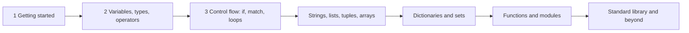
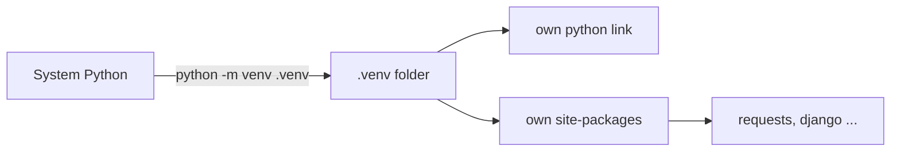
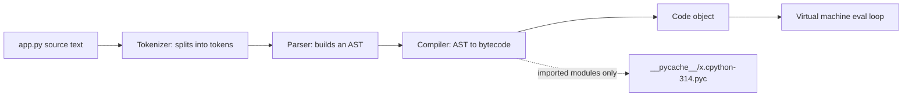

# Chapter 1 — Getting Started with Python

This chapter takes you from "never run Python" to "I understand what happens when I press Enter". You will install Python, run code two different ways, see how the CPython interpreter (the standard program that reads and runs Python code) turns your text into something a machine executes, and learn the small set of layout rules (indentation, lines, quotes, comments) that every later chapter relies on.

**What you'll learn**

| # | Topic | You will be able to… |
|---|---|---|
| 1.1 | Who this book is for and how it is organised | pick the right path through the chapters |
| 1.2 | What Python is, its history and design traits | explain Python in one minute to anyone |
| 1.3 | Where Python is used | name real products built with it |
| 1.4 | Installing Python and virtual environments | set up a clean project on any OS |
| 1.5–1.6 | REPL (interactive prompt) vs scripts, IDEs (coding apps) | choose the right tool for experimenting vs building |
| 1.7 | Your first program | write, run and understand `print("Hello, World!")` |
| 1.8 | How CPython runs code | describe source → bytecode (low-level instructions) → virtual machine |
| 1.9 | Basic syntax | identifiers, indentation, line continuation, quotes, blank lines, `input()`, `;` |
| 1.10 | Comments and docstrings | document code the way Python tools expect |
| 1.11 | PEP 8 and PEP 20 | write code that looks like professional Python |

All code lives in [`code/`](code/) and was run with CPython 3.14. Run any file with `python code/<file>.py`.

---

## 1.1 Who this book is for, and how it is organised

### What it is
A single, self-contained path through core Python — from first program to intermediate topics — written so you never need a second source.

### Who should read it
| Reader | What you get |
|---|---|
| Complete beginners (students, career changers) | A first language taught from zero, with every term defined on first use |
| Developers from Java, C#, JavaScript, Go… | The "Python way" of doing things you already know, plus the traps that differ from your language |
| Data analysts and scientists | A solid language base before NumPy, pandas and scikit-learn |
| Teachers and trainers | Ready-made explanations, examples and self-check questions |
| Hobbyists and automators | Enough Python to script your own tasks and projects |

**Prerequisites:** a computer (Windows, macOS or Linux), the ability to install software, curiosity, and willingness to type code yourself rather than only read it. No maths beyond arithmetic is needed in these early chapters.

### How the book is organised

Each chapter builds on the previous one. Every topic follows the same rhythm: *what it is → why it matters → how it works → code with real output → trade-offs → common mistakes → real-world use → interview questions → self-check → TL;DR*. Skim the TL;DR boxes ("too long; didn't read" — a few-line summary) to review; do the self-checks to confirm you actually learned it.

---

## 1.2 What Python is

### What it is
Python is a **high-level, general-purpose programming language**. *High-level* means you describe *what* to do (add these numbers, sort this list) without managing memory addresses (the numbered slots in RAM where data lives) or CPU registers (the processor's own tiny, ultra-fast storage cells). *General-purpose* means it is not tied to one domain: the same language builds websites, trains neural networks (machine-learning models built from layers of simple numeric units) and renames files.

Think of it as a very capable assistant who speaks almost-English: you write `for name in guests: print(name)` and it does exactly that.

Python is **multi-paradigm**: you can write it as a list of steps (procedural), organise it into classes and objects (object-oriented — an *object* bundles data with the functions that act on it; a *class* is the blueprint for making such objects), or compose small functions (functional). You do not have to pick one.

### A short history
| Year | Event |
|---|---|
| Dec 1989 | Guido van Rossum starts Python at CWI (the Dutch national maths and computer science institute) as a successor to the ABC teaching language. The name comes from the comedy group *Monty Python*, not the snake. |
| 1991 | First public release, 0.9.0. |
| 2000 | Python 2.0: list comprehensions (one-line list builders) and a garbage collector (automatic memory clean-up) that can reclaim reference cycles (objects pointing at each other in a loop). |
| 2008 | Python 3.0: a deliberate clean-up that broke backward compatibility (old code no longer guaranteed to run; e.g. `print` became a function, text became Unicode — the worldwide standard numbering every character in every script — by default). |
| 2018–19 | Guido steps down as "Benevolent Dictator For Life" (July 2018); since 2019 a five-person **Steering Council**, elected by the core developers, governs the language. |
| 2020 | Python 2 reaches end of life (1 January 2020). Only Python 3 is maintained. |
| 2020 → now | One feature release per year, every October (since 3.9; PEP 602) (3.10 added `match`; 3.11 made CPython markedly faster; 3.13 added a new interactive shell and experimental free-threading (letting several threads run Python code truly in parallel); 3.14 is current). |

Language changes are proposed in **PEPs** — *Python Enhancement Proposals* — numbered design documents. You will meet PEP 8 (style) and PEP 20 (philosophy) in this chapter.

### Why it matters — the design traits
| Trait | What it means in practice | The honest caveat |
|---|---|---|
| **Readable syntax** | Indentation shows structure; keywords are English words (`and`, `not`, `in`). | Whitespace errors become syntax errors (code that breaks the grammar and cannot run at all). |
| **Dynamically typed** | You never declare a variable's type; each *value* carries its type, checked while the program runs. | Type mistakes surface at run time unless you add type hints (optional labels saying what type a value should be) and a checker such as mypy (reads hints and reports mismatches without running code). |
| **Strongly typed** | Python refuses to silently mix unrelated types: `"3" + 4` is an error, not `"34"` or `7`. | You convert explicitly (Chapter 2). |
| **Automatic memory management** | Objects are freed when nothing refers to them (reference counting — keeping a count of how many names point at each object — plus a cycle collector). You never call `free()` (C's manual "give this memory back" function). | Less control over memory layout than C. |
| **"Interpreted"** | You run source files directly — no separate compile step for you. Internally CPython *does* compile to bytecode (a compact, lower-level instruction list) first (see §1.8). | Pure-Python loops are slower than C/Java; heavy numeric work goes to libraries (reusable packages of code) written in C. |
| **Extensible** | Hot spots (the few places where a program spends most of its time) can be written in C, C++ or Rust and imported like normal modules (files of code loaded with `import`) (this is how NumPy is fast). | Adds build complexity. |
| **Embeddable** | A C/C++ program can host the interpreter to give users a scripting language (Blender, GIMP, many games). | — |
| **"Batteries included"** | A large standard library (modules that ship with Python): files, JSON (a text format for data), HTTP (the web's request/response protocol), dates, maths, testing, databases (SQLite, a small file-based database). Plus 500 000+ third-party packages (written by outsiders) on PyPI (the Python Package Index, the public package store). | Quality of third-party packages varies. |

### Common mistakes
- Believing "interpreted" means "reads one line, runs it, reads the next". The whole file is compiled first; a syntax error on line 200 stops line 1 from ever running (proved in §1.8).
- Confusing *dynamic* with *weak* typing. Python is dynamic **and** strong.
- Learning Python 2 material. Anything using `print "hi"` (no parentheses) is obsolete.

### In the interview
**30-second answer:** "Python is a high-level, dynamically but strongly typed, garbage-collected, multi-paradigm language. The reference implementation, CPython, compiles source to bytecode and runs it on a stack-based virtual machine. It trades raw speed for developer productivity and pushes heavy computation into C extensions like NumPy."

- *Is Python compiled or interpreted?* → Both: compiled to bytecode, then the bytecode is interpreted by a VM. "Interpreted" describes the user experience.
- *Why is Python slow, and how do people cope?* → Every operation goes through dynamic type checks in the VM (virtual machine, §1.8). Teams vectorise with NumPy (apply one operation to a whole array at once, in C), use C/Rust extensions, use PyPy (a JIT-compiling implementation — *just-in-time*: it turns hot code into machine code while the program runs), or rely on CPython's own speed-ups since 3.11.
- *What is a PEP?* → A design document proposing a change or standard; e.g. PEP 8 is the style guide.

### Self-check
1. Is `"3" + 4` allowed? → No, `TypeError` (the error raised when a value has the wrong type for an operation): Python is strongly typed.
2. Who governs Python today? → The elected five-member Steering Council.
3. What does "dynamically typed" mean? → Types belong to values and are checked at run time; names have no fixed type.
4. When did Python 2 stop being supported? → 1 January 2020.

### TL;DR
Python = readable, dynamic-but-strong, garbage-collected, batteries-included. Created by Guido van Rossum (1989–91); Python 3 (2008) is the only live version; changes go through PEPs.

---

## 1.3 Where Python is used

### What it is
Python's niche is "everywhere glue (code that connects other programs and libraries together) is needed plus everywhere a mature library exists". The table pairs each area with the key libraries and verified real-world users.

| Area | Key tools | Real-world examples |
|---|---|---|
| **Web back-ends** | Django (batteries-included: ORM — maps database tables to classes, admin, auth — user log-in), Flask (minimal), FastAPI (async — serves many waiting requests at once, type-hint driven) | Instagram runs one of the largest Django deployments; Reddit was rewritten in Python in 2005; Pinterest and Mozilla sites use Django/Flask |
| **Data analysis** | pandas (tables and time series), NumPy (fast arrays), Jupyter notebooks (pages mixing code cells, output and notes) | Finance, analytics and research teams worldwide; Jupyter is the default notebook tool in data science |
| **Machine learning & AI** | scikit-learn, PyTorch, TensorFlow/Keras, Hugging Face Transformers | PyTorch (Meta) and TensorFlow (Google) expose Python as their main interface; most LLM (large language model, the AI behind chatbots) tooling ships Python SDKs (ready-made client libraries) first |
| **Scientific computing** | SciPy, NumPy, Matplotlib, Astropy | NumPy was used in the first black-hole image (Event Horizon Telescope) and in LIGO's gravitational-wave detection |
| **Automation & scripting** | standard library (`pathlib`, `subprocess`, `shutil`), Ansible | Sysadmin scripts, CI pipelines (automatic build-and-test runs on every code change), Ansible itself is written in Python |
| **Networking** | `socket`, `asyncio`, Twisted, `requests`/`httpx` | Network tooling, scrapers (programs that pull data out of web pages), async servers |
| **Game development & scripting** | Pygame (2-D games), embedded Python in engines | *EVE Online* uses Stackless Python on its servers; *Civilization IV* used Python for game logic; Blender and Maya expose Python scripting APIs (Application Programming Interfaces: the functions a program offers for other code to call) |
| **Desktop GUIs** (windows, buttons, menus) | Tkinter (ships with Python), PyQt/PySide, wxPython | Internal tools, utilities, the Python IDLE editor itself (Tkinter) |
| **Education** | IDLE, Thonny, turtle graphics | Widely used as a first language in schools and universities (e.g. MIT 6.100L teaches Python) |
| **IoT & embedded** (Internet of Things: small networked devices) | MicroPython, CircuitPython | Runs on microcontrollers (tiny one-chip computers) such as the Raspberry Pi Pico and ESP32 to read sensors and talk to networks |

### Why it matters
Choosing a language is mostly choosing an ecosystem. Python wins where libraries matter more than raw speed: data, ML, scripting, web APIs.

### When not to use it
| Situation | Better fit | Why |
|---|---|---|
| Hard real-time (must answer within a guaranteed deadline) or very latency-sensitive (every microsecond of delay counts) systems (trading engines, game engines' inner loops) | C, C++, Rust | Predictable performance, no interpreter overhead |
| Browser front-end code | JavaScript / TypeScript | Browsers run JavaScript natively (Python in the browser via WebAssembly — a low-level code format browsers can run — exists but is niche) |
| Native mobile apps | Swift, Kotlin | Platform SDKs and tooling |
| CPU-bound (limited by processor speed, not by waiting) multi-threaded code (on standard CPython) | Go, Rust, Java — or Python with multiprocessing (several separate Python processes) / free-threaded builds | The Global Interpreter Lock (GIL) lets only one thread (an independent line of execution inside a program) run Python bytecode at a time in the default build |

### Self-check
1. Name the two main Python web frameworks and their difference. → Django: full-featured with ORM/admin; Flask: minimal core, add what you need.
2. Why is Python fast enough for ML if Python itself is slow? → The heavy maths runs in C/C++/CUDA (NVIDIA's toolkit for computing on graphics cards) inside NumPy/PyTorch; Python only orchestrates.
3. Which Python variant runs on microcontrollers? → MicroPython (and its fork CircuitPython).

### TL;DR
Python dominates data, ML, scripting and web back-ends because of its libraries; avoid it for hard real-time, browser front-ends and native mobile.

---

## 1.4 Installing Python and creating a project

### What it is
To run Python you need an **interpreter** — the program that reads and executes Python code. The official one is **CPython** (written in C), downloaded from python.org. Other implementations exist (PyPy, MicroPython, GraalPy), but "Python" in this book means CPython.

### How it works — install per OS
| OS | Recommended | Check it worked |
|---|---|---|
| **Windows** | Installer from python.org (tick **"Add python.exe to PATH"** — PATH is the list of folders your system searches when you type a command), or the Microsoft Store package. Windows also installs the `py` launcher, which picks a version: `py -3.14`. | `py --version` or `python --version` |
| **macOS** | Installer from python.org, or Homebrew (a popular macOS package manager — a tool that installs and updates software): `brew install python`. Do not rely on any old system copy. | `python3 --version` |
| **Linux** | Your package manager, e.g. `sudo apt install python3 python3-venv` (`sudo` = run as administrator). **Never remove** the system Python — the OS uses it. | `python3 --version` |

On macOS/Linux the command you type in a **terminal** (also called the *shell* or *command line*: the text window where you type commands) is usually `python3` (plain `python` may not exist or may point elsewhere). Inside an activated virtual environment, `python` always means that environment's interpreter.

### Virtual environments (intro)
**What it is:** a *virtual environment* ("venv") is a private folder containing its own `python` executable link and its own `site-packages` directory (folder) for installed libraries. Analogy: each project gets its own toolbox, so upgrading a hammer for project A doesn't break project B.

**The problem it solves:** project A needs `Django 4`, project B needs `Django 5`. Installing both globally is impossible; installing into the system Python can break OS tools. Modern Linux distributions and Homebrew even refuse (`error: externally-managed-environment`, PEP 668) to let `pip` (Python's package installer) install globally.

**How it works:**
1. Create: `python3 -m venv .venv` (on Windows: `py -m venv .venv`).
2. Activate: `source .venv/bin/activate` (macOS/Linux) or `.venv\Scripts\activate` (Windows). Your prompt shows `(.venv)`.
3. Install packages: `python -m pip install requests`. They go into `.venv/…/site-packages`, nowhere else.
4. Record them: `python -m pip freeze > requirements.txt`; a teammate recreates with `python -m pip install -r requirements.txt`.
5. Leave: `deactivate`. Delete the environment by deleting the `.venv` folder.



`python -m pip` (rather than bare `pip`) guarantees you install into the interpreter you are actually running. Faster all-in-one tools such as **uv** and **Poetry** manage venvs and dependencies (the outside packages your project needs) for you; they build on the same idea.

### Common mistakes
- Forgetting to tick "Add to PATH" on Windows → `'python' is not recognized`.
- Installing packages globally with `sudo pip` → breaks OS tools. Use a venv.
- Committing `.venv/` to Git (the version-control tool that records every change to your files). Commit `requirements.txt` (or `pyproject.toml`, the standard project settings file) instead; add `.venv/` to `.gitignore` (the list of files Git should ignore).
- Running `pip` from one Python and `python` from another → "I installed it but import fails". Use `python -m pip`.

### In the interview
**30-second answer:** "I create one virtual environment per project with `python -m venv .venv`, activate it, install with `python -m pip`, and pin (fix to exact versions) dependencies in `requirements.txt` or `pyproject.toml`. That isolates versions between projects and keeps the system interpreter clean."
- *Where do packages go in a venv?* → Its own `site-packages` directory; `sys.prefix` points to the venv.
- *Does a venv copy the whole interpreter?* → Typically it links to (or copies) the base interpreter binary and adds its own `site-packages`; the standard library is shared.

### Self-check
1. Command to create a venv named `.venv`? → `python -m venv .venv`.
2. How do you know it is active? → Prompt shows `(.venv)`; `python -c "import sys; print(sys.prefix)"` points into it.
3. Why `python -m pip` instead of `pip`? → It runs pip for exactly the interpreter you call.

### TL;DR
Install CPython from python.org (or your OS package manager), then give every project its own `.venv` and install with `python -m pip`.

---

## 1.5 Two ways to run code: the REPL and scripts

### What it is
- **REPL** (*Read–Eval–Print Loop*): type `python3` with no arguments. You get a `>>>` prompt; each line you type is read, evaluated, and its result printed, then it loops. Continuation lines show `...`.
- **Script**: a text file ending in `.py` that you run with `python3 hello.py`. Nothing is echoed automatically — you must `print()`.

```text
$ python3
>>> 2 + 3
5
>>> _ * 10          # _ holds the last printed result (REPL only)
50
>>> name = "Ada"
>>> name            # a bare expression is echoed in the REPL...
'Ada'
>>> exit()          # or Ctrl-D (macOS/Linux), Ctrl-Z then Enter (Windows)
```

Since Python 3.13 the default REPL supports colour, multi-line editing, and `exit`/`quit` without parentheses. Use `help(len)` inside the REPL for documentation and `help()` for an interactive help browser.

### Ways to run Python
| Command | What it does | Use it for |
|---|---|---|
| `python3` | Start the REPL | Quick experiments |
| `python3 script.py` | Run a file | Real programs |
| `python3 -i script.py` | Run a file, then drop into the REPL with its variables | Debugging / exploring results |
| `python3 -m module` | Run a module found on the import path (the folders Python searches on `import`) | Tools: `-m venv`, `-m pip`, `-m http.server`, `-m pytest` |
| `python3 -c "print(1+1)"` | Run a one-line program | Shell one-liners |
| Jupyter notebook | Cells of code + output + text | Data exploration, teaching |

On macOS/Linux a script can start with a **shebang** line `#!/usr/bin/env python3`; after `chmod +x script.py` (mark the file as executable) you can run `./script.py` directly.

### The `if __name__ == "__main__":` guard
Every module has a variable `__name__`. When a file is **run directly** it is `"__main__"`; when it is **imported** it is the module's name. Putting start-up code under the guard lets a file be both a runnable script and an importable library — every script in this book does it.

### Trade-offs
| | REPL | Script |
|---|---|---|
| Feedback | Instant | After each run |
| Keeps your work | No (history only) | Yes, in a file you can version |
| Auto-prints values | Yes | No — use `print()` |
| Best for | Trying one idea | Anything you'll run twice |

### Common mistakes
- Typing `python3 hello.py` *inside* the `>>>` prompt → `SyntaxError`. That is a shell command; exit the REPL first.
- Expecting a bare expression like `2 + 3` in a script to print something. Only the REPL echoes.
- Naming your file after a standard module (`random.py`, `email.py`) — `import random` then imports *your* file.

### Self-check
1. What does `_` hold in the REPL? → The last echoed result.
2. How do you run a file and then inspect its variables? → `python3 -i file.py`.
3. What is `__name__` when a file is imported? → The module's name, not `"__main__"`.

### TL;DR
REPL for trying, scripts for keeping. Guard start-up code with `if __name__ == "__main__":`.

---

## 1.6 IDEs and editors

### What it is
An **IDE** (*Integrated Development Environment*) combines an editor with running, debugging (finding and fixing bugs, often by pausing the program to inspect values), autocompletion and error checking. You can write Python in any text editor, but tooling catches mistakes before you run.

| Tool | Best for | Notes |
|---|---|---|
| **VS Code** + Python extension | Most people | Free; Pylance gives autocompletion and type checking; integrated debugger and Jupyter |
| **PyCharm** | Large projects | Deep refactoring (restructuring code without changing what it does) and inspections; core features are free, advanced ones need a paid Pro subscription |
| **Jupyter / JupyterLab** | Data analysis, teaching | Cells, inline charts; not ideal for large applications |
| **IDLE** | First hour | Ships with Python; simple REPL + editor |
| **Thonny** | Absolute beginners | Shows variables and step-by-step execution visually |
| Vim / Neovim / Emacs / Zed / Sublime | Keyboard-driven developers | Add a language server (a background helper that powers completion and go-to-definition; Pyright, pylsp) for smart features |

Add three tools to any editor: a **formatter** (Black or Ruff format — rewrites layout to PEP 8), a **linter** (Ruff or Flake8 — flags bugs and style issues), and optionally a **type checker** (mypy or Pyright).

### Common mistakes
- The editor uses a different interpreter than your venv → imports "missing". Select the `.venv` interpreter in the IDE.
- Hand-formatting code. Let the formatter do it on save.

### TL;DR
VS Code or PyCharm for projects, Jupyter for data, IDLE/Thonny to start; always pair with a formatter and linter.

---

## 1.7 Your first program

### What it is
The traditional first program prints a greeting. It proves your installation works and introduces two ideas: a **function call** and a **string**.

```python
# Print "Hello, World!" to the console
print("Hello, World!")
```

- `print` is a **built-in function** — always available, no import needed. Calling it means writing its name followed by parentheses containing **arguments**.
- `"Hello, World!"` is a **string** (type `str`): a sequence of characters between quotes.
- `print` writes the text to **standard output** (the console) and then a newline.
- The `# …` line is a **comment**; Python ignores it.

`print` has two handy keyword arguments (arguments passed as `name=value`): `sep` (what goes between arguments, default a space) and `end` (what goes after, default `"\n"`). From [`code/first_program.py`](code/first_program.py):

```python
print("Hello, World!")
print("Python", sys.version_info.major, sys.version_info.minor, sep=".", end="  <- running version\n")
```
Output:
```text
Hello, World!
Python.3.14  <- running version
```

### Common mistakes
- `Print("hi")` → `NameError` (Python doesn't know that name): Python is case-sensitive.
- `print "hi"` → `SyntaxError` (Python 2 syntax).
- Mismatched or curly quotes pasted from a word processor (`“hi”`) → `SyntaxError`.

### Self-check
1. What type is `"Hello, World!"`? → `str`.
2. How do you print `a-b-c` from three arguments? → `print("a", "b", "c", sep="-")`.
3. How do you print without a trailing newline? → `print(x, end="")`.

### TL;DR
`print(...)` sends text to the console; text in quotes is a `str`; everything is case-sensitive.

---

## 1.8 How CPython runs your code

### What it is
When you type `python3 app.py`, CPython does **not** execute your text line by line. It first translates the *entire file* into **bytecode** — compact instructions for an imaginary, stack-based computer (a *stack* is a pile where the last value put on is the first taken off) — and then its **virtual machine** (VM) executes those instructions. Analogy: a translator first converts a whole speech into shorthand notes (bytecode), then reads the notes aloud (VM).

### How it works

1. **Tokenize** — the text is split into tokens: names, numbers, operators, `INDENT`/`DEDENT` markers. Comments are discarded here.
2. **Parse** — tokens are arranged into an **Abstract Syntax Tree (AST)**, a tree describing the program's structure. Since 3.9 CPython uses a PEG parser (*Parsing Expression Grammar*, a technique for describing and checking syntax; PEP 617). Syntax errors are found here — for the whole file, before anything runs.
3. **Compile** — the AST becomes a **code object**: bytecode plus tables of constants and names.
4. **Cache** — for *imported* modules, the code object is saved as a `.pyc` file in `__pycache__/` so the next import can skip steps 1–3 if the source hasn't changed. The main script you run directly is not cached.
5. **Execute** — the VM's evaluation loop reads each instruction, pushes and pops values on a stack, and calls C code to do the real work. Since 3.11 the VM *specialises* hot (frequently executed) instructions for the types it actually sees (PEP 659), one reason 3.11+ is noticeably faster than 3.10.

From [`code/how_cpython_runs.py`](code/how_cpython_runs.py):
```python
SOURCE = 'price = 20\nqty = 3\ntotal = price * qty\nprint("total =", total)\n'
code = compile(SOURCE, "<demo>", "exec")       # steps 1-3
dis.dis(code)                                  # show the bytecode
exec(code, {})                                 # step 5
```
Output (CPython 3.14 — instruction names change between versions):
```text
implementation: cpython 3.14.7
code object: code | constants: (20, 'total =', None) | names: ('price', 'qty', 'total', 'print')
--- bytecode ---
  1           LOAD_SMALL_INT          20
              STORE_NAME               0 (price)
  2           LOAD_SMALL_INT           3
              STORE_NAME               1 (qty)
  3           LOAD_NAME                0 (price)
              LOAD_NAME                1 (qty)
              BINARY_OP                5 (*)
              STORE_NAME               2 (total)
  4           LOAD_NAME                3 (print)
              PUSH_NULL
              LOAD_CONST               1 ('total =')
              LOAD_NAME                2 (total)
              CALL                     2
              ...
--- run ---
total = 60
SyntaxError at line 2 - so line 1 never ran
cached bytecode file: __pycache__/shop.cpython-314.pyc
cache tag for this interpreter: cpython-314
```
Read line 3 of the bytecode: push `price`, push `qty`, `BINARY_OP *` pops both and pushes the product, `STORE_NAME` pops it into `total`. That is a stack machine.

### Other implementations
| Implementation | Runs on | Notable for |
|---|---|---|
| **CPython** | C | The reference; what python.org ships |
| **PyPy** | RPython, JIT-compiled | Often several times faster on long-running pure-Python code |
| **MicroPython** | Microcontrollers | Tiny memory footprint |
| **GraalPy**, Jython | JVM (Java Virtual Machine) | Java interoperability (calling Java code directly) |

CPython itself added an experimental JIT compiler (3.13, off by default) and an optional **free-threaded** build without the GIL (experimental in 3.13, officially supported but still optional in 3.14).

### Trade-offs
Bytecode + VM makes Python portable (the same `.py` runs on any OS) and quick to start, at the cost of per-instruction overhead versus native machine code (instructions the CPU executes directly).

### Common mistakes
- Thinking `.pyc` files hide or protect source code — they are trivially decompiled (turned back into readable source) and version-specific.
- Committing `__pycache__/` to Git. Ignore it.
- Expecting a syntax error late in the file to let earlier lines run.

### In the interview
**30-second answer:** "CPython tokenizes and parses the whole file into an AST, compiles it to bytecode in a code object, caches bytecode for imported modules in `__pycache__`, and then a stack-based virtual machine executes the bytecode. Since 3.11 it specialises instructions based on observed types."
- *What's in a `.pyc`?* → A header (magic number identifying the bytecode version, plus source timestamp/size or hash) followed by the serialised (converted to bytes for saving) code object.
- *What is the GIL?* → A lock (a mechanism that lets only one thread proceed at a time) in the default CPython build that allows only one thread to execute bytecode at a time; it simplifies memory management but limits CPU-bound threading.
- *How can you see bytecode?* → The `dis` module: `dis.dis(func)`.

### Self-check
1. Name the stages from source to execution. → Tokenize → parse (AST) → compile (bytecode/code object) → execute on the VM.
2. Is your main script cached as `.pyc`? → No, only imported modules.
3. Why can a syntax error on line 50 prevent line 1 from running? → The whole file is parsed and compiled before execution starts.

### TL;DR
Source → tokens → AST → bytecode → VM. "Interpreted" really means "compiled to bytecode, then interpreted".

---

## 1.9 Basic syntax

### Identifiers
An **identifier** is a name you give to a variable, function, class or module.

**Rules (enforced — breaking them is a `SyntaxError`):**
1. Starts with a letter or underscore `_`; then any letters, digits, underscores.
2. No spaces or symbols like `-`, `@`, `$`, `!`, `#`, `%`.
3. Case-sensitive: `total`, `Total`, `TOTAL` are three different names.
4. Any length.
5. Not a **keyword** (reserved word). Python 3.14 has 35 keywords (`if`, `for`, `class`, `True`, `None`, …) plus four **soft keywords** — `match`, `case`, `type`, `_` — that are special only in certain positions, so `match = 3` is still legal.
6. Unicode letters are allowed (`café = 1` works), but stick to ASCII (the basic 128-character English set) for shared code.

From [`code/first_program.py`](code/first_program.py), which tests names with `str.isidentifier()` and `keyword.iskeyword()`:
```text
'total'      valid identifier? True
'_private'   valid identifier? True
'user2'      valid identifier? True
'2user'      valid identifier? False
'user-name'  valid identifier? False
'class'      valid identifier? False
'café'       valid identifier? True
```

### Lines and indentation
**What it is:** Python marks a **block** (the body of an `if`, loop, function, class) by *indentation*, not braces `{}`. A line ending in `:` opens a block; every line in it must be indented by the same amount; the block ends when indentation returns to the outer level.

```python
if temperature > 30:
    label = "hot"      # inside the if-block
else:
    label = "mild"     # inside the else-block
print(label)           # back at the outer level: always runs
```

**Rules:**
- PEP 8 says: **4 spaces per level**, never tabs. Configure your editor to insert spaces.
- Mixing tabs and spaces inconsistently is a `TabError` in Python 3.
- An unexpected indent is `IndentationError: unexpected indent`; a missing one after `:` is `IndentationError: expected an indented block`.
- An empty block is illegal — use `pass` as a placeholder (Chapter 3).

**Why it matters:** the layout you see *is* the structure the computer sees. In brace languages, misleading indentation can hide bugs (a famous example is Apple's 2014 "goto fail" SSL bug (SSL/TLS is the encryption behind `https`), where a duplicated, indented line looked like it belonged to an `if`). In Python that mismatch cannot exist.

### Multi-line statements
A statement normally ends at the end of the line. To continue it:

| Method | Example | Verdict |
|---|---|---|
| **Implicit** — inside `()`, `[]`, `{}` | `total = (1` ⏎ `+ 2` ⏎ `+ 3)` | Preferred by PEP 8 |
| **Explicit** — backslash `\` at line end | `total = 1 + \` ⏎ `2 + \` ⏎ `3` | Works, but a stray space after `\` breaks it |

Both produce `6` in `line_continuation_demo()`. PEP 8 also suggests breaking long expressions *before* binary operators (operators that take two values, like `+` or `*`) (`+ 2` at the start of the next line), which lines operators up for the reader.

### Quotation marks
| Form | Use | Example |
|---|---|---|
| `'...'` | Strings containing `"` | `'It said "hi"'` |
| `"..."` | Strings containing `'` | `"It's sunny"` |
| `'''...'''` or `"""..."""` | Text spanning lines; docstrings | `"""Line one`⏎`Line two"""` |

Single and double quotes are identical in meaning — pick one style and stay consistent (formatters like Black standardise on `"`). Output of `quotes_demo()`:
```text
It said "hi" | It's sunny | ['Line one', 'Line two']
```

### Blank lines
Blank lines are ignored by the interpreter (inside the REPL, a blank line ends a multi-line block). Use them to separate logical steps. PEP 8: **two** blank lines around top-level functions and classes, **one** between methods in a class.

### Reading user input
`input(prompt)` prints the prompt, waits for the user to press Enter, and returns what they typed **as a `str` — always**, even if they typed digits.

```python
user_name = input("Please enter your name: ")
print("Hello, " + user_name + "!")
```
The runnable script replaces `input()` with a stand-in so it runs unattended; the output is what a user typing `Ada` would see:
```text
Please enter your name: Ada
Hello, Ada!
```
To do maths with input, convert it: `age = int(input("Age: "))` (Chapter 2 covers conversion and its errors).

### Several statements on one line
A semicolon `;` separates statements on a single line:
```python
import sys; x = "foo"; sys.stdout.write(x + "\n")      # prints: foo
```
It is legal, but PEP 8 discourages it: one statement per line is easier to read, diff (compare two versions line by line) and debug. (`sys.stdout.write` is the lower-level cousin of `print`: it writes exactly the string you give it, with no automatic newline.)

### Common mistakes
- Forgetting the colon: `if x > 3` → `SyntaxError: expected ':'`.
- Copying code from the web that uses tabs into a file that uses spaces.
- Treating `input()` as a number: `input() + 1` → `TypeError`.
- Using `-` in names (`user-name` means "user minus name").

### In the interview
**30-second answer:** "Python uses indentation to define blocks — four spaces per PEP 8 — so visual structure equals logical structure. Statements end at the newline unless you're inside brackets, which is the preferred way to continue a line. Identifiers are case-sensitive and can't be keywords."
- *What's a soft keyword?* → A word that's only reserved in a specific context, like `match`/`case` in a match statement, so old code using `match` as a variable still works.
- *Why prefer brackets over backslashes?* → A backslash fails silently if followed by whitespace, and brackets let editors auto-indent.

### Self-check
1. Is `my-var` a valid identifier? → No; `-` is subtraction.
2. What does `input()` return if the user types `42`? → The string `"42"`.
3. What error do you get for inconsistent tabs and spaces? → `TabError`.
4. How many spaces per indentation level does PEP 8 recommend? → 4.

### TL;DR
Names: letters/digits/underscore, not starting with a digit, not keywords, case-sensitive. Blocks = `:` + 4-space indent. Continue lines inside brackets. `input()` returns `str`. Avoid `;`.

---

## 1.10 Comments and docstrings

### What it is
- A **comment** starts with `#` and runs to the end of the line. The tokenizer throws it away; it never reaches the bytecode. It is a note for humans.
- A **docstring** is a string literal (a value written directly in the code) placed as the *first statement* of a module, function, class or method. Unlike a comment, it is kept at run time in the object's `__doc__` attribute (a named value attached to an object, read with a dot), and tools (`help()`, IDE tooltips, Sphinx documentation generators) read it.

### Single-line and inline comments
```python
# A comment explains WHY; the code already says WHAT.
return width * height  # inline comment: two spaces before the '#'
```
PEP 8: start with `# ` (hash + space); for inline comments put at least two spaces before `#`; keep comments up to date — a wrong comment is worse than none.

### "Multi-line comments"
Python has **no** dedicated multi-line comment syntax. Two options:
1. **Consecutive `#` lines** — the correct way; every editor can toggle them with one shortcut.
2. **A triple-quoted string not assigned to anything** — often called a "multi-line comment". Technically it is an *expression statement*: the string is a value that is created and immediately discarded (CPython usually optimises it away). It "works", but it is not a comment: if it happens to be the first statement in a function it silently becomes the docstring, and it must obey indentation rules like any other statement. Prefer `#` lines; reserve triple quotes for docstrings.

### Docstrings
From [`code/comments_docstrings.py`](code/comments_docstrings.py):
```python
def area(width: float, height: float) -> float:
    """Return the area of a rectangle.

    Args:
        width: size along x, in metres.
        height: size along y, in metres.
    """
    return width * height
```
Output:
```text
module doc first line: Chapter 1 - comments vs docstrings, PEP 20, and keywords.
function doc first line: Return the area of a rectangle.
area(3, 4) = 12
```
Conventions (PEP 257): triple double quotes; a one-line summary in the imperative ("Return…", not "Returns…"), ending with a period; for longer docstrings a blank line then details. Popular layouts for the details are Google style (shown above), NumPy style and reStructuredText (a plain-text markup format).

### Comments vs docstrings
| | `#` comment | Docstring |
|---|---|---|
| Kept at run time? | No | Yes, in `__doc__` |
| Audience | Maintainers reading the code | Users of the function/module (via `help()`, IDEs) |
| Content | *Why* a tricky line exists | *What* the object does, its arguments, return value, errors |
| Position | Anywhere | First statement of module/class/function |

### Common mistakes
- Comments that repeat the code (`x += 1  # add one to x`). Explain intent instead.
- Leaving commented-out code blocks around — that's what version control is for.
- Writing a docstring after the first statement (it's then just an ignored string).

### In the interview
**30-second answer:** "Comments start with `#` and are discarded by the tokenizer; they explain *why*. Docstrings are the first string literal in a module, class or function, stored in `__doc__`, and describe *what* the object does for its users. Python has no block-comment syntax; use several `#` lines."
- *Is a triple-quoted string a comment?* → No, it's a string expression that's evaluated and discarded — unless it's first in a body, then it's a docstring.
- *How do you read a docstring at runtime?* → `obj.__doc__` or `help(obj)`.

### Self-check
1. Where must a docstring go? → First statement in the module/class/function body.
2. Do comments slow down your program? → No; they're removed during tokenizing.
3. Proper way to comment out five lines? → Put `#` at the start of each (editor shortcut).

### TL;DR
`#` = note for maintainers, gone at run time. Docstring = first-statement string, kept in `__doc__`, read by `help()` and IDEs. No real multi-line comments — use several `#` lines.

---

## 1.11 PEP 8 and PEP 20 — writing Pythonic code

### What it is
- **PEP 8** is the official **style guide**: how Python code should *look*. Consistency lets any Python developer read any codebase.
- **PEP 20**, *The Zen of Python* by Tim Peters, is the language's **philosophy** in 19 short aphorisms (brief, memorable sayings). Type `import this` to print it.

### PEP 8 essentials
| Rule | Example |
|---|---|
| 4 spaces per indent, no tabs | `····return x` |
| Lines ≤ 79 characters (72 for comments/docstrings); many teams relax to 88–100 | — |
| `snake_case` for variables, functions, modules | `user_age`, `load_data()` |
| `CapWords` (CamelCase) for classes | `UserProfile` |
| `UPPER_SNAKE_CASE` for constants | `MAX_RETRIES = 3` |
| Leading `_` for "internal" names | `_cache` |
| Spaces around `=` in assignments and around comparisons; none inside brackets | `x = f(a, b)` not `x=f( a,b )` |
| No spaces around `=` in keyword arguments | `print(x, end="")` |
| Imports at the top, one per line, grouped: standard library, third-party, local | `import os` ⏎ `import sys` |
| Two blank lines around top-level functions/classes | — |
| Compare to `None` with `is`, not `==` | `if x is None:` |
| Don't compare booleans to `True` | `if ready:` not `if ready == True:` |

PEP 8 itself says consistency within a project beats rigid rule-following. Automate it: **Black** or **Ruff** formats code; **Ruff** or **Flake8** lints.

### PEP 20 — the aphorisms that matter most
From [`code/comments_docstrings.py`](code/comments_docstrings.py), which captures the output of `import this`:
```text
Zen of Python has 19 aphorisms, e.g.:
   Beautiful is better than ugly.
   Explicit is better than implicit.
   Simple is better than complex.
   Readability counts.
35 hard keywords, e.g. ['False', 'None', 'True', 'and', 'as', 'assert']
soft keywords (only special in some places): ['_', 'case', 'match', 'type']
```
How they show up in daily decisions:
| Aphorism | In practice |
|---|---|
| Explicit is better than implicit | `from math import sqrt` rather than `from math import *` |
| Readability counts | Descriptive names; one statement per line |
| Errors should never pass silently | Don't write `except: pass` |
| There should be one obvious way to do it | Use `for item in items`, not index juggling |
| Flat is better than nested | Early returns instead of deep `if` pyramids (Chapter 3) |
| In the face of ambiguity, refuse the temptation to guess | Why `"3" + 4` raises instead of guessing |

"**Pythonic**" means code that follows these idioms.

### Common mistakes
- Arguing about style in code review (teammates reading your changes before they are merged) — let the formatter decide.
- Using `camelCase` for functions (a Java habit).

### In the interview
**30-second answer:** "PEP 8 is the style guide — 4-space indents, snake_case functions, CapWords classes, 79-char lines, grouped imports — and I enforce it with Ruff or Black. PEP 20 is the Zen of Python; the ideas I lean on most are 'explicit is better than implicit', 'readability counts' and 'errors should never pass silently'."
- *What does "Pythonic" mean?* → Using the language's idioms (iteration, context managers — `with` blocks, Chapter 9 — comprehensions) instead of translating another language line by line.

### Self-check
1. Name style for a class holding user settings? → `UserSettings`.
2. How do you print the Zen of Python? → `import this`.
3. Which is PEP 8-correct: `if x == None` or `if x is None`? → `if x is None`.

### TL;DR
PEP 8 = how code looks (automate it). PEP 20 = why Python feels the way it does. Together they define "Pythonic".

---

## Chapter 1 TL;DR
- Python is a high-level, dynamically **and** strongly typed, garbage-collected language; CPython is the reference implementation; Python 3 is the only supported line.
- It's used for web back-ends, data, ML, science, automation, games scripting, GUIs, education and IoT — mostly because of its libraries.
- Install from python.org or your OS; give each project a `.venv`; install with `python -m pip`.
- REPL (`>>>`) for experiments, `.py` scripts for real work, `if __name__ == "__main__":` for start-up code.
- CPython: source → tokens → AST → bytecode (cached as `.pyc` for imports) → stack-based VM. The whole file is compiled before any line runs.
- Syntax: blocks by `:` + 4-space indentation; case-sensitive identifiers; continue lines inside brackets; `'`/`"`/`"""` strings; `input()` returns `str`; avoid `;`.
- `#` comments vanish at compile time; docstrings live in `__doc__`.
- Follow PEP 8 (enforced by a formatter) and the spirit of PEP 20.
