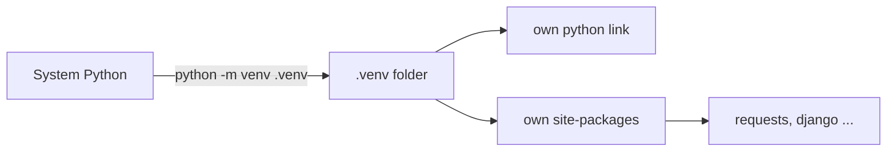
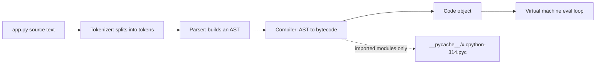

# Chapter 1 — Getting Started with Python

From "never run Python" to "I understand what happens when I press Enter": install Python, run code two ways, see how the CPython interpreter (the standard program that reads and runs Python code) turns text into executed instructions, and learn the layout rules (indentation, lines, quotes, comments) every later chapter relies on.

| # | Topic | You will be able to… |
|---|---|---|
| 1.1 | Who this book is for | pick your path through the chapters |
| 1.2 | What Python is, history, design traits | explain Python in one minute |
| 1.3 | Where Python is used | name real products built with it |
| 1.4 | Installing Python, virtual environments | set up a clean project on any OS |
| 1.5–1.6 | REPL vs scripts, IDEs | choose the right tool |
| 1.7 | First program | write and understand `print("Hello, World!")` |
| 1.8 | How CPython runs code | describe source → bytecode → virtual machine |
| 1.9 | Basic syntax | identifiers, indentation, continuation, quotes, `input()`, `;` |
| 1.10 | Comments and docstrings | document code the way tools expect |
| 1.11 | PEP 8 and PEP 20 | write professional-looking Python |

All code lives in [`code/`](code/) and was run with CPython 3.14: `python code/<file>.py`.

---

## 1.1 Who this book is for, and how it is organised

### What it is
One self-contained path through core Python, from first program to intermediate topics.

### Who should read it
| Reader | What you get |
|---|---|
| Complete beginners (students, career changers) | A first language from zero; every term defined on first use |
| Developers from Java, C#, JS, Go… | The "Python way" plus traps that differ from your language |
| Data analysts / scientists | A language base before NumPy, pandas, scikit-learn |
| Teachers and trainers | Ready-made explanations, examples and self-checks |
| Hobbyists and automators | Enough Python to script your own tasks |

**Prerequisites:** a computer (Windows, macOS, Linux), ability to install software, willingness to type code yourself. Only arithmetic-level maths.

### How the book is organised

Each chapter builds on the previous one. Topics follow one rhythm: *what it is → how it works → code with real output → trade-offs → common mistakes → interview questions → self-check → TL;DR* ("too long; didn't read" summary).

---

## 1.2 What Python is

### What it is
A **high-level, general-purpose programming language**. *High-level*: you say *what* to do without managing memory addresses or CPU registers. *General-purpose*: the same language builds websites, trains neural networks and renames files.

Python is **multi-paradigm**: procedural (a list of steps), object-oriented (an *object* bundles data with the functions acting on it; a *class* is the blueprint for objects), or functional (composing small functions). You don't have to pick one.

### A short history
| Year | Event |
|---|---|
| Dec 1989 | Guido van Rossum starts Python at CWI (Dutch national maths/CS institute) as a successor to the ABC teaching language. Named after *Monty Python*, not the snake. |
| 1991 | First public release, 0.9.0. |
| 2000 | Python 2.0: list comprehensions and a garbage collector (automatic memory clean-up) that reclaims reference cycles (objects pointing at each other in a loop). |
| 2008 | Python 3.0: deliberate backward-incompatible clean-up (`print` became a function; text became Unicode by default). |
| 2018–19 | Guido steps down as "Benevolent Dictator For Life" (July 2018); since 2019 an elected five-person **Steering Council** governs. |
| 2020 | Python 2 end of life (1 January 2020). Only Python 3 is maintained. |
| 2020 → now | One feature release per year, every October (since 3.9; PEP 602). 3.10 added `match`; 3.11 made CPython markedly faster; 3.13 added a new interactive shell and experimental free-threading (threads running Python truly in parallel); 3.14 is current. |

Language changes are proposed in **PEPs** (*Python Enhancement Proposals*), numbered design documents — e.g. PEP 8 (style), PEP 20 (philosophy).

### Why it matters — the design traits
| Trait | In practice | Caveat |
|---|---|---|
| **Readable syntax** | Indentation shows structure; English keywords (`and`, `not`, `in`). | Whitespace errors are syntax errors (code can't run at all). |
| **Dynamically typed** | No declared variable types; each *value* carries its type, checked at run time. | Type mistakes surface at run time unless you add type hints and a checker such as mypy (reports mismatches without running code). |
| **Strongly typed** | No silent mixing: `"3" + 4` is an error, not `"34"` or `7`. | You convert explicitly (Chapter 2). |
| **Automatic memory management** | Reference counting (counting names pointing at each object) plus a cycle collector; no `free()`. | Less control over memory layout than C. |
| **"Interpreted"** | You run source directly; internally CPython compiles to bytecode first (§1.8). | Pure-Python loops are slower than C/Java; heavy numeric work goes to C libraries. |
| **Extensible** | Hot spots (where most time is spent) can be written in C, C++ or Rust and imported like modules (this is how NumPy is fast). | Adds build complexity. |
| **Embeddable** | A C/C++ program can host the interpreter as a scripting language (Blender, GIMP, games). | — |
| **"Batteries included"** | Large standard library (files, JSON, HTTP, dates, maths, testing, SQLite) plus 500 000+ third-party packages on PyPI (Python Package Index). | Third-party quality varies. |

### Common mistakes
- Believing "interpreted" means "read one line, run it". The whole file is compiled first; a syntax error on line 200 stops line 1 from running (§1.8).
- Confusing *dynamic* with *weak* typing. Python is dynamic **and** strong.
- Learning from Python 2 material (`print "hi"` is obsolete).

### In the interview
**30-second answer:** "Python is a high-level, dynamically but strongly typed, garbage-collected, multi-paradigm language. The reference implementation, CPython, compiles source to bytecode and runs it on a stack-based virtual machine. It trades raw speed for developer productivity and pushes heavy computation into C extensions like NumPy."

- *Compiled or interpreted?* → Both: compiled to bytecode, then interpreted by a VM. "Interpreted" describes the user experience.
- *Why is Python slow, and how do people cope?* → Every operation goes through dynamic type checks in the VM. Teams vectorise with NumPy (one operation over a whole array, in C), write C/Rust extensions, use PyPy (a JIT — *just-in-time* — implementation that compiles hot code to machine code while running), or rely on CPython's speed-ups since 3.11.
- *What is a PEP?* → A design document proposing a change or standard.

### Self-check
1. Is `"3" + 4` allowed? → No, `TypeError` (wrong type for an operation): strong typing.
2. Who governs Python? → The elected five-member Steering Council.
3. When did Python 2 support end? → 1 January 2020.

### TL;DR
Readable, dynamic-but-strong, garbage-collected, batteries-included. Guido van Rossum (1989–91); Python 3 (2008) is the only live line; changes go through PEPs.

---

## 1.3 Where Python is used

### What it is
Python wins wherever glue code (connecting other programs and libraries) is needed and a mature library exists.

| Area | Key tools | Real-world examples |
|---|---|---|
| **Web back-ends** | Django (batteries-included: ORM — maps tables to classes — admin, auth), Flask (minimal), FastAPI (async, type-hint driven) | Instagram runs one of the largest Django deployments; Reddit was rewritten in Python in 2005; Pinterest and Mozilla use Django/Flask |
| **Data analysis** | pandas, NumPy, Jupyter notebooks (code cells + output + notes) | Finance, analytics, research; Jupyter is the default data-science notebook |
| **Machine learning & AI** | scikit-learn, PyTorch, TensorFlow/Keras, Hugging Face Transformers | PyTorch (Meta) and TensorFlow (Google) are Python-first; most LLM tooling ships Python SDKs first |
| **Scientific computing** | SciPy, NumPy, Matplotlib, Astropy | NumPy was used in the first black-hole image (Event Horizon Telescope) and LIGO's gravitational-wave detection |
| **Automation & scripting** | `pathlib`, `subprocess`, `shutil`, Ansible | Sysadmin scripts, CI pipelines (automatic build-and-test on every change); Ansible is written in Python |
| **Networking** | `socket`, `asyncio`, Twisted, `requests`/`httpx` | Network tooling, scrapers, async servers |
| **Game development & scripting** | Pygame, embedded Python | *EVE Online* (Stackless Python servers); *Civilization IV* game logic; Blender and Maya scripting APIs |
| **Desktop GUIs** (windows, buttons, menus) | Tkinter (bundled), PyQt/PySide, wxPython | Internal tools; the IDLE editor itself (Tkinter) |
| **Education** | IDLE, Thonny, turtle | Common first language (e.g. MIT 6.100L) |
| **IoT & embedded** (Internet of Things: small networked devices) | MicroPython, CircuitPython | Microcontrollers (tiny one-chip computers) such as Raspberry Pi Pico and ESP32, reading sensors and talking to networks |

### When not to use it
| Situation | Better fit | Why |
|---|---|---|
| Hard real-time (guaranteed deadlines) or latency-critical (trading engines, game-engine inner loops) | C, C++, Rust | Predictable performance, no interpreter overhead |
| Browser front-end code | JavaScript / TypeScript | Browsers run JS natively (Python via WebAssembly is niche) |
| Native mobile apps | Swift, Kotlin | Platform SDKs and tooling |
| CPU-bound (limited by processor speed, not by waiting) multi-threaded code on standard CPython | Go, Rust, Java — or Python multiprocessing / free-threaded builds | The Global Interpreter Lock (GIL) lets only one thread run Python bytecode at a time in the default build |

### Self-check
1. Django vs Flask? → Django: full-featured with ORM/admin; Flask: minimal core.
2. Why is Python fast enough for ML? → Heavy maths runs in C/C++/CUDA (NVIDIA GPU toolkit) inside NumPy/PyTorch; Python orchestrates.

### TL;DR
Python dominates data, ML, scripting and web back-ends because of its libraries; avoid it for hard real-time, browser front-ends and native mobile.

---

## 1.4 Installing Python and creating a project

### What it is
To run Python you need an **interpreter**. The official one is **CPython** (written in C) from python.org. Others exist (PyPy, MicroPython, GraalPy); "Python" here means CPython.

### How it works — install per OS
| OS | Recommended | Check |
|---|---|---|
| **Windows** | python.org installer (tick **"Add python.exe to PATH"** — PATH is the folder list searched for commands) or Microsoft Store. Also installs the `py` launcher: `py -3.14`. | `py --version` or `python --version` |
| **macOS** | python.org installer or Homebrew: `brew install python`. Don't rely on an old system copy. | `python3 --version` |
| **Linux** | Package manager: `sudo apt install python3 python3-venv`. **Never remove** the system Python — the OS uses it. | `python3 --version` |

On macOS/Linux the terminal command is usually `python3` (plain `python` may be missing). Inside an activated venv, `python` always means that environment's interpreter.

### Virtual environments (intro)
**What it is:** a *virtual environment* ("venv") is a private folder with its own `python` link and its own `site-packages` folder for installed libraries — one toolbox per project.

**The problem it solves:** project A needs Django 4, project B Django 5; global installs can't satisfy both and can break OS tools. Modern Linux distributions and Homebrew refuse global `pip` installs (`error: externally-managed-environment`, PEP 668).

**How it works:**
1. Create: `python3 -m venv .venv` (Windows: `py -m venv .venv`).
2. Activate: `source .venv/bin/activate` (macOS/Linux) or `.venv\Scripts\activate` (Windows); prompt shows `(.venv)`.
3. Install: `python -m pip install requests` → goes into `.venv/…/site-packages` only.
4. Record: `python -m pip freeze > requirements.txt`; recreate with `python -m pip install -r requirements.txt`.
5. Leave: `deactivate`. Delete by deleting `.venv`.



`python -m pip` (not bare `pip`) guarantees you install into the interpreter you actually run. **uv** and **Poetry** manage venvs and dependencies for you on the same idea.

### Common mistakes
- Not ticking "Add to PATH" on Windows → `'python' is not recognized`.
- `sudo pip install` globally → breaks OS tools.
- Committing `.venv/` to Git. Commit `requirements.txt` / `pyproject.toml`; add `.venv/` to `.gitignore`.
- `pip` from one Python, `python` from another → "installed but import fails". Use `python -m pip`.

### In the interview
**30-second answer:** "One virtual environment per project with `python -m venv .venv`, install with `python -m pip`, and pin dependencies in `requirements.txt` or `pyproject.toml`. That isolates versions between projects and keeps the system interpreter clean."
- *Where do packages go?* → The venv's own `site-packages`; `sys.prefix` points into the venv (check with `python -c "import sys; print(sys.prefix)"`).
- *Does a venv copy the interpreter?* → It links to (or copies) the base binary and adds its own `site-packages`; the standard library is shared.

### TL;DR
Install CPython from python.org or your OS, give every project its own `.venv`, install with `python -m pip`.

---

## 1.5 Two ways to run code: the REPL and scripts

### What it is
- **REPL** (*Read–Eval–Print Loop*): `python3` with no arguments gives a `>>>` prompt; each line is read, evaluated, its result printed. Continuation lines show `...`.
- **Script**: a `.py` file run with `python3 hello.py`. Nothing is echoed — you must `print()`.

```text
$ python3
>>> 2 + 3
5
>>> _ * 10          # _ holds the last printed result (REPL only)
50
>>> name = "Ada"
>>> name            # a bare expression is echoed in the REPL...
'Ada'
>>> exit()          # or Ctrl-D (macOS/Linux), Ctrl-Z then Enter (Windows)
```

Since 3.13 the default REPL has colour, multi-line editing, and `exit`/`quit` without parentheses. `help(len)` shows docs; `help()` opens a help browser.

### Ways to run Python
| Command | What it does | Use it for |
|---|---|---|
| `python3` | Start the REPL | Quick experiments |
| `python3 script.py` | Run a file | Real programs |
| `python3 -i script.py` | Run, then drop into the REPL with its variables | Debugging / exploring |
| `python3 -m module` | Run a module from the import path | `-m venv`, `-m pip`, `-m http.server`, `-m pytest` |
| `python3 -c "print(1+1)"` | Run a one-liner | Shell one-liners |
| Jupyter notebook | Code + output + text cells | Data exploration, teaching |

On macOS/Linux a **shebang** line `#!/usr/bin/env python3` plus `chmod +x script.py` lets you run `./script.py`.

### The `if __name__ == "__main__":` guard
Every module has `__name__`: `"__main__"` when **run directly**, the module's name when **imported**. Start-up code under the guard makes a file both a runnable script and an importable library — every script in this book does it.

### Trade-offs
| | REPL | Script |
|---|---|---|
| Feedback | Instant | After each run |
| Keeps your work | No (history only) | Yes, versionable |
| Auto-prints values | Yes | No — use `print()` |
| Best for | Trying one idea | Anything you'll run twice |

### Common mistakes
- Typing `python3 hello.py` *inside* `>>>` → `SyntaxError`; it's a shell command.
- Expecting a bare `2 + 3` in a script to print. Only the REPL echoes.
- Naming your file after a standard module (`random.py`) — `import random` imports *your* file.

### TL;DR
REPL for trying, scripts for keeping (`_` = last REPL result; `-i` = run then inspect). Guard start-up code with `if __name__ == "__main__":`.

---

## 1.6 IDEs and editors

### What it is
An **IDE** (*Integrated Development Environment*) combines an editor with running, debugging (pausing to inspect values), autocompletion and error checking.

| Tool | Best for | Notes |
|---|---|---|
| **VS Code** + Python extension | Most people | Free; Pylance completion/type checking; debugger, Jupyter |
| **PyCharm** | Large projects | Deep refactoring and inspections; core free, advanced features paid (Pro) |
| **Jupyter / JupyterLab** | Data analysis, teaching | Cells, inline charts; not for large apps |
| **IDLE** | First hour | Ships with Python |
| **Thonny** | Absolute beginners | Visualises variables and step-by-step execution |
| Vim / Neovim / Emacs / Zed / Sublime | Keyboard-driven devs | Add a language server (Pyright, pylsp) for completion and go-to-definition |

Pair any editor with a **formatter** (Black or Ruff format — rewrites layout to PEP 8), a **linter** (Ruff or Flake8 — flags bugs and style issues) and optionally a **type checker** (mypy or Pyright).

### Common mistakes
- Editor using a different interpreter than your venv → imports "missing". Select the `.venv` interpreter.
- Hand-formatting code; let the formatter run on save.

### TL;DR
VS Code or PyCharm for projects, Jupyter for data, IDLE/Thonny to start; always add a formatter and linter.

---

## 1.7 Your first program

### What it is
```python
# Print "Hello, World!" to the console
print("Hello, World!")
```
- `print` is a **built-in function** (always available). Calling it = name + parentheses containing **arguments**.
- `"Hello, World!"` is a **string** (`str`): characters between quotes.
- `print` writes to **standard output** (the console) followed by a newline. `# …` is a **comment**, ignored by Python.

Two keyword arguments (passed as `name=value`): `sep` (between arguments, default space) and `end` (after, default `"\n"`). From [`code/first_program.py`](code/first_program.py):

```python
print("Hello, World!")
print("Python", sys.version_info.major, sys.version_info.minor, sep=".", end="  <- running version\n")
```
Output:
```text
Hello, World!
Python.3.14  <- running version
```

### Common mistakes
- `Print("hi")` → `NameError` (unknown name): Python is case-sensitive.
- `print "hi"` → `SyntaxError` (Python 2 syntax).
- Curly quotes pasted from a word processor (`“hi”`) → `SyntaxError`.

### Self-check
1. Print `a-b-c` from three arguments? → `print("a", "b", "c", sep="-")`.
2. Print without a trailing newline? → `print(x, end="")`.

### TL;DR
`print(...)` sends text to the console; quoted text is a `str`; everything is case-sensitive.

---

## 1.8 How CPython runs your code

### What it is
CPython does **not** execute your text line by line. It first translates the *entire file* into **bytecode** — compact instructions for an imaginary stack-based computer (a *stack*: last value in is first out) — then its **virtual machine** (VM) executes them.

### How it works

1. **Tokenize** — split into names, numbers, operators, `INDENT`/`DEDENT` markers. Comments are discarded here.
2. **Parse** — tokens become an **Abstract Syntax Tree (AST)** describing the program's structure. Since 3.9 CPython uses a PEG parser (*Parsing Expression Grammar*; PEP 617). Syntax errors are found here, for the whole file, before anything runs.
3. **Compile** — the AST becomes a **code object**: bytecode plus tables of constants and names.
4. **Cache** — for *imported* modules, the code object is saved as `.pyc` in `__pycache__/` so later imports skip steps 1–3 if the source is unchanged. The main script is not cached.
5. **Execute** — the VM's evaluation loop pushes/pops values on a stack and calls C code for the real work. Since 3.11 it *specialises* hot instructions for the types it actually sees (PEP 659) — one reason 3.11+ is noticeably faster than 3.10.

From [`code/how_cpython_runs.py`](code/how_cpython_runs.py):
```python
SOURCE = 'price = 20\nqty = 3\ntotal = price * qty\nprint("total =", total)\n'
code = compile(SOURCE, "<demo>", "exec")       # steps 1-3
dis.dis(code)                                  # show the bytecode
exec(code, {})                                 # step 5
```
Output (CPython 3.14 — instruction names change between versions):
```text
implementation: cpython 3.14.7
code object: code | constants: (20, 'total =', None) | names: ('price', 'qty', 'total', 'print')
--- bytecode ---
  1           LOAD_SMALL_INT          20
              STORE_NAME               0 (price)
  2           LOAD_SMALL_INT           3
              STORE_NAME               1 (qty)
  3           LOAD_NAME                0 (price)
              LOAD_NAME                1 (qty)
              BINARY_OP                5 (*)
              STORE_NAME               2 (total)
  4           LOAD_NAME                3 (print)
              PUSH_NULL
              LOAD_CONST               1 ('total =')
              LOAD_NAME                2 (total)
              CALL                     2
              ...
--- run ---
total = 60
SyntaxError at line 2 - so line 1 never ran
cached bytecode file: __pycache__/shop.cpython-314.pyc
cache tag for this interpreter: cpython-314
```
Line 3: push `price`, push `qty`, `BINARY_OP *` pops both and pushes the product, `STORE_NAME` pops it into `total` — a stack machine.

### Other implementations
| Implementation | Runs on | Notable for |
|---|---|---|
| **CPython** | C | The reference; what python.org ships |
| **PyPy** | RPython, JIT-compiled | Often several times faster on long-running pure-Python code |
| **MicroPython** | Microcontrollers | Tiny memory footprint |
| **GraalPy**, Jython | JVM | Calling Java code directly |

CPython added an experimental JIT compiler (3.13, off by default) and an optional **free-threaded** build without the GIL (experimental in 3.13, officially supported but still optional in 3.14).

### Trade-offs
Bytecode + VM is portable (same `.py` on any OS) and quick to start, at the cost of per-instruction overhead versus native machine code.

### Common mistakes
- Thinking `.pyc` files protect source — they are trivially decompiled and version-specific.
- Committing `__pycache__/` to Git.

### In the interview
**30-second answer:** "CPython tokenizes and parses the whole file into an AST, compiles it to bytecode in a code object, caches bytecode for imported modules in `__pycache__`, and a stack-based virtual machine executes it. Since 3.11 it specialises instructions based on observed types."
- *What's in a `.pyc`?* → A header (magic number for the bytecode version, plus source timestamp/size or hash) followed by the serialised code object.
- *What is the GIL?* → A lock in default CPython allowing only one thread to execute bytecode at a time; simplifies memory management but limits CPU-bound threading.
- *How can you see bytecode?* → `dis.dis(func)`.
- *Why can a syntax error on line 50 stop line 1 running?* → The whole file is parsed and compiled before execution.

### TL;DR
Source → tokens → AST → bytecode → VM. "Interpreted" really means "compiled to bytecode, then interpreted". Only imported modules are cached as `.pyc`.

---

## 1.9 Basic syntax

### Identifiers
An **identifier** names a variable, function, class or module. Rules (breaking them is a `SyntaxError`):
1. Starts with a letter or `_`, then letters, digits, underscores; any length.
2. No spaces or symbols (`-`, `@`, `$`, `!`, `#`, `%`).
3. Case-sensitive: `total`, `Total`, `TOTAL` differ.
4. Not a **keyword**. Python 3.14 has 35 keywords (`if`, `for`, `class`, `True`, `None`, …) plus four **soft keywords** — `match`, `case`, `type`, `_` — special only in certain positions, so `match = 3` is legal.
5. Unicode letters are allowed (`café = 1`), but use ASCII in shared code.

From [`code/first_program.py`](code/first_program.py) (`str.isidentifier()` and `keyword.iskeyword()`):
```text
'total'      valid identifier? True
'_private'   valid identifier? True
'user2'      valid identifier? True
'2user'      valid identifier? False
'user-name'  valid identifier? False
'class'      valid identifier? False
'café'       valid identifier? True
```

### Lines and indentation
A **block** (body of an `if`, loop, function, class) is marked by *indentation*, not braces. A line ending in `:` opens it; all its lines share one indent; it ends when indentation returns to the outer level.

```python
if temperature > 30:
    label = "hot"      # inside the if-block
else:
    label = "mild"     # inside the else-block
print(label)           # back at the outer level: always runs
```

- PEP 8: **4 spaces per level**, never tabs.
- Inconsistent tabs/spaces → `TabError`. Unexpected indent → `IndentationError: unexpected indent`; missing after `:` → `IndentationError: expected an indented block`.
- An empty block is illegal — use `pass` (Chapter 3).

**Why it matters:** visible layout *is* the structure. In brace languages misleading indentation hides bugs (Apple's 2014 "goto fail" SSL bug (SSL/TLS is the encryption behind `https`): a duplicated, indented line looked like part of an `if`). In Python that mismatch cannot exist.

### Multi-line statements
| Method | Example | Verdict |
|---|---|---|
| **Implicit** — inside `()`, `[]`, `{}` | `total = (1` ⏎ `+ 2` ⏎ `+ 3)` | Preferred by PEP 8 |
| **Explicit** — `\` at line end | `total = 1 + \` ⏎ `2 + \` ⏎ `3` | Works, but a stray space after `\` breaks it |

Both give `6` in `line_continuation_demo()`. PEP 8 suggests breaking *before* binary operators (`+ 2` starts the next line).

### Quotation marks
| Form | Use | Example |
|---|---|---|
| `'...'` | Strings containing `"` | `'It said "hi"'` |
| `"..."` | Strings containing `'` | `"It's sunny"` |
| `'''...'''` / `"""..."""` | Multi-line text; docstrings | `"""Line one`⏎`Line two"""` |

Single and double quotes mean the same; be consistent (Black standardises on `"`). Output of `quotes_demo()`:
```text
It said "hi" | It's sunny | ['Line one', 'Line two']
```

### Blank lines
Ignored by the interpreter (in the REPL a blank line ends a multi-line block). PEP 8: **two** around top-level functions/classes, **one** between methods.

### Reading user input
`input(prompt)` prints the prompt, waits for Enter, and returns **a `str` — always**, even for digits.

```python
user_name = input("Please enter your name: ")
print("Hello, " + user_name + "!")
```
The runnable script stubs `input()`; a user typing `Ada` sees:
```text
Please enter your name: Ada
Hello, Ada!
```
For maths, convert: `age = int(input("Age: "))` (Chapter 2).

### Several statements on one line
```python
import sys; x = "foo"; sys.stdout.write(x + "\n")      # prints: foo
```
Legal but discouraged by PEP 8 (harder to read, diff and debug). `sys.stdout.write` writes exactly the string given, with no automatic newline.

### Common mistakes
- Missing colon: `if x > 3` → `SyntaxError: expected ':'`.
- Pasting tab-indented code into a space-indented file.
- `input() + 1` → `TypeError`.
- `user-name` means "user minus name".

### In the interview
**30-second answer:** "Python uses indentation to define blocks — four spaces per PEP 8 — so visual structure equals logical structure. Statements end at the newline unless you're inside brackets, the preferred way to continue a line. Identifiers are case-sensitive and can't be keywords."
- *What's a soft keyword?* → Reserved only in context, like `match`/`case`, so old code using `match` as a variable still works.
- *Why brackets over backslashes?* → A backslash breaks if followed by whitespace; brackets let editors auto-indent.

### TL;DR
Names: letters/digits/underscore, no leading digit, not keywords, case-sensitive. Blocks = `:` + 4-space indent. Continue lines inside brackets. `input()` returns `str`. Avoid `;`.

---

## 1.10 Comments and docstrings

### What it is
- A **comment** (`#` to end of line) is discarded by the tokenizer; it never reaches bytecode, so it costs nothing at run time.
- A **docstring** is a string literal that is the *first statement* of a module, function, class or method. It is kept in the object's `__doc__` attribute and read by `help()`, IDE tooltips and Sphinx.

### Single-line and inline comments
```python
# A comment explains WHY; the code already says WHAT.
return width * height  # inline comment: two spaces before the '#'
```
PEP 8: `# ` (hash + space); at least two spaces before an inline `#`; keep comments current — a wrong comment is worse than none.

### "Multi-line comments"
Python has **no** multi-line comment syntax.
1. **Consecutive `#` lines** — the correct way (editors toggle them with one shortcut).
2. **An unassigned triple-quoted string** — an *expression statement* whose value is created and discarded (CPython usually optimises it away). Not a comment: as the first statement in a function it silently becomes the docstring, and it must obey indentation. Reserve triple quotes for docstrings.

### Docstrings
From [`code/comments_docstrings.py`](code/comments_docstrings.py):
```python
def area(width: float, height: float) -> float:
    """Return the area of a rectangle.

    Args:
        width: size along x, in metres.
        height: size along y, in metres.
    """
    return width * height
```
Output:
```text
module doc first line: Chapter 1 - comments vs docstrings, PEP 20, and keywords.
function doc first line: Return the area of a rectangle.
area(3, 4) = 12
```
PEP 257: triple double quotes; a one-line imperative summary ("Return…", not "Returns…") ending in a period; for longer ones a blank line then details. Common detail layouts: Google style (above), NumPy style, reStructuredText.

### Comments vs docstrings
| | `#` comment | Docstring |
|---|---|---|
| Kept at run time? | No | Yes, in `__doc__` |
| Audience | Maintainers | Users (via `help()`, IDEs) |
| Content | *Why* a tricky line exists | *What* it does, arguments, return, errors |
| Position | Anywhere | First statement of module/class/function |

### Common mistakes
- Comments repeating code (`x += 1  # add one to x`).
- Leaving commented-out code — version control keeps history.
- A docstring after the first statement is just an ignored string.

### In the interview
**30-second answer:** "Comments start with `#`, are discarded by the tokenizer and explain *why*. Docstrings are the first string literal in a module, class or function, stored in `__doc__`, describing *what* for users. There's no block-comment syntax; use several `#` lines."
- *Is a triple-quoted string a comment?* → No: a string expression evaluated and discarded — unless first in a body, then a docstring.
- *Read a docstring at runtime?* → `obj.__doc__` or `help(obj)`.

### TL;DR
`#` = note for maintainers, gone at run time. Docstring = first-statement string in `__doc__`. No real multi-line comments.

---

## 1.11 PEP 8 and PEP 20 — writing Pythonic code

### What it is
- **PEP 8**: the official **style guide** — how code should *look*.
- **PEP 20**, *The Zen of Python* (Tim Peters): the **philosophy** in 19 aphorisms. `import this` prints it.

### PEP 8 essentials
| Rule | Example |
|---|---|
| 4 spaces per indent, no tabs | `····return x` |
| Lines ≤ 79 chars (72 for comments/docstrings); many teams use 88–100 | — |
| `snake_case` variables, functions, modules | `user_age`, `load_data()` |
| `CapWords` (CamelCase) classes | `UserProfile` |
| `UPPER_SNAKE_CASE` constants | `MAX_RETRIES = 3` |
| Leading `_` for internal names | `_cache` |
| Spaces around `=` in assignments and comparisons; none inside brackets | `x = f(a, b)` not `x=f( a,b )` |
| No spaces around `=` in keyword arguments | `print(x, end="")` |
| Imports at top, one per line, grouped: stdlib, third-party, local | `import os` ⏎ `import sys` |
| Two blank lines around top-level defs | — |
| Compare to `None` with `is` | `if x is None:` |
| Don't compare booleans to `True` | `if ready:` |

PEP 8 itself says project consistency beats rigid rules. Automate: **Black**/**Ruff** format; **Ruff**/**Flake8** lint.

### PEP 20 — the aphorisms that matter most
From [`code/comments_docstrings.py`](code/comments_docstrings.py), which captures `import this`:
```text
Zen of Python has 19 aphorisms, e.g.:
   Beautiful is better than ugly.
   Explicit is better than implicit.
   Simple is better than complex.
   Readability counts.
35 hard keywords, e.g. ['False', 'None', 'True', 'and', 'as', 'assert']
soft keywords (only special in some places): ['_', 'case', 'match', 'type']
```
| Aphorism | In practice |
|---|---|
| Explicit is better than implicit | `from math import sqrt`, not `from math import *` |
| Readability counts | Descriptive names; one statement per line |
| Errors should never pass silently | No `except: pass` |
| There should be one obvious way to do it | `for item in items`, not index juggling |
| Flat is better than nested | Early returns over deep `if` pyramids (Chapter 3) |
| In the face of ambiguity, refuse the temptation to guess | Why `"3" + 4` raises |

"**Pythonic**" means code that follows these idioms.

### Common mistakes
- Arguing style in code review — let the formatter decide.
- `camelCase` functions (a Java habit).

### In the interview
**30-second answer:** "PEP 8 is the style guide — 4-space indents, snake_case functions, CapWords classes, 79-char lines, grouped imports — enforced with Ruff or Black. PEP 20 is the Zen of Python; I lean on 'explicit is better than implicit', 'readability counts' and 'errors should never pass silently'."
- *What does "Pythonic" mean?* → Using the language's idioms (iteration, `with` context managers — Chapter 9 — comprehensions) instead of translating another language line by line.

### TL;DR
PEP 8 = how code looks (automate it). PEP 20 = why Python feels the way it does. Together they define "Pythonic".

---

## Chapter 1 TL;DR
- Python: high-level, dynamically **and** strongly typed, garbage-collected; CPython is the reference; only Python 3 is supported.
- Used for web back-ends, data, ML, science, automation, game scripting, GUIs, education, IoT — because of its libraries.
- Install from python.org or your OS; one `.venv` per project; install with `python -m pip`.
- REPL for experiments, `.py` scripts for real work, `if __name__ == "__main__":` for start-up code.
- CPython: source → tokens → AST → bytecode (`.pyc` for imports) → stack VM; the whole file compiles before any line runs.
- Syntax: `:` + 4-space blocks; case-sensitive identifiers; continue inside brackets; `input()` returns `str`; avoid `;`.
- `#` comments vanish at compile time; docstrings live in `__doc__`.
- Follow PEP 8 (via a formatter) and the spirit of PEP 20.
