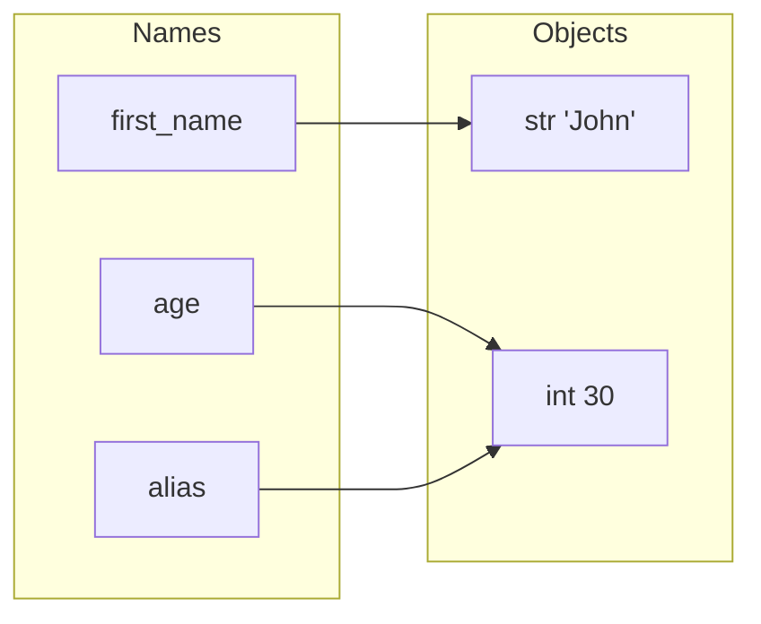
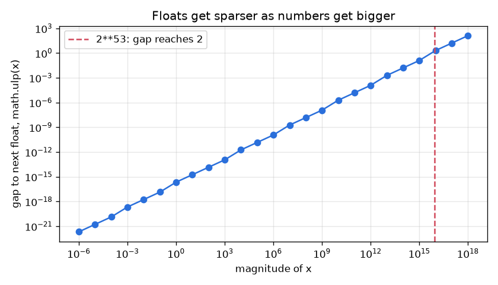

# Chapter 2 — Variables, Data Types and Operators

Every program stores data and computes with it. This chapter explains how Python stores data (names pointing at objects), which kinds of data exist (the built-in types), how numbers really behave (including why `0.1 + 0.2 != 0.3`), how to convert between types, and every operator family with its precedence. The mental model from §2.1 — *names are labels on objects* — is the single most important idea in the whole book: most "weird" Python behaviour stops being weird once you have it.

**What you'll learn**

| # | Topic | Key ideas |
|---|---|---|
| 2.1 | Variables | creating, printing, deleting, case sensitivity, multiple assignment, naming rules and conventions, names vs objects |
| 2.2 | Identity, equality, mutability | `is` vs `==`, `id()`, mutable vs immutable, aliasing |
| 2.3 | Dynamic vs strong typing | why `x` can change type but `"3" + 4` fails |
| 2.4 | Built-in data types | text, numeric, sequence, mapping, set, boolean, binary, `None` |
| 2.5 | Numbers | arbitrary-precision `int`, `float` pitfalls, `Decimal`, `Fraction`, `complex`, `random` |
| 2.6 | Booleans and truthiness | `True`/`False`, falsy values, `bool` is an `int` |
| 2.7 | Type conversion | implicit widening, explicit `int()`/`float()`/`str()`…, failure cases |
| 2.8 | Operators | arithmetic, comparison, assignment/augmented, logical, bitwise, membership, identity, walrus `:=`, chained comparisons, precedence |

Code: [`code/`](code/) — every output below is real, from CPython 3.14.

---

## 2.1 Variables

### What it is
A **variable** in Python is a **name that refers to an object**. An **object** is a chunk of memory holding a value, its **type**, and a reference count. The name itself stores no data — it is a label tied to an object. Analogy: objects are parcels in a warehouse; names are sticky labels. You can stick several labels on one parcel, move a label to a different parcel, or peel a label off — the parcel itself is unaffected.

There is no declaration step: a variable comes into existence the first time you **assign** to it with `=`.

### How it works — creating and printing
```python
first_name = "John"      # name first_name -> str object "John"
age = 30                 # name age        -> int object 30
height = 5.11            # name height     -> float object 5.11
print(first_name, age, height)          # John 30 5.11
```
Assignment `name = expression` runs in two steps:
1. Evaluate the right-hand side → an object (created or found).
2. Bind the name on the left to that object (in the current **namespace** — a dictionary-like table mapping names to objects).


After `alias = age`, both names point at the **same** `int` object. No copy is made — ever — by plain assignment.

### Multiple assignment
From [`code/names_and_objects.py`](code/names_and_objects.py):
```python
first_name, age, height = "John", 30, 5.11   # tuple unpacking: one name per value
a = b = c = 0                                # chained: three names, ONE object
x, y = 1, 2
x, y = y, x                                  # swap: right side is built first, then unpacked
head, *rest = [10, 20, 30, 40]               # starred: rest collects the leftovers as a list
```
Output:
```text
John 30 5.11
swap: 2 1 | chained: 0 0 0
head: 10 rest: [20, 30, 40]
```
Unpacking needs matching counts: `x, y = 1, 2, 3` raises `ValueError: too many values to unpack`. Beware `a = b = []` — both names share **one** list (see §2.2).

### Deleting variables — `del`
`del name` removes the **name** from the namespace. The object is destroyed only when no references to it remain (CPython frees it immediately when its reference count hits zero).
```python
player_score = 120
alias = player_score
del player_score
print(player_score)     # NameError - the name is gone
print(alias)            # 120 - the object survives, alias still refers to it
```
Output (the script runs the snippet inside a function, then again at module level with a name `player`):
```text
UnboundLocalError (a NameError subclass, inside a function): cannot access local variable 'player_score' where it is not associated with a value
object still reachable via alias: 120
NameError at module level: name 'player' is not defined
```
Using a deleted name **always** raises `NameError` (inside a function you see its subclass `UnboundLocalError`). If an online code playground seems to print nothing instead, it is simply not displaying the error stream — run the file locally and you will see the traceback. You rarely need `del` for plain variables; it's more common for removing dictionary keys (`del d["k"]`) or list items (`del items[0]`).

### Case sensitivity
`Age`, `age` and `AGE` are three unrelated names:
```text
Age/age/AGE: 25 30 35
```

### Naming rules (enforced) and conventions (PEP 8)
| Rules — break them and you get `SyntaxError` | Conventions — break them and reviewers complain |
|---|---|
| Start with a letter or `_` | `snake_case` for variables and functions: `user_age` |
| Then letters, digits, `_` only | `CapWords` for classes: `UserProfile` |
| Not a keyword (`class`, `if`, `None`…) | `UPPER_SNAKE_CASE` for constants: `MAX_USERS = 100` |
| Case-sensitive | Descriptive: `age` not `a`, `username` not `usrnm` |
| | Leading `_` = internal/private by convention |
| | Don't shadow built-ins: never name a variable `list`, `str`, `sum`, `id`, `input` |

Valid: `username`, `_user_id`, `user2name`. Invalid: `2user` (starts with a digit), `user-name` (hyphen is minus), `class` (keyword).

Shadowing is legal but harmful: after `list = [1, 2]`, calling `list("abc")` fails with `TypeError: 'list' object is not callable`.

### Common mistakes
- Assuming `b = a` copies a list. It doesn't; use `a.copy()`, `list(a)` or `a[:]` (shallow copy), or `copy.deepcopy(a)` for nested data.
- Shadowing built-ins (`list`, `dict`, `sum`, `max`, `id`, `type`).
- Using a variable before assigning it → `NameError`.

### In the interview
**30-second answer:** "Python variables are names bound to objects, not boxes holding values. Assignment never copies; it binds a name to the object on the right. `del` unbinds a name, and CPython frees the object when its reference count reaches zero."
- *What happens in `a = b = []`?* → One list, two names; appending via `a` is visible via `b`.
- *How does swap `x, y = y, x` work?* → The right side builds a tuple `(y, x)` first, then unpacks it into the names.
- *Does `del x` free memory?* → It removes one reference; the object is freed only if that was the last one.

### Self-check
1. After `a = [1]; b = a; b.append(2)`, what is `a`? → `[1, 2]`.
2. Is `_total2` a valid name? `2_total`? → Yes; no.
3. What exception do you get using a deleted name? → `NameError`.
4. Why is naming a variable `str` a bad idea? → It hides the built-in `str` type in that scope.

### TL;DR
Variables are labels on objects; `=` binds, never copies; `del` removes a label; names are case-sensitive, snake_case, and must not be keywords or shadow built-ins.

---

## 2.2 Identity, equality and mutability

### What it is
Every object has three things:
| Property | Question it answers | How to see it | Can it change? |
|---|---|---|---|
| **Identity** | *Which* object is this? | `id(obj)` (in CPython, the memory address) | Never, for the object's lifetime |
| **Type** | *What kind* of object? | `type(obj)` | No (in normal code) |
| **Value** | *What* does it contain? | `==`, `print` | Only if the type is **mutable** |

- `a == b` — **equality**: do they have the same value? (calls `a.__eq__(b)`)
- `a is b` — **identity**: are they the very same object? (compares `id`s; cannot be overridden)

### How it works
```python
list_a = [1, 2, 3]
list_b = [1, 2, 3]      # a second, separate list with equal contents
list_c = list_a         # another name for the first list
```
```text
a == b: True | a is b: False | a is c: True
id(a) == id(c): True
```

**Mutable** types can change their value in place: `list`, `dict`, `set`, `bytearray`, most user-defined classes. **Immutable** types cannot: `int`, `float`, `complex`, `bool`, `str`, `tuple`, `frozenset`, `bytes`, `None`. "Changing" an immutable value really creates a new object and rebinds the name:
```python
n = 10
m = n
m += 1          # builds a new int 11 and rebinds m; n still refers to 10
```
```text
team: ['ann', 'bob', 'cy'] | same object? True     # list mutated through an alias
n: 10 m: 11                                        # int "changed" = rebinding
str is immutable: 'str' object does not support item assignment
tuple holding a list: ([1, 99], [2])
```
The last line is the subtle one: a tuple is immutable — it will always contain *the same two list objects* — but those lists are themselves mutable.

### Why it matters
- Passing a list to a function passes a reference: the function can mutate the caller's list. That is powerful and a common bug source.
- Only immutable (more precisely, **hashable**) objects can be dictionary keys or set members, because their hash must never change.

### When to use `is`
Use `is` only for **singletons** — objects of which exactly one exists: `None`, `True`, `False`, `Ellipsis`, and sentinel objects you create. `if x is None:` is correct; `if x == None:` works but can be fooled by classes that override `__eq__`.

### Common mistakes
- `if x is 5:` or `if name is "bob":` — works "by accident" sometimes because CPython caches small integers (−5 to 256) and some strings. That caching is an implementation detail; Python 3.8+ emits `SyntaxWarning: "is" with 'int' literal`. Use `==`.
- `grid = [[0] * 3] * 3` creates **three references to one row**; changing `grid[0][0]` changes all rows. Use `[[0] * 3 for _ in range(3)]`.
- Mutable default arguments (`def f(items=[])`) — the one list is shared across calls (covered in the functions chapter).

### In the interview
**30-second answer:** "`==` compares values via `__eq__`; `is` compares identity — whether two names point to the same object. I use `is` only for singletons like `None`. Mutable objects like lists and dicts can change in place, so aliases see the change; immutable ones like ints, strings and tuples can't, so 'modifying' them rebinds the name to a new object."
- *Why does `256 is 256` give True but `1000 is 1000` might not?* → CPython pre-allocates small ints −5..256; it's an implementation detail, never rely on it.
- *Can a tuple change?* → Its own slots can't be reassigned, but mutable objects inside it can be mutated; such a tuple is also unhashable.
- *Why must dict keys be immutable?* → The dict stores keys by hash; if the value could change, the hash would change and the key would be lost.

### Self-check
1. `[] == []` and `[] is []`? → `True`, `False`.
2. Which of these are mutable: `str`, `list`, `tuple`, `set`, `frozenset`? → `list`, `set`.
3. Correct test for "no value"? → `x is None`.
4. What does `id()` return in CPython? → The object's memory address (an integer unique among live objects).

### TL;DR
`==` = same value, `is` = same object. Use `is` only with `None`/`True`/`False`/sentinels. Mutable objects change in place (aliases see it); immutable ones are replaced.

---

## 2.3 Dynamic vs strong typing

### What it is
Two independent axes:
| Axis | Python's position | Meaning |
|---|---|---|
| **Static ↔ dynamic** | **Dynamic** | Types are attached to *objects*, checked while running. A *name* can refer to an `int` now and a `str` later. |
| **Weak ↔ strong** | **Strong** | Operations on incompatible types raise errors instead of silently converting. |

```python
value = 42              # name -> int
value = "forty-two"     # same name -> str: fine (dynamic)
"Age: " + 30            # TypeError: can only concatenate str (not "int") to str  (strong)
```
Output of that part of the script:
```text
int -> str
TypeError: can only concatenate str (not "int") to str
```
Compare JavaScript (dynamic **and** weak): `"Age: " + 30` gives `"Age: 30"` and `"5" - 2` gives `3`. C is static but fairly weak (implicit int/pointer conversions). Java is static and strong.

Python *does* widen numbers automatically (`1 + 2.5` → `3.5`), because int, float and complex form a numeric tower where no information is surprising — see §2.7.

### Type hints
You can annotate types: `def area(w: float, h: float) -> float:` (function annotations, Python 3.0+; the `typing` module arrived in 3.5) and `age: int = 30` (variable annotations, 3.6+). The interpreter **ignores** hints at run time; tools such as mypy, Pyright and IDEs use them to catch mistakes before you run. Large codebases (Dropbox, where mypy was developed, and Instagram) adopted hints to keep dynamic code safe at scale.

### Trade-offs
| Dynamic typing gives | Dynamic typing costs |
|---|---|
| Less boilerplate; fast prototyping | Type errors appear at run time |
| Duck typing: "if it has `.read()`, treat it as a file" | IDEs know less without hints |
| Generic code for free | Slower execution (type checks on every operation) |

### Self-check
1. Is Python statically typed? → No, dynamically; optional hints are checked by external tools only.
2. Why does `"3" * 2` work but `"3" + 2` fail? → `str * int` is defined (repetition → `"33"`); `str + int` isn't.
3. Does `x: int = "hi"` raise an error? → No, hints aren't enforced at run time; mypy would flag it.

### TL;DR
Dynamic = names can re-point to any type; strong = no silent cross-type coercion (except numeric widening). Add type hints + mypy for static checking.

---

## 2.4 Built-in data types

### What it is
A **data type** defines what values an object can hold and which operations make sense (you can divide numbers, not dictionaries). Python's built-ins fall into eight categories:

| Category | Types | Mutable? | Literal / constructor example |
|---|---|---|---|
| Text | `str` | No | `"hi"`, `'hi'`, `"""hi"""` |
| Numeric | `int`, `float`, `complex` | No | `10`, `10.5`, `2 + 3j` |
| Sequence | `list`, `tuple`, `range` | list: yes; tuple, range: no | `[1, 2]`, `(1, 2)`, `range(5)` |
| Mapping | `dict` | Yes | `{"name": "Alice"}` |
| Set | `set`, `frozenset` | set: yes; frozenset: no | `{1, 2}`, `frozenset([1, 2])` |
| Boolean | `bool` | No | `True`, `False` |
| Binary | `bytes`, `bytearray`, `memoryview` | bytearray: yes; bytes: no; memoryview: reflects its buffer | `b"abc"`, `bytearray(b"abc")`, `memoryview(b"abc")` |
| None | `NoneType` | No | `None` |

From [`code/data_types_tour.py`](code/data_types_tour.py), which prints `type(obj).__name__` for one sample of each:
```text
text       -> str        mutable=False
int        -> int        mutable=False
float      -> float      mutable=False
complex    -> complex    mutable=False
list       -> list       mutable=True
tuple      -> tuple      mutable=False
range      -> range      mutable=False
dict       -> dict       mutable=True
set        -> set        mutable=True
frozenset  -> frozenset  mutable=False
bool       -> bool       mutable=False
bytes      -> bytes      mutable=False
bytearray  -> bytearray  mutable=True
memoryview -> memoryview mutable=False
None       -> NoneType   mutable=False
```
Check a type with `type(x)` (exact type) or, better in real code, `isinstance(x, int)` (also accepts subclasses). Note `isinstance(True, int)` is `True` because `bool` subclasses `int`.

### Each category in brief
Strings, lists, tuples, dictionaries and sets get full chapters later; here is what you need now.

**Text — `str`:** an immutable sequence of Unicode characters. `"Hello, World!"`, `len(s)`, `s.upper()`, `s[0]`.

**Numeric:** `int` for whole numbers (counts, IDs), `float` for measurements, `complex` for engineering/signal maths. Deep dive in §2.5.
```text
int + 5: 15 | float + 0.5: 11.0 | complex: (3+1j)
```

**Sequence types** keep items in order and support indexing `s[i]`, slicing `s[i:j]`, `len()`, `in`:
- `list` — mutable, the everyday container: `sports = ["soccer", "basketball", "tennis"]`.
- `tuple` — immutable; use for fixed records (`("red", "green", "blue")`, coordinates) and as dict keys. Slightly smaller and faster to create than lists.
- `range` — an immutable, **lazy** sequence of integers: it stores only start, stop and step, so `range(10**12)` uses almost no memory. `range(5)` is 0, 1, 2, 3, 4 (start inclusive, stop exclusive).
```text
range(5) as list: [0, 1, 2, 3, 4] | 3 in r: True
```

**Mapping — `dict`:** key → value pairs with fast (average O(1)) lookup by key. Keys must be hashable. Since Python 3.7, dicts remember insertion order.
```python
user = {"name": "Alice", "age": 25}
user["age"] += 1                 # modify
user["city"] = "Paris"           # add
user.get("email", "n/a")         # safe lookup with default; user["email"] would raise KeyError
```
```text
dict: {'name': 'Alice', 'age': 26, 'city': 'Paris'} | get missing key: n/a
```

**Set types:** unordered collections of **unique** hashable items with fast membership tests. `set` is mutable; `frozenset` is immutable and therefore hashable (usable as a dict key or inside another set). Adding a duplicate is silently ignored. Careful: `{}` is an empty **dict**; an empty set is `set()`.
```text
set size: 4 | sorted: ['basketball', 'soccer', 'tennis', 'volleyball']
frozenset usable as dict key: palette
```

**Boolean — `bool`:** `True` / `False`; see §2.6.

**Binary types** handle raw bytes (file contents, network packets, images):
- `bytes` — immutable sequence of integers 0–255: `bytes([50, 100, 150])`, `b"abc"`.
- `bytearray` — mutable version; you can assign `data[1] = 105`.
- `memoryview` — a zero-copy *window* onto another buffer; slicing it doesn't copy, and it reflects later changes to the underlying data.
```python
data = bytearray([50, 100, 150])
data[1] = 105
view = memoryview(data)[1:3]     # window on items 1..2, no copy
data[2] = 200                    # change the buffer after creating the view...
```
```text
bytes: [50, 100, 150] | bytearray: [50, 105, 200] | view: [105, 200]
bytes range 0-255: bytes must be in range(0, 256)
text <-> bytes: b'caf\xc3\xa9' café
```
The view shows `200` — proof that it shares memory. Text ↔ bytes conversion goes through an **encoding**: `"café".encode("utf-8")` and `b"...".decode("utf-8")`.

**None — `NoneType`:** the single object `None` means "no value here": a missing optional argument, a not-yet-computed result, a function that returns nothing (functions without `return` return `None`). Test it with `is None`.
```text
No value provided
function without return gives: None
```

### Common mistakes
- `{}` for an empty set (it's a dict).
- Using a list as a dict key → `TypeError: unhashable type: 'list'`; use a tuple.
- Mixing `bytes` and `str`: `b"a" + "b"` → `TypeError`; encode/decode explicitly.
- `type(x) == int` rejects subclasses; prefer `isinstance(x, int)`.

### Real-world examples
- JSON from a web API maps directly onto `dict`, `list`, `str`, `int`/`float`, `bool`, `None` (`json.loads`).
- `bytes`/`memoryview` are used by `asyncio` streams and by NumPy's buffer protocol to share memory without copies.
- `frozenset` keys appear in caches keyed by a set of options.

### In the interview
**30-second answer:** "Python's built-ins are str; int/float/complex; list/tuple/range; dict; set/frozenset; bool; bytes/bytearray/memoryview; and None. The key split is mutable — list, dict, set, bytearray — versus immutable; only hashable, typically immutable, objects can be dict keys or set members."
- *List vs tuple?* → List mutable, for homogeneous collections that change; tuple immutable, for fixed records, hashable if its items are.
- *Why is `range(10**9)` cheap?* → It's lazy; it computes values on demand from start/stop/step.
- *What's memoryview for?* → Slicing large binary buffers without copying.

### Self-check
1. Type of `{}`? Of `{1}`? → `dict`; `set`.
2. Which binary type is mutable? → `bytearray`.
3. What does a function without `return` return? → `None`.
4. Can a `frozenset` be a dict key? → Yes, it's immutable and hashable.

### TL;DR
Eight categories; memorise which are mutable (list, dict, set, bytearray). `range` is lazy, `dict` is ordered (3.7+), `{}` is a dict, `None` means "no value".

---

## 2.5 Numbers

### What it is
Python has three built-in numeric types — `int`, `float`, `complex` — plus two exact types in the standard library — `decimal.Decimal` and `fractions.Fraction`.

### `int` — arbitrary precision
Integers have **no fixed size**: they grow to use as much memory as needed. There is no overflow like C's 32/64-bit wraparound.
From [`code/numbers_demo.py`](code/numbers_demo.py):
```text
sum: 13
2**100 = 1267650600228229401496703205376 | bits: 101
factorial(25) = 15511210043330985984000000
readable literal 1_000_000 = 1000000 | hex/bin/oct: 255 5 15
int->str digit limit (CPython 3.11+): 4300
```
- **How:** CPython stores an int as an array of 30-bit "digits"; small ints fit in one digit, big ones use more. Arithmetic on huge ints is slower, but correct.
- **Literals:** `1_000_000` (underscores for readability), `0xFF` (hex), `0b101` (binary), `0o17` (octal).
- **Limit worth knowing:** since 3.11, converting an int with more than 4 300 decimal digits to/from `str` raises `ValueError` by default, to stop denial-of-service attacks via huge numeric strings. Raise it with `sys.set_int_max_str_digits()` if you really need to.

### `float` — IEEE-754 double precision
A `float` is a 64-bit **binary** floating-point number: 1 sign bit, 11 exponent bits, 52 fraction bits. It gives about **15–17 significant decimal digits** (`sys.float_info.dig` is 15) and a range up to about 1.8 × 10³⁰⁸.

**The famous pitfall:** most decimal fractions cannot be represented exactly in binary, just as 1/3 cannot be written exactly in decimal. `0.1` is stored as the nearest binary fraction:
```text
0.1 + 0.2 = 0.30000000000000004 | == 0.3? False | isclose? True
exact value stored for 0.1: 0.1000000000000000055511151231257827021181583404541015625
max float: 1.7976931348623157e+308 | epsilon: 2.220446049250313e-16
digits trusted (dig): 15
2**53 + 1 as float: 9007199254740992.0 (lost the +1)
inf/nan: True False
round(2.5), round(3.5): 2 4 | round(2.675, 2): 2.67
1/3 + 1/6 = 1/2 | 0.1 added ten times: 0.9999999999999999 | ten Fraction(1, 10) == 1: True
sum([0.1]*10) (3.12+ uses compensated summation): 1.0 | math.fsum: 1.0
```
What each line teaches:
1. **Never compare floats with `==`.** Use `math.isclose(a, b)` (relative tolerance 1e-9 by default) or `abs(a - b) < tol`.
2. **Errors accumulate** with repeated operations (`0.1` added ten times ≠ `1.0`). `math.fsum` — and, since Python 3.12, the built-in `sum()` for floats — use compensated summation to reduce this.
3. **Integers above 2⁵³ lose precision** as floats: `float(2**53 + 1)` drops the `+ 1`. Keep IDs and money-in-cents as `int`.
4. **`round()` uses "round half to even"** (banker's rounding): `round(2.5) == 2`, `round(3.5) == 4`. And `round(2.675, 2)` gives `2.67` because 2.675 is actually stored as 2.67499999…
5. `float("inf")`, `float("-inf")` and `float("nan")` exist; **NaN is not equal to anything, including itself**.

The gap between neighbouring floats grows with magnitude — floats are dense near zero and sparse for big numbers:


*Figure — `math.ulp(x)` (unit in the last place) on log-log axes: at 1.0 the gap is 2.2e-16; beyond 2⁵³ ≈ 9×10¹⁵ consecutive floats are 2 apart, so odd integers can't be represented.*

### `Decimal` — exact base-10 arithmetic
`decimal.Decimal` stores numbers in base 10 with user-controllable precision (28 significant digits by default) and rounding. Use it for **money** and anything where "what a human would compute on paper" is the requirement.
```text
Decimal 0.10+0.20 = 0.30 | == 0.30? True
Decimal from float (wrong way): 0.1000000000000000055511151231257827021181583404541015625
round half up 2.675 -> 2.68
```
- Always construct from a **string**: `Decimal("0.10")`. `Decimal(0.1)` faithfully copies the float's binary error.
- `quantize(Decimal("0.01"), rounding=ROUND_HALF_UP)` rounds to cents the way invoices expect.
- Cost: much slower than float (still fine for business logic).

### `Fraction` — exact rationals
`fractions.Fraction(1, 3)` stores numerator and denominator as ints, so `1/3 + 1/6` is exactly `1/2`. Good for exact geometry, probability, music ratios; slow for heavy numeric work because numerators/denominators can grow.

### `complex`
Written `a + bj` (engineers' `j`, not `i`). Attributes `.real`, `.imag` (both floats), method `.conjugate()`, `abs(z)` gives the magnitude. The `cmath` module has complex versions of `sqrt`, `exp`, `phase`, etc.
```text
z.real: 1.0 z.imag: 2.0 |z|: 5.0 conjugate: (1-2j)
```
Used in signal processing (FFT), electrical engineering (impedance), quantum computing simulators.

### The division family
```text
7/2 = 3.5 | 7//2 = 3 | -7//2 = -4 | -7%2 = 1 | divmod(17,5) = (3, 2)
int(-2.7) truncates: -2 | math.floor(-2.7): -3
```
- `/` is **true division** and always returns a float (even `4 / 2 == 2.0`).
- `//` is **floor division**: rounds toward **negative infinity**, so `-7 // 2 == -4` (C and Java truncate toward zero and give −3).
- `%` is consistent with `//`: `a == (a // b) * b + a % b`, so the result takes the **sign of the divisor**: `-7 % 2 == 1`, `7 % -3 == -2`.
- `divmod(a, b)` returns `(a // b, a % b)` in one call.
- `int(x)` **truncates** toward zero; `math.floor`/`math.ceil` round down/up; `round` rounds half-to-even.
- Division by zero raises `ZeroDivisionError` for ints and floats alike.

### Random numbers
The `random` module generates **pseudo-random** numbers (Mersenne Twister): deterministic given a seed. Call `random.seed(42)` for reproducible tests and experiments.
```python
random.seed(42)
random.randint(1, 10)          # int in [1, 10], BOTH ends inclusive
random.random()                # float in [0.0, 1.0)
random.choice(["red", "green", "blue"])
```
```text
randint(1,10): 2 | random(): 0.025 | choice: green
```
Other useful functions: `uniform(a, b)`, `shuffle(list)`, `sample(pop, k)`, `gauss(mu, sigma)`. **Never** use `random` for passwords, tokens or anything security-related — use the `secrets` module, which draws from the OS's cryptographic generator.

### Trade-offs
| Type | Exact? | Speed | Use for |
|---|---|---|---|
| `int` | Yes | Fast (small), slower when huge | Counts, IDs, money in cents |
| `float` | No (≈15–17 digits) | Fastest, hardware-backed | Science, ML, measurements, graphics |
| `Decimal` | Yes in base 10 (to set precision) | Slow | Money, tax, anything legally decimal |
| `Fraction` | Yes | Slow, can blow up | Exact rational maths |
| `complex` | Float-based | Fast | Signals, AC circuits |

### Common mistakes
- `if total == 0.3:` with floats.
- `Decimal(0.1)` instead of `Decimal("0.1")`.
- Expecting `round(2.5)` to be 3.
- Using floats for currency.
- Assuming `-7 // 2 == -3`.
- Using `random` for security tokens.

### Real-world examples
- Python's big ints power cryptography libraries and RSA teaching code — no special bignum library needed.
- Financial and e-commerce back-ends store amounts as `Decimal` (Django's `DecimalField` returns `Decimal` objects).
- NumPy and PyTorch use float32/float64 arrays; ML training even uses 16-bit floats because a little precision loss is acceptable for speed.

### In the interview
**30-second answer:** "Python ints are arbitrary precision, so they never overflow. Floats are IEEE-754 doubles, so decimal fractions like 0.1 are approximations — compare them with `math.isclose`, and use `Decimal` built from strings for money. `//` floors toward negative infinity and `%` takes the divisor's sign."
- *Why is `0.1 + 0.2 != 0.3`?* → 0.1 and 0.2 have no exact binary representation; the rounded sum differs from the rounded 0.3 in the last bit.
- *What rounding does `round()` use?* → Round half to even, to avoid upward bias in large sums.
- *How do you get reproducible random numbers?* → `random.seed(n)` or a dedicated `random.Random(n)` instance.

### Self-check
1. `2 ** 64` in Python — overflow? → No, `18446744073709551616`.
2. `-9 // 4` and `-9 % 4`? → `-3` and `3`.
3. How do you create an exact 0.1? → `Decimal("0.1")` or `Fraction(1, 10)`.
4. Is `random.randint(1, 10)` able to return 10? → Yes, both ends inclusive.
5. Why is `float(2**53 + 1) == float(2**53)`? → Above 2⁵³ the float spacing is 2.

### TL;DR
int = exact and unbounded; float = fast but approximate (use `isclose`, never `==`); Decimal (from strings) for money; Fraction for exact ratios; `//` floors, `%` follows the divisor; seed `random` for repeatability, use `secrets` for security.

---

## 2.6 Booleans and truthiness

### What it is
`bool` has exactly two values, `True` and `False` (capitalised; they're keywords). Comparisons produce them, and `if`/`while` consume them. `bool` is a **subclass of `int`**: `True == 1`, `False == 0`, and `True + True == 2`.

### Truthiness — how any object becomes a boolean
In a boolean context (`if x:`, `while x:`, `and`/`or`/`not`, `bool(x)`), every object is treated as true **except** these **falsy** values:

| Falsy | Examples |
|---|---|
| The constants | `None`, `False` |
| Numeric zeros, whatever the type | `0`, `0.0`, `0j`, `Decimal(0)`, `Fraction(0)` |
| Empty sequences and collections | `""`, `()`, `[]`, `{}`, `set()`, `range(0)`, `b""` |

Everything else is **truthy**, including `"0"`, `"False"`, `" "`, `[0]` and `-1`.

**How it works:** `bool(x)` calls `x.__bool__()` if defined; otherwise `x.__len__()` and checks for non-zero; otherwise the object is truthy. Your own classes can hook into this.

```python
has_access = True
if has_access:
    print("Access granted.")
else:
    print("Access denied.")
```

### Idioms
```python
if not cart:          # instead of: if len(cart) == 0
if name:              # instead of: if name != ""
if x is None:         # when 0 or "" are valid values, test for None explicitly
```

### Common mistakes
- `if x == True:` → just `if x:` (PEP 8).
- `if value:` when `0` is legitimate data — it treats `0` as "missing". Use `if value is not None:`.
- `bool("False")` is `True` — any non-empty string is truthy (§2.7).
- Because `True == 1`, `{1: "a", True: "b"}` has **one** key (`{1: 'b'}`).

### In the interview
**30-second answer:** "Falsy values are None, False, numeric zeros and empty containers; everything else is truthy. `bool` subclasses `int`. I use truthiness for emptiness checks but `is None` when zero or empty string are valid values."
- *How does a custom class define truthiness?* → Implement `__bool__`, or `__len__` as a fallback.

### Self-check
1. `bool([0])`? → `True` (non-empty list).
2. `True + True + False`? → `2`.
3. Is `" "` truthy? → Yes, it has one character.

### TL;DR
Falsy = `None`, `False`, zeros, empties. Everything else is truthy. `bool` is an `int`.

---

## 2.7 Type conversion

### What it is
**Type conversion** (casting) produces a new object of a different type from an existing value. It happens **implicitly** (Python does it for you) or **explicitly** (you call a constructor such as `int()`).

### Implicit conversion
Python only converts implicitly **within the numeric tower**, widening to the more general type: `bool → int → float → complex`.
From [`code/conversions.py`](code/conversions.py):
```text
6 + 1.5 = 7.5 float
True + 2 = 3 | 2 + 1j = (2+1j)
```
It never implicitly converts between text and numbers (`"6" + 1.5` is a `TypeError`) — strong typing.

### Explicit conversion
Call the target type like a function. The runnable table:
```text
str(10)                          -> '10'
int("20")                        -> 20
float(4)                         -> 4.0
int(True), int(False)            -> (1, 0)
int(2.8)                         -> 2
float("3.5")                     -> 3.5
bool(0)                          -> False
complex(2, 3)                    -> (2+3j)
list("abc")                      -> ['a', 'b', 'c']
tuple("abc")                     -> ('a', 'b', 'c')
sorted(set("abac"))              -> ['a', 'b', 'c']
dict([(1,'one'),(2,'two')])      -> {1: 'one', 2: 'two'}
bin(3), hex(255), oct(8)         -> ('0b11', '0xff', '0o10')
int("ff", 16), int("0b11", 0)    -> (255, 3)
int("  42\n"), int("1_000")      -> (42, 1000)
ord('A'), chr(66)                -> (65, 'B')
```
| Function | Converts… | Notes |
|---|---|---|
| `int(x)` | number or numeric string → int | Truncates floats toward zero; strips surrounding whitespace; accepts `_`; optional `base` (2–36, or 0 = read the prefix) |
| `float(x)` | number or string → float | Accepts `"1e3"`, `"inf"`, `"nan"` |
| `str(x)` | anything → readable text | `repr(x)` gives the unambiguous developer form (`'hi\n'`) |
| `bool(x)` | anything → truthiness | See §2.6 |
| `complex(re, im)` | numbers or string → complex | `complex("2+3j")` works |
| `list()`, `tuple()`, `set()` | any iterable → that collection | `set` removes duplicates and loses order |
| `dict()` | iterable of key/value pairs (or keyword args) → dict | `dict(a=1)` |
| `bin()`, `hex()`, `oct()` | int → prefixed string | Reverse with `int(s, 0)` |
| `ord()`, `chr()` | character ↔ Unicode code point | |

### When conversion fails
```text
int("3.5")   -> ValueError: invalid literal for int() with base 10: '3.5'
int("abc")   -> ValueError: invalid literal for int() with base 10: 'abc'
float("1,5") -> ValueError: could not convert string to float: '1,5'
int(None)    -> TypeError: int() argument must be a string, a bytes-like object or a real number, not 'NoneType'
bool("False") = True | bool("") = False
```
- `ValueError` = right type, bad content. `TypeError` = wrong type altogether.
- To parse `"3.5"` as an int, go through float: `int(float("3.5"))` → 3 (decide first whether truncation is what you want).
- For user input, wrap conversions in `try/except ValueError` (the exceptions chapter shows the pattern).
- Parse booleans from text explicitly: `text.strip().lower() in {"true", "1", "yes"}`.

### Building strings from numbers
`"Age: " + str(age)` works, but **f-strings** (3.6+) are clearer and handle formatting: `f"Age: {age}"`, `f"pi ~ {3.14159:.2f}"` → `pi ~ 3.14`.

### Common mistakes
- Forgetting `input()` returns `str`: `age = input(); age + 1` → `TypeError`.
- `int(2.999)` is 2, not 3 — truncation, not rounding.
- `bool("False")` is `True`.
- Locale formats: `float("1,5")` fails; `float("1,000")` fails.

### In the interview
**30-second answer:** "Python only converts implicitly up the numeric tower — bool, int, float, complex. Everything else is explicit via constructors like `int()`, `float()`, `str()`, `list()`. Bad content raises `ValueError`, a wrong type raises `TypeError`. `int()` truncates toward zero."
- *`int("0x1A", 0)`?* → 26; base 0 reads the prefix.
- *str vs repr?* → str is for users, repr for developers and should be unambiguous.

### Self-check
1. `int(-3.9)`? → `-3`.
2. Which exception does `int("12a")` raise? → `ValueError`.
3. Result type of `3 + 4.0`? → `float` (7.0).
4. How do you turn `"1010"` binary text into 10? → `int("1010", 2)`.

### TL;DR
Implicit only for numbers (widening). Explicit via type constructors. `ValueError` for bad text, `TypeError` for wrong types. Prefer f-strings to `str()` + `+`.

---

## 2.8 Operators

### What it is
An **operator** is a symbol or keyword that computes a result from **operands** (the values it works on). In `a + b`, `+` is the operator and `a`, `b` are operands. Under the hood each operator calls a "dunder" (double-underscore) method — `a + b` calls `a.__add__(b)` — which is how the same `+` adds numbers, joins strings and concatenates lists.

All examples below come from [`code/operators_demo.py`](code/operators_demo.py) with `a, b = 10, 3`.

### Arithmetic
| Op | Meaning | `10 ? 3` |
|---|---|---|
| `+` | addition | 13 |
| `-` | subtraction | 7 |
| `*` | multiplication | 30 |
| `/` | true division (always float) | 3.3333333333333335 |
| `%` | modulus (remainder) | 1 |
| `**` | exponentiation | 1000 |
| `//` | floor division | 3 |
| `@` | matrix multiplication (used by NumPy; no built-in type implements it) | — |

Operators also work on other types: `"ab" * 3 == "ababab"`, `[1] + [2] == [1, 2]`.

### Comparison
`==`, `!=`, `>`, `<`, `>=`, `<=` → always return `bool`.
```text
compare: False True True False True False
```
Strings compare lexicographically by code point (`"Z" < "a"` is True because uppercase letters come first). Comparing unrelated types with `<` raises `TypeError` (`1 < "2"`); `==` between them just returns `False`.

**Chained comparisons:** `18 <= age < 65` means `18 <= age and age < 65`, with `age` evaluated only once — just like maths notation.
```text
18 <= age < 65: True
```

### Assignment and augmented assignment
`=` binds a name. **Augmented** operators combine an operation with rebinding: `x += 3` means roughly `x = x + 3`. Every arithmetic and bitwise operator has one. Walking one variable through all of them:
```text
v += 3  -> 13
v -= 2  -> 11
v *= 2  -> 22
v /= 2  -> 11.0
v %= 4  -> 3.0
v **= 2 -> 9.0
v //= 2 -> 4.0
v &= 3  -> 0
v |= 8  -> 8
v ^= 6  -> 14
v <<= 1 -> 28
v >>= 2 -> 7
```
Notice: `/=` turned the int into a float, and it stays a float through `%=`, `**=`, `//=`; the script converts back with `int(v)` before the bitwise steps because bitwise operators need integers. The bit patterns: `4 & 3` → `100 & 011 = 000`; `0 | 8` → `1000`; `8 ^ 6` → `1000 ^ 0110 = 1110` (14); `14 << 1` → 28; `28 >> 2` → 7.

**Subtlety:** for **mutable** objects, augmented operators modify in place. `nums += [3]` extends the existing list (aliases see it), while `nums = nums + [3]` builds a new list.
```text
list += mutates in place: [1, 2, 3]
```
Python has no `++` or `--`; `x++` is a `SyntaxError` and `++x` is just `+(+x)`.

### Logical: `and`, `or`, `not`
| Expression | Result |
|---|---|
| `x and y` | if `x` is falsy → `x`, else → `y` |
| `x or y` | if `x` is truthy → `x`, else → `y` |
| `not x` | `True` if `x` is falsy, else `False` (always a bool) |

Two important properties:
1. **Short-circuit evaluation:** the right operand is evaluated only if needed. `0 and 1/0` returns `0` without dividing by zero.
2. **They return an operand, not necessarily a bool:** `"" or "guest"` → `"guest"`. That is the idiom for defaults.
```text
True and False: False | True or False: True | not True: False
'' or 'guest' -> guest | 0 and 1/0 -> 0
```
(Use `x if x is not None else default` when `0`/`""` are valid values.)

### Bitwise
Work on the binary representation of integers.
| Op | Name | `2 ? 3` (`0010`, `0011`) |
|---|---|---|
| `&` | AND — 1 where both bits are 1 | 2 (`0010`) |
| `\|` | OR — 1 where either is 1 | 3 (`0011`) |
| `^` | XOR — 1 where bits differ | 1 (`0001`) |
| `~` | NOT — flips every bit; `~x == -x - 1` (two's complement) | `~2 == -3` |
| `<<` | shift left n bits = multiply by 2ⁿ | `2 << 1 == 4` |
| `>>` | shift right n bits = floor-divide by 2ⁿ | `2 >> 1 == 1` |
```text
bitwise: 2 3 1 -3 4 1 | 0010 & 0011 = 0010
```
Real uses: permission flags (`READ | WRITE`, test with `perms & WRITE`), `enum.Flag`, network masks, hashing, compact storage. On `set`s the same symbols mean union `|`, intersection `&`, difference `-`, symmetric difference `^`; on dicts (3.9+) `|` merges.

### Membership: `in`, `not in`
Test whether a value is contained in a container: list, tuple, string (substring test), dict (checks **keys**), set.
```text
membership: True True True True
```
Speed differs: `x in list` scans every element (O(n)); `x in set` / `x in dict` use hashing (O(1) on average). For repeated lookups, convert to a set.

### Identity: `is`, `is not`
True when both sides are the same object (§2.2).
```text
identity: False True True
```

### Walrus operator `:=` (assignment expression, 3.8+)
`name := expr` assigns **and** returns the value, so you can bind inside an expression — typically a condition — and avoid computing something twice.
```python
for line in log:
    if (m := re.match(r"error: (.*)", line)) is not None:
        print("walrus captured:", m.group(1))
if (count := len(data)) > 2:
    print(f"walrus: {count} items")
```
```text
walrus captured: disk full
walrus: 3 items
```
Parentheses are usually required. Classic uses: `while (chunk := f.read(8192)):` and filtering in comprehensions `[y for x in data if (y := f(x)) > 0]`. Don't use it where a normal assignment on its own line reads better.

### Operator precedence
**Precedence** decides which operator binds first when there are no parentheses; **associativity** decides the order among equal-precedence operators (left-to-right for almost all; `**` is right-to-left). From highest to lowest, per the Python language reference:

| # | Operators | Notes |
|---|---|---|
| 1 | `(…)`, `[…]`, `{…}` | parenthesised expressions and displays |
| 2 | `x[i]`, `x[i:j]`, `f(…)`, `x.attr` | subscription, slicing, call, attribute |
| 3 | `await x` | |
| 4 | `**` | right-associative: `2 ** 3 ** 2 == 2 ** 9 == 512` |
| 5 | `+x`, `-x`, `~x` | unary; binds *less* tightly than `**` on its right, so `-2 ** 2 == -4` |
| 6 | `*`, `@`, `/`, `//`, `%` | |
| 7 | `+`, `-` | |
| 8 | `<<`, `>>` | |
| 9 | `&` | |
| 10 | `^` | |
| 11 | `\|` | |
| 12 | `in`, `not in`, `is`, `is not`, `<`, `<=`, `>`, `>=`, `!=`, `==` | **all comparisons share one level** and chain |
| 13 | `not x` | |
| 14 | `and` | |
| 15 | `or` | |
| 16 | `x if c else y` | conditional expression |
| 17 | `lambda` | |
| 18 | `:=` | assignment expression |

Two consequences beginners hit: `&`, `^`, `|` bind **tighter** than comparisons (so in pandas you must write `(df.a > 1) & (df.b < 2)` with parentheses), and `and` binds tighter than `or`.

**Worked example** (`a, b, c = 10, 20, 30`):
```python
result = a + b * c ** 2 / 10 - 5 <= b or b % a == 0 and c > b
```
1. `c ** 2` → 900 (highest arithmetic precedence)
2. `b * 900` → 18000; then `18000 / 10` → 1800.0 (`*` and `/` share a level, left to right)
3. `a + 1800.0` → 1810.0; `- 5` → 1805.0
4. `1805.0 <= b` → `False`
5. `b % a == 0` → `0 == 0` → `True`; `c > b` → `True`
6. `and` before `or`: `True and True` → `True`
7. `False or True` → **`True`**
```text
precedence: True True | left side value: 1805.0
-2 ** 2 = -4 | (-2) ** 2 = 4 | 2 ** 3 ** 2 = 512
not 1 == 2 -> True | 1 < 2 == 2 -> True
```
The second value (`True`) is the same expression fully parenthesised — identical, as expected. `not 1 == 2` is `not (1 == 2)` because comparisons bind tighter than `not`. `1 < 2 == 2` is a *chain*: `1 < 2 and 2 == 2`.

**Rule of thumb:** if you have to think about precedence, add parentheses — readability counts.

### Common mistakes
- `x = x++` (no such operator).
- `if a = b:` (assignment isn't an expression; use `==`, or `:=` deliberately).
- Mixing bitwise and comparison operators: because `&` binds tighter than `==`, `x == 1 & y == 2` parses as the chain `x == (1 & y) == 2` — not what you meant. Write `(x == 1) & (y == 2)`, or `and` for plain booleans.
- `if x == 1 or 2:` is always truthy (`(x == 1) or 2`). Write `if x in (1, 2):`.
- Comparing floats with `==` (use `math.isclose`):
```text
0.1*3 == 0.3: False | abs diff: True
```

### Real-world examples
- `or` defaults: `timeout = config.get("timeout") or 30`.
- Walrus in stream reading: `while (chunk := sock.recv(4096)):` in network code.
- Bit flags: `os.open(path, os.O_WRONLY | os.O_CREAT)`, `re.IGNORECASE | re.MULTILINE`.
- `@` for matrix products in NumPy/PyTorch: `y = X @ w`.

### In the interview
**30-second answer:** "Python has arithmetic, comparison, assignment/augmented, logical, bitwise, membership and identity operators, plus the walrus `:=`. `and`/`or` short-circuit and return an operand, comparisons chain like maths, `**` is right-associative and binds tighter than unary minus, and bitwise operators bind tighter than comparisons."
- *Output of `-3 ** 2`?* → `-9`.
- *Why does `if x == 1 or 2` always pass?* → It parses as `(x == 1) or 2`, and `2` is truthy.
- *Difference between `a += [1]` and `a = a + [1]` for lists?* → The first mutates the list in place (aliases see it); the second creates a new list.
- *What's the complexity of `in` for list vs set?* → O(n) vs average O(1).

### Self-check
1. `10 // 4`, `10 % 4`, `10 / 4`? → `2`, `2`, `2.5`.
2. `None or "x"` → ? `0 and "x"` → ? → `"x"`; `0`.
3. `5 & 3`, `5 | 3`, `5 ^ 3`? → `1`, `7`, `6`.
4. Is `1 < 3 > 2` valid? → Yes: `1 < 3 and 3 > 2` → `True`.
5. `2 ** -1`? → `0.5` (unary minus on the right of `**` binds first).

### TL;DR
Know `/` vs `//` vs `%`, that `and`/`or` short-circuit and return operands, that comparisons chain, that `+=` mutates mutable objects in place, and the precedence ladder: `**` > unary > `* /` > `+ -` > shifts > `&` > `^` > `|` > comparisons > `not` > `and` > `or`. When in doubt, parenthesise.

---

## Chapter 2 TL;DR
- A variable is a **name bound to an object**; `=` never copies; `del` removes a name.
- `==` compares values, `is` compares identity — use `is` only for `None`/singletons.
- Mutable: `list`, `dict`, `set`, `bytearray`. Immutable: numbers, `str`, `tuple`, `frozenset`, `bytes`, `None`.
- Python is **dynamically** (names can re-point) and **strongly** (no silent cross-type coercion) typed.
- `int` is unbounded; `float` is approximate (`isclose`, not `==`); `Decimal("…")` for money; `Fraction` for exact ratios.
- Falsy: `None`, `False`, zeros, empty containers — everything else is truthy; `bool` is an `int`.
- Conversion is implicit only up the numeric tower; otherwise call `int()`, `float()`, `str()`… and expect `ValueError`/`TypeError` on bad input.
- Operators: `//` floors, `%` follows the divisor, `and`/`or` short-circuit, comparisons chain, `:=` assigns inside expressions, and parentheses beat memorising precedence.
