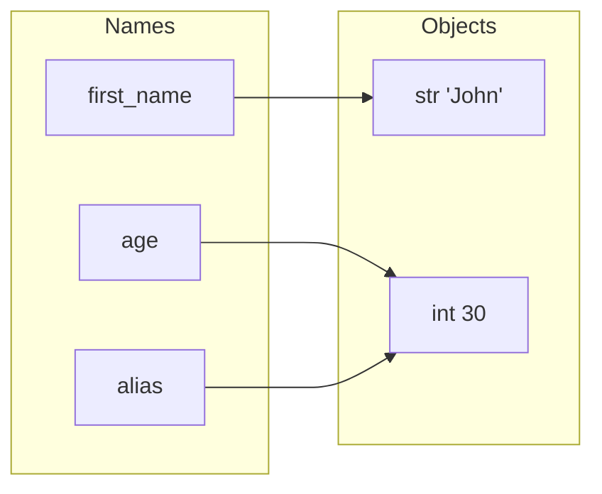

# Chapter 2 — Variables, Data Types and Operators

How Python stores data (names pointing at objects), which built-in types exist (available without `import`), how numbers really behave (why `0.1 + 0.2 != 0.3`), how to convert between types, and every operator family with its precedence. The model from §2.1 — *names are labels on objects* — is the most important idea in the book: most "weird" Python behaviour stops being weird once you have it.

| # | Topic | Key ideas |
|---|---|---|
| 2.1 | Variables | creating, deleting, multiple assignment, naming, names vs objects |
| 2.2 | Identity, equality, mutability | `is` vs `==`, `id()`, mutable vs immutable, aliasing |
| 2.3 | Dynamic vs strong typing | why `x` can change type but `"3" + 4` fails |
| 2.4 | Built-in data types | text, numeric, sequence, mapping, set, boolean, binary, `None` |
| 2.5 | Numbers | unbounded `int`, `float` pitfalls, `Decimal`, `Fraction`, `complex`, `random` |
| 2.6 | Booleans and truthiness | falsy values, `bool` is an `int` |
| 2.7 | Type conversion | implicit widening, explicit constructors, failure cases |
| 2.8 | Operators | all families, walrus `:=`, chained comparisons, precedence |

Code: [`code/`](code/) — every output below is real, from CPython 3.14.

---

## 2.1 Variables

### What it is
A **variable** is a **name that refers to an object**. An **object** is a chunk of memory holding a value, its **type**, and a reference count (how many names and containers point at it). The name stores no data — it is a label. Objects are parcels; names are sticky labels: several labels can go on one parcel, a label can move, peeling one off doesn't affect the parcel.

No declaration step: a variable exists from its first **assignment** with `=`.

### How it works — creating and printing
```python
first_name = "John"      # name first_name -> str object "John"
age = 30                 # name age        -> int object 30
height = 5.11            # name height     -> float object 5.11
print(first_name, age, height)          # John 30 5.11
```
`name = expression`: (1) evaluate the right side → an object; (2) bind the name to it in the current **namespace** (a dictionary-like table of names → objects).


After `alias = age`, both names point at the **same** object. Plain assignment never copies.

### Multiple assignment
From [`code/names_and_objects.py`](code/names_and_objects.py):
```python
first_name, age, height = "John", 30, 5.11   # tuple unpacking: one name per value
a = b = c = 0                                # chained: three names, ONE object
x, y = 1, 2
x, y = y, x                                  # swap: right side is built first, then unpacked
head, *rest = [10, 20, 30, 40]               # starred: rest collects the leftovers as a list
```
Output:
```text
John 30 5.11
swap: 2 1 | chained: 0 0 0
head: 10 rest: [20, 30, 40]
```
Unpacking spreads a sequence's items (here a *tuple* — Python's fixed sequence written with commas) into names; counts must match: `x, y = 1, 2, 3` → `ValueError: too many values to unpack` (`ValueError` = right type, unusable content). Beware `a = b = []` — one shared list (§2.2).

### Deleting variables — `del`
`del name` removes the **name**; the object is freed only when no references remain (CPython frees it immediately at refcount zero).
```python
player_score = 120
alias = player_score
del player_score
print(player_score)     # NameError - the name is gone
print(alias)            # 120 - the object survives, alias still refers to it
```
Output (the script runs the snippet inside a function, then at module level with a name `player`):
```text
UnboundLocalError (a NameError subclass, inside a function): cannot access local variable 'player_score' where it is not associated with a value
object still reachable via alias: 120
NameError at module level: name 'player' is not defined
```
A deleted name **always** raises `NameError` (in a function, its subclass `UnboundLocalError`). If an online playground shows nothing, it isn't displaying *stderr* (the error output stream) — run locally to see the traceback. `del` is more common for dict keys (`del d["k"]`) and list items (`del items[0]`).

### Case sensitivity
`Age`, `age`, `AGE` are three unrelated names:
```text
Age/age/AGE: 25 30 35
```

### Naming rules (enforced) and conventions (PEP 8)
| Rules — else `SyntaxError` | Conventions — else reviewers complain |
|---|---|
| Start with a letter or `_` | `snake_case` variables/functions: `user_age` |
| Then letters, digits, `_` only | `CapWords` classes: `UserProfile` |
| Not a keyword (`class`, `if`, `None`…) | `UPPER_SNAKE_CASE` constants: `MAX_USERS = 100` |
| Case-sensitive | Descriptive: `username` not `usrnm`; leading `_` = internal |
| | Don't shadow (reuse and hide) built-ins: `list`, `str`, `sum`, `id`, `input` |

Valid: `username`, `_user_id`, `user2name`. Invalid: `2user`, `user-name` (minus), `class`. After `list = [1, 2]`, `list("abc")` fails: `TypeError: 'list' object is not callable`.

### Common mistakes
- Assuming `b = a` copies a list. Use `a.copy()`, `list(a)` or `a[:]` (shallow copy — new outer list, shared items), or `copy.deepcopy(a)` for nested data.
- Shadowing built-ins (`list`, `dict`, `sum`, `max`, `id`, `type`).
- Using a variable before assigning it → `NameError`.

### In the interview
**30-second answer:** "Python variables are names bound to objects, not boxes holding values. Assignment never copies; it binds a name to the object on the right. `del` unbinds a name, and CPython frees the object when its reference count reaches zero."
- *`a = b = []`?* → One list, two names; appending via `a` shows via `b`.
- *How does `x, y = y, x` work?* → The right side builds the tuple `(y, x)` first, then unpacks it.
- *Does `del x` free memory?* → It removes one reference; the object is freed only if that was the last.

### TL;DR
Variables are labels on objects; `=` binds, never copies; `del` removes a label; names are case-sensitive, snake_case, not keywords, don't shadow built-ins.

---

## 2.2 Identity, equality and mutability

### What it is
| Property | Question | How to see it | Can it change? |
|---|---|---|---|
| **Identity** | *Which* object? | `id(obj)` (CPython: memory address) | Never, for its lifetime |
| **Type** | *What kind*? | `type(obj)` | No (normally) |
| **Value** | *What* does it contain? | `==`, `print` | Only if the type is **mutable** |

- `a == b` — **equality**: same value? (calls `a.__eq__(b)` — a *dunder* (double-underscore) method, the hook behind an operator)
- `a is b` — **identity**: the very same object? (compares `id`s; cannot be overridden)

### How it works
```python
list_a = [1, 2, 3]
list_b = [1, 2, 3]      # a second, separate list with equal contents
list_c = list_a         # another name for the first list
```
```text
a == b: True | a is b: False | a is c: True
id(a) == id(c): True
```

**Mutable** types change in place, so every alias sees the change: `list`, `dict`, `set`, `bytearray`, most user classes. **Immutable**: `int`, `float`, `complex`, `bool`, `str`, `tuple`, `frozenset`, `bytes`, `None`. "Changing" an immutable creates a new object and rebinds:
```python
n = 10
m = n
m += 1          # builds a new int 11 and rebinds m; n still refers to 10
```
```text
team: ['ann', 'bob', 'cy'] | same object? True     # list mutated through an alias
n: 10 m: 11                                        # int "changed" = rebinding
str is immutable: 'str' object does not support item assignment
tuple holding a list: ([1, 99], [2])
```
The last line: the tuple always holds *the same two list objects*, but those lists are mutable.

### Why it matters
- Passing a list to a function passes a reference: the function can mutate the caller's list.
- Only **hashable** objects (able to produce a fixed *hash* — an integer fingerprint used for fast lookup), typically immutable ones, can be dict keys or set members.

### When to use `is`
Only for **singletons** (exactly one exists): `None`, `True`, `False`, `Ellipsis`, and your own sentinel objects (unique placeholders meaning e.g. "no value given"). `x == None` can be fooled by a custom `__eq__`.

### Common mistakes
- `if x is 5:` / `if name is "bob":` — sometimes "works" because CPython caches small ints (−5 to 256) and some strings, an implementation detail. 3.8+ emits `SyntaxWarning: "is" with 'int' literal`. Use `==`.
- `grid = [[0] * 3] * 3` → **three references to one row**. Use `[[0] * 3 for _ in range(3)]`.
- Mutable default arguments (`def f(items=[])`) share one list across calls (functions chapter).

### In the interview
**30-second answer:** "`==` compares values via `__eq__`; `is` compares identity. I use `is` only for singletons like `None`. Mutable objects like lists and dicts change in place, so aliases see the change; immutable ones like ints, strings and tuples can't, so 'modifying' them rebinds the name to a new object."
- *Why `256 is 256` True but `1000 is 1000` maybe not?* → Small-int cache −5..256; implementation detail.
- *Can a tuple change?* → Its slots can't be reassigned, but mutable items inside can be mutated; such a tuple is unhashable.
- *Why must dict keys be immutable?* → Keys are stored by hash; a changing value would change the hash and lose the key.

### Self-check
1. `[] == []` and `[] is []`? → `True`, `False`.
2. Mutable among `str`, `list`, `tuple`, `set`, `frozenset`? → `list`, `set`.

### TL;DR
`==` = same value, `is` = same object (only for `None`/`True`/`False`/sentinels). Mutable objects change in place (aliases see it); immutable ones are replaced.

---

## 2.3 Dynamic vs strong typing

### What it is
| Axis | Python | Meaning |
|---|---|---|
| **Static ↔ dynamic** | **Dynamic** | Types belong to *objects*, checked at run time; a *name* can hold an `int` now, a `str` later. |
| **Weak ↔ strong** | **Strong** | Incompatible types raise errors instead of silently converting. |

```python
value = 42              # name -> int
value = "forty-two"     # same name -> str: fine (dynamic)
"Age: " + 30            # TypeError: can only concatenate str (not "int") to str  (strong)
```
```text
int -> str
TypeError: can only concatenate str (not "int") to str
```
JavaScript is dynamic **and** weak (`"Age: " + 30` → `"Age: 30"`, `"5" - 2` → `3`); C is static but fairly weak (implicit int/pointer conversions); Java is static and strong. Python *does* widen numbers (`1 + 2.5` → `3.5`) along the numeric tower bool → int → float → complex (§2.7).

### Type hints
`def area(w: float, h: float) -> float:` (function annotations, 3.0+; `typing` module 3.5) and `age: int = 30` (variable annotations, 3.6+). The interpreter **ignores** hints at run time; static checkers (mypy, Pyright — they read code without running it) and IDEs use them. Large codebases (Dropbox, where mypy was developed; Instagram) adopted hints to keep dynamic code safe at scale.

### Trade-offs
| Dynamic typing gives | Dynamic typing costs |
|---|---|
| Less boilerplate (repetitive set-up code); fast prototyping | Type errors appear at run time |
| Duck typing: "has `.read()`? treat it as a file" | IDEs know less without hints |
| Generic code (works for many types) for free | Slower execution (type checks on every operation) |

### Self-check
1. Why does `"3" * 2` work but `"3" + 2` fail? → `str * int` is defined (repetition → `"33"`); `str + int` isn't.
2. Does `x: int = "hi"` raise? → No; hints aren't enforced; mypy would flag it.

### TL;DR
Dynamic = names can re-point to any type; strong = no silent cross-type coercion (except numeric widening). Hints + mypy add static checking.

---

## 2.4 Built-in data types

### What it is
A **data type** defines what values an object holds and which operations make sense.

| Category | Types | Mutable? | Literal / constructor |
|---|---|---|---|
| Text | `str` | No | `"hi"`, `'hi'`, `"""hi"""` |
| Numeric | `int`, `float`, `complex` | No | `10`, `10.5`, `2 + 3j` |
| Sequence | `list`, `tuple`, `range` | list only | `[1, 2]`, `(1, 2)`, `range(5)` |
| Mapping | `dict` | Yes | `{"name": "Alice"}` |
| Set | `set`, `frozenset` | set only | `{1, 2}`, `frozenset([1, 2])` |
| Boolean | `bool` | No | `True`, `False` |
| Binary | `bytes`, `bytearray`, `memoryview` | bytearray yes; bytes no; memoryview reflects its buffer | `b"abc"`, `bytearray(b"abc")`, `memoryview(b"abc")` |
| None | `NoneType` | No | `None` |

From [`code/data_types_tour.py`](code/data_types_tour.py):
```text
text       -> str        mutable=False
int        -> int        mutable=False
float      -> float      mutable=False
complex    -> complex    mutable=False
list       -> list       mutable=True
tuple      -> tuple      mutable=False
range      -> range      mutable=False
dict       -> dict       mutable=True
set        -> set        mutable=True
frozenset  -> frozenset  mutable=False
bool       -> bool       mutable=False
bytes      -> bytes      mutable=False
bytearray  -> bytearray  mutable=True
memoryview -> memoryview mutable=False
None       -> NoneType   mutable=False
```
`type(x)` gives the exact type; prefer `isinstance(x, int)` (accepts subclasses). `isinstance(True, int)` is `True` because `bool` subclasses `int`.

### Each category in brief
Strings, lists, tuples, dicts and sets get full chapters later.

**Text — `str`:** immutable sequence of Unicode characters: `len(s)`, `s.upper()`, `s[0]`.

**Numeric:** `int` (counts, IDs), `float` (measurements), `complex` (engineering) — §2.5.
```text
int + 5: 15 | float + 0.5: 11.0 | complex: (3+1j)
```

**Sequences** keep order and support indexing `s[i]` (from 0), slicing `s[i:j]`, `len()`, `in`:
- `list` — mutable everyday container.
- `tuple` — immutable; fixed records, coordinates, dict keys. Slightly smaller and faster to create than lists.
- `range` — immutable, **lazy**: stores only start/stop/step, so `range(10**12)` uses almost no memory. `range(5)` = 0..4 (stop exclusive).
```text
range(5) as list: [0, 1, 2, 3, 4] | 3 in r: True
```

**Mapping — `dict`:** key → value pairs with average O(1) lookup; keys must be hashable; insertion-ordered since 3.7.

> **Key term — Big-O notation:** how running time grows with data size. **O(1)** (constant): same cost for 10 or 10 million items; **O(n)** (linear): grows in proportion to *n*. It describes the trend, not seconds.
```python
user = {"name": "Alice", "age": 25}
user["age"] += 1                 # modify
user["city"] = "Paris"           # add
user.get("email", "n/a")         # safe lookup with default; user["email"] would raise KeyError
```
```text
dict: {'name': 'Alice', 'age': 26, 'city': 'Paris'} | get missing key: n/a
```

**Sets:** unordered, **unique** hashable items, fast membership. `set` is mutable; `frozenset` is immutable and hashable (usable as a key). Duplicates are silently ignored. `{}` is an empty **dict**; empty set is `set()`.
```text
set size: 4 | sorted: ['basketball', 'soccer', 'tennis', 'volleyball']
frozenset usable as dict key: palette
```

**Binary types** hold raw bytes (0–255: files, network packets, images):
- `bytes` — immutable: `bytes([50, 100, 150])`, `b"abc"`.
- `bytearray` — mutable: `data[1] = 105`.
- `memoryview` — zero-copy *window* onto a buffer; slicing doesn't copy and later changes show through.
```python
data = bytearray([50, 100, 150])
data[1] = 105
view = memoryview(data)[1:3]     # window on items 1..2, no copy
data[2] = 200                    # change the buffer after creating the view...
```
```text
bytes: [50, 100, 150] | bytearray: [50, 105, 200] | view: [105, 200]
bytes range 0-255: bytes must be in range(0, 256)
text <-> bytes: b'caf\xc3\xa9' café
```
The view shows `200` — shared memory. Text ↔ bytes goes through an **encoding** (UTF-8 is standard): `"café".encode("utf-8")`, `b"...".decode("utf-8")`.

**None — `NoneType`:** the single object meaning "no value": missing optional argument, not-yet-computed result, return value of a function without `return`. Test with `is None`.
```text
No value provided
function without return gives: None
```

### Common mistakes
- `{}` for an empty set.
- List as dict key → `TypeError: unhashable type: 'list'`; use a tuple.
- `b"a" + "b"` → `TypeError`; encode/decode explicitly.
- `type(x) == int` rejects subclasses; prefer `isinstance`.

### Real-world examples
- JSON from a web API maps onto `dict`, `list`, `str`, `int`/`float`, `bool`, `None` (`json.loads`).
- `bytes`/`memoryview` are used by `asyncio` streams and NumPy's buffer protocol to share memory without copies.
- `frozenset` keys appear in caches keyed by a set of options (see [System Design Fundamentals](../../../system-design-patterns/modules/00-system-design-fundamentals/README.md)).

### In the interview
**30-second answer:** "Built-ins are str; int/float/complex; list/tuple/range; dict; set/frozenset; bool; bytes/bytearray/memoryview; and None. The key split is mutable — list, dict, set, bytearray — versus immutable; only hashable, typically immutable, objects can be dict keys or set members."
- *List vs tuple?* → List mutable, for homogeneous collections that change; tuple immutable, for fixed records, hashable if its items are.
- *Why is `range(10**9)` cheap?* → Lazy; values computed on demand.
- *memoryview for?* → Slicing large binary buffers without copying.

### TL;DR
Eight categories; memorise the mutable ones (list, dict, set, bytearray). `range` is lazy, `dict` ordered (3.7+), `{}` is a dict, `None` = "no value".

---

## 2.5 Numbers

### What it is
Three built-in numeric types — `int`, `float`, `complex` — plus two exact standard-library types: `decimal.Decimal` and `fractions.Fraction`.

### `int` — arbitrary precision
No fixed size, no overflow (C's 32/64-bit wraparound). From [`code/numbers_demo.py`](code/numbers_demo.py):
```text
sum: 13
2**100 = 1267650600228229401496703205376 | bits: 101
factorial(25) = 15511210043330985984000000
readable literal 1_000_000 = 1000000 | hex/bin/oct: 255 5 15
int->str digit limit (CPython 3.11+): 4300
```
- **How:** CPython stores an int as an array of 30-bit "digits"; huge ints are slower but correct.
- **Literals:** `1_000_000`, `0xFF`, `0b101`, `0o17`.
- **Limit:** since 3.11, converting an int of more than 4 300 decimal digits to/from `str` raises `ValueError` by default (denial-of-service protection against huge numeric strings). Raise with `sys.set_int_max_str_digits()`.

### `float` — IEEE-754 double precision
A 64-bit **binary** floating-point number (IEEE-754 standard): 1 sign, 11 exponent, 52 fraction bits → about **15–17 significant digits** (`sys.float_info.dig` is 15), range up to ~1.8 × 10³⁰⁸.

**The pitfall:** most decimal fractions have no exact binary form (like 1/3 in decimal). `0.1` is stored as the nearest binary fraction:
```text
0.1 + 0.2 = 0.30000000000000004 | == 0.3? False | isclose? True
exact value stored for 0.1: 0.1000000000000000055511151231257827021181583404541015625
max float: 1.7976931348623157e+308 | epsilon: 2.220446049250313e-16
digits trusted (dig): 15
2**53 + 1 as float: 9007199254740992.0 (lost the +1)
inf/nan: True False
round(2.5), round(3.5): 2 4 | round(2.675, 2): 2.67
1/3 + 1/6 = 1/2 | 0.1 added ten times: 0.9999999999999999 | ten Fraction(1, 10) == 1: True
sum([0.1]*10) (3.12+ uses compensated summation): 1.0 | math.fsum: 1.0
```
1. **Never compare floats with `==`.** Use `math.isclose(a, b)` (default relative tolerance 1e-9) or `abs(a - b) < tol`.
2. **Errors accumulate** (`0.1` ten times ≠ `1.0`). `math.fsum` — and since 3.12 the built-in `sum()` for floats — use compensated summation (tracking and correcting each addition's rounding error).
3. **Integers above 2⁵³ lose precision** as floats. Keep IDs and money-in-cents as `int`.
4. **`round()` is "round half to even"** (banker's rounding): `round(2.5) == 2`, `round(3.5) == 4`. `round(2.675, 2)` is `2.67` because 2.675 is stored as 2.67499999…
5. `float("inf")`, `float("-inf")`, `float("nan")` exist; **NaN ("Not a Number", e.g. `inf - inf`) is not equal to anything, including itself**.

The gap between neighbouring floats grows with magnitude:


*Figure — `math.ulp(x)` (unit in the last place), log-log axes: at 1.0 the gap is 2.2e-16; beyond 2⁵³ ≈ 9×10¹⁵ consecutive floats are 2 apart, so odd integers can't be represented.*

### `Decimal` — exact base-10 arithmetic
Base-10 numbers with controllable precision (28 significant digits default) and rounding. Use for **money** and anything that must match pen-and-paper.
```text
Decimal 0.10+0.20 = 0.30 | == 0.30? True
Decimal from float (wrong way): 0.1000000000000000055511151231257827021181583404541015625
round half up 2.675 -> 2.68
```
- Construct from a **string**: `Decimal("0.10")`; `Decimal(0.1)` copies the float's binary error.
- `quantize(Decimal("0.01"), rounding=ROUND_HALF_UP)` rounds to cents like invoices.
- Much slower than float (fine for business logic).

### `Fraction` — exact rationals
`Fraction(1, 3)` stores numerator/denominator as ints, so `1/3 + 1/6` is exactly `1/2`. Good for exact geometry, probability, music ratios; slow for heavy work as numerators/denominators grow.

### `complex`
`a + bj` (engineers' `j`). `.real`, `.imag` (floats), `.conjugate()`, `abs(z)` = magnitude; `cmath` has complex `sqrt`, `exp`, `phase`.
```text
z.real: 1.0 z.imag: 2.0 |z|: 5.0 conjugate: (1-2j)
```
Used in signal processing (FFT), electrical engineering (impedance), quantum simulators.

### The division family
```text
7/2 = 3.5 | 7//2 = 3 | -7//2 = -4 | -7%2 = 1 | divmod(17,5) = (3, 2)
int(-2.7) truncates: -2 | math.floor(-2.7): -3
```
- `/` is **true division**, always float (`4 / 2 == 2.0`).
- `//` is **floor division**, toward **negative infinity**: `-7 // 2 == -4` (C and Java truncate to −3).
- `%` satisfies `a == (a // b) * b + a % b`, so it takes the **divisor's sign**: `-7 % 2 == 1`, `7 % -3 == -2`.
- `divmod(a, b)` = `(a // b, a % b)`.
- `int(x)` **truncates** toward zero; `math.floor`/`math.ceil` round down/up.
- Division by zero raises `ZeroDivisionError` for ints and floats.

### Random numbers
`random` is **pseudo-random** (Mersenne Twister formula): deterministic given a seed. `random.seed(42)` makes tests reproducible.
```python
random.seed(42)
random.randint(1, 10)          # int in [1, 10], BOTH ends inclusive
random.random()                # float in [0.0, 1.0)
random.choice(["red", "green", "blue"])
```
```text
randint(1,10): 2 | random(): 0.025 | choice: green
```
Also `uniform(a, b)`, `shuffle(list)`, `sample(pop, k)`, `gauss(mu, sigma)`. **Never** use `random` for passwords or tokens — use `secrets`, which draws from the OS's cryptographic generator.

### Trade-offs
| Type | Exact? | Speed | Use for |
|---|---|---|---|
| `int` | Yes | Fast (small), slower when huge | Counts, IDs, money in cents |
| `float` | No (≈15–17 digits) | Fastest, hardware-backed | Science, ML, measurements |
| `Decimal` | Yes in base 10 (to set precision) | Slow | Money, tax |
| `Fraction` | Yes | Slow, can blow up | Exact rational maths |
| `complex` | Float-based | Fast | Signals, AC circuits |

### Common mistakes
`total == 0.3` with floats · `Decimal(0.1)` · expecting `round(2.5) == 3` · floats for currency · assuming `-7 // 2 == -3` · `random` for security tokens.

### Real-world examples
- Big ints power cryptography and RSA teaching code with no bignum library.
- Financial back-ends store amounts as `Decimal` (Django's `DecimalField`).
- NumPy/PyTorch use float32/float64 arrays; ML training even uses 16-bit floats, trading precision for speed.

### In the interview
**30-second answer:** "Python ints are arbitrary precision, so they never overflow. Floats are IEEE-754 doubles, so decimal fractions like 0.1 are approximations — compare with `math.isclose`, and use `Decimal` built from strings for money. `//` floors toward negative infinity and `%` takes the divisor's sign."
- *Why `0.1 + 0.2 != 0.3`?* → Neither has an exact binary form; the rounded sum differs from rounded 0.3 in the last bit.
- *`round()` rule?* → Half to even, avoiding upward bias in large sums.
- *Reproducible randomness?* → `random.seed(n)` or a `random.Random(n)` instance.

### Self-check
1. `2 ** 64` overflow? → No: `18446744073709551616`.
2. `-9 // 4` and `-9 % 4`? → `-3` and `3`.
3. Can `random.randint(1, 10)` return 10? → Yes, both ends inclusive.
4. Why `float(2**53 + 1) == float(2**53)`? → Above 2⁵³ float spacing is 2.

### TL;DR
int = exact, unbounded; float = fast, approximate (`isclose`, never `==`); `Decimal` (from strings) for money; `Fraction` for exact ratios; `//` floors, `%` follows the divisor; seed `random` for repeatability, `secrets` for security.

---

## 2.6 Booleans and truthiness

### What it is
`bool` has exactly `True` and `False` (keywords). Comparisons produce them; `if`/`while` consume them. `bool` is a **subclass of `int`**: `True == 1`, `True + True == 2`.

### Truthiness — how any object becomes a boolean
In a boolean context (`if x:`, `while x:`, `and`/`or`/`not`, `bool(x)`) every object is truthy **except** these **falsy** values:

| Falsy | Examples |
|---|---|
| The constants | `None`, `False` |
| Numeric zeros | `0`, `0.0`, `0j`, `Decimal(0)`, `Fraction(0)` |
| Empty collections | `""`, `()`, `[]`, `{}`, `set()`, `range(0)`, `b""` |

Truthy includes `"0"`, `"False"`, `" "`, `[0]`, `-1`.

**How it works:** `bool(x)` calls `x.__bool__()`; failing that `x.__len__()` (non-zero = true); otherwise truthy. Your classes can hook in.

### Idioms
```python
if not cart:          # instead of: if len(cart) == 0
if name:              # instead of: if name != ""
if x is None:         # when 0 or "" are valid values, test for None explicitly
```

### Common mistakes
- `if x == True:` → `if x:` (PEP 8).
- `if value:` when `0` is legitimate data. Use `if value is not None:`.
- `bool("False")` is `True`.
- `True == 1`, so `{1: "a", True: "b"}` has **one** key (`{1: 'b'}`).

### In the interview
**30-second answer:** "Falsy values are None, False, numeric zeros and empty containers; everything else is truthy. `bool` subclasses `int`. I use truthiness for emptiness checks but `is None` when zero or empty string are valid values."
- *Custom truthiness?* → Implement `__bool__`, or `__len__` as fallback.

### Self-check
1. `bool([0])`? → `True`. 2. `True + True + False`? → `2`.

### TL;DR
Falsy = `None`, `False`, zeros, empties; everything else truthy. `bool` is an `int`.

---

## 2.7 Type conversion

### What it is
**Type conversion** (casting) builds a new object of another type, **implicitly** (Python does it) or **explicitly** (you call a constructor — the type called like a function — such as `int()`).

### Implicit conversion
Only **within the numeric tower**, widening: `bool → int → float → complex`. From [`code/conversions.py`](code/conversions.py):
```text
6 + 1.5 = 7.5 float
True + 2 = 3 | 2 + 1j = (2+1j)
```
Never between text and numbers (`"6" + 1.5` → `TypeError`).

### Explicit conversion
```text
str(10)                          -> '10'
int("20")                        -> 20
float(4)                         -> 4.0
int(True), int(False)            -> (1, 0)
int(2.8)                         -> 2
float("3.5")                     -> 3.5
bool(0)                          -> False
complex(2, 3)                    -> (2+3j)
list("abc")                      -> ['a', 'b', 'c']
tuple("abc")                     -> ('a', 'b', 'c')
sorted(set("abac"))              -> ['a', 'b', 'c']
dict([(1,'one'),(2,'two')])      -> {1: 'one', 2: 'two'}
bin(3), hex(255), oct(8)         -> ('0b11', '0xff', '0o10')
int("ff", 16), int("0b11", 0)    -> (255, 3)
int("  42\n"), int("1_000")      -> (42, 1000)
ord('A'), chr(66)                -> (65, 'B')
```
| Function | Converts… | Notes |
|---|---|---|
| `int(x)` | number or numeric string → int | Truncates floats toward zero; strips whitespace; accepts `_`; optional `base` (2–36, or 0 = read the prefix) |
| `float(x)` | number or string → float | Accepts `"1e3"`, `"inf"`, `"nan"` |
| `str(x)` | anything → readable text | `repr(x)` gives the unambiguous developer form (`'hi\n'`) |
| `bool(x)` | anything → truthiness | §2.6 |
| `complex(re, im)` | numbers or string → complex | `complex("2+3j")` works |
| `list()`, `tuple()`, `set()` | any iterable → that collection | `set` dedupes and loses order |
| `dict()` | key/value pairs or keyword args → dict | `dict(a=1)` |
| `bin()`, `hex()`, `oct()` | int → prefixed string | Reverse with `int(s, 0)` |
| `ord()`, `chr()` | character ↔ Unicode code point | |

### When conversion fails
```text
int("3.5")   -> ValueError: invalid literal for int() with base 10: '3.5'
int("abc")   -> ValueError: invalid literal for int() with base 10: 'abc'
float("1,5") -> ValueError: could not convert string to float: '1,5'
int(None)    -> TypeError: int() argument must be a string, a bytes-like object or a real number, not 'NoneType'
bool("False") = True | bool("") = False
```
- `ValueError` = right type, bad content; `TypeError` = wrong type.
- `"3.5"` → int: `int(float("3.5"))` → 3 (decide whether truncation is intended).
- Wrap user-input conversions in `try/except ValueError` (exceptions chapter).
- Parse booleans explicitly: `text.strip().lower() in {"true", "1", "yes"}`.
- Locale formats fail: `float("1,5")`, `float("1,000")`.

### Building strings from numbers
`"Age: " + str(age)` works, but **f-strings** (3.6+; literals prefixed with `f` that embed `{expressions}`) are clearer and format too: `f"Age: {age}"`, `f"pi ~ {3.14159:.2f}"` → `pi ~ 3.14`.

### In the interview
**30-second answer:** "Python only converts implicitly up the numeric tower — bool, int, float, complex. Everything else is explicit via constructors like `int()`, `float()`, `str()`, `list()`. Bad content raises `ValueError`, a wrong type raises `TypeError`. `int()` truncates toward zero."
- *`int("0x1A", 0)`?* → 26; base 0 reads the prefix.
- *str vs repr?* → str for users; repr for developers, unambiguous.
- *`int(-3.9)`?* → `-3`. *`"1010"` binary → 10?* → `int("1010", 2)`.

### TL;DR
Implicit only for numbers (widening); explicit via constructors; `ValueError` for bad text, `TypeError` for wrong types; `input()` returns `str`; prefer f-strings.

---

## 2.8 Operators

### What it is
An **operator** computes a result from **operands**. Each calls a dunder method — `a + b` calls `a.__add__(b)` — which is how `+` adds numbers, joins strings and concatenates lists. Examples from [`code/operators_demo.py`](code/operators_demo.py) with `a, b = 10, 3`.

### Arithmetic
| Op | Meaning | `10 ? 3` |
|---|---|---|
| `+` `-` `*` | add, subtract, multiply | 13, 7, 30 |
| `/` | true division (always float) | 3.3333333333333335 |
| `%` | modulus (remainder) | 1 |
| `**` | exponentiation | 1000 |
| `//` | floor division | 3 |
| `@` | matrix multiplication (NumPy; no built-in type implements it) | — |

Also on other types: `"ab" * 3 == "ababab"`, `[1] + [2] == [1, 2]`.

### Comparison
`==`, `!=`, `>`, `<`, `>=`, `<=` → `bool`.
```text
compare: False True True False True False
```
Strings compare lexicographically by code point (`"Z" < "a"` is True). Unrelated types with `<` raise `TypeError` (`1 < "2"`); `==` just returns `False`.

**Chained comparisons:** `18 <= age < 65` = `18 <= age and age < 65`, with `age` evaluated once.
```text
18 <= age < 65: True
```

### Assignment and augmented assignment
`x += 3` ≈ `x = x + 3`; every arithmetic and bitwise operator has a form:
```text
v += 3  -> 13
v -= 2  -> 11
v *= 2  -> 22
v /= 2  -> 11.0
v %= 4  -> 3.0
v **= 2 -> 9.0
v //= 2 -> 4.0
v &= 3  -> 0
v |= 8  -> 8
v ^= 6  -> 14
v <<= 1 -> 28
v >>= 2 -> 7
```
`/=` made it a float through `//=`; the script converts back with `int(v)` before the bitwise steps (they need ints). Bits: `4 & 3` → `100 & 011 = 000`; `0 | 8` → `1000`; `8 ^ 6` → `1110` (14); `14 << 1` → 28; `28 >> 2` → 7.

**Subtlety:** for **mutable** objects augmented operators mutate in place: `nums += [3]` extends the existing list (aliases see it); `nums = nums + [3]` builds a new one.
```text
list += mutates in place: [1, 2, 3]
```
No `++`/`--`: `x++` is a `SyntaxError`, `++x` is `+(+x)`.

### Logical: `and`, `or`, `not`
| Expression | Result |
|---|---|
| `x and y` | `x` if `x` is falsy, else `y` |
| `x or y` | `x` if `x` is truthy, else `y` |
| `not x` | always a bool |

1. **Short-circuit:** the right operand is evaluated only if needed — `0 and 1/0` returns `0`.
2. **They return an operand:** `"" or "guest"` → `"guest"` (the defaults idiom; use `x if x is not None else default` when `0`/`""` are valid).
```text
True and False: False | True or False: True | not True: False
'' or 'guest' -> guest | 0 and 1/0 -> 0
```

### Bitwise
| Op | Name | `2 ? 3` (`0010`, `0011`) |
|---|---|---|
| `&` | AND — 1 where both are 1 | 2 (`0010`) |
| `\|` | OR — 1 where either is 1 | 3 (`0011`) |
| `^` | XOR — 1 where bits differ | 1 (`0001`) |
| `~` | NOT; `~x == -x - 1` (two's complement) | `~2 == -3` |
| `<<` | shift left n = ×2ⁿ | `2 << 1 == 4` |
| `>>` | shift right n = floor ÷2ⁿ | `2 >> 1 == 1` |
```text
bitwise: 2 3 1 -3 4 1 | 0010 & 0011 = 0010
```
Uses: permission flags (`READ | WRITE`, test with `perms & WRITE`), `enum.Flag`, network masks, hashing. On sets: `|` union, `&` intersection, `-` difference, `^` symmetric difference; on dicts (3.9+) `|` merges.

### Membership: `in`, `not in`
List, tuple, string (substring), dict (**keys**), set.
```text
membership: True True True True
```
`x in list` is O(n); `x in set`/`dict` average O(1). For repeated lookups convert to a set.

### Identity: `is`, `is not`
Same object (§2.2).
```text
identity: False True True
```

### Walrus operator `:=` (assignment expression, 3.8+)
Assigns **and** returns the value, so you can bind inside a condition and avoid computing twice.
```python
for line in log:
    if (m := re.match(r"error: (.*)", line)) is not None:
        print("walrus captured:", m.group(1))
if (count := len(data)) > 2:
    print(f"walrus: {count} items")
```
```text
walrus captured: disk full
walrus: 3 items
```
Usually needs parentheses. Classic uses: `while (chunk := f.read(8192)):` and filters in comprehensions (compact `[expr for x in data]` collection builders, Chapter 5): `[y for x in data if (y := f(x)) > 0]`. Don't use it where a separate assignment reads better.

### Operator precedence
**Precedence** decides which operator binds first; **associativity** orders equal-precedence ones (left-to-right except `**`, right-to-left). Highest to lowest (language reference):

| # | Operators | Notes |
|---|---|---|
| 1 | `(…)`, `[…]`, `{…}` | parenthesised expressions and displays |
| 2 | `x[i]`, `x[i:j]`, `f(…)`, `x.attr` | subscription, slicing, call, attribute |
| 3 | `await x` | asyncio |
| 4 | `**` | right-associative: `2 ** 3 ** 2 == 512` |
| 5 | `+x`, `-x`, `~x` | unary; weaker than `**` on its left, so `-2 ** 2 == -4` |
| 6 | `*`, `@`, `/`, `//`, `%` | |
| 7 | `+`, `-` | |
| 8 | `<<`, `>>` | |
| 9 | `&` | |
| 10 | `^` | |
| 11 | `\|` | |
| 12 | `in`, `not in`, `is`, `is not`, `<`, `<=`, `>`, `>=`, `!=`, `==` | **one level**, chainable |
| 13 | `not x` | |
| 14 | `and` | |
| 15 | `or` | |
| 16 | `x if c else y` | conditional expression |
| 17 | `lambda` | Chapter 7 |
| 18 | `:=` | assignment expression |

Beginners hit two: `&`, `^`, `|` bind **tighter** than comparisons (in pandas write `(df.a > 1) & (df.b < 2)`), and `and` binds tighter than `or`.

**Worked example** (`a, b, c = 10, 20, 30`):
```python
result = a + b * c ** 2 / 10 - 5 <= b or b % a == 0 and c > b
```
1. `c ** 2` → 900
2. `b * 900` → 18000; `/ 10` → 1800.0 (same level, left to right)
3. `a + 1800.0 - 5` → 1805.0
4. `1805.0 <= b` → `False`
5. `b % a == 0` → `True`; `c > b` → `True`
6. `and` first: `True and True` → `True`
7. `False or True` → **`True`**
```text
precedence: True True | left side value: 1805.0
-2 ** 2 = -4 | (-2) ** 2 = 4 | 2 ** 3 ** 2 = 512
not 1 == 2 -> True | 1 < 2 == 2 -> True
```
The second `True` is the fully parenthesised version. `not 1 == 2` is `not (1 == 2)`; `1 < 2 == 2` chains as `1 < 2 and 2 == 2`. **Rule of thumb:** if you have to think about precedence, add parentheses.

### Common mistakes
- `x++` doesn't exist; `if a = b:` is invalid (use `==`, or `:=` deliberately).
- `x == 1 & y == 2` parses as the chain `x == (1 & y) == 2`. Write `(x == 1) & (y == 2)` or use `and`.
- `if x == 1 or 2:` is always truthy (`(x == 1) or 2`). Write `if x in (1, 2):`.
- Comparing floats with `==`:
```text
0.1*3 == 0.3: False | abs diff: True
```

### Real-world examples
- `timeout = config.get("timeout") or 30`.
- `while (chunk := sock.recv(4096)):` in socket code.
- Bit flags: `os.open(path, os.O_WRONLY | os.O_CREAT)`, `re.IGNORECASE | re.MULTILINE`.
- `y = X @ w` in NumPy/PyTorch.

### In the interview
**30-second answer:** "Python has arithmetic, comparison, assignment/augmented, logical, bitwise, membership and identity operators, plus the walrus `:=`. `and`/`or` short-circuit and return an operand, comparisons chain like maths, `**` is right-associative and binds tighter than unary minus, and bitwise operators bind tighter than comparisons."
- *`-3 ** 2`?* → `-9`.
- *Why does `if x == 1 or 2` always pass?* → `(x == 1) or 2`; `2` is truthy.
- *`a += [1]` vs `a = a + [1]`?* → First mutates in place (aliases see it); second creates a new list.
- *`in` on list vs set?* → O(n) vs average O(1).

### Self-check
1. `10 // 4`, `10 % 4`, `10 / 4`? → `2`, `2`, `2.5`.
2. `None or "x"`; `0 and "x"`? → `"x"`; `0`.
3. `5 & 3`, `5 | 3`, `5 ^ 3`? → `1`, `7`, `6`.
4. `1 < 3 > 2`? → `True` (chain).
5. `2 ** -1`? → `0.5`.

### TL;DR
Know `/` vs `//` vs `%`; `and`/`or` short-circuit and return operands; comparisons chain; `+=` mutates mutables in place; precedence: `**` > unary > `* /` > `+ -` > shifts > `&` > `^` > `|` > comparisons > `not` > `and` > `or`. When in doubt, parenthesise.

---

## Chapter 2 TL;DR
- A variable is a **name bound to an object**; `=` never copies; `del` removes a name.
- `==` compares values, `is` identity — `is` only for `None`/singletons.
- Mutable: `list`, `dict`, `set`, `bytearray`. Immutable: numbers, `str`, `tuple`, `frozenset`, `bytes`, `None`.
- **Dynamically** (names re-point) and **strongly** (no silent coercion) typed.
- `int` unbounded; `float` approximate (`isclose`); `Decimal("…")` for money; `Fraction` for exact ratios.
- Falsy: `None`, `False`, zeros, empty containers; `bool` is an `int`.
- Implicit conversion only up the numeric tower; else `int()`, `float()`, `str()`… with `ValueError`/`TypeError` on bad input.
- `//` floors, `%` follows the divisor, `and`/`or` short-circuit, comparisons chain, `:=` assigns inside expressions; parenthesise rather than memorise.
