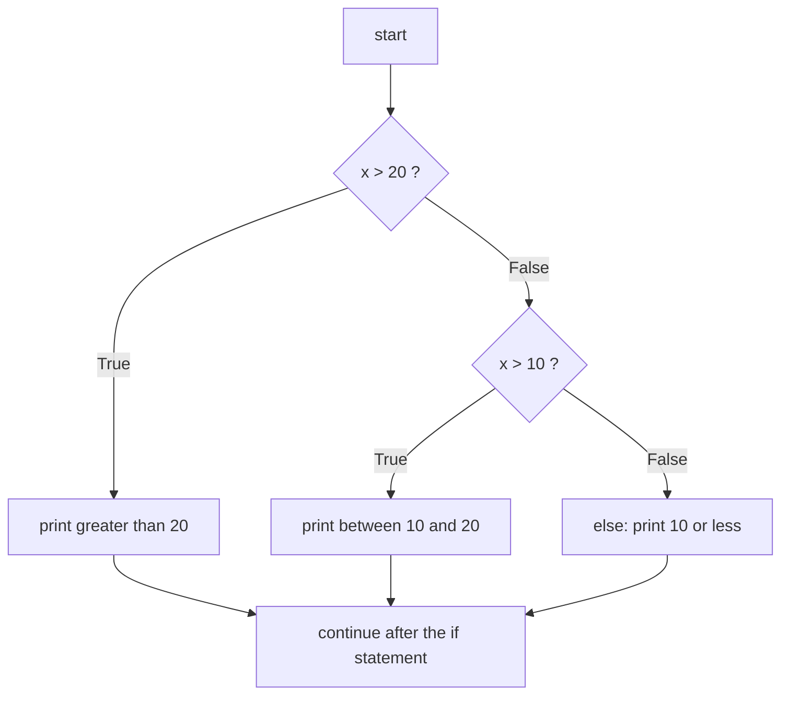
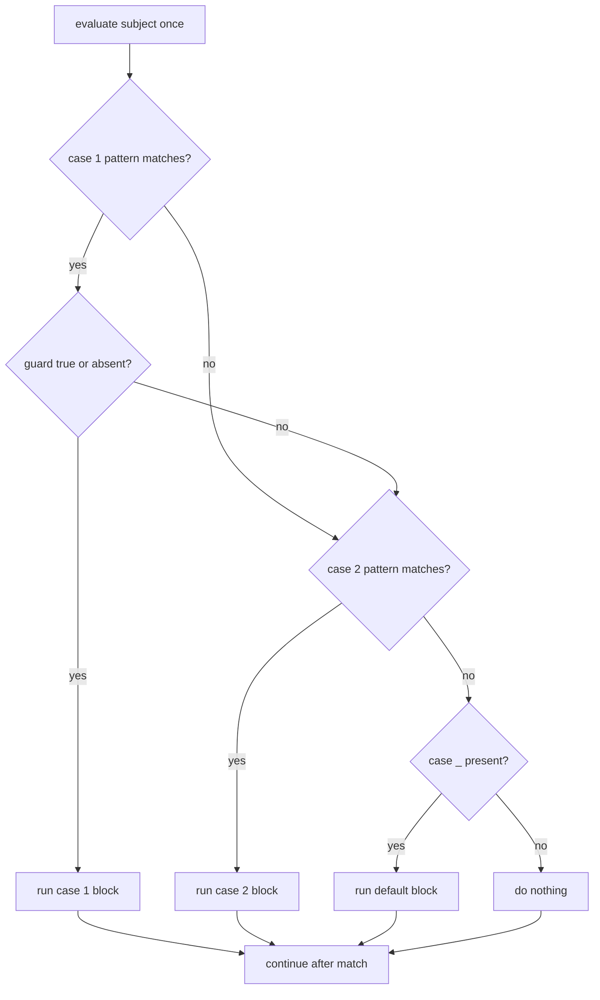
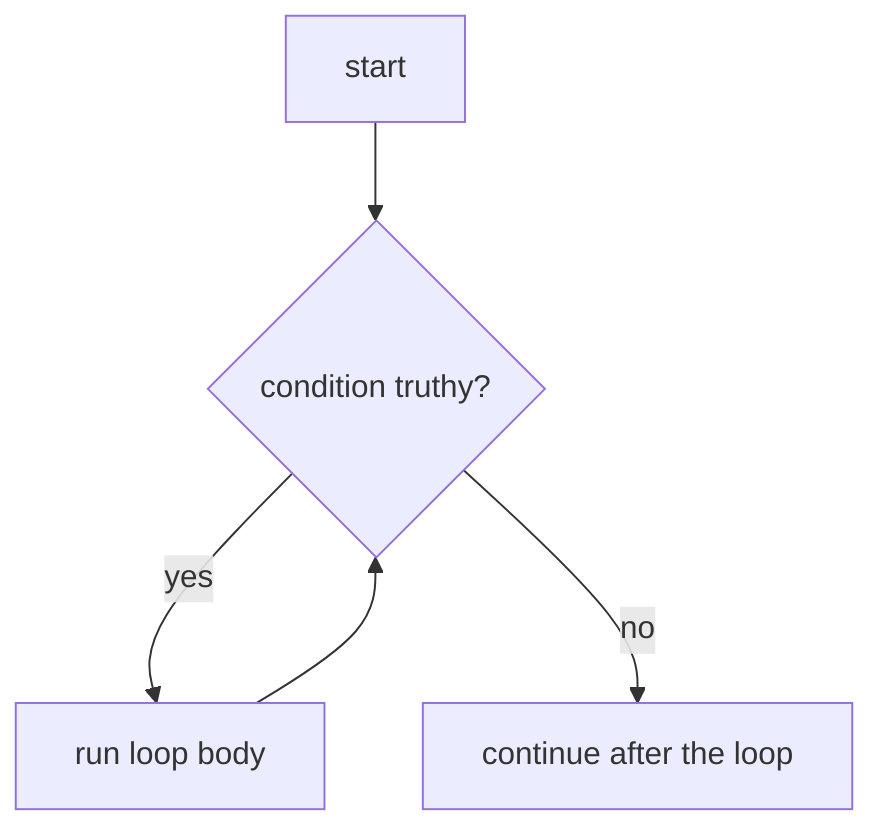
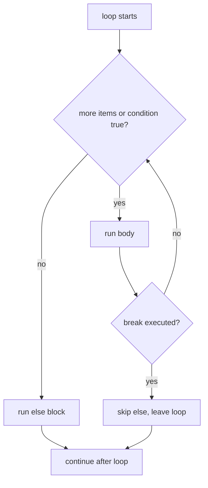

# Chapter 3 — Control Flow: Decisions and Loops

**Control flow** is how a program chooses *which* statements run (`if`, `match`) and *how many times* (`for`, `while`). With Chapter 2's truthiness rules (empty and zero values count as false) these constructs express any algorithm.

| # | Topic | Key ideas |
|---|---|---|
| 3.1 | Conditionals overview | branching and where it's used |
| 3.2 | `if` / `elif` / `else` | order of tests, guard clauses |
| 3.3 | Conditional expressions | `a if cond else b` |
| 3.4 | `match` / `case` | literal, OR, capture, wildcard, sequence, mapping, class patterns, guards, `as` |
| 3.5 | Loops and the iteration protocol | iterables, iterators, `for` vs `while` |
| 3.6 | `for` loops | dicts, nesting, `range`, `enumerate`, `zip` |
| 3.7 | `while` loops | unknown counts, infinite loops |
| 3.8 | Loop control | `break`, `continue`, `pass` |
| 3.9 | `for-else` / `while-else` | "no break happened" |
| 3.10 | Loop idioms | `sum`/`any`/`all`, counting, safe modification |

Code: [`code/conditionals.py`](code/conditionals.py), [`code/pattern_matching.py`](code/pattern_matching.py), [`code/loops.py`](code/loops.py) — outputs are real (CPython 3.14).

---

## 3.1 Conditional statements — overview

### What it is
A **conditional statement** evaluates a **condition** (any expression, read by truthiness) and runs a block only when it holds. Two constructs:
- `if` / `elif` / `else` — test conditions one after another.
- `match` / `case` (3.10+) — compare one value against **patterns** describing its shape; a far more powerful cousin of C/Java `switch`.

### Why it matters — real-world uses
Typical uses: input validation (reject a short password), navigation (logged in → dashboard), games (health ≤ 0 → game over), alerts (heart rate out of range), web routing by HTTP method and path (404 if none matches).

---

## 3.2 `if`, `elif`, `else`

### What it is
```python
if condition1:
    ...            # runs if condition1 is truthy
elif condition2:
    ...            # runs if condition1 was falsy and condition2 is truthy
else:
    ...            # runs if every condition above was falsy
```
- `if` required; any number of `elif`; optional `else` last. Headers end with `:`.
- **At most one** branch runs: the first truthy one. Later conditions are not evaluated.

### How it works

From [`code/conditionals.py`](code/conditionals.py):
```python
x = 10
if x > 5:
    print("x is greater than 5")          # runs

x = 3
if x > 5:
    print("x is greater than 5")
else:
    print("x is not greater than 5")      # runs

def describe(x: int) -> str:
    if x > 20:
        return "x is greater than 20"
    elif x > 10:
        return "x is greater than 10 but not more than 20"
    else:
        return "x is 10 or less"
```
Output:
```text
x is greater than 5
x is not greater than 5
25 -> x is greater than 20
15 -> x is greater than 10 but not more than 20
5 -> x is 10 or less
```

### Order matters
The first true branch wins, so test the **most specific** condition first:
```python
def grade(score: int) -> str:
    if not 0 <= score <= 100:
        raise ValueError(f"score out of range: {score}")
    if score >= 90:
        return "A"
    elif score >= 80:
        return "B"
    elif score >= 70:
        return "C"
    return "F"
```
```text
grades: ['A', 'B', 'C', 'F']
```
If `score >= 70` came first, every A and B student would get a C.

### Nesting vs guard clauses
Deep nesting ("arrow code") is hard to read. A **guard clause** handles an edge case early with `return`/`raise` (`raise` signals an error — Chapter 9), keeping the main path flat — "flat is better than nested":
```python
def shipping_cost(total: float, is_member: bool) -> float:
    if total <= 0:
        return 0.0
    if is_member or total >= 50:
        return 0.0
    return 4.99
```
```text
shipping: 4.99 0.0 0.0
```

### Writing good conditions
- Truthiness: `if not cart:` rather than `if len(cart) == 0:`.
- Test `None` explicitly when `0`/`""` are valid — `discount = 0` looks "missing" to a truthiness test:
```text
cart is empty
hello, guest
falsy check says missing: True | is-None check says missing: False
```
- Chained ranges: `if 18 <= temp <= 26 and not raining:`; membership instead of `or` chains: `if day in {"sat", "sun"}:`.
```text
weekend
good weather for a walk
```

### Trade-offs
| Approach | Good for | Weak at |
|---|---|---|
| `if/elif/else` | Arbitrary conditions, ranges, few branches | Many equality tests on one value |
| `match/case` | One value, many shapes; destructuring (pulling parts into names) | Plain boolean conditions |
| dict lookup `{"a": f, "b": g}[key]()` | Constant keys → action (a *dispatch table*) | Conditions that aren't exact keys |

### Common mistakes
- `=` instead of `==` → `SyntaxError`; `else if` → must be `elif`.
- `if x == 1 or 2:` — always true; write `if x in (1, 2):`.
- `if flag == True:` → `if flag:`.
- Overlapping ranges in the wrong order (grading example).

### Real-world examples
- Django views: `if request.method == "POST": … else: …`.
- Feature flags: `if flags.is_enabled("new_checkout", user): …`.

### In the interview
**30-second answer:** "`if` evaluates conditions top-down by truthiness and runs only the first matching branch; `elif` chains alternatives and `else` catches the rest. I order conditions from most specific to most general, use guard clauses to avoid deep nesting, and `is None` when zero or empty values are legitimate."
- *Does Python have `switch`?* → `match` (3.10+) covers it and more; dicts serve as dispatch tables.
- *Are later `elif`s evaluated after a match?* → No.

### Self-check
1. With `x = 20`, which branch of `describe` runs? → The `elif` (`20 > 20` false, `20 > 10` true).
2. "Between 1 and 10 inclusive"? → `1 <= n <= 10`.

### TL;DR
First truthy branch wins; order specific → general; flat guard clauses; use `in`, chained comparisons and truthiness.

---

## 3.3 Conditional expressions (the "ternary")

### What it is
The **expression** form of `if/else` (three parts, hence "ternary"):
```python
value_if_true if condition else value_if_false
```
```python
parity = "even" if n % 2 == 0 else "odd"          # 7 is odd
print("Access granted." if has_access else "Access denied.")
```
Only the chosen branch is evaluated; `else` is required. Very low precedence (just above `lambda`), so parenthesise inside bigger expressions. Example: `abs` = `x if x >= 0 else -x`.

### When not to use it
- Long branches or side effects (printing, changing data) — use an `if` statement.
- Nested ternaries (`a if x else b if y else c`) — legal but hard to read.
- For defaults `x or default` is shorter — only when all falsy `x` should be replaced.

### TL;DR
`a if cond else b` picks a value; keep it short and un-nested.

---

## 3.4 `match` / `case` — structural pattern matching

### What it is
`match` (3.10, PEPs 634–636) evaluates a **subject** once and tries each `case` **pattern** in order; the first that matches (and whose optional guard is true) runs. No match → nothing happens, no error.

Unlike C/Java `switch`, a pattern describes the **structure** of the data — "a list starting with `"go"` plus one item", "a dict whose `type` is `"click"`", "a `Point` with `y == 0`" — and **binds** parts to names in one step (*destructuring*).

```python
match subject:
    case pattern1:
        ...
    case pattern2 if guard:
        ...
    case _:
        ...          # wildcard: the default
```
`match`/`case` are **soft keywords** — `match` still works as a variable name.

### How it works

**No fall-through** (C cases without `break` run into the next); you never write `break`.

### The pattern kinds
| Pattern | Looks like | Matches when… | Binds |
|---|---|---|---|
| **Literal** | `200`, `"Monday"`, `None`, `True` | subject `==` literal (`None`/`True`/`False` via `is`) | — |
| **Capture** | `x` (bare name) | always | subject → `x` |
| **Wildcard** | `_` | always | nothing |
| **Value** | `Color.RED`, `http.HTTPStatus.OK` (dotted) | subject `==` that value | — |
| **OR** | `p1 \| p2 \| p3` | any alternative matches | all alternatives must bind the same names |
| **AS** | `pattern as name` | pattern matches | matched part → `name` |
| **Sequence** | `[a, b]`, `(a, b)`, `[first, *rest]` | subject is a sequence (**not** `str`/`bytes`) of matching length and items | items |
| **Mapping** | `{"type": "click", "pos": p}` | mapping has those keys with matching values; **extra keys ignored** | values; `**rest` collects the others |
| **Class** | `Point(x=0, y=0)`, `Point(x, 0)`, `int(n)`, `str()` | `isinstance(subject, Point)` and listed attributes match | attributes |
| **Guard** | `case p if cond:` | pattern matches **and** `cond` truthy | (pattern's bindings) |

### Literal and OR patterns
From [`code/pattern_matching.py`](code/pattern_matching.py):
```python
def http_status(code: int) -> str:
    match code:
        case 200:
            return "Success"
        case 404:
            return "Not Found"
        case 500:
            return "Server Error"
        case 301 | 302 | 307 | 308:          # OR pattern
            return "Redirect"
        case _:                              # wildcard
            return "Unknown status code"

def day_kind(day: str) -> str:
    match day:
        case "Monday" | "Friday":
            return "Start/end of the work week"
        case "Tuesday" | "Wednesday" | "Thursday":
            return "Midweek"
        case _:
            return "Weekend"
```
```text
['Success', 'Not Found', 'Server Error', 'Redirect', 'Unknown status code']
Midweek | Start/end of the work week | Weekend
```

### Sequence patterns
```python
def first_color(colors: list[str]) -> str:
    match colors:
        case []:
            return "empty list"
        case ["red", *others]:        # first item "red"; others = the rest (a list)
            return f"red first, {len(others)} others"
        case ["blue", *_]:            # *_ = any number of remaining items, not bound
            return "blue first"
        case [single]:                # exactly one item
            return f"only one color: {single}"
        case _:
            return "different first color"
```
```text
[] -> empty list
['red', 'blue', 'green'] -> red first, 2 others
['blue', 'red'] -> blue first
['pink'] -> only one color: pink
['pink', 'red'] -> different first color
```
Without a star the length must match exactly; at most one star per sequence pattern.

Command parsing, with an OR sub-pattern captured by `as` and a **guard**:
```python
def command(text: str) -> str:
    match text.split():
        case ["go", ("north" | "south" | "east" | "west") as direction]:
            return f"moving {direction}"
        case ["take", item]:
            return f"picked up {item}"
        case ["drop", *items] if items:          # guard: need at least one item
            return f"dropped {', '.join(items)}"
        case ["quit" | "exit"]:
            return "bye"
        case _:
            return f"unknown command: {text!r}"
```
```text
'go north'       -> moving north
'take lamp'      -> picked up lamp
'drop key coin'  -> dropped key, coin
'drop'           -> unknown command: 'drop'
'quit'           -> bye
'dance'          -> unknown command: 'dance'
```
`"drop"` alone matches `["drop", *items]` with `items == []`, but the guard fails, so matching continues to `_`.

Tuples work the same way:
```python
match person:                                    # person = (25, "Engineer")
    case (age, "Engineer") if age > 20:
        return f"Adult Engineer aged {age}"
    case (age, profession):
        return f"{profession} aged {age}"
```
```text
Adult Engineer aged 25 | Engineer aged 19
```

**Strings are not sequences for matching** (deliberate, so `"ab"` doesn't match `[a, b]`):
```text
'ab' is matched as a str, not as a sequence of characters
```

### Mapping patterns
Ideal for JSON-like events and API payloads:
```python
match event:
    case {"type": "click", "pos": (x, y)}:          # nested sequence pattern
        return f"click at {x},{y}"
    case {"type": "key", "key": str(k)} if len(k) == 1:
        return f"key {k!r}"
    case {"type": "resize", **rest}:                # rest = remaining key/values
        return f"resize with {rest}"
    case {"type": other}:
        return f"unhandled event type {other!r}"
    case _:
        return "not an event"
```
```text
{'type': 'click', 'pos': (3, 4), 'button': 1} -> click at 3,4
{'type': 'key', 'key': 'q'} -> key 'q'
{'type': 'resize', 'w': 800, 'h': 600} -> resize with {'w': 800, 'h': 600}
{'type': 'scroll'} -> unhandled event type 'scroll'
['click'] -> not an event
```
The first event's extra `"button"` key doesn't prevent the match.

### Class patterns
> **Key term — class:** a blueprint for objects of your own type (Chapter 10); `Point(1, 2)` is an *instance* of `Point`. `isinstance(obj, Point)` asks "was `obj` made from `Point` or a subclass?".

`ClassName(...)` checks `isinstance`, then attributes. Keyword form `Point(x=0)` matches attribute `x`. Positional form `Point(a, b)` needs `__match_args__` — a tuple naming the attributes positions map to; `@dataclass` (a decorator that auto-writes common class code) generates it (`('x', 'y')`). Built-ins like `int`, `str`, `float` take one positional sub-pattern matching the whole subject.
```python
@dataclass
class Point:
    x: float
    y: float

match shape:
    case Point(x=0, y=0):                            # keyword attributes
        return "the origin"
    case Point(x, 0):                                # positional via __match_args__
        return f"on the x-axis at {x}"
    case Point():                                    # any Point
        return "some other point"
    case Circle(center=Point(x=0, y=0), radius=r):   # nested patterns
        return f"circle of radius {r} at the origin"
    case Circle(radius=r) if r <= 0:
        return "invalid circle"
    case int(n) | float(n):
        return f"a number {n}"
    case str() as s:
        return f"a string of length {len(s)}"
    case _:
        return "unknown shape"
```
```text
Point(x=0, y=0) -> the origin
Point(x=5, y=0) -> on the x-axis at 5
Point(x=1, y=2) -> some other point
Circle(center=Point(x=0, y=0), radius=2) -> circle of radius 2 at the origin
Circle(center=Point(x=1, y=1), radius=-1) -> invalid circle
7 -> a number 7
2.5 -> a number 2.5
'hello' -> a string of length 5
[1] -> unknown shape
Point.__match_args__ = ('x', 'y')
```

### The capture-pattern trap
A **bare name** is a *capture*, never a comparison. With `RED = "red"`, `case RED:` matches anything and rebinds `RED`:
```text
matched?! blue
SyntaxError: name capture 'RED' makes remaining patterns unreachable
```
Python refuses to compile it if more cases follow. Compare against a constant with a **dotted name** such as an `Enum` member (a named constant in an enumeration class), a literal, or a guard (`case x if x == RED:`):
```python
class Color(Enum):
    RED = "red"
    GREEN = "green"

match c:
    case Color.RED:      # compared with ==
        return "stop"
    case Color.GREEN:
        return "go"
```
```text
stop go
```

### Trade-offs
| | `match` | `if/elif` |
|---|---|---|
| Check structure and extract parts at once | ✅ | Manual `isinstance`, `len`, indexing |
| Arbitrary boolean conditions | Via guards only | ✅ |
| Python version | 3.10+ | All |
| Performance | Similar — cases tried in order, not a jump table | Similar |

Don't use it for one or two boolean tests (`if`), constant key → value maps (a dict), or code that must run on ≤ 3.9.

### Common mistakes
- `case RED:` with a plain variable (capture trap).
- Expecting fall-through or writing `break` in a case.
- Expecting `case [a, b]:` to match a string.
- No `case _:` → unexpected input silently ignored; consider raising in the default.
- OR patterns binding different names (`case [x] | [x, y]:`) → `SyntaxError`.

### Real-world examples
- CLI and chat-bot command parsers (`command()` above).
- Dispatching JSON messages from WebSockets or message queues by `type` (see [System Design Fundamentals](../../../system-design-patterns/modules/00-system-design-fundamentals/README.md)).
- Compilers walking an AST: `case BinOp(left, Add(), right):` — the `ast` node classes define `__match_args__` for this.

### In the interview
**30-second answer:** "`match` evaluates a subject once and tries case patterns top to bottom, with no fall-through. Patterns can be literals, captures, the `_` wildcard, dotted-name constants, OR-patterns, sequences with `*rest`, mappings that ignore extra keys, and class patterns that check `isinstance` and attributes via `__match_args__`. Guards add an `if` condition. The main trap is that a bare name captures instead of comparing."
- *Match a constant?* → Dotted name, literal, or guard.
- *Mapping patterns need exact keys?* → No; extra keys ignored, `**rest` captures them.
- *What makes positional class patterns work?* → `__match_args__`, auto-generated by `dataclass` and `namedtuple`.

### Self-check
1. What does `case [x, *_]:` match? → Any non-string sequence with ≥ 1 item; binds the first to `x`.
2. No case matches and no `_`? → Nothing; execution continues after `match`.
3. Capture which alternative of `"a" | "b"` matched? → `("a" | "b") as choice`.

### TL;DR
`match` = one value against shape-aware patterns, first match wins, no fall-through; literals, `|`, `[... *rest]`, `{key: ...}`, `Class(attr=...)`, guards, `as`; dotted names for constants — bare names capture.

---

## 3.5 Loops — overview and the iteration protocol

### What it is
| Loop | Repeats… | Use when |
|---|---|---|
| `for` | once per item of an **iterable** | you have a collection or known count |
| `while` | while a **condition** stays truthy | the count isn't known in advance |

**Loop control statements:** `break` (leave), `continue` (next iteration), `pass` (placeholder). Visiting every item is **traversal**.

### How `for` really works — the iteration protocol
An **iterable** hands out items one at a time (lists, strings, dicts, sets, ranges, files, generators — objects producing values on demand); an **iterator** tracks the position.
1. `for x in obj:` calls `iter(obj)` to get an iterator.
2. Each round it calls `next(iterator)` and binds `x`.
3. When `next` raises `StopIteration`, the loop ends quietly.
```python
it = iter(["a", "b"])
next(it)   # 'a'
next(it)   # 'b'
next(it)   # raises StopIteration
```
So one `for` works for every container, and lazy objects (`range`, file handles) are looped without loading everything into memory.

---

## 3.6 The `for` loop

### What it is
```python
for variable in iterable:
    ...   # body runs once per item; variable holds the current item
```

### How it works — basic traversal
From [`code/loops.py`](code/loops.py):
```python
for fruit in ["apple", "banana", "cherry"]:
    print(fruit, end=" ")
for ch in "hey":
    print(ch.upper(), end="")
```
```text
apple banana cherry
HEY
```
No index bookkeeping, so no off-by-one errors. The loop variable **survives** the loop with its last value (unless the iterable was empty).

### Looping through dictionaries
Iterating a dict yields **keys** (insertion order). Views (live read-only windows) give the rest:
| You need | Write |
|---|---|
| keys | `for k in d:` (or `d.keys()`) |
| values | `for v in d.values():` |
| both | `for k, v in d.items():` |
```python
info = {"name": "John", "age": 30, "city": "New York"}
for key in info:
    print(key, "->", info[key])
for key, value in info.items():          # preferred: no second lookup
    print(f"{key}={value}", end=" ")
```
```text
name -> John
age -> 30
city -> New York
name=John age=30 city=New York | values: ['John', 30, 'New York']
```

### Nested loops
The inner loop runs fully for each outer item: `rows × cols` iterations.
```python
matrix = [[1, 2, 3], [4, 5, 6]]
for row in matrix:
    for num in row:
        print(num, end=" ")
    print()                               # newline after each row
```
```text
1 2 3
4 5 6
```
Two nested loops over n items are O(n²) (10× data → 100× work). If the inner loop only searches, a set/dict lookup often removes it.

### `range()` — counting loops
Lazy integers, stop **exclusive**:
| Call | Produces |
|---|---|
| `range(stop)` | 0 … stop−1 |
| `range(start, stop)` | start … stop−1 |
| `range(start, stop, step)` | start, start+step, … while < stop (> stop for negative step) |
```text
[0, 1, 2, 3, 4, 5, 6, 7, 8, 9] [1, 2, 3, 4, 5, 6, 7, 8, 9, 10] [1, 3, 5, 7, 9] [10, 7, 4, 1]
```
`step` can't be 0 (`ValueError`). `range` supports `len()`, indexing, fast `in`, and is cheap at any size.

### `enumerate()` — index and item together
Instead of `for i in range(len(names)): names[i]`:
```python
for i, name in enumerate(names, start=1):
    print(f"{i}. {name}", end="  ")
```
```text
1. ann  2. bob  3. cy
```

### `zip()` — walk several iterables in parallel
`zip(a, b)` yields tuples `(a[0], b[0]), (a[1], b[1]), …` and **stops at the shortest**; `strict=True` (3.10+) raises if lengths differ — usually what you want for aligned data.
```python
for name, score in zip(names, scores, strict=True):
    print(f"{name}:{score}", end="  ")
```
```text
ann:91  bob:78  cy:85
zip strict: zip() argument 2 is shorter than argument 1
plain zip stops at the shortest: [(1, 'a'), (2, 'b')]
```
`dict(zip(keys, values))` builds a dict from two lists.

### Common mistakes
- `for i in range(len(items)):` when you need items (iterate directly) or both (`enumerate`).
- `range(1, 10)` stops at 9.
- Expecting dict iteration to give pairs.
- Silent truncation with plain `zip`.

### Real-world examples
- `for line in f:` streams a file; `csv.reader(f)` rows.
- `for i, batch in enumerate(dataloader):` — the standard PyTorch training loop.
- `zip(features, labels)` in ML pipelines.

### In the interview
**30-second answer:** "A `for` loop calls `iter()` on the iterable and `next()` until `StopIteration`, so it works on anything iterable. I iterate items directly, use `enumerate` for the index, `zip(strict=True)` for parallel sequences, `.items()` for dicts, and `range` for counts."
- *`zip` with unequal lengths?* → Stops at shortest; `strict=True` raises `ValueError`.
- *Loop variable after the loop?* → Keeps the last value.

### Self-check
1. `list(range(2, 11, 3))`? → `[2, 5, 8]`.
2. Nested loops over 3 and 4 items: inner body runs? → 12 times.

### TL;DR
`for item in iterable`; dict → keys (use `.items()`); `range` excludes stop; `enumerate` for indices; `zip(strict=True)` for parallel lists.

---

## 3.7 The `while` loop

### What it is
```python
while condition:
    ...   # repeats while condition is truthy; re-checked before every iteration
```
For unknown iteration counts: read until "quit", retry until success, iterate until a value converges.

### How it works

The condition is checked first (the body may run **zero** times), and the body **must** change something the condition depends on.
```python
count = 0
while count < 5:
    print(f"Count is {count}", end="; ")
    count += 1          # progress toward making the condition false
```
```text
Count is 0; Count is 1; Count is 2; Count is 3; Count is 4;
```
A genuinely unknown count — halvings until below 1:
```python
n, steps = 100.0, 0
while n >= 1:
    n /= 2
    steps += 1
```
```text
halvings until < 1: 7
```
(100 → 50 → 25 → 12.5 → 6.25 → 3.125 → 1.5625 → 0.78125.)

### Infinite loops on purpose
`while True:` + `break` is the idiomatic "loop and a half" (menus, server loops):
```python
while True:
    answer = input("> ")
    if answer == "quit":
        break
    handle(answer)
```
With walrus: `while (answer := input("> ")) != "quit": handle(answer)`.

### Trade-offs
| | `for` | `while` |
|---|---|---|
| Termination | Automatic when exhausted | Your responsibility |
| Typical bug | Off-by-one in `range` | Infinite loop (forgot to update) |
| Use for | Collections, fixed counts | Unknown counts, event loops, retries, convergence |

### Common mistakes
- Forgetting the update → infinite loop (Ctrl-C raises `KeyboardInterrupt`).
- `while i < len(items): … i += 1` to traverse — use `for`.
- Float conditions like `while x != 1.0:` that never become exactly true — use `<`/`>` or a tolerance.

### Real-world examples
- Game loops: `while running: handle_events(); update(); draw()`.
- Retry with back-off: `while attempts < 5 and not ok: …`.
- Chunked reading: `while (chunk := f.read(8192)): …`.

### In the interview
**30-second answer:** "`while` re-checks its condition before each iteration and is for unknown iteration counts. The body must make progress toward the condition becoming false; for intentional infinite loops I use `while True` with a clear `break`."

### TL;DR
`while cond:` repeats until `cond` is falsy (possibly zero times); guarantee progress; `while True` + `break` for loop-and-a-half.

---

## 3.8 Loop control: `break`, `continue`, `pass`

### What it is
| Statement | Effect |
|---|---|
| `break` | Exit the **innermost** loop now; skips any loop `else` |
| `continue` | Skip to the next iteration (`while` re-checks its condition) |
| `pass` | Do nothing; fills a place where a statement is required |

### How it works
```python
for number in [1, 2, 3, 4, 5, 6]:
    if number == 4:
        print("Number 4 found, stopping loop.")
        break                                  # 5 and 6 are never visited

odds = []
for number in [1, 2, 3, 4, 5, 6]:
    if number % 2 == 0:
        continue                               # skip evens
    odds.append(number)

for number in [1, 2, 3]:
    if number % 2 == 0:
        pass                                   # placeholder - does nothing
    print(number, end=" ")                     # still runs for every number
```
```text
Number 4 found, stopping loop.
continue kept odds: [1, 3, 5]
1 2 3
```
`pass` is **not** `continue`: the rest of the body still runs. Use it (or `...`) for stubs: `def todo(): pass`, `class MyError(Exception): pass`.

**`break` exits only one level:**
```python
for i in range(3):
    for j in range(3):
        if j == 1:
            break                  # leaves the inner loop only
        print(f"({i},{j})", end=" ")
```
```text
(0,0) (1,0) (2,0)
```
To exit several levels, move the loops into a function and `return`, or use a flag variable.

### Common mistakes
- Expecting `break` to leave all nested loops.
- Confusing `pass` and `continue`.
- `continue` in a `while` *before* the counter update → infinite loop.
- `continue`-based filtering where a comprehension is clearer.

### In the interview
**30-second answer:** "`break` leaves the innermost loop, `continue` jumps to the next iteration, `pass` is a no-op placeholder. To break out of nested loops I refactor into a function and `return`."

### TL;DR
`break` = leave loop, `continue` = next iteration, `pass` = do nothing; all act on the innermost loop.

---

## 3.9 `for-else` and `while-else`

### What it is
A loop's `else` runs **only if the loop finished without `break`** (iterable exhausted, or condition became false). Read it as **"no break"**. Classic use: search loops — `break` = found, `else` = not found, no flag needed.

```python
for item in iterable:
    ...
else:
    ...   # runs only if the loop didn't break
```

### How it works

From [`code/loops.py`](code/loops.py):
```python
for number in [1, 2, 3, 4, 5]:
    if number == 3:
        print("Number 3 found, stopping search.")
        break
else:
    print("Number not found.")        # skipped: break happened

for number in [1, 2, 4, 5]:
    if number == 3:
        print("found 3")
        break
else:
    print("3 not in list (else ran: no break)")

count = 0
while count < 5:
    if count == 2:
        print("Breaking at count 2.")
        break
    count += 1
else:
    print("Loop was uninterrupted.")  # skipped: break happened
```
```text
Number 3 found, stopping search.
3 not in list (else ran: no break)
Breaking at count 2.
```
With no `break` in the body the `else` always runs — legal but pointless.

Inside a function, `return` plays `break` and the final statement plays `else` — e.g. primality by trial division (try every divisor up to √n):
```python
def is_prime(n: int) -> bool:
    if n < 2:
        return False
    for d in range(2, int(n ** 0.5) + 1):
        if n % d == 0:
            return False
    return True
```
```text
is 29 prime? True | is 21 prime? False
```
At module level, or when you need to continue afterwards, `for-else` is the flag-free equivalent.

### Trade-offs / when not to use it
Many developers misread `else` as "if the loop didn't run". If that confuses your team, use a helper with `return`, or `any()`/`next()` (§3.10). Comment it `# no break`.

### Common mistakes
- Thinking `else` runs only when the body never executed — it also runs after a normal full run.
- Thinking `else` runs after `break`.
- Misaligning `else` so it pairs with an `if` inside the loop (or vice versa).

### In the interview
**30-second answer:** "A loop's `else` runs only when the loop wasn't terminated by `break` — think 'no break'. It's handy for search loops: `break` on found, `else` for not-found, without a flag variable."
- *Runs on an empty iterable?* → Yes, no break happened.
- *`return` inside the loop?* → Skips `else` (leaves the function).

### TL;DR
Loop `else` runs when the loop ends naturally, not via `break`; use it for search-with-not-found and comment it.

---

## 3.10 Common loop idioms

### Aggregation with built-ins
Many loops are built-ins in disguise — shorter, clearer and run in C:
```python
nums = [4, -1, 7, 0, 3]
sum(nums), min(nums), max(nums)
any(x < 0 for x in nums)                  # True if at least one; stops early
all(x < 10 for x in nums)                 # True if every one; stops early
[x * x for x in nums if x > 0]            # list comprehension: map + filter
list(reversed(nums)), sorted(nums, reverse=True)
next((x for x in nums if x > 5), None)    # first match or a default
```
```text
sum/min/max: 13 -1 7
any negative? True | all < 10? True
squares of positives: [16, 49, 9]
reversed: [3, 0, 7, -1, 4] | sorted desc: [7, 4, 3, 0, -1]
first > 5: 7
```
`next(generator, default)` replaces a whole `for … break … else` search. Comprehensions are covered in the lists chapter. Note `all([])` is `True`, `any([])` is `False`.

### Counting / grouping with a dict
```python
counts = {}
for word in "the cat and the hat".split():
    counts[word] = counts.get(word, 0) + 1
```
```text
word counts: {'the': 2, 'cat': 1, 'and': 1, 'hat': 1}
```
(`collections.Counter` does this in one call — dictionaries chapter.)

### Don't change a collection while looping over it
Removing during iteration shifts later items left, so the loop **skips** the next one:
```python
buggy = [1, 2, 2, 3]
for x in buggy:
    if x == 2:
        buggy.remove(x)        # the second 2 slides into the visited slot and is skipped
```
```text
remove-while-iterating left: [1, 2, 3] | filtered correctly: [1, 3]
RuntimeError: dictionary changed size during iteration
```
Fix: rebuild (`[x for x in data if x != 2]`) or iterate a copy (`for x in data[:]:`). Dicts refuse outright with `RuntimeError`; iterate `list(d)` if you must add/delete keys.

### Idiom cheat-sheet
| Instead of… | Write… |
|---|---|
| `for i in range(len(xs)): print(xs[i])` | `for x in xs: print(x)` |
| index + item via `range(len())` | `for i, x in enumerate(xs):` |
| parallel indexing `a[i], b[i]` | `for x, y in zip(a, b, strict=True):` |
| `for k in d: v = d[k]` | `for k, v in d.items():` |
| looping backwards with indices | `for x in reversed(xs):` |
| accumulator loop (keeps a running total) | `sum(xs)` |
| flag + loop to test a condition | `any(...)` / `all(...)` |
| loop with `append` to transform | list comprehension |
| `while` loop reading chunks | `while (chunk := f.read(n)):` |

### Real-world examples
- Log scanning: `for line in open(path): if "ERROR" in line: …`.
- ETL jobs (extract–transform–load) aggregating per-key totals in dicts.
- Validation: `if not all(field in payload for field in REQUIRED): return 400`.

### In the interview
**30-second answer:** "I replace hand-written loops with built-ins where possible — `sum`, `any`, `all`, `min`/`max`, `sorted`, comprehensions, `next` with a default — because they're clearer and run in C. I never mutate a list or dict while iterating it; I build a new one or iterate a copy."
- *Why does removing during iteration skip items?* → The list iterator advances by index; removal shifts later items down.
- *Do `any`/`all` evaluate everything?* → No, they short-circuit.

### TL;DR
Prefer built-ins and comprehensions over manual loops; `enumerate`/`zip`/`.items()` over indexes; never mutate what you're iterating.

---

## Chapter 3 TL;DR
- `if/elif/else`: first truthy branch wins; order specific → general; guard clauses keep code flat; `a if c else b` for values.
- `match/case` (3.10+): literals, `|`, captures, `_`, dotted constants, sequences with `*rest`, mappings (extra keys ignored), class patterns (`__match_args__`), guards, `as`; no fall-through; bare names capture.
- `for` uses the iteration protocol (`iter`/`next`/`StopIteration`); dicts yield keys; use `range`, `enumerate`, `zip(strict=True)`, `.items()`.
- `while` runs while a condition holds — guarantee progress; `while True` + `break` for loop-and-a-half.
- `break` leaves the innermost loop, `continue` skips ahead, `pass` does nothing.
- Loop `else` = "no break happened" — ideal for search loops.
- Reach for `sum`/`any`/`all`/`next`/comprehensions first; never modify a collection while iterating it.
