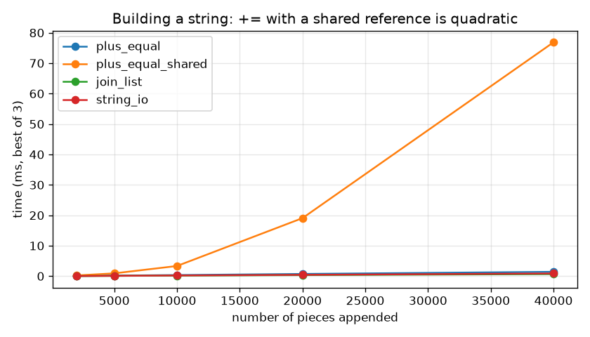

# Chapter 4 — Strings

Text is everywhere: user names, file paths, log lines (a program's running record of what it did), JSON (a text format for structured data), HTML (the markup language of web pages), SQL (the language for querying databases), chat messages. In Python all of that text lives in one type, `str`. This chapter takes you from "what is a string" to the things intermediate developers are expected to know cold: immutability, slicing, the formatting mini-language, the most useful methods, how text becomes bytes (Unicode and UTF-8), how to build big strings without slowing to a crawl, and a first working knowledge of regular expressions.

**What you'll learn**

1. Creating strings with different quotes, indexing them and looping over them.
2. Why strings are immutable and how to "change" one anyway.
3. String operators (`+`, `*`, `in`, comparisons, `%`) and slicing with start/stop/step.
4. Escape sequences and raw strings.
5. Formatting with f-strings, the format-spec mini-language, `str.format()` and `%`.
6. The string methods you will actually use, with a reference table and their costs.
7. How to join many pieces efficiently.
8. Unicode vs bytes, encodings and UTF-8.
9. Regular expressions: `search`, `match`, `findall`, `sub` and groups.

All runnable code is in [`code/`](code/). Every output shown below was produced by running those files with Python 3.14 (the code also runs on 3.12+).

---

## 4.1 What a string is — creating, indexing, looping

### What it is
A **string** (`str`) is an ordered, immutable sequence of Unicode characters (Unicode is the worldwide standard that gives every character in every writing system a number — §4.9). *Ordered* means each character has a position; *immutable* means that once the string exists its characters can never be changed; *sequence* means it supports the same tools as lists and tuples — `len()`, indexing, slicing, `in`, and `for` loops.

Analogy: a string is a printed line of text on paper. You can read any letter, photocopy parts of it, or print a new page — but you can't erase a letter on the existing page.

Python has no separate "character" type. A single character is simply a string of length 1: `type("x")` is `str` and `len("x")` is `1`.

### Why it matters
Almost every program reads, cleans, or produces text. Knowing the exact rules (zero-based indexes, negative indexes, what raises an error and what doesn't) saves a lot of off-by-one bugs (indexes wrong by exactly one).

### How it works
1. **Create** a string with any of three quote styles — they all produce the same `str` type:
   - `'single'` — the usual choice for short strings; convenient when the text contains a `"`.
   - `"double"` — convenient when the text contains an apostrophe: `"It's raining"`.
   - `"""triple"""` or `'''triple'''` — can span several lines and freely contain both kinds of quote. Also used for docstrings (the documentation string at the top of a function or module, Chapter 1).
2. **Index** with `s[i]`. Positions start at `0` on the left. **Negative indexes** count from the right: `-1` is the last character, `-2` the one before it. For a string of length *n*, valid indexes are `0 … n−1` and `−n … −1`; anything else raises `IndexError` (Python stops with an error — an *exception* — saying the position doesn't exist).
3. **Loop** with `for ch in s:` — you get one character per iteration. Use `enumerate(s)` when you also need the position.

```
 index:   0   1   2   3   4   5   6   7   8   9  10  11  12  13  14
 char :   L   e   a   r   n   i   n   g   ␣   P   y   t   h   o   n
 neg  : -15 -14 -13 -12 -11 -10  -9  -8  -7  -6  -5  -4  -3  -2  -1
```

```python
# code/01_string_basics.py (excerpt)
single = 'Hi there'
double = "It's raining"                      # apostrophe inside double quotes
triple = """Line one
Line two with "quotes" and 'apostrophes'"""
print(single, "|", double)
print(triple)
print(type("x"), len("x"))                   # a single character is just a str of length 1

word = "Learning Python"
print(word[0], word[9], word[-1], word[-6])  # L P n P
try:
    word[100]
except IndexError as e:
    print("IndexError:", e)

for i, ch in enumerate("abc"):
    print(f"{i}:{ch}", end=" ")
```

Output:
```
Hi there | It's raining
Line one
Line two with "quotes" and 'apostrophes'
<class 'str'> 1
L P n P
IndexError: string index out of range
0:a 1:b 2:c
```

`print(x, end=" ")` replaces the default newline at the end of each `print` with a space, which is handy when looping over characters.

### Common mistakes
- Forgetting that indexing starts at 0: the 8th character is `s[7]`.
- Using `for i in range(len(s)): s[i]` when you only need the characters — just write `for ch in s`.
- Mixing quote styles incorrectly: `'It's'` ends the string at the apostrophe → `SyntaxError`. Use `"It's"` or `'It\'s'`.

### Self-check
1. What is `"Python programming is fun!"[-4]`? → `'f'` (the fourth character from the end: `f`, `u`, `n`, `!`).
2. Does Python have a `char` type? → No; a character is a `str` of length 1.
3. Which quote style lets you write a multi-line string without `\n`? → Triple quotes.

### TL;DR
`str` = immutable, ordered sequence of Unicode characters. Three quote styles, zero-based indexes, negative indexes from the end, `for ch in s` to loop.

---

## 4.2 Immutability — and how to "update" a string

### What it is
**Immutable** means an object's value cannot change after creation. For strings, `s[0] = "J"` is illegal. Every operation that looks like it changes a string — `upper()`, `replace()`, `+` — actually builds and returns a **new** string.

### Why it matters
- **Safety:** you can pass a string to any function and know it will come back unchanged. No defensive copies (copies made just in case someone else changes the data) needed.
- **Hashability:** because a string's value never changes, its hash (an integer fingerprint of the value, used for fast lookups) never changes, so strings can be dictionary keys and set members (Chapter 6). CPython even caches a string's hash after computing it once.
- **Sharing:** the interpreter may reuse one string object in several places (for example, identifiers are *interned* — stored once and shared), which is only safe because nobody can mutate it.

### How it works
1. You try item assignment → `TypeError`.
2. To "update", slice the parts you want to keep and concatenate (join end to end) them with the new text.
3. Assign the result back to the same name. The **name** now points to a new object; the old object is untouched (and is garbage-collected — its memory reclaimed automatically — if nothing else refers to it).

```python
s = "Hello, world!"
try:
    s[0] = "J"                               # not allowed
except TypeError as e:
    print("TypeError:", e)
before = id(s)
s = s[:7] + "Python!"                        # build a NEW string, rebind the name
print(s, "| same object?", id(s) == before)
```

Output:
```
TypeError: 'str' object does not support item assignment
Hello, Python! | same object? False
```

`s[:7]` is `"Hello, "` (positions 0–6), and `+ "Python!"` appends the new ending. `id()` returns an object's identity; it differs, proving a new object was created.

### Trade-offs
| | Immutable `str` | Mutable alternative (`list` of chars, `bytearray`, `io.StringIO`) |
|---|---|---|
| Safe to share / use as dict key | Yes | No |
| Change one character | O(n) — copy the whole string | O(1) |
| Build text piece by piece | Use `"".join(parts)` (see 4.8) | Natural |

> **Key term — Big-O notation:** shorthand for how an operation's cost grows with the size of the input *n*. **O(1)** means constant time — the same cost no matter how long the string is; **O(n)** means the cost grows in step with the length (twice as long → about twice the work); **O(n²)** ("quadratic") means doubling *n* roughly quadruples the work. It describes growth, not exact timings.

### Common mistakes
- Calling a method and ignoring the result: `name.strip()` on its own line does nothing useful. Write `name = name.strip()`.
- Thinking `s += "x"` modifies `s` in place — it creates a new string (see 4.8 for why that matters in loops).

### In the interview
**30-second answer:** "Python strings are immutable: every 'modifying' operation returns a new string. That makes them safe to share and hashable, so they work as dict keys. The cost is that repeated modification copies data, so for building large strings you collect parts in a list and `join` them."

- *Q: If strings are immutable, how does `s += 'x'` work?* A: It evaluates `s + 'x'` into a new string and rebinds the name `s`. (CPython sometimes resizes in place when no other reference exists — an optimisation you must not rely on.)
- *Q: Why must dict keys be immutable?* A: Strictly, they must be *hashable*: the hash must not change while the key is in the dict, otherwise the lookup would search the wrong slot.

### Self-check
1. What does `s.replace("a", "b")` do to `s`? → Nothing; it returns a new string.
2. Why can a `str` be a set element but a `list` can't? → `str` is immutable and hashable; `list` is mutable and unhashable.
3. What does `"Hello, world!"[:7] + "Python!"` give? → `'Hello, Python!'`.

### TL;DR
You never change a string; you make a new one and rebind the name. Immutability buys safety and hashability.

---

## 4.3 String operators

### What it is
Operators are the symbols Python lets you use directly on strings.

| Operator | Meaning | Example | Result |
|---|---|---|---|
| `+` | Concatenation (join two strings) | `"Py" + "thon"` | `'Python'` |
| `*` | Repetition (int times) | `"Ha" * 3` | `'HaHaHa'` |
| `in` | Substring membership | `"fox" in "The quick brown fox"` | `True` |
| `not in` | Negated membership | `"cat" not in "The quick brown fox"` | `True` |
| `==`, `!=` | Equal / not equal (by value) | `"Python" == "Python"` | `True` |
| `<`, `>`, `<=`, `>=` | Lexicographic (dictionary-order) comparison | `"apple" < "banana"` | `True` |
| `%` | printf-style (borrowed from C's `printf` function) formatting (legacy — old but still supported, see 4.6) | `"%s!" % "hi"` | `'hi!'` |
| `[i]`, `[a:b:c]` | Indexing and slicing (see 4.4) | `"abc"[1]` | `'b'` |

### How it works
1. `+` needs **two strings**. `"Age: " + 30` raises `TypeError`; convert first (`str(30)`) or use an f-string.
2. `*` with zero or a negative number gives the empty string `''`.
3. `in` checks for a **substring**, not just a single character: `"row" in "brown"` is `True`.
4. Comparisons go character by character, comparing **Unicode code points** (the number assigned to each character — see 4.9). The first difference decides. If one string is a prefix of the other, the shorter one is smaller (`"app" < "apple"`).
   - Worked example: `"Zebra" < "apple"` → compare `'Z'` (code point 90) with `'a'` (97) → 90 < 97 → `True`. Uppercase letters sort before all lowercase ones.
   - `"10" < "9"` is `True`, because `'1'` (49) < `'9'` (57). Strings that look like numbers do **not** compare as numbers.

```python
print("Ha" * 3, "+".join(["a", "b"]), "Py" + "thon")
print("fox" in "The quick brown fox", "cat" not in "The quick brown fox")
print("apple" < "banana", "Zebra" < "apple", "10" < "9")  # compares code points
```

Output:
```
HaHaHa a+b Python
True True
True True True
```

### Common mistakes
- Sorting user names with plain `<` and being surprised that `"Zoe"` comes before `"adam"`. Sort with `key=str.casefold` (a *key function* is applied to each item to decide its sort position) for case-insensitive order.
- Comparing numeric strings: convert with `int()`/`float()` first.
- Using `is` to compare strings. `is` checks object identity, not equality; it may happen to work for short interned strings and then fail elsewhere. Always use `==`.

### Self-check
1. `"Echo " * 3`? → `'Echo Echo Echo '`.
2. `"H" in "Hello"`? → `True`.
3. Is `"Banana" >= "Apple"` true? → Yes, `'B'` (66) > `'A'` (65).

### TL;DR
`+` joins, `*` repeats, `in` finds substrings, comparisons are by code point (so case and digits matter), and use `==`, never `is`.

---

## 4.4 Slicing

### What it is
**Slicing** extracts a piece of a sequence using `s[start:stop:step]`. It returns a new string.

- `start` — first position included (default: the beginning).
- `stop` — first position **excluded** (default: the end).
- `step` — how far to jump each time (default `1`; negative walks backwards).

### Why it matters
Slicing is the everyday tool for pulling out fixed-position fields, dropping prefixes/suffixes, reversing, and taking every *n*-th item. The exact same syntax works on lists, tuples, bytes and arrays (Chapter 5).

### How it works
1. Resolve negative numbers by adding `len(s)`: with `len("Hello, Python!") == 14`, `-7` means `7`.
2. Fill in defaults for missing parts.
3. Walk from `start` towards `stop` in jumps of `step`, collecting characters, stopping **before** `stop`.
4. Out-of-range bounds are clipped silently — slicing never raises `IndexError`.

The half-open rule `[start, stop)` gives two handy facts: `len(s[a:b]) == b - a`, and `s[:k] + s[k:] == s` for any `k`.

```
text = "Hello, Python!"
         H  e  l  l  o  ,  ␣  P  y  t  h  o  n  !
index:   0  1  2  3  4  5  6  7  8  9 10 11 12 13
neg:   -14                   -7 -6 -5 -4 -3 -2 -1
```

```python
text = "Hello, Python!"
print(repr(text[7:13]))    # 'Python'
print(repr(text[-7:-1]))   # 'Python'
print(repr(text[:5]), repr(text[7:]))
print(repr(text[::2]))     # every 2nd char: 'Hlo yhn'
print(repr(text[::-1]))    # reversed
print(repr(text[3:100]))   # slices never raise IndexError -> clipped
```

Output:
```
'Python'
'Python'
'Hello' 'Python!'
'Hlo yhn'
'!nohtyP ,olleH'
'lo, Python!'
```

Walk-through of `text[::2]`: positions 0, 2, 4, 6, 8, 10, 12 → `H`, `l`, `o`, `␣` (the space at 6), `y`, `h`, `n` → `'Hlo yhn'`. Note there is **no comma** in the result: the comma sits at odd position 5, and the space at position 6 is kept. Likewise `text[-5:-1]` is `'thon'` (positions 9–12), and `text[:6]` is `'Hello,'`.

### Common mistakes
- Expecting `stop` to be included: `text[7:12]` is `'Pytho'`, not `'Python'`.
- Using a negative step with the default bounds swapped in your head: `s[5:1:-1]` walks from 5 **down to** 2; `s[1:5:-1]` is empty.
- Reversing a string that contains combining characters (accent marks stored as separate code points) or emoji with modifiers (e.g. skin-tone variants) — `[::-1]` reverses code points, which can detach accents (see 4.9).

### In the interview
**30-second answer:** "`s[start:stop:step]` returns a new sequence from `start` up to but not including `stop`. Omitted bounds default to the ends, negatives count from the end, bounds are clipped so it never raises, and `s[::-1]` reverses. It costs O(k) for k items copied."

- *Q: Why is `stop` exclusive?* A: So `s[:k] + s[k:] == s` and `len(s[a:b]) == b - a` — no ±1 corrections.
- *Q: Is palindrome (reads the same backwards) check `s == s[::-1]` O(n)?* A: Yes — O(n) time and O(n) extra space for the reversed copy; a two-pointer loop (one index moving in from each end) does it in O(1) extra space.

### Self-check
1. `"Hello, Python!"[-5:-1]`? → `'thon'`.
2. `"abcdef"[::3]`? → `'ad'`.
3. `"abc"[5:]`? → `''` (no error).

### TL;DR
`[start:stop:step]`, stop excluded, negatives from the end, never raises, `[::-1]` reverses, cost is proportional to the slice length.

---

## 4.5 Escape sequences and raw strings

### What it is
An **escape sequence** is a backslash followed by one or more characters that together stand for a single special character — for example `\n` is one newline character. A **raw string** (prefix `r`) turns escape processing off so every backslash is kept literally.

### Why it matters
You need escapes to put newlines, tabs, quotes and arbitrary Unicode characters in string literals. You need raw strings for text that is *full of* backslashes: regular expressions (a mini-language for text patterns, §4.10) and Windows paths.

### How it works

| Escape | Meaning | Example | Result |
|---|---|---|---|
| `\\` | Backslash | `"a\\b"` | `a\b` |
| `\'` | Single quote | `'It\'s'` | `It's` |
| `\"` | Double quote | `"He said \"hi\""` | `He said "hi"` |
| `\n` | Newline (line feed) | `"one\ntwo"` | two lines |
| `\t` | Horizontal tab | `"a\tb"` | `a` tab `b` |
| `\r` | Carriage return (cursor to line start) | `"Hello\rWorld"` | terminal shows `World` |
| `\b` | Backspace character (code 8) | `"ABC\b"` | terminal may erase `C` visually |
| `\f` | Form feed (page break for printers) | `"Page\fNext"` | rarely visible |
| `\ooo` | Octal (base-8) code (up to 3 digits) | `"\101"` | `A` |
| `\xhh` | Hex (base-16) code (exactly 2 digits) | `"\x41"` | `A` |
| `\uXXXX` | Unicode code point (4 hex digits) | `"\u00e9"` | `é` |
| `\UXXXXXXXX` | Unicode code point (8 hex digits) | `"\U0001F600"` | 😀 |
| `\N{name}` | Unicode character by name | `"\N{GREEK SMALL LETTER PI}"` | `π` |

`\r` and `\b` are real characters in the string; what you *see* depends on the terminal. `repr("ABC\b")` shows `'ABC\x08'`.

```python
print("Tab\tseparated\nnew line, quote: \" backslash: \\")
print("\x41\101\u00e9\N{GREEK SMALL LETTER PI}")   # A A é π
path = r"C:\new\table"                              # raw: backslashes kept literally
print(path, len(path), len("C:\new\table"))         # raw has 12 chars, cooked has 10
```

Output:
```
Tab	separated
new line, quote: " backslash: \
AAéπ
C:\new\table 12 10
```

Without `r`, `"C:\new\table"` silently contains a newline (`\n`) and a tab (`\t`) — 10 characters instead of 12.

### Common mistakes
- Writing Windows paths without `r` (or without doubling backslashes). Better: use forward slashes or `pathlib.Path` (Python's file-path object type), which work on Windows too.
- Unknown escapes like `"\d"`: Python keeps the backslash but warns (a `SyntaxWarning` since Python 3.12). Write regexes as raw strings: `r"\d+"`.
- A raw string cannot end in a single backslash: `r"C:\"` is a syntax error (the `\"` still stops the string from ending). Use `"C:\\"`.

### Self-check
1. `len("a\nb")`? → 3.
2. What does `r"\n"` contain? → Two characters: a backslash and `n`.
3. Why write regexes as raw strings? → So `\d`, `\b`, `\s` reach the regex engine unchanged; `"\b"` without `r` is a backspace character.

### TL;DR
Backslash escapes produce special characters; `r"..."` disables them — use it for regexes and Windows paths.

---

## 4.6 String formatting: f-strings, the format-spec mini-language, `str.format`, `%`

### What it is
**Formatting** means building a string from a template plus values: `"Asha is 31 years old."` from `name` and `age`. Python has four ways:

| Style | Example | Introduced | Use today |
|---|---|---|---|
| f-string (formatted string literal) | `f"{name} is {age}"` | 3.6 | Default choice |
| `str.format()` | `"{} is {}".format(name, age)` | 2.6 / 3.0 | Templates stored as data |
| `%` (printf-style) | `"%s is %d" % (name, age)` | Original | Legacy code, `logging` (standard log-message module) calls |
| `string.Template` | `Template("$name is $age")` | 2.4 | Templates written by untrusted users |

(Python 3.14 also added **t-strings**, `t"..."`, which produce a `string.templatelib.Template` object (unrelated to `string.Template`) instead of a `str` so that libraries can escape values (neutralise characters that have a special meaning) safely — for example for HTML or SQL. They are new and still niche; f-strings remain the everyday tool.)

### Why it matters
Formatting is how you print reports, build log lines, show money with two decimals, pad columns in a table, and render numbers in hex or percent. The **format-spec mini-language** after the `:` is shared by f-strings, `str.format()` and the built-in `format()` function, so learning it once pays off everywhere.

### How it works — f-strings
1. Put `f` before the opening quote.
2. Inside `{ }` write **any expression**: a name, arithmetic, a method call, an index.
3. Optionally add a **conversion**: `!r` (use `repr()`, the unambiguous developer-facing form), `!s` (use `str()`), `!a` (use `ascii()`).
4. Optionally add `:format_spec` to control the look.
5. `{expr=}` (3.8+) prints the expression text *and* its value — great for debugging (finding and fixing bugs).
6. Write `{{` and `}}` for literal braces.

```python
name, age = "Asha", 31
print(f"{name} is {age} years old.")
print(f"Next year: {age + 1}, upper: {name.upper()}")
print(f"{name!r} vs {name!s}")                # !r calls repr(), !s calls str()
width = 10
print(f"[{name:>{width}}]")                    # nested replacement field for the width
total = 42
print(f"{total = }")                           # self-documenting (3.8+)
print(f"{{literal braces}}")
```

Output:
```
Asha is 31 years old.
Next year: 32, upper: ASHA
'Asha' vs Asha
[      Asha]
total = 42
{literal braces}
```

Since Python 3.12 (PEP 701) f-strings are parsed by the real grammar (Python's formal syntax rules), so you may reuse the same quote type inside the braces (`f"{d["key"]}"`), use backslashes, and split long expressions over lines. On 3.11 and earlier, use the other quote type inside.

### How it works — the format-spec mini-language
The spec has this shape (every part optional):

```
[[fill]align][sign][#][0][width][grouping][.precision][type]
```

| Part | Options | Meaning |
|---|---|---|
| fill | any character | Pad with this character (needs an align) |
| align | `<` `>` `^` `=` | Left, right, centre, pad after the sign (numbers) |
| sign | `+` `-` space | Always show sign / only minus (default) / space for positives |
| `#` | | Alternate form: `0x`, `0o`, `0b` prefixes |
| `0` | | Zero-pad numbers to the width |
| width | integer | Minimum total width |
| grouping | `,` or `_` | Thousands separator |
| .precision | integer | Digits after the point (`f`, `%`), significant digits (`g`), or max chars (strings) |
| type | `s d b o x X c e f g %` | String, decimal int, binary, octal, hex, char, scientific (e-notation like `1.2e+06`), fixed, general, percent |

Defaults: strings align left, numbers align right.

```python
pi, n, ratio = 3.14159265, 1234567, 0.4567
# each row: spec used -> result
```

Output of `code/02_formatting.py` (spec on the left, value on the right):
```
{:.2f}                -> '3.14'
{:10.3f}              -> '     3.142'
{:<8}|                -> 'ab      |'
{:^8}|                -> '   ab   |'
{:*>8}                -> '******ab'
{:,}                  -> '1,234,567'
{:_}                  -> '1_234_567'
{:.1%}                -> '45.7%'
{:e}                  -> '1.234567e+06'
{:+d}                 -> '+42'
{:05d}                -> '00042'
{:b} {:o} {:x} {:X}   -> '11111111 377 ff FF'
{:#x}                 -> '0xff'
{:%Y-%m-%d}           -> '2024-03-09'
```

Worked example: `f"{pi:10.3f}"` → type `f` (fixed point), precision 3 → `3.142` (5 characters, rounded), width 10 → right-align (numbers default right) with 5 spaces in front → `'     3.142'`.

The last row shows that objects can define their own spec: `date` passes everything after `:` to `strftime` (the date method that formats with codes like `%Y`). Your own classes can do the same by implementing `__format__` (the special method that `format()` and f-strings call).

### How it works — `str.format()` and `%`
```python
print("{} + {} = {}".format(2, 3, 5))
print("{1} before {0}".format("A", "B"))
print("{name} has {n} cats".format(name="Li", n=2))
user = {"name": "Li", "n": 2}
print("{name} has {n} cats".format(**user))
template = "Dear {who}, your balance is {amt:,.2f}"   # reusable template stored as data
print(template.format(who="Sam", amt=12345.6))
print("%s is %d years, pi~%.2f" % ("Asha", 31, 3.14159))  # old printf style
```

Output:
```
2 + 3 = 5
B before A
Li has 2 cats
Li has 2 cats
Dear Sam, your balance is 12,345.60
Asha is 31 years, pi~3.14
```

- `{}` fills positionally, `{1}` by index, `{name}` by keyword; `**user` unpacks a dict into keywords.
- `str.format()` shines when the **template is data** (loaded from a file or config — configuration settings) — an f-string must be written in source code.
- `%` uses `%s` (str), `%d` (int), `%f` (float), `%x` (hex), `%%` (literal percent). With a single value that is itself a tuple it misbehaves, which is one reason newer styles won.

### Trade-offs
| | f-string | `str.format` | `%` | `string.Template` |
|---|---|---|---|---|
| Readability | Best — value next to its slot | Good | Fair | Good |
| Speed | Fastest (compiled into the function) | Slower (method call + parse) | Similar to format | Slowest |
| Template can be data | No | Yes | Yes | Yes |
| Safe for user-written templates | n/a | **No** — `{obj.__class__...}` can reach attributes | Mostly | **Yes** — only `$name` substitution |
| Lazy formatting in logging | No | No | Yes (`logger.info("%s", x)`) | No |

### When not to use it
- **Logging:** write `logger.info("user %s logged in", user)` (a *logger* is the object you send log messages through) rather than an f-string. The `logging` module only formats the message if that level is enabled, and log aggregators (services that collect logs from many machines) can group messages by the unformatted template.
- **SQL:** never format values into SQL text. Use the driver's (the library that talks to the database) parameters (`cursor.execute("... WHERE id = ?", (user_id,))`) to avoid SQL injection (an attack where user input gets executed as part of a database command).
- **User-supplied templates:** don't call `user_template.format(**objects)` — the replacement fields can walk attributes (`{config.__class__.__init__.__globals__}`) and leak data. Use `string.Template` or a sandboxed template engine (a template library that blocks access to dangerous internals).

### Common mistakes
- Forgetting the `f` prefix → the braces print literally.
- `f"{price:.2}"` means **2 significant digits** (`g`-like), not two decimals. For money write `:.2f` (and use `decimal.Decimal` for real money arithmetic).
- `"%s" % some_tuple` raising "not all arguments converted" — wrap it: `"%s" % (some_tuple,)`.

### Real-world examples
- Python's `logging` module merges message arguments with `%`-style (`logger.info("%s", x)`); `style="{"` only changes the syntax of the *Formatter's* layout string, not of the messages.
- `datetime`, `Decimal` and `ipaddress` objects implement `__format__`, so `f"{now:%H:%M}"` works.
- Configuration and email templates are typically stored as data and filled with `str.format` or a template engine (a library that fills placeholders in text) such as Jinja2.

### In the interview
**30-second answer:** "Use f-strings by default: readable and fastest. After the colon is the format-spec mini-language — fill, align, sign, width, grouping, precision, type — e.g. `{x:>10,.2f}`. Use `str.format` when the template is stored as data, `%` for logging's lazy formatting, and `string.Template` for untrusted templates."

- *Q: What does `f"{x=}"` do?* A: Prints `x=` followed by `repr(x)` — a debugging shortcut from 3.8.
- *Q: How do you make your class support `f"{obj:custom}"`?* A: Implement `__format__(self, spec)`.
- *Q: Why not f-strings in log calls?* A: The string is built even when the level is disabled, and it prevents grouping by message template.

### Self-check
1. `f"{7:03d}"`? → `'007'`.
2. `f"{0.256:.0%}"`? → `'26%'`.
3. `f"{'hi':=^6}"`? → `'==hi=='`.
4. Which style is safe for user-written templates? → `string.Template`.

### TL;DR
f-strings everywhere; learn `[[fill]align][sign][#][0][width][,][.prec][type]`; `str.format` for stored templates; `%` for logging; `Template` for untrusted input.

---

## 4.7 String methods

### What it is
A **method** is a function attached to an object, called with a dot: `text.upper()`. `str` has about 47 methods. Because strings are immutable, none of them change the original; the transforming ones **return a new string**, and the checking ones return `True`/`False` or a number.

### Why it matters
Most text-processing tasks — cleaning CSV (comma-separated values, a plain-text table format) fields, validating input, parsing log lines — are a few method calls, and they run in optimised C code, much faster than a hand-written Python loop.

### How it works — the reference table

**Case conversion**

| Method | What it returns |
|---|---|
| `upper()` / `lower()` | All letters upper / lower case |
| `capitalize()` | First character upper, the rest lower |
| `title()` | First letter of each word upper, rest lower |
| `swapcase()` | Each letter's case flipped |
| `casefold()` | Aggressive lowercase for caseless comparison (`"ß"` → `"ss"`) |

**Alignment and padding**

| Method | What it returns |
|---|---|
| `center(w, fill=" ")` | Centred in width `w` |
| `ljust(w, fill)` / `rjust(w, fill)` | Left / right justified in width `w` |
| `zfill(w)` | Left-padded with zeros (keeps a leading sign) |
| `expandtabs(n)` | Tabs replaced by spaces |

**Stripping, splitting, joining**

| Method | What it returns |
|---|---|
| `strip(chars)` / `lstrip` / `rstrip` | Remove whitespace (spaces, tabs, newlines) (or any of `chars`) from both ends / left / right |
| `split(sep=None, maxsplit=-1)` | List of pieces; with no `sep`, splits on runs of whitespace and drops empties |
| `rsplit(sep, maxsplit)` | Like `split` but counts `maxsplit` from the right |
| `splitlines()` | List of lines (handles `\n`, `\r\n`, and others) without the line breaks |
| `partition(sep)` / `rpartition(sep)` | 3-tuple `(before, sep, after)` around the first / last `sep` |
| `sep.join(iterable)` (any loopable object) | One string: the items glued with `sep` (items must be strings) |
| `removeprefix(p)` / `removesuffix(s)` | The string without that exact prefix/suffix, if present (3.9+) |

**Boolean checks** (all return `False` for the empty string, except `isprintable()` and `isascii()`)

| Method | `True` when… |
|---|---|
| `isalnum()` | Every character is a letter or a number (in the Unicode sense) |
| `isalpha()` | Every character is a letter |
| `isdecimal()` | Every character is a decimal digit 0–9 (in any script — writing system — e.g. Arabic-Indic) |
| `isdigit()` | Decimal digits plus digits like superscript `²` |
| `isnumeric()` | Any numeric character, including fractions like `½` |
| `islower()` / `isupper()` | All cased characters are lower / upper, and there is at least one |
| `istitle()` | Title case: upper only after uncased chars, lower only after cased ones |
| `isspace()` | Only whitespace, at least one character |
| `isidentifier()` | Valid Python identifier (a legal name; keywords included — check `keyword.iskeyword` too) |
| `isprintable()` | No non-printable characters (`\t`, `\n` count as non-printable); `True` for `""` |
| `isascii()` | All characters are ASCII (the basic 128-character English set; 3.7+); `True` for `""` |
| `startswith(p)` / `endswith(s)` | Starts / ends with `p` / `s`; accepts a **tuple** of options |

**Find, count, replace, translate**

| Method | What it returns |
|---|---|
| `count(sub, start, end)` | Number of non-overlapping occurrences |
| `find(sub, start, end)` / `rfind` | Lowest / highest index, or **`-1`** if absent |
| `index(sub, start, end)` / `rindex` | Same, but raises **`ValueError`** if absent |
| `replace(old, new, count=-1)` | Copy with occurrences replaced (all, or the first `count`) |
| `str.maketrans(...)` + `translate(table)` | Map/delete many single characters in one pass |

The optional `start, end` arguments (`beg`, `end` in older docs) behave like a slice: search only inside `s[start:end]`, but report indexes relative to the full string.

### Code — each group in action

```python
s = "pYthon is FUN"
print(s.upper(), "|", s.lower(), "|", s.capitalize(), "|", s.title(), "|", s.swapcase())
print("they're bill's".title())            # title() treats ' as a word break
print("Straße".lower(), "Straße".casefold())  # casefold is the aggressive, caseless form
print("[" + "Menu".center(16, "-") + "]")
print("[" + "Menu".ljust(10) + "]", "[" + "Menu".rjust(10, ".") + "]", "42".zfill(5))
```
Output:
```
PYTHON IS FUN | python is fun | Python is fun | Python Is Fun | PyTHON IS fun
They'Re Bill'S
straße strasse
[------Menu------]
[Menu      ] [......Menu] 00042
```

`center(16, "-")` pads the 4-character word with 12 dashes, 6 on each side. When the padding is odd, the side that gets the extra character depends on the lengths involved (`"ab".center(5)` is `'  ab '` but `"abc".center(6)` is `' abc  '`), whereas an f-string `{:^w}` always puts the extra character on the right. Pick one and use it consistently if columns must line up.

```python
text = "  Hello, Python! Welcome to programming.  "
print(text.strip().split())                # any whitespace, runs collapsed
print(text.strip().rsplit(" ", 1))         # split once, from the right
print("a,,b".split(","), "a  b".split(" "), "a  b".split())
print("k=v=w".partition("="), "k=v=w".rpartition("="), "abc".partition("="))
print("line1\nline2\r\nline3".splitlines())
print("xxhixx".strip("x"), "--hi".lstrip("-"), "hi--".rstrip("-"))
print("report_2024.csv".removesuffix(".csv"), "Mr. Smith".removeprefix("Mr. "))
print("abcabc".strip("ab"))                # strip removes a SET of chars, not a prefix
print("-".join(["2024", "03", "09"]), ", ".join(str(n) for n in [1, 2, 3]))
```
Output:
```
['Hello,', 'Python!', 'Welcome', 'to', 'programming.']
['Hello, Python! Welcome to', 'programming.']
['a', '', 'b'] ['a', '', 'b'] ['a', 'b']
('k', '=', 'v=w') ('k=v', '=', 'w') ('abc', '', '')
['line1', 'line2', 'line3']
hi hi hi
report_2024 Smith
cabc
2024-03-09 1, 2, 3
```

Two behaviours worth memorising from this output:
- `split()` with **no argument** collapses runs of whitespace and never yields empty strings; `split(" ")` with an explicit separator yields an empty string between two adjacent separators.
- `strip("ab")` removes **any** of the characters `a`/`b` from the ends — it is not "remove the prefix `ab`". That is what `removeprefix` is for.

```python
samples = ["Hello123", "Hello", "123", "½", "²", "   ", "Hello World", "my_var", "3var"]
# prints one row per sample: isalnum isalpha isdecimal isdigit isnumeric isspace istitle isidentifier
```
Output (T = True, F = False):
```
value          alnum alpha decim digit numer space title ident
'Hello123'         T     F     F     F     F     F     T     T
'Hello'            T     T     F     F     F     F     T     T
'123'              T     F     T     T     T     F     F     F
'½'                T     F     F     F     T     F     F     F
'²'                T     F     F     T     T     F     F     F
'   '              F     F     F     F     F     T     F     F
'Hello World'      F     F     F     F     F     F     T     F
'my_var'           F     F     F     F     F     F     F     T
'3var'             T     F     F     F     F     F     F     F
True True
```

The three digit checks form nested sets: **decimal ⊂ digit ⊂ numeric**. For validating "can I pass this to `int()`?", `isdecimal()` is the right one (`int("²")` fails even though `"²".isdigit()` is `True`). For anything with signs, spaces or decimals, just `try: int(s)` / `float(s)`.

```python
t = "hello world, hello universe, hello multiverse"
print(t.count("hello"), t.find("hello"), t.rfind("hello"), t.find("bye"))
print(t.find("hello", 1))                  # search starting at index 1
try:
    t.index("bye")
except ValueError as e:
    print("ValueError:", e)
print(t.replace("hello", "hi", 2))         # only first 2 occurrences

table = str.maketrans({"a": "4", "e": "3", "o": "0", "!": None})  # None = delete
print("hello, leet coders!".translate(table))
```
Output:
```
3 0 29 -1
13
ValueError: substring not found
hi world, hi universe, hello multiverse
h3ll0, l33t c0d3rs
```

### Cost of common operations (n = length of the string)

| Operation | Time | Note |
|---|---|---|
| `len(s)` | O(1) | Length is stored |
| `s[i]` | O(1) | CPython stores fixed-width characters (see 4.9) |
| `s[a:b]` | O(b − a) | Copies the slice |
| `s + t` | O(len s + len t) | Always a new string |
| `sub in s`, `find`, `count`, `replace` | O(n) typical | Optimised C search |
| `split`, `strip`, `upper`, `translate` | O(n) | One pass |
| `sep.join(parts)` | O(total length) | Pre-computes size, one copy |
| `hash(s)` | O(n) first time, then O(1) | Hash is cached on the object |
| `s == t` | O(n) worst case | Stops at first difference; O(1) if lengths differ |

### Common mistakes
- Using `find()` in a boolean test: `if s.find("x"):` is **wrong** — `find` returns `0` (falsy) when the match is at the start and `-1` (truthy) when absent. Use `if "x" in s:`.
- Using `lower()` for case-insensitive comparison of international text — prefer `casefold()`.
- Expecting `title()` to be smart about apostrophes (`"They'Re"`). For display names, write your own rule or use `string.capwords()`, which splits on whitespace only.
- Calling `str.join` with non-strings: `",".join([1, 2])` → `TypeError`. Convert with a generator (a lazily produced sequence, Chapter 7): `",".join(map(str, nums))` (`map` applies `str` to every item).

### Real-world examples
- CSV and log parsing: `line.rstrip("\n").split(",")` is the inner loop of countless scripts (use the `csv` module when fields can contain quoted commas).
- URL (web address)/path handling: `url.removeprefix("https://")`, `filename.endswith((".jpg", ".png"))`.
- Search boxes normalise input with `query.strip().casefold()` before matching.

### In the interview
**30-second answer:** "String methods never mutate; they return new strings. Key groups: case (`lower`, `casefold`), cleaning (`strip`, `removeprefix`), splitting/joining (`split`, `partition`, `join`), checking (`isdecimal`, `startswith` with tuples) and searching (`in`, `find` returns −1, `index` raises). Most are O(n) and implemented in C."

- *Q: `find` vs `index`?* A: Same search; `find` returns `-1` when absent, `index` raises `ValueError`.
- *Q: `split()` vs `split(" ")`?* A: No-arg split treats runs of any whitespace as one separator and drops empty fields.
- *Q: How to remove all punctuation fast?* A: `s.translate(str.maketrans("", "", string.punctuation))`.

### Self-check
1. `"Hello123".isalpha()`? → `False` (digits).
2. `"a-b-c".rsplit("-", 1)`? → `['a-b', 'c']`.
3. `"Menu".center(20, "-")`? → `'--------Menu--------'`.
4. What does `"hello world, hello universe, hello multiverse".replace("hello", "hi", 2)` give? → `'hi world, hi universe, hello multiverse'`.

### TL;DR
Methods return new strings. Memorise: `strip/split/join/partition`, `startswith(tuple)`, `in` over `find`, `casefold` for comparisons, `isdecimal` for digit checks, `translate` for bulk character mapping.

---

## 4.8 Joining strings efficiently

### What it is
When you build a big string from many pieces (a report, an HTML page, a CSV file), *how* you glue them matters. The idiomatic way is to collect the pieces in a list and call `"".join(pieces)` once.

### The problem it solves
Because strings are immutable, `s = s + piece` must allocate (reserve memory for) a new string and copy **all** existing characters every time. After *n* appends of a fixed-size piece that is roughly 1 + 2 + … + n = n(n+1)/2 character copies — **quadratic** time, O(n²). `join` instead measures the total length, allocates once, and copies each piece once — **linear**, O(n).

### How it works
1. Append each piece to a list (list append is amortised O(1) — occasionally slow, but constant on average — Chapter 5).
2. Call `sep.join(list)`: pass 1 adds up the lengths; pass 2 copies each piece into a single pre-sized buffer (block of memory).
3. Alternative for stream-like code: `io.StringIO` (an in-memory text "file") — `write()` pieces, then `getvalue()`.

CPython has a special trick: if the string on the left of `+=` has **no other references**, it may resize it in place, making the naive loop look fast. This is an implementation detail — PyPy and other interpreters don't do it, and it stops working the moment another name refers to the same string. The benchmark (a controlled timing measurement) below shows both cases.

```python
def plus_equal(n):          # naive, but CPython's in-place trick rescues it
    s = ""
    for _ in range(n):
        s += PIECE
    return s

def plus_equal_shared(n):   # same, but a second reference defeats the trick
    s = ""
    alias = []
    for _ in range(n):
        alias.append(s)
        s += PIECE
        alias.pop()
    return s

def join_list(n):
    parts = []
    for _ in range(n):
        parts.append(PIECE)
    return "".join(parts)
```

Output (`code/05_join_performance.py`, times in ms on the author's laptop — yours will differ, the shape won't):
```
      n         plus_equal  plus_equal_shared          join_list          string_io
   2000            0.07 ms            0.23 ms            0.04 ms            0.04 ms
   5000            0.16 ms            0.89 ms            0.09 ms            0.10 ms
  10000            0.34 ms            3.06 ms            0.17 ms            0.20 ms
  20000            0.69 ms           18.84 ms            0.35 ms            0.41 ms
  40000            1.36 ms           81.27 ms            0.69 ms            0.82 ms
```



*Figure — doubling n doubles the time for `join` and `StringIO` (linear) but roughly quadruples it for `+=` when the optimisation can't apply (quadratic).*

### Trade-offs
| Approach | Complexity | Readability | Notes |
|---|---|---|---|
| `a + b + c` (few pieces) | Fine | Best | Perfectly OK for a handful of strings |
| f-string | Fine | Best | Best for a fixed template |
| `+=` in a loop | O(n²) worst case | Good | Only fast by CPython accident |
| `"".join(list_or_generator)` | O(n) | Good | The standard idiom |
| `io.StringIO` | O(n) | Good | Natural when code "writes" output in many places |

### When not to use it
Don't contort code for two or three concatenations; `first + " " + last` or an f-string is clearer. The join rule is for loops and large inputs.

### Common mistakes
- Joining numbers directly (`TypeError`) — use `map(str, nums)`.
- Writing `"".join([x for x in items])` when `"".join(items)` already works (items are strings).

### In the interview
**30-second answer:** "Repeated `+=` on an immutable string copies everything each time, so it's O(n²). Collect parts in a list and `''.join` once — O(n), because join sizes the result first and copies each part once."

- *Q: But my `+=` benchmark is fast?* A: CPython resizes in place when the string has a single reference; it's not guaranteed and not portable (other Python implementations may behave differently).
- *Q: Generator or list inside `join`?* A: `join` converts its argument to a sequence anyway, so a list comprehension is usually slightly faster; both are fine.

### Self-check
1. Why is `+=` in a loop quadratic in principle? → Each step copies the whole accumulated string.
2. What does `join` do first? → Computes the total length so it can allocate once.
3. Name a linear alternative to `join`. → `io.StringIO`.

### TL;DR
Many pieces → list + `"".join(...)`. A few pieces → `+` or f-string.

---

## 4.9 Unicode vs bytes, encodings and UTF-8

### What it is
- A **character** is an abstract symbol: "A", "é", "€", "😀".
- **Unicode** assigns every character a number called a **code point**, written `U+20AC` (hex) for "€". Python's `str` is a sequence of code points. `ord(ch)` gives the number; `chr(n)` gives the character back.
- **Bytes** are raw 8-bit values (0–255) — what files, sockets (network connections) and disks actually hold. Python's `bytes` type is an immutable sequence of such values, written `b"..."`.
- An **encoding** is the rulebook that turns code points into bytes (`str.encode`) and back (`bytes.decode`).
- **UTF-8** is the dominant encoding on the web and in Linux/macOS: variable-length, 1 to 4 bytes per code point, and identical to ASCII for the first 128 characters.

Analogy: code points are the words of a message; an encoding is the alphabet you use to write them on paper. If the reader assumes a different alphabet, they read gibberish ("mojibake").

### Why it matters
Every time text crosses a boundary — reading a file, calling an HTTP API (a web service your code talks to over HTTP, the web's request/response protocol), writing to a database — it is converted between `str` and `bytes`. Getting the encoding wrong causes crashes (`UnicodeDecodeError`) or, worse, silently corrupted text.

### How it works
1. Inside your program, work with `str` (text).
2. At the edges, **decode** incoming bytes to `str` as early as possible and **encode** outgoing `str` to bytes as late as possible (the "Unicode sandwich").
3. Always name the encoding: `open(path, encoding="utf-8")`. Without it, `open()` uses the platform's locale encoding (the default chosen by the operating system's language/region settings), which differs between machines (Python 3.15, due October 2026, makes UTF-8 the default under PEP 686 — still name it explicitly while you support 3.12–3.14).
4. UTF-8 byte lengths by code point range:

| Code points | Bytes | Example |
|---|---|---|
| U+0000 – U+007F (ASCII) | 1 | `A` → `41` |
| U+0080 – U+07FF | 2 | `é` → `C3 A9` |
| U+0800 – U+FFFF | 3 | `€` → `E2 82 AC` |
| U+10000 – U+10FFFF | 4 | `😀` → `F0 9F 98 80` |

```python
for ch in ["A", "é", "€", "😀"]:
    utf8 = ch.encode("utf-8")
    print(f"{ch!r}: ord={ord(ch):>6}  U+{ord(ch):04X}  utf-8={utf8!r:<22} {len(utf8)} byte(s)")

s = "café"
b = s.encode("utf-8")
print(type(b), b, "len(str)=", len(s), "len(bytes)=", len(b))
print(b.decode("utf-8"))
print(repr(b.decode("latin-1")))                     # wrong codec -> mojibake, no error!
try:
    b.decode("ascii")
except UnicodeDecodeError as e:
    print("UnicodeDecodeError:", e)
print(s.encode("ascii", errors="replace"), s.encode("ascii", errors="ignore"))
print(b"\xff\xfeok".decode("utf-8", errors="replace"))
print(b"abc"[0], list(b"hi"), bytes([104, 105]))        # indexing bytes gives ints
```

Output:
```
'A': ord=    65  U+0041  utf-8=b'A'                   1 byte(s)
'é': ord=   233  U+00E9  utf-8=b'\xc3\xa9'            2 byte(s)
'€': ord=  8364  U+20AC  utf-8=b'\xe2\x82\xac'        3 byte(s)
'😀': ord=128512  U+1F600  utf-8=b'\xf0\x9f\x98\x80'    4 byte(s)
<class 'bytes'> b'caf\xc3\xa9' len(str)= 4 len(bytes)= 5
café
'café'
UnicodeDecodeError: 'ascii' codec can't decode byte 0xc3 in position 3: ordinal not in range(128)
b'caf?' b'caf'
��ok
97 [104, 105] b'hi'
```

What to notice:
- `len("café")` is 4 characters but its UTF-8 form is 5 bytes. Database column limits and HTTP `Content-Length` (the header that states the message size) count **bytes**.
- Decoding UTF-8 bytes as Latin-1 (an old 256-character Western-European encoding) **doesn't fail** — it produces `café`. That's the classic mojibake you see on badly configured websites.
- `errors=` controls failure: `"strict"` (default, raise), `"replace"` (`?` or `�`), `"ignore"` (drop — loses data silently), `"backslashreplace"`, and more.
- Indexing `bytes` gives an **int**, not a 1-byte string.

**Normalization.** Some characters can be written two ways: `é` as one code point (U+00E9) or as `e` + a combining accent (U+0301). They look identical but compare unequal. `unicodedata.normalize("NFC", s)` converts to the composed form so comparisons work:

```python
a = "caf\u00e9"; b = "cafe\u0301"
print(a, b, a == b, len(a), len(b))          # café café False 4 5
nfc = unicodedata.normalize("NFC", b)
print("after NFC:", a == nfc, len(nfc))      # after NFC: True 4
```

**How CPython stores `str`.** Since Python 3.3 (PEP 393) each string picks the narrowest fixed width that fits its widest character: 1 byte per character for Latin-1 text, 2 bytes if it has characters up to U+FFFF, 4 bytes otherwise. Fixed width is why `s[i]` is O(1) even though UTF-8 is variable-length — CPython does not store strings as UTF-8 internally.

### Trade-offs
| | `str` | `bytes` | `bytearray` |
|---|---|---|---|
| Holds | Unicode code points | Raw bytes 0–255 | Raw bytes 0–255 |
| Mutable | No | No | Yes |
| Literal | `"héllo"` | `b"hello"` (ASCII only in literal) | `bytearray(b"...")` |
| Use for | All text logic | Files, network, hashing, crypto (cryptography) | Building/patching binary buffers |

| Encoding | Size per char | ASCII-compatible | Notes |
|---|---|---|---|
| UTF-8 | 1–4 bytes | Yes | Default for web, JSON (required by RFC 8259 — an internet standards document — for data exchanged between systems), Python source files |
| UTF-16 | 2 or 4 bytes | No | Used internally by Windows APIs, Java and JavaScript strings |
| Latin-1 (ISO-8859-1) | 1 byte | Yes | Only 256 characters; never fails to decode, so hides errors |
| ASCII | 1 byte | — | Only 128 characters |

### Common mistakes
- Mixing types: `"abc" + b"def"` → `TypeError`. Python 3 never guesses an encoding for you.
- Omitting `encoding=` in `open()` — code works on your Mac and breaks on a Windows server.
- Counting user-visible characters with `len()`. A flag emoji or "👍🏽" is several code points. For "grapheme" (what a reader perceives as one character) counting you need a third-party library such as `grapheme` or `regex` (`\X`).
- Using `errors="ignore"` to make an error go away — you lose data silently.

### Real-world examples
- `requests` (the popular HTTP client library) exposes both `response.content` (bytes) and `response.text` (decoded `str`, using the declared or guessed encoding).
- `json.dumps(..., ensure_ascii=False)` keeps non-ASCII characters readable instead of escaping them as `\u00e9`.
- The Python source code itself is UTF-8 by default (PEP 3120), which is why `name = "Zoë"` works without a coding comment (a `# -*- coding: … -*-` line declaring the file's encoding).

### In the interview
**30-second answer:** "`str` is a sequence of Unicode code points; `bytes` is raw data. Encode text to bytes at the output boundary and decode bytes to text at the input boundary, always naming the encoding — normally UTF-8, which is variable-length (1–4 bytes) and ASCII-compatible."

- *Q: Why does `len('café'.encode())` return 5?* A: `é` needs two bytes in UTF-8.
- *Q: What is mojibake?* A: Text decoded with the wrong encoding, e.g. UTF-8 bytes read as Latin-1 → `café`.
- *Q: Why can two equal-looking strings compare unequal?* A: Different code point sequences (composed vs decomposed); normalise with NFC.

### Self-check
1. How many bytes is `€` in UTF-8? → 3.
2. `b"hi"[0]`? → `104` (an int).
3. What should you pass to `open()` for text files? → `encoding="utf-8"` (or the file's real encoding).
4. Does `bytes.decode("latin-1")` ever raise? → No — every byte maps to a character, which is why it can hide mistakes.

### TL;DR
Text is `str` (code points); storage and network are `bytes`. Decode early, encode late, always say `utf-8`, and normalise before comparing user text.

---

## 4.10 Regular expressions — a practical introduction

### What it is
A **regular expression** (regex) is a small pattern language for describing text: "one or more digits", "a word followed by `=`", "a date like 2024-03-09". Python's `re` module compiles a pattern (turns it into an efficient internal form) and searches strings with it.

### Why it matters
String methods handle fixed text; regex handles **shapes** of text. Extracting all emails, validating a postcode, pulling fields from log lines, or collapsing whitespace are one-liners with `re`.

### How it works — the core syntax

| Pattern | Matches |
|---|---|
| `.` | Any character except newline |
| `\d` `\w` `\s` | Digit, word character (letter, digit, `_`), whitespace |
| `\D` `\W` `\S` | The opposites |
| `[abc]` `[a-z]` `[^0-9]` | One char from a set / range / not in the set |
| `^` `$` | Start / end of string (or of each line with `re.MULTILINE`); `$` also matches just before a final `\n` |
| `\b` | Word boundary |
| `*` `+` `?` | 0 or more, 1 or more, 0 or 1 (greedy — take as much as possible) |
| `{3}` `{2,5}` | Exactly 3, between 2 and 5 |
| `*?` `+?` | Lazy versions — match as little as possible |
| `a\|b` | `a` or `b` |
| `( … )` | Capturing group (its matched text is remembered) |
| `(?P<name> … )` | Named group |
| `(?: … )` | Group without capturing |

**The main functions**

| Function | Does |
|---|---|
| `re.search(p, s)` | First match **anywhere** → `Match` or `None` |
| `re.match(p, s)` | Match only at the **start** → `Match` or `None` |
| `re.fullmatch(p, s)` | The **whole string** must match |
| `re.findall(p, s)` | List of all matches (strings, or tuples if the pattern has several groups) |
| `re.finditer(p, s)` | Iterator (yields items one at a time) of `Match` objects (positions + groups) |
| `re.sub(p, repl, s)` | Replace matches; `repl` can use `\1` (a *backreference*: the text group 1 captured) or be a function |
| `re.split(p, s)` | Split on a pattern |
| `re.compile(p)` | Pre-compile into a `Pattern` object with the same methods |

A **`Match` object** has `.group()` (whole match), `.group(1)` / `.group("name")`, `.groups()`, `.groupdict()`, `.start()`, `.end()`, `.span()`.

### Code

```python
LOG = """2024-03-09 12:01:07 ERROR db timeout user=alice
2024-03-09 12:01:09 INFO  login ok user=bob
2024-03-10 08:15:00 ERROR disk full user=carol"""

s = "Order #123 shipped"
print(re.match(r"\d+", s))                  # None: match only tries at position 0
m = re.search(r"\d+", s)                    # scans the whole string
print(m, m.group(), m.start(), m.end(), m.span())
print(re.fullmatch(r"\d{3}", "123") is not None, re.fullmatch(r"\d{3}", "1234"))

print(re.findall(r"user=(\w+)", LOG))        # one group -> list of strings
print(re.findall(r"(\d{4})-(\d\d)-(\d\d)", "2024-03-09 and 2025-01-02"))  # tuples
for m in re.finditer(r"ERROR (.+?) user=(\w+)", LOG):
    print("  ", m.group(1), "->", m.group(2), "at", m.start())
```
Output:
```
None
<re.Match object; span=(7, 10), match='123'> 123 7 10 (7, 10)
True None
['alice', 'bob', 'carol']
[('2024', '03', '09'), ('2025', '01', '02')]
   db timeout -> alice at 20
   disk full -> carol at 112
```

```python
pat = re.compile(r"(?P<date>\d{4}-\d\d-\d\d) (?P<time>[\d:]+) (?P<level>\w+)")
m = pat.search(LOG)
print(m.group("level"), m.group(1), m.groups())
print(m.groupdict())
print(re.search(r"(?:ab)+", "xxababab").group())   # (?:...) groups without capturing

print(re.sub(r"\s+", " ", "too    many   spaces"))
print(re.sub(r"(\d{4})-(\d\d)-(\d\d)", r"\3/\2/\1", "due 2024-03-09"))   # backrefs
print(re.sub(r"\d+", lambda m: str(int(m.group()) * 2), "3 apples, 10 pears"))
print(re.split(r"[,;]\s*", "a, b;c ,d"))

html = "<b>bold</b><i>it</i>"
print(re.findall(r"<.+>", html))     # greedy: grabs as much as possible
print(re.findall(r"<.+?>", html))    # lazy: as little as possible
print(re.escape("price: $5.00 (approx)"))
```
Output:
```
ERROR 2024-03-09 ('2024-03-09', '12:01:07', 'ERROR')
{'date': '2024-03-09', 'time': '12:01:07', 'level': 'ERROR'}
ababab
too many spaces
due 09/03/2024
6 apples, 20 pears
['a', 'b', 'c ', 'd']
['<b>bold</b><i>it</i>']
['<b>', '</b>', '<i>', '</i>']
price:\ \$5\.00\ \(approx\)
```

Step by step for the date rewrite: the pattern captures year, month and day into groups 1–3; the replacement `r"\3/\2/\1"` writes them back in reverse order. The replacement string is raw so `\3` is not treated as an octal escape.

`re.escape` backslash-escapes every special character — use it whenever you insert user text into a pattern.

### Trade-offs
| Task | Best tool |
|---|---|
| Fixed substring test | `in`, `startswith`, `endswith` — faster and clearer |
| Split on one fixed separator | `str.split` |
| Variable shapes, extraction, validation | `re` |
| HTML / XML | A real parser (a program that reads the format by its grammar; `html.parser`, `lxml`, BeautifulSoup) — regex can't handle nesting |
| Emails / URLs strict validation | A dedicated library or `urllib.parse`; "perfect" regexes are unreadable |

### When not to use it
When a string method does the job, or when the input is a nested format (HTML, JSON, code). Also avoid running user-supplied patterns — see the next point.

### Common mistakes
- **Forgetting `r"..."`**: `"\b"` is a backspace, not a word boundary.
- **`match` vs `search`**: `match` only checks the beginning; for validation use `fullmatch`.
- **Greedy `.*`** swallowing too much — use `.*?` or a negated class like `[^<]*`.
- **Catastrophic backtracking:** Python's engine backtracks (when one way of matching fails, it goes back and tries another), so patterns with nested quantifiers (repeat counts such as `*`, `+`, `{m,n}`) such as `(a+)+$` can take exponential time (roughly doubling with each extra character) on inputs that almost match, and even simpler ones (`.*.*=.*`, or `\s+$` on a long run of spaces) can go quadratic. This is the basis of ReDoS (regular-expression denial-of-service) attacks.
- Calling `m.group()` without checking `m is not None` → `AttributeError` (`None` has no `.group` attribute).

### Real-world examples
- On 2 July 2019 a single new WAF (web application firewall) rule containing `.*(?:.*=.*)` backtracked so heavily that it pinned CPUs (kept the processors 100 % busy) across Cloudflare's network, causing a global outage of about 27 minutes (per Cloudflare's public post-mortem — an after-the-incident write-up of what went wrong).
- On 20 July 2016 Stack Overflow was down for 34 minutes: a whitespace-trimming regex (`[\s\u200c]+$`) hit a post with about 20,000 consecutive whitespace characters and backtracked quadratically — O(n²), roughly 200 million steps for one string (per their post-mortem).
- Django can route URLs (map web addresses to the functions that handle them) with regex patterns via `re_path()` (before Django 2.0, regex routes through `url()` were the only option), and log shippers (tools that collect and forward log files) such as Logstash's grok filter are built on named regex patterns.

### In the interview
**30-second answer:** "`re.search` finds the first match anywhere, `match` only at the start, `fullmatch` the whole string. `findall` returns strings or tuples of groups, `finditer` gives Match objects, `sub` replaces with backrefs or a function. Use raw strings, lazy quantifiers when needed, named groups for readability, and beware catastrophic backtracking."

- *Q: Why `re.compile`?* A: Readability and reuse; `re` also caches recently used patterns, so the speed gain is usually small.
- *Q: What does `findall` return with two groups?* A: A list of 2-tuples, one per match.
- *Q: How do you make a group non-capturing?* A: `(?:...)`.

### Self-check
1. `re.match(r"\d", "a1")`? → `None`.
2. `re.findall(r"\d+", "a1b22c333")`? → `['1', '22', '333']`.
3. `re.sub(r"(\w+)@(\w+)", r"\2 at \1", "me@home")`? → `'home at me'`.
4. Greedy vs lazy on `"<a><b>"` with `<.+>` vs `<.+?>`? → `['<a><b>']` vs `['<a>', '<b>']`.

### TL;DR
`search`/`match`/`fullmatch` for one match, `findall`/`finditer` for many, `sub` to replace, `()` to capture, `(?P<name>)` to name, `r""` always, and keep patterns simple.

---

## Chapter TL;DR

| Topic | Remember |
|---|---|
| Basics | `str` is an immutable sequence of Unicode code points; zero-based and negative indexing. |
| Immutability | Methods and operators return new strings; rebind the name. Strings are hashable. |
| Operators | `+`, `*`, `in`; comparisons by code point; use `==`, not `is`. |
| Slicing | `[start:stop:step]`, stop excluded, never raises, `[::-1]` reverses. |
| Escapes | `\n \t \\ \' \" \xhh \uXXXX \N{...}`; `r"..."` for regex and paths. |
| Formatting | f-strings by default; `[[fill]align][sign][#][0][width][,][.prec][type]`; `format()` for stored templates, `%` for logging, `Template` for untrusted input. |
| Methods | `strip/split/join/partition/replace/startswith`; `in` not `find` for tests; `casefold` for comparisons; `isdecimal` for digits. |
| Building | Many pieces → list + `"".join`. |
| Unicode | Decode at input, encode at output, always `encoding="utf-8"`; normalise with NFC. |
| Regex | `search`, `match`, `fullmatch`, `findall`, `sub`, groups; raw strings; beware backtracking. |
