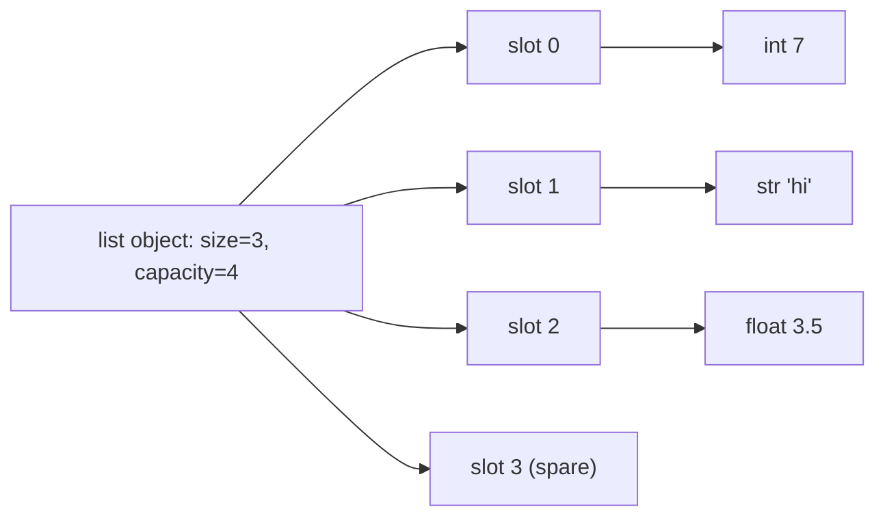
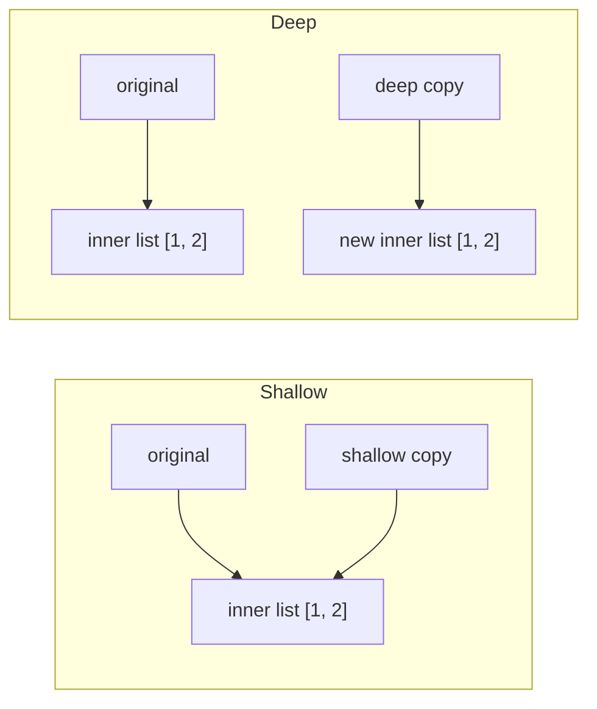

# Chapter 5 — Lists, Tuples and Arrays

Python gives you several ways to keep items **in order**: the all-purpose `list`, the immutable (cannot be changed once created) `tuple`, the compact numeric `array.array`, and — from the scientific world — NumPy's `ndarray` (NumPy is the standard third-party library for fast numeric arrays). They look alike (all support indexing, slicing, `len`, `in`, and `for`) but behave very differently in mutability, memory, speed and safety. This chapter explains each one, how it works under the hood, and how to choose.

**What you'll learn**

1. The `array` module: type codes, indexing, insertion, deletion, search, update, and its methods.
2. Lists: creating, accessing, updating, joining, slicing, looping and operators.
3. How a list is really a dynamic array — and the big-O cost of every operation.
4. Adding and removing items, and the full list-method table.
5. Advanced slicing: steps, slice assignment, slice deletion.
6. List comprehensions.
7. Sorting: `sort()` vs `sorted()`, `key`, `reverse`, stability, multi-key sorts.
8. Copying: aliasing, shallow vs deep copies, and the `[[0]*3]*3` trap.
9. Tuples: immutability, operators, unpacking (including `*`), joining, methods, tuples as records, `namedtuple`.
10. When to choose `list`, `tuple`, `array.array` or NumPy.

All runnable code is in [`code/`](code/). Outputs below are real, produced with Python 3.14 (the code runs on 3.12+). Timings are from one laptop — yours will differ, but the ratios hold.

---

## 5.1 The `array` module — typed, compact arrays

### What it is
An **array** (from the standard-library — shipped with Python — `array` module) is a mutable sequence in which **every element has the same C numeric type** (a fixed-size number format from the C language) — all 32-bit ints, or all 64-bit floats, and so on. The values are stored as raw machine numbers side by side in one block of memory (**contiguous** storage), rather than as separate Python objects.

Analogy: a list is a shelf of labelled boxes, each box holding any object; an `array` is an egg carton — every slot is the same size and holds one kind of thing, so it packs far more densely.

### Why it matters
For large volumes of plain numbers — sensor readings, audio samples (individual measurements of a sound wave), pixel values, binary file formats (files of raw bytes rather than text) — an `array` uses a fraction of a list's memory and can be written to or read from files and sockets (network connections) directly as bytes.

### How it works
1. `import array` and create one with a **type code** that fixes the element type: `array.array("i", [10, 20, 30])`.
2. Every value you store is checked and converted to that C type; wrong types raise `TypeError`, out-of-range numbers raise `OverflowError` (the number is too big or small for that type).
3. Indexing (positive and negative), slicing, `len`, `in` and `for` work exactly as with lists.

**Type codes** (sizes are the minimum the C standard guarantees; `itemsize` tells you the real size on your machine)

| Code | C type | Python type | Min bytes | Typical on 64-bit macOS/Linux |
|---|---|---|---|---|
| `'b'` / `'B'` | signed (allows negatives) / unsigned (zero and up) char | int | 1 | 1 (range −128…127 / 0…255) |
| `'h'` / `'H'` | signed / unsigned short | int | 2 | 2 |
| `'i'` / `'I'` | signed / unsigned int | int | 2 | 4 |
| `'l'` / `'L'` | signed / unsigned long | int | 4 | 8 (4 on Windows) |
| `'q'` / `'Q'` | signed / unsigned long long | int | 8 | 8 |
| `'f'` | float | float | 4 | 4 |
| `'d'` | double | float | 8 | 8 |
| `'u'` | wchar_t (Unicode char) | str | 2 | 4 — **deprecated** (still works, but discouraged) since 3.3, slated for removal |
| `'w'` | Py_UCS4 (Unicode char) | str | 4 | 4 — added in 3.13 as the replacement for `'u'` |

```python
a = array.array("i", [10, 20, 30, 40, 50])      # 'i' = C signed int
print(a, a.typecode, a.itemsize, "bytes per item")
print(a[0], a[1], a[-1], a[-2])
for x in a:
    print(x, end=" ")
try:
    a.append(3.5)                                # wrong type is rejected
except TypeError as e:
    print("TypeError:", e)
try:
    array.array("b", [200])                      # 'b' holds -128..127
except OverflowError as e:
    print("OverflowError:", e)
```

Output:
```
array('i', [10, 20, 30, 40, 50]) i 4 bytes per item
10 20 50 40
10 20 30 40 50
TypeError: 'float' object cannot be interpreted as an integer
OverflowError: signed char is greater than maximum
```

### The four basic operations: insert, delete, search, update

> **Key term — Big-O notation:** the "Cost" column uses Big-O, a shorthand for how the work grows with the number of elements *n*. **O(1)** = constant: the same cost for 10 or 10 million items. **O(n)** = linear: twice the items, about twice the work. **O(k)** is the same idea for *k*, the size of the extra input. It describes growth, not seconds.

| Operation | Code | Effect | Cost |
|---|---|---|---|
| Traverse | `for x in a` | Visit each element | O(n) |
| Insert | `a.insert(i, x)` | Put `x` at index `i`, shift the rest right | O(n) |
| Delete | `a.pop(i)` / `a.remove(x)` | Remove by position / first matching value, shift left | O(n) (O(1) for `pop()` at the end) |
| Search | `a.index(x)` | Position of the first `x` (or `ValueError`) | O(n) |
| Update | `a[i] = x` | Overwrite in place | O(1) |

### Array methods

| Method | What it does | Cost |
|---|---|---|
| `append(x)` | Add `x` at the end | O(1) amortised (constant on average) |
| `extend(iterable)` | Append every item of an iterable (anything you can loop over; same type required) | O(k) |
| `insert(i, x)` | Insert before position `i` | O(n) |
| `pop([i])` | Remove and return item `i` (default last) | O(1) last, O(n) otherwise |
| `remove(x)` | Delete the first occurrence of `x` | O(n) |
| `index(x)` | Position of first `x` | O(n) |
| `count(x)` | How many times `x` occurs | O(n) |
| `reverse()` | Reverse in place | O(n) |
| `clear()` | Remove all items (**Python 3.13+**; use `del a[:]` on older versions) | O(1) |
| `tolist()` / `fromlist(l)` | Convert to / append from a list | O(n) |
| `tobytes()` / `frombytes(b)` | Raw machine bytes out / in | O(n) |
| `tofile(f)` / `fromfile(f, n)` | Write / read raw values to a binary file | O(n) |
| `byteswap()` | Swap byte order (endianness) of every item | O(n) |
| `buffer_info()` | `(address, length)` of the underlying memory (address = the numeric location in RAM) | O(1) |

Two things arrays **don't** have: a `.sort()` method and a `.copy()` method. Sort with the built-in `sorted(a)` — which returns a **list** — and convert back with `array.array(code, sorted(a))`. Copy with `a[:]`, `array.array(a.typecode, a)` or `copy.copy(a)`.

```python
a = array.array("i", [1, 2, 3, 4, 5])
a.insert(1, 10);            print("insert(1, 10):", a.tolist())
removed = a.pop(1);         print("pop(1):", a.tolist(), "removed", removed)
print("index(3):", a.index(3))
a[2] = 20;                  print("a[2] = 20:", a.tolist())
a.append(4);                print("append(4):", a.tolist())
a.extend([5, 4, 6]);        print("extend:", a.tolist())
print("count(4):", a.count(4))
a.remove(4);                print("remove(4) (first 4 only):", a.tolist())
a.reverse();                print("reverse:", a.tolist())
print("sorted(a) -> list:", sorted(a))           # arrays have no .sort()
a = array.array("i", sorted(a));  print("back to array:", a)
b = copy.copy(a)                                  # no .copy() method: use copy.copy or a[:]
b[0] = 99
print("copy independent:", a[0], b[0])
del a[:]                                          # empties it (array.clear() exists from 3.13)
print("emptied:", a)
```

Output:
```
insert(1, 10): [1, 10, 2, 3, 4, 5]
pop(1): [1, 2, 3, 4, 5] removed 10
index(3): 2
a[2] = 20: [1, 2, 20, 4, 5]
append(4): [1, 2, 20, 4, 5, 4]
extend: [1, 2, 20, 4, 5, 4, 5, 4, 6]
count(4): 3
remove(4) (first 4 only): [1, 2, 20, 5, 4, 5, 4, 6]
reverse: [6, 4, 5, 4, 5, 20, 2, 1]
sorted(a) -> list: [1, 2, 4, 4, 5, 5, 6, 20]
back to array: array('i', [1, 2, 4, 4, 5, 5, 6, 20])
copy independent: 1 99
emptied: array('i')
```

`tolist()` is used only to print a clean list; printing the array itself shows `array('i', [...])`.

**Memory.** One million integers:

```
list of 1,000,000 ints :   36.0 MB (pointers + int objects)
array('i')          :    4.1 MB (raw 4-byte ints)
```

A list stores an 8-byte pointer (a memory address referring to an object) per slot **plus** a separate int object (28 bytes each for small ints on 64-bit CPython) — about 9× more memory here.

### Trade-offs, mistakes, and when not to use it
- **Not faster for arithmetic.** Each time you read an element, Python must create an `int`/`float` object for it ("boxing"), so looping over an array is often *slower* than over a list (see 5.15). For fast maths, use NumPy.
- **Choose the type code carefully:** `'b'` overflows at 128; `'l'` is 4 bytes on Windows but 8 on Linux/macOS — use `'q'` when you need 64 bits everywhere.
- Use arrays for **compact storage and binary I/O** (input/output of raw bytes); use lists for general work; use NumPy for numerical computing.

### Self-check
1. What does the type code decide? → The C type, hence size and allowed values, of every element.
2. How do you sort an `array`? → `array.array(a.typecode, sorted(a))`.
3. Why does an array of a million ints use ~4 MB while a list uses ~36 MB? → The array stores raw 4-byte values; the list stores pointers to full Python int objects.

### TL;DR
`array.array(code, data)` = homogeneous (all one type), compact, mutable numbers. Same indexing and most list methods; no `sort`/`copy` methods; `clear()` only from 3.13. Great for memory and binary I/O, not for speed.

---

## 5.2 Lists — the everyday sequence

### What it is
A **list** is an ordered, **mutable** collection that can hold objects of **any type**, written with square brackets: `[1, "Hello", 3.14, True]`. It can grow and shrink at run time.

Analogy: a to-do list on a whiteboard — you can read any line, rewrite it, add lines, erase lines, and reorder them.

### Why it matters
It's the default container in Python. Function results, rows from a file, items from an API (a web service your code calls), stacks (last-in-first-out piles), queues (first-in-first-out lines) of work — you'll reach for a list first in most programs.

### How it works — create, access, update

```python
my_list = [1, "Hello", 3.14, True]           # mixed types are fine
print(my_list, len(my_list))
print(my_list[0], my_list[1], my_list[-1], my_list[-2])
my_list[1] = "World"
print("single update:", my_list)
my_list[1:3] = ["Changed", "Completely"]
print("slice update:", my_list)
print(list("abc"), list(range(4)), [0] * 3, [])
```

Output:
```
[1, 'Hello', 3.14, True] 4
1 Hello True 3.14
single update: [1, 'World', 3.14, True]
slice update: [1, 'Changed', 'Completely', True]
['a', 'b', 'c'] [0, 1, 2, 3] [0, 0, 0] []
```

- Indexing works like strings: `0` is first, `-1` last, `-2` second-last.
- Unlike strings, you can **assign** to an index (`my_list[1] = ...`) or a whole slice (`my_list[1:3] = [...]`) — see 5.5.
- `list(iterable)` builds a list from anything iterable.

### How it works — joining, slicing, looping

```python
a, b = [1, 2, 3], [4, 5, 6]
c = a + b                                    # new list
a.extend(b)                                  # modifies a in place
print(c, a, c == a, c is a)
full = list(range(10))
print(full[2:7], full[-8:-3], full[::3], full[::-1])
for i, fruit in enumerate(["apple", "banana", "cherry"], start=1):
    print(i, fruit)
```

Output:
```
[1, 2, 3, 4, 5, 6] [1, 2, 3, 4, 5, 6] True False
[2, 3, 4, 5, 6] [2, 3, 4, 5, 6] [0, 3, 6, 9] [9, 8, 7, 6, 5, 4, 3, 2, 1, 0]
1 apple
2 banana
3 cherry
```

`+` builds a **new** list and leaves both inputs alone; `extend()` (or `+=`) **modifies** the left list in place. `c == a` compares contents (equal); `c is a` compares identity (different objects).

### List operators

| Operator | Meaning | Example | Result |
|---|---|---|---|
| `+` | Concatenate into a new list | `[1, 2] + [3]` | `[1, 2, 3]` |
| `*` | Repeat | `[1, 2] * 2` | `[1, 2, 1, 2]` |
| `in` / `not in` | Membership (linear scan) | `3 in [1, 2, 3]` | `True` |
| `==`, `<`, … | Element-by-element (lexicographic) comparison | `[1, 2, 3] < [1, 3]` | `True` |
| `+=` | Extend in place | `a += [4]` | `a` changed |
| `del a[i]` | Delete by index or slice | `del a[0]` | |

```python
a, b = [1, 2, 3], [4, 5, 6]
print(a + b, a * 3, 3 in a, 7 not in a)
print([1, 2, 3] < [1, 3], [1, 2] == [1, 2], max(a), min(a), sum(a))
```

Output:
```
[1, 2, 3, 4, 5, 6] [1, 2, 3, 1, 2, 3, 1, 2, 3] True True
True True 3 1 6
```

`[1, 2, 3] < [1, 3]` is `True` because the first elements tie (1 = 1) and at the second position 2 < 3 — exactly like comparing words letter by letter.

### Common mistakes
- Confusing `a + b` (new list) with `a.extend(b)` (in place, returns `None`). Writing `a = a.extend(b)` sets `a` to `None`.
- Testing membership in a big list inside a loop — each `in` is O(n). Convert to a `set` first (Chapter 6).
- Modifying a list while iterating over it (e.g. removing items) — elements get skipped. Iterate over a copy (`for x in lst[:]`) or build a new list with a comprehension.

### Self-check
1. `[1, 2] * 3`? → `[1, 2, 1, 2, 1, 2]`.
2. What does `a.extend(b)` return? → `None` (it changes `a`).
3. `full[-8:-3]` on `list(range(10))`? → `[2, 3, 4, 5, 6]`.

### TL;DR
Lists are ordered, mutable, heterogeneous (items may be of mixed types). Index, slice, update in place; `+` makes new lists, `extend`/`+=` modify.

---

## 5.3 List internals — a dynamic array — and the big-O table

### What it is
In CPython a list is a **dynamic array**: one contiguous block of memory holding **pointers** (references) to the element objects, plus two numbers — how many slots are used (`len`) and how many are allocated (**capacity**). "Dynamic" means it resizes itself automatically.



### Why it matters
Knowing the layout tells you instantly which operations are cheap and which are slow — the difference between an O(n) and an O(n²) program.

### How it works
1. **Index access** `lst[i]`: address = start + i × 8 bytes → one step, O(1).
2. **Append** when there is spare capacity: write the pointer into the next slot, O(1).
3. **Append when full**: allocate a bigger block, copy all pointers, then write. CPython grows by roughly **12.5% plus a small constant** (the formula in recent CPython versions is `new_size + new_size/8 + 6`, rounded down to a multiple of 4). Because each resize makes room for many future appends, the copying cost spread over all appends is constant — **amortised O(1)**.
4. **Insert or delete at position i**: every pointer after `i` must shift one slot → O(n − i). At the front (`i = 0`) that's the whole list.
5. **Shrinking**: when the list falls below half its capacity, CPython may reallocate a smaller block.

Measured capacity while appending (from `code/06_list_internals.py`, using `sys.getsizeof`):

```
 len  capacity  (capacity = slots allocated)
   0         0
   1         4
   5         8
   9        16
  17        24
  25        32
  33        40
  41        52
  53        64
  65        76
```


*Figure — capacity (steps) always stays at or above the used length (dashed line); a copy happens only at each step.*

Worked amortised example: appending the 17th item finds the list full at 16, so CPython allocates 24 slots and copies 16 pointers. The next 7 appends are free. Spread over those 8 appends, that's 2 copies each — and as lists grow, the steps get larger in absolute terms, so the average copy cost per append stays bounded by a constant.

Timing the difference between the end and the front (µs — microseconds, millionths of a second — per push-then-pop pair):

```
        n   append()+pop()   insert(0)+pop(0)   (µs per pair)
   10,000            0.017              3.588
  100,000            0.017             40.046
1,000,000            0.018            414.395
```

End operations stay flat as *n* grows ×100; front operations grow ×100 — the signature of O(1) vs O(n).

### Big-O table for `list` (n = len, k = size of the other argument or slice)

| Operation | Example | Average cost |
|---|---|---|
| Length | `len(a)` | O(1) |
| Get / set item | `a[i]`, `a[i] = x` | O(1) |
| Append | `a.append(x)` | O(1) amortised |
| Pop last | `a.pop()` | O(1) |
| Pop / delete at i | `a.pop(i)`, `del a[i]` | O(n − i) → O(n) at the front |
| Insert at i | `a.insert(i, x)` | O(n − i) |
| Extend | `a.extend(b)`, `a += b` | O(k) |
| Concatenate | `a + b` | O(n + k) |
| Repeat | `a * k` | O(n·k) |
| Get slice | `a[i:j]` | O(k) |
| Set slice | `a[i:j] = b` | O(k + n) |
| Delete slice | `del a[i:j]` | O(n) |
| Membership / search | `x in a`, `a.index(x)`, `a.count(x)`, `a.remove(x)` | O(n) |
| Min / max / sum | `min(a)` | O(n) |
| Copy | `a.copy()`, `a[:]` | O(n) |
| Reverse | `a.reverse()` | O(n) |
| Sort | `a.sort()`, `sorted(a)` | O(n log n) (a bit more than linear — the norm for good sorts) worst, O(n) if already sorted |
| Iterate | `for x in a` | O(n) |

### Trade-offs
| Need | Best structure | Why |
|---|---|---|
| Append/pop at the end (stack) | `list` | O(1) |
| Add/remove at both ends (queue) | `collections.deque` (double-ended queue; Chapter 6) | O(1) at both ends; list's `pop(0)` is O(n) |
| Frequent membership tests | `set` / `dict` | O(1) average instead of O(n) |
| Keep sorted while inserting | `bisect` (binary-search helpers) on a list (Chapter 6) or a sorted container library | O(log n) (grows very slowly: doubling n adds one step) search, O(n) insert |

### Common mistakes
- Using `list.pop(0)` as a queue — quadratic for large queues. Use `deque.popleft()`.
- Calling `insert(0, x)` in a loop to build a reversed list — append then `reverse()` once.

### In the interview
**30-second answer:** "A Python list is a dynamic array of pointers. Indexing and append are O(1) (append amortised, thanks to proportional over-allocation of about 12.5%), but inserting or deleting anywhere except the end shifts elements and is O(n), and membership tests are O(n)."

- *Q: Why amortised?* A: Occasional resizes copy everything, but they happen rarely enough that the total copying over n appends is O(n).
- *Q: Linked list (a chain of nodes, each pointing to the next) vs Python list?* A: Python has no built-in linked list; `deque` is a doubly-linked list (each node points both forward and back) of fixed-size blocks, giving O(1) at both ends but O(n) indexing in the middle.
- *Q: Why is `x in lst` slow?* A: It compares against each element in turn — linear scan.

### Self-check
1. What is stored in a list's slots? → Pointers to objects, not the objects themselves.
2. Cost of `lst.insert(0, x)` on a million-item list? → O(n): a million pointers move.
3. Why doesn't every append copy the list? → Spare capacity is reserved in advance.

### TL;DR
List = dynamic array of pointers. O(1): index, append, pop-last. O(n): insert/delete at front or middle, `in`, `index`, `remove`. Queue → `deque`; lookups → `set`.

---

## 5.4 Adding and removing items

### What it is
Methods and statements that change a list's contents.

| Goal | Use | Returns | Error when |
|---|---|---|---|
| Add one item at the end | `append(x)` | `None` | — |
| Add one item at position i | `insert(i, x)` | `None` | — (i beyond ends is clamped — moved to the nearest end) |
| Add all items of an iterable | `extend(iterable)` / `+=` | `None` | Not iterable |
| Remove first item equal to x | `remove(x)` | `None` | `ValueError` if absent |
| Remove by position and get it | `pop(i=-1)` | The item | `IndexError` on empty/out of range |
| Remove by position or slice | `del a[i]`, `del a[i:j]` | — | `IndexError` |
| Remove everything | `clear()` (or `del a[:]`) | `None` | — |

```python
fruits = ["apple", "banana"]
fruits.append("cherry");               print("append:", fruits)
fruits.insert(1, "orange");            print("insert:", fruits)
fruits.extend(["grape", "mango"]);     print("extend:", fruits)
fruits.remove("banana");               print("remove:", fruits)
last = fruits.pop();                   print("pop():", fruits, "->", last)
first = fruits.pop(0);                 print("pop(0):", fruits, "->", first)
del fruits[0];                         print("del [0]:", fruits)
fruits.clear();                        print("clear:", fruits)
x = [1, 2]
x.append([3, 4]);  print("append a list :", x)   # nests!
y = [1, 2]
y.extend([3, 4]);  print("extend a list :", y)
try:
    y.remove(99)
except ValueError as e:
    print("ValueError:", e)
```

Output:
```
append: ['apple', 'banana', 'cherry']
insert: ['apple', 'orange', 'banana', 'cherry']
extend: ['apple', 'orange', 'banana', 'cherry', 'grape', 'mango']
remove: ['apple', 'orange', 'cherry', 'grape', 'mango']
pop(): ['apple', 'orange', 'cherry', 'grape'] -> mango
pop(0): ['orange', 'cherry', 'grape'] -> apple
del [0]: ['cherry', 'grape']
clear: []
append a list : [1, 2, [3, 4]]
extend a list : [1, 2, 3, 4]
ValueError: list.remove(x): x not in list
```

### Common mistakes
- `append` vs `extend`: `append([3, 4])` adds **one** element (a nested list); `extend([3, 4])` adds **two**. `extend("hi")` adds `'h'` and `'i'`.
- Removing all occurrences with a `while x in lst: lst.remove(x)` loop — O(n²). Use `lst = [v for v in lst if v != x]`.
- `lst.clear()` vs `lst = []`: `clear()` empties the **same** object (every other reference sees an empty list); `lst = []` rebinds only this name to a new list.

### Self-check
1. `[1].extend("ab")`? → The list becomes `[1, 'a', 'b']`.
2. Which removal method returns the removed item? → `pop`.
3. What does `remove` do with duplicates? → Removes only the first.

### TL;DR
`append` one, `extend` many, `insert` at a position; `remove` by value, `pop` by index (returns it), `del` by index/slice, `clear` everything.

---

## 5.5 List methods (complete table) and slicing in depth

### The full method table

| Method | Does | Cost |
|---|---|---|
| `append(x)` | Add `x` at the end | O(1) amortised |
| `extend(it)` | Add every item of `it` | O(k) |
| `insert(i, x)` | Insert before index `i` | O(n) |
| `remove(x)` | Delete first item equal to `x` | O(n) |
| `pop([i])` | Remove and return item `i` (default last) | O(1) last / O(n) |
| `clear()` | Remove all items | O(n) (drops each reference) |
| `index(x[, start[, end]])` | First index of `x` | O(n) |
| `count(x)` | Number of items equal to `x` | O(n) |
| `sort(*, key=None, reverse=False)` | Sort in place (stable — equal items keep their order, §5.7) | O(n log n) |
| `reverse()` | Reverse in place | O(n) |
| `copy()` | Shallow copy | O(n) |

Only 11 methods — everything else is a built-in function (`len`, `sorted`, `reversed`, `min`, `max`, `sum`, `enumerate`, `zip`) or an operator.

```python
colors = ["red", "blue", "green", "blue"]
print(colors.count("blue"), colors.index("blue"), colors.index("blue", 2))
colors.remove("blue");   print(colors)          # only the first 'blue'
colors.append("amber")
colors.sort();           print("sort:", colors)
colors.reverse();        print("reverse:", colors)
nums = [3, 1, 2]
snapshot = nums.copy()
nums.sort(reverse=True)
print(nums, snapshot)
```

Output:
```
2 1 3
['red', 'green', 'blue']
sort: ['amber', 'blue', 'green', 'red']
reverse: ['red', 'green', 'blue', 'amber']
[3, 2, 1] [3, 1, 2]
```

`index("blue", 2)` starts searching at position 2, so it finds the second `"blue"` at index 3.

### Slicing in depth — steps and slice assignment
Everything about string slicing (Chapter 4) applies: `a[start:stop:step]`, stop excluded, negatives from the end, never raises. Because lists are mutable you can also **assign to** and **delete** slices.

| Form | Rule |
|---|---|
| `a[i:j] = iterable` | Replace that range; the new data may be **longer or shorter** |
| `a[i:i] = iterable` | Empty range → pure **insertion** at `i` |
| `a[i:j:k] = iterable` | Extended (stepped) slice → lengths **must match** |
| `del a[i:j:k]` | Delete the selected positions |
| `a[:] = []` | Empty the list in place (same as `clear()`) |

```python
x = list(range(10))
print(x[1:8:2], x[::-2], x[-3:])
y = x.copy(); y[2:5] = ["a"];            print("shrink :", y)      # lengths may differ
y = x.copy(); y[2:2] = ["new", "items"]; print("insert :", y)      # empty slice = insert
y = x.copy(); y[::2] = [0] * 5;          print("stepped:", y)      # lengths must match
y = x.copy(); del y[::2];                print("del ::2:", y)
y = x.copy(); y[:] = [];                 print("clear  :", y)
try:
    y = x.copy(); y[::2] = [1, 2]
except ValueError as e:
    print("ValueError:", e)
```

Output:
```
[1, 3, 5, 7] [9, 7, 5, 3, 1] [7, 8, 9]
shrink : [0, 1, 'a', 5, 6, 7, 8, 9]
insert : [0, 1, 'new', 'items', 2, 3, 4, 5, 6, 7, 8, 9]
stepped: [0, 1, 0, 3, 0, 5, 0, 7, 0, 9]
del ::2: [1, 3, 5, 7, 9]
clear  : []
ValueError: attempt to assign sequence of size 2 to extended slice of size 5
```

### Common mistakes
- Expecting `a[1:3] = 5` to work — the right side must be iterable: `a[1:3] = [5]`.
- Forgetting that a slice **read** is a shallow copy but a slice **assignment** changes the original.

### Self-check
1. `x = [0,1,2,3]; x[1:3] = []` → ? → `[0, 3]`.
2. Can `a[::2] = [1]` work on a 4-item list? → No, the stepped slice has 2 slots; lengths must match.
3. How many methods does `list` have? → 11.

### TL;DR
11 methods; slicing reads copies, slice assignment edits in place (length may change unless there's a step).

---

## 5.6 List comprehensions

### What it is
A **list comprehension** builds a new list from an iterable in one expression:

```
[expression for item in iterable if condition]
```

- **expression** — what to put in the new list (e.g. `n ** 2`).
- **for item in iterable** — the source loop.
- **if condition** — optional filter; items that fail it are skipped.

### The problem it solves
The traditional pattern — create an empty list, loop, `append` — takes three or four lines to say one thing, and the repeated `.append` attribute lookup (finding the method on the object each time) and method call cost time. A comprehension says it in one readable line and runs as specialised bytecode (the low-level instructions CPython's interpreter executes).

### How it works
1. Python creates an empty list.
2. For each `item` in the iterable, it evaluates `condition` (if present).
3. If true (or absent), it evaluates `expression` and appends the result.
4. Multiple `for` clauses nest **left to right**, in the same order you'd write nested loops.

```python
numbers = [1, 2, 3, 4, 5]
squared = []
for n in numbers:                          # the traditional way
    squared.append(n ** 2)
print("loop:", squared)
print("comp:", [n ** 2 for n in numbers])
print("even squares:", [n ** 2 for n in numbers if n % 2 == 0])
print("if/else in expr:", ["even" if n % 2 == 0 else "odd" for n in numbers])
print([f"Number {n} squared is {n ** 2}." for n in numbers[:2]])

matrix = [[1, 2, 3], [4, 5, 6]]
flat = [x for row in matrix for x in row]          # same order as nested for-loops
transposed = [[row[i] for row in matrix] for i in range(3)]
pairs = [(c, n) for c in "ab" for n in (1, 2)]
print(flat, transposed, pairs)

total = sum(n * n for n in range(1_000_000))       # generator expression: no list built
```

Output:
```
loop: [1, 4, 9, 16, 25]
comp: [1, 4, 9, 16, 25]
even squares: [4, 16]
if/else in expr: ['odd', 'even', 'odd', 'even', 'odd']
['Number 1 squared is 1.', 'Number 2 squared is 4.']
[1, 2, 3, 4, 5, 6] [[1, 4], [2, 5], [3, 6]] [('a', 1), ('a', 2), ('b', 1), ('b', 2)]
sum of squares: 333332833333500000
loop+append: 39.0 ms   comprehension: 31.6 ms (ratio 1.2x; machine-dependent)
```

Note the two different `if` positions:
- `[... for n in xs if cond]` — **filter** (fewer items out).
- `[a if cond else b for n in xs]` — **choose a value** (same number of items out).

The speed gain is real but modest (1.2× here). Choose comprehensions for **clarity**; the speed is a bonus.

### Trade-offs
| | Comprehension | `for` loop + `append` | Generator expression `( … )` (yields items lazily, one at a time) | `map`/`filter` (apply a function / keep matching items) |
|---|---|---|---|---|
| Readability for simple transforms | Best | OK | Best | OK with named functions |
| Memory | Whole list | Whole list | One item at a time | Lazy iterator |
| Complex logic, try/except, prints | Poor | Best | Poor | Poor |

### When not to use it
- When the body needs several statements, error handling or side effects (actions beyond producing a value, such as printing or writing files) — write a loop.
- When you only iterate once (e.g. feeding `sum`, `any`, `max`, `"".join`) — use a **generator expression** with round brackets to avoid building a list.
- More than two `for` clauses, or nested comprehensions deeper than one level, usually hurt readability (*Effective Python* recommends no more than two control subexpressions).
- For side effects only (`[print(x) for x in xs]`) — that builds a useless list of `None`s.

### Common mistakes
- Reversing the order of nested `for`s: `[x for x in row for row in matrix]` fails (`row` not defined yet).
- Expecting the loop variable to leak: in Python 3 comprehension variables are local to the comprehension (visible only inside it).

### Real-world examples
Data-cleaning code in pandas/ETL (extract–transform–load data jobs) scripts (`[c.strip().lower() for c in columns]`), building SQL parameter lists, and flattening API pages (results a web service returns in chunks; `[item for page in pages for item in page["results"]]`).

### In the interview
**30-second answer:** "`[expr for x in it if cond]` builds a list in one expression; it's clearer and a bit faster than loop-and-append. Use a generator expression when you only need to iterate once, and a normal loop when the logic gets complicated."

- *Q: Order of multiple fors?* A: Left to right, same as nested loops.
- *Q: Dict and set versions?* A: `{k: v for ...}` and `{x for ...}` (Chapter 6).

### Self-check
1. `[c.upper() for c in "abc" if c != "b"]`? → `['A', 'C']`.
2. How do you avoid materialising (actually building in memory) a list in `sum(...)`? → Use a generator expression: `sum(x*x for x in xs)`.
3. Flatten `[[1],[2,3]]`? → `[x for sub in lst for x in sub]` → `[1, 2, 3]`.

### TL;DR
`[expr for x in it if cond]`; `if/else` goes before `for`; nested `for`s read left to right; use `( … )` for one-pass use, a loop for complex logic.

---

## 5.7 Sorting

### What it is
- `lst.sort()` — sorts the list **in place** and returns `None`.
- `sorted(iterable)` — returns a **new** sorted list from any iterable (list, tuple, string, set, dict keys, generator).

Both accept `key=` (a function that computes the value to sort by) and `reverse=True`.

### Why it matters
Sorting underlies reports, rankings, deduplication (removing repeats), binary search (finding an item by repeatedly halving a sorted list) and "top-k" (the k biggest or smallest) queries. Knowing `key` functions and **stability** lets you express almost any ordering in one line.

### How it works
1. If `key` is given, Python calls it **once per element** and sorts by those results (decorate–sort–undecorate done for you).
2. Elements (or keys) are compared with `<`. Mixed types that can't be compared raise `TypeError`.
3. The algorithm is **Timsort** (since Python 2.3; 3.11 swapped in the "powersort" merge policy). It finds already-ordered runs (stretches already in order) and merges them: **O(n log n)** worst case, **O(n)** on already-sorted data.
4. It is **stable**: items with equal keys keep their original relative order. That lets you sort by several keys in multiple passes — secondary key first, primary key last.

```python
nums = [5, 2, 9, 1]
new = sorted(nums)                  # returns a NEW list, works on any iterable
print(new, nums)
result = nums.sort()                # sorts IN PLACE, returns None
print(nums, result)
print(sorted("banana"), sorted({3, 1, 2}), sorted({"b": 1, "a": 2}))

words = ["banana", "Apple", "cherry", "Date"]
print(sorted(words))                              # uppercase first (code points)
print(sorted(words, key=str.casefold))            # case-insensitive
print(sorted(words, key=len))                     # by length
print(sorted(words, key=len, reverse=True))
people = [("Ann", 31), ("Bob", 25), ("Cid", 31)]
print(sorted(people, key=itemgetter(1)))          # same as key=lambda p: p[1]
```

Output:
```
[1, 2, 5, 9] [5, 2, 9, 1]
[1, 2, 5, 9] None
['a', 'a', 'a', 'b', 'n', 'n'] [1, 2, 3] ['a', 'b']
['Apple', 'Date', 'banana', 'cherry']
['Apple', 'banana', 'cherry', 'Date']
['Date', 'Apple', 'banana', 'cherry']
['banana', 'cherry', 'Apple', 'Date']
[('Bob', 25), ('Ann', 31), ('Cid', 31)]
```

Stability in action: with `key=len`, `"banana"` and `"cherry"` both have length 6, and they come out in their original order (banana before cherry). With `reverse=True` they *still* keep that order — `reverse` flips the comparison, not the tie order, so stability is preserved.

**Multi-key sorts** — department ascending, then age descending:

```python
people = [("Ann", "HR", 31), ("Bob", "IT", 25), ("Cid", "HR", 25), ("Dee", "IT", 31)]
by_age = sorted(people, key=itemgetter(2))
print("by age (ties keep original order):", [p[0] for p in by_age])
print("tuple key :", [p[0] for p in sorted(people, key=lambda p: (p[1], -p[2]))])
tmp = sorted(people, key=itemgetter(2), reverse=True)        # secondary key first
print("two passes:", [p[0] for p in sorted(tmp, key=itemgetter(1))])
```

Output:
```
by age (ties keep original order): ['Bob', 'Cid', 'Ann', 'Dee']
tuple key : ['Ann', 'Cid', 'Dee', 'Bob']
two passes: ['Ann', 'Cid', 'Dee', 'Bob']
```

A **tuple key** compares field by field; negating a number flips its direction. When a field can't be negated (e.g. a string you want descending), use two stable passes instead.

### Trade-offs
| | `list.sort()` | `sorted()` |
|---|---|---|
| Input | Lists only | Any iterable |
| Result | Same list, changed | New list |
| Memory | No extra list | Extra O(n) |
| Keep original? | No | Yes |

### Common mistakes
- `lst = lst.sort()` → `lst` becomes `None`.
- Sorting mixed types (`[3, "a"]`) → `TypeError: '<' not supported between instances of 'str' and 'int'`.
- Sorting numeric strings as strings (`"10" < "9"`) — use `key=int`.
- Writing a `lambda` (a one-line anonymous function) when `operator.itemgetter`/`attrgetter` (ready-made "get item/attribute" key functions) or `str.casefold` already exists (clearer, slightly faster).

### Real-world examples
Timsort, designed by Tim Peters for CPython, was adopted for object sorting in Java (`Arrays.sort` on objects, Java 7), on Android, and in V8 (the JavaScript engine in Chrome and Node.js) since 2018. Leaderboards, "sort by price then rating" filters on shopping sites, SQL's `ORDER BY a, b DESC` and pandas' `df.sort_values(["a", "b"], ascending=[True, False])` all map to key-based stable sorts.

### In the interview
**30-second answer:** "`sort` sorts a list in place and returns None; `sorted` returns a new list from any iterable. Both take `key` and `reverse`. Python uses Timsort — stable, O(n log n), O(n) on nearly sorted data — and stability lets you do multi-key sorts with a tuple key or successive passes."

- *Q: Why is stability useful?* A: Equal elements keep prior order, enabling multi-pass sorts (e.g. by name, then by department).
- *Q: How many times is `key` called?* A: Once per element.
- *Q: Top 3 of a million items?* A: `heapq.nlargest(3, items)` (using a *heap*, a structure that keeps the smallest item on top) — O(n log k) instead of sorting everything (Chapter 6).

### Self-check
1. What does `sorted("cab")` return? → `['a', 'b', 'c']` (a list).
2. Sort strings by length, longest first? → `sorted(words, key=len, reverse=True)`.
3. Sort by dept ascending, salary descending? → `key=lambda e: (e.dept, -e.salary)`.

### TL;DR
`sort()` in place/None, `sorted()` new list; `key=` once per item; Timsort is stable and adaptive.

---

## 5.8 Copying — aliasing, shallow vs deep, and the nested-list trap

### What it is
- **Aliasing**: two names referring to the **same** object. `b = a` never copies.
- **Shallow copy**: a new outer container whose slots point to the **same** inner objects. Made by `a.copy()`, `list(a)`, `a[:]`, `copy.copy(a)`.
- **Deep copy**: a new outer container **and** recursive copies (copies of copies, all the way down) of everything inside. Made by `copy.deepcopy(a)`.

Analogy: aliasing is giving a house a second address; a shallow copy is building a new house but sharing the same furniture; a deep copy duplicates the house and every piece of furniture.

### Why it matters
Most "my data changed by itself" bugs come from aliasing or shallow copies of nested data.

### How it works


```python
a = [1, 2, 3]
b = a                       # NOT a copy: two names, one list
b.append(4)
print(a, b, a is b)

original = [[1, 2], [3, 4]]
shallow = original.copy()
deep = copy.deepcopy(original)
original[0].append(99)                  # mutate an INNER list
original.append([5])                    # mutate the OUTER list
print("original:", original)
print("shallow :", shallow, "<- shares inner lists")
print("deep    :", deep, "<- fully independent")
print(shallow[0] is original[0], deep[0] is original[0])
```

Output:
```
[1, 2, 3, 4] [1, 2, 3, 4] True
original: [[1, 2, 99], [3, 4], [5]]
shallow : [[1, 2, 99], [3, 4]] <- shares inner lists
deep    : [[1, 2], [3, 4]] <- fully independent
True False
```

The shallow copy did **not** get `[5]` (its outer list is separate) but **did** see `99` (the inner list is shared).

Passing a list to a function also passes a reference (a pointer to the same object) — the function can mutate your list:
```
[1, 2, 3, 4, 'x']        # after add_item(a) appended 'x'
```

### The `[[0] * 3] * 3` trap
`*` repeats **references**. `[[0] * 3] * 3` creates one inner row and puts three pointers to it in the outer list.

```python
bad = [[0] * 3] * 3                     # 3 references to ONE row
bad[0][0] = 1
good = [[0] * 3 for _ in range(3)]      # 3 separate rows
good[0][0] = 1
```

Output:
```
bad : [[1, 0, 0], [1, 0, 0], [1, 0, 0]] ids: 1 distinct row(s)
good: [[1, 0, 0], [0, 0, 0], [0, 0, 0]] ids: 3 distinct row(s)
```

(`[0] * 3` itself is fine: integers are immutable, so sharing them is harmless.)

### The mutable default argument trap
Default values are evaluated **once**, when `def` runs, so a list default is shared by every call:

```python
def bad_append(item, bucket=[]):
    bucket.append(item); return bucket
def good_append(item, bucket=None):
    if bucket is None:
        bucket = []
    bucket.append(item); return bucket
print(bad_append(1), bad_append(2))    # [1, 2] [1, 2]
print(good_append(1), good_append(2))  # [1] [2]
```

### Trade-offs
| | Alias `b = a` | Shallow `a.copy()` | Deep `copy.deepcopy(a)` |
|---|---|---|---|
| Cost | O(1) | O(n) | O(total size of everything) |
| Independent outer list | No | Yes | Yes |
| Independent nested objects | No | No | Yes |
| Handles cycles (objects that contain each other) | — | — | Yes (keeps a memo — a record of what's already copied) |

### When not to use it
Don't `deepcopy` by reflex — it's slow and copies things you may want shared (caches — stored results reused later; connections — open links to databases or servers). If data is flat or contains only immutable items, a shallow copy is a full copy in practice. Consider immutable structures (tuples, frozen dataclasses — dataclass objects whose fields can't be changed, Chapter 10) so copying isn't needed.

### Common mistakes
- `grid = [[None] * cols] * rows` — use a comprehension.
- Thinking `a[:]` copies nested lists — it doesn't.
- `def f(x=[])` / `def f(d={})` — use `None` and create inside.

### In the interview
**30-second answer:** "Assignment never copies — it creates another reference. A shallow copy (`copy()`, `list()`, `[:]`) duplicates only the outer container; nested objects are shared. `copy.deepcopy` copies recursively. Classic traps: `[[0]*3]*3` shares one row, and mutable default arguments are shared between calls."

- *Q: Does `a[:]` copy?* A: Shallowly, yes.
- *Q: Does deepcopy handle cycles?* A: Yes — it tracks already-copied objects in a memo dict.

### Self-check
1. `a = [[1]]; b = a[:]; b[0].append(2)` — what is `a`? → `[[1, 2]]`.
2. Correct way to build a 3×3 zero grid? → `[[0]*3 for _ in range(3)]`.
3. Why is `def f(x=[])` dangerous? → The same list is reused across calls.

### TL;DR
`=` aliases, `copy()` shares the insides, `deepcopy` shares nothing. Never multiply a list of lists.

---

## 5.9 Tuples — immutable sequences and records

### What it is
A **tuple** is an ordered, **immutable** sequence. The **commas** make it; parentheses are just for grouping/readability: `(1, 2, 3)` or `1, 2, 3` (**tuple packing**). A one-element tuple needs a trailing comma: `(42,)`.

Analogy: a list is a shopping list you keep editing; a tuple is a printed receipt — you can read and copy it, not edit it.

### Why it matters
- **Integrity:** data that shouldn't change (coordinates, RGB colours, database rows, function return bundles) can't be changed by accident.
- **Hashable** (if all its items are hashable) → can be a dict key or set element: `{(59.9, 10.7): "Oslo"}`.
- **Lighter** than lists: fixed size, no spare capacity. A 3-item tuple is 72 bytes vs 88 for a list on this build. CPython can also build tuples of constants at compile time (when source is turned into bytecode, before the program runs).
- **Thread safety by construction:** an object nobody can mutate can be shared between threads (independent lines of execution in one program) without locks (mechanisms that let only one thread touch data at a time) (the objects inside may still be mutable, see below).

### How it works — define, access, "update", loop, operators, slice

```python
t = (1, 2, 3, 4, 5)
packed = "apple", "banana", "cherry"          # the commas make the tuple
single, not_a_tuple, empty = (42,), (42), ()
print(t, packed, type(single).__name__, type(not_a_tuple).__name__, empty)
print(t[0], t[2], t[-1], t[1:4], t[::-1])
try:
    t[1] = 20
except TypeError as e:
    print("TypeError:", e)
as_list = list(t); as_list[1] = 20; t2 = tuple(as_list)   # "update" = build a new tuple
print("updated copy:", t2)
for item in t:
    print(item, end=" ")
a, b = (1, 2, 3), (4, 5, 6)
print(a + b, a * 2, 3 in a, 7 not in a, (1, 2) < (1, 3))
```

Output:
```
(1, 2, 3, 4, 5) ('apple', 'banana', 'cherry') tuple int ()
1 3 5 (2, 3, 4) (5, 4, 3, 2, 1)
TypeError: 'tuple' object does not support item assignment
updated copy: (1, 20, 3, 4, 5)
1 2 3 4 5
(1, 2, 3, 4, 5, 6) (1, 2, 3, 1, 2, 3) True True True
```

| Operator | Meaning | Example |
|---|---|---|
| `+` | Concatenate into a new tuple | `(1, 2) + (3,)` → `(1, 2, 3)` |
| `*` | Repeat | `(1, 2) * 2` → `(1, 2, 1, 2)` |
| `in` / `not in` | Membership | `3 in (1, 2, 3)` → `True` |
| `<`, `==`, … | Lexicographic comparison | `(1, 2) < (1, 3)` → `True` |
| `[i]`, `[i:j:k]` | Index and slice (slices are new tuples) | `(0,1,2,3)[1:3]` → `(1, 2)` |

To "update" a tuple: convert to a list, change it, convert back — or build a new tuple with slicing: `t[:1] + (20,) + t[2:]`.

### Immutability is shallow
The tuple's **slots** can't change, but a mutable object **inside** can:

```python
t = ([1, 2], "x")
t[0].append(3)
print(t)                   # ([1, 2, 3], 'x')
hash(t)                    # TypeError: unhashable type: 'list'
```

A tuple is hashable only if everything inside is hashable.

### Tuples as records
Think of a tuple as a **record** where *position has meaning*: `("Ann", "HR", 31)` = name, department, age. Lists are for **many things of the same kind** (a list of employees); tuples are for **one thing with several fields** (one employee). That's the guidance in *Fluent Python*, and it's why functions return tuples: `divmod(17, 5)` → `(3, 2)`.

### Common mistakes
- `(42)` is just the int 42 — write `(42,)`.
- Trailing comma accidents: `x = 1,` makes `x` a tuple.
- Assuming a tuple of lists is safe to use as a dict key — it isn't hashable.

### Self-check
1. `type(("a"))`? → `str`. `type(("a",))`? → `tuple`.
2. Can you append to a list inside a tuple? → Yes; the tuple still holds the same list object.
3. Why can tuples be dict keys and lists cannot? → Tuples (of hashable items) are immutable and hashable.

### TL;DR
Commas make tuples; they're immutable (shallowly), hashable if their contents are, lighter than lists, and ideal as fixed-shape records.

---

## 5.10 Unpacking tuples (and any iterable)

### What it is
**Unpacking** assigns the items of a sequence to several names in one statement: `a, b, c = (1, "Hello", 3.14)`. It works with any iterable — lists, strings, generators, dict items.

### Why it matters
It removes index noise (`row[0]`, `row[1]`) and so removes off-by-one bugs, and it's how you receive multiple return values, swap variables and loop over pairs.

### How it works
1. The right side is evaluated fully first.
2. Python iterates it and binds each item to the next name on the left.
3. The counts must match — otherwise `ValueError` ("not enough values" / "too many values").
4. **Star-unpacking** (`*name`) collects "everything else" into a **list** (possibly empty). Only one star per assignment.
5. Unpacking nests: `for name, (lat, lon) in ...`.

```python
a, b, c = (1, "Hello", 3.14)
print(a, b, c)
try:
    w, x, y, z = (1, "Hello", 3.14)
except ValueError as e:
    print("ValueError:", e)
first, *middle, last = (1, 2, 3, 4, 5, 6)
print(first, middle, last)
head, *tail = [10]
print(head, tail)
x, y = 1, 2
x, y = y, x                                   # swap
print(x, y)
for name, (lat, lon) in [("Oslo", (59.9, 10.7)), ("Lima", (-12.0, -77.0))]:
    print(f"{name}: {lat}, {lon}")
_, _, ext = "archive.tar.gz".partition(".")   # _ = "don't care"
print(ext)
```

Output:
```
1 Hello 3.14
ValueError: not enough values to unpack (expected 4, got 3)
1 [2, 3, 4, 5] 6
10 []
2 1
Oslo: 59.9, 10.7
Lima: -12.0, -77.0
tar.gz
```

Wrapping risky unpacking in `try/except ValueError` (as above) lets a program report bad input (say, a malformed CSV — comma-separated values — row) instead of crashing.

The swap `x, y = y, x` works because the right side builds the tuple `(2, 1)` **before** any assignment happens.

**Star in calls and literals** (the same idea, in reverse):

| Syntax | Meaning | Example |
|---|---|---|
| `f(*seq)` | Spread items as positional arguments (arguments matched by position) | `print(*[1, 2, 3])` → `1 2 3` |
| `[*a, *b]` | Build a list from several iterables | `[*(1, 2), *[3]]` → `[1, 2, 3]` |
| `(*a, x)` | Build a tuple | `(*t, 99)` |
| `def f(*args)` | Collect extra positional arguments into a tuple | Chapter on functions |

### Common mistakes
- Using two stars: `a, *b, *c = ...` → `SyntaxError`.
- Expecting `*middle` to be a tuple — it is always a **list**.
- Unpacking a dict directly gives **keys**; use `.items()` for pairs.

### In the interview
**30-second answer:** "Unpacking binds items of any iterable to names; the count must match or you get ValueError. `first, *rest = seq` gathers the leftovers into a list. It powers multiple return values, swaps without a temp, and clean loops like `for k, v in d.items()`."

- *Q: Is `a, b = b, a` atomic?* A: It's evaluated as build tuple, then assign — no temp variable needed, but it isn't a thread-atomic operation (one indivisible step that other threads cannot interrupt).
- *Q: What does `*_` do?* A: Discards any number of items: `first, *_ = row`.

### Self-check
1. `a, *b = "hey"`? → `a='h'`, `b=['e', 'y']`.
2. `x, y = [1, 2, 3]`? → `ValueError: too many values to unpack (expected 2)`.
3. How to swap `a` and `b`? → `a, b = b, a`.

### TL;DR
`a, b, c = seq`; counts must match; `*rest` gathers a list; `_` for ignored slots; works in `for` loops and nests.

---

## 5.11 Joining tuples

### What it is
Combining several tuples into one. Because tuples are immutable, every join creates a **new** tuple.

### How it works — five ways

```python
parts = [(1, 2), (3, 4), (5, 6)]
out = ()
for p in parts:
    out += p                                  # new tuple every time: O(n^2) overall
print("loop     :", out)
print("+        :", (1, 2, 3) + (4, 5, 6))
print("sum      :", sum(parts, ()))           # also O(n^2): repeated +
print("genexpr  :", tuple(x for p in parts for x in p))
print("chain    :", tuple(itertools.chain.from_iterable(parts)))
```

Output (last line: joining 3,000 two-item tuples):
```
loop     : (1, 2, 3, 4, 5, 6)
+        : (1, 2, 3, 4, 5, 6)
sum      : (1, 2, 3, 4, 5, 6)
genexpr  : (1, 2, 3, 4, 5, 6)
chain    : (1, 2, 3, 4, 5, 6)
3000 tuples: sum 14.55 ms vs chain 0.052 ms
```

- `+` — perfect for two or three tuples.
- `+=` in a loop and `sum(parts, ())` — both repeatedly create a bigger tuple and copy everything so far, so joining *m* tuples costs O(total²). `sum` is **not** faster than the loop; it does the same work. (The docs recommend `itertools.chain` for concatenating sequences — `sum` even refuses strings outright.)
- `tuple(x for p in parts for x in p)` — a flattening generator expression: the outer `for` walks each tuple, the inner `for` walks its items, and `tuple()` collects them once → O(total).
- `tuple(itertools.chain.from_iterable(parts))` — the idiomatic linear solution, implemented in C: ~280× faster here.

### Common mistakes
- Joining a tuple and a list: `(1,) + [2]` → `TypeError`. Convert first.
- Forgetting the comma when adding one item: `t + (4)` fails; `t + (4,)` works.

### Self-check
1. Fastest general way to join many tuples? → `tuple(itertools.chain.from_iterable(tuples))`.
2. Is `sum(list_of_tuples, ())` linear? → No, quadratic.

### TL;DR
Few tuples → `+`. Many → `tuple(chain.from_iterable(...))` or a flattening generator. Avoid `+=` loops and `sum`.

---

## 5.12 Tuple methods

Tuples have only two methods — everything that would modify is missing by design.

| Method | Returns | Cost |
|---|---|---|
| `count(x)` | How many items equal `x` | O(n) |
| `index(x[, start[, end]])` | Position of the first `x`; `ValueError` if absent | O(n) |

```python
fruit = ("apple", "banana", "cherry", "apple", "cherry")
print(fruit.count("apple"), fruit.count("cherry"), fruit.index("banana"), fruit.index("cherry"))
```

Output:
```
2 2 1 2
```

`index("cherry")` returns `2` — the **first** cherry — even though another is at 4. The built-ins `len`, `min`, `max`, `sum`, `sorted` (returns a list), `reversed`, `any`, `all` all work on tuples too.

### TL;DR
`count` and `index`, both O(n). Everything else comes from built-ins.

---

## 5.13 `namedtuple` and `typing.NamedTuple` — tuples with field names

### What it is
`collections.namedtuple` creates a **tuple subclass** (a specialised type built on `tuple`) whose positions also have names: `p.x` instead of `p[0]`. `typing.NamedTuple` is the same thing written as a class with type hints (optional type annotations) and defaults.

### The problem it solves
`emp[2]` says nothing; `emp.salary` says everything. Named tuples keep all tuple benefits (immutable, hashable, unpackable, as small as a tuple — no per-instance `__dict__`, the dictionary ordinary objects use to store their attributes) while making code self-documenting.

### How it works

```python
Point = namedtuple("Point", ["x", "y"])
p = Point(3, 4)
print(p, p.x, p[1], p._asdict(), p._replace(x=10))
x, y = p                                      # still a tuple

class Employee(NamedTuple):                   # typed, class-style syntax
    name: str
    dept: str
    salary: int = 0
e = Employee("Ann", "HR")
print(e, e.salary)
```

Output:
```
Point(x=3, y=4) 3 4 {'x': 3, 'y': 4} Point(x=10, y=4)
Employee(name='Ann', dept='HR', salary=0) 0
```

Useful extras: `_asdict()` (to a dict, e.g. for JSON), `_replace(**changes)` (a modified **copy**), `_fields` (field names), `_make(iterable)` (build from a row).

### Trade-offs
| | tuple | namedtuple / NamedTuple | `@dataclass` (auto-generated class, Chapter 10) | dict |
|---|---|---|---|---|
| Access by name | No | Yes | Yes | Yes (`d["k"]`) |
| Immutable | Yes | Yes | Optional (`frozen=True`) | No |
| Hashable | If items are | If items are | If frozen | No |
| Memory | Smallest | Same as tuple | Bigger (use `slots=True` to shrink) | Biggest |
| Methods / validation | No | Limited | Full class | No |
| Also behaves as a sequence | Yes | Yes (can surprise: `p == (3, 4)` is `True`) | No | No |

### When not to use it
When records need mutation, validation or methods, prefer `@dataclass`. When equality with plain tuples would be a bug, prefer a dataclass too.

### Real-world examples
The standard library returns named tuples from many functions: `urllib.parse.urlparse()` → `ParseResult(scheme=..., netloc=...)` (a namedtuple subclass). `sys.version_info` (`sys.version_info.major`), `time.struct_time` and `os.stat_result` are *struct sequences* — the C-level cousin with the same "tuple plus named fields" behaviour. Database drivers use them for rows too (e.g. psycopg 3's — a PostgreSQL database driver — `namedtuple_row` row factory).

### In the interview
**30-second answer:** "A namedtuple is a tuple subclass with named fields — immutable, lightweight, unpackable, with `_asdict` and `_replace`. I use it (or `typing.NamedTuple` for type hints) for simple immutable records and switch to dataclasses when I need mutability, validation or methods."

### Self-check
1. How do you "change" a field? → `p2 = p._replace(x=10)` — returns a new object.
2. Is a namedtuple equal to a plain tuple with the same values? → Yes, which can be surprising.

### TL;DR
Named fields on a tuple. Use for immutable records; use dataclasses for richer objects.

---

## 5.14 Choosing: `list` vs `tuple` vs `array.array` vs NumPy

### What it is
Four sequence types, four sweet spots. NumPy's **`ndarray`** (third-party, `pip install numpy`) is a typed, contiguous, possibly multi-dimensional array whose operations run in compiled loops over the whole array at once (**vectorisation**).

### How they compare — measured
One million integers, "multiply every element by 2":

```
container         memory    x*2 time
list              36.0MB      20.8ms
array.array        8.2MB      45.7ms
numpy              8.0MB       0.6ms
```

- `list` stores pointers + int objects → most memory; element-wise work runs in the interpreter.
- `array.array('q')` stores raw 8-byte ints → compact, but every read creates a Python int, so a Python-level loop is **slower** than the list.
- NumPy stores raw 8-byte ints **and** does the arithmetic in C for the whole array → ~35× faster than the list here.

### Trade-offs
| | `list` | `tuple` | `array.array` | `numpy.ndarray` |
|---|---|---|---|---|
| Mutable | Yes | No | Yes | Yes (fixed size) |
| Element types | Any, mixed | Any, mixed | One C numeric type | One dtype (element data type: numeric, bool, fixed strings, objects) |
| Memory for numbers | High | High | Low | Low |
| Hashable | No | Yes (if items are) | No | No |
| Fast element-wise maths | No | No | No | Yes (vectorised) |
| Multi-dimensional | Via nesting | Via nesting | No | Yes |
| Standard library | Yes | Yes | Yes | No (third-party) |
| `+` means | Concatenate | Concatenate | Concatenate | **Element-wise add** |

### When to use which
- **list** — default for general collections that change.
- **tuple** — fixed records, dict keys, return values, constants.
- **array.array** — lots of numbers kept compactly with no dependency (no extra package to install); binary file/network formats.
- **NumPy** — any numerical computing: statistics, images, ML features (the numeric inputs to a machine-learning model), linear algebra (vector and matrix maths). It's the foundation under pandas (tables), scikit-learn (machine learning), SciPy (scientific routines) and matplotlib (charts).

### Common mistakes
- Looping over a NumPy array in Python (`for x in arr: ...`) — you lose the speed. Use vectorised expressions (`arr * 2`, `arr[arr > 0]`).
- Expecting `np_a + np_b` to concatenate — it adds element-wise (use `np.concatenate`).
- Picking `array.array` for speed — it's for memory.

### In the interview
**30-second answer:** "List for general mutable data, tuple for immutable records and dict keys, `array.array` for compact homogeneous numbers without dependencies, NumPy for fast numerical work because it stores raw values contiguously and runs vectorised C loops."

### Self-check
1. Why is `array.array` slower than a list for `[x*2 for x in arr]`? → Every element read must create a Python int object.
2. What does `+` do on NumPy arrays? → Element-wise addition.
3. Which of the four can be a dict key? → Tuple (if its items are hashable).

### TL;DR
General → list. Fixed → tuple. Compact numbers → array. Fast numbers → NumPy.

---

## Chapter TL;DR

| Topic | Remember |
|---|---|
| `array` module | Typed, compact, mutable; type codes set size/range; no `sort`/`copy` methods; `clear()` from 3.13; memory win, not speed win. |
| Lists | Ordered, mutable, mixed types; index/slice/update; `+` new, `extend` in place. |
| Internals | Dynamic array of pointers; ~12.5% over-allocation → amortised O(1) append; front/middle insert/delete O(n); `in` O(n). |
| Add/remove | `append`, `extend`, `insert`; `remove` (value), `pop` (index, returns), `del`, `clear`. |
| Slicing | `[start:stop:step]`; slice assignment can resize; stepped assignment needs equal length. |
| Comprehensions | `[expr for x in it if cond]`; generator expression for one-pass use; loops for complex logic. |
| Sorting | `sort()` in place → None; `sorted()` new list; `key`, `reverse`; Timsort is stable, O(n log n), O(n) on sorted input. |
| Copying | `=` aliases; `copy()`/`[:]` shallow; `deepcopy` recursive; never `[[0]*n]*m`; no mutable defaults. |
| Tuples | Commas make them; `(x,)` for one; shallowly immutable; hashable if contents are; records. |
| Unpacking | Counts must match; `*rest` → list; swap with `a, b = b, a`. |
| Joining tuples | `+` for few; `chain.from_iterable` for many; `sum`/`+=` loops are quadratic. |
| Tuple methods | `count`, `index`. |
| namedtuple | Named, immutable records; `_asdict`, `_replace`; dataclass for more. |
| Choosing | list / tuple / array / NumPy by mutability, memory, and speed needs. |
