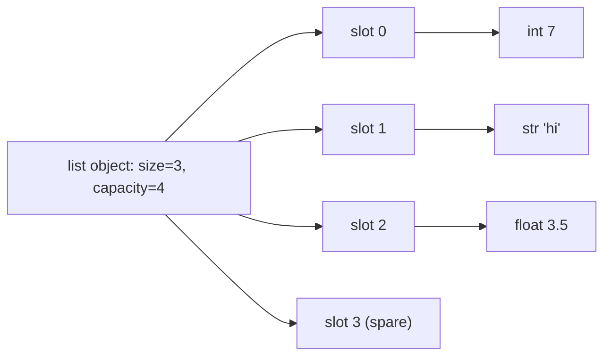
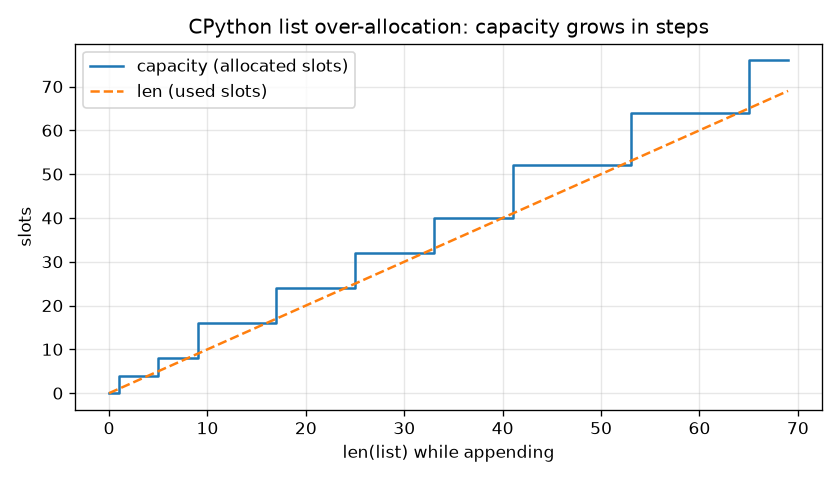
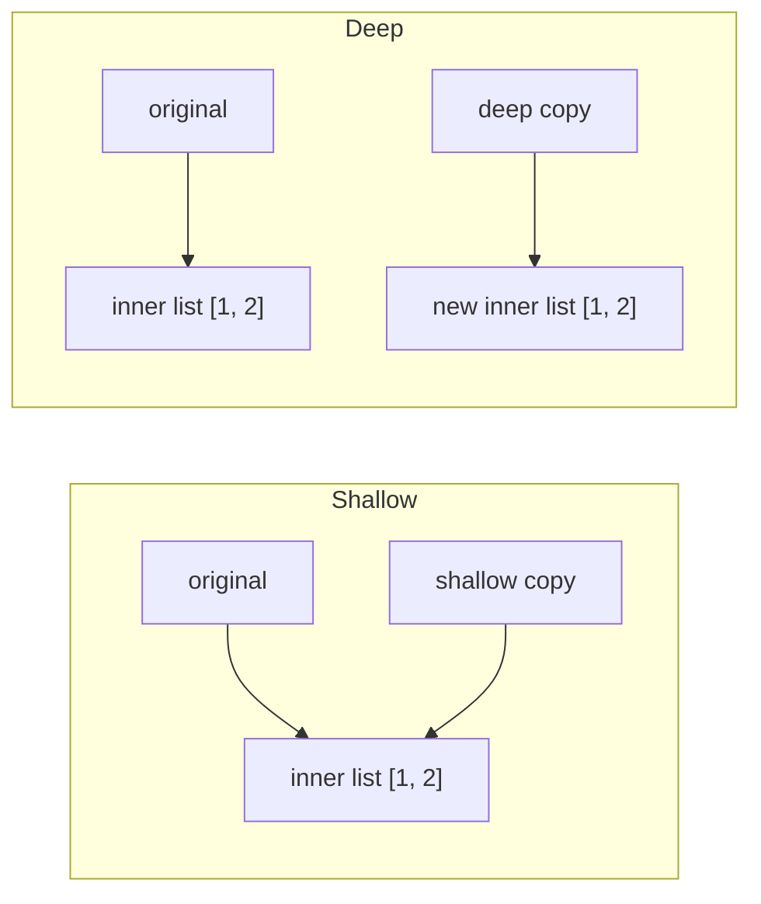

# Chapter 5 — Lists, Tuples and Arrays

Python keeps items **in order** in several ways: the all-purpose `list`, the immutable `tuple`, the compact numeric `array.array`, and NumPy's `ndarray` (NumPy is the standard third-party library for fast numeric arrays). All support indexing, slicing, `len`, `in` and `for`, but they differ in mutability, memory, speed and safety. This chapter explains each, how it works underneath, and how to choose.

**What you'll learn**

1. The `array` module: type codes, insert/delete/search/update, methods.
2. Lists: creating, accessing, updating, joining, slicing, looping, operators.
3. Lists as dynamic arrays — the big-O cost of every operation.
4. Adding/removing items and the full list-method table.
5. Advanced slicing: steps, slice assignment, slice deletion.
6. List comprehensions.
7. Sorting: `sort()` vs `sorted()`, `key`, `reverse`, stability, multi-key sorts.
8. Copying: aliasing, shallow vs deep, the `[[0]*3]*3` trap.
9. Tuples: immutability, operators, unpacking (with `*`), joining, methods, records, `namedtuple`.
10. Choosing `list`, `tuple`, `array.array` or NumPy.

Runnable code is in [`code/`](code/). Outputs are real (Python 3.14; code runs on 3.12+). Timings are from one laptop — ratios hold.

---

## 5.1 The `array` module — typed, compact arrays

### What it is
An **array** (standard-library `array` module) is a mutable sequence where **every element has the same C numeric type** (a fixed-size C number format) — all 32-bit ints, all 64-bit floats, etc. Values are stored as raw machine numbers side by side in one block (**contiguous** storage), not as separate Python objects. A list is a shelf of boxes holding anything; an array is an egg carton — uniform slots, packed densely.

### Why it matters
For large volumes of plain numbers — sensor readings, audio samples, pixel values, binary file formats — an array uses a fraction of a list's memory and reads/writes files and sockets directly as bytes.

### How it works
1. Create with a **type code**: `array.array("i", [10, 20, 30])`.
2. Each stored value is converted to that C type; wrong types → `TypeError`, out-of-range → `OverflowError`.
3. Indexing (incl. negative), slicing, `len`, `in`, `for` work as with lists.

**Type codes** (minimum sizes per the C standard; `itemsize` gives the real size)

| Code | C type | Python type | Min bytes | Typical on 64-bit macOS/Linux |
|---|---|---|---|---|
| `'b'` / `'B'` | signed (allows negatives) / unsigned char | int | 1 | 1 (−128…127 / 0…255) |
| `'h'` / `'H'` | signed / unsigned short | int | 2 | 2 |
| `'i'` / `'I'` | signed / unsigned int | int | 2 | 4 |
| `'l'` / `'L'` | signed / unsigned long | int | 4 | 8 (4 on Windows) |
| `'q'` / `'Q'` | signed / unsigned long long | int | 8 | 8 |
| `'f'` | float | float | 4 | 4 |
| `'d'` | double | float | 8 | 8 |
| `'u'` | wchar_t (Unicode char) | str | 2 | 4 — **deprecated** since 3.3, slated for removal |
| `'w'` | Py_UCS4 (Unicode char) | str | 4 | 4 — added in 3.13 to replace `'u'` |

```python
a = array.array("i", [10, 20, 30, 40, 50])      # 'i' = C signed int
print(a, a.typecode, a.itemsize, "bytes per item")
print(a[0], a[1], a[-1], a[-2])
for x in a:
    print(x, end=" ")
try:
    a.append(3.5)                                # wrong type is rejected
except TypeError as e:
    print("TypeError:", e)
try:
    array.array("b", [200])                      # 'b' holds -128..127
except OverflowError as e:
    print("OverflowError:", e)
```

Output:
```
array('i', [10, 20, 30, 40, 50]) i 4 bytes per item
10 20 50 40
10 20 30 40 50
TypeError: 'float' object cannot be interpreted as an integer
OverflowError: signed char is greater than maximum
```

### The four basic operations: insert, delete, search, update

> **Key term — Big-O notation:** how work grows with *n* elements. **O(1)**: constant. **O(n)**: linear. **O(k)**: linear in *k*, the size of the extra input. Growth, not seconds.

**Insert** (`insert`, shifts the rest right), **delete** (`pop(i)` / `remove(x)`, shift left), **search** (`index`) and **traverse** (`for x in a`) are O(n); **update** (`a[i] = x`) is O(1) — see the method table.

### Array methods

| Method | What it does | Cost |
|---|---|---|
| `append(x)` | Add at the end | O(1) amortised (constant on average) |
| `extend(iterable)` | Append every item (same type required) | O(k) |
| `insert(i, x)` | Insert before `i` | O(n) |
| `pop([i])` | Remove and return item `i` (default last) | O(1) last, O(n) otherwise |
| `remove(x)` | Delete first `x` | O(n) |
| `index(x)` | Position of first `x` | O(n) |
| `count(x)` | Occurrences of `x` | O(n) |
| `reverse()` | Reverse in place | O(n) |
| `clear()` | Remove all (**3.13+**; older: `del a[:]`) | O(1) |
| `tolist()` / `fromlist(l)` | To / append from a list | O(n) |
| `tobytes()` / `frombytes(b)` | Raw machine bytes out / in | O(n) |
| `tofile(f)` / `fromfile(f, n)` | Write / read raw values to a binary file | O(n) |
| `byteswap()` | Swap byte order (endianness) of every item | O(n) |
| `buffer_info()` | `(address, length)` of the underlying memory | O(1) |

Arrays have **no** `.sort()` or `.copy()`. Sort with `sorted(a)` (returns a **list**) and rebuild with `array.array(code, sorted(a))`; copy with `a[:]`, `array.array(a.typecode, a)` or `copy.copy(a)`.

```python
a = array.array("i", [1, 2, 3, 4, 5])
a.insert(1, 10);            print("insert(1, 10):", a.tolist())
removed = a.pop(1);         print("pop(1):", a.tolist(), "removed", removed)
print("index(3):", a.index(3))
a[2] = 20;                  print("a[2] = 20:", a.tolist())
a.append(4);                print("append(4):", a.tolist())
a.extend([5, 4, 6]);        print("extend:", a.tolist())
print("count(4):", a.count(4))
a.remove(4);                print("remove(4) (first 4 only):", a.tolist())
a.reverse();                print("reverse:", a.tolist())
print("sorted(a) -> list:", sorted(a))           # arrays have no .sort()
a = array.array("i", sorted(a));  print("back to array:", a)
b = copy.copy(a)                                  # no .copy() method: use copy.copy or a[:]
b[0] = 99
print("copy independent:", a[0], b[0])
del a[:]                                          # empties it (array.clear() exists from 3.13)
print("emptied:", a)
```

Output:
```
insert(1, 10): [1, 10, 2, 3, 4, 5]
pop(1): [1, 2, 3, 4, 5] removed 10
index(3): 2
a[2] = 20: [1, 2, 20, 4, 5]
append(4): [1, 2, 20, 4, 5, 4]
extend: [1, 2, 20, 4, 5, 4, 5, 4, 6]
count(4): 3
remove(4) (first 4 only): [1, 2, 20, 5, 4, 5, 4, 6]
reverse: [6, 4, 5, 4, 5, 20, 2, 1]
sorted(a) -> list: [1, 2, 4, 4, 5, 5, 6, 20]
back to array: array('i', [1, 2, 4, 4, 5, 5, 6, 20])
copy independent: 1 99
emptied: array('i')
```

**Memory.** One million integers:
```
list of 1,000,000 ints :   36.0 MB (pointers + int objects)
array('i')          :    4.1 MB (raw 4-byte ints)
```
A list stores an 8-byte pointer (memory address) per slot **plus** a separate int object (28 bytes for small ints on 64-bit CPython) — ~9× more here.

### Trade-offs, mistakes, and when not to use it
- **Not faster for arithmetic.** Every read creates an `int`/`float` object ("boxing"), so looping over an array is often *slower* than a list (5.14). For fast maths use NumPy.
- **Choose the type code carefully:** `'b'` overflows at 128; `'l'` is 4 bytes on Windows, 8 on Linux/macOS — use `'q'` for 64 bits everywhere.
- Arrays are for **compact storage and binary I/O**; lists for general work; NumPy for numerics.

### TL;DR
`array.array(code, data)` = homogeneous, compact, mutable numbers; list-like indexing and most methods; no `sort`/`copy`; `clear()` from 3.13. A memory win, not a speed win.

---

## 5.2 Lists — the everyday sequence

### What it is
A **list** is an ordered, **mutable** collection of objects of **any type**, written `[1, "Hello", 3.14, True]`, that grows and shrinks at run time. It's Python's default container: function results, file rows, API items, stacks (last-in-first-out) and queues (first-in-first-out) of work.

### How it works — create, access, update
```python
my_list = [1, "Hello", 3.14, True]           # mixed types are fine
print(my_list, len(my_list))
print(my_list[0], my_list[1], my_list[-1], my_list[-2])
my_list[1] = "World"
print("single update:", my_list)
my_list[1:3] = ["Changed", "Completely"]
print("slice update:", my_list)
print(list("abc"), list(range(4)), [0] * 3, [])
```

Output:
```
[1, 'Hello', 3.14, True] 4
1 Hello True 3.14
single update: [1, 'World', 3.14, True]
slice update: [1, 'Changed', 'Completely', True]
['a', 'b', 'c'] [0, 1, 2, 3] [0, 0, 0] []
```
Indexing works like strings; unlike strings you can **assign** to an index or slice (5.5). `list(iterable)` builds a list from anything iterable.

### How it works — joining, slicing, looping

```python
a, b = [1, 2, 3], [4, 5, 6]
c = a + b                                    # new list
a.extend(b)                                  # modifies a in place
print(c, a, c == a, c is a)
full = list(range(10))
print(full[2:7], full[-8:-3], full[::3], full[::-1])
for i, fruit in enumerate(["apple", "banana", "cherry"], start=1):
    print(i, fruit)
```

Output:
```
[1, 2, 3, 4, 5, 6] [1, 2, 3, 4, 5, 6] True False
[2, 3, 4, 5, 6] [2, 3, 4, 5, 6] [0, 3, 6, 9] [9, 8, 7, 6, 5, 4, 3, 2, 1, 0]
1 apple
2 banana
3 cherry
```
`+` builds a **new** list; `extend()`/`+=` **modify** the left list. `==` compares contents; `is` identity.

### List operators

| Operator | Meaning | Example | Result |
|---|---|---|---|
| `+` | Concatenate into a new list | `[1, 2] + [3]` | `[1, 2, 3]` |
| `*` | Repeat | `[1, 2] * 2` | `[1, 2, 1, 2]` |
| `in` / `not in` | Membership (linear scan) | `3 in [1, 2, 3]` | `True` |
| `==`, `<`, … | Element-by-element (lexicographic) | `[1, 2, 3] < [1, 3]` | `True` |
| `+=` | Extend in place | `a += [4]` | `a` changed |
| `del a[i]` | Delete by index or slice | `del a[0]` | |

```python
a, b = [1, 2, 3], [4, 5, 6]
print(a + b, a * 3, 3 in a, 7 not in a)
print([1, 2, 3] < [1, 3], [1, 2] == [1, 2], max(a), min(a), sum(a))
```

Output:
```
[1, 2, 3, 4, 5, 6] [1, 2, 3, 1, 2, 3, 1, 2, 3] True True
True True 3 1 6
```
`[1, 2, 3] < [1, 3]`: first elements tie, then 2 < 3 — like comparing words.

### Common mistakes
- `a = a.extend(b)` sets `a` to `None` (`extend` returns `None`).
- Repeated `in` on a big list inside a loop — O(n) each; convert to a `set` (Chapter 6).
- Removing while iterating skips elements; iterate a copy (`lst[:]`) or rebuild with a comprehension.

### TL;DR
Ordered, mutable, heterogeneous (mixed types). Index, slice, update in place; `+` makes new lists, `extend`/`+=` modify.

---

## 5.3 List internals — a dynamic array — and the big-O table

### What it is
In CPython a list is a **dynamic array**: one contiguous block of **pointers** to element objects, plus the used length (`len`) and the allocated slots (**capacity**). "Dynamic": it resizes automatically. The layout tells you which operations are cheap — the difference between O(n) and O(n²) programs.



### How it works
1. **Index** `lst[i]`: address = start + i × 8 bytes → O(1).
2. **Append** with spare capacity: write the next slot, O(1).
3. **Append when full**: allocate a bigger block, copy all pointers, write. Growth is ~**12.5% plus a small constant** (recent CPython: `new_size + new_size/8 + 6`, rounded down to a multiple of 4). Each resize leaves room for many appends, so the copying averages to a constant — **amortised O(1)**.
4. **Insert/delete at i**: every later pointer shifts → O(n − i); at the front, the whole list.
5. **Shrinking**: below half capacity, CPython may reallocate smaller.

Measured capacity while appending (`code/06_list_internals.py`, via `sys.getsizeof`):
```
 len  capacity  (capacity = slots allocated)
   0         0
   1         4
   5         8
   9        16
  17        24
  25        32
  33        40
  41        52
  53        64
  65        76
```



*Figure — capacity (steps) stays at or above the used length (dashed); a copy happens only at each step.*

Worked example: the 17th append finds 16 full, allocates 24 and copies 16 pointers; the next 7 appends are free — 2 copies each over 8 appends. Steps grow with the list, so the average stays bounded.

End vs front (µs — millionths of a second — per push-then-pop pair):
```
        n   append()+pop()   insert(0)+pop(0)   (µs per pair)
   10,000            0.017              3.588
  100,000            0.017             40.046
1,000,000            0.018            414.395
```
End operations stay flat as *n* grows ×100; front operations grow ×100 — O(1) vs O(n).

### Big-O table for `list` (n = len, k = size of the other argument or slice)

| Operation | Example | Average cost |
|---|---|---|
| Length | `len(a)` | O(1) |
| Get / set item | `a[i]`, `a[i] = x` | O(1) |
| Append | `a.append(x)` | O(1) amortised |
| Pop last | `a.pop()` | O(1) |
| Pop / delete at i | `a.pop(i)`, `del a[i]` | O(n − i) → O(n) at the front |
| Insert at i | `a.insert(i, x)` | O(n − i) |
| Extend | `a.extend(b)`, `a += b` | O(k) |
| Concatenate | `a + b` | O(n + k) |
| Repeat | `a * k` | O(n·k) |
| Get slice | `a[i:j]` | O(k) |
| Set slice | `a[i:j] = b` | O(k + n) |
| Delete slice | `del a[i:j]` | O(n) |
| Membership / search | `x in a`, `a.index(x)`, `a.count(x)`, `a.remove(x)` | O(n) |
| Min / max / sum | `min(a)` | O(n) |
| Copy | `a.copy()`, `a[:]` | O(n) |
| Reverse | `a.reverse()` | O(n) |
| Sort | `a.sort()`, `sorted(a)` | O(n log n) worst (slightly more than linear — the norm for good sorts), O(n) if already sorted |
| Iterate | `for x in a` | O(n) |

### Trade-offs
| Need | Best structure | Why |
|---|---|---|
| Append/pop at the end (stack) | `list` | O(1) |
| Add/remove at both ends (queue) | `collections.deque` (double-ended queue; Chapter 6) | O(1) at both ends; `list.pop(0)` is O(n) |
| Frequent membership tests | `set` / `dict` | O(1) average vs O(n) |
| Keep sorted while inserting | `bisect` (binary-search helpers) on a list (Chapter 6) or a sorted-container library | O(log n) search (doubling n adds one step), O(n) insert |

### Common mistakes
- `list.pop(0)` as a queue — quadratic for large queues; use `deque.popleft()`.
- `insert(0, x)` in a loop to build a reversed list — append, then `reverse()` once.

### In the interview
**30-second answer:** "A Python list is a dynamic array of pointers. Indexing and append are O(1) (append amortised, thanks to proportional over-allocation of about 12.5%), but inserting or deleting anywhere except the end shifts elements and is O(n), and membership tests are O(n)."
- *Why amortised?* → Rare resizes copy everything, but total copying over n appends is O(n).
- *Linked list vs Python list?* → No built-in linked list (a chain of nodes each pointing to the next); `deque` is a doubly-linked list (nodes point both ways) of fixed-size blocks: O(1) at both ends, O(n) indexing in the middle.
- *Why is `x in lst` slow?* → Linear scan.
- *What's in the slots?* → Pointers, not the objects.

### TL;DR
Dynamic array of pointers. O(1): index, append, pop-last. O(n): insert/delete at front or middle, `in`, `index`, `remove`. Queue → `deque`; lookups → `set`.

---

## 5.4 Adding and removing items

### What it is
| Goal | Use | Returns | Error when |
|---|---|---|---|
| Add one item at the end | `append(x)` | `None` | — |
| Add one item at position i | `insert(i, x)` | `None` | — (i beyond ends is clamped to the nearest end) |
| Add all items of an iterable | `extend(iterable)` / `+=` | `None` | Not iterable |
| Remove first item equal to x | `remove(x)` | `None` | `ValueError` if absent |
| Remove by position and get it | `pop(i=-1)` | The item | `IndexError` on empty/out of range |
| Remove by position or slice | `del a[i]`, `del a[i:j]` | — | `IndexError` |
| Remove everything | `clear()` (or `del a[:]`) | `None` | — |

```python
fruits = ["apple", "banana"]
fruits.append("cherry");               print("append:", fruits)
fruits.insert(1, "orange");            print("insert:", fruits)
fruits.extend(["grape", "mango"]);     print("extend:", fruits)
fruits.remove("banana");               print("remove:", fruits)
last = fruits.pop();                   print("pop():", fruits, "->", last)
first = fruits.pop(0);                 print("pop(0):", fruits, "->", first)
del fruits[0];                         print("del [0]:", fruits)
fruits.clear();                        print("clear:", fruits)
x = [1, 2]
x.append([3, 4]);  print("append a list :", x)   # nests!
y = [1, 2]
y.extend([3, 4]);  print("extend a list :", y)
try:
    y.remove(99)
except ValueError as e:
    print("ValueError:", e)
```

Output:
```
append: ['apple', 'banana', 'cherry']
insert: ['apple', 'orange', 'banana', 'cherry']
extend: ['apple', 'orange', 'banana', 'cherry', 'grape', 'mango']
remove: ['apple', 'orange', 'cherry', 'grape', 'mango']
pop(): ['apple', 'orange', 'cherry', 'grape'] -> mango
pop(0): ['orange', 'cherry', 'grape'] -> apple
del [0]: ['cherry', 'grape']
clear: []
append a list : [1, 2, [3, 4]]
extend a list : [1, 2, 3, 4]
ValueError: list.remove(x): x not in list
```

### Common mistakes
- `append([3, 4])` adds **one** (nested) element; `extend([3, 4])` adds **two**; `extend("hi")` adds `'h'`, `'i'`.
- `while x in lst: lst.remove(x)` — O(n²). Use `lst = [v for v in lst if v != x]`.
- `lst.clear()` empties the **same** object (all references see it); `lst = []` rebinds only this name.

### TL;DR
`append` one, `extend` many, `insert` at a position; `remove` by value (first only), `pop` by index (returns it), `del` by index/slice, `clear` everything.

---

## 5.5 List methods (complete table) and slicing in depth

### The full method table

| Method | Does | Cost |
|---|---|---|
| `append(x)` | Add at the end | O(1) amortised |
| `extend(it)` | Add every item of `it` | O(k) |
| `insert(i, x)` | Insert before `i` | O(n) |
| `remove(x)` | Delete first equal item | O(n) |
| `pop([i])` | Remove and return item `i` (default last) | O(1) last / O(n) |
| `clear()` | Remove all | O(n) (drops each reference) |
| `index(x[, start[, end]])` | First index of `x` | O(n) |
| `count(x)` | Items equal to `x` | O(n) |
| `sort(*, key=None, reverse=False)` | Sort in place (stable — equal items keep their order, §5.7) | O(n log n) |
| `reverse()` | Reverse in place | O(n) |
| `copy()` | Shallow copy | O(n) |

Only 11 methods; everything else is a built-in (`len`, `sorted`, `reversed`, `min`, `max`, `sum`, `enumerate`, `zip`) or an operator.

```python
colors = ["red", "blue", "green", "blue"]
print(colors.count("blue"), colors.index("blue"), colors.index("blue", 2))
colors.remove("blue");   print(colors)          # only the first 'blue'
colors.append("amber")
colors.sort();           print("sort:", colors)
colors.reverse();        print("reverse:", colors)
nums = [3, 1, 2]
snapshot = nums.copy()
nums.sort(reverse=True)
print(nums, snapshot)
```

Output:
```
2 1 3
['red', 'green', 'blue']
sort: ['amber', 'blue', 'green', 'red']
reverse: ['red', 'green', 'blue', 'amber']
[3, 2, 1] [3, 1, 2]
```
`index("blue", 2)` starts at position 2, finding the second `"blue"` at 3.

### Slicing in depth — steps and slice assignment
String slicing rules (Chapter 4) apply. Because lists are mutable you can also **assign** and **delete** slices.

| Form | Rule |
|---|---|
| `a[i:j] = iterable` | Replace that range; new data may be **longer or shorter** |
| `a[i:i] = iterable` | Empty range → pure **insertion** at `i` |
| `a[i:j:k] = iterable` | Extended (stepped) slice → lengths **must match** |
| `del a[i:j:k]` | Delete the selected positions |
| `a[:] = []` | Empty in place (same as `clear()`) |

```python
x = list(range(10))
print(x[1:8:2], x[::-2], x[-3:])
y = x.copy(); y[2:5] = ["a"];            print("shrink :", y)      # lengths may differ
y = x.copy(); y[2:2] = ["new", "items"]; print("insert :", y)      # empty slice = insert
y = x.copy(); y[::2] = [0] * 5;          print("stepped:", y)      # lengths must match
y = x.copy(); del y[::2];                print("del ::2:", y)
y = x.copy(); y[:] = [];                 print("clear  :", y)
try:
    y = x.copy(); y[::2] = [1, 2]
except ValueError as e:
    print("ValueError:", e)
```

Output:
```
[1, 3, 5, 7] [9, 7, 5, 3, 1] [7, 8, 9]
shrink : [0, 1, 'a', 5, 6, 7, 8, 9]
insert : [0, 1, 'new', 'items', 2, 3, 4, 5, 6, 7, 8, 9]
stepped: [0, 1, 0, 3, 0, 5, 0, 7, 0, 9]
del ::2: [1, 3, 5, 7, 9]
clear  : []
ValueError: attempt to assign sequence of size 2 to extended slice of size 5
```

### Common mistakes
- `a[1:3] = 5` — the right side must be iterable: `a[1:3] = [5]`.
- A slice **read** is a shallow copy; a slice **assignment** changes the original.

### TL;DR
11 methods; slicing reads copies, slice assignment edits in place (length may change unless there's a step).

---

## 5.6 List comprehensions

### What it is
A **list comprehension** builds a new list in one expression:
```
[expression for item in iterable if condition]
```
- **expression** — what goes in (e.g. `n ** 2`).
- **for item in iterable** — the source loop.
- **if condition** — optional filter.

### The problem it solves
Empty-list + loop + `append` takes three or four lines to say one thing, and the repeated `.append` attribute lookup and call cost time. A comprehension is one readable line compiled to specialised bytecode.

### How it works
1. Create an empty list; for each item, test `condition` (if any).
2. If true, evaluate `expression` and append.
3. Multiple `for` clauses nest **left to right**, as nested loops would.

```python
numbers = [1, 2, 3, 4, 5]
squared = []
for n in numbers:                          # the traditional way
    squared.append(n ** 2)
print("loop:", squared)
print("comp:", [n ** 2 for n in numbers])
print("even squares:", [n ** 2 for n in numbers if n % 2 == 0])
print("if/else in expr:", ["even" if n % 2 == 0 else "odd" for n in numbers])
print([f"Number {n} squared is {n ** 2}." for n in numbers[:2]])

matrix = [[1, 2, 3], [4, 5, 6]]
flat = [x for row in matrix for x in row]          # same order as nested for-loops
transposed = [[row[i] for row in matrix] for i in range(3)]
pairs = [(c, n) for c in "ab" for n in (1, 2)]
print(flat, transposed, pairs)

total = sum(n * n for n in range(1_000_000))       # generator expression: no list built
```

Output:
```
loop: [1, 4, 9, 16, 25]
comp: [1, 4, 9, 16, 25]
even squares: [4, 16]
if/else in expr: ['odd', 'even', 'odd', 'even', 'odd']
['Number 1 squared is 1.', 'Number 2 squared is 4.']
[1, 2, 3, 4, 5, 6] [[1, 4], [2, 5], [3, 6]] [('a', 1), ('a', 2), ('b', 1), ('b', 2)]
sum of squares: 333332833333500000
loop+append: 39.0 ms   comprehension: 31.6 ms (ratio 1.2x; machine-dependent)
```
Two `if` positions:
- `[... for n in xs if cond]` — **filter** (fewer items).
- `[a if cond else b for n in xs]` — **choose a value** (same count).

The speed gain is modest (1.2×); choose comprehensions for **clarity**.

### Trade-offs
| | Comprehension | `for` + `append` | Generator expression `( … )` (lazy, one item at a time) | `map`/`filter` (apply a function / keep matches) |
|---|---|---|---|---|
| Readability for simple transforms | Best | OK | Best | OK with named functions |
| Memory | Whole list | Whole list | One item at a time | Lazy iterator |
| Complex logic, try/except, prints | Poor | Best | Poor | Poor |

### When not to use it
- Several statements, error handling, side effects (printing, writing files) — write a loop.
- One-pass consumers (`sum`, `any`, `max`, `"".join`) — a **generator expression** avoids materialising (building in memory) the list: `sum(x*x for x in xs)`.
- More than two `for` clauses or nesting deeper than one level (*Effective Python*: at most two control subexpressions).
- Side effects only (`[print(x) for x in xs]`) builds a useless list of `None`s.

### Common mistakes
- Wrong nesting order: `[x for x in row for row in matrix]` fails (`row` undefined).
- Expecting the loop variable to leak: in Python 3 it's local to the comprehension.

### Real-world examples
Data cleaning (`[c.strip().lower() for c in columns]`), SQL parameter lists, flattening paged API results (`[item for page in pages for item in page["results"]]`) in ETL (extract–transform–load) scripts.

### In the interview
**30-second answer:** "`[expr for x in it if cond]` builds a list in one expression; it's clearer and a bit faster than loop-and-append. Use a generator expression when you only need to iterate once, and a normal loop when the logic gets complicated."
- *Order of multiple fors?* → Left to right, like nested loops.
- *Dict and set versions?* → `{k: v for ...}`, `{x for ...}` (Chapter 6).

### Self-check
1. `[c.upper() for c in "abc" if c != "b"]`? → `['A', 'C']`.
2. Flatten `[[1],[2,3]]`? → `[x for sub in lst for x in sub]`.

### TL;DR
`[expr for x in it if cond]`; `if/else` goes before `for`; nested `for`s read left to right; `( … )` for one-pass use; loops for complex logic.

---

## 5.7 Sorting

### What it is
- `lst.sort()` — sorts **in place**, returns `None`.
- `sorted(iterable)` — returns a **new** list from any iterable (list, tuple, string, set, dict keys, generator).

Both take `key=` (function computing the sort value) and `reverse=True`. Sorting underlies reports, rankings, deduplication, binary search (repeatedly halving a sorted list) and top-k queries; `key` plus **stability** express almost any ordering in one line.

### How it works
1. `key` is called **once per element**; Python sorts by the results (decorate–sort–undecorate for you).
2. Items (or keys) are compared with `<`; incomparable mixed types raise `TypeError`.
3. Algorithm: **Timsort** (since 2.3; 3.11 adopted the "powersort" merge policy). It finds runs (stretches already in order) and merges them: **O(n log n)** worst, **O(n)** on sorted data.
4. **Stable**: equal keys keep their original order — so multi-key sorts can be done in passes, secondary key first.

```python
nums = [5, 2, 9, 1]
new = sorted(nums)                  # returns a NEW list, works on any iterable
print(new, nums)
result = nums.sort()                # sorts IN PLACE, returns None
print(nums, result)
print(sorted("banana"), sorted({3, 1, 2}), sorted({"b": 1, "a": 2}))

words = ["banana", "Apple", "cherry", "Date"]
print(sorted(words))                              # uppercase first (code points)
print(sorted(words, key=str.casefold))            # case-insensitive
print(sorted(words, key=len))                     # by length
print(sorted(words, key=len, reverse=True))
people = [("Ann", 31), ("Bob", 25), ("Cid", 31)]
print(sorted(people, key=itemgetter(1)))          # same as key=lambda p: p[1]
```

Output:
```
[1, 2, 5, 9] [5, 2, 9, 1]
[1, 2, 5, 9] None
['a', 'a', 'a', 'b', 'n', 'n'] [1, 2, 3] ['a', 'b']
['Apple', 'Date', 'banana', 'cherry']
['Apple', 'banana', 'cherry', 'Date']
['Date', 'Apple', 'banana', 'cherry']
['banana', 'cherry', 'Apple', 'Date']
[('Bob', 25), ('Ann', 31), ('Cid', 31)]
```
Stability: with `key=len`, `"banana"` and `"cherry"` (both 6) keep their order — even with `reverse=True`, which flips comparisons, not tie order.

**Multi-key sorts** — department ascending, then age descending:

```python
people = [("Ann", "HR", 31), ("Bob", "IT", 25), ("Cid", "HR", 25), ("Dee", "IT", 31)]
by_age = sorted(people, key=itemgetter(2))
print("by age (ties keep original order):", [p[0] for p in by_age])
print("tuple key :", [p[0] for p in sorted(people, key=lambda p: (p[1], -p[2]))])
tmp = sorted(people, key=itemgetter(2), reverse=True)        # secondary key first
print("two passes:", [p[0] for p in sorted(tmp, key=itemgetter(1))])
```

Output:
```
by age (ties keep original order): ['Bob', 'Cid', 'Ann', 'Dee']
tuple key : ['Ann', 'Cid', 'Dee', 'Bob']
two passes: ['Ann', 'Cid', 'Dee', 'Bob']
```
A **tuple key** compares field by field; negating a number flips its direction. If a field can't be negated (a string to sort descending), use two stable passes.

### Trade-offs
| | `list.sort()` | `sorted()` |
|---|---|---|
| Input | Lists only | Any iterable |
| Result | Same list, changed | New list |
| Memory | No extra list | Extra O(n) |
| Keep original? | No | Yes |

### Common mistakes
- `lst = lst.sort()` → `None`.
- Mixed types (`[3, "a"]`) → `TypeError: '<' not supported between instances of 'str' and 'int'`.
- Numeric strings sorted as strings (`"10" < "9"`) — `key=int`.
- A `lambda` (one-line anonymous function) where `operator.itemgetter`/`attrgetter` (ready-made key functions) or `str.casefold` exist — clearer and slightly faster.

### Real-world examples
Timsort (Tim Peters, for CPython) was adopted for object sorting in Java 7 (`Arrays.sort`), Android, and V8 (Chrome/Node.js JavaScript engine) since 2018. Leaderboards, "price then rating" filters, SQL `ORDER BY a, b DESC` and pandas `df.sort_values(["a", "b"], ascending=[True, False])` are key-based stable sorts.

### In the interview
**30-second answer:** "`sort` sorts a list in place and returns None; `sorted` returns a new list from any iterable. Both take `key` and `reverse`. Python uses Timsort — stable, O(n log n), O(n) on nearly sorted data — and stability lets you do multi-key sorts with a tuple key or successive passes."
- *Why is stability useful?* → Equal elements keep prior order, enabling multi-pass sorts.
- *How often is `key` called?* → Once per element.
- *Top 3 of a million?* → `heapq.nlargest(3, items)` (a *heap* keeps the smallest on top) — O(n log k) (Chapter 6).

### TL;DR
`sort()` in place → `None`; `sorted()` new list; `key=` once per item; Timsort is stable and adaptive.

---

## 5.8 Copying — aliasing, shallow vs deep, and the nested-list trap

### What it is
- **Aliasing**: two names, **same** object. `b = a` never copies.
- **Shallow copy**: new outer container, slots pointing to the **same** inner objects — `a.copy()`, `list(a)`, `a[:]`, `copy.copy(a)`.
- **Deep copy**: new outer container **and** recursive copies of everything inside — `copy.deepcopy(a)`.

Most "my data changed by itself" bugs come from aliasing or shallow copies of nested data.

### How it works


```python
a = [1, 2, 3]
b = a                       # NOT a copy: two names, one list
b.append(4)
print(a, b, a is b)

original = [[1, 2], [3, 4]]
shallow = original.copy()
deep = copy.deepcopy(original)
original[0].append(99)                  # mutate an INNER list
original.append([5])                    # mutate the OUTER list
print("original:", original)
print("shallow :", shallow, "<- shares inner lists")
print("deep    :", deep, "<- fully independent")
print(shallow[0] is original[0], deep[0] is original[0])
```

Output:
```
[1, 2, 3, 4] [1, 2, 3, 4] True
original: [[1, 2, 99], [3, 4], [5]]
shallow : [[1, 2, 99], [3, 4]] <- shares inner lists
deep    : [[1, 2], [3, 4]] <- fully independent
True False
```
The shallow copy didn't get `[5]` (separate outer list) but saw `99` (shared inner list). Passing a list to a function passes a reference too — `add_item(a)` appending `'x'` gives `[1, 2, 3, 4, 'x']` in the caller.

### The `[[0] * 3] * 3` trap
`*` repeats **references**: one inner row, three pointers.

```python
bad = [[0] * 3] * 3                     # 3 references to ONE row
bad[0][0] = 1
good = [[0] * 3 for _ in range(3)]      # 3 separate rows
good[0][0] = 1
```

Output:
```
bad : [[1, 0, 0], [1, 0, 0], [1, 0, 0]] ids: 1 distinct row(s)
good: [[1, 0, 0], [0, 0, 0], [0, 0, 0]] ids: 3 distinct row(s)
```
(`[0] * 3` is fine: ints are immutable.)

### The mutable default argument trap
Defaults are evaluated **once**, when `def` runs, so a list default is shared by every call:

```python
def bad_append(item, bucket=[]):
    bucket.append(item); return bucket
def good_append(item, bucket=None):
    if bucket is None:
        bucket = []
    bucket.append(item); return bucket
print(bad_append(1), bad_append(2))    # [1, 2] [1, 2]
print(good_append(1), good_append(2))  # [1] [2]
```

### Trade-offs
| | Alias `b = a` | Shallow `a.copy()` | Deep `copy.deepcopy(a)` |
|---|---|---|---|
| Cost | O(1) | O(n) | O(total size of everything) |
| Independent outer list | No | Yes | Yes |
| Independent nested objects | No | No | Yes |
| Handles cycles (objects that contain each other) | — | — | Yes (memo of already-copied objects) |

### When not to use it
Don't `deepcopy` by reflex — it's slow and copies things you may want shared (caches, database connections). For flat or immutable-only data a shallow copy is effectively full. Immutable structures (tuples, frozen dataclasses — Chapter 10) avoid copying altogether.

### Common mistakes
- `grid = [[None] * cols] * rows` — use a comprehension.
- Thinking `a[:]` copies nested lists.
- `def f(x=[])` / `def f(d={})` — use `None` and create inside.

### In the interview
**30-second answer:** "Assignment never copies — it creates another reference. A shallow copy (`copy()`, `list()`, `[:]`) duplicates only the outer container; nested objects are shared. `copy.deepcopy` copies recursively. Classic traps: `[[0]*3]*3` shares one row, and mutable default arguments are shared between calls."
- *Does `a[:]` copy?* → Shallowly.
- *Does deepcopy handle cycles?* → Yes, via a memo dict.

### Self-check
1. `a = [[1]]; b = a[:]; b[0].append(2)` — `a`? → `[[1, 2]]`.

### TL;DR
`=` aliases, `copy()` shares the insides, `deepcopy` shares nothing. Never multiply a list of lists.

---

## 5.9 Tuples — immutable sequences and records

### What it is
A **tuple** is an ordered, **immutable** sequence. **Commas** make it; parentheses only group: `(1, 2, 3)` or `1, 2, 3` (**tuple packing**). One element needs a trailing comma: `(42,)`.

### Why it matters
- **Integrity:** coordinates, RGB colours, database rows, return bundles can't change by accident.
- **Hashable** (if all items are) → dict key or set element: `{(59.9, 10.7): "Oslo"}`.
- **Lighter:** fixed size, no spare capacity — a 3-item tuple is 72 bytes vs 88 for a list on this build; CPython can build constant tuples at compile time.
- **Thread safety by construction:** an unmutable object can be shared between threads without locks (the objects inside may still be mutable).

### How it works — define, access, "update", loop, operators, slice

```python
t = (1, 2, 3, 4, 5)
packed = "apple", "banana", "cherry"          # the commas make the tuple
single, not_a_tuple, empty = (42,), (42), ()
print(t, packed, type(single).__name__, type(not_a_tuple).__name__, empty)
print(t[0], t[2], t[-1], t[1:4], t[::-1])
try:
    t[1] = 20
except TypeError as e:
    print("TypeError:", e)
as_list = list(t); as_list[1] = 20; t2 = tuple(as_list)   # "update" = build a new tuple
print("updated copy:", t2)
for item in t:
    print(item, end=" ")
a, b = (1, 2, 3), (4, 5, 6)
print(a + b, a * 2, 3 in a, 7 not in a, (1, 2) < (1, 3))
```

Output:
```
(1, 2, 3, 4, 5) ('apple', 'banana', 'cherry') tuple int ()
1 3 5 (2, 3, 4) (5, 4, 3, 2, 1)
TypeError: 'tuple' object does not support item assignment
updated copy: (1, 20, 3, 4, 5)
1 2 3 4 5
(1, 2, 3, 4, 5, 6) (1, 2, 3, 1, 2, 3) True True True
```

| Operator | Meaning | Example |
|---|---|---|
| `+` | Concatenate into a new tuple | `(1, 2) + (3,)` → `(1, 2, 3)` |
| `*` | Repeat | `(1, 2) * 2` → `(1, 2, 1, 2)` |
| `in` / `not in` | Membership | `3 in (1, 2, 3)` → `True` |
| `<`, `==`, … | Lexicographic comparison | `(1, 2) < (1, 3)` → `True` |
| `[i]`, `[i:j:k]` | Index and slice (slices are new tuples) | `(0,1,2,3)[1:3]` → `(1, 2)` |

"Update" = list round-trip, or slicing: `t[:1] + (20,) + t[2:]`.

### Immutability is shallow
Slots can't change, but a mutable object **inside** can:

```python
t = ([1, 2], "x")
t[0].append(3)
print(t)                   # ([1, 2, 3], 'x')
hash(t)                    # TypeError: unhashable type: 'list'
```
A tuple is hashable only if everything inside is.

### Tuples as records
A tuple is a **record** where *position has meaning*: `("Ann", "HR", 31)` = name, department, age. Lists hold **many things of one kind**; tuples hold **one thing with several fields** (*Fluent Python*'s guidance) — hence functions return tuples: `divmod(17, 5)` → `(3, 2)`.

### Common mistakes
- `(42)` is the int 42; `type(("a"))` is `str` — write `(42,)`.
- `x = 1,` makes a tuple.
- A tuple of lists isn't hashable, so can't be a dict key.

### TL;DR
Commas make tuples; shallowly immutable, hashable if contents are, lighter than lists, ideal fixed-shape records.

---

## 5.10 Unpacking tuples (and any iterable)

### What it is
**Unpacking** assigns a sequence's items to several names: `a, b, c = (1, "Hello", 3.14)` — for any iterable. It removes index noise (`row[0]`), and powers multiple return values, swaps and pair loops.

### How it works
1. The right side is fully evaluated first.
2. Items bind to names in order; counts must match or `ValueError` ("not enough" / "too many values").
3. **Star-unpacking** (`*name`) collects the rest into a **list** (possibly empty); one star per assignment.
4. Unpacking nests: `for name, (lat, lon) in ...`.

```python
a, b, c = (1, "Hello", 3.14)
print(a, b, c)
try:
    w, x, y, z = (1, "Hello", 3.14)
except ValueError as e:
    print("ValueError:", e)
first, *middle, last = (1, 2, 3, 4, 5, 6)
print(first, middle, last)
head, *tail = [10]
print(head, tail)
x, y = 1, 2
x, y = y, x                                   # swap
print(x, y)
for name, (lat, lon) in [("Oslo", (59.9, 10.7)), ("Lima", (-12.0, -77.0))]:
    print(f"{name}: {lat}, {lon}")
_, _, ext = "archive.tar.gz".partition(".")   # _ = "don't care"
print(ext)
```

Output:
```
1 Hello 3.14
ValueError: not enough values to unpack (expected 4, got 3)
1 [2, 3, 4, 5] 6
10 []
2 1
Oslo: 59.9, 10.7
Lima: -12.0, -77.0
tar.gz
```
`try/except ValueError` lets a program report bad input (a malformed CSV row) instead of crashing. The swap works because `(2, 1)` is built **before** assignment.

**Star in calls and literals** (the reverse):

| Syntax | Meaning | Example |
|---|---|---|
| `f(*seq)` | Spread items as positional arguments | `print(*[1, 2, 3])` → `1 2 3` |
| `[*a, *b]` | Build a list from several iterables | `[*(1, 2), *[3]]` → `[1, 2, 3]` |
| `(*a, x)` | Build a tuple | `(*t, 99)` |
| `def f(*args)` | Collect extra positional arguments into a tuple | Chapter on functions |

### Common mistakes
- Two stars (`a, *b, *c = ...`) → `SyntaxError`.
- `*middle` is always a **list**, not a tuple.
- Unpacking a dict gives **keys**; use `.items()`.

### In the interview
**30-second answer:** "Unpacking binds items of any iterable to names; the count must match or you get ValueError. `first, *rest = seq` gathers the leftovers into a list. It powers multiple return values, swaps without a temp, and clean loops like `for k, v in d.items()`."
- *Is `a, b = b, a` atomic?* → Build tuple, then assign — no temp, but not thread-atomic (other threads can interleave).
- *`*_`?* → Discards any number of items: `first, *_ = row`.

### Self-check
1. `a, *b = "hey"`? → `a='h'`, `b=['e', 'y']`.
2. `x, y = [1, 2, 3]`? → `ValueError: too many values to unpack (expected 2)`.

### TL;DR
`a, b, c = seq`; counts must match; `*rest` gathers a list; `_` for ignored slots; works in loops and nests.

---

## 5.11 Joining tuples

### What it is
Combining tuples always creates a **new** tuple.

### How it works — five ways

```python
parts = [(1, 2), (3, 4), (5, 6)]
out = ()
for p in parts:
    out += p                                  # new tuple every time: O(n^2) overall
print("loop     :", out)
print("+        :", (1, 2, 3) + (4, 5, 6))
print("sum      :", sum(parts, ()))           # also O(n^2): repeated +
print("genexpr  :", tuple(x for p in parts for x in p))
print("chain    :", tuple(itertools.chain.from_iterable(parts)))
```

Output (last line: joining 3,000 two-item tuples):
```
loop     : (1, 2, 3, 4, 5, 6)
+        : (1, 2, 3, 4, 5, 6)
sum      : (1, 2, 3, 4, 5, 6)
genexpr  : (1, 2, 3, 4, 5, 6)
chain    : (1, 2, 3, 4, 5, 6)
3000 tuples: sum 14.55 ms vs chain 0.052 ms
```
`+` is fine for two or three. `+=` loops and `sum(parts, ())` copy everything so far each time — O(total²); the docs recommend `itertools.chain` (and `sum` refuses strings). The flattening generator is O(total); `tuple(itertools.chain.from_iterable(parts))` is the idiomatic linear C solution, ~280× faster here.

### Common mistakes
- `(1,) + [2]` → `TypeError`; convert first.
- `t + (4)` fails; `t + (4,)` works.

### TL;DR
Few → `+`. Many → `tuple(chain.from_iterable(...))` or a flattening generator. Avoid `+=` loops and `sum`.

---

## 5.12 Tuple methods

Only two — anything that would modify is missing by design.

| Method | Returns | Cost |
|---|---|---|
| `count(x)` | Items equal to `x` | O(n) |
| `index(x[, start[, end]])` | First position of `x`; `ValueError` if absent | O(n) |

```python
fruit = ("apple", "banana", "cherry", "apple", "cherry")
print(fruit.count("apple"), fruit.count("cherry"), fruit.index("banana"), fruit.index("cherry"))
```

Output:
```
2 2 1 2
```
`index("cherry")` returns the **first** (2). Built-ins `len`, `min`, `max`, `sum`, `sorted` (returns a list), `reversed`, `any`, `all` work on tuples.

### TL;DR
`count` and `index`, both O(n); the rest comes from built-ins.

---

## 5.13 `namedtuple` and `typing.NamedTuple` — tuples with field names

### What it is
`collections.namedtuple` creates a **tuple subclass** whose positions also have names: `p.x` instead of `p[0]`. `typing.NamedTuple` is the class syntax with type hints and defaults.

### The problem it solves
`emp[2]` says nothing; `emp.salary` says everything. Named tuples keep every tuple benefit (immutable, hashable, unpackable, tuple-sized — no per-instance `__dict__`, the attribute dictionary ordinary objects carry) while being self-documenting.

### How it works

```python
Point = namedtuple("Point", ["x", "y"])
p = Point(3, 4)
print(p, p.x, p[1], p._asdict(), p._replace(x=10))
x, y = p                                      # still a tuple

class Employee(NamedTuple):                   # typed, class-style syntax
    name: str
    dept: str
    salary: int = 0
e = Employee("Ann", "HR")
print(e, e.salary)
```

Output:
```
Point(x=3, y=4) 3 4 {'x': 3, 'y': 4} Point(x=10, y=4)
Employee(name='Ann', dept='HR', salary=0) 0
```
Extras: `_asdict()` (to dict, e.g. JSON), `_replace(**changes)` (modified **copy** — the way to "change" a field), `_fields`, `_make(iterable)`.

### Trade-offs
| | tuple | namedtuple / NamedTuple | `@dataclass` (Chapter 10) | dict |
|---|---|---|---|---|
| Access by name | No | Yes | Yes | Yes (`d["k"]`) |
| Immutable | Yes | Yes | Optional (`frozen=True`) | No |
| Hashable | If items are | If items are | If frozen | No |
| Memory | Smallest | Same as tuple | Bigger (`slots=True` shrinks) | Biggest |
| Methods / validation | No | Limited | Full class | No |
| Also behaves as a sequence | Yes | Yes (surprise: `p == (3, 4)` is `True`) | No | No |

### When not to use it
Records needing mutation, validation or methods — or where equality with plain tuples would be a bug — use `@dataclass`.

### Real-world examples
`urllib.parse.urlparse()` → `ParseResult(scheme=..., netloc=...)` (a namedtuple subclass). `sys.version_info`, `time.struct_time`, `os.stat_result` are *struct sequences* — the C-level cousin. psycopg 3 (a PostgreSQL driver) offers a `namedtuple_row` row factory.

### In the interview
**30-second answer:** "A namedtuple is a tuple subclass with named fields — immutable, lightweight, unpackable, with `_asdict` and `_replace`. I use it (or `typing.NamedTuple` for type hints) for simple immutable records and switch to dataclasses when I need mutability, validation or methods."

### TL;DR
Named fields on a tuple for immutable records; dataclasses for richer objects.

---

## 5.14 Choosing: `list` vs `tuple` vs `array.array` vs NumPy

### What it is
NumPy's **`ndarray`** (third-party, `pip install numpy`) is a typed, contiguous, possibly multi-dimensional array whose operations run as compiled loops over the whole array (**vectorisation**).

### How they compare — measured
One million integers, "multiply every element by 2":
```
container         memory    x*2 time
list              36.0MB      20.8ms
array.array        8.2MB      45.7ms
numpy              8.0MB       0.6ms
```
`list` holds pointers + int objects (most memory, interpreter loop); `array.array('q')` holds raw 8-byte ints but every read creates a Python int, so a Python loop is **slower** than the list; NumPy holds raw ints **and** does the arithmetic in C → ~35× faster than the list.

### Trade-offs
| | `list` | `tuple` | `array.array` | `numpy.ndarray` |
|---|---|---|---|---|
| Mutable | Yes | No | Yes | Yes (fixed size) |
| Element types | Any, mixed | Any, mixed | One C numeric type | One dtype (element data type: numeric, bool, fixed strings, objects) |
| Memory for numbers | High | High | Low | Low |
| Hashable | No | Yes (if items are) | No | No |
| Fast element-wise maths | No | No | No | Yes (vectorised) |
| Multi-dimensional | Via nesting | Via nesting | No | Yes |
| Standard library | Yes | Yes | Yes | No (third-party) |
| `+` means | Concatenate | Concatenate | Concatenate | **Element-wise add** |

### When to use which
**list** for changing collections; **tuple** for fixed records, dict keys, return values; **array.array** for compact numbers with no extra dependency and binary formats; **NumPy** for numerical computing (statistics, images, ML features, linear algebra) — the foundation under pandas, scikit-learn, SciPy and matplotlib.

### Common mistakes
- Python-level loops over NumPy arrays lose the speed — use `arr * 2`, `arr[arr > 0]`.
- `np_a + np_b` adds element-wise; concatenate with `np.concatenate`.
- Picking `array.array` for speed — it's for memory.

### In the interview
**30-second answer:** "List for general mutable data, tuple for immutable records and dict keys, `array.array` for compact homogeneous numbers without dependencies, NumPy for fast numerical work because it stores raw values contiguously and runs vectorised C loops."

### TL;DR
General → list. Fixed → tuple. Compact numbers → array. Fast numbers → NumPy.

---

## Chapter TL;DR

| Topic | Remember |
|---|---|
| `array` module | Typed, compact, mutable; type codes set size/range; no `sort`/`copy` methods; `clear()` from 3.13; memory win, not speed win. |
| Lists | Ordered, mutable, mixed types; index/slice/update; `+` new, `extend` in place. |
| Internals | Dynamic array of pointers; ~12.5% over-allocation → amortised O(1) append; front/middle insert/delete O(n); `in` O(n). |
| Add/remove | `append`, `extend`, `insert`; `remove` (value), `pop` (index, returns), `del`, `clear`. |
| Slicing | `[start:stop:step]`; slice assignment can resize; stepped assignment needs equal length. |
| Comprehensions | `[expr for x in it if cond]`; generator expression for one-pass use; loops for complex logic. |
| Sorting | `sort()` in place → None; `sorted()` new list; `key`, `reverse`; Timsort is stable, O(n log n), O(n) on sorted input. |
| Copying | `=` aliases; `copy()`/`[:]` shallow; `deepcopy` recursive; never `[[0]*n]*m`; no mutable defaults. |
| Tuples | Commas make them; `(x,)` for one; shallowly immutable; hashable if contents are; records. |
| Unpacking | Counts must match; `*rest` → list; swap with `a, b = b, a`. |
| Joining tuples | `+` for few; `chain.from_iterable` for many; `sum`/`+=` loops are quadratic. |
| Tuple methods | `count`, `index`. |
| namedtuple | Named, immutable records; `_asdict`, `_replace`; dataclass for more. |
| Choosing | list / tuple / array / NumPy by mutability, memory, and speed needs. |
