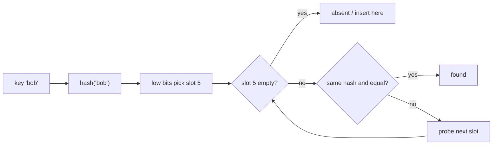
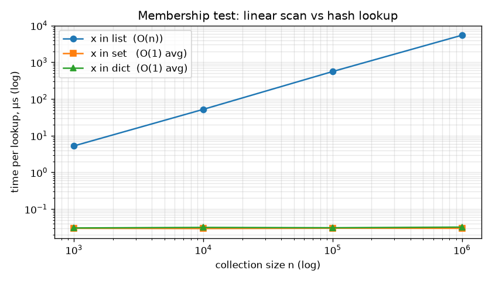
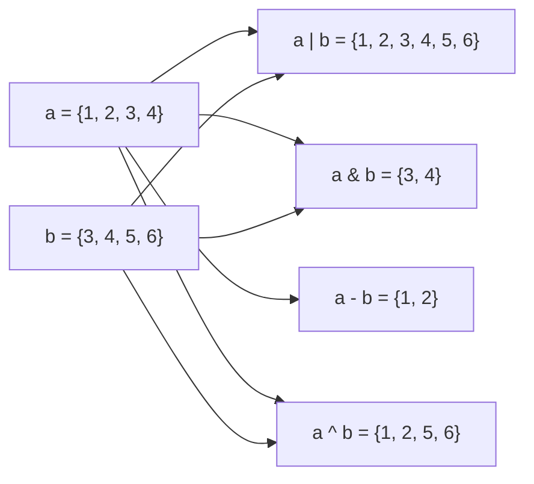

# Chapter 6 — Dictionaries, Sets and the `collections` Toolbox

Lists and tuples find things by **position**. Dictionaries and sets find things by **value** — and they do it in constant time on average, whether they hold ten items or ten million. That single property makes them the workhorses of real Python code: caches, indexes, counters, configuration, JSON, de-duplication, graph algorithms. This chapter explains how they work (hashing), how to use every method, and which specialised container from `collections`, `heapq` and `bisect` to reach for when a plain dict, set or list isn't quite right.

**What you'll learn**

1. Dictionaries: define, access, update, remove, copy, loop, operators (`in`, `|`), and insertion order.
2. Hashing: what "hashable" means, how a dict/set finds a key, and the big-O table.
3. Nested dictionaries and their link to JSON.
4. Every dict method, with `get`, `setdefault`, `update` and `|` compared, plus view objects.
5. Dict and set comprehensions.
6. Sets: define, add/update, remove/discard, copy, loop.
7. Set operations (union, intersection, difference, symmetric difference) and every set method.
8. `frozenset`.
9. `collections`: `Counter`, `defaultdict`, `OrderedDict`, `deque`, `ChainMap`, `namedtuple`.
10. `heapq` (priority queues) and `bisect` (binary search), and a when-to-use table for everything.

All runnable code is in [`code/`](code/). Outputs are real (Python 3.14; code runs on 3.12+). Where a set of **strings** is printed, its order can differ between runs — string hashes are randomised per process (explained in 6.2).

---

## 6.1 Dictionaries — key → value

### What it is
A **dictionary** (`dict`) stores **key–value pairs**. You look up a value by its key, not by position: `ages["Alice"]`. Keys are unique; values can be anything (numbers, strings, lists, other dicts).

- Written with braces and colons: `{"Alice": 22, "Bob": 25}`.
- **Mutable:** add, change and delete pairs at any time.
- **Keys must be hashable** (roughly: immutable — strings, numbers, tuples of hashables, `None`, `frozenset`). Lists, dicts and sets can't be keys. See 6.2.
- **Insertion-ordered:** iteration returns keys in the order they were first inserted. This is a language guarantee since **Python 3.7** (it was an implementation detail in CPython 3.6). Older tutorials that call dicts "unordered" are out of date — but dicts are still not *indexable* by position (`d[0]` looks up the key `0`).

Analogy: a real dictionary — you jump straight to a word and read its definition; you don't scan page by page.

### Why it matters
Whenever you'd otherwise search a list for "the item whose name is X", a dict does it in one step. Python itself runs on dicts: module globals, object attributes (`obj.__dict__`), keyword arguments and class namespaces are all dicts.

### How it works — define and access

```python
ages = {"Alice": 22, "Bob": 25, "Eve": 19}
print(ages, len(ages))
print(ages["Alice"], ages.get("Bob"), ages.get("Charlie"), ages.get("Charlie", "Not Found"))
try:
    ages["Charlie"]
except KeyError as e:
    print("KeyError:", e)
other_ways = dict(a=1, b=2), dict([("x", 1), ("y", 2)]), dict(zip("pq", [7, 8]))
print(*other_ways)
print({(59.9, 10.7): "Oslo", 42: "int key", None: "None key"})
try:
    {["a", "list"]: 1}
except TypeError as e:
    print("TypeError:", e)
```

Output:
```
{'Alice': 22, 'Bob': 25, 'Eve': 19} 3
22 25 None Not Found
KeyError: 'Charlie'
{'a': 1, 'b': 2} {'x': 1, 'y': 2} {'p': 7, 'q': 8}
{(59.9, 10.7): 'Oslo', 42: 'int key', None: 'None key'}
TypeError: cannot use 'list' as a dict key (unhashable type: 'list')
```

- `d[key]` raises **`KeyError`** if the key is missing — use it when a missing key is a bug.
- `d.get(key)` returns `None` (or your default) instead — use it when absence is normal.
- Four ways to build: literal, `dict(k=v)` (string keys only), `dict(list_of_pairs)`, `dict(zip(keys, values))`.

### How it works — update, remove, copy, loop

```python
ages = {"Alice": 22, "Bob": 25, "Eve": 19}
ages["Alice"] = 23                          # overwrite
ages["Dave"] = 20                           # insert (goes to the end)
print(ages)
removed = ages.pop("Eve");  print("pop:", removed, ages)
del ages["Bob"];            print("del:", ages)
print(ages.pop("Zed", "no such key"))       # default avoids KeyError
```

Output:
```
{'Alice': 23, 'Bob': 25, 'Eve': 19, 'Dave': 20}
pop: 19 {'Alice': 23, 'Bob': 25, 'Dave': 20}
del: {'Alice': 23, 'Dave': 20}
no such key
```

Assignment `d[k] = v` either **updates** (key exists — its position in the order is kept) or **inserts** (new key — goes to the end). `pop` returns the removed value; `del` just deletes.

```python
original = {"Alice": 23, "Charlie": 21, "tags": ["x"]}
copied = original.copy()                    # shallow
copied["Alice"] = 24
copied["tags"].append("y")                  # shared inner list!
print(original, copied, sep="\n")
for key in original:                        # iterates keys
    print(key, end=" ")
for key, value in {"Alice": 23, "Charlie": 21}.items():
    print(f"{key} is {value} years old")
```

Output:
```
{'Alice': 23, 'Charlie': 21, 'tags': ['x', 'y']}
{'Alice': 24, 'Charlie': 21, 'tags': ['x', 'y']}
Alice Charlie tags
Alice is 23 years old
Charlie is 21 years old
```

`copy()` (also `dict(d)`) is **shallow**: changing `copied["Alice"]` didn't affect the original, but both share the same `tags` list. Use `copy.deepcopy` for nested data (Chapter 5, 5.8).

Looping over a dict yields **keys**; `.values()` yields values; `.items()` yields `(key, value)` pairs, which you unpack in the `for`.

### Dictionary operators

| Operator | Meaning | Example |
|---|---|---|
| `k in d` / `k not in d` | Is `k` a **key**? (O(1)) | `"Alice" in ages` |
| `d[k]`, `d[k] = v`, `del d[k]` | Get / set / delete | |
| `d1 \| d2` | New merged dict; right side wins on conflicts (3.9+) | `{"a":1} \| {"a":2}` → `{'a': 2}` |
| `d1 \|= d2` | Merge into `d1` in place (like `update`) | |
| `{**d1, **d2}` | Merge via unpacking (3.5+) | |
| `==` | Same pairs (order ignored) | |

```python
d = {"Alice": 23, "Charlie": 21}
print("Alice" in d, "Bob" not in d, 23 in d, 23 in d.values())
a, b = {"x": 1, "y": 2}, {"y": 20, "z": 3}
print("a | b :", a | b)
a |= {"w": 0};  print("a |= :", a)
print("{**a, **b}:", {**a, **b})
print({"a": 1, "b": 2} == {"b": 2, "a": 1})
views = d.keys()
d["New"] = 0
print(views)                                # views are live
```

Output:
```
True True False True
a | b : {'x': 1, 'y': 20, 'z': 3}
a |= : {'x': 1, 'y': 2, 'w': 0}
{**a, **b}: {'x': 1, 'y': 20, 'w': 0, 'z': 3}
True
dict_keys(['Alice', 'Charlie', 'New'])
```

`23 in d` is `False` because `in` checks **keys**. To search values, use `in d.values()` — but that's an O(n) scan.

### Common mistakes
- **Changing a dict's size while looping over it** → `RuntimeError: dictionary changed size during iteration`. Loop over a snapshot: `for k in list(d): ...`, or build a new dict with a comprehension.
- Using `d[k]` for optional keys and crashing on `KeyError`.
- Expecting `d.copy()` to copy nested lists/dicts.
- Relying on `d.keys()[0]` — views aren't indexable; use `next(iter(d))`.

### Real-world examples
- JSON objects map straight to dicts (`json.loads`), so every web API response you parse is a dict.
- Caches: `functools.lru_cache` and hand-written memo tables are dicts from arguments to results.
- Django/Flask pass template context and request data as dicts (or dict-like objects).

### In the interview
**30-second answer:** "A dict maps hashable keys to values with average O(1) get, set, delete and membership, using a hash table. Since 3.7 it preserves insertion order. `d[k]` raises KeyError, `get` returns a default, `|` merges (3.9+), and `copy()` is shallow."

- *Q: Are dicts ordered?* A: Yes, insertion order, guaranteed since 3.7. Equality still ignores order.
- *Q: What happens on `d[k] = v` for an existing key?* A: Value replaced, position unchanged.
- *Q: `in` on dict — keys or values?* A: Keys.

### Self-check
1. `{"a": 1}.get("b", 0)`? → `0`.
2. `{"a": 1} | {"a": 2, "b": 3}`? → `{'a': 2, 'b': 3}`.
3. Can a tuple be a key? → Yes, if all its items are hashable.
4. How do you delete keys while looping? → Iterate over `list(d)`.

### TL;DR
Key → value, O(1) average, insertion-ordered (3.7+), hashable keys, `[]` raises, `get` defaults, `|` merges, `copy` is shallow.

---

## 6.2 Hashing — how dicts and sets find things in O(1)

### What it is
A **hash** is an integer computed from a value by `hash(x)`. A **hash table** is an array of slots; the hash decides which slot a key goes into. Dicts and sets are hash tables. An object is **hashable** if it has a hash that never changes during its lifetime and can be compared with `==`.

The contract (from the Python data model): **if `a == b` then `hash(a) == hash(b)`**. The reverse need not hold — different values may share a hash (a **collision**).

### Why it matters
Hashing explains everything about dicts and sets: why lookups are O(1), why keys must be immutable, why `1` and `1.0` are the same key, and why sets have no order.

### How it works — a lookup, step by step
1. Compute `h = hash(key)`.
2. Take some low bits of `h` to choose a slot in the table (table size is a power of two).
3. If the slot is empty → key absent (for lookup) or put it here (for insert).
4. If the slot holds an entry, compare: same hash **and** (`is` or `==`) → found.
5. Otherwise it's a collision: CPython uses **open addressing** — it computes the next slot to try with a pseudo-random probe sequence (mixing in more bits of the hash), and repeats from step 3.
6. The table is kept at most about **2/3 full**. When it gets fuller, CPython allocates a larger table and re-inserts everything (**resize**). Like list growth, this is rare enough that insertion is **amortised O(1)**.



Since Python 3.6, CPython's dict is a **compact dict**: a small sparse *index* table (the slots) pointing into a dense *entries* array that stores `(hash, key, value)` in insertion order. That's where insertion order comes from, and it also made dicts 20–25% smaller. Sets use a simpler, non-compact table, so they have no ordering.

Growth you can observe with `sys.getsizeof` (a table of 8 slots holds 5 entries, 16 holds 10, 32 holds 21, 64 holds 42 — the 2/3 rule):

```
 len  bytes
   1  224
   6  352
  11  632
  22  1168
  43  2264
```

### What is hashable?

```
42               hashable    hash=42
3.0              hashable    hash=3
'hi'             hashable    hash=<salted: differs every run>
(1, 2)           hashable    hash=-3550055125485641917
frozenset({1})   hashable    hash=-558064481276695278
None             hashable    hash=4238894112
True             hashable    hash=1
[1]              UNHASHABLE  (unhashable type: 'list')
{1: 2}           UNHASHABLE  (unhashable type: 'dict')
{1}              UNHASHABLE  (unhashable type: 'set')
(1, [2])         UNHASHABLE  (unhashable type: 'list')
```

| Hashable | Not hashable |
|---|---|
| `int`, `float`, `complex`, `bool`, `str`, `bytes`, `None`, `frozenset`, `range` | `list`, `dict`, `set`, `bytearray` |
| `tuple` / `namedtuple` **if every item is hashable** | A tuple containing a list |
| Instances of your classes (by default hashed by identity) | Classes that define `__eq__` without `__hash__` (Python sets `__hash__ = None`) |
| Frozen dataclasses (`@dataclass(frozen=True)`) | Regular dataclasses with `eq=True` (the default) |

**Equal values are the same key.** `1 == 1.0 == True` and they hash equal, so:

```python
d = {1: "int one"}
d[1.0] = "float one"
d[True] = "bool true"
print(d)          # {1: 'bool true'}  — one key; the first key object is kept, value replaced
```

**String hashes are randomised.** For security (to stop attackers crafting many colliding keys — a "hash-flooding" denial of service), `str` and `bytes` hashes are salted with a random per-process seed (default since Python 3.3; controlled by `PYTHONHASHSEED`). That's why the order of a set of strings can change between runs. Small ints hash to themselves (`hash(12345) == 12345`; `hash(-1)` is `-2` because `-1` is reserved as an error signal in C).

**Mutating a key breaks the table.** If a key's hash depends on mutable state and you change it while it's in a dict, the entry sits in the slot for the *old* hash:

```
lookup with same object: LOST
lookup with old value  : LOST
```

The same object can't be found (wrong slot), and a fresh object with the old value lands in the right slot but isn't `==`. That's precisely why built-in mutable types refuse to be hashable.

### Big-O table (average case; worst case is O(n) when many keys collide)

| Operation | `dict` | `set` |
|---|---|---|
| Lookup `d[k]` / `k in d` / `x in s` | O(1) | O(1) |
| Insert / update `d[k] = v`, `s.add(x)` | O(1) amortised | O(1) amortised |
| Delete `del d[k]`, `pop`, `s.remove(x)`, `discard` | O(1) | O(1) |
| `len()` | O(1) | O(1) |
| Iterate / `copy()` / `keys()`→list | O(n) | O(n) |
| `get`, `setdefault`, `popitem` | O(1) | `pop()` O(1) |
| `d1 \| d2`, `update(other)` | O(len(other)) + copy | — |
| Union `s \| t` | — | O(len(s) + len(t)) |
| Intersection `s & t` | — | O(min(len(s), len(t))) |
| Difference `s - t` | — | O(len(s)) |
| Symmetric difference `s ^ t` | — | O(len(s) + len(t)) |
| `s <= t` (subset) | — | O(len(s)) |
| Search a **value** `v in d.values()` | O(n) | — |

The payoff, measured (`code/08_lookup_benchmark.py`, looking for the last element):

```
         n    list (µs)   set (µs)  dict (µs)
     1,000         5.26      0.030      0.031
    10,000        52.49      0.030      0.031
   100,000       536.93      0.030      0.031
 1,000,000      5533.07      0.030      0.032
```



*Figure — on a log–log plot the list line rises with slope 1 (linear); set and dict stay flat at ~30 ns. At a million items the set is ~180,000× faster.*

### Trade-offs
- **Memory:** a hash table keeps spare slots (up to 1/3 empty) plus stored hashes — much more memory than a list of the same items.
- **No positional access** and (for sets) no order.
- **Worst case** O(n) if many keys collide — rare with good hashes, but possible with a bad custom `__hash__` (e.g. `return 1`).

### Common mistakes
- Defining `__eq__` on a class and being surprised it's no longer hashable — define `__hash__` from the same immutable fields (or use `@dataclass(frozen=True)`).
- Writing `__hash__` that uses mutable fields.
- Using floats as keys after arithmetic: `0.1 + 0.2` is not `0.3`, so it's a different key.

### In the interview
**30-second answer:** "Dicts and sets are hash tables using open addressing. `hash(key)` picks a slot; collisions probe other slots; equality confirms the match. The table stays ≤ 2/3 full and resizes, so operations are O(1) average, O(n) worst. Keys must be hashable — their hash can't change — and equal objects must have equal hashes, which is why `1`, `1.0` and `True` are the same key."

- *Q: Why can't lists be dict keys?* A: They're mutable; if they changed, their hash would change and the entry would be lost.
- *Q: Why does set iteration order change between runs?* A: String hashes are randomly salted per process (hash-flooding protection).
- *Q: How are dicts ordered if they're hash tables?* A: Compact dict: the hash index points into an entries array kept in insertion order.

### Self-check
1. Is `(1, [2])` hashable? → No — it contains a list.
2. What's the rule linking `==` and `hash`? → Equal objects must have equal hashes.
3. `len({1, 1.0, True})`? → 1.
4. Average cost of `x in big_set`? → O(1).

### TL;DR
hash → slot → compare; ≤ 2/3 full; O(1) average. Hashable = hash never changes. Equal ⇒ same hash. String hashes are salted per run.

---

## 6.3 Nested dictionaries

### What it is
A **nested dictionary** is a dict whose values are themselves dicts (or lists of dicts). It models **hierarchical** data: a family tree, a config file, a JSON API response.

### How it works
1. **Read** by chaining keys: `family["children"]["Alice"]["age"]`.
2. **Write** the same way: `family["children"]["Alice"]["age"] = 11`.
3. **Add a branch** by assigning a new dict at any level.
4. **Loop** over one level with `.items()`.

```python
family = {
    "name": "John Doe",
    "children": {
        "Alice": {"age": 10, "gender": "Female"},
        "Bob": {"age": 8, "gender": "Male"},
    },
}
print("Parent:", family["name"])
print("Alice's age:", family["children"]["Alice"]["age"])
family["children"]["Alice"]["age"] = 11                  # update deep value
family["children"]["Cara"] = {"age": 3, "gender": "Female"}  # add a new branch
for child, info in family["children"].items():
    print(f"  {child}: {info['age']} ({info['gender']})")
```

Output:
```
Parent: John Doe
Alice's age: 10
  Alice: 11 (Female)
  Bob: 8 (Male)
  Cara: 3 (Female)
```

**Safe access** when a level may be missing:

```python
print(family.get("children", {}).get("Zed", {}).get("age", "unknown"))   # unknown

def deep_get(d, *keys, default=None):
    for k in keys:
        if not isinstance(d, dict) or k not in d:
            return default
        d = d[k]
    return d
print(deep_get(family, "children", "Bob", "age"), deep_get(family, "x", "y", default=-1))  # 8 -1
```

**JSON round trip** — nested dicts are exactly what `json` reads and writes:

```python
text = json.dumps(family, indent=2)
back = json.loads(text)
print(back == family)                                              # True
print(json.loads('{"1": [1, 2]}'), json.dumps({1: (1, 2)}))       # {'1': [1, 2]} {"1": [1, 2]}
```

JSON object keys are always strings and JSON has no tuples — so int keys come back as strings and tuples come back as lists.

### Trade-offs
| Nested dicts | Dataclasses / Pydantic models |
|---|---|
| Zero setup, matches JSON exactly | Named, typed fields, validation, IDE autocomplete |
| Typos in keys fail only at run time | Typos caught by type checker |
| Good for ad-hoc/dynamic data | Good for stable, well-known schemas |

### When not to use it
For deeply nested, well-defined data used throughout a codebase, convert to dataclasses or Pydantic models at the boundary; pass typed objects inside the program.

### Common mistakes
- `KeyError` halfway down a chain — use `get(..., {})` chains, a helper like `deep_get`, or `try/except KeyError`.
- Shallow-copying a nested config and then mutating the copy's inner dict — changes the original too.
- Building nested structures by hand with many `if key not in d: d[key] = {}` checks — use `setdefault` or `defaultdict` (6.9).

### Real-world examples
API responses (GitHub, Stripe) and config formats (JSON, YAML, TOML via `tomllib`) all load as nested dicts; pandas' `json_normalize` flattens them into tables.

### Self-check
1. How do you read Bob's gender? → `family["children"]["Bob"]["gender"]`.
2. What happens to tuple values in `json.dumps`? → They become JSON arrays (lists on load).
3. Safest one-liner for a possibly missing nested key? → Chained `.get(key, {})`.

### TL;DR
Chain keys to read and write; guard missing levels with `get(..., {})`; nested dicts ≈ JSON.

---

## 6.4 Dictionary methods and view objects

### The full method table

| Method | What it does | Cost |
|---|---|---|
| `d.get(k, default=None)` | Value for `k`, or `default` — never raises | O(1) |
| `d.setdefault(k, default=None)` | Return `d[k]`; if missing, first insert `k: default` | O(1) |
| `d.update(other, **kw)` | Merge pairs from a dict / iterable of pairs / keywords, overwriting | O(len(other)) |
| `d.pop(k[, default])` | Remove `k`, return its value; `KeyError` if absent and no default | O(1) |
| `d.popitem()` | Remove and return the **last inserted** `(k, v)` (LIFO); `KeyError` if empty | O(1) |
| `d.clear()` | Remove everything | O(n) |
| `d.copy()` | Shallow copy | O(n) |
| `dict.fromkeys(keys, value=None)` | **Class method**: new dict with every key mapped to the **same** `value` | O(n) |
| `d.keys()` / `d.values()` / `d.items()` | Live **view** objects | O(1) to create |

Plus `len(d)`, `k in d`, `del d[k]`, `reversed(d)` (3.8+), `d | other`, `d |= other` (3.9+).

```python
info = {"name": "John", "age": 28, "city": "New York"}
print(info.get("name"), info.get("phone"))
info.update({"age": 29, "phone": "123-456-7890"})       # overwrite + add
info.update(zip_code="10001")                            # keyword form
print(info)
info.clear()
print(info)

new = dict.fromkeys(["a", "b", "c"], 1)
print(new)
print(new.pop("b"), new, new.items())
shared = dict.fromkeys(["x", "y"], [])                   # ONE list shared by all keys!
shared["x"].append(1)
print("fromkeys trap:", shared)
d = {"first": 1, "second": 2, "third": 3}
print(d.popitem(), d)                                    # LIFO: last inserted
```

Output:
```
John None
{'name': 'John', 'age': 29, 'city': 'New York', 'phone': '123-456-7890', 'zip_code': '10001'}
{}
{'a': 1, 'b': 1, 'c': 1}
1 {'a': 1, 'c': 1} dict_items([('a', 1), ('c', 1)])
fromkeys trap: {'x': [1], 'y': [1]}
('third', 3) {'first': 1, 'second': 2}
```

The `fromkeys` trap is the dict cousin of `[[0]*3]*3`: every key points at **one** list. Use `{k: [] for k in keys}` instead.

### `get` vs `setdefault` vs `update` vs `|` — which one?

| Want to… | Use | Changes `d`? |
|---|---|---|
| Read with a fallback | `d.get(k, default)` | No |
| Read, inserting a default if missing (e.g. grouping) | `d.setdefault(k, [])` | Only if missing |
| Merge another mapping into `d` | `d.update(other)` or `d \|= other` | Yes |
| Get a **new** merged dict | `d \| other` or `{**d, **other}` | No |
| Count / group many items | `Counter` / `defaultdict` (6.9) | — |

```python
words = ["apple", "avocado", "banana", "blueberry", "cherry"]
by_letter = {}
for w in words:
    by_letter.setdefault(w[0], []).append(w)             # insert [] only if missing
print(by_letter)
counts = {}
for ch in "hello":
    counts[ch] = counts.get(ch, 0) + 1                   # get with default for counting
print(counts)
```

Output:
```
{'a': ['apple', 'avocado'], 'b': ['banana', 'blueberry'], 'c': ['cherry']}
{'h': 1, 'e': 1, 'l': 2, 'o': 1}
```

Note that `setdefault`'s default is **evaluated every call** even when the key exists (`[]` is built and thrown away) — harmless for `[]`, costly for expensive defaults. `defaultdict` avoids that.

### View objects
`keys()`, `values()` and `items()` return **views**: lightweight windows onto the dict that reflect later changes. Key views (and item views, if values are hashable) also support set operations.

```python
stock = {"apple": 3, "pear": 0}
k, v, it = stock.keys(), stock.values(), stock.items()
stock["fig"] = 7
print(k, v, it, sep="\n")
print(k & {"apple", "kiwi"}, sorted(k - {"pear"}))       # keys views support set ops
print(sorted(stock, key=stock.get, reverse=True))        # keys sorted by value
print(max(stock.items(), key=lambda kv: kv[1]))
```

Output:
```
dict_keys(['apple', 'pear', 'fig'])
dict_values([3, 0, 7])
dict_items([('apple', 3), ('pear', 0), ('fig', 7)])
{'apple'} ['apple', 'fig']
['fig', 'apple', 'pear']
('fig', 7)
```

### Common mistakes
- `dict.fromkeys(keys, [])` sharing one mutable value.
- `d.update(k=v)` when `k` is a variable — the keyword form uses the literal name `"k"`. Use `d[k] = v`.
- Assuming `popitem()` removes a random item — since 3.7 it's always the last inserted.

### In the interview
**30-second answer:** "`get` reads with a default, `setdefault` reads-or-inserts, `update`/`|=` merge in place, `|` returns a new merged dict with the right side winning. `pop` removes by key, `popitem` removes the last inserted. `keys/values/items` are live views, and key views support set operations."

### Self-check
1. `{"a": 1}.setdefault("b", 5)` — return value and resulting dict? → `5`; `{'a': 1, 'b': 5}`.
2. What does `popitem()` remove? → The most recently inserted pair.
3. Keys common to two dicts? → `d1.keys() & d2.keys()`.

### TL;DR
`get` (read), `setdefault` (read-or-insert), `update`/`|=` (merge in place), `|` (merge new), `pop`/`popitem`, views are live and set-like. Avoid `fromkeys` with mutable values.

---

## 6.5 Dict and set comprehensions

### What it is
The comprehension syntax from Chapter 5 also builds dicts and sets:

```
{key_expr: value_expr for item in iterable if condition}   # dict
{expr for item in iterable if condition}                   # set
```

### How it works
```python
words = ["apple", "banana", "cherry"]
print({w: len(w) for w in words})
prices = {"apple": 1.2, "banana": 0.5, "cherry": 3.0}
print({k: v for k, v in prices.items() if v >= 1})
print({v: k for k, v in {"a": 1, "b": 2}.items()})    # invert
print(sorted({c for c in "mississippi"}))              # set comprehension
```

Output:
```
{'apple': 5, 'banana': 6, 'cherry': 6}
{'apple': 1.2, 'cherry': 3.0}
{1: 'a', 2: 'b'}
['i', 'm', 'p', 's']
```

- Filtering a dict: iterate `.items()` and keep pairs that pass the test.
- **Inverting** a dict swaps keys and values — if two keys share a value, the later one wins (values must also be hashable).
- `{}` is an **empty dict**, not an empty set. Write `set()`.

### Common mistakes
- Duplicate keys in a dict comprehension silently overwrite earlier ones.
- Using a comprehension when `dict(zip(keys, values))` is simpler.

### Self-check
1. `{x % 3 for x in range(10)}`? → `{0, 1, 2}`.
2. Build `{name: len(name)}` for a list `names`? → `{n: len(n) for n in names}`.

### TL;DR
`{k: v for ...}` for dicts, `{x for ...}` for sets; `{}` alone is a dict.

---

## 6.6 Sets — unique, unordered collections

### What it is
A **set** is an unordered, mutable collection of **unique, hashable** items: `{"apple", "banana"}` or `set(iterable)`. Duplicates are dropped automatically. There's no indexing (`s[0]` is a `TypeError`) because there's no position.

Analogy: a bag of distinct marbles. You can ask "is the red one in the bag?" instantly, add or take out marbles, but they aren't in any order.

### Why it matters
- **De-duplication** in one step: `set(emails)`.
- **Fast membership** (O(1) average, 6.2): "have I seen this before?" in crawlers, graph searches, validation.
- **Set algebra** answers questions like "which users are in both groups?" in one operator (6.7).

### How it works — define, add, update, remove, copy, loop

```python
fruits = {"apple", "banana", "cherry", "apple"}
colors = set(["red", "blue", "red", "green"])
print(sorted(fruits), sorted(colors), len(fruits))   # sorted() only for stable printing
empty_set, empty_dict = set(), {}
print(type(empty_set).__name__, type(empty_dict).__name__)
print(set("hello"), set(range(3)))                     # str order varies run to run

nums = {1, 2, 3}
nums.add(4); nums.add(2)                   # adding an existing item: no effect
nums.update([5, 6], (7,))                  # any iterables
print(nums)
nums.remove(1)
nums.discard(60)                           # absent: silently ignored
try:
    nums.remove(60)
except KeyError as e:
    print("KeyError:", e)
backup = nums.copy()
nums.clear()
print(nums, backup)
print("pop() ->", backup.pop(), backup)    # removes an ARBITRARY element
```

Output:
```
['apple', 'banana', 'cherry'] ['blue', 'green', 'red'] 3
set dict
{'l', 'h', 'e', 'o'} {0, 1, 2}          <- letter order varies from run to run
{1, 2, 3, 4, 5, 6, 7}
KeyError: 60
set() {2, 3, 4, 5, 6, 7}
pop() -> 2 {3, 4, 5, 6, 7}
```

- `add(x)` inserts one item; `update(*iterables)` inserts many.
- `remove(x)` raises `KeyError` if `x` is missing; `discard(x)` doesn't — use it when absence is fine.
- `pop()` removes and returns an **arbitrary** element (whatever the table yields first) — don't rely on which.
- `copy()` gives an independent set (its items are immutable anyway, so shallow = full here).
- Small integers often *appear* sorted because they hash to themselves; that's a coincidence of the implementation, not a guarantee.

**De-duplicating while keeping order** — a set loses order, so use a dict:

```python
items = ["b", "a", "b", "c", "a"]
print(list(dict.fromkeys(items)))       # ['b', 'a', 'c']
```

### Common mistakes
- `{}` for an empty set (it's a dict).
- `set("hello")` when you meant `{"hello"}` — the first splits into characters.
- Putting lists or dicts in a set → `TypeError: unhashable type`.
- Relying on set order for output — sort it.

### Self-check
1. `len({1, 2, 2, 3})`? → 3.
2. `remove` vs `discard`? → `remove` raises `KeyError` if absent; `discard` doesn't.
3. How to dedupe a list but keep first-seen order? → `list(dict.fromkeys(lst))`.

### TL;DR
Unique, unordered, hashable items; `add`/`update`, `remove` (raises) / `discard` (silent); `set()` for empty; O(1) membership.

---

## 6.7 Set operations

### What it is
Mathematical set algebra, available both as **operators** (both sides must be sets/frozensets) and as **methods** (accept any iterable).

| Operation | Operator | Method | Result |
|---|---|---|---|
| Union — in either | `a \| b` | `a.union(b, ...)` | Everything from both |
| Intersection — in both | `a & b` | `a.intersection(b, ...)` | Common items |
| Difference — in `a` not `b` | `a - b` | `a.difference(b, ...)` | `a` minus `b` |
| Symmetric difference — in exactly one | `a ^ b` | `a.symmetric_difference(b)` | Union minus intersection |
| Subset | `a <= b` | `a.issubset(b)` | Every item of `a` is in `b` |
| Proper subset | `a < b` | — | Subset and not equal |
| Superset | `a >= b` | `a.issuperset(b)` | Every item of `b` is in `a` |
| Disjoint | — | `a.isdisjoint(b)` | No common items |



```python
a, b = {1, 2, 3, 4}, {3, 4, 5, 6}
print("union        a | b :", a | b, a.union(b))
print("intersection a & b :", a & b, a.intersection(b))
print("difference   a - b :", a - b, a.difference(b), "  b - a:", b - a)
print("sym. diff    a ^ b :", a ^ b, a.symmetric_difference(b))
print("method accepts any iterable:", a.union([9, 10]), " operator needs sets")
try:
    a | [9]
except TypeError as e:
    print("TypeError:", e)
print("multi-arg:", a.intersection(b, {4, 99}))

small, big, other = {1, 2}, {1, 2, 3}, {7}
print(small <= big, small.issubset(big), small < big, big >= small, big.issuperset(small))
print(small.isdisjoint(other), small < small, small <= small)
```

Output:
```
union        a | b : {1, 2, 3, 4, 5, 6} {1, 2, 3, 4, 5, 6}
intersection a & b : {3, 4} {3, 4}
difference   a - b : {1, 2} {1, 2}   b - a: {5, 6}
sym. diff    a ^ b : {1, 2, 5, 6} {1, 2, 5, 6}
method accepts any iterable: {1, 2, 3, 4, 9, 10}  operator needs sets
TypeError: unsupported operand type(s) for |: 'set' and 'list'
multi-arg: {4}
True True True True True
True False True
```

Difference is **not symmetric**: `a - b = {1, 2}` but `b - a = {5, 6}`. A set is a subset of itself (`<=`) but not a proper subset (`<`).

### Trade-offs
Operators are shorter and make you convert inputs explicitly (catching type mistakes); methods are more flexible (any iterable, several arguments at once).

### Real-world examples
- Permissions: `required <= user_permissions`.
- Diffing: `new_ids - old_ids` (added), `old_ids - new_ids` (removed) when syncing records.
- Recommendations: "people who liked X also liked" via intersections; Jaccard similarity = `len(a & b) / len(a | b)`, used in near-duplicate detection.

### In the interview
**30-second answer:** "`|` union, `&` intersection, `-` difference, `^` symmetric difference, `<=`/`>=` subset/superset, `isdisjoint`. Operators need sets; methods accept any iterable. Intersection costs O(min(len a, len b)) because it iterates the smaller set and probes the larger."

### Self-check
1. `{1, 2, 3} ^ {2, 3, 4}`? → `{1, 4}`.
2. `{1, 2} < {1, 2}`? → `False`.
3. Users in group A but not B? → `A - B`.

### TL;DR
`| & - ^` plus subset/superset/disjoint; methods take any iterable; difference is one-directional.

---

## 6.8 Set methods (complete table) and `frozenset`

### All set methods

| Method | What it does | Operator form | Returns |
|---|---|---|---|
| `add(x)` | Add one element (no effect if present) | — | `None` |
| `update(*its)` | Add all elements from iterables | `\|=` | `None` |
| `remove(x)` | Remove `x`; `KeyError` if absent | — | `None` |
| `discard(x)` | Remove `x` if present | — | `None` |
| `pop()` | Remove and return an arbitrary element; `KeyError` if empty | — | element |
| `clear()` | Remove everything | — | `None` |
| `copy()` | Shallow copy | — | new set |
| `union(*its)` | All elements | `\|` | new set |
| `intersection(*its)` | Common elements | `&` | new set |
| `intersection_update(*its)` | Keep only common elements | `&=` | `None` |
| `difference(*its)` | Elements not in the others | `-` | new set |
| `difference_update(*its)` | Remove elements found in the others | `-=` | `None` |
| `symmetric_difference(it)` | In exactly one | `^` | new set |
| `symmetric_difference_update(it)` | Update to "in exactly one" | `^=` | `None` |
| `issubset(it)` | All my elements are in `it` | `<=` | bool |
| `issuperset(it)` | All of `it`'s elements are in me | `>=` | bool |
| `isdisjoint(it)` | No common elements | — | bool |

The `_update` methods change the set **in place** and return `None`; the plain ones return a **new** set.

```python
s = {1, 2, 3, 4}
s.intersection_update({2, 3, 9});         print("&= :", s)
s.difference_update({3});                 print("-= :", s)
s.symmetric_difference_update({2, 8});    print("^= :", s)
s |= {100};                               print("|= :", s)
```

Output:
```
&= : {2, 3}
-= : {2}
^= : {8}
|= : {8, 100}
```

Each `_update` method has an augmented-operator twin (`&=`, `-=`, `^=`, `|=`); the operator forms require sets on both sides, the methods accept any iterables.

### `frozenset` — the immutable set

### What it is
A **frozenset** is a set that can't be changed after creation. It has all the non-mutating methods (`union`, `issubset`, …) and none of the mutating ones (`add`, `remove`, `update`, …).

### Why it matters
Because it's immutable, it's **hashable**: it can be a dict key or an element of another set — something a normal set can never be.

```python
fs = frozenset([1, 2, 3])
try:
    fs.add(4)
except AttributeError as e:
    print("AttributeError:", e)
groups = {frozenset({"alice", "bob"}): "team A"}   # usable as a dict key
print(groups[frozenset({"bob", "alice"})])
print(fs | {9}, type(fs | {9}).__name__)            # result type follows the left operand
```

Output:
```
AttributeError: 'frozenset' object has no attribute 'add'
team A
frozenset({1, 2, 3, 9}) frozenset
```

The lookup works with the members in a different order because sets compare (and hash) by contents, not order — handy for keys like "unordered pair of users".

### Common mistakes
- Expecting `s.union(t)` to modify `s` (it returns a new set) — or expecting `s.update(t)` to return the result (it returns `None`).
- Using `pop()` as if it returned the smallest element.

### Self-check
1. Which returns `None`: `intersection` or `intersection_update`? → `intersection_update`.
2. Can a set contain another set? → Only a `frozenset`.
3. Key for an undirected edge `{u, v}`? → `frozenset((u, v))`.

### TL;DR
Plain methods return new sets, `_update` methods mutate; `frozenset` = immutable, hashable set for keys and nested sets.

---

## 6.9 The `collections` module

The standard library's `collections` module supplies specialised containers that fix the most common "plain dict/list isn't quite right" situations.

### `Counter` — counting hashable things

**What it is:** a dict subclass mapping item → count. Missing items count as `0` (no `KeyError`).

```python
words = "the cat and the hat and the bat".split()
c = Counter(words)
print(c)
print(c.most_common(2), c["the"], c["dog"])          # missing key -> 0, no KeyError
c.update(["cat", "cat"]); c.subtract(["the"])
print(c.most_common(3))
a, b = Counter("aabbb"), Counter("abccc")
print(a + b, a - b, a & b, a | b, sep=" | ")
print(Counter("mississippi").total())                # 3.10+
```

Output:
```
Counter({'the': 3, 'and': 2, 'cat': 1, 'hat': 1, 'bat': 1})
[('the', 3), ('and', 2)] 3 0
[('cat', 3), ('the', 2), ('and', 2)]
Counter({'b': 4, 'a': 3, 'c': 3}) | Counter({'b': 2, 'a': 1}) | Counter({'a': 1, 'b': 1}) | Counter({'b': 3, 'c': 3, 'a': 2})
11
```

- `most_common(n)` — top-n pairs (ties keep first-seen order).
- `update` **adds** counts (unlike `dict.update`, which replaces); `subtract` subtracts and may leave zero or negative counts.
- `+` / `-` add/subtract and **drop** results ≤ 0; `&` takes the minimum per key, `|` the maximum.
- `total()` sums all counts (3.10+).

**Real-world:** word frequencies, log-level tallies, top-k error messages, the "bag of words" step in text classification.

### `defaultdict` — dict with automatic defaults

**What it is:** a dict subclass that calls a **factory** (`list`, `int`, `set`, any zero-argument callable) to create a value the first time a missing key is **accessed with `[]`**.

```python
groups = defaultdict(list)
for kind, name in [("fruit", "apple"), ("veg", "kale"), ("fruit", "fig")]:
    groups[kind].append(name)                        # missing key -> list() created
print(dict(groups))
counts = defaultdict(int)
for ch in "banana":
    counts[ch] += 1
print(dict(counts))
print("veg" in groups, "meat" in groups, groups.get("meat"))   # get/in don't create keys
_ = groups["meat"]                                               # [] access DOES
print("after groups['meat']:", dict(groups))
tree = lambda: defaultdict(tree)                                # autovivifying tree
t = tree(); t["a"]["b"]["c"] = 1
```

Output:
```
{'fruit': ['apple', 'fig'], 'veg': ['kale']}
{'b': 1, 'a': 3, 'n': 2}
True False None
after groups['meat']: {'fruit': ['apple', 'fig'], 'veg': ['kale'], 'meat': []}
```

Watch out: **just reading** `d[missing]` inserts an empty value — a common source of mysterious extra keys. Use `in` or `.get()` for read-only checks.

**Real-world:** adjacency lists for graphs (`defaultdict(list)`), inverted indexes (`defaultdict(set)` word → document ids), grouping rows by a column.

### `OrderedDict` — a dict with reordering tools

**What it is:** the pre-3.7 way to get an ordered dict. Plain dicts are now ordered too, so `OrderedDict` matters only for its extras:
- `move_to_end(key, last=True)` — O(1) move to the end (or front with `last=False`).
- `popitem(last=False)` — pop from the **front** (FIFO); plain `dict.popitem()` only pops the end.
- **Order-sensitive equality**: two `OrderedDict`s are equal only if the order matches too.

```python
od = OrderedDict.fromkeys("abcde")
od.move_to_end("b")                   # to the end
od.move_to_end("e", last=False)       # to the front
print(list(od))                       # ['e', 'a', 'c', 'd', 'b']
print(od.popitem(last=False))         # ('e', None)
print(OrderedDict(a=1, b=2) == OrderedDict(b=2, a=1), dict(a=1, b=2) == dict(b=2, a=1))  # False True
```

**The classic use — an LRU (least-recently-used) cache:**

```python
class LRUCache:
    def __init__(self, capacity):
        self.capacity, self.data = capacity, OrderedDict()
    def get(self, key):
        if key not in self.data:
            return None
        self.data.move_to_end(key)            # mark as most recently used
        return self.data[key]
    def put(self, key, value):
        self.data[key] = value
        self.data.move_to_end(key)
        if len(self.data) > self.capacity:
            self.data.popitem(last=False)     # evict least recently used

cache = LRUCache(2)
cache.put("a", 1); cache.put("b", 2); cache.get("a"); cache.put("c", 3)
print("LRU keeps:", list(cache.data))         # LRU keeps: ['a', 'c']
```

Reading `"a"` made it recent, so adding `"c"` evicted `"b"`. For caching function results, prefer the built-in `@functools.lru_cache`.

### `deque` — double-ended queue

**What it is:** a sequence with **O(1)** `append`/`pop` at **both** ends (a list is O(n) at the front). Implemented as a doubly-linked list of fixed-size blocks, so indexing in the middle is O(n).

```python
q = deque([1, 2, 3])
q.append(4); q.appendleft(0)
print("after append/appendleft:", q)
left, right = q.popleft(), q.pop()
print("popleft ->", left, "| pop ->", right, "| now", q)
q.rotate(1); print("rotate(1):", q)
last3 = deque(maxlen=3)
for x in range(6):
    last3.append(x)                   # old items fall off the other end
print("maxlen=3:", last3)
```

Output:
```
after append/appendleft: deque([0, 1, 2, 3, 4])
popleft -> 0 | pop -> 4 | now deque([1, 2, 3])
rotate(1): deque([3, 1, 2])
maxlen=3: deque([3, 4, 5], maxlen=3)
```

- `maxlen` gives a bounded buffer — perfect for "last N lines/events" (like `tail -n`).
- `append` and `popleft` are thread-safe in CPython, which is why deques back simple producer/consumer queues (`queue.Queue` adds blocking and locking on top).

**Real-world:** BFS queues in graph search, sliding-window algorithms, undo history with a cap, rate limiters that keep recent timestamps.

### `ChainMap` — layered lookups

**What it is:** a view over several mappings searched **in order**; the first one containing the key wins. Nothing is copied.

```python
defaults = {"color": "red", "user": "guest", "debug": False}
env = {"user": "admin"}
cli = {"debug": True}
cfg = ChainMap(cli, env, defaults)    # first mapping wins
print(cfg["color"], cfg["user"], cfg["debug"])
cfg["color"] = "blue"                 # writes go to the FIRST mapping only
print(cli, defaults["color"])
child = cfg.new_child({"user": "tmp"})
print(child["user"], cfg["user"])
```

Output:
```
red admin True
{'debug': True, 'color': 'blue'} red
tmp admin
```

**Real-world:** configuration precedence (command-line > environment > defaults), nested scopes in interpreters/template engines (`new_child()` pushes a scope). The standard library's `string.Template.substitute` uses a `ChainMap` internally to combine a mapping with keyword arguments.

### `namedtuple` — tuple with field names
Covered fully in Chapter 5 (5.13): `Card = namedtuple("Card", "rank suit")` → `Card("A", "spades").rank == "A"`, with `_fields`, `_asdict()`, `_replace()`.

```
A Card(rank='10', suit='hearts') ('rank', 'suit')
```

### Common mistakes (collections)
- Using `Counter.update` expecting replacement semantics.
- Accidentally creating keys in a `defaultdict` by reading.
- Using `list.pop(0)` instead of `deque.popleft()` for queues.
- Using `OrderedDict` just for ordering on Python 3.7+ — a plain dict already does it.

### In the interview
**30-second answer:** "`Counter` counts and gives `most_common`; `defaultdict` auto-creates values for grouping; `deque` has O(1) appends and pops at both ends — use it for queues and bounded buffers; `OrderedDict` adds `move_to_end` and FIFO `popitem`, which makes an LRU cache easy; `ChainMap` layers mappings for config precedence; `namedtuple` gives tuples field names."

- *Q: Implement an LRU cache?* A: `OrderedDict` with `move_to_end` on access and `popitem(last=False)` on overflow — both O(1).
- *Q: Why deque for BFS?* A: `popleft()` is O(1); `list.pop(0)` is O(n).
- *Q: `Counter` + vs `update`?* A: `+` returns a new Counter and drops non-positive counts; `update` adds in place and keeps them.

### Self-check
1. `Counter("aab")["z"]`? → `0`.
2. Build a graph's adjacency lists without key checks? → `defaultdict(list)`.
3. Keep only the last 100 log lines? → `deque(maxlen=100)`.
4. Which mapping receives writes in a `ChainMap`? → The first one.

### TL;DR
Counter = counts; defaultdict = auto-values; OrderedDict = reordering + FIFO pop (LRU); deque = fast both ends + maxlen; ChainMap = layered lookup; namedtuple = named tuple fields.

---

## 6.10 `heapq` — priority queues on a plain list

### What it is
A **binary min-heap** is a list arranged so that `heap[k] <= heap[2k+1]` and `heap[k] <= heap[2k+2]` for every `k`. The smallest item is always at `heap[0]`. The `heapq` module provides functions that keep a normal list in heap order.

### Why it matters
Whenever you repeatedly need "the smallest (or most urgent) item next" — task schedulers, Dijkstra's shortest path, merging sorted streams, top-k — a heap does it in O(log n) per operation instead of re-sorting.

### How it works

| Function | Does | Cost |
|---|---|---|
| `heapify(list)` | Rearrange a list into a heap in place | O(n) |
| `heappush(h, x)` | Add `x` (sift up) | O(log n) |
| `heappop(h)` | Remove and return the smallest (sift down) | O(log n) |
| `h[0]` | Peek at the smallest | O(1) |
| `heappushpop(h, x)` / `heapreplace(h, x)` | Push then pop / pop then push, efficiently | O(log n) |
| `nsmallest(k, it)` / `nlargest(k, it)` | Top-k without full sort | O(n log k) |
| `merge(*sorted_its)` | Lazily merge sorted inputs | O(n log m) |
| `heapify_max`, `heappush_max`, `heappop_max`, … | Max-heap versions (**new in Python 3.14**) | as above |

```python
def heapify_neg(xs):                      # helper: store negatives -> behaves as a max-heap
    h = [-x for x in xs]
    heapq.heapify(h)
    return h

h = [5, 1, 8, 3, 2]
heapq.heapify(h)                          # O(n), in place; h[0] is the smallest
print("heapified:", h, "min:", h[0])
heapq.heappush(h, 0)
print("pops:", [heapq.heappop(h) for _ in range(3)], "left:", h)
print(heapq.nsmallest(2, [7, 3, 9, 1]), heapq.nlargest(2, [7, 3, 9, 1]))
print("max-heap trick (negate):", -heapq.heappop(heapify_neg([3, 9, 4])))
```

Output:
```
heapified: [1, 2, 8, 3, 5] min: 1
pops: [0, 1, 2] left: [3, 5, 8]
[1, 3] [9, 7]
max-heap trick (negate): 9
```

The heapified list `[1, 2, 8, 3, 5]` is **not sorted** — only the heap property holds (1 ≤ 2, 1 ≤ 8, 2 ≤ 3, 2 ≤ 5). Before 3.14, the standard trick for a max-heap is to push negated numbers.

**Priority queue with tie-breaking:**

```python
tasks, counter = [], 0
for prio, name in [(2, "write docs"), (1, "fix prod bug"), (3, "refactor"), (1, "reply to CEO")]:
    heapq.heappush(tasks, (prio, counter, name))   # (priority, sequence, payload)
    counter += 1
while tasks:
    prio, _, name = heapq.heappop(tasks)
    print(f"  p{prio}: {name}")
```

Output:
```
  p1: fix prod bug
  p1: reply to CEO
  p2: write docs
  p3: refactor
```

Tuples compare element by element, so priority decides first; the increasing counter breaks ties in insertion order **and** stops Python from ever comparing the payloads (which might not be comparable).

`heapq.merge([1, 4, 9], [2, 3, 10], [5])` → `[1, 2, 3, 4, 5, 9, 10]` — the core of external sorting (merging sorted files too big for memory).

### Trade-offs
| Need | Use |
|---|---|
| Smallest item repeatedly, with inserts | `heapq` |
| Just the top k once | `heapq.nlargest/nsmallest` (or `sorted(...)[:k]` if k is close to n) |
| Only min or max once | `min()` / `max()` — O(n) |
| Thread-safe blocking priority queue | `queue.PriorityQueue` (uses heapq inside) |
| Sorted order at all times with lookups | `bisect` on a list, or a sorted-container library |

### Real-world examples
`asyncio`'s event loop keeps scheduled callbacks (`call_later`) in a heap; the `sched` module and `queue.PriorityQueue` are built on `heapq`; Dijkstra/A* implementations in Python almost always use it.

### Self-check
1. Where's the smallest item in a heap? → `h[0]`.
2. Cost of `heapify` vs n pushes? → O(n) vs O(n log n).
3. Why add a counter to heap entries? → Stable tie-breaking and to avoid comparing payloads.

### TL;DR
`heapify` O(n), push/pop O(log n), `h[0]` is the min; tuples `(priority, count, item)`; `nlargest` for top-k; max-heap = negate (or 3.14's `_max` functions).

---

## 6.11 `bisect` — binary search on sorted lists

### What it is
`bisect` finds where a value belongs in an **already sorted** list using binary search — O(log n) comparisons.

### How it works
- `bisect_left(a, x)` — first index where `x` could be inserted keeping order (before any equal items).
- `bisect_right(a, x)` / `bisect(a, x)` — index **after** any equal items.
- `insort(a, x)` (= `insort_right`) — insert keeping order: O(log n) search **+ O(n)** list shift.
- Since Python 3.10, all functions accept `key=`.

Worked example on `[10, 20, 20, 30, 40]` searching for 20: the middle element (index 2) is 20; `bisect_left` keeps searching left and lands at index 1; `bisect_right` lands after the last 20 at index 3.

```python
scores = [10, 20, 20, 30, 40]
print(bisect.bisect_left(scores, 20), bisect.bisect_right(scores, 20), bisect.bisect(scores, 25))
bisect.insort(scores, 25)
print(scores)

def contains(sorted_list, x):
    i = bisect.bisect_left(sorted_list, x)
    return i < len(sorted_list) and sorted_list[i] == x
print(contains(scores, 30), contains(scores, 31))

def grade(score, cutoffs=(60, 70, 80, 90), letters="FDCBA"):
    return letters[bisect.bisect(cutoffs, score)]
print([grade(s) for s in (33, 60, 77, 89, 90, 100)])

people = [("Ann", 25), ("Bob", 31), ("Cid", 40)]           # sorted by age
i = bisect.bisect_left(people, 30, key=lambda p: p[1])      # key= is 3.10+
print("first person aged >= 30:", people[i])
```

Output:
```
1 3 3
[10, 20, 20, 25, 30, 40]
True False
['F', 'D', 'C', 'B', 'A', 'A']
first person aged >= 30: ('Bob', 31)
```

The grading function is the classic example from the Python docs: `bisect` turns a table of cutoffs into a lookup — a score of exactly 60 lands to the **right** of the 60 cutoff, i.e. "D".

### Trade-offs
- Searching is O(log n), but `insort` is O(n) because the list must shift. For many inserts plus lookups on big data, a set/dict (if you don't need order) or a balanced tree/`sortedcontainers.SortedList` (third-party) is better.
- The list **must** be sorted by the same key you search with — bisect doesn't check.

### Real-world examples
`random.choices` uses `bisect` on cumulative weights to pick weighted samples; time-series code uses it to find the first event after a timestamp; percentile/bucket lookups (tax brackets, grade cutoffs) are one call.

### Self-check
1. `bisect_left([1, 2, 2, 3], 2)`? → `1`. `bisect_right`? → `3`.
2. Cost of `insort` on a list of n items? → O(n) (O(log n) search + O(n) shift).
3. What must be true of the list? → Sorted (by the same key).

### TL;DR
Binary search on sorted lists: `bisect_left/right` O(log n), `insort` O(n), `key=` since 3.10.

---

## 6.12 When to use what — the decision table

| You need… | Use | Why | Key costs |
|---|---|---|---|
| Ordered items, index access, append at end | `list` | Dynamic array | index O(1), append O(1)*, `in` O(n) |
| Fixed record / dict key / return several values | `tuple` / `namedtuple` | Immutable, hashable, light | index O(1) |
| Look up values by key | `dict` | Hash table | get/set/del O(1) avg |
| Fast membership / uniqueness | `set` | Hash table | `in` O(1) avg |
| A set as a key or inside a set | `frozenset` | Immutable, hashable | same as set |
| Count things / top-k frequencies | `Counter` | Counting dict with `most_common` | update O(k) |
| Group into lists/sets without key checks | `defaultdict(list/set)` | Auto-created values | O(1) |
| Queue / stack at both ends / last N items | `deque` (`maxlen=N`) | O(1) at both ends | append/pop O(1), middle index O(n) |
| LRU cache / reorder keys / FIFO pop | `OrderedDict` (or `functools.lru_cache`) | `move_to_end`, `popitem(last=False)` | O(1) |
| Layered config / scopes | `ChainMap` | Search mappings in order, no copying | lookup O(number of maps) |
| Repeatedly take the smallest/most urgent | `heapq` | Binary heap | push/pop O(log n), peek O(1) |
| Top-k from a large iterable | `heapq.nlargest/nsmallest` | Avoids a full sort | O(n log k) |
| Search/insert in a sorted list | `bisect` | Binary search | search O(log n), insert O(n) |
| Dedupe but keep order | `dict.fromkeys(items)` | Dicts keep insertion order | O(n) |
| Compact numeric storage / fast maths | `array.array` / NumPy | Chapter 5 | — |

(* amortised)

### In the interview — putting it together
**Prompt:** "Find the 3 most frequent words in a log file and the first line where each appears."

**Answer sketch:** stream lines; `Counter` for counts; a dict with `setdefault(word, line_no)` for first occurrence; `counter.most_common(3)` at the end. Everything is O(total words) plus O(u log 3) for the top-k — no nested loops, no `list.index`.

---

## Chapter TL;DR

| Topic | Remember |
|---|---|
| Dicts | Key → value, O(1) avg, insertion-ordered since 3.7; `[]` raises `KeyError`, `get` defaults; `\|` merges (3.9+); `copy` is shallow; don't resize while iterating. |
| Hashing | hash → slot → compare; ≤ 2/3 full; equal ⇒ same hash; keys must be immutable/hashable; string hashes salted per run. |
| Nested dicts | Chain keys; guard with `get(..., {})`; map 1:1 to JSON (keys become strings). |
| Dict methods | `get`, `setdefault`, `update`/`\|=`, `pop`, `popitem` (LIFO), `fromkeys` (shared value trap), live views with set ops. |
| Comprehensions | `{k: v for ...}`, `{x for ...}`; `{}` is a dict. |
| Sets | Unique, unordered, hashable items; `add`/`update`; `remove` raises, `discard` doesn't; `set()` for empty. |
| Set operations | `\| & - ^`, `<= < >= >`, `isdisjoint`; methods accept iterables; `_update` versions mutate. |
| frozenset | Immutable, hashable set — keys and sets of sets. |
| collections | Counter, defaultdict, OrderedDict (LRU), deque (queues, maxlen), ChainMap (layers), namedtuple. |
| heapq | Min-heap on a list; push/pop O(log n); `(prio, count, item)`; `nlargest`; max-heap functions in 3.14. |
| bisect | Binary search on sorted lists; `insort` is O(n); `key=` since 3.10. |
