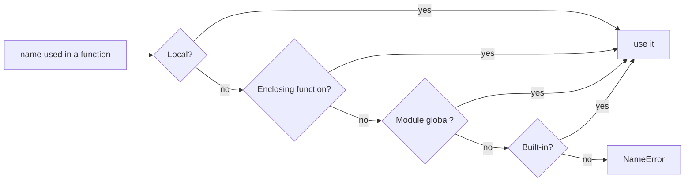
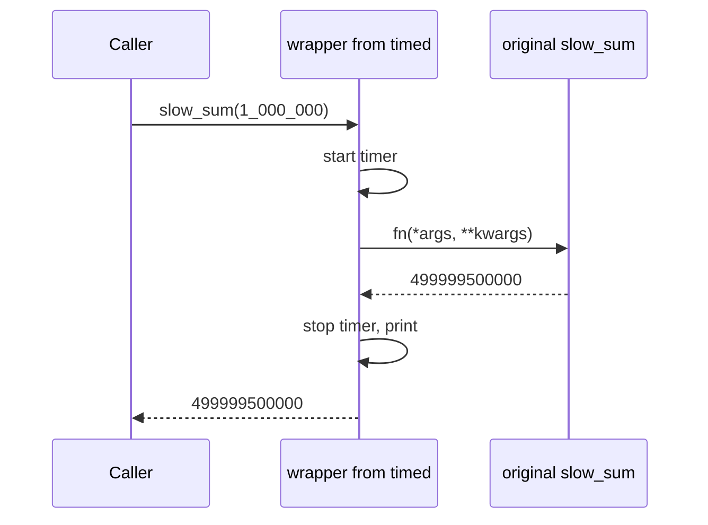
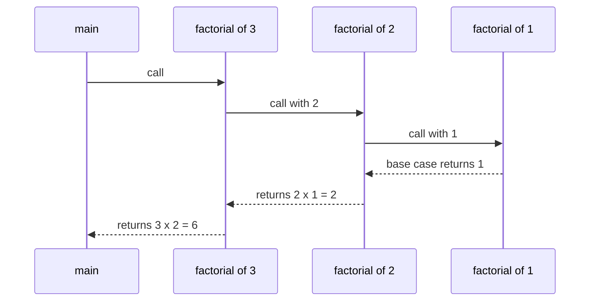

# Chapter 7 — Functions

A **function** is a named, reusable block of code that takes inputs, does one job, and (usually) returns a result. Beyond ten-line scripts, everything is built from functions, and many "advanced" features — decorators (functions wrapping functions to add behaviour, 7.6), callbacks (functions handed to other code to call later), `sorted(key=...)`, caching (remembering results) — are just functions passed around as values.

This chapter goes from `def` to closures (functions remembering variables from where they were created), decorators and recursion (a function calling itself). Scripts are in [`code/`](code/), run with Python 3.14 (3.12-compatible); output is real.

**What you'll learn**

| # | Topic | Script |
|---|---|---|
| 7.1 | Defining and calling, `return`, `None`, `pass` | `01_defining_and_arguments.py` |
| 7.2 | Every kind of argument: positional, keyword, default, `*args`, `**kwargs`, `/`, `*`, unpacking, the mutable-default trap, multiple return values | `01_defining_and_arguments.py` |
| 7.3 | Scope and namespaces: LEGB, `global`, `nonlocal` | `02_scope_and_closures.py` |
| 7.4 | Closures and the late-binding trap | `02_scope_and_closures.py` |
| 7.5 | First-class and higher-order functions, `lambda`, `map`/`filter`, `key=` | `03_first_class_and_functools.py` |
| 7.6 | Decorators and `functools`: `wraps`, `partial`, `reduce`, `lru_cache`, `cache` | `03_first_class_and_functools.py` |
| 7.7 | Recursion, the call stack, the recursion limit, memoization | `04_recursion.py` |
| 7.8 | Docstrings and type annotations | `05_docstrings_annotations.py` |

---

## 7.1 Defining and calling functions

### What it is
**Define** with `def`, a name, parentheses holding the **parameters**, and a colon; the indented lines are the **body**. Defining doesn't run it — it creates a function object bound to the name. **Call** it with its name plus parentheses holding **arguments**.

> **Parameter vs argument.** The *parameter* is the name in the definition (`def cube(x)` → `x`); the *argument* is the value at the call (`cube(3)` → `3`). Interviewers notice mix-ups.

### Why it matters
1. **Modularity** — small pieces with one job, written and debugged alone.
2. **Reuse** — write once, call anywhere (or from other programs via modules, Chapter 8); fix a bug once.
3. **Scope** — names inside are private, so parts don't trample each other's variables (7.3).
4. **Readability and teamwork** — `send_invoice(order)` documents intent; people can own different functions.

### How it works
1. `def` compiles the body to bytecode, creates a *function object*, evaluates default values (important in 7.2), binds the name.
2. A call creates a fresh **frame** (workspace of local variables), binds parameters to arguments, runs the body.
3. `return value` ends the call and hands `value` back; falling off the end or a bare `return` gives `None`.
4. The frame is discarded (unless a closure keeps part alive, 7.4).

`pass` does nothing — the placeholder where a block is required (empty function, class, `if`). `...` (Ellipsis) is used the same way in stubs.

```python
def say_hi():
    """A function with no parameters and no return statement."""
    print("hi from say_hi()")

def cube(x):
    """Return x cubed."""
    return x ** 3

def todo():
    pass  # placeholder body - keeps the syntax valid

say_hi()
print("say_hi() returned:", say_hi())
print("cube(3) =", cube(3))
print("todo() returned:", todo())
```

Output:
```
hi from say_hi()
hi from say_hi()
say_hi() returned: None
cube(3) = 27
todo() returned: None
```
`say_hi()` printed twice (plain call, then inside `print`), and returned `None` — a function that only *prints* still *returns* `None`.

### Trade-offs: print vs return

| | `print(...)` inside | `return ...` |
|---|---|---|
| Result usable by caller | No — goes to the screen | Yes — stored, tested, combined |
| Testable | Only by capturing stdout (the console stream) | Directly (`assert cube(3) == 27` — `assert` raises if false) |
| Good for | Debugging, CLI output at the edges | Almost all real logic |

### Common mistakes
- **Missing parentheses**: `result = cube` stores the function; `cube(3)` calls it.
- **Printing instead of returning** → `x = f()` is `None`.
- **Code after `return`** in the same block never runs.
- **Calling before defining** at module level — the `def` must have executed first (inside other functions it's fine; lookup happens at call time).

### Real-world examples
Libraries are collections of functions (`len`, `open`, `json.dumps`, `requests.get`, `numpy.mean`); Flask and FastAPI map each URL to a plain function ("view"/"endpoint") returning the response.

### In the interview
**30-second answer:** "A function is defined with `def`; defining creates a function object bound to a name, and calling it creates a new frame with its own local variables. `return` sends a value back; with no `return` the result is `None`. Functions give modularity, reuse and a private scope."
- *Are functions objects?* → Yes; they have attributes (`__name__`, `__doc__`, `__defaults__`) and can be passed around (7.5).
- *`pass`?* → No-op placeholder where syntax needs a statement.

### Self-check
1. `x = print("a")` stores? → `None`.

### TL;DR
`def name(params):` + indented body. Defining ≠ running. `return` gives a value back, otherwise `None`. `pass` fills an empty body.

---

## 7.2 Function arguments — every kind

### What it is
At the **call site** (where the function is called) pass arguments **positionally** (by order) or **by keyword** (by name). In the **definition** add **defaults**, collect extras with `*args`/`**kwargs`, and force a style with `/` (positional-only) and `*` (keyword-only).

The full parameter list, in the only allowed order:
```python
def f(pos_only, /, pos_or_kw, *args, kw_only, **kwargs): ...
#     ^^^^^^^^     ^^^^^^^^^  ^^^^^  ^^^^^^^  ^^^^^^^^
#     before /     normal     extra  after *  extra keywords
#                              positionals     (dict)
#                              (tuple)
```

| Kind | Declared as | Called as | Notes |
|---|---|---|---|
| Positional-or-keyword | `def f(a, b)` | `f(1, 2)` or `f(b=2, a=1)` | The default kind |
| Default | `def f(a, b=10)` | `f(1)` or `f(1, 5)` | Defaulted params come after non-defaulted (positional part) |
| Variable positional | `def f(*args)` | `f(1, 2, 3)` | `args` is a **tuple** |
| Variable keyword | `def f(**kwargs)` | `f(x=1, y=2)` | `kwargs` is a **dict** (insertion-ordered) |
| Positional-only | `def f(a, b, /)` | `f(1, 2)` only | Python 3.8+ (PEP 570) |
| Keyword-only | `def f(*, a, b)` or after `*args` | `f(a=1, b=2)` only | Can be required (no default) |

### Why it matters
Good argument design makes calls **self-documenting and hard to misuse**: `connect("db", 5432, True, False)` is a riddle; `connect("db", port=5432, ssl=True, retry=False)` explains itself. Defaults keep simple calls simple, `*args`/`**kwargs` enable flexible wrappers (functions calling another and adding something around it), and `/`/`*` let library authors rename parameters later.

### How it works — binding arguments to parameters
1. Positional arguments fill parameters left to right; extras go to `*args` (or `TypeError`).
2. Keyword arguments match by name; unknown names go to `**kwargs` (or `TypeError`).
3. Filled twice (position *and* keyword) → `TypeError: got multiple values`.
4. Empty parameters take their **default**; none → `TypeError: missing ... required argument`.

At the call, positionals precede keywords: `f(1, b=2)` fine, `f(a=1, 2)` → `SyntaxError`.

### Positional and keyword arguments
**Positional** arguments match purely by order — swap two and you silently get wrong results. **Keyword** arguments name the parameter, so order stops mattering and calls read clearly — best with many or optional parameters.

### Default arguments
A **default** makes a parameter optional; a supplied argument overrides it.

```python
def book_flight(origin, destination, seat="economy", *, meal="standard"):
    """origin/destination: positional-or-keyword; seat: default; meal: keyword-only."""
    return f"{origin}->{destination} [{seat}, meal={meal}]"

print(book_flight("SFO", "JFK"))                                  # defaults used
print(book_flight(destination="JFK", origin="SFO", seat="aisle"))  # any order by name
print(book_flight("SFO", "JFK", meal="vegan"))                    # keyword-only
book_flight("SFO")                           # missing arg
book_flight("SFO", "JFK", "aisle", "vegan")  # meal given positionally
book_flight("SFO", origin="LAX")             # same arg twice
```

Output (errors caught by a helper in the script):
```
SFO->JFK [economy, meal=standard]
SFO->JFK [aisle, meal=standard]
SFO->JFK [economy, meal=vegan]
  missing arg: TypeError: book_flight() missing 1 required positional argument: 'destination'
  meal given positionally: TypeError: book_flight() takes from 2 to 3 positional arguments but 4 were given
  same arg twice: TypeError: book_flight() got multiple values for argument 'origin'
```

### Positional-only (`/`) and keyword-only (`*`)
- **Before `/`**: by position only. Names become internal, so they can be renamed later, and `value` can't collide with a `**kwargs` key. Built-ins do this: `len(obj, /)`, `abs(x, /)`, `divmod(x, y, /)` — `len(obj=[1])` is a `TypeError`.
- **After `*`** (or `*args`): by name only. Use for flags and non-obvious options: `sorted(iterable, /, *, key=None, reverse=False)` forbids `sorted(xs, None, True)`. Keyword-only parameters may be required.

```python
def clamp(value, low, high, /):
    return max(low, min(value, high))

print("clamp(15, 0, 10) =", clamp(15, 0, 10))
clamp(value=15, low=0, high=10)
```
```
clamp(15, 0, 10) = 10
  clamp(value=15, ...): TypeError: clamp() got some positional-only arguments passed as keyword arguments: 'value, low, high'
```

### Variable-length arguments: `*args` and `**kwargs`
`*args` gathers **extra positionals** into a tuple; `**kwargs` gathers **extra keywords** into a dict. The names are convention — the stars do the work.

```python
def total(*numbers, start=0):
    print("  numbers is a", type(numbers).__name__, numbers)
    return sum(numbers, start)

def make_tag(tag, /, text, **attrs):
    attr_str = "".join(f' {k}="{v}"' for k, v in attrs.items())
    return f"<{tag}{attr_str}>{text}</{tag}>"

print("total(1, 2, 3) =", total(1, 2, 3))
print("total() =", total())
print(make_tag("a", "docs", href="https://docs.python.org", target="_blank"))
```
```
  numbers is a tuple (1, 2, 3)
total(1, 2, 3) = 6
  numbers is a tuple ()
total() = 0
<a href="https://docs.python.org" target="_blank">docs</a>
```
E.g. `configure(host="db1", port=5432, timeout="30s")` receives `{"host": "db1", "port": 5432, "timeout": "30s"}` and loops over `.items()`.

### Unpacking at the call site
In reverse: `*iterable` spreads positionals, `**mapping` spreads keywords.

```python
nums = [4, 5, 6]
opts = {"seat": "window", "meal": "kosher"}
print("total(*nums) =", total(*nums))
print(book_flight("SFO", "JFK", **opts))
```
```
  numbers is a tuple (4, 5, 6)
total(*nums) = 15
SFO->JFK [window, meal=kosher]
```

### Returning several values
A function returns **one** object; `return a, b, c` builds a tuple that the caller unpacks.

```python
def min_max_mean(values):
    return min(values), max(values), sum(values) / len(values)

result = min_max_mean([3, 9, 6])
print("raw result:", result, type(result).__name__)
lo, hi, avg = result
```
```
raw result: (3, 9, 6.0) tuple
lo=3 hi=9 avg=6.0
```
Beyond ~3 values, return a `dataclass` or `typing.NamedTuple` (records with named fields, Chapters 5 and 10) so callers write `stats.mean`.

### The mutable-default pitfall
**Defaults are evaluated once — when `def` runs — not per call.** A mutable default (list, dict, set) is *one shared object*, so changes pile up.

```python
def append_bad(item, bucket=[]):          # BUG: default evaluated once
    bucket.append(item)
    return bucket

def append_good(item, bucket=None):       # FIX: None sentinel
    if bucket is None:
        bucket = []
    bucket.append(item)
    return bucket

print(append_bad("a"), append_bad("b"))
print("default is now:", append_bad.__defaults__)
print(append_good("a"), append_good("b"))
```
```
['a', 'b'] ['a', 'b']
default is now: (['a', 'b'],)
['a'] ['b']
```
Both `append_bad` calls returned the *same* list; `__defaults__` shows the mutated default. Fix with the **`None` sentinel** (placeholder meaning "nothing passed"): create the object inside. The same rule freezes `def log(msg, when=datetime.now())` at definition time. `dataclasses` refuses bare mutable defaults and asks for `field(default_factory=list)`.

### Trade-offs

| Choice | Benefit | Cost |
|---|---|---|
| Positional | Short calls | Order-dependent, easy to swap by mistake |
| Keyword | Readable, order-free | Longer; names become public API others rely on |
| Keyword-only (`*`) | Forces clarity for flags/options | Slightly more typing |
| Positional-only (`/`) | Free to rename; no clash with `**kwargs` | Callers can't use names for clarity |
| `*args`/`**kwargs` | Flexible wrappers, forwarding | Hides the real signature (parameter list) from readers, IDEs and type checkers |

### When not to use it
- Don't use `**kwargs` when you know the options — explicit keywords error on typos (`timout=5`) and get IDE help; `**kwargs` swallows the typo.
- Don't stack boolean positional flags (`f(x, True, False)`) — make them keyword-only.

### Common mistakes
- Mutable default (`=[]`, `={}`) — use `None`.
- `def f(a=1, b):` → `SyntaxError`; `f(a=1, 2)` → `SyntaxError`.
- `*args` is a **tuple** — `list(args)` to modify.
- `return a, b` is one tuple, not "two return values".

### Real-world examples
- `print(*objects, sep=" ", end="\n", file=None, flush=False)` — `*objects` plus keyword-only options.
- `requests.get(url, params=None, **kwargs)` forwards `timeout=`, `headers=`.
- Matplotlib plotting calls pass `**kwargs` (`color=`, `linewidth=`) to underlying line/patch objects.

### In the interview
**30-second answer:** "Arguments bind positionally by order or by keyword by name. Defaults make parameters optional but are evaluated once at definition time, so never use a mutable default — use `None`. `*args` collects extra positionals into a tuple, `**kwargs` extra keywords into a dict. Parameters before `/` are positional-only, after `*` keyword-only."
- *Why is `def f(x=[])` dangerous?* → One list, created once, shared by every defaulted call.
- *Why positional-only in a library?* → Names stay private (renameable) and a `**kwargs` key may share the name.
- *Pass a list as separate arguments?* → `f(*my_list)`; dict as keywords → `f(**my_dict)`.

### Self-check
1. `def f(a, /, b, *, c)` — which work: `f(1, 2, 3)`, `f(1, b=2, c=3)`, `f(a=1, b=2, c=3)`? → Only `f(1, b=2, c=3)` (and `f(1, 2, c=3)`).

### TL;DR
Positional = order, keyword = name. Defaults evaluated **once** → `None` for mutables. `*args` → tuple, `**kwargs` → dict; `*`/`**` at the call unpack. `/` positional-only before, `*` keyword-only after. Multiple returns = one tuple.

---

## 7.3 Scope and namespaces — LEGB, `global`, `nonlocal`

### What it is
A **namespace** maps names to objects — usually literally a dict (`globals()` shows the module's). Names are unique within one namespace but can repeat across namespaces. A name's **scope** is the code region where it can be used directly.

Python resolves a bare name with the **LEGB rule**, stopping at the first hit:

| Letter | Scope | Where it comes from | Lifetime |
|---|---|---|---|
| **L** | Local | Names assigned in the current function (incl. parameters) | The call |
| **E** | Enclosing | Locals of *outer* functions (nested functions) | While referenced (closures) |
| **G** | Global | Top-level names of the **module** (file) | Until program end / unload |
| **B** | Built-in | `len`, `print`, `ValueError`… from `builtins` | Whole program |

Not found → `NameError`.



### Why it matters
Scope makes functions safe to combine — one function's `total` can't clobber another's. Misunderstanding it causes the confusing `UnboundLocalError`.

### How it works — the key rule
**Locality is decided at compile time for the whole body: if a function *assigns* a name anywhere (`=`, `+=`, `for x in`, `import x`, `def x`), that name is local throughout** — unless declared `global` or `nonlocal`. *Reading* alone doesn't make it local, so reading globals needs no declaration.

1. `global name` → assignments rebind the **module-level** variable.
2. `nonlocal name` → assignments rebind the **nearest enclosing function's** variable (must exist there; module globals don't count). Added in Python 3.
3. Only functions (and classes, comprehensions, lambdas) create scopes — **not `if`, `for`, `while`, `with`**; a variable assigned inside an `if` is visible after it.

```python
level = "global"                     # G

def outer():
    level = "enclosing"              # E for inner()
    def inner():
        level = "local"              # L
        print("  inner sees:", level)
    inner()
    print("  outer sees:", level)

def reads_global():
    print("  reads_global sees:", level)   # no assignment here -> global

counter = 0

def broken_increment():
    counter += 1                     # assignment makes counter LOCAL -> error

def global_increment():
    global counter
    counter += 1
```
```
== LEGB lookup ==
  inner sees: local
  outer sees: enclosing
  reads_global sees: global
  B (built-in) len is builtins.len: True

== assigning without global ==
  UnboundLocalError: cannot access local variable 'counter' where it is not associated with a value

== global ==
  counter = 2
```
`counter += 1` is `counter = counter + 1`: the assignment makes `counter` local, so reading it first raises `UnboundLocalError` (a `NameError` subclass). `nonlocal` does the same one level in (`make_counter`, 7.4).

### Trade-offs

| Shared state via | Good | Bad |
|---|---|---|
| Pass in / return values | Explicit, testable, thread-friendly | More parameters |
| `global` | Quick for scripts | Hidden coupling; any function can change it; hard to test |
| `nonlocal` / closure | State private to one function family | Less obvious than a class |
| A class with attributes | Clear home for state + behaviour | More code |

### When not to use it
Avoid `global` except for true module-level config or caches in small scripts. Mutating a global *object* (`CACHE[key] = v`) needs no `global` — only rebinding the *name* does — but it's still shared mutable state.

### Common mistakes
- `UnboundLocalError` from `x += 1` on a global — `global x`, or better, return the new value.
- **Shadowing built-ins**: `list = [1, 2]` then `list('xy')` → `'list' object is not callable` (likewise `dict`, `id`, `input`, `sum`, `type`).
- A class body is not an enclosing scope for its methods — use `self.x` (`self` = the object the method was called on, Chapter 10) or `ClassName.x`.
- Comprehension variables don't leak (own scope); a plain `for` variable does.

### Real-world examples
- `logger = logging.getLogger(__name__)` at module level, only *read* in functions.
- `MAX_RETRIES = 3` constants: global, UPPER_CASE (PEP 8), treated as read-only.

### In the interview
**30-second answer:** "Python looks names up via LEGB: local, enclosing, global, built-in. Any assignment in a function makes that name local for the whole function, which is why `x += 1` on a global raises `UnboundLocalError`. `global` rebinds module-level names, `nonlocal` rebinds the nearest enclosing function's name. Blocks like `if` and `for` don't create scopes."
- *`global` needed to append to a global list?* → No — `.append` mutates, not rebinds.
- *`global` vs `nonlocal`?* → Module scope vs nearest enclosing *function* scope (must exist there).
- *Why does `def f(): print(x); x = 1` fail with a global `x`?* → The later assignment makes `x` local for the whole body.
- *Can `nonlocal` target a module variable?* → No — `SyntaxError: no binding for nonlocal ... found`.

### TL;DR
Lookup **L → E → G → B**. Assignment anywhere in a function ⇒ local throughout. `global` for module names, `nonlocal` for outer-function names; prefer passing and returning values.

---

## 7.4 Closures

### What it is
A **closure** is an inner function that *remembers* variables from the enclosing scope after the outer function has returned. Those are **free variables**, stored in "cells" on the function (`fn.__closure__`).

### Why it matters
Closures build **functions from functions** — configured functions (`make_multiplier(3)`), counters with private state, callbacks carrying context — without a class. Decorators (7.6) are built on them.

### How it works
1. `make_multiplier(3)` runs; `factor = 3` is local.
2. Inner `multiply` reads `factor` → the compiler makes it a free variable in a cell.
3. `multiply` is returned; the frame ends but the cell survives.
4. Each `make_multiplier` call creates a **new** cell — `double` and `triple` are independent.
5. *Rebinding* (not just reading) a captured variable needs `nonlocal`.

```python
def make_counter():
    count = 0
    def step():
        nonlocal count               # rebind the enclosing variable
        count += 1
        return count
    return step

def make_multiplier(factor):
    def multiply(x):
        return x * factor            # 'factor' is captured (a free variable)
    return multiply

c1, c2 = make_counter(), make_counter()
print("  c1:", c1(), c1(), c1(), " c2:", c2())
double, triple = make_multiplier(2), make_multiplier(3)
print("  double(5) =", double(5), " triple(5) =", triple(5))
print("  free vars of double:", double.__code__.co_freevars,
      "cell value:", double.__closure__[0].cell_contents)
```
```
  c1: 1 2 3  c2: 1
  double(5) = 10  triple(5) = 15
  free vars of double: ('factor',) cell value: 2
```

### The late-binding trap
Closures capture **variables, not values**; the value is read when the inner function *runs*.
```python
funcs = [lambda: i for i in range(3)]
print([f() for f in funcs])          # [2, 2, 2]  - all see the final i
funcs = [lambda i=i: i for i in range(3)]
print([f() for f in funcs])          # [0, 1, 2]  - default captures the current value
```
`i=i` works *because* defaults are evaluated at definition (7.2); `functools.partial` is cleaner.

### Trade-offs

| | Closure | Class |
|---|---|---|
| Code size | Tiny | Larger |
| Number of operations | Best for one (a callable) | Many methods |
| Inspectability | State hidden in cells | Attributes visible, easy to debug |

### When not to use it
Several operations (increment, reset, read), or state others must inspect/serialise (convert to bytes/text) → write a class. Closures can't be pickled by `pickle` (Python's object-serialisation module).

### Common mistakes
- Late binding in loops.
- Missing `nonlocal` → `UnboundLocalError` on `count += 1`.

### Real-world examples
- Every decorator (`@functools.lru_cache`, Flask's `@app.route("/")`) returns a closure.
- GUI callbacks (Tkinter `command=`) use closures or `partial` to carry which button was pressed.

### In the interview
**30-second answer:** "A closure is a nested function that keeps references to variables of its enclosing scope after that scope has returned. It captures variables, not values, so lambdas in a loop all see the last value unless you bind with a default argument or `partial`. `nonlocal` lets it rebind the captured variable."
- *Where are captured variables stored?* → Cells in `fn.__closure__`; names in `fn.__code__.co_freevars`.
- *Fix the loop-lambda bug?* → `lambda i=i: ...` or `functools.partial(f, i)`.

### TL;DR
Inner function + remembered outer variables = closure. Captures variables (late binding); `nonlocal` to rebind. Foundation of decorators.

---

## 7.5 First-class and higher-order functions, `lambda`, `map`/`filter`, `key=`

### What it is
Functions are **first-class objects**: assign, store in lists/dicts, pass, return. A **higher-order function** takes or returns a function (`map`, `sorted`, decorators, `make_multiplier`). A **`lambda`** is an anonymous single-expression function: `lambda x: x * 2` ≈ `def` returning `x * 2`, but no statements, no annotations, name `<lambda>`. Passing **behaviour** as data ("sort by this", "call this when done") removes families of near-duplicate functions.

### How it works

```python
yell = shout                                  # assign to a name
table = {"up": str.upper, "low": str.lower}  # store in a dict
print(apply_twice(shout, "hey"))              # pass as argument  -> HEY!!

nums = [5, -2, 8, -7, 3]
list(map(abs, nums))                  # [5, 2, 8, 7, 3]
list(filter(lambda n: n > 0, nums))   # [5, 8, 3]
[n * n for n in nums if n > 0]        # [25, 64, 9]
```
- `map(fn, it)` applies `fn` to each item; `filter(pred, it)` keeps items where the *predicate* (yes/no function) is truthy. Both return **lazy iterators** (values produced on request) — wrap in `list()`; consumable once.
- `sorted(it, key=fn, reverse=False)` returns a **new list**; `list.sort()` sorts in place, returns `None`. `min`, `max`, `heapq.nlargest`, `itertools.groupby` take `key=` too.
- `key` is called **once per element**; sorting is **stable** (equal keys keep order) — the basis of multi-level sorts ([§5.7](../05-lists-tuples-arrays/README.md)).
- `operator.itemgetter(1)`, `operator.attrgetter("age")`, `str.lower` are ready-made, faster alternatives to many lambdas.

```python
people = [("Ana", 31), ("bob", 25), ("Cy", 31), ("dee", 19)]
sorted(people, key=lambda p: p[1])            # by age
sorted(people, key=lambda p: (-p[1], p[0]))   # age desc, then name
sorted(["bob", "Ana", "dee", "Cy"], key=str.lower)
max(people, key=operator.itemgetter(1))
```
```
  by age:             [('dee', 19), ('bob', 25), ('Ana', 31), ('Cy', 31)]
  by age desc, name:  [('Ana', 31), ('Cy', 31), ('bob', 25), ('dee', 19)]
  case-insensitive:   ['Ana', 'bob', 'Cy', 'dee']
  itemgetter(1):      ('dee', 19)
  oldest:             ('Ana', 31)
```
A **tuple** key sorts by first element, then second…; negating a number flips that level.

### Trade-offs

| Tool | Best for | Watch out |
|---|---|---|
| Comprehension | Transform + filter in one line | Builds a whole list (generator `( … )` for laziness) |
| `map`/`filter` with a named function | `map(str.strip, lines)` | With a lambda, usually less readable than a comprehension |
| `lambda` | Tiny one-off `key=` functions | No statements; `<lambda>` in tracebacks; PEP 8: don't assign one to a name — use `def` |

### When not to use it
`f = lambda x: x + 1` → write `def` (better traceback name, docstring). Don't nest `map(lambda..., filter(lambda..., ...))` when a comprehension reads plainly.

### Common mistakes
- `sorted_list = my_list.sort()` → `None`.
- Consuming a `map`/`filter` twice — second pass empty.
- `key=len()` (calling) instead of `key=len`.

### Real-world examples
- pandas: `df["name"].map(str.title)`, `df.sort_values(key=...)`, `df.apply(fn)`.
- `sorted(files, key=os.path.getmtime)` (last-modified time).
- Callbacks: `threading.Thread(target=worker)`; `executor.map(fetch, urls)` in `concurrent.futures` (an *executor* is a worker pool running calls in parallel).

### In the interview
**30-second answer:** "Functions are objects, so they can be passed, stored and returned; a higher-order function takes or returns one. `lambda` makes a one-expression anonymous function, mostly for `key=`. `map`/`filter` return lazy iterators; comprehensions are usually preferred. `sorted` with `key` computes the key once per element and is stable, so tuple keys give multi-level sorts."
- *`sorted` vs `.sort()`?* → Any iterable → new list vs list method, in place, `None`.
- *Two fields, one descending?* → Tuple key with a negated number, or two stable sorts (secondary first).
- *`if` in a lambda?* → No statements; a conditional *expression* is fine.

### TL;DR
Functions are values; higher-order functions take/return them. `lambda` for tiny keys. `map`/`filter` lazy; comprehensions clearer. `sorted(key=…)`: once per item, stable, tuple keys for multi-level.

---

## 7.6 Decorators and `functools`

### What it is
A **decorator** takes a function and returns a replacement (usually a closure calling the original plus extra behaviour). `@` is shorthand:
```python
@timed
def slow_sum(n): ...
# is exactly
def slow_sum(n): ...
slow_sum = timed(slow_sum)
```
**`functools`** collects function tools: `wraps`, `partial`, `reduce`, `lru_cache`, `cache`, `cached_property`, `singledispatch`, `total_ordering`.

### Why it matters
Decorators add cross-cutting behaviour (concerns spanning many functions) — timing, logging, caching, auth checks, retries, route registration — without editing each function; `functools` provides battle-tested versions.

### How it works



```python
def timed(fn):
    @functools.wraps(fn)                 # copy __name__, __doc__, etc.
    def wrapper(*args, **kwargs):        # accept any signature
        t0 = time.perf_counter()
        result = fn(*args, **kwargs)     # call the original
        ms = (time.perf_counter() - t0) * 1000
        print(f"  [{fn.__name__} ran in {'under' if ms < 500 else 'over'} 500 ms]")
        return result                    # don't forget to return!
    return wrapper
```
```
  [slow_sum ran in under 500 ms]
  slow_sum(1_000_000) = 499999500000
  with wraps:    name = slow_sum | doc = Add 0..n-1 the slow way.
  without wraps: name = wrapper | doc = None
```
`*args, **kwargs` let the wrapper accept and forward any signature.

**`functools.wraps`** copies `__name__`, `__doc__`, `__module__`, `__qualname__`, `__dict__` and sets `__wrapped__`; without it every decorated function appears as `wrapper` in logs, `help()` and tracebacks.

**`functools.partial(fn, *args, **kwargs)`** pre-fills arguments:
```python
int_from_binary = functools.partial(int, base=2)
int_from_binary("1011")   # 11
```

**`functools.reduce(fn, iterable[, initial])`** folds pairwise left to right: `reduce(mul, [1,2,3,4,5])` = ((((1·2)·3)·4)·5) = 120. Without `initial`, empty input → `TypeError`. Prefer `sum`, `math.prod`, `max`, `"".join` where they fit.

**`functools.lru_cache(maxsize=128)`** memoizes: stores results keyed by arguments and returns them on repeat calls; beyond `maxsize` keys, the **least recently used** is evicted. **`functools.cache`** (3.9+) = `lru_cache(maxsize=None)` — unbounded, slightly faster.

```python
@functools.lru_cache(maxsize=128)
def square_slowly(n):
    time.sleep(0.05)
    return n * n
for n in (4, 4, 5, 4):
    square_slowly(n)
print(square_slowly.cache_info())
```
```
  CacheInfo(hits=2, misses=2, maxsize=128, currsize=2)
  after cache_clear: CacheInfo(hits=0, misses=0, maxsize=128, currsize=0)
  unhashable argument -> unhashable type: 'list'
```
4, 4, 5, 4 → misses on first 4 and 5, hits on the repeats. Arguments must be **hashable**.

### Trade-offs

| Tool | Win | Cost / caveat |
|---|---|---|
| `lru_cache(maxsize=N)` | Bounded memory | Bookkeeping; stale results if data changes |
| `cache` | Fastest, simplest | Grows forever — a memory leak for unbounded inputs |
| `partial` | Picklable, introspectable (`.func`, `.args`) | Only pre-fills; can't reorder |
| `reduce` | General fold | Often less readable than a loop or built-in |

### When not to use it
- Don't cache functions with side effects (sending email) or results depending on time, randomness or mutable globals.
- `lru_cache` on an **instance method** keys on `self` and keeps every instance alive; prefer `functools.cached_property` or a module-level cached function.

### Common mistakes
- No `return result` in the wrapper → decorated function returns `None`.
- No `@functools.wraps`.
- `@timed()` vs `@timed` confusion. A decorator *with* arguments (`@retry(3)`) is a function returning a decorator — three levels of nesting.

### Real-world examples
- Flask/FastAPI `@app.get("/items")` registers route handlers.
- pytest: `@pytest.fixture`, `@pytest.mark.parametrize(...)`.
- Standard library: `@property`, `@staticmethod`, `@classmethod`, `@dataclass`, `@contextlib.contextmanager`.
- `re` caches compiled patterns so repeated `re.match(pattern, s)` doesn't recompile.

### In the interview
**30-second answer:** "A decorator is a callable that takes a function and returns a replacement; `@d` above `def f` means `f = d(f)`. Inside you define a `wrapper(*args, **kwargs)` closure and use `functools.wraps` to keep the original's name and docstring. `functools` also gives `partial` to pre-fill arguments, `reduce` to fold, and `lru_cache`/`cache` to memoize pure functions (output depends only on inputs, no side effects) with hashable arguments."
- *`wraps`?* → Copies metadata (`__name__`, `__doc__`, …), sets `__wrapped__`.
- *`@retry(3)`?* → Outer function takes `3`, returns the decorator, which returns the wrapper.
- *When is `lru_cache` wrong?* → Impure functions, unhashable args, unbounded keys with `maxsize=None`, instance methods.

### TL;DR
Decorator = function in, function out; always `@wraps` and `return result`. `partial` pre-fills, `reduce` folds, `lru_cache` (default `maxsize` 128) / `cache` memoize pure functions with hashable arguments.

---

## 7.7 Recursion

### What it is
A **recursive function** calls itself on a smaller version of the problem — *divide and conquer*. It needs:
1. A **base case** — small enough to answer directly.
2. A **recursive case** — shrink the input and recurse, guaranteeing progress toward the base case.

### Why it matters
Natural for **self-similar data**: nested lists/JSON, folder trees, parse trees, tree/graph traversal, merge sort and quicksort, backtracking (try an option, undo if it fails: permutations, sudoku). Interviews use it constantly.

### How it works — the call stack
Each call gets a frame on the **call stack** (last-in-first-out pile of active calls); frames pile up to the base case, then results flow back. Factorial: n! = n × (n−1)!, 0! = 1! = 1.

```python
def factorial(n):
    if n <= 1:                 # base case (also handles 0! = 1)
        return 1
    return n * factorial(n - 1)
```
Trace of `factorial(3)`, and `factorial(5)` = 5 × 4 × 3 × 2 × 1 = 120:
```
factorial(5) = 120 | factorial(0) = 1
factorial(3)
  factorial(2)
    factorial(1)
    -> 1
  -> 2
-> 6
```



### The recursion limit
CPython has **no tail-call optimisation** (TCO — reusing the frame when the last step is a self-call), by design to keep tracebacks complete, so every level costs a frame. Depth is capped: `sys.getrecursionlimit()` is **1000** by default; exceeding it raises `RecursionError` (a `RuntimeError` subclass).
```
sys.getrecursionlimit() = 1000
depth_of(500) = 500
RecursionError: maximum recursion depth exceeded
```
`sys.setrecursionlimit(n)` raises it, but deep recursion costs memory and can crash the process — for thousands of levels **rewrite as a loop** (explicit stack list for tree walks).

### Memoization — fixing exponential recursion
Fibonacci: F(0)=0, F(1)=1, F(n)=F(n−1)+F(n−2); F(7) = 13. Naive recursion recomputes the same values (F(5) calls F(4) and F(3); F(4) calls F(3) *again*), so calls grow ~1.6ⁿ. **Memoization** computes each F(k) once — linear work.

```python
@functools.cache
def fib_memo(n):
    if n < 2:
        return n
    return fib_memo(n - 1) + fib_memo(n - 2)

def fib_iter(n):              # bottom-up: no recursion at all
    a, b = 0, 1
    for _ in range(n):
        a, b = b, a + b
    return a
```
```
fib(7) = 13
naive calls for n=10, 20, 25: 177 21891 242785
memoized: CacheInfo(hits=23, misses=26, maxsize=None, currsize=26)
fib_iter(90) = 2880067194370816120
```
n = 25: 242,785 naive calls vs 26 distinct values computed (misses) and 23 cache hits.


*Figure — calls for fib(n): naive grows exponentially (a straight line on a log axis), memoized linearly.*

### Recursion over nested data
```python
def flatten(nested):
    out = []
    for item in nested:
        if isinstance(item, list):
            out.extend(flatten(item))   # recursive case: a smaller list
        else:
            out.append(item)            # base case: a plain value
    return out

flatten([1, [2, [3, [4]], 5], [], 6])   # [1, 2, 3, 4, 5, 6]
```
The same shape walks directories (`os.walk` / `Path.iterdir`), JSON and trees.

### Trade-offs

| | Recursion | Iteration |
|---|---|---|
| Fits | Trees, nested data, divide and conquer, backtracking | Linear sequences, counting, very deep processes |
| Clarity | Mirrors the definition | May need an explicit stack |
| Memory | One frame per level | Constant (or your own stack) |
| Depth limit | ~1000 by default | None |
| Speed in CPython | Call overhead per level | Usually faster |

### When not to use it
Linear problems (sum a list, walk a 100k-node linked list) — loop. Depth driven by untrusted input size.

### Common mistakes
- **Missing/unreachable base case**: base `n == 1` makes `factorial(0)` recurse 0 → −1 → … until `RecursionError`; `n <= 1` fixes it.
- Not shrinking the input (`f(n)` calling `f(n)`).
- Forgetting to `return` the recursive result → `None`.
- Naive recursion on overlapping sub-problems (the same smaller problems solved repeatedly: Fibonacci, grid paths) — memoize.
- Mutable default accumulators (`def walk(node, seen=set())`).

### Real-world examples
- `os.walk`, `shutil.copytree`, `json` encoding (CPython's encoder is recursive and can raise `RecursionError` on extremely deep input), `copy.deepcopy`.
- Recursive-descent parsers (one function per grammar rule, calling each other).

### In the interview
**30-second answer:** "Recursion is a function calling itself on a smaller input until a base case. Each call uses a stack frame; CPython doesn't optimise tail calls and limits depth to about 1000, raising `RecursionError`. Overlapping sub-problems like Fibonacci are exponential unless memoized with `functools.cache`, which makes them linear. For very deep or linear problems, convert to a loop."
- *Naive vs memoized Fibonacci?* → O(φⁿ) (φ ≈ 1.618, golden ratio) time vs O(n) time and O(n) space.
- *Tail-call optimisation?* → No, by design.
- *Recursive DFS (depth-first search) to iterative?* → Explicit stack: pop a node, process, push children.

### TL;DR
Base case + shrinking recursive case. Frames pile up; limit ≈ 1000; no TCO. Memoize overlapping sub-problems (`@cache`); loop when deep.

---

## 7.8 Docstrings and annotations

### What it is
- A **docstring** is a string literal as the **first statement** of a function, class or module, stored in `__doc__` and shown by `help()`, IDEs and documentation generators (Sphinx). PEP 257: one-line summary, blank line, details.
- **Annotations** (type hints) declare expected types: `def f(x: int) -> str`. **Not enforced** at runtime — stored and ignored. **mypy**, **pyright** (static type checkers) and IDEs read them to catch bugs before running; **FastAPI** (web framework) and **Pydantic** (data validation) read them at runtime to validate. Full coverage: [Chapter 13](../13-type-hints/README.md).

### Why it matters
Docstrings explain *what and why*; annotations make the contract checkable, so a type checker catches `average("abc")` in CI (automated checks on every change).

### How it works

```python
from collections.abc import Callable, Iterable

def average(values: Iterable[float], *, default: float | None = None) -> float | None:
    """Return the arithmetic mean of *values*.

    Args:
        values: numbers to average.
        default: returned when *values* is empty.

    Returns:
        The mean, or *default* for empty input.

    >>> average([1, 2, 3])
    2.0
    """
    items = list(values)
    if not items:
        return default
    return sum(items) / len(items)

def apply(fn: Callable[[int], int], x: int) -> int:
    return fn(x)

type Pair = tuple[int, int]          # 3.12+ type alias statement
def swap(p: Pair) -> Pair:
    return p[1], p[0]
```
```
first docstring line: Return the arithmetic mean of *values*.
signature: (values: collections.abc.Iterable[float], *, default: float | None = None) -> float | None
return annotation: float | None
average([1, 2, 3]) = 2.0
average([], default=0.0) = 0.0
swap(('x', 'y')) = ('y', 'x') <- str, not int, and no error
apply(lambda n: n + 1, 41) = 42
swap((1, 2)) = (2, 1)
doctest: 1 test(s), 0 failure(s)
```

| Syntax | Meaning | Since |
|---|---|---|
| `x: int`, `-> str` | Parameter / return annotation | 3.0 (PEP 3107); typing semantics 3.5 (PEP 484) |
| `list[int]`, `dict[str, float]` | Built-in generics (containers with a type parameter) | 3.9 |
| `int \| None` | Union ("either type"; replaces `Optional[int]`) | 3.10 |
| `type Alias = ...`, `def f[T](x: T) -> T` | Type alias / generic syntax | 3.12 (PEP 695) |
| Lazy evaluation of annotations | Forward references (types defined later) work without quotes | 3.14 (PEP 649) |

`inspect.signature(fn)` reads parameters, defaults and annotations at runtime. The `>>>` lines form a **doctest**: `doctest.testmod()` runs them and compares output.

### Trade-offs
Annotations add noise and need a checker to pay off, but on shared code they catch whole bug classes and power autocompletion. Docstrings drift — keep them short and about behaviour.

### When not to use it
Throwaway scripts needn't be fully annotated; don't restate the obvious (`"""Returns x."""`).

### Common mistakes
- Believing annotations validate input — `swap(("x", "y"))` ran fine.
- A `# does X` comment instead of a docstring → invisible to `help()`.
- Docstring not *first* → `__doc__` is `None`.

### Real-world examples
- FastAPI builds request validation and OpenAPI docs (machine-readable API description) from annotations.
- NumPy/Google docstring styles rendered by Sphinx (numpy.org).
- Dropbox runs mypy in CI over millions of lines.

### In the interview
**30-second answer:** "A docstring is the first string in a function, stored in `__doc__` and shown by `help()`. Annotations declare expected types but aren't enforced at runtime; static checkers like mypy use them, and frameworks like FastAPI/Pydantic read them to validate."
- *Checked at run time?* → No, only by tools/libraries that read them.
- *Read annotations at runtime?* → `inspect.signature(f)`, `inspect.get_annotations(f)` / `f.__annotations__`.

### TL;DR
Docstring = first-statement string shown by `help()`. Annotations = documentation checkable by mypy/pyright, not enforced at runtime.

---

## Chapter TL;DR

- `def` creates a function object; calling runs it in a fresh frame; no `return` ⇒ `None`; `pass` for empty bodies.
- Arguments: positional (order) and keyword (name); defaults evaluated **once** ⇒ never a mutable default, use `None`; `*args` tuple, `**kwargs` dict; `/` positional-only, `*` keyword-only; `*`/`**` unpack at call sites; `return a, b` returns a tuple.
- Scope: **LEGB**. Assignment makes a name local for the whole function (`UnboundLocalError`). `global` → module, `nonlocal` → enclosing function. `if`/`for` don't create scopes.
- Closures remember enclosing variables (by reference ⇒ late binding). Decorators are closures: `@d` means `f = d(f)`; use `functools.wraps`.
- Functions are first-class: pass them, return them, `key=` them. `map`/`filter` are lazy; `sorted` is stable.
- `functools`: `partial`, `reduce`, `lru_cache`/`cache` (pure functions, hashable args), `wraps`.
- Recursion: base case + progress; limit 1000, no tail-call optimisation; memoize overlapping sub-problems; loop when deep.
- Docstrings for `help()`, annotations for tools — not runtime checks.
