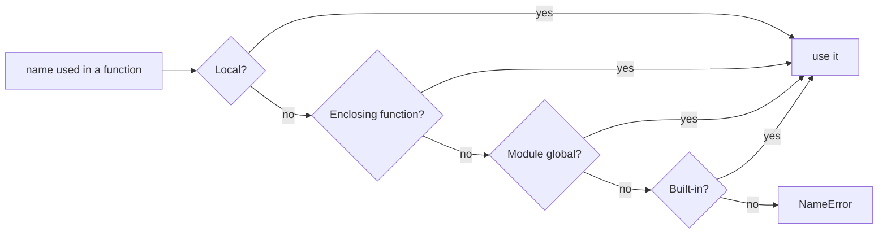
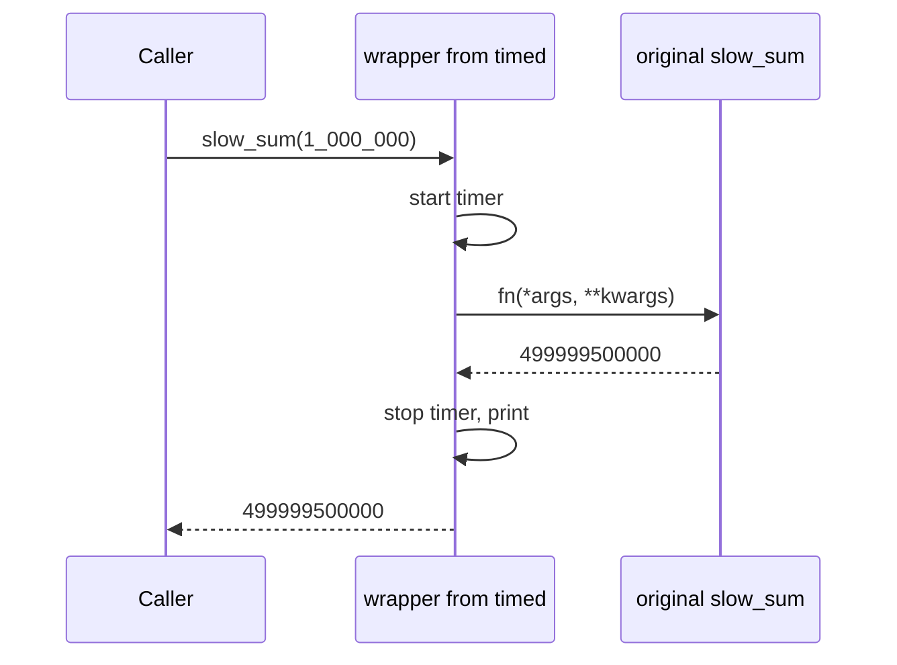
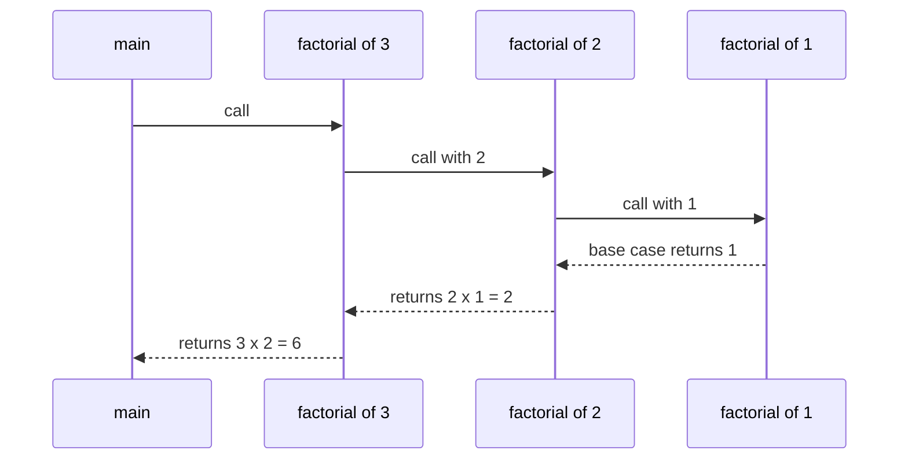
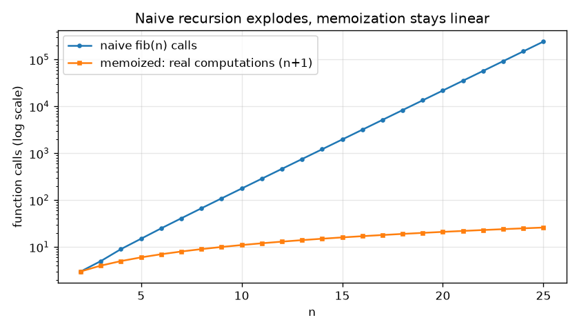

# Chapter 7 — Functions

A **function** is a named, reusable block of code that takes some inputs, does one job, and (usually) hands back a result. Almost everything you write in Python beyond a ten-line script is built out of functions, and many "advanced" features — decorators (functions that wrap other functions to add behaviour, 7.6), callbacks (functions you hand to other code so it can call them later), `sorted(key=...)`, caching (remembering results so they needn't be recomputed) — are just functions being passed around like ordinary values.

This chapter goes from `def` to closures (functions that remember variables from where they were created), decorators and recursion (a function calling itself). Every script lives in [`code/`](code/) and was run with Python 3.14 (all code is 3.12-compatible); the output shown is real.

**What you'll learn**

| # | Topic | Script |
|---|---|---|
| 7.1 | Defining and calling functions, `return`, `None`, `pass` | `01_defining_and_arguments.py` |
| 7.2 | Every kind of argument: positional, keyword, default, `*args`, `**kwargs`, positional-only `/`, keyword-only `*`, unpacking, the mutable-default trap, returning several values | `01_defining_and_arguments.py` |
| 7.3 | Scope and namespaces: LEGB, `global`, `nonlocal` | `02_scope_and_closures.py` |
| 7.4 | Closures and the late-binding trap | `02_scope_and_closures.py` |
| 7.5 | First-class and higher-order functions, `lambda`, `map`/`filter`, `sorted`/`min`/`max` with `key` | `03_first_class_and_functools.py` |
| 7.6 | Decorators and `functools`: `wraps`, `partial`, `reduce`, `lru_cache`, `cache` | `03_first_class_and_functools.py` |
| 7.7 | Recursion, the call stack, the recursion limit, memoization | `04_recursion.py` |
| 7.8 | Docstrings and type annotations | `05_docstrings_annotations.py` |

---

## 7.1 Defining and calling functions

### What it is
You **define** a function with the `def` keyword, a name, a pair of parentheses holding the **parameters** (the input names), and a colon. The indented lines below form the **body**. Defining a function does not run it — it only creates a function object and binds it to the name. You **call** (run) it by writing its name followed by parentheses, passing **arguments** (the actual values) inside.

Analogy: a function definition is a recipe card; a call is actually cooking the dish. You can cook from the same card as many times as you like, with different ingredients each time.

> **Parameter vs argument.** The *parameter* is the variable name in the definition (`def cube(x)` → `x`). The *argument* is the value supplied at the call (`cube(3)` → `3`). People mix them up constantly; interviewers notice.

### Why it matters
Functions give you four things at once:

1. **Modularity** — a big program is split into small pieces, each with one clear job, which can be written, read and debugged on its own.
2. **Reuse** — write the logic once, call it from anywhere (or from other programs via modules, Chapter 8). Fixing a bug fixes it everywhere.
3. **Scope** — names created inside a function are private to it, so different parts of a program don't trample each other's variables (7.3).
4. **Readability and teamwork** — a well-named function (`send_invoice(order)`) documents intent, and different people can own different functions.

### How it works
1. Python executes the `def` statement: it compiles the body (translates it into bytecode, the interpreter's low-level instructions), creates a *function object*, evaluates any default values (important later), and binds the object to the name.
2. At a call, Python creates a fresh **frame** (a workspace holding the local variables), binds each parameter to its argument, and runs the body.
3. `return value` ends the call immediately and gives `value` back to the caller. If the body finishes without `return` — or with a bare `return` — the call gives back `None`.
4. The frame is thrown away (unless a closure keeps some of it alive, 7.4).

`pass` is a statement that does nothing. Python forbids an empty block, so `pass` is the placeholder when you want to define a function (or class, or `if` branch) now and fill it in later. `...` (Ellipsis) is often used the same way in stubs (placeholder functions to be filled in later).

```python
def say_hi():
    """A function with no parameters and no return statement."""
    print("hi from say_hi()")

def cube(x):
    """Return x cubed."""
    return x ** 3

def todo():
    pass  # placeholder body - keeps the syntax valid

say_hi()
print("say_hi() returned:", say_hi())
print("cube(3) =", cube(3))
print("todo() returned:", todo())
```

Output:
```
hi from say_hi()
hi from say_hi()
say_hi() returned: None
cube(3) = 27
todo() returned: None
```

Notice that `say_hi()` printed twice: once for the plain call and once inside the `print(...)` — and then `None` appeared, because a function that only *prints* still *returns* `None`.

### Trade-offs: print vs return

| | `print(...)` inside the function | `return ...` |
|---|---|---|
| Result usable by caller | No — it goes to the screen | Yes — can be stored, tested, combined |
| Testable | Only by capturing stdout (standard output, the console stream) | Directly (`assert cube(3) == 27` — `assert` raises an error if the condition is false) |
| Good for | Debugging, CLI (command-line program) output at the edges | Almost all real logic |

### Common mistakes
- **Forgetting the parentheses**: `result = cube` stores the *function*, not a result. `result = cube(3)` calls it.
- **Printing instead of returning**, then wondering why `x = f()` is `None`.
- **Code after `return`** in the same block never runs.
- **Calling before defining** at module level (the top level of a file, outside any function): the `def` must have executed before the call runs (inside other functions this is fine, because the lookup happens at call time).

### Real-world examples
Every library you'll touch is a collection of functions: `len`, `print`, `open`, `json.dumps`, `requests.get`, `numpy.mean`. Web frameworks such as Flask and FastAPI map each URL (web address) to a plain Python function ("view" or "endpoint" — the code that answers that address) that returns the response.

### In the interview
**30-second answer:** "A function is defined with `def`; defining creates a function object bound to a name, and calling it creates a new frame with its own local variables. `return` sends a value back; with no `return` the result is `None`. Functions give modularity, reuse and a private scope."

- *What does a function without `return` return?* → `None`.
- *Are functions objects?* → Yes; they have attributes (`__name__`, `__doc__`, `__defaults__`) and can be passed around (7.5).
- *What is `pass` for?* → A no-op placeholder where syntax needs a statement.

### Self-check
1. What does `x = print("a")` store in `x`? → `None`.
2. Parameter or argument: the `3` in `cube(3)`? → Argument.
3. When does the body of a function run? → Only when it's called, not when `def` runs.
4. Why prefer `return` over `print` in logic? → Results can be reused and tested.

### TL;DR
`def name(params):` + indented body. Defining ≠ running. `return` gives a value back; otherwise you get `None`. `pass` fills an empty body.

---

## 7.2 Function arguments — every kind

### What it is
Python gives you several ways to feed values into a function. At the **call site** (the place in the code where the function is called) you can pass arguments **positionally** (matched by order) or **by keyword** (matched by name). In the **definition** you can add **defaults**, collect extras with `*args` / `**kwargs`, and force a style with `/` (positional-only) and `*` (keyword-only).

The full shape of a parameter list, in the only order Python allows:

```python
def f(pos_only, /, pos_or_kw, *args, kw_only, **kwargs): ...
#     ^^^^^^^^     ^^^^^^^^^  ^^^^^  ^^^^^^^  ^^^^^^^^
#     before /     normal     extra  after *  extra keywords
#                              positionals     (dict)
#                              (tuple)
```

| Kind | Declared as | Called as | Notes |
|---|---|---|---|
| Positional-or-keyword | `def f(a, b)` | `f(1, 2)` or `f(b=2, a=1)` | The default kind |
| Default | `def f(a, b=10)` | `f(1)` or `f(1, 5)` | Params with defaults must come after those without (in the positional part) |
| Variable positional | `def f(*args)` | `f(1, 2, 3)` | `args` is a **tuple** |
| Variable keyword | `def f(**kwargs)` | `f(x=1, y=2)` | `kwargs` is a **dict** (insertion-ordered) |
| Positional-only | `def f(a, b, /)` | `f(1, 2)` only | Python 3.8+ (PEP 570) |
| Keyword-only | `def f(*, a, b)` or after `*args` | `f(a=1, b=2)` only | Can be required (no default) |

### Why it matters
Good argument design makes calls **self-documenting and hard to misuse**. `connect("db", 5432, True, False)` is a riddle; `connect("db", port=5432, ssl=True, retry=False)` explains itself. Defaults keep simple calls simple, `*args`/`**kwargs` let you write flexible wrappers (functions that call another function and add something around it), and `/`/`*` let a library author keep freedom to rename parameters later.

### How it works — binding arguments to parameters
When you call a function, Python:

1. Fills parameters left-to-right from the **positional arguments**. Extra positionals go into `*args` (or raise `TypeError` if there is no `*args`).
2. Matches each **keyword argument** to the parameter with that name. Unknown names go into `**kwargs` (or raise `TypeError`).
3. A parameter filled twice (by position *and* by keyword) → `TypeError: got multiple values`.
4. Any still-empty parameter takes its **default**; if it has none → `TypeError: missing ... required argument`.

At the call site, positional arguments must come before keyword arguments: `f(1, b=2)` is fine, `f(a=1, 2)` is a `SyntaxError`.

### Positional and keyword arguments
**Positional** arguments are matched purely by order, so every required one must be supplied and in the right order — swap two and you silently get wrong results (the function can't tell a first name from a last name). **Keyword** arguments name the target parameter, so order no longer matters and the call reads clearly; they shine when a function has many parameters or several optional ones.

### Default arguments
A **default** makes a parameter optional: if the caller leaves it out, the default is used; if the caller supplies it, it overrides the default.

```python
def book_flight(origin, destination, seat="economy", *, meal="standard"):
    """origin/destination: positional-or-keyword; seat: default; meal: keyword-only."""
    return f"{origin}->{destination} [{seat}, meal={meal}]"

print(book_flight("SFO", "JFK"))                                  # defaults used
print(book_flight(destination="JFK", origin="SFO", seat="aisle"))  # any order by name
print(book_flight("SFO", "JFK", meal="vegan"))                    # keyword-only
book_flight("SFO")                           # missing arg
book_flight("SFO", "JFK", "aisle", "vegan")  # meal given positionally
book_flight("SFO", origin="LAX")             # same arg twice
```

Output (errors caught by a small helper in the script):
```
SFO->JFK [economy, meal=standard]
SFO->JFK [aisle, meal=standard]
SFO->JFK [economy, meal=vegan]
  missing arg: TypeError: book_flight() missing 1 required positional argument: 'destination'
  meal given positionally: TypeError: book_flight() takes from 2 to 3 positional arguments but 4 were given
  same arg twice: TypeError: book_flight() got multiple values for argument 'origin'
```

### Positional-only (`/`) and keyword-only (`*`)
- Everything **before `/`** must be passed by position. Their names become an internal detail, so the author may rename them later without breaking anyone, and a name like `value` can't collide with a `**kwargs` key. Many built-ins work this way: `len(obj, /)`, `abs(x, /)`, `divmod(x, y, /)` — try `len(obj=[1])` and you get a `TypeError`.
- Everything **after `*`** (or after `*args`) must be passed by name. Use it for flags (on/off options) and options whose meaning isn't obvious from position: `sorted(iterable, /, *, key=None, reverse=False)` — you can't write `sorted(xs, None, True)`. Keyword-only parameters may still be *required* (no default).

```python
def clamp(value, low, high, /):
    return max(low, min(value, high))

print("clamp(15, 0, 10) =", clamp(15, 0, 10))
clamp(value=15, low=0, high=10)
```
```
clamp(15, 0, 10) = 10
  clamp(value=15, ...): TypeError: clamp() got some positional-only arguments passed as keyword arguments: 'value, low, high'
```

### Variable-length arguments: `*args` and `**kwargs`
`*args` gathers any **extra positional** arguments into a tuple; `**kwargs` gathers any **extra keyword** arguments into a dict. The names `args`/`kwargs` are only convention — the `*` and `**` do the work.

```python
def total(*numbers, start=0):
    print("  numbers is a", type(numbers).__name__, numbers)
    return sum(numbers, start)

def make_tag(tag, /, text, **attrs):
    attr_str = "".join(f' {k}="{v}"' for k, v in attrs.items())
    return f"<{tag}{attr_str}>{text}</{tag}>"

print("total(1, 2, 3) =", total(1, 2, 3))
print("total() =", total())
print(make_tag("a", "docs", href="https://docs.python.org", target="_blank"))
```
```
  numbers is a tuple (1, 2, 3)
total(1, 2, 3) = 6
  numbers is a tuple ()
total() = 0
<a href="https://docs.python.org" target="_blank">docs</a>
```

A typical `**kwargs` use is a settings function: `configure(host="db1", port=5432, timeout="30s")` receives `{"host": "db1", "port": 5432, "timeout": "30s"}` and can loop over `.items()`.

### Unpacking at the call site
The same stars work in reverse when *calling*: `*iterable` spreads a sequence into positional arguments, `**mapping` spreads a dict into keyword arguments.

```python
nums = [4, 5, 6]
opts = {"seat": "window", "meal": "kosher"}
print("total(*nums) =", total(*nums))
print(book_flight("SFO", "JFK", **opts))
```
```
  numbers is a tuple (4, 5, 6)
total(*nums) = 15
SFO->JFK [window, meal=kosher]
```

### Returning several values
A function returns exactly **one** object — but that object can be a tuple, and `return a, b, c` builds one. The caller then *unpacks* it.

```python
def min_max_mean(values):
    return min(values), max(values), sum(values) / len(values)

result = min_max_mean([3, 9, 6])
print("raw result:", result, type(result).__name__)
lo, hi, avg = result
```
```
raw result: (3, 9, 6.0) tuple
lo=3 hi=9 avg=6.0
```
For more than ~3 values, return a `dataclass` or `typing.NamedTuple` (lightweight record classes with named fields, Chapters 5 and 10) instead, so callers use names (`stats.mean`) not positions.

### The mutable-default pitfall
**Default values are evaluated once — when `def` runs — not on each call.** If the default is a mutable object (list, dict, set), every call that uses the default shares *the same object*, and changes pile up.

```python
def append_bad(item, bucket=[]):          # BUG: default evaluated once
    bucket.append(item)
    return bucket

def append_good(item, bucket=None):       # FIX: None sentinel
    if bucket is None:
        bucket = []
    bucket.append(item)
    return bucket

print(append_bad("a"), append_bad("b"))
print("default is now:", append_bad.__defaults__)
print(append_good("a"), append_good("b"))
```
```
['a', 'b'] ['a', 'b']
default is now: (['a', 'b'],)
['a'] ['b']
```
Both `append_bad` calls returned the *same* list, and `__defaults__` shows the stored default has been mutated. The fix is the **`None` sentinel** (a special placeholder value meaning "nothing was passed") idiom: default to `None` and create a new object inside. (The same "evaluated once" rule means `def log(msg, when=datetime.now())` freezes the time at definition.) `dataclasses` refuses a bare mutable default for exactly this reason and asks for `field(default_factory=list)`.

### Trade-offs

| Choice | Benefit | Cost |
|---|---|---|
| Positional | Short calls | Order-dependent, easy to swap by mistake |
| Keyword | Readable, order-free | Longer calls; parameter names become public API (part of what other people's code relies on) |
| Keyword-only (`*`) | Forces clarity for flags/options | Slightly more typing for callers |
| Positional-only (`/`) | Freedom to rename; no clash with `**kwargs` | Callers can't use names for clarity |
| `*args`/`**kwargs` | Flexible wrappers, forwarding | Hides the real signature (the function's parameter list) from readers, IDEs and type checkers (tools that check type hints without running code) |

### When not to use it
- Don't reach for `**kwargs` when you know the options — explicit keyword parameters give errors on typos (`timout=5`) and IDE help; `**kwargs` silently swallows the typo.
- Don't pile on boolean positional flags (`f(x, True, False)`) — make them keyword-only.

### Common mistakes
- Mutable default (`=[]`, `={}`) — use `None`.
- Putting a non-default parameter after a default one: `def f(a=1, b):` → `SyntaxError`.
- Positional after keyword at the call: `f(a=1, 2)` → `SyntaxError`.
- Forgetting that `*args` is a **tuple** (immutable) — convert with `list(args)` if you need to modify it.
- Mixing up `return a, b` (one tuple) with "two return values".

### Real-world examples
- `print(*objects, sep=" ", end="\n", file=None, flush=False)` — `*objects` plus keyword-only options.
- `requests.get(url, params=None, **kwargs)` forwards options such as `timeout=` and `headers=` through `**kwargs`.
- Matplotlib (the standard plotting library) plotting calls accept `**kwargs` and pass them on to the underlying line/patch objects (`color=`, `linewidth=`).
- `dataclasses.field(default_factory=list)` exists because of the mutable-default trap.

### In the interview
**30-second answer:** "Arguments bind positionally by order or by keyword by name. Defaults make parameters optional but are evaluated once at definition time, so never use a mutable default — use `None`. `*args` collects extra positionals into a tuple, `**kwargs` extra keywords into a dict. Parameters before `/` are positional-only, after `*` keyword-only."

- *Why is `def f(x=[])` dangerous?* → The list is created once and shared by every call that uses the default; mutations accumulate.
- *Why would a library use positional-only parameters?* → To keep parameter names private (can be renamed without breaking callers) and to allow a `**kwargs` key with the same name.
- *How do you pass a list as separate arguments?* → `f(*my_list)`; a dict as keywords → `f(**my_dict)`.

### Self-check
1. Inside `def f(*a, **k)`, what are the types of `a` and `k`? → `tuple` and `dict`.
2. `def f(a, /, b, *, c)` — which calls work: `f(1, 2, 3)`, `f(1, b=2, c=3)`, `f(a=1, b=2, c=3)`? → Only `f(1, b=2, c=3)` (and `f(1, 2, c=3)`).
3. What does `return 1, 2` return? → The tuple `(1, 2)`.
4. When is a default value computed? → Once, when the `def` statement runs.

### TL;DR
Positional = by order, keyword = by name. Defaults are evaluated **once** → use `None` for mutables. `*args` → tuple, `**kwargs` → dict; `*`/`**` at the call site unpack. `/` = positional-only before it, `*` = keyword-only after it. Multiple return values = one tuple.

---

## 7.3 Scope and namespaces — LEGB, `global`, `nonlocal`

### What it is
A **namespace** is a mapping from names to objects — literally a dictionary in most cases (`globals()` shows the module's one). Each name inside one namespace is unique, but the same name can exist in different namespaces without clashing. The **scope** of a name is the region of code where that name can be used directly.

Python resolves a bare name using the **LEGB rule** — it searches four scopes in order and stops at the first hit:

| Letter | Scope | Where it comes from | Lifetime |
|---|---|---|---|
| **L** | Local | Names assigned inside the current function (including parameters) | Created when the call starts, gone when it ends |
| **E** | Enclosing | Locals of any *outer* function(s), for nested functions | As long as something references them (see closures) |
| **G** | Global | Names assigned at the top level of the **module** (file) | Until the program ends (or module is unloaded) |
| **B** | Built-in | `len`, `print`, `ValueError`… from the `builtins` module | Whole program |

Not found anywhere → `NameError`.



Analogy: looking for scissors — first your own desk (local), then the room you're in (enclosing), then the whole house (global), then the hardware store (built-ins).

### Why it matters
Scope is what makes functions safe to combine: a `total` inside one function can't clobber a `total` inside another. Misunderstanding it causes one of Python's most confusing errors, `UnboundLocalError`.

### How it works — the key rule
**Whether a name is local is decided at compile time (when Python translates the function, before it runs), for the whole function body: if the function *assigns* to a name anywhere (`=`, `+=`, `for x in`, `import x`, `def x`), that name is local everywhere in the function** — unless declared `global` or `nonlocal`. Merely *reading* a name doesn't make it local, so reading a global works without any declaration.

1. `global name` → assignments to `name` in this function rebind the **module-level** variable.
2. `nonlocal name` → assignments rebind the variable in the **nearest enclosing function** scope (it must already exist there; module globals don't count). Added in Python 3.
3. Only functions (and classes, comprehensions, lambdas) create scopes. **`if`, `for`, `while` and `with` blocks do not** — a variable assigned inside an `if` is visible after it.

```python
level = "global"                     # G

def outer():
    level = "enclosing"              # E for inner()
    def inner():
        level = "local"              # L
        print("  inner sees:", level)
    inner()
    print("  outer sees:", level)

def reads_global():
    print("  reads_global sees:", level)   # no assignment here -> global

counter = 0

def broken_increment():
    counter += 1                     # assignment makes counter LOCAL -> error

def global_increment():
    global counter
    counter += 1
```
```
== LEGB lookup ==
  inner sees: local
  outer sees: enclosing
  reads_global sees: global
  B (built-in) len is builtins.len: True

== assigning without global ==
  UnboundLocalError: cannot access local variable 'counter' where it is not associated with a value

== global ==
  counter = 2
```

`counter += 1` means `counter = counter + 1`. Because of the assignment, `counter` is local; the right-hand side then reads the local before it has a value → `UnboundLocalError` (a subclass of `NameError`).

`nonlocal` does the same job one level in — see `make_counter` in 7.4.

### Trade-offs

| Approach to shared state | Good | Bad |
|---|---|---|
| Pass in / return values | Explicit, testable, thread-friendly (safe when several threads run at once) | More parameters |
| `global` | Quick for scripts | Hidden coupling (functions secretly depending on each other); any function can change it; hard to test |
| `nonlocal` / closure | State private to one function family | Can be less obvious than a class |
| A class with attributes | Clear home for state + behaviour | More code |

### When not to use it
Avoid `global` for anything except true module-level configuration or caches in small scripts. Mutating a global *object* (e.g. `CACHE[key] = v`) doesn't even need `global` — only rebinding the *name* does — but it is still shared mutable state.

### Common mistakes
- `UnboundLocalError` from `x += 1` on a global — add `global x`, or better, return the new value.
- **Shadowing built-ins**: naming a variable `list`, `dict`, `id`, `input`, `sum` or `type` hides the built-in in that scope. The script shows `list = [1, 2]` followed by `list('xy')` → `'list' object is not callable`.
- Expecting a class body to be an enclosing scope for its methods — it isn't; methods must use `self.x` (`self` is the object the method was called on, Chapter 10) or `ClassName.x`.
- Expecting the loop variable of a **comprehension** to leak — it doesn't (comprehensions have their own scope), while a plain `for` loop's variable does remain after the loop.

### Real-world examples
- `logging.getLogger(__name__)` is conventionally stored as a module-level (global) `logger` (the object you send log messages through) and only *read* inside functions.
- Configuration constants (`MAX_RETRIES = 3`) live at module level in UPPER_CASE by PEP 8 convention: global, but treated as read-only.

### In the interview
**30-second answer:** "Python looks names up via LEGB: local, enclosing, global, built-in. Any assignment in a function makes that name local for the whole function, which is why `x += 1` on a global raises `UnboundLocalError`. `global` rebinds module-level names, `nonlocal` rebinds the nearest enclosing function's name. Blocks like `if` and `for` don't create scopes."

- *Do you need `global` to append to a global list?* → No — `.append` mutates, it doesn't rebind. You need it only for `name = ...`.
- *What's the difference between `global` and `nonlocal`?* → `global` targets module scope; `nonlocal` targets the nearest enclosing *function* scope and requires the name to exist there.
- *Is a variable defined inside an `if` visible after it?* → Yes, `if`/`for` don't create scopes.

### Self-check
1. What does LEGB stand for? → Local, Enclosing, Global, Built-in.
2. Why does `def f(): print(x); x = 1` fail even if a global `x` exists? → The later assignment makes `x` local for the whole body, so the `print` reads an unassigned local.
3. Can `nonlocal` refer to a module-level variable? → No — `SyntaxError: no binding for nonlocal ... found`.
4. What error do you get when a name isn't in any scope? → `NameError`.

### TL;DR
Lookup order is **L → E → G → B**. Assignment anywhere in a function ⇒ local everywhere in it. `global` for module names, `nonlocal` for outer-function names. Prefer passing and returning values over either.

---

## 7.4 Closures

### What it is
A **closure** is an inner function that *remembers* variables from the enclosing function's scope, even after the outer function has returned. Those remembered variables are called **free variables**; Python stores them in "cells" attached to the function (`fn.__closure__`).

Analogy: a backpack. When the inner function leaves home (is returned), it takes a backpack with the variables it needs.

### Why it matters
Closures let you build **functions from other functions** — configured functions (`make_multiplier(3)`), counters with private state, callbacks that carry context — without writing a class. Decorators (7.6) are built on them.

### How it works
1. `make_multiplier(3)` runs; `factor = 3` lives in its local scope.
2. It defines `multiply`, which reads `factor` → the compiler marks `factor` as a free variable and stores it in a cell.
3. `make_multiplier` returns `multiply`. Its frame ends, but the cell survives because `multiply` references it.
4. Each call to `make_multiplier` creates a **new** cell, so `double` and `triple` are independent.
5. To *rebind* a captured variable (not just read it), the inner function needs `nonlocal`.

```python
def make_counter():
    count = 0
    def step():
        nonlocal count               # rebind the enclosing variable
        count += 1
        return count
    return step

def make_multiplier(factor):
    def multiply(x):
        return x * factor            # 'factor' is captured (a free variable)
    return multiply

c1, c2 = make_counter(), make_counter()
print("  c1:", c1(), c1(), c1(), " c2:", c2())
double, triple = make_multiplier(2), make_multiplier(3)
print("  double(5) =", double(5), " triple(5) =", triple(5))
print("  free vars of double:", double.__code__.co_freevars,
      "cell value:", double.__closure__[0].cell_contents)
```
```
  c1: 1 2 3  c2: 1
  double(5) = 10  triple(5) = 15
  free vars of double: ('factor',) cell value: 2
```

### The late-binding trap
Closures capture **variables, not values**. The value is looked up when the inner function *runs*.

```python
funcs = [lambda: i for i in range(3)]
print([f() for f in funcs])          # [2, 2, 2]  - all see the final i
funcs = [lambda i=i: i for i in range(3)]
print([f() for f in funcs])          # [0, 1, 2]  - default captures the current value
```
The `i=i` trick works *because* defaults are evaluated at definition time (7.2). `functools.partial` is a cleaner alternative.

### Trade-offs

| | Closure | Class |
|---|---|---|
| Code size | Tiny | Larger |
| Number of operations | Best for one (a callable) | Many methods |
| Inspectability | State hidden in cells | Attributes visible, easy to debug |

### When not to use it
When the "function" needs several operations (increment, reset, read), or other people must inspect/serialise (convert to bytes or text for saving or sending) its state, write a small class instead. Closures also can't be pickled by the standard `pickle` module (Python's built-in object-serialisation tool).

### Common mistakes
- Late binding in loops (above).
- Forgetting `nonlocal` and getting `UnboundLocalError` on `count += 1`.

### Real-world examples
- Every decorator (`@functools.lru_cache`, Flask's `@app.route("/")`) returns a closure wrapping your function.
- Event callbacks in GUI toolkits (libraries for windows and buttons; Tkinter `command=`) often use closures or `partial` to carry the context of which button was pressed.

### In the interview
**30-second answer:** "A closure is a nested function that keeps references to variables of its enclosing scope after that scope has returned. It captures variables, not values, so lambdas in a loop all see the last value unless you bind with a default argument or `partial`. `nonlocal` lets it rebind the captured variable."

- *Where are captured variables stored?* → In cell objects in `fn.__closure__`; names in `fn.__code__.co_freevars`.
- *How to fix the loop-lambda bug?* → `lambda i=i: ...` or `functools.partial(f, i)`.

### Self-check
1. Do `c1` and `c2` from `make_counter` share state? → No, each call creates a new cell.
2. Why does `[lambda: i for i in range(3)]` give `[2, 2, 2]`? → `i` is looked up at call time, when it's 2.
3. What keyword lets a closure change a captured variable? → `nonlocal`.

### TL;DR
Inner function + remembered outer variables = closure. Captures variables (late binding), use `nonlocal` to rebind. Foundation of decorators.

---

## 7.5 First-class and higher-order functions, `lambda`, `map`/`filter`, `key=`

### What it is
Python functions are **first-class objects**: you can assign them to variables, store them in lists and dicts, pass them as arguments and return them from other functions. A **higher-order function** is one that takes a function as an argument or returns one (`map`, `sorted`, decorators, `make_multiplier`).

A **`lambda`** is an anonymous, single-expression function: `lambda x: x * 2` is the same as a `def` whose body is `return x * 2`, but it has no statements, no annotations and its name is just `<lambda>`.

### Why it matters
It lets you pass **behaviour** as data: "sort by this", "retry this", "call this when done". It removes whole families of near-duplicate functions.

### How it works

```python
yell = shout                                  # assign to a name
table = {"up": str.upper, "low": str.lower}  # store in a dict
print(apply_twice(shout, "hey"))              # pass as argument  -> HEY!!

nums = [5, -2, 8, -7, 3]
list(map(abs, nums))                  # [5, 2, 8, 7, 3]
list(filter(lambda n: n > 0, nums))   # [5, 8, 3]
[n * n for n in nums if n > 0]        # [25, 64, 9]
```

- `map(fn, iterable)` applies `fn` to each item; `filter(pred, iterable)` keeps items where `pred(item)` (a *predicate* — a function answering yes/no) is truthy. Both return **lazy iterators** (objects that produce each value only when asked) in Python 3 (the script prints `map`) — wrap in `list()` to see values, and they can be consumed only once.
- `sorted(iterable, key=fn, reverse=False)` returns a **new list**; `list.sort()` sorts in place and returns `None`. `min`, `max`, `heapq.nlargest` and `itertools.groupby` accept `key=` too.
- `key` is called **once per element**; the elements are then compared by their key. Python's sort is **stable**: equal keys keep their original order — which is how multi-level sorting works.
- `operator.itemgetter(1)`, `operator.attrgetter("age")` and `str.lower` are ready-made, faster alternatives to many lambdas.

```python
people = [("Ana", 31), ("bob", 25), ("Cy", 31), ("dee", 19)]
sorted(people, key=lambda p: p[1])            # by age
sorted(people, key=lambda p: (-p[1], p[0]))   # age desc, then name
sorted(["bob", "Ana", "dee", "Cy"], key=str.lower)
max(people, key=operator.itemgetter(1))
```
```
  by age:             [('dee', 19), ('bob', 25), ('Ana', 31), ('Cy', 31)]
  by age desc, name:  [('Ana', 31), ('Cy', 31), ('bob', 25), ('dee', 19)]
  case-insensitive:   ['Ana', 'bob', 'Cy', 'dee']
  itemgetter(1):      ('dee', 19)
  oldest:             ('Ana', 31)
```
Returning a **tuple** from `key` sorts by the first element, then the second, and so on; negating a number flips that level's direction.

### Trade-offs

| Tool | Best for | Watch out |
|---|---|---|
| Comprehension | Transform + filter in one readable line | Builds a whole list (use a generator expression `( … )` for laziness) |
| `map`/`filter` with a named function | `map(str.strip, lines)` | With a lambda it's usually less readable than a comprehension |
| `lambda` | Tiny one-off `key=` functions | No statements, name `<lambda>` in tracebacks (the error report listing the chain of calls), PEP 8 says don't assign one to a name — use `def` |

### When not to use it
Don't write `f = lambda x: x + 1` — use `def f(x): return x + 1` (better name in tracebacks, can have a docstring). Don't nest `map(lambda..., filter(lambda..., ...))` when a comprehension reads plainly.

### Common mistakes
- `sorted_list = my_list.sort()` → `None`. Use `sorted()` or call `.sort()` alone.
- Consuming a `map`/`filter` iterator twice — the second pass is empty.
- `key=len()` (calling it) instead of `key=len` (passing it).

### Real-world examples
- pandas (the table-processing library): `df["name"].map(str.title)`, `df.sort_values(key=...)`, `df.apply(fn)`.
- `sorted(files, key=os.path.getmtime)` (a file's last-modified time) — "newest file" scripts.
- Callbacks: `threading.Thread(target=worker)` (runs `worker` in a new thread), `concurrent.futures` `executor.map(fetch, urls)` (an *executor* is a pool of workers that runs calls in parallel).

### In the interview
**30-second answer:** "Functions are objects, so they can be passed, stored and returned; a higher-order function takes or returns one. `lambda` makes a one-expression anonymous function, mostly for `key=`. `map`/`filter` return lazy iterators; comprehensions are usually preferred. `sorted` with `key` computes the key once per element and is stable, so tuple keys give multi-level sorts."

- *`sorted` vs `.sort()`?* → `sorted` takes any iterable and returns a new list; `.sort()` is a list method, in place, returns `None`.
- *Is Python's sort stable?* → Yes, guaranteed.
- *Sort by two fields, one descending?* → Tuple key with a negated number, or two stable sorts (secondary key first).

### Self-check
1. What does `map(abs, [-1])` return? → A lazy `map` iterator, not a list.
2. How many times is `key` called when sorting 1,000 items? → 1,000 (once each).
3. Can a lambda contain an `if` statement? → No statements; a conditional *expression* (`a if c else b`) is fine.

### TL;DR
Functions are values. Higher-order functions take/return functions. `lambda` for tiny keys. `map`/`filter` are lazy; comprehensions are clearer. `sorted(key=…)` — once per item, stable, tuple keys for multi-level.

---

## 7.6 Decorators and `functools`

### What it is
A **decorator** is a higher-order function that takes a function and returns a replacement (usually a closure that calls the original plus extra behaviour). The `@` syntax is shorthand:

```python
@timed
def slow_sum(n): ...
# is exactly
def slow_sum(n): ...
slow_sum = timed(slow_sum)
```

The standard-library module **`functools`** collects tools for working with functions: `wraps`, `partial`, `reduce`, `lru_cache`, `cache`, `cached_property`, `singledispatch`, `total_ordering`.

### Why it matters
Decorators add cross-cutting behaviour (concerns that apply to many functions) — timing, logging, caching, auth checks (is this user logged in and allowed?), retries, route registration (linking a URL to its handler) — without editing each function. `functools` gives you battle-tested versions so you don't write them yourself.

### How it works



```python
def timed(fn):
    @functools.wraps(fn)                 # copy __name__, __doc__, etc.
    def wrapper(*args, **kwargs):        # accept any signature
        t0 = time.perf_counter()
        result = fn(*args, **kwargs)     # call the original
        ms = (time.perf_counter() - t0) * 1000
        print(f"  [{fn.__name__} ran in {'under' if ms < 500 else 'over'} 500 ms]")
        return result                    # don't forget to return!
    return wrapper
```
```
  [slow_sum ran in under 500 ms]
  slow_sum(1_000_000) = 499999500000
  with wraps:    name = slow_sum | doc = Add 0..n-1 the slow way.
  without wraps: name = wrapper | doc = None
```

**`functools.wraps`** copies the original's `__name__`, `__doc__`, `__module__`, `__qualname__`, `__dict__` and sets `__wrapped__`. Without it, every decorated function would appear as `wrapper` in logs, `help()` and tracebacks.

**`functools.partial(fn, *args, **kwargs)`** "pre-fills" some arguments and returns a new callable:
```python
int_from_binary = functools.partial(int, base=2)
int_from_binary("1011")   # 11
```

**`functools.reduce(fn, iterable[, initial])`** folds (combines pairwise, left to right) a sequence into one value: `reduce(mul, [1,2,3,4,5])` computes ((((1·2)·3)·4)·5) = 120. Give an `initial` value or an empty input raises `TypeError`. For sums, products, max/min, `any`/`all` and joins, the dedicated built-ins (`sum`, `math.prod`, `max`, `"".join`) are clearer.

**`functools.lru_cache(maxsize=128)`** memoizes (caches results per argument combination): it stores results keyed by the arguments and returns the stored result for repeat calls. When more than `maxsize` distinct keys are stored, the **least recently used** entry is evicted (thrown out to make room). **`functools.cache`** (3.9+) is `lru_cache(maxsize=None)` — unbounded, slightly faster.

```python
@functools.lru_cache(maxsize=128)
def square_slowly(n):
    time.sleep(0.05)
    return n * n
for n in (4, 4, 5, 4):
    square_slowly(n)
print(square_slowly.cache_info())
```
```
  CacheInfo(hits=2, misses=2, maxsize=128, currsize=2)
  after cache_clear: CacheInfo(hits=0, misses=0, maxsize=128, currsize=0)
  unhashable argument -> unhashable type: 'list'
```
Calls with 4, 4, 5, 4 → misses on the first 4 and on 5, hits on the two repeats. Arguments must be **hashable** (lists fail).

### Trade-offs

| Tool | Win | Cost / caveat |
|---|---|---|
| `lru_cache(maxsize=N)` | Bounded memory | Bookkeeping overhead; stale (out-of-date) results if data changes |
| `cache` | Fastest, simplest | Grows forever — a memory leak (memory that is never released) for unbounded inputs |
| `partial` | Picklable, introspectable (can be examined at run time: `.func`, `.args`) | Only pre-fills; can't reorder arguments |
| `reduce` | General fold | Often less readable than a loop or built-in |

### When not to use it
- Don't cache functions with side effects (actions beyond returning a value, e.g. sending email) or whose result depends on time, randomness or mutable global state.
- `lru_cache` on an **instance method** (a function defined in a class and called on an object) keys on `self` and keeps every instance alive for the cache's lifetime; prefer `functools.cached_property` for per-instance values, or a module-level cached function.

### Common mistakes
- Forgetting `return result` in the wrapper → the decorated function returns `None`.
- Forgetting `@functools.wraps`.
- Writing `@timed()` for a decorator that takes no arguments (or vice-versa). A decorator *with* arguments is a function that returns a decorator — three levels of nesting.

### Real-world examples
- Flask/FastAPI: `@app.get("/items")` registers the function as a route handler.
- pytest (the most popular Python test framework): `@pytest.fixture`, `@pytest.mark.parametrize(...)`.
- Standard library: `@property`, `@staticmethod`, `@classmethod`, `@dataclass`, `@contextlib.contextmanager`.
- The `re` module keeps an internal cache of compiled patterns so repeated `re.match(pattern, s)` doesn't recompile.

### In the interview
**30-second answer:** "A decorator is a callable that takes a function and returns a replacement; `@d` above `def f` means `f = d(f)`. Inside you define a `wrapper(*args, **kwargs)` closure and use `functools.wraps` to keep the original's name and docstring. `functools` also gives `partial` to pre-fill arguments, `reduce` to fold, and `lru_cache`/`cache` to memoize pure functions (whose output depends only on their inputs, with no side effects) with hashable arguments."

- *What does `wraps` do?* → Copies metadata (descriptive information about the function) (`__name__`, `__doc__`, …) and sets `__wrapped__`.
- *How do you write a decorator that takes arguments, like `@retry(3)`?* → An outer function taking `3` returns the actual decorator, which returns the wrapper.
- *When is `lru_cache` wrong?* → Impure functions, unhashable args, unbounded key spaces with `maxsize=None`, instance methods.

### Self-check
1. Rewrite `@d` / `def f` without the `@`. → `f = d(f)`.
2. What's the default `maxsize` of `lru_cache`? → 128.
3. `reduce(operator.add, [])` → ? → `TypeError` (no initial value).
4. Why `*args, **kwargs` in a wrapper? → So it can wrap any signature and forward everything.

### TL;DR
Decorator = function in, function out; always `@wraps` and `return result`. `partial` pre-fills args, `reduce` folds, `lru_cache`/`cache` memoize pure functions with hashable arguments.

---

## 7.7 Recursion

### What it is
A **recursive function** calls itself to solve a smaller version of the same problem. It's the programming form of *divide and conquer*: split the problem into smaller copies, solve each, combine the answers. Every recursive function needs:

1. A **base case** — an input small enough to answer directly, with no further call.
2. A **recursive case** — reduce the input and call yourself, making guaranteed progress toward the base case.

Analogy: Russian nesting dolls — open one, find a smaller one, repeat until the tiny solid doll (base case).

### Why it matters
Recursion is the natural fit for **self-similar data and problems**: nested lists/JSON, folder trees, parse trees (the tree a parser builds from text), tree and graph traversal (visiting every node), merge sort and quicksort (classic fast sorting algorithms), backtracking (try an option, undo it if it fails; permutations, sudoku). Interviews use it constantly.

### How it works — the call stack
Each call gets its own frame on the **call stack** (a last-in-first-out pile of active calls). Calls pile up until the base case, then results flow back as frames are popped. Factorial: n! = n × (n−1)!, with 0! = 1! = 1.

```python
def factorial(n):
    if n <= 1:                 # base case (also handles 0! = 1)
        return 1
    return n * factorial(n - 1)
```
Trace of `factorial(3)` from the script, and the arithmetic for `factorial(5)`: 5 × 4 × 3 × 2 × 1 = 120.
```
factorial(5) = 120 | factorial(0) = 1
factorial(3)
  factorial(2)
    factorial(1)
    -> 1
  -> 2
-> 6
```



### The recursion limit
CPython has **no tail-call optimisation** (TCO — reusing the current frame when a function's very last step is calling itself), so every level costs a frame. To protect the interpreter from running out of stack, it caps the depth: `sys.getrecursionlimit()` is **1000** by default. Exceed it and you get `RecursionError` (a subclass of `RuntimeError`).

```
sys.getrecursionlimit() = 1000
depth_of(500) = 500
RecursionError: maximum recursion depth exceeded
```
`sys.setrecursionlimit(n)` can raise it, but deep recursion still costs memory and can crash the process (the running program) if pushed too far — for depths in the thousands or more, **rewrite it as a loop** (with an explicit stack list for tree walks).

### Memoization — fixing exponential recursion
Fibonacci: F(0)=0, F(1)=1, F(n)=F(n−1)+F(n−2), so F(7) = 13. The naive version recomputes the same values over and over: F(5) calls F(4) and F(3), F(4) calls F(3) *again*, and so on. The number of calls grows roughly like 1.6ⁿ. **Memoization** — remembering results of earlier calls — makes each F(k) computed once, so the work becomes linear.

```python
@functools.cache
def fib_memo(n):
    if n < 2:
        return n
    return fib_memo(n - 1) + fib_memo(n - 2)

def fib_iter(n):              # bottom-up: no recursion at all
    a, b = 0, 1
    for _ in range(n):
        a, b = b, a + b
    return a
```
```
fib(7) = 13
naive calls for n=10, 20, 25: 177 21891 242785
memoized: CacheInfo(hits=23, misses=26, maxsize=None, currsize=26)
fib_iter(90) = 2880067194370816120
```
For n = 25 the naive version makes 242,785 calls; the memoized one computes 26 distinct values (misses) and answers 23 repeats from the cache.


*Figure — Function calls needed for fib(n): naive recursion grows exponentially (multiplying by a constant factor at each step — a straight line on a log axis), memoization grows linearly.*

### Recursion over nested data
```python
def flatten(nested):
    out = []
    for item in nested:
        if isinstance(item, list):
            out.extend(flatten(item))   # recursive case: a smaller list
        else:
            out.append(item)            # base case: a plain value
    return out

flatten([1, [2, [3, [4]], 5], [], 6])   # [1, 2, 3, 4, 5, 6]
```
The same shape walks directories (folders; `os.walk` / `Path.iterdir`), JSON documents and trees.

### Trade-offs

| | Recursion | Iteration |
|---|---|---|
| Fits | Trees, nested data, divide and conquer, backtracking | Linear sequences, counting, very deep processes |
| Clarity | Mirrors the math/definition | Can need an explicit stack |
| Memory | One frame per level | Constant (or your own stack) |
| Depth limit | ~1000 by default | None |
| Speed in CPython | Function-call overhead per level | Usually faster |

### When not to use it
Linear problems (sum a list, count down, walk a linked list — a chain of nodes each pointing to the next — of 100k nodes) — use a loop. Anything whose depth depends on untrusted input size.

### Common mistakes
- **Missing or unreachable base case.** A factorial with base case `n == 1` recurses forever on `factorial(0)` (0 → −1 → −2 …) until `RecursionError`; `n <= 1` fixes it.
- Not shrinking the input (`f(n)` calling `f(n)`).
- Forgetting to `return` the recursive result (`factorial(n - 1)` without `return` gives `None`).
- Using naive recursion for overlapping sub-problems (the same smaller problems solved again and again) (Fibonacci, grid paths) — memoize.
- Mutable default accumulators in recursive helpers (`def walk(node, seen=set())`).

### Real-world examples
- `os.walk`, `shutil.copytree`, `json` encoding of nested structures all process nested data (CPython's `json` encoder is recursive and can raise `RecursionError` for extremely deep input).
- `copy.deepcopy` recursively copies nested objects.
- Recursive-descent parsers (parsers with one function per grammar rule, calling each other; Python's own grammar tooling, many config/expression parsers).

### In the interview
**30-second answer:** "Recursion is a function calling itself on a smaller input until a base case. Each call uses a stack frame; CPython doesn't optimise tail calls and limits depth to about 1000, raising `RecursionError`. Overlapping sub-problems like Fibonacci are exponential unless memoized with `functools.cache`, which makes them linear. For very deep or linear problems, convert to a loop."

- *Complexity of naive vs memoized Fibonacci?* → O(φⁿ) (φ is the golden ratio ≈ 1.618) ≈ O(1.6ⁿ) time vs O(n) time and O(n) space.
- *Does Python do tail-call optimisation?* → No, by design (keeps tracebacks complete).
- *How do you convert recursive DFS (depth-first search: go as deep as possible before backing up) to iterative?* → Keep an explicit stack list: pop a node, process, push its children.

### Self-check
1. What two parts does every recursive function need? → Base case and recursive case that progresses toward it.
2. What happens past the recursion limit? → `RecursionError`.
3. How many distinct values does memoized `fib(25)` compute? → 26 (F(0)…F(25)).
4. Why might `factorial(0)` crash with base case `n == 1`? → It never reaches 1.

### TL;DR
Base case + shrinking recursive case. Stack frames pile up; limit ≈ 1000; no TCO. Memoize overlapping sub-problems (`@cache`), loop when deep.

---

## 7.8 Docstrings and annotations

### What it is
- A **docstring** is a string literal placed as the **first statement** of a function, class or module. Python stores it in `__doc__`, and `help()`, IDEs and documentation generators (tools that build reference web pages from docstrings, e.g. Sphinx) show it. Conventions are in PEP 257: a one-line summary, a blank line, then details.
- **Annotations** (type hints) attach expected types to parameters and the return value: `def f(x: int) -> str`. They are **not enforced** at runtime — Python stores them and moves on. Tools such as **mypy**, **pyright** (static type checkers) and IDEs read them to catch bugs before you run the code; libraries such as **FastAPI** (a web framework) and **Pydantic** (a data-validation library) read them at runtime to validate data.

### Why it matters
Docstrings explain *what and why*; annotations make the contract checkable. Together they make functions usable without reading their bodies — and let a type checker catch `average("abc")`-style mistakes in CI (continuous integration: automated checks that run on every code change).

### How it works

```python
from collections.abc import Callable, Iterable

def average(values: Iterable[float], *, default: float | None = None) -> float | None:
    """Return the arithmetic mean of *values*.

    Args:
        values: numbers to average.
        default: returned when *values* is empty.

    Returns:
        The mean, or *default* for empty input.

    >>> average([1, 2, 3])
    2.0
    """
    items = list(values)
    if not items:
        return default
    return sum(items) / len(items)

def apply(fn: Callable[[int], int], x: int) -> int:
    return fn(x)

type Pair = tuple[int, int]          # 3.12+ type alias statement
def swap(p: Pair) -> Pair:
    return p[1], p[0]
```
```
first docstring line: Return the arithmetic mean of *values*.
signature: (values: collections.abc.Iterable[float], *, default: float | None = None) -> float | None
return annotation: float | None
average([1, 2, 3]) = 2.0
average([], default=0.0) = 0.0
swap(('x', 'y')) = ('y', 'x') <- str, not int, and no error
apply(lambda n: n + 1, 41) = 42
swap((1, 2)) = (2, 1)
doctest: 1 test(s), 0 failure(s)
```

Key syntax, by version:

| Syntax | Meaning | Since |
|---|---|---|
| `x: int`, `-> str` | Parameter / return annotation | 3.0 (PEP 3107); typing semantics 3.5 (PEP 484) |
| `list[int]`, `dict[str, float]` | Built-in generics (container types with a type parameter) | 3.9 |
| `int \| None` | Union ("either type"; instead of `Optional[int]`) | 3.10 |
| `type Alias = ...`, `def f[T](x: T) -> T` | Type alias / generic syntax | 3.12 (PEP 695) |
| Lazy evaluation of annotations | Forward references (naming a type defined later in the file) work without quotes | 3.14 (PEP 649) |

`inspect.signature(fn)` reads parameters, defaults and annotations at runtime. The `>>>` lines in the docstring are a **doctest**: `doctest.testmod()` runs them and compares the output.

### Trade-offs
Annotations add some noise and need a type checker to pay off, but on shared code they catch whole classes of bugs and power autocompletion. Docstrings drift if not maintained — keep them short and about behaviour, not implementation.

### When not to use it
Tiny throwaway scripts don't need full annotations. Don't restate the obvious in a docstring (`"""Returns x."""`).

### Common mistakes
- Believing annotations validate input (they don't — `swap(("x", "y"))` ran fine).
- Putting a comment `# does X` instead of a docstring → invisible to `help()`.
- Docstring not the *first* statement → `__doc__` is `None`.

### Real-world examples
- FastAPI builds request validation and OpenAPI docs (a standard machine-readable description of a web API) from function annotations.
- NumPy/Google docstring styles are rendered by Sphinx on docs sites such as numpy.org.
- Large companies with big Python codebases (Dropbox is a well-known example) run mypy in CI to type-check millions of lines.

### In the interview
**30-second answer:** "A docstring is the first string in a function, stored in `__doc__` and shown by `help()`. Annotations declare expected types but aren't enforced at runtime; static checkers like mypy use them, and frameworks like FastAPI/Pydantic read them to validate."

- *Are type hints checked when the code runs?* → No, only by tools or libraries that choose to read them.
- *How do you read a function's annotations at runtime?* → `inspect.signature(f)` or `inspect.get_annotations(f)` / `f.__annotations__`.

### Self-check
1. Where must a docstring go? → First statement in the body.
2. What does `float | None` mean? → Either a float or `None`.
3. Does `def f(x: int)` reject `f("a")`? → No.

### TL;DR
Docstring = first-line string, shown by `help()`. Annotations = documentation checkable by mypy/pyright, not enforced at runtime.

---

## Chapter TL;DR

- `def` creates a function object; calling runs it in a fresh frame; no `return` ⇒ `None`; `pass` for empty bodies.
- Arguments: positional (order) and keyword (name); defaults evaluated **once** ⇒ never a mutable default, use `None`; `*args` tuple, `**kwargs` dict; `/` positional-only, `*` keyword-only; `*`/`**` unpack at call sites; `return a, b` returns a tuple.
- Scope: **LEGB**. Assignment makes a name local for the whole function (`UnboundLocalError`). `global` → module, `nonlocal` → enclosing function. `if`/`for` don't create scopes.
- Closures remember enclosing variables (by reference ⇒ late binding). Decorators are closures: `@d` means `f = d(f)`; use `functools.wraps`.
- Functions are first-class: pass them, return them, `key=` them. `map`/`filter` are lazy; `sorted` is stable.
- `functools`: `partial`, `reduce`, `lru_cache`/`cache` (pure functions, hashable args), `wraps`.
- Recursion: base case + progress; limit 1000, no tail-call optimisation; memoize overlapping sub-problems; loop when deep.
- Docstrings for `help()`, annotations for tools — not runtime checks.
