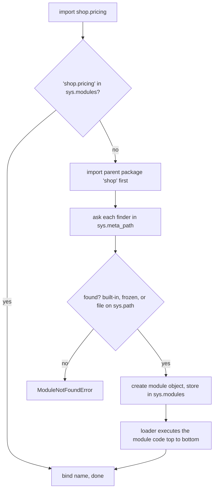
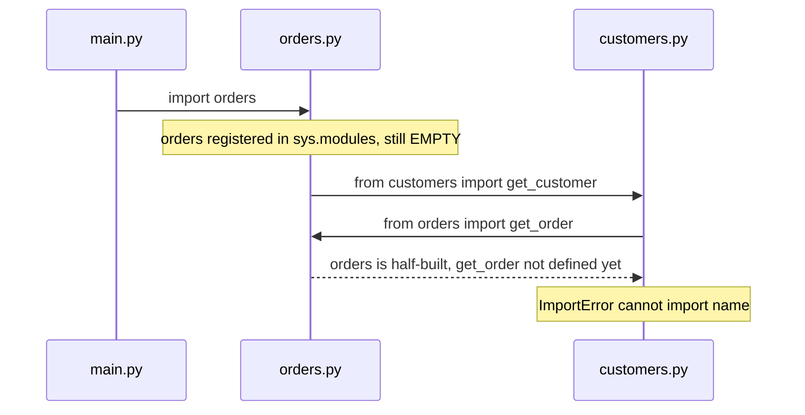
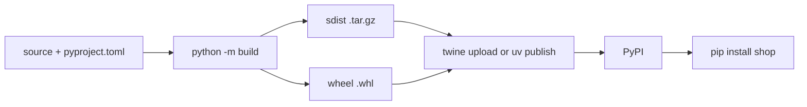

# Chapter 8 — Modules, Packages and Environments

A single file is fine for a script. Real programs are spread across many files, depend on code other people wrote (NumPy, requests, Django), and must run the same way on your laptop, a colleague's machine and a server (a computer that runs programs for other machines over a network). This chapter covers the three layers that make that possible:

1. **Modules and packages** — how Python code is split into files and folders and pulled together with `import`.
2. **The import system** — where Python looks for code, what it caches (keeps in memory for reuse), and why imports sometimes fail.
3. **Environments and packaging** — `pip` (Python's package installer), virtual environments (isolated, per-project package folders, 8.7), `requirements.txt` vs `pyproject.toml`, modern tools (`uv`, Poetry), project layout and publishing to PyPI (the Python Package Index, the public store of packages).

All scripts are in [`code/`](code/); they build their demo packages in temporary folders, so they leave nothing behind. Output shown is real (Python 3.14; code is 3.12-compatible).

**What you'll learn**

| # | Topic | Script |
|---|---|---|
| 8.1 | Modules and the four `import` forms, aliases | `01_import_basics.py` |
| 8.2 | How `import` works: `sys.modules`, finders/loaders, `sys.path` | `01_import_basics.py`, `02_packages_and_sys_path.py` |
| 8.3 | Packages, `__init__.py`, namespace packages, `__all__` | `02_packages_and_sys_path.py` |
| 8.4 | Absolute vs relative imports | `02_packages_and_sys_path.py` |
| 8.5 | `if __name__ == "__main__"` and `python -m` | `02_packages_and_sys_path.py` |
| 8.6 | Common import errors, circular imports | `03_import_errors.py` |
| 8.7 | `pip` and virtual environments (`venv`) | `04_environments.py` |
| 8.8 | `requirements.txt` vs `pyproject.toml`; `uv` and Poetry | `04_environments.py` |
| 8.9 | Project layout (src layout) and publishing basics | — |

---

## 8.1 Modules and `import`

### What it is
A **module** is simply a `.py` file of Python code — functions, classes, variables — that other code can load with `import`. The module's name is the file name without `.py` (`pricing.py` → module `pricing`). Modules can also be compiled extensions (modules written in C/C++ and compiled to machine code; `.so`/`.pyd`, e.g. parts of NumPy) or be built into the interpreter (`sys`).

Python ships with a large **standard library** ("stdlib"; "batteries included"): `math`, `json`, `pathlib`, `datetime`, `random`, `csv`, `sqlite3`, `http`, `unittest` and a few hundred more — file handling, networking, data formats, testing, concurrency (doing several things at overlapping times) — available with no installation.

Analogy: modules are the chapters of a manual; `import` is putting a bookmark in one so you can refer to it.

### Why it matters
- **Organisation** — big programs become small files with one theme each.
- **Reuse and sharing** — the same module can serve many programs; the whole PyPI ecosystem is modules.
- **Namespaces** — each module has its own global namespace (its own table of names), so `json.load` and `pickle.load` (`pickle` saves Python objects as bytes) never collide.

### How it works — the four import forms

| Form | You then write | Brings into your namespace |
|---|---|---|
| `import math` | `math.sqrt(81)` | The name `math` (the module) |
| `from math import sqrt` | `sqrt(64)` | Only the name `sqrt` |
| `import numpy as np` | `np.array(...)` | The module under an **alias** |
| `from math import sqrt as square_root` | `square_root(2)` | One name under an alias |

```python
import math                                   # whole module
import math as m                              # module with an alias
from math import sqrt                         # one name
from math import sqrt as square_root          # one name with an alias
from os import path as os_path

print("math.sqrt(81)       =", math.sqrt(81))
print("sqrt(64)            =", sqrt(64))
print("square_root(m.pi)   =", square_root(m.pi))
print("m is math           =", m is math)
```
Output:
```
== four import forms ==
math.sqrt(81)       = 9.0
sqrt(64)            = 8.0
square_root(m.pi)   = 1.7724538509055159
m is math           = True
os_path.join('a','b') = a/b

== a module is an object with a namespace ==
sys   type=module  compiled into the interpreter
json  type=module  file ending __init__.py
names in math starting with 'is': ['isclose', 'isfinite', 'isinf', 'isnan', 'isqrt']
```

- A dotted name after `import` (`math.sqrt`) uses **dot notation** to reach attributes inside the module.
- An **alias** (`as`) shortens long names (`np`, `pd`, `plt` are near-universal conventions) or avoids a clash (two modules both exporting `load`).
- `m is math` is `True`: an alias is just a second name for the **same** module object.
- `dir(module)` lists what's inside; `help(module)` shows its documentation.
- `json` reports `__init__.py` — it's actually a *package* (8.3).

**`from module import *`** copies every public name (one not starting with `_`; or those listed in `__all__`) into your namespace. PEP 8 discourages it outside interactive sessions (the REPL or a notebook): readers can't tell where names came from and it can silently overwrite your own names.

**Style (PEP 8):** imports at the top of the file, one per line, grouped *standard library → third-party → your own code*, separated by blank lines. Tools like `ruff` and `isort` (code linting and import-sorting tools) sort them automatically.

### Trade-offs

| | `import math` | `from math import sqrt` |
|---|---|---|
| Clarity at call site | `math.sqrt` shows origin | `sqrt` is shorter but origin is hidden |
| Name clashes | None | Possible |
| Circular-import safety | Safer (attribute looked up at call time, 8.6) | Riskier |
| Monkey-patching/mocking (swapping an attribute at run time, e.g. for a fake in tests) | Sees patched attributes | Holds the *old* object |

### Common mistakes
- Naming your own file after a module you want to use (`random.py`, `json.py`, `email.py`) — see 8.6.
- `import math.sqrt` → `ModuleNotFoundError: No module named 'math.sqrt'; 'math' is not a package`. `import` names modules; use `from math import sqrt` for functions.
- Wildcard imports in production code (code that runs for real users).

### Real-world examples
Every data-science notebook (Jupyter page of code cells and output) starts with `import numpy as np`, `import pandas as pd`, `import matplotlib.pyplot as plt` — community-standard aliases. Django projects import from their own apps: `from shop.models import Order`.

### In the interview
**30-second answer:** "A module is a `.py` file; `import m` loads it once and binds the name `m`, and `from m import x` binds just `x`. `as` gives an alias. Prefer explicit imports, avoid `import *`, and group imports stdlib/third-party/local."

- *Difference between `import a` and `from a import b`?* → Both load the whole module `a`; they differ only in which name is bound in your namespace.
- *Does importing twice run the module twice?* → No — the second time it's fetched from `sys.modules` (8.2).

### Self-check
1. What is a module? → A file of Python code that can be imported.
2. After `from math import sqrt`, does `math.pi` work? → No — `math` isn't bound.
3. Why use `import numpy as np`? → Shorter, conventional alias.

### TL;DR
Module = file. `import m` / `from m import x` / `as` aliases. Explicit imports, grouped, at the top.

---

## 8.2 How `import` really works

### What it is
The **import system** is the machinery that turns `import shop.pricing` into a module object. Three pieces matter:

- **`sys.modules`** — a dict cache of every module already loaded, keyed by full name.
- **Finders and loaders** — *finders* (listed in `sys.meta_path`) locate a module; a *loader* creates and executes it. The built-in chain handles built-in modules, frozen modules (modules baked into the interpreter binary) and the file system.
- **`sys.path`** — the list of folders the file-system finder searches, in order.

### How it works



1. **Check the cache.** If the name is in `sys.modules`, reuse that object — module code runs **only once per process** (one running instance of a program). (`importlib.reload(m)` forces a re-run; rarely needed outside interactive work.)
2. **Import parents first.** `import a.b.c` imports `a`, then `a.b`, then `a.b.c`.
3. **Find.** Each finder is asked in turn. The path finder walks **`sys.path`**, which is built as:
   1. the folder of the script being run (or the current directory for `python -m` / `python -c` / the REPL),
   2. folders in the `PYTHONPATH` environment variable (a named setting the operating system hands to programs),
   3. the standard library,
   4. `site-packages` — where `pip` installs third-party packages (the active venv's, if one is active).
4. **Load.** A new module object is created and put into `sys.modules` **before** its code runs (this is why circular imports give half-built modules, 8.6), then its top-level code executes, filling its namespace.
5. **Bind** the requested name(s) in the importing namespace.

Compiled bytecode (the low-level instructions CPython executes) is cached in `__pycache__/*.pyc` files so later imports skip re-parsing; that's why those folders appear. They're safe to delete and belong in `.gitignore` (the list of files Git, the version-control tool, should ignore).

```python
print("'math' in sys.modules:", "math" in sys.modules)
again = importlib.import_module("math")
print("second import returns the same object:", again is math)
json_mod = importlib.import_module("json")     # import by string name
```
```
'math' in sys.modules: True
second import returns the same object: True
json.dumps via import_module: {"a": 1}
```
`importlib.import_module("name")` imports by a string — how plugin systems (add-ons loaded by name at run time) and frameworks (Django's `INSTALLED_APPS`) load modules chosen in configuration.

### Common mistakes
- Fixing "module not found" with `sys.path.append(...)` hacks scattered through code. Install the project instead (`pip install -e .`, 8.9) or run with `python -m` from the project root (the project's top-level folder).
- Expecting edits to a module to show up in a running REPL/notebook without `importlib.reload` (or Jupyter's `%autoreload`).

### In the interview
**30-second answer:** "`import` first checks `sys.modules`; if missing, finders search built-ins and then the folders in `sys.path` — script directory, PYTHONPATH, stdlib, site-packages. The loader creates the module, registers it in `sys.modules`, then runs its top-level code once. Later imports reuse the cached object."

- *Why does module-level code only run once?* → The module is cached in `sys.modules`.
- *What's `__pycache__`?* → Cached bytecode (`.pyc`) to speed up later imports.
- *In what order is `sys.path` searched?* → Script dir, PYTHONPATH, stdlib, site-packages; first match wins.

### Self-check
1. Where does Python cache loaded modules? → `sys.modules`.
2. Which folder comes first in `sys.path` when you run `python app.py`? → The folder containing `app.py`.
3. How can you import a module whose name is in a string? → `importlib.import_module`.

### TL;DR
Cache (`sys.modules`) → find (`sys.meta_path`, `sys.path`) → load (register, then execute once) → bind. First match on `sys.path` wins.

---

## 8.3 Packages, `__init__.py`, namespace packages, `__all__`

### What it is
A **package** is a folder of modules that can be imported as a unit, giving a hierarchy of dotted names (`shop.pricing`, `sklearn.linear_model` — `sklearn` is scikit-learn, the machine-learning library). Technically a package is a module with a `__path__` attribute (the list of folders to search for its submodules).

- **Regular package**: a folder containing `__init__.py`. That file runs the first time the package (or anything inside it) is imported. It can be empty, or it can define the package's public API (the names users are meant to rely on) by re-exporting names, set `__version__`, etc.
- **Namespace package** (PEP 420, Python 3.3+): a folder *without* `__init__.py`. Python still imports it; several folders on `sys.path` can even contribute to one namespace (used by big organisations to split one namespace across separately-installed distributions — installable packages as published on PyPI). It has no `__file__`.

| | Module | Regular package | Namespace package |
|---|---|---|---|
| On disk | `x.py` | folder + `__init__.py` | folder, no `__init__.py` |
| Has `__path__` | No | Yes | Yes |
| Runs code on import | The file | `__init__.py` | Nothing |
| Use for | Single unit | Normal libraries and apps | Splitting one namespace over several installs |

**`__all__`** is an optional list of strings in a module or `__init__.py`: it defines what `from package import *` exports and documents the public API.

### How it works — the demo package
`02_packages_and_sys_path.py` writes this tree into a temporary folder:

```
shop/
    __init__.py      # from .pricing import price_with_tax ; __all__ ; __version__
    __main__.py      # makes "python -m shop" work
    pricing.py       # uses a relative and an absolute import of utils
    utils.py
plugins/             # no __init__.py -> namespace package
    extra.py
```

```python
# shop/__init__.py
"""shop - a tiny demo package."""
from .pricing import price_with_tax      # re-export the public API
__all__ = ["price_with_tax"]
__version__ = "0.1.0"
print(f"  [running shop/__init__.py, __name__={__name__!r}]")
```
Then it adds the temp folder to `sys.path` and imports:

```python
sys.path.insert(0, str(root))
import shop                          # runs shop/__init__.py once
import shop                          # cached: __init__ does NOT run again
from shop import price_with_tax
```
```
== import it: put its parent folder on sys.path ==
  [running shop/__init__.py, __name__='shop']
  price_with_tax(100) = 108.0
  shop.__version__    = 0.1.0
  shop.__path__ is a list of folders: ['shop']
  pricing.__name__    = shop.pricing | __package__ = shop
  namespace package: extra plugin (namespace package, no __init__.py)
  plugins has __file__? None

== star import only takes names in __all__ ==
  names brought in: ['price_with_tax']
```
The `[running shop/__init__.py…]` line appears once despite two `import shop` statements. Users can write `from shop import price_with_tax` without knowing it lives in `shop/pricing.py` — the `__init__.py` "facade" (a simple front that hides the internal layout) is how `pandas` lets you write `pd.DataFrame` although `DataFrame` is defined deep in `pandas/core/frame.py`.

### Trade-offs
A heavy `__init__.py` that imports every submodule makes `import pkg` slow and raises circular-import risk; an empty one forces users to know the internal layout. Common middle ground: re-export the small public API, keep the rest internal (by convention, `_private` names and modules).

### When not to use it
Don't rely on namespace packages for your ordinary project — forgetting `__init__.py` "works" but tools (some test runners, type checkers — programs that check type hints without running code — packaging configs) handle regular packages more predictably. Use namespace packages deliberately.

### Common mistakes
- Putting slow work (network calls, loading big files) at top level of `__init__.py`.
- Assuming `import pkg` also imports all submodules — it doesn't, unless `__init__.py` imports them. `import pkg.sub` is needed.

### Real-world examples
- `sklearn` is a package of subpackages: `from sklearn.linear_model import LogisticRegression`.
- `json`, `email`, `http`, `urllib`, `concurrent` are packages in the standard library.
- Google's cloud client libraries share the `google.cloud` namespace package across separately installed distributions (`google-cloud-storage`, `google-cloud-bigquery`).

### In the interview
**30-second answer:** "A package is a folder of modules; with `__init__.py` it's a regular package whose init file runs on first import and usually re-exports the public API. Without it, it's a PEP 420 namespace package that can span multiple folders. `__all__` controls `import *` and documents the public surface."

- *Is `__init__.py` required in Python 3?* → No, but without it you get a namespace package, which behaves differently; use it for normal packages.
- *What does `__all__` do?* → Lists names exported by `from m import *`.

### Self-check
1. How does Python tell a package from a module? → A package has `__path__`.
2. When does `__init__.py` run? → On the first import of the package or any of its submodules.
3. Does `import shop` import `shop.utils`? → Only if `shop/__init__.py` (or something it imports) does.

### TL;DR
Package = folder of modules (+ `__init__.py` for a regular package). `__init__.py` runs once and defines the public API. `__all__` limits `import *`.

---

## 8.4 Absolute vs relative imports

### What it is
- **Absolute import**: names the full path from a top-level package on `sys.path` — `from shop.utils import round_money`.
- **Relative import**: names a location relative to the *current package* using leading dots — `from .utils import round_money` (same package), `from ..core import x` (parent package). Only the `from … import …` form can be relative.

### How it works
Relative imports are resolved using the module's `__package__` (`'shop'` for `shop.pricing`, shown in the output above). A file run directly as a script has `__name__ == "__main__"` and no parent package, so relative imports inside it fail:

```
python shop/pricing.py  -> ImportError: attempted relative import with no known parent package
python -m shop.pricing  ->
  [running shop/__init__.py, __name__='shop']
  pricing run directly: 10 -> 10.8
  stderr: RuntimeWarning: 'shop.pricing' found in sys.modules after import of package 'shop', but prior to execution of 'shop.pricing'; this may result in unpredictable behaviour
```
Running with `python -m shop.pricing` from the project root works because Python imports the package first. The `RuntimeWarning` is a real gotcha worth knowing: `shop/__init__.py` already imported `shop.pricing`, so `-m` then executes a *second* copy of it as `__main__`. The fix is to keep runnable entry points (the modules or functions that start a program) in modules that the package `__init__` doesn't import (such as `__main__.py` or a `cli.py`).

### Trade-offs

| | Absolute | Relative |
|---|---|---|
| Readability | Full origin visible | Short inside deep packages |
| Moving/renaming the top package | Must edit imports | Keeps working |
| Works in a script run directly | Yes (if package is on `sys.path`) | No |
| PEP 8 | **Recommended** | Acceptable for intra-package imports |

Python 2's *implicit* relative imports (`import utils` meaning "sibling module") no longer exist in Python 3 — a bare `import utils` is always absolute.

### Common mistakes
- Running a module inside a package as `python pkg/mod.py` → relative imports fail; use `python -m pkg.mod`.
- Too many dots (`from ...x`) beyond the top-level package → `ImportError: attempted relative import beyond top-level package`.

### In the interview
**30-second answer:** "Absolute imports use the full dotted path and are PEP 8's default; relative imports use dots relative to the current package and work only inside packages, not in files run as scripts — run those with `python -m`."

### Self-check
1. What does `from . import utils` mean? → Import `utils` from the current package.
2. Why does a relative import fail in `python pkg/mod.py`? → The module is `__main__` with no parent package.

### TL;DR
Absolute by default; dots for intra-package imports; run package modules with `python -m`.

---

## 8.5 `if __name__ == "__main__":` and `python -m`

### What it is
Every module has a `__name__`. When the file is **imported**, `__name__` is its module name (`'shop.pricing'`). When the file is **run directly** (`python file.py` or `python -m pkg.mod`), `__name__` is the string `'__main__'`. The guard

```python
if __name__ == "__main__":
    main()
```
runs code only when the file is executed, not when it's imported.

### Why it matters
It lets one file be both a **reusable module** and a **runnable script**: tests and other modules can import its functions without triggering the script behaviour (starting a server, parsing command-line arguments — the words typed after the command — printing). It's also required for code using `multiprocessing` (running work in several separate Python processes) on platforms that start workers (helper processes) by re-importing the main module (the `spawn` and `forkserver` start methods — ways of launching a new process: Windows, macOS by default since 3.8, and Linux since 3.14 made `forkserver` its default), otherwise each worker would re-run the script.

### How it works
- `python -m package.module` runs a module found via `sys.path` as `__main__` — the right way to run code inside packages, and how many tools are invoked: `python -m pip`, `python -m venv`, `python -m pytest`, `python -m http.server`, `python -m json.tool`.
- `python -m package` runs `package/__main__.py` (our demo: `python -m shop says: 19.99 -> 21.59`).
- In a script, `sys.path[0]` is the script's folder; with `-m`, it's the current directory.

```
python -m shop          ->
  [running shop/__init__.py, __name__='shop']
  python -m shop says: 19.99 -> 21.59
```

### Common mistakes
- Top-level test calls or `print`s without the guard — they run every time someone imports your module.
- Putting lots of logic *inside* the guard. Keep it to `main()` so the logic stays importable and testable.

### In the interview
**30-second answer:** "`__name__` is `'__main__'` for the file being run and the module name when imported. The guard keeps script-only code from running on import. `python -m pkg.mod` runs a module inside a package with correct imports; `python -m pkg` runs `pkg/__main__.py`."

### Self-check
1. What's `__name__` inside `shop/pricing.py` when imported? → `'shop.pricing'`.
2. What does `python -m shop` execute? → `shop/__main__.py`.

### TL;DR
Guard script behaviour with `if __name__ == "__main__": main()`. Use `python -m` for modules inside packages.

---

## 8.6 Common import errors and circular imports

### What it is
Most import problems fall into a handful of patterns. `03_import_errors.py` reproduces each one in a throwaway folder:

```
1. missing module                  -> ModuleNotFoundError: No module named 'reqests'
2. name not in module              -> ImportError: cannot import name 'square_root' from 'math' (.../math.cpython-314-darwin.so)
3. shadowing the stdlib            -> AttributeError: module 'random' has no attribute 'randint' (consider renaming '.../random.py' since it has the same name as the standard library module named 'random' and prevents importing that standard library module)
4. circular import (from-import)   -> ImportError: cannot import name 'get_order' from 'orders' (consider renaming '.../orders.py' if it has the same name as a library you intended to import)
4b. fixed: import module, use attr -> {'id': 7, 'customer': {'id': 1}}
4c. fixed: import inside function  -> {'id': 7, 'customer': {'id': 1}}
```

| Error | Usual cause | Fix |
|---|---|---|
| `ModuleNotFoundError` (subclass of `ImportError`) | Typo; package not installed **in the interpreter you're running**; wrong working directory (the folder your shell is in) | Check spelling; `python -m pip install x` with the same `python`; install the project or use `-m` |
| `ImportError: cannot import name` | Name doesn't exist in that module (typo, removed in a new version) — or a circular import | Check the module's contents / version |
| `AttributeError: module 'x' has no attribute 'y'` | Your file named `x.py` shadows the real module; or submodule not imported | Rename your file (and delete its `__pycache__`) |
| `ImportError: attempted relative import …` | Ran a package module as a script | `python -m pkg.mod` |

Case 3 happens because `sys.path[0]` (the script's folder) is searched before the standard library, so a local `random.py` wins. Python 3.13+ adds the helpful "consider renaming" hint.

### Circular imports
A **circular import** is when module A imports B while B (directly or indirectly) imports A.



Why it breaks: step 4 of 8.2 — a module is registered in `sys.modules` *before* its body runs. When `customers` asks for `orders.get_order`, it gets the half-initialised `orders` module whose `def get_order` line hasn't executed yet. (On Python 3.12 the message says it plainly: "cannot import name 'get_order' from partially initialized module 'orders' (most likely due to a circular import)". The 3.14 run above instead appends a generic "consider renaming" hint, which is misleading here — nothing is shadowed. When you see `cannot import name` for a name that clearly exists, suspect a cycle first.)

Fixes, best first:
1. **Restructure** — move the shared code into a third module both can import (breaks the cycle; usually the right design fix).
2. **Import the module, not the name** (`import orders` then `orders.get_order(...)` inside functions) — the attribute is looked up at *call* time, after both modules have finished loading (case 4b).
3. **Deferred import** inside the function that needs it (case 4c) — cheap, local, but hides a dependency (something your code needs in order to work).
4. For imports needed only by type hints: `from typing import TYPE_CHECKING` / `if TYPE_CHECKING: from orders import Order` (type checkers see it, runtime doesn't).

### Common mistakes
- "`pip install` worked but import fails": pip installed into a different interpreter. Always use `python -m pip ...` with the same `python` that runs your code, and check `which python` / `sys.executable` (both show which interpreter file is actually running).
- Naming a file `test.py`, `code.py`, `email.py`, `random.py`, `numpy.py` …

### Real-world examples
Django models in different apps that reference each other avoid circular imports by using string references (`models.ForeignKey("customers.Customer", ...)` — a *foreign key* is a database link from one record to another) — a framework-level version of "look it up later".

### In the interview
**30-second answer:** "A circular import happens because a module is put in `sys.modules` before its body finishes, so the other module sees a half-built object and `from x import y` fails. Fix by moving shared code to a third module, importing the module instead of names so lookup happens at call time, or deferring the import into a function."

- *`ModuleNotFoundError` but the package is installed — why?* → Different interpreter/venv from the one pip used; or a local file shadows it.
- *Why does `import a` survive a cycle when `from a import f` doesn't?* → `import a` only needs the module object to exist; `from a import f` needs `f` to be defined already.

### Self-check
1. What's the parent class of `ModuleNotFoundError`? → `ImportError`.
2. Why does a local `random.py` break `import random`? → The script's folder is first on `sys.path`.
3. Best long-term fix for a cycle? → Extract the shared code into a separate module.

### TL;DR
Check spelling, interpreter and shadowing first. Cycles break `from x import y`; fix by restructuring, `import module`, or deferred import.

---

## 8.7 `pip` and virtual environments

### What it is
- **PyPI** (Python Package Index, pypi.org) is the public repository of third-party packages.
- **`pip`** is the standard installer: it downloads packages (preferably pre-built **wheels**, `.whl` — ready-to-install archives) and their dependencies (other packages they need) from PyPI into an environment's `site-packages`.
- A **virtual environment (venv)** is an isolated folder containing its own `site-packages` and a `python` link to a base interpreter. Packages installed into it don't affect other projects or the system Python.

Analogy: each project gets its own toolbox; you don't throw all tools from all jobs into one drawer.

### Why it matters
Project A needs `Django 4.2`, project B needs `Django 5.1` — only one can live in a single `site-packages`. Venvs give each project its own versions, make "works on my machine" reproducible, and keep you from breaking your operating system's Python. Many systems (Homebrew Python, Debian/Ubuntu — popular Linux distributions) now **refuse** a global `pip install` with an `externally-managed-environment` error (PEP 668) precisely to push you into a venv.

### How it works

```bash
python3 -m venv .venv                 # create (folder name .venv is the convention)
source .venv/bin/activate             # macOS/Linux   (Windows: .venv\Scripts\activate)
python -m pip install requests        # install into THIS venv
python -m pip install "django>=5,<6"  # version specifiers
python -m pip list                    # what's installed
python -m pip show requests           # details, dependencies
python -m pip install -U requests     # upgrade
python -m pip uninstall requests
python -m pip freeze > requirements.txt   # exact versions of everything installed
python -m pip install -r requirements.txt # recreate elsewhere
deactivate                            # leave the venv
```

"Activating" only prepends the venv's `bin/` to your `PATH` (the list of folders your shell searches for commands) so `python` and `pip` refer to the venv's copies — you can also skip activation and call `.venv/bin/python` directly. A venv is **not portable**: don't copy or commit (record a snapshot in Git) it; commit the dependency list and recreate it. Add `.venv/` to `.gitignore`.

Inside a venv, `sys.prefix` (the venv) differs from `sys.base_prefix` (the base install) — that's how code detects one:

```python
def in_venv() -> bool:
    return sys.prefix != sys.base_prefix

venv.create(env_dir, with_pip=False)   # same as: python -m venv .venv --without-pip
```
```
== which interpreter am I? ==
  Python 3.14.7
  running inside a venv: True
  sys.prefix folder name: .venv-books

== installed distributions (importlib.metadata) ==
  numpy         2.5.3
  pandas        3.0.6
  scikit-learn  1.9.1
  numpy requires python: >=3.12

== a fresh, empty venv is isolated ==
  created: ['bin', 'include', 'lib', 'pyvenv.cfg']
  new venv -> in venv: True
  new venv -> No module named 'numpy'
```
The book's own environment has NumPy, but a brand-new venv can't see it — isolation in action. `importlib.metadata.version("numpy")` reads an installed distribution's version at runtime.

### Trade-offs

| Tool | What it isolates | Notes |
|---|---|---|
| `venv` (stdlib) | Python packages | Built in; uses an existing Python |
| `pipx` | Each CLI (command-line) *tool* in its own venv | For tools like `black`, `httpie`, not project libraries |
| `conda` | Packages **and** non-Python libraries (CUDA, MKL — GPU and maths libraries — compilers), Python itself | Popular in data science; own package channels |
| Docker (bundles an app with its own OS files into a *container*) | Whole OS userland (the OS files outside the kernel) | Deployment-level (production-running) isolation, heavier |

### When not to use it
You don't need a venv to run a script that uses only the standard library. Everything else — use one per project.

### Common mistakes
- `pip install` running a different Python than your code → always `python -m pip`.
- `sudo pip install` into the system Python.
- Committing `.venv/` to git or copying it between machines.
- Unpinned (no exact version fixed) installs in production (`pip install requests` today and next year give different versions).

### Real-world examples
CI pipelines (continuous integration: automatic build-and-test on every change; GitHub Actions is GitHub's CI service) create a fresh environment per run and install from a lock/requirements file, so every build is reproducible. Heroku-style platforms (hosting services that build and run your app) and many Docker images (container templates) do `pip install -r requirements.txt` at build time.

### In the interview
**30-second answer:** "pip installs packages from PyPI into an environment's site-packages. A venv is an isolated environment per project — `python -m venv .venv`, activate, `python -m pip install`. It prevents version conflicts between projects and protects the system Python. Don't commit the venv; commit the dependency list."

- *How can code tell it's in a venv?* → `sys.prefix != sys.base_prefix`.
- *venv vs conda?* → venv isolates Python packages for an existing interpreter; conda also manages Python versions and native libraries.

### Self-check
1. Command to create a venv? → `python -m venv .venv`.
2. Why `python -m pip` instead of `pip`? → Guarantees pip installs into the same interpreter you run.
3. What does activating a venv actually change? → Your `PATH` (plus the prompt).

### TL;DR
One venv per project. `python -m venv .venv` → activate → `python -m pip install …`. Never commit the venv.

---

## 8.8 `requirements.txt` vs `pyproject.toml`; `uv` and Poetry

### What it is
- **`requirements.txt`** — a plain list of packages for pip to install, often with exact pins (`requests==2.32.3`). It describes an *environment*, not a project, and it's pip-specific.
- **`pyproject.toml`** — the standard project configuration file (TOML format, a simple human-readable settings syntax). It declares **build requirements** (PEP 518, `[build-system]`), **project metadata** (descriptive information) — name, version, supported Python, dependencies, optional extras (named groups of extra dependencies), command-line entry points (PEP 621, `[project]`) — and settings for tools (`[tool.ruff]`, `[tool.pytest.ini_options]`, …).
- A **lock file** (`uv.lock`, `poetry.lock`, or a fully pinned requirements file) records the exact resolved version of *every* package including transitive dependencies (the dependencies of your dependencies), for reproducible installs.

### How it works
A minimal `pyproject.toml` — the script parses this very text with the standard-library `tomllib` (3.11+):

```toml
[build-system]
requires = ["hatchling"]
build-backend = "hatchling.build"

[project]
name = "shop"
version = "0.1.0"
requires-python = ">=3.12"
dependencies = ["requests>=2.31,<3", "pydantic>=2"]

[project.optional-dependencies]
dev = ["pytest>=8", "ruff"]

[project.scripts]
shop = "shop.cli:main"
```
```
== reading pyproject.toml (tomllib, 3.11+) ==
  name/version : shop 0.1.0
  dependencies : ['requests>=2.31,<3', 'pydantic>=2']
  dev extras   : ['pytest>=8', 'ruff']
  console script 'shop' -> shop.cli:main
  build backend: hatchling.build
```
- `dependencies` uses **ranges** (what your code is compatible with); the lock file holds **exact pins** (what you tested).
- `pip install -e ".[dev]"` installs the project in **editable** mode (the install points at your source folder, so edits take effect without reinstalling) plus the `dev` extras.
- `[project.scripts]` makes `pip` create a `shop` command that calls `shop.cli:main()`.
- The **build backend** (hatchling, setuptools, flit-core, poetry-core, uv_build…) turns the project into distributable files (PEP 517).

| | `requirements.txt` | `pyproject.toml` |
|---|---|---|
| Standard? | pip convention | PEP 518/517/621 standard |
| Describes | An environment to install | A project: metadata, deps, build, tool config |
| Typical content | Exact pins | Compatible ranges |
| Used by | `pip install -r` | pip, build, uv, Poetry, hatch, ruff, pytest… |
| Best for | Deploying an app; simple scripts | Any package or modern project |

**Version specifiers:** `==2.1.0` exact, `>=2.1` minimum, `<3` upper bound, `~=2.1` "compatible release" (≥2.1, <3.0), `!=2.1.3` exclude.

### Modern tools: `uv` and Poetry (brief)
- **uv** (by Astral, written in Rust, a fast compiled language) — a very fast replacement for pip, venv, pip-tools and pipx in one binary (a single executable program). `uv init` (new project with `pyproject.toml`), `uv add requests` (add dependency + update `uv.lock` + install), `uv sync` (make `.venv` match the lock), `uv run pytest` (run inside the project env), `uv python install 3.12` (manage Python versions), `uv pip install ...` (pip-compatible interface), `uv build` / `uv publish`.
- **Poetry** — an older, widely used all-in-one tool: `poetry new`, `poetry add`, `poetry install`, `poetry.lock`, `poetry build`, `poetry publish`. Poetry 2.x supports the standard `[project]` table.

Both do the same core job: manage `pyproject.toml`, resolve dependencies, write a lock file, and create the venv for you.

### When not to use it
For a one-file script, a venv + `requirements.txt` is enough. Don't mix tools in one project (e.g. Poetry lock + hand-edited requirements) — pick one source of truth (the single file everyone treats as authoritative).

### Common mistakes
- Pinning exact versions in a **library's** `dependencies` — it makes your library impossible to install alongside others. Libraries use ranges; applications lock.
- `pip freeze` into requirements for a library (captures your whole environment, including dev tools).
- Forgetting to commit the lock file for applications.

### Real-world examples
Most major projects (pandas, FastAPI, pytest, scikit-learn) now declare metadata in `pyproject.toml`. Tools such as ruff, black, mypy and pytest read their configuration from it.

### In the interview
**30-second answer:** "`requirements.txt` is a pip input listing packages, usually pinned — an environment snapshot. `pyproject.toml` is the standard project file: build system, metadata, dependency ranges, extras, entry points and tool config. Reproducibility comes from a lock file; tools like uv and Poetry manage the pyproject, lock and venv together."

- *Library vs application dependencies?* → Libraries declare loose ranges; applications pin exact versions with a lock file.
- *What's a wheel?* → A pre-built distribution (`.whl`, a zip) that installs without running a build — fast and no compiler needed.

### Self-check
1. Which PEP defines the `[project]` table? → PEP 621.
2. What does `~=2.1` allow? → ≥2.1 and <3.0.
3. What file makes installs reproducible? → A lock file (or fully pinned requirements).

### TL;DR
`pyproject.toml` = the project (ranges, metadata, build, tool config). Lock file / pinned `requirements.txt` = exact environment. uv (fast, all-in-one) and Poetry manage both.

---

## 8.9 Project layout and publishing basics

### What it is
The **src layout** puts your package inside a `src/` folder instead of at the project root:

```
shop-project/
├── pyproject.toml
├── README.md
├── src/
│   └── shop/
│       ├── __init__.py
│       ├── __main__.py
│       ├── cli.py
│       └── pricing.py
└── tests/
    └── test_pricing.py
```
(The alternative, **flat layout**, puts `shop/` next to `pyproject.toml`.)

### Why it matters
With a flat layout, running `pytest` or `python` from the project root puts the root on `sys.path`, so `import shop` silently uses your *source folder* — tests pass even if packaging is broken (a missing file in the built wheel, a wrong `package-data` rule). With the src layout, `shop` is importable **only after installing** it (`pip install -e .` for development), so your tests exercise what users actually get. The Python Packaging User Guide describes both and explains this advantage of src.

### How it works — publishing to PyPI
1. Put metadata in `pyproject.toml` (name must be unique on PyPI; bump `version` for every release — PyPI never lets you re-upload a version).
2. **Build** distributions: `python -m build` (or `uv build`) creates `dist/shop-0.1.0.tar.gz` (**sdist**, source) and `dist/shop-0.1.0-py3-none-any.whl` (**wheel**, ready to install).
3. **Test** on **TestPyPI** (test.pypi.org), a separate sandbox (safe practice) index.
4. **Upload**: `python -m twine upload dist/*` (or `uv publish`) with an API token (a secret key that proves your identity to a service) — or, better, **Trusted Publishing** from CI (GitHub Actions authenticates to PyPI via OpenID Connect — a standard protocol for proving identity between services — no long-lived token stored).
5. Users run `pip install shop`.



### Trade-offs

| | src layout | flat layout |
|---|---|---|
| Catches packaging mistakes | Yes (must install to import) | No |
| Setup effort | Needs `pip install -e .` | Works from root immediately |
| Used by | Many libraries (and uv's `--package`/`--lib` templates) | Many apps and simple projects |

### When not to use it
A small app that's never packaged (a Django site, a notebook project) gains little from src layout or publishing.

### Common mistakes
- Uploading secrets (passwords, keys, tokens): check `dist/` contents before uploading (a wheel is just a zip — `unzip -l`).
- Re-using a version number — PyPI will reject it.
- Package name on PyPI ≠ import name (e.g. install `scikit-learn`, import `sklearn`; install `Pillow`, import `PIL`) — confusing for users, so keep them aligned for new projects.

### Real-world examples
The `pip install scikit-learn` → `import sklearn` split is the classic name mismatch. Many popular projects publish to PyPI from GitHub Actions using Trusted Publishing.

### In the interview
**30-second answer:** "Use a `pyproject.toml`, ideally a src layout so tests run against the installed package. Build an sdist and a wheel with `python -m build` or `uv build`, try them on TestPyPI, then upload with twine or `uv publish`, preferably via Trusted Publishing from CI. Versions are immutable on PyPI."

- *sdist vs wheel?* → sdist is source that must be built on install; wheel is pre-built and installs by unpacking.
- *Why src layout?* → Prevents accidentally importing the working copy instead of the installed package.

### Self-check
1. What two files does `python -m build` produce? → An sdist (`.tar.gz`) and a wheel (`.whl`).
2. How do you make a src-layout package importable while developing? → `pip install -e .` (editable install).
3. Can you re-upload version 0.1.0 after a fix? → No — release 0.1.1.

### TL;DR
src layout + `pyproject.toml` + editable install for dev. `build` → sdist + wheel → TestPyPI → PyPI (Trusted Publishing).

---

## Chapter TL;DR

- **Module** = a `.py` file; **package** = folder of modules (`__init__.py` → regular, none → namespace). `import m`, `from m import x`, `as` aliases; avoid `import *`.
- `import` checks `sys.modules` → finds via `sys.path` (script dir, PYTHONPATH, stdlib, site-packages) → registers then runs the module **once** → binds names.
- Absolute imports by default; relative (`.`) only inside packages; run package modules with `python -m`.
- `if __name__ == "__main__": main()` separates "run" from "import".
- Import errors: typo / wrong interpreter / shadowing file / circular import (module registered before its body runs — restructure, `import module`, or deferred import).
- One **venv** per project; `python -m pip`; never commit `.venv`.
- `pyproject.toml` (standard: metadata, dependency ranges, build, tool config) vs `requirements.txt` (pip list, pins); lock files for reproducibility; **uv** or **Poetry** manage it all.
- **src layout**, build **sdist + wheel**, TestPyPI, then PyPI via twine/`uv publish`/Trusted Publishing.
