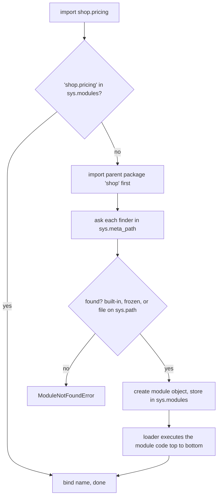
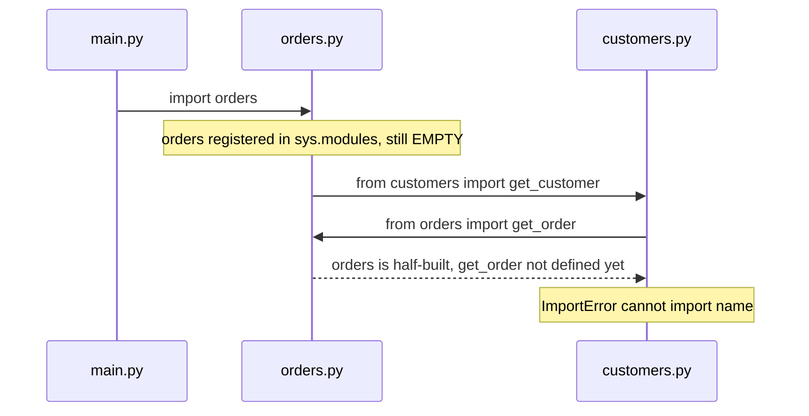
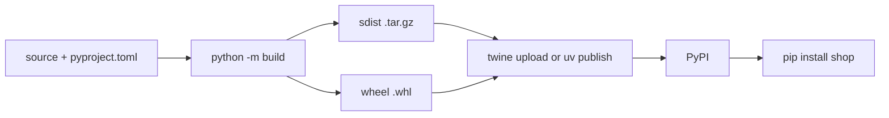

# Chapter 8 — Modules, Packages and Environments

Real programs span many files, depend on other people's code (NumPy, requests, Django), and must run the same on your laptop, a colleague's machine and a server. Three layers make that possible:

1. **Modules and packages** — splitting code into files and folders, pulled together with `import`.
2. **The import system** — where Python looks for code, what it caches, why imports fail.
3. **Environments and packaging** — `pip` (the package installer), virtual environments (isolated per-project package folders, 8.7), `requirements.txt` vs `pyproject.toml`, `uv` and Poetry, project layout, publishing to PyPI (the Python Package Index, the public package store).

Scripts are in [`code/`](code/); they build demo packages in temporary folders and leave nothing behind. Output is real (Python 3.14; code is 3.12-compatible).

| # | Topic | Script |
|---|---|---|
| 8.1 | Modules, the four `import` forms, aliases | `01_import_basics.py` |
| 8.2 | How `import` works: `sys.modules`, finders/loaders, `sys.path` | `01_import_basics.py`, `02_packages_and_sys_path.py` |
| 8.3 | Packages, `__init__.py`, namespace packages, `__all__` | `02_packages_and_sys_path.py` |
| 8.4 | Absolute vs relative imports | `02_packages_and_sys_path.py` |
| 8.5 | `if __name__ == "__main__"` and `python -m` | `02_packages_and_sys_path.py` |
| 8.6 | Common import errors, circular imports | `03_import_errors.py` |
| 8.7 | `pip` and virtual environments (`venv`) | `04_environments.py` |
| 8.8 | `requirements.txt` vs `pyproject.toml`; `uv` and Poetry | `04_environments.py` |
| 8.9 | Project layout (src layout) and publishing basics | — |

---

## 8.1 Modules and `import`

### What it is
A **module** is a `.py` file of functions, classes and variables that other code loads with `import`; its name is the file name without `.py` (`pricing.py` → `pricing`). Modules can also be compiled extensions (C/C++ compiled to machine code, `.so`/`.pyd`, e.g. parts of NumPy) or built into the interpreter (`sys`).

The **standard library** ("stdlib", "batteries included") ships a few hundred modules — `math`, `json`, `pathlib`, `datetime`, `random`, `csv`, `sqlite3`, `http`, `unittest` — for files, networking, data formats, testing and concurrency, with no installation.

### Why it matters
- **Organisation** — one theme per file.
- **Reuse and sharing** — PyPI is just modules.
- **Namespaces** — each module has its own global names, so `json.load` and `pickle.load` (`pickle` saves objects as bytes) never collide.

### How it works — the four import forms

| Form | You then write | Brings into your namespace |
|---|---|---|
| `import math` | `math.sqrt(81)` | The name `math` (the module) |
| `from math import sqrt` | `sqrt(64)` | Only `sqrt` |
| `import numpy as np` | `np.array(...)` | The module under an **alias** |
| `from math import sqrt as square_root` | `square_root(2)` | One name under an alias |

```python
import math                                   # whole module
import math as m                              # module with an alias
from math import sqrt                         # one name
from math import sqrt as square_root          # one name with an alias
from os import path as os_path

print("math.sqrt(81)       =", math.sqrt(81))
print("sqrt(64)            =", sqrt(64))
print("square_root(m.pi)   =", square_root(m.pi))
print("m is math           =", m is math)
```
Output:
```
== four import forms ==
math.sqrt(81)       = 9.0
sqrt(64)            = 8.0
square_root(m.pi)   = 1.7724538509055159
m is math           = True
os_path.join('a','b') = a/b

== a module is an object with a namespace ==
sys   type=module  compiled into the interpreter
json  type=module  file ending __init__.py
names in math starting with 'is': ['isclose', 'isfinite', 'isinf', 'isnan', 'isqrt']
```
- **Dot notation** (`math.sqrt`) reaches attributes inside the module.
- An **alias** shortens names (`np`, `pd`, `plt` are conventions) or avoids clashes; `m is math` — same module object.
- `dir(module)` lists contents; `help(module)` shows docs. `json` reports `__init__.py` — it's a *package* (8.3).

**`from module import *`** copies every public name (no leading `_`, or those in `__all__`). PEP 8 discourages it outside interactive sessions: origins become invisible and your names can be silently overwritten.

**Style (PEP 8):** imports at the top, one per line, grouped *stdlib → third-party → your code* with blank lines between; `ruff` / `isort` sort them.

### Trade-offs

| | `import math` | `from math import sqrt` |
|---|---|---|
| Clarity at call site | `math.sqrt` shows origin | Shorter, origin hidden |
| Name clashes | None | Possible |
| Circular-import safety | Safer (attribute looked up at call time, 8.6) | Riskier |
| Monkey-patching/mocking (swapping an attribute at run time, e.g. a fake in tests) | Sees patched attributes | Holds the *old* object |

### Common mistakes
- Naming your file after a module you use (`random.py`, `json.py`) — 8.6.
- `import math.sqrt` → `ModuleNotFoundError: No module named 'math.sqrt'; 'math' is not a package`; use `from math import sqrt`.
- Wildcard imports in production code.

### Real-world examples
Notebooks start `import numpy as np`, `import pandas as pd`, `import matplotlib.pyplot as plt`; Django projects `from shop.models import Order`.

### In the interview
**30-second answer:** "A module is a `.py` file; `import m` loads it once and binds the name `m`, and `from m import x` binds just `x`. `as` gives an alias. Prefer explicit imports, avoid `import *`, and group imports stdlib/third-party/local."
- *`import a` vs `from a import b`?* → Both load all of `a`; only the bound name differs (after `from math import sqrt`, `math.pi` fails).
- *Importing twice runs twice?* → No — cached in `sys.modules` (8.2).

### TL;DR
Module = file. `import m` / `from m import x` / `as` aliases. Explicit imports, grouped, at the top.

---

## 8.2 How `import` really works

### What it is
The **import system** turns `import shop.pricing` into a module object:
- **`sys.modules`** — dict cache of every loaded module, keyed by full name.
- **Finders and loaders** — *finders* (in `sys.meta_path`) locate a module; a *loader* creates and executes it. The built-in chain handles built-in modules, frozen modules (baked into the interpreter binary) and the file system.
- **`sys.path`** — folders the file-system finder searches, in order.

### How it works



1. **Check the cache.** In `sys.modules` → reuse; module code runs **once per process**. (`importlib.reload(m)` forces a re-run.)
2. **Import parents first:** `a`, then `a.b`, then `a.b.c`.
3. **Find.** The path finder walks **`sys.path`**:
   1. the running script's folder (or the current directory for `python -m` / `-c` / the REPL),
   2. folders in the `PYTHONPATH` environment variable,
   3. the standard library,
   4. `site-packages` — where `pip` installs (the active venv's, if any).
4. **Load.** The new module is put into `sys.modules` **before** its code runs (why circular imports see half-built modules, 8.6), then its top level executes.
5. **Bind** the requested names.

Bytecode is cached in `__pycache__/*.pyc` to skip re-parsing; safe to delete; add to `.gitignore`.

```python
print("'math' in sys.modules:", "math" in sys.modules)
again = importlib.import_module("math")
print("second import returns the same object:", again is math)
json_mod = importlib.import_module("json")     # import by string name
```
```
'math' in sys.modules: True
second import returns the same object: True
json.dumps via import_module: {"a": 1}
```
`importlib.import_module("name")` imports by string — how plugin systems and frameworks (Django's `INSTALLED_APPS`) load modules named in configuration.

### Common mistakes
- Scattering `sys.path.append(...)` hacks. Install the project (`pip install -e .`, 8.9) or run `python -m` from the project root.
- Expecting module edits to appear in a running REPL/notebook without `importlib.reload` (or Jupyter's `%autoreload`).

### In the interview
**30-second answer:** "`import` first checks `sys.modules`; if missing, finders search built-ins and then the folders in `sys.path` — script directory, PYTHONPATH, stdlib, site-packages. The loader creates the module, registers it in `sys.modules`, then runs its top-level code once. Later imports reuse the cached object."
- *`__pycache__`?* → Cached `.pyc` bytecode.
- *`sys.path` order?* → Script dir, PYTHONPATH, stdlib, site-packages; first match wins.

### TL;DR
Cache (`sys.modules`) → find (`sys.meta_path`, `sys.path`) → load (register, execute once) → bind. First match on `sys.path` wins.

---

## 8.3 Packages, `__init__.py`, namespace packages, `__all__`

### What it is
A **package** is a folder of modules imported as a unit, giving dotted names (`shop.pricing`, `sklearn.linear_model` — scikit-learn). Technically: a module with a `__path__` attribute (folders to search for submodules).

- **Regular package**: folder with `__init__.py`, which runs on the first import of the package or anything inside. Empty, or defines the public API (re-exports names, `__version__`).
- **Namespace package** (PEP 420, 3.3+): folder *without* `__init__.py`. Still importable; several `sys.path` folders can contribute to one namespace (splitting a namespace over separately installed distributions). No `__file__`.

| | Module | Regular package | Namespace package |
|---|---|---|---|
| On disk | `x.py` | folder + `__init__.py` | folder, no `__init__.py` |
| Has `__path__` | No | Yes | Yes |
| Runs code on import | The file | `__init__.py` | Nothing |
| Use for | Single unit | Normal libraries and apps | One namespace over several installs |

**`__all__`** — optional list of strings defining what `from package import *` exports; documents the public API.

### How it works — the demo package
`02_packages_and_sys_path.py` writes this tree into a temp folder:
```
shop/
    __init__.py      # from .pricing import price_with_tax ; __all__ ; __version__
    __main__.py      # makes "python -m shop" work
    pricing.py       # uses a relative and an absolute import of utils
    utils.py
plugins/             # no __init__.py -> namespace package
    extra.py
```

```python
# shop/__init__.py
"""shop - a tiny demo package."""
from .pricing import price_with_tax      # re-export the public API
__all__ = ["price_with_tax"]
__version__ = "0.1.0"
print(f"  [running shop/__init__.py, __name__={__name__!r}]")
```
```python
sys.path.insert(0, str(root))
import shop                          # runs shop/__init__.py once
import shop                          # cached: __init__ does NOT run again
from shop import price_with_tax
```
```
== import it: put its parent folder on sys.path ==
  [running shop/__init__.py, __name__='shop']
  price_with_tax(100) = 108.0
  shop.__version__    = 0.1.0
  shop.__path__ is a list of folders: ['shop']
  pricing.__name__    = shop.pricing | __package__ = shop
  namespace package: extra plugin (namespace package, no __init__.py)
  plugins has __file__? None

== star import only takes names in __all__ ==
  names brought in: ['price_with_tax']
```
`__init__.py` ran once despite two imports. The re-export "facade" (a simple front hiding internal layout) is how `pd.DataFrame` works although `DataFrame` lives in `pandas/core/frame.py`.

### Trade-offs
A heavy `__init__.py` importing every submodule slows `import pkg` and risks cycles; an empty one forces users to learn the layout. Middle ground: re-export the small public API; keep the rest `_private`.

### When not to use it
Don't rely on namespace packages accidentally — tools (test runners, type checkers, packaging configs) handle regular packages more predictably.

### Common mistakes
- Slow work (network calls, big files) at the top level of `__init__.py`.
- Assuming `import pkg` imports all submodules — only what `__init__.py` imports; otherwise `import pkg.sub`.

### Real-world examples
- `from sklearn.linear_model import LogisticRegression` — subpackages.
- Stdlib packages: `json`, `email`, `http`, `urllib`, `concurrent`.
- Google's `google.cloud` namespace package spans `google-cloud-storage`, `google-cloud-bigquery`, etc.

### In the interview
**30-second answer:** "A package is a folder of modules; with `__init__.py` it's a regular package whose init file runs on first import and usually re-exports the public API. Without it, it's a PEP 420 namespace package that can span multiple folders. `__all__` controls `import *` and documents the public surface."
- *`__init__.py` required in Python 3?* → No, but without it you get a namespace package, which behaves differently.

### TL;DR
Package = folder of modules (+ `__init__.py` for regular). `__init__.py` runs once and defines the public API; `__all__` limits `import *`; packages have `__path__`.

---

## 8.4 Absolute vs relative imports

### What it is
- **Absolute**: full path from a top-level package on `sys.path` — `from shop.utils import round_money`.
- **Relative**: dots relative to the *current package* — `from .utils import ...` (same package), `from ..core import x` (parent). Only `from … import …` can be relative.

### How it works
Relative imports resolve via `__package__` (`'shop'` for `shop.pricing`). A file run directly is `__main__` with no parent package, so its relative imports fail:
```
python shop/pricing.py  -> ImportError: attempted relative import with no known parent package
python -m shop.pricing  ->
  [running shop/__init__.py, __name__='shop']
  pricing run directly: 10 -> 10.8
  stderr: RuntimeWarning: 'shop.pricing' found in sys.modules after import of package 'shop', but prior to execution of 'shop.pricing'; this may result in unpredictable behaviour
```
`python -m` from the project root imports the package first, so it works. The `RuntimeWarning` is a real gotcha: `shop/__init__.py` already imported `shop.pricing`, so `-m` executes a *second* copy as `__main__`. Keep entry points (modules that start a program) in modules `__init__` doesn't import (`__main__.py`, `cli.py`).

### Trade-offs

| | Absolute | Relative |
|---|---|---|
| Readability | Full origin visible | Short in deep packages |
| Renaming the top package | Must edit imports | Keeps working |
| Works in a script run directly | Yes (if package is on `sys.path`) | No |
| PEP 8 | **Recommended** | Acceptable intra-package |

Python 2's *implicit* relative imports are gone: bare `import utils` is always absolute.

### Common mistakes
- `python pkg/mod.py` → relative imports fail; use `python -m pkg.mod`.
- Dots beyond the top package → `ImportError: attempted relative import beyond top-level package`.

### In the interview
**30-second answer:** "Absolute imports use the full dotted path and are PEP 8's default; relative imports use dots relative to the current package and work only inside packages, not in files run as scripts — run those with `python -m`."

### TL;DR
Absolute by default; dots for intra-package imports; run package modules with `python -m`.

---

## 8.5 `if __name__ == "__main__":` and `python -m`

### What it is
`__name__` is the module name when **imported** (`'shop.pricing'`) and `'__main__'` when **run directly** (`python file.py` or `python -m pkg.mod`). The guard (intro in [§1.5](../01-getting-started/README.md))
```python
if __name__ == "__main__":
    main()
```
runs code only on execution, not import.

### Why it matters
One file is both a **reusable module** and a **runnable script**: importers (tests) don't trigger script behaviour (starting a server, parsing command-line arguments, printing). It's also required with `multiprocessing` (work in separate Python processes) where workers start by re-importing the main module — the `spawn` and `forkserver` start methods (Windows; macOS by default since 3.8; Linux defaults to `forkserver` since 3.14) — or each worker re-runs the script.

### How it works
- `python -m package.module` runs a module found via `sys.path` as `__main__` — the right way to run code in packages, and how tools run: `python -m pip`, `-m venv`, `-m pytest`, `-m http.server`, `-m json.tool`.
- `python -m package` runs `package/__main__.py`.
- In a script `sys.path[0]` is the script's folder; with `-m`, the current directory.
```
python -m shop          ->
  [running shop/__init__.py, __name__='shop']
  python -m shop says: 19.99 -> 21.59
```

### Common mistakes
- Top-level test calls or `print`s without the guard run on every import.
- Lots of logic *inside* the guard — keep it to `main()` so logic stays importable and testable.

### In the interview
**30-second answer:** "`__name__` is `'__main__'` for the file being run and the module name when imported. The guard keeps script-only code from running on import. `python -m pkg.mod` runs a module inside a package with correct imports; `python -m pkg` runs `pkg/__main__.py`."

### TL;DR
Guard script behaviour with `if __name__ == "__main__": main()`; use `python -m` for modules inside packages.

---

## 8.6 Common import errors and circular imports

### What it is
`03_import_errors.py` reproduces each common failure in a throwaway folder:
```
1. missing module                  -> ModuleNotFoundError: No module named 'reqests'
2. name not in module              -> ImportError: cannot import name 'square_root' from 'math' (.../math.cpython-314-darwin.so)
3. shadowing the stdlib            -> AttributeError: module 'random' has no attribute 'randint' (consider renaming '.../random.py' since it has the same name as the standard library module named 'random' and prevents importing that standard library module)
4. circular import (from-import)   -> ImportError: cannot import name 'get_order' from 'orders' (consider renaming '.../orders.py' if it has the same name as a library you intended to import)
4b. fixed: import module, use attr -> {'id': 7, 'customer': {'id': 1}}
4c. fixed: import inside function  -> {'id': 7, 'customer': {'id': 1}}
```

| Error | Usual cause | Fix |
|---|---|---|
| `ModuleNotFoundError` (subclass of `ImportError`) | Typo; not installed **in the interpreter you're running**; wrong working directory | Check spelling; `python -m pip install x` with the same `python`; install the project or use `-m` |
| `ImportError: cannot import name` | Name doesn't exist (typo, removed in a new version) — or a circular import | Check the module's contents / version |
| `AttributeError: module 'x' has no attribute 'y'` | Your `x.py` shadows the real module; or submodule not imported | Rename your file (delete its `__pycache__`) |
| `ImportError: attempted relative import …` | Ran a package module as a script | `python -m pkg.mod` |

Case 3: `sys.path[0]` (script folder) precedes the stdlib, so a local `random.py` wins. 3.13+ adds the "consider renaming" hint.

### Circular imports
A **circular import**: A imports B while B (directly or indirectly) imports A.


Why: modules are registered in `sys.modules` *before* their body runs (8.2 step 4), so `customers` gets a half-initialised `orders` whose `def get_order` hasn't executed. Python 3.12 says it plainly ("cannot import name 'get_order' from partially initialized module 'orders' (most likely due to a circular import)"); the 3.14 run above appends a misleading generic "consider renaming" hint instead. If `cannot import name` names something that clearly exists, suspect a cycle.

Fixes, best first:
1. **Restructure** — move shared code to a third module (the right design fix).
2. **Import the module, not the name** (`import orders`; `orders.get_order(...)` inside functions) — looked up at *call* time, after both finished loading (4b).
3. **Deferred import** inside the function (4c) — cheap, local, but hides a dependency.
4. Type-hint-only imports: `if TYPE_CHECKING: from orders import Order` (`from typing import TYPE_CHECKING`; seen by checkers, not at runtime).

### Common mistakes
- "`pip install` worked but import fails": different interpreter. Use `python -m pip` and check `which python` / `sys.executable`.
- Files named `test.py`, `code.py`, `email.py`, `random.py`, `numpy.py`.

### Real-world examples
Django models referencing each other across apps use string references (`models.ForeignKey("customers.Customer", ...)` — a *foreign key* links one database record to another) — "look it up later" at framework level.

### In the interview
**30-second answer:** "A circular import happens because a module is put in `sys.modules` before its body finishes, so the other module sees a half-built object and `from x import y` fails. Fix by moving shared code to a third module, importing the module instead of names so lookup happens at call time, or deferring the import into a function."
- *`ModuleNotFoundError` though installed?* → Different interpreter/venv, or a shadowing local file.
- *Why does `import a` survive a cycle when `from a import f` doesn't?* → `import a` needs only the module object; `from a import f` needs `f` defined.

### TL;DR
Check spelling, interpreter and shadowing first. Cycles break `from x import y`; restructure, `import module`, or defer.

---

## 8.7 `pip` and virtual environments

### What it is
- **PyPI** (pypi.org) — the public repository of third-party packages.
- **`pip`** — the standard installer: downloads packages (preferably pre-built **wheels**, `.whl`) and their dependencies into an environment's `site-packages`.
- **Virtual environment (venv)** — isolated folder with its own `site-packages` and a `python` link to a base interpreter; installs don't affect other projects or the system Python. (Intro in [§1.4](../01-getting-started/README.md).)

### Why it matters
Project A needs Django 4.2, B needs 5.1 — one `site-packages` can't hold both. Venvs give per-project versions, reproducibility, and protect the OS's Python. Homebrew Python and Debian/Ubuntu now **refuse** global `pip install` (`externally-managed-environment`, PEP 668).

### How it works

```bash
python3 -m venv .venv                 # create (folder name .venv is the convention)
source .venv/bin/activate             # macOS/Linux   (Windows: .venv\Scripts\activate)
python -m pip install requests        # install into THIS venv
python -m pip install "django>=5,<6"  # version specifiers
python -m pip list                    # what's installed
python -m pip show requests           # details, dependencies
python -m pip install -U requests     # upgrade
python -m pip uninstall requests
python -m pip freeze > requirements.txt   # exact versions of everything installed
python -m pip install -r requirements.txt # recreate elsewhere
deactivate                            # leave the venv
```
"Activating" only prepends the venv's `bin/` to `PATH` (folders the shell searches for commands) and changes the prompt — you can instead call `.venv/bin/python` directly. A venv is **not portable**: never copy or commit it; commit the dependency list and add `.venv/` to `.gitignore`.

Inside a venv `sys.prefix` (the venv) differs from `sys.base_prefix` (the base install):
```python
def in_venv() -> bool:
    return sys.prefix != sys.base_prefix

venv.create(env_dir, with_pip=False)   # same as: python -m venv .venv --without-pip
```
```
== which interpreter am I? ==
  Python 3.14.7
  running inside a venv: True
  sys.prefix folder name: .venv-books

== installed distributions (importlib.metadata) ==
  numpy         2.5.3
  pandas        3.0.6
  scikit-learn  1.9.1
  numpy requires python: >=3.12

== a fresh, empty venv is isolated ==
  created: ['bin', 'include', 'lib', 'pyvenv.cfg']
  new venv -> in venv: True
  new venv -> No module named 'numpy'
```
A brand-new venv can't see the book environment's NumPy — isolation. `importlib.metadata.version("numpy")` reads installed versions at runtime.

### Trade-offs

| Tool | What it isolates | Notes |
|---|---|---|
| `venv` (stdlib) | Python packages | Built in; uses an existing Python |
| `pipx` | Each CLI *tool* in its own venv | For tools like `black`, `httpie`, not project libraries |
| `conda` | Packages **and** non-Python libraries (CUDA, MKL — GPU/maths libraries — compilers), Python itself | Popular in data science; own channels |
| Docker (app + OS files in a *container*) | Whole OS userland (OS files outside the kernel) | Deployment-level isolation, heavier |

### When not to use it
Stdlib-only scripts don't need a venv; everything else gets one per project.

### Common mistakes
- `pip` running a different Python → `python -m pip`.
- `sudo pip install` into the system Python.
- Committing or copying `.venv/`.
- Unpinned production installs (today's and next year's `pip install requests` differ).

### Real-world examples
CI pipelines (e.g. GitHub Actions) create a fresh environment per run from a lock/requirements file; Heroku-style platforms and Docker images run `pip install -r requirements.txt` at build time.

### In the interview
**30-second answer:** "pip installs packages from PyPI into an environment's site-packages. A venv is an isolated environment per project — `python -m venv .venv`, activate, `python -m pip install`. It prevents version conflicts between projects and protects the system Python. Don't commit the venv; commit the dependency list."
- *Detect a venv in code?* → `sys.prefix != sys.base_prefix`.
- *venv vs conda?* → venv: packages for an existing interpreter; conda also manages Python versions and native libraries.

### TL;DR
One venv per project: `python -m venv .venv` → activate (changes `PATH`) → `python -m pip install …`. Never commit the venv.

---

## 8.8 `requirements.txt` vs `pyproject.toml`; `uv` and Poetry

### What it is
- **`requirements.txt`** — pip-specific list of packages, often exact pins (`requests==2.32.3`); describes an *environment*, not a project.
- **`pyproject.toml`** — the standard project file (TOML syntax): **build requirements** (PEP 518, `[build-system]`), **project metadata** — name, version, Python range, dependencies, optional extras (named groups of extra dependencies), entry points (PEP 621, `[project]`) — and tool settings (`[tool.ruff]`, `[tool.pytest.ini_options]`).
- A **lock file** (`uv.lock`, `poetry.lock`, or fully pinned requirements) records the exact version of *every* package, including transitive dependencies (dependencies of dependencies), for reproducible installs.

### How it works
A minimal `pyproject.toml`, parsed by the script with stdlib `tomllib` (3.11+):

```toml
[build-system]
requires = ["hatchling"]
build-backend = "hatchling.build"

[project]
name = "shop"
version = "0.1.0"
requires-python = ">=3.12"
dependencies = ["requests>=2.31,<3", "pydantic>=2"]

[project.optional-dependencies]
dev = ["pytest>=8", "ruff"]

[project.scripts]
shop = "shop.cli:main"
```
```
== reading pyproject.toml (tomllib, 3.11+) ==
  name/version : shop 0.1.0
  dependencies : ['requests>=2.31,<3', 'pydantic>=2']
  dev extras   : ['pytest>=8', 'ruff']
  console script 'shop' -> shop.cli:main
  build backend: hatchling.build
```
- `dependencies` holds **ranges** (what you're compatible with); the lock holds **exact pins** (what you tested).
- `pip install -e ".[dev]"` = **editable** install (points at your source folder, edits apply without reinstalling) plus `dev` extras.
- `[project.scripts]` makes pip create a `shop` command calling `shop.cli:main()`.
- The **build backend** (hatchling, setuptools, flit-core, poetry-core, uv_build…) builds distributable files (PEP 517).

| | `requirements.txt` | `pyproject.toml` |
|---|---|---|
| Standard? | pip convention | PEP 518/517/621 standard |
| Describes | An environment to install | A project: metadata, deps, build, tool config |
| Typical content | Exact pins | Compatible ranges |
| Used by | `pip install -r` | pip, build, uv, Poetry, hatch, ruff, pytest… |
| Best for | Deploying an app; simple scripts | Any package or modern project |

**Version specifiers:** `==2.1.0` exact, `>=2.1` minimum, `<3` upper bound, `~=2.1` "compatible release" (≥2.1, <3.0), `!=2.1.3` exclude.

### Modern tools: `uv` and Poetry (brief)
- **uv** (Astral, written in Rust) — one fast binary replacing pip, venv, pip-tools and pipx: `uv init` (new project + `pyproject.toml`), `uv add requests` (add + update `uv.lock` + install), `uv sync` (make `.venv` match the lock), `uv run pytest`, `uv python install 3.12` (manage Python versions), `uv pip install ...` (pip-compatible), `uv build` / `uv publish`.
- **Poetry** — older, widely used all-in-one: `poetry new`, `add`, `install`, `poetry.lock`, `build`, `publish`; 2.x supports the standard `[project]` table.

Both manage `pyproject.toml`, resolve dependencies, write a lock file and create the venv.

### When not to use it
A one-file script needs only a venv + `requirements.txt`. Don't mix tools in one project — pick one source of truth.

### Common mistakes
- Exact pins in a **library's** `dependencies` — makes it uninstallable alongside others. Libraries use ranges; applications lock.
- `pip freeze` for a library's requirements (captures your whole environment, dev tools included).
- Not committing the lock file for applications.

### Real-world examples
pandas, FastAPI, pytest and scikit-learn declare metadata in `pyproject.toml`; ruff, black, mypy and pytest read config from it.

### In the interview
**30-second answer:** "`requirements.txt` is a pip input listing packages, usually pinned — an environment snapshot. `pyproject.toml` is the standard project file: build system, metadata, dependency ranges, extras, entry points and tool config. Reproducibility comes from a lock file; tools like uv and Poetry manage the pyproject, lock and venv together."
- *Library vs application dependencies?* → Libraries: loose ranges; applications: exact pins in a lock.
- *Wheel?* → Pre-built distribution (`.whl`, a zip) installed without a build step — fast, no compiler.

### TL;DR
`pyproject.toml` = the project (ranges, metadata, build, tool config). Lock file / pinned `requirements.txt` = exact environment. uv and Poetry manage both.

---

## 8.9 Project layout and publishing basics

### What it is
The **src layout** puts the package under `src/`:
```
shop-project/
├── pyproject.toml
├── README.md
├── src/
│   └── shop/
│       ├── __init__.py
│       ├── __main__.py
│       ├── cli.py
│       └── pricing.py
└── tests/
    └── test_pricing.py
```
The **flat layout** puts `shop/` next to `pyproject.toml`.

### Why it matters
With a flat layout, running from the root puts it on `sys.path`, so `import shop` uses your *source folder* — tests pass even when packaging is broken (a file missing from the wheel, a wrong `package-data` rule). With src, `shop` imports **only after installing** (`pip install -e .`), so tests exercise what users get — the advantage the Python Packaging User Guide describes.

### How it works — publishing to PyPI
1. Metadata in `pyproject.toml` (unique PyPI name; bump `version` every release — PyPI never accepts a re-upload).
2. **Build**: `python -m build` (or `uv build`) → `dist/shop-0.1.0.tar.gz` (**sdist**, source, built on install) and `dist/shop-0.1.0-py3-none-any.whl` (**wheel**, installs by unpacking).
3. **Test** on **TestPyPI** (test.pypi.org), a sandbox index.
4. **Upload**: `python -m twine upload dist/*` (or `uv publish`) with an API token — or better, **Trusted Publishing** from CI (GitHub Actions proves identity to PyPI via OpenID Connect; no stored long-lived token).
5. Users `pip install shop`.



### Trade-offs

| | src layout | flat layout |
|---|---|---|
| Catches packaging mistakes | Yes (must install to import) | No |
| Setup effort | Needs `pip install -e .` | Works from root immediately |
| Used by | Many libraries (and uv's `--package`/`--lib` templates) | Many apps and simple projects |

### When not to use it
Never-packaged apps (a Django site, a notebook project) gain little.

### Common mistakes
- Uploading secrets — inspect `dist/` first (a wheel is a zip: `unzip -l`).
- Re-using a version number.
- PyPI name ≠ import name (`scikit-learn` → `sklearn`, `Pillow` → `PIL`) — keep them aligned in new projects.

### Real-world examples
`pip install scikit-learn` → `import sklearn` is the classic mismatch; many popular projects publish from GitHub Actions via Trusted Publishing.

### In the interview
**30-second answer:** "Use a `pyproject.toml`, ideally a src layout so tests run against the installed package. Build an sdist and a wheel with `python -m build` or `uv build`, try them on TestPyPI, then upload with twine or `uv publish`, preferably via Trusted Publishing from CI. Versions are immutable on PyPI."
- *sdist vs wheel?* → Source built at install vs pre-built, unpacked.
- *Why src layout?* → Prevents importing the working copy instead of the installed package.

### TL;DR
src layout + `pyproject.toml` + editable install for dev. `build` → sdist + wheel → TestPyPI → PyPI (Trusted Publishing).

---

## Chapter TL;DR

- **Module** = a `.py` file; **package** = folder of modules (`__init__.py` → regular, none → namespace). `import m`, `from m import x`, `as` aliases; avoid `import *`.
- `import` checks `sys.modules` → finds via `sys.path` (script dir, PYTHONPATH, stdlib, site-packages) → registers then runs the module **once** → binds names.
- Absolute imports by default; relative (`.`) only inside packages; run package modules with `python -m`.
- `if __name__ == "__main__": main()` separates "run" from "import".
- Import errors: typo / wrong interpreter / shadowing file / circular import (module registered before its body runs — restructure, `import module`, or deferred import).
- One **venv** per project; `python -m pip`; never commit `.venv`.
- `pyproject.toml` (standard: metadata, dependency ranges, build, tool config) vs `requirements.txt` (pip list, pins); lock files for reproducibility; **uv** or **Poetry** manage it all.
- **src layout**, build **sdist + wheel**, TestPyPI, then PyPI via twine/`uv publish`/Trusted Publishing.
