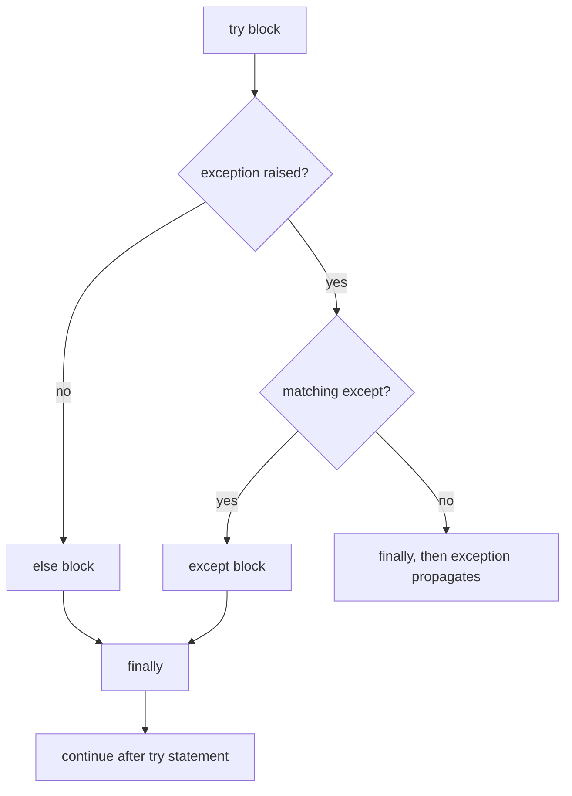

# Chapter 9 — Errors, Exceptions and Files

Programs meet bad input, missing files, full disks and broken networks. Python reports these with **exceptions** — objects that interrupt normal flow and travel up the call stack (the pile of calls in progress) until handled. Most failures involve I/O (input/output: files, networks, devices), so this chapter pairs error handling with files: text and bytes, paths, CSV, JSON, pickle (§9.11), temporary files and folder operations.

Scripts are in [`code/`](code/); all file operations happen in a temporary directory removed afterwards. Output is real (Python 3.14; code is 3.12-compatible).

| # | Topic | Script |
|---|---|---|
| 9.1 | Exceptions, tracebacks, the built-in hierarchy | `01_exceptions.py` |
| 9.2 | `try` / `except` / `else` / `finally` | `01_exceptions.py` |
| 9.3 | Raising, re-raising, custom exceptions | `01_exceptions.py` |
| 9.4 | Chaining (`raise … from …`), `add_note` | `01_exceptions.py` |
| 9.5 | EAFP vs LBYL | `01_exceptions.py` |
| 9.6 | `ExceptionGroup` and `except*` (3.11+) | `01_exceptions.py` |
| 9.7 | `assert` | `01_exceptions.py` |
| 9.8 | Context managers and `with` | `02_context_managers.py` |
| 9.9 | File I/O: modes, text vs binary, encodings | `03_files_pathlib.py` |
| 9.10 | `pathlib`, `shutil`, `tempfile` | `03_files_pathlib.py` |
| 9.11 | `csv`, `json`, `pickle` (and why pickle is unsafe) | `04_csv_json_pickle.py` |

---

## 9.1 Exceptions and the hierarchy

### What it is
An **exception** is an object describing an error, **raised** at the point of failure. Raising stops the current code; Python unwinds the call stack, leaving each function in turn, looking for a matching `except`. If none matches, the program stops and prints a **traceback** — the chain of calls that led there. Read it **bottom-up**: last line = exception type and message, the line above = where it happened.

```
Traceback (most recent call last):
  File "app.py", line 8, in <module>
    total = parse("12a")
  File "app.py", line 3, in parse
    return int(text)
ValueError: invalid literal for int() with base 10: '12a'
```

- **Syntax errors** (`SyntaxError`, `IndentationError`) are found when Python *compiles* the file — nothing runs, so they can't be caught in that file.
- **Exceptions** happen while code *runs* (`ZeroDivisionError`, `KeyError`, …) and can be handled.

### How it works — the class hierarchy
Every exception is an instance of a class deriving from **`BaseException`**. Handlers match a class *and all its subclasses*, so the tree decides what an `except` catches.

```
== part of the built-in hierarchy ==
  BaseException
      BaseExceptionGroup
      Exception
      GeneratorExit
      KeyboardInterrupt
      SystemExit
  ...under Exception (selection):
  LookupError
      IndexError
      KeyError
  ArithmeticError
      FloatingPointError
      OverflowError
      ZeroDivisionError
  OSError
      FileNotFoundError
      IsADirectoryError
      PermissionError
      TimeoutError
  issubclass(ModuleNotFoundError, ImportError): True
```
(The script walks `__subclasses__()` of the real classes; a selection is printed.)

| Class | Raised when | Example |
|---|---|---|
| `SystemExit`, `KeyboardInterrupt`, `GeneratorExit` | Program exit, Ctrl-C, generator (function yielding values one at a time) closing | Deliberately **not** under `Exception` so `except Exception` doesn't swallow (catch and hide) them |
| `ValueError` | Right type, bad value | `int("abc")` |
| `TypeError` | Wrong type / wrong call | `"a" + 1`, too many arguments |
| `KeyError` / `IndexError` (both `LookupError`) | Missing key / index out of range | `{}["x"]`, `[][0]` |
| `AttributeError` | Missing attribute | `None.upper()` |
| `NameError` (→ `UnboundLocalError`) | Unknown name | typo in a variable |
| `ZeroDivisionError` (`ArithmeticError`) | Division by zero | `1 / 0` |
| `OSError` family | OS-level failures | `FileNotFoundError`, `PermissionError`, `IsADirectoryError`, `TimeoutError`, `ConnectionError` |
| `ImportError` (→ `ModuleNotFoundError`) | Import failures | [Chapter 8](../08-modules-packages-environments/README.md) |
| `StopIteration` | Iterator exhausted | used by `for` internally |
| `RecursionError` (`RuntimeError`) | Too-deep recursion | [Chapter 7](../07-functions/README.md) |
| `NotImplementedError` (`RuntimeError`) | Abstract method (declared by a base class for subclasses to fill in) not overridden | |
| `AssertionError` | `assert` failed | 9.7 |
| `UnicodeDecodeError` (→ `ValueError`) | Bytes invalid in the codec (a text encoding's encoder/decoder) | 9.9 |

### In the interview
**30-second answer:** "An exception is an object raised on error; it unwinds the stack until an `except` clause whose class matches (including subclasses) handles it, otherwise the program ends with a traceback. All exceptions derive from `BaseException`; application errors derive from `Exception`, while `SystemExit`, `KeyboardInterrupt` and `GeneratorExit` sit directly under `BaseException` so generic handlers don't catch them."
- *Why isn't `KeyboardInterrupt` an `Exception`?* → So `except Exception:` doesn't break Ctrl-C.
- *Read a traceback?* → Bottom line = type and message; frames above = call path, most recent last.

### TL;DR
Exceptions are objects that unwind the stack until matched by class. Know the tree: `BaseException` → `Exception` → your errors.

---

## 9.2 `try` / `except` / `else` / `finally`

### What it is
```python
try:
    risky()                 # code that might fail
except SomeError as exc:    # runs if SomeError (or subclass) was raised in try
    handle(exc)
else:                       # runs only if try raised NOTHING
    use_result()
finally:                    # runs ALWAYS: success, handled, unhandled, return, break
    clean_up()
```

### How it works
1. Run `try`.
2. On an exception, skip the rest of `try`; check `except` clauses **top to bottom**; the **first** match runs. `except (A, B) as e:` catches either.
3. No exception → run `else`.
4. Always run `finally` — even while an exception propagates (travels up the stack) or the block `return`s.
5. No match → the exception continues upward (after `finally`).



```python
def parse_age(text):
    try:
        age = int(text)
    except ValueError:
        print(f"  except: {text!r} is not a number")
        return None
    else:
        print(f"  else:   parsed {age}")
        return age
    finally:
        print("  finally: always runs")
```
```
== try / except / else / finally ==
  else:   parsed 42
  finally: always runs
  except: 'forty' is not a number
  finally: always runs
```
`finally` ran though both branches `return`ed.

**Why `else`?** It keeps `try` tiny — only the line that can raise the handled error — so a bug in success-path code isn't silently caught by the wrong handler.

### Trade-offs / rules of thumb

| Do | Don't |
|---|---|
| Catch the **most specific** exception you can handle | Bare `except:` — also catches `KeyboardInterrupt` and `SystemExit` |
| Order handlers specific → general | `except Exception` first (shadows the rest — later handlers become dead code) |
| Keep `try` blocks small | Wrap 50 lines in one `try` |
| Handle where you can *do something* (retry, default, message) | Catch just to `pass` (hides bugs) |
| Use `finally` / `with` for cleanup | `return` inside `finally` — swallows exceptions (3.14 emits `SyntaxWarning`, PEP 765) |

### When not to use it
Not for ordinary control flow when a check or API exists (`dict.get`, `str.isdigit` for trusted formats). Don't catch errors you can't handle — let a top-level handler log them.

### Common mistakes
- `except Exception as e: pass` — the bug resurfaces far away.
- Using `e` after the handler — Python **deletes** the `as` name at the end (to break reference cycles, objects referring to each other that can't be freed promptly) → `NameError`. Copy it if needed.
- Catching `Exception` around your own bugs (a typo's `TypeError`) and reporting "invalid input".

### Real-world examples
- **Log, don't hide**: `logging.exception("msg")` inside an `except` logs the message *plus* traceback; `traceback.print_exc()` / `format_exc()` give the same text on stderr or as a string ([Chapter 14](../14-standard-library-tour/README.md)).
- **Warnings aren't exceptions**: `warnings.warn("old_api() is deprecated", DeprecationWarning)` prints and continues; `python -W error` (or pytest's `-W error`) turns warnings into exceptions so CI catches deprecations.
- Django, Flask, FastAPI wrap each request in a top-level handler turning uncaught exceptions into a 500 response ("internal server error"; HTTP basics in [System Design Fundamentals](../../../system-design-patterns/modules/00-system-design-fundamentals/README.md)) plus a log entry.
- `requests`: `resp.raise_for_status()` raises `requests.HTTPError` for 4xx (client's fault) / 5xx (server's fault); all errors derive from `requests.RequestException`.

### In the interview
**30-second answer:** "`try` runs risky code; the first matching `except` handles; `else` runs only if nothing was raised, which keeps the `try` minimal; `finally` always runs for cleanup. Catch specific exceptions, order specific to general, never a bare `except`."
- *Does `finally` run if `try` returns?* → Yes, just before the return completes.
- *Bare `except:` vs `except Exception:`?* → Bare also catches `KeyboardInterrupt`/`SystemExit`.

### TL;DR
`try` small, `except` specific (first match wins), `else` on success, `finally` always; the `as` name is deleted after the handler.

---

## 9.3 Raising, re-raising and custom exceptions

### What it is
- **`raise SomeError("message")`** — signal an error yourself, typically when inputs violate your function's contract (its promises about valid inputs/outputs).
- **Re-raising**: a bare **`raise`** inside `except` re-throws the current exception with its original traceback, after logging or cleanup. Outside a handler: `RuntimeError: No active exception to reraise`.
- **Custom exceptions** — your own `Exception` subclasses so callers can catch *your* errors precisely.

### How it works
1. Use a built-in when it fits: bad value → `ValueError`, wrong type → `TypeError`, missing key-like thing → `KeyError`/`LookupError`, unsupported operation → `NotImplementedError`.
2. For domain errors (errors meaningful in your problem area, e.g. payments), define a module **base class** plus specific subclasses — callers catch all (`except PaymentError`) or one (`except CardDeclined`).
3. Suffix names with `Error` (PEP 8); add attributes the handler needs, set in `__init__`.

```python
class PaymentError(Exception):
    """Base class for this module's errors."""

class CardDeclined(PaymentError):
    def __init__(self, card_last4, reason):
        super().__init__(f"card ending {card_last4} declined: {reason}")
        self.card_last4 = card_last4
        self.reason = reason

class InsufficientFunds(PaymentError):
    pass

def charge(balance, amount):
    if amount <= 0:
        raise ValueError(f"amount must be positive, got {amount}")
    if amount > balance:
        raise InsufficientFunds(f"need {amount}, have {balance}")
    return balance - amount

def reraise_after_logging(x):
    try:
        return 1 / x
    except ZeroDivisionError:
        print("  logging the error, then re-raising")
        raise                           # bare raise keeps the original traceback
```
```
== raising and catching custom exceptions ==
  charge(100, 30) -> 70
  InsufficientFunds: need 500, have 100
  ValueError: amount must be positive, got -5
  caught CardDeclined, attrs: last4=4242 reason=expired

== re-raising ==
  logging the error, then re-raising
  caller still sees: ZeroDivisionError('division by zero')
```
Pass the message to `super().__init__` so `str(exc)` and tracebacks show it.

### Trade-offs
Too few custom exceptions → callers parse message strings (fragile); too many → a zoo. A base class plus a few meaningful subclasses is the sweet spot. Many libraries also inherit a matching built-in (`class InvalidAmount(PaymentError, ValueError)`) so generic `except ValueError` keeps working.

### Common mistakes
- Subclassing `BaseException` — escapes `except Exception`.
- `raise exc` instead of bare `raise` in the handler — works but adds the current line to the traceback.
- `raise "error"` — `TypeError` in Python 3; only exception instances/classes.
- Returning error codes (`return -1`) — callers forget to check.

### Real-world examples
- `requests.RequestException` → `ConnectionError`, `Timeout`, `HTTPError`.
- Django: `ObjectDoesNotExist` base with per-model `Model.DoesNotExist`; `ValidationError`.
- `json.JSONDecodeError` subclasses `ValueError`, so old `except ValueError` code works.

### In the interview
**30-second answer:** "Raise built-ins like `ValueError`/`TypeError` for contract violations; for domain errors create a base exception subclassing `Exception` plus specific subclasses with useful attributes. Inside a handler, bare `raise` re-throws with the original traceback."
- *Why a base class per library?* → One clause catches all its errors.
- *`raise` vs `raise e`?* → Bare re-raises the active exception unchanged; `raise e` re-raises the object from the current line.

### TL;DR
`raise` built-ins for contract errors; custom hierarchy (base + `...Error` subclasses) for domain errors; bare `raise` to re-throw.

---

## 9.4 Exception chaining and notes

### What it is
Raising a higher-level error while handling a low-level one records the link:

| Syntax | Stored in | Traceback says |
|---|---|---|
| `raise New(...)` inside an `except` (implicit) | `new.__context__` | "During handling of the above exception, another exception occurred" |
| `raise New(...) from orig` (explicit) | `new.__cause__` | "The above exception was the direct cause of the following exception" |
| `raise New(...) from None` | suppresses the context | Only the new exception is shown |

**`exc.add_note("…")`** (3.11+) attaches context lines shown under the message — "which row/file/request?".

### Why it matters
Translating errors keeps your API clean (callers catch `ConfigError`, not your internals' `KeyError`/`ValueError`) *without* losing the root cause needed for debugging.

### How it works
```python
class ConfigError(Exception):
    pass

def load_port(cfg):
    try:
        return int(cfg["port"])
    except (KeyError, ValueError) as exc:
        raise ConfigError("invalid 'port' setting") from exc
```
```
== exception chaining: raise ... from ... ==
  port = 8080
  ConfigError: invalid 'port' setting; __cause__ = KeyError('port')
  ConfigError: invalid 'port' setting; __cause__ = ValueError("invalid literal for int() with base 10: 'eighty'")
  implicit: __context__ = KeyError('missing')
  formatted traceback of an explicit chain (last lines):
    | Traceback (most recent call last):
    | KeyError: 'port'
    | 
    | The above exception was the direct cause of the following exception:
    | 
    | Traceback (most recent call last):
    | ConfigError: invalid 'port' setting

== add_note (3.11+) ==
   invalid literal for int() with base 10: 'x1' | notes: ['while reading row 7 of prices.csv']
```
(Only unindented traceback lines are printed.)

### Common mistakes
- Wrapping without `from` and without a message — hides what happened.
- `from None` everywhere — discards debugging information; use only when the original is noise.

### In the interview
**30-second answer:** "Raising inside an `except` chains implicitly via `__context__`; `raise X from e` sets `__cause__` and says 'direct cause' in the traceback; `from None` hides the chain. Use explicit chaining when translating low-level errors into your own exception types. `add_note` adds context in 3.11+."

### TL;DR
Translate with `raise MyError(...) from exc`; add context with `add_note`.

---

## 9.5 EAFP vs LBYL

### What it is
- **LBYL — Look Before You Leap**: check, then act. `if key in d: v = d[key]`.
- **EAFP — Easier to Ask Forgiveness than Permission**: try, handle the exception. `try: v = d[key] except KeyError: ...`.

The official glossary calls EAFP the common Python style.

### Why it matters
EAFP avoids **race conditions** — the time-of-check-to-time-of-use (TOCTOU) gap: `if os.path.exists(p): open(p)` fails if another process deletes the file in between; `try: open(p) except FileNotFoundError:` has no gap. It also avoids double work (check *and* lookup) and suits duck typing (call the method instead of checking the type).

```python
stock = {"apple": 3}
qty = stock["pear"] if "pear" in stock else 0      # LBYL
try:                                               # EAFP
    qty = stock["pear"]
except KeyError:
    qty = 0
stock.get("pear", 0)                               # the idiomatic one-liner
```
```
  LBYL: 0
  EAFP: 0 | idiomatic: stock.get('pear', 0) = 0
```

### Trade-offs

| | EAFP | LBYL |
|---|---|---|
| Races (files, shared state) | Safe | Check can go stale |
| Speed when failure is **rare** | Fast (`try` is almost free when nothing raises; 3.11+ "zero-cost") | Pays for the check every time |
| Speed when failure is **common** | Raising/catching is relatively expensive | Cheaper |
| Readability | Can hide which line failed if `try` is big | Explicit |

### When not to use it
Prefer LBYL when failure is common, when partial side effects can't be undone, or a dedicated API exists (`dict.get`, `getattr(obj, "x", default)`, `str.isdigit()`).

### In the interview
**30-second answer:** "LBYL checks before acting; EAFP attempts and catches. Python favours EAFP: it avoids race conditions like checking a file exists then opening it, and it's cheap when errors are rare. Use LBYL when failure is frequent or partial work is hard to undo."

### TL;DR
Python prefers EAFP — race-free and fast when errors are rare; LBYL when failure is common.

---

## 9.6 `ExceptionGroup` and `except*` (Python 3.11+)

### What it is
When **several** independent errors happen at once — concurrent tasks, validating many fields, many cleanup callbacks — an **`ExceptionGroup`** (PEP 654) wraps them in one raisable object. **`except*`** handles the matching *part*: each clause receives a sub-group; anything unhandled is re-raised in a new group.

### How it works
```python
def run_all():
    errors = []
    for task, fn in [("a", lambda: 1 / 0), ("b", lambda: int("z")),
                     ("c", lambda: 42), ("d", lambda: [][1])]:
        try:
            fn()
        except Exception as exc:
            exc.add_note(f"task {task}")
            errors.append(exc)
    if errors:
        raise ExceptionGroup("some tasks failed", errors)

try:
    run_all()
except* ZeroDivisionError as eg:
    print("  math errors: ", [(repr(e), e.__notes__) for e in eg.exceptions])
except* (ValueError, IndexError) as eg:
    print("  input errors:", [repr(e) for e in eg.exceptions])
```
```
== ExceptionGroup and except* (3.11+) ==
  math errors:  [("ZeroDivisionError('division by zero')", ['task a'])]
  input errors: ['ValueError("invalid literal for int() with base 10: \'z\'")', "IndexError('list index out of range')"]
```
Unlike plain `except`, **more than one** `except*` clause can run. Rules: no mixing `except` and `except*` in one `try`; `eg` is always a group (`eg.exceptions`); `ExceptionGroup` holds `Exception` subclasses, `BaseExceptionGroup` anything.

### Real-world examples
- `asyncio.TaskGroup` (3.11+; runs several asyncio tasks together) raises an `ExceptionGroup` when children fail.
- The Trio async library pioneered the model, motivating PEP 654.

### When not to use it
Single errors — plain `except`.

### In the interview
**30-second answer:** "An `ExceptionGroup` bundles several exceptions; `except*` lets each clause handle the matching subset, and unhandled ones are re-raised. It's used by `asyncio.TaskGroup` when multiple tasks fail."

### TL;DR
Many errors at once → `ExceptionGroup`; split-handle with `except*`.

---

## 9.7 `assert`

### What it is
`assert condition, "message"` raises `AssertionError("message")` if `condition` is false — documenting and checking **internal assumptions** (invariants: conditions that should always hold if your code is correct).

```python
def mean(xs):
    assert len(xs) > 0, "mean() of empty list"
    return sum(xs) / len(xs)
```
```
  mean([2, 4]) = 3.0
  AssertionError: mean() of empty list (disabled entirely by python -O)
```

### The crucial caveat
**`-O`** (optimise) sets `__debug__` to `False` and **removes all asserts**. Never use `assert` for input validation, security checks or anything production needs — raise a real exception (`ValueError`).

### Common mistakes
- `assert (x > 0, "msg")` — a non-empty tuple is always truthy, never fails (CPython warns "assertion is always true").
- Validating user input or permissions with `assert`.

### Real-world examples
**pytest** uses plain `assert`, rewriting it to show both sides on failure (`assert result == 5`).

### In the interview
**30-second answer:** "`assert` checks internal invariants and raises `AssertionError`; it's stripped under `python -O`, so use it for debugging and tests, never for validating input."

### TL;DR
`assert` = developer sanity check and test tool; not validation.

---

## 9.8 Context managers and `with`

### What it is
A **context manager** sets something up on entering a `with` block and **guarantees** teardown on leaving — normally, via `return`/`break`, or by exception. Typical: files, locks (one thread at a time), database transactions (changes that succeed or fail together), temp directories, timers.

```python
with open("data.txt", encoding="utf-8") as f:   # file opened
    data = f.read()
# file closed here, even if read() raised
```

### How it works — the protocol
The *protocol* (required special methods) for `with EXPR as NAME: BODY`:
1. Evaluate `EXPR` → manager `m`.
2. Call `m.__enter__()`; bind its return value to `NAME`.
3. Run `BODY`.
4. Call `m.__exit__(exc_type, exc, tb)` — `None, None, None` on success, else the exception details.
5. If `__exit__` returns **truthy**, the exception is **suppressed**; otherwise it propagates.

It's `try/finally` as a reusable object.

```python
class Timer:
    def __enter__(self):
        self.start = time.perf_counter()
        print("  __enter__: timer started")
        return self                       # bound to the name after 'as'

    def __exit__(self, exc_type, exc, tb):
        self.elapsed = time.perf_counter() - self.start
        print(f"  __exit__: exc_type={exc_type.__name__ if exc_type else None}")
        return False                      # let exceptions propagate
```
```
== class-based: normal exit ==
  __enter__: timer started
  __exit__: exc_type=None
  elapsed measured: True

== class-based: exception inside the block ==
  __enter__: timer started
  __exit__: exc_type=KeyError
  exception still reached caller: KeyError('boom')
```

**`@contextlib.contextmanager`** builds one from a generator (function pausing at `yield`): before `yield` = enter, yielded value = `as` target, after = exit. Wrap `yield` in `try` to react to errors:
```python
@contextlib.contextmanager
def transaction(log):
    log.append("BEGIN")
    try:
        yield log
    except Exception:
        log.append("ROLLBACK")
        raise
    else:
        log.append("COMMIT")
```
```
  log: ['BEGIN', 'UPDATE accounts ...', 'COMMIT', 'BEGIN', 'UPDATE bad ...', 'ROLLBACK']
```

| `contextlib` helper | Does | Output |
|---|---|---|
| `suppress(FileNotFoundError)` | Ignore listed exceptions in the block | `missing file ignored` |
| `closing(obj)` | Call `obj.close()` on exit | |
| `ExitStack()` | Manage a *dynamic number* of managers; exits in **reverse** order (LIFO) | `open db, cache, queue` → `close queue, cache, db` |
| Parenthesised `with (A() as a, B() as b):` | Several managers in one statement (3.10+) | |

### Trade-offs
Class-based when the object has other methods (a connection); `@contextmanager` for one-off setup/teardown; `ExitStack` when the resource count is known only at runtime.

### Common mistakes
- Files without `with` → leaked file handles (OS resources behind open files), and buffered writes may never reach disk.
- `@contextmanager` without `try/finally` around `yield` → no cleanup if the body raises.
- Accidentally returning `True` from `__exit__` → swallows every exception.

### Real-world examples
- `with lock:` (`threading.Lock()`) acquires and always releases.
- `with conn:` on `sqlite3` commits on success, rolls back on exception — and does **not** close the connection.
- `torch.no_grad()`, `unittest.mock.patch(...)`, `decimal.localcontext()`, `tempfile.TemporaryDirectory()`.

Deeper treatment (async managers, reentrancy — re-entering an active manager) in [Chapter 12](../12-decorators-context-managers-metaprogramming/README.md).

### In the interview
**30-second answer:** "A context manager implements `__enter__` and `__exit__`; `with` calls enter, runs the block, and always calls exit with any exception info — exit returning true suppresses it. It's a reusable try/finally for resources like files and locks. `contextlib.contextmanager` builds one from a generator; `ExitStack` handles a dynamic set."
- *`__exit__` receives?* → `exc_type, exc_value, traceback`, all `None` on success.
- *Suppress an exception?* → Return `True` from `__exit__`, or `contextlib.suppress`.

### TL;DR
`with` = guaranteed cleanup. `__enter__`/`__exit__`, or `@contextmanager` with `try` around `yield`; `suppress`, `closing`, `ExitStack`.

---

## 9.9 File I/O — modes, text vs binary, encodings

### What it is
`open(path, mode="r", encoding=None, newline=None)` returns a **file object**. **Text mode** reads/writes `str`, converting via an **encoding** (characters ↔ bytes, e.g. UTF-8 — see [§4.9](../04-strings/README.md)); **binary mode** (`"b"`) reads/writes raw `bytes`.

| Mode | Meaning | If file exists | If missing |
|---|---|---|---|
| `"r"` (default) | read | read from start | `FileNotFoundError` |
| `"w"` | write | **truncates** to empty | creates |
| `"a"` | append | writes go to the end | creates |
| `"x"` | exclusive create | `FileExistsError` | creates |
| `"+"` added (`"r+"`, `"w+"`) | read and write | | |
| `"b"` added (`"rb"`, `"wb"`) | binary (bytes) | | |
| `"t"` (default) | text (str) | | |

### How it works
```python
notes = base / "notes.txt"
with open(notes, "w", encoding="utf-8") as f:    # 'w' creates/truncates
    f.write("first line\n")
    f.writelines(["second line\n", "café ☕\n"])
with open(notes, "a", encoding="utf-8") as f:    # 'a' appends
    print("appended line", file=f)
with open(notes, encoding="utf-8") as f:         # default mode 'r'
    for i, line in enumerate(f, 1):              # lazy, line by line
        print(f"  {i}: {line.rstrip()}")
```
```
== writing and reading text ==
  1: first line
  2: second line
  3: café ☕
  4: appended line
  read() whole file -> 44 characters

== text vs bytes, encodings ==
  bytes on disk: 47 (é is 2 bytes, ☕ is 3 bytes in UTF-8)
  first 12 bytes: b'first line\ns'
  ascii decode -> UnicodeDecodeError ordinal not in range(128) at byte 26
  latin-1 (wrong codec) mangles: 'café â\x98\x95'
  errors='replace': caf�� ���

== binary mode, seek/tell ==
  tell after seek(4): 4 | read(3): [4, 5, 6]

== 'x' mode refuses to overwrite ==
  FileExistsError: File exists
```

| Method | Returns | Memory |
|---|---|---|
| `for line in f:` | one line at a time (with `\n`) | Constant — best for big files |
| `f.read()` / `f.read(n)` | whole file / up to `n` chars (bytes in binary) | Whole file |
| `f.readline()` | next line | One line |
| `f.readlines()` | list of all lines | Whole file |
| `f.write(s)` | characters written | — |
| `f.seek(pos)`, `f.tell()` | move / report position | — |

Key facts:
1. **Always pass `encoding="utf-8"`** in text mode. Otherwise Python uses the locale encoding (OS language/region default; historically cp1252 on many Windows systems), so a file written on macOS may not read on Windows. PEP 686 plans UTF-8 as default in 3.15; until then be explicit (or run with `-X utf8`).
2. A wrong codec fails (`UnicodeDecodeError`) or silently produces **mojibake** (`café`). `errors="replace"` / `"ignore"` trade errors for data loss — last resorts.
3. Text mode translates newlines: reading turns `\r\n` and `\r` into `\n` ("universal newlines"); writing turns `\n` into the platform separator. Binary never changes bytes.
4. Writes are **buffered**; data is safe after `close()` (or `flush()` + `os.fsync()` for durability — surviving a crash or power cut).
5. Images, zips, pickles, anything non-text → binary mode.
6. **File-like objects**: anything with `read()`/`write()` substitutes for a file — `io.StringIO("text")` (in-memory text) and `io.BytesIO(b"...")` (in-memory binary), handy in tests and for APIs expecting files (`csv.reader(io.StringIO(data))`, `pd.read_csv(io.StringIO(...))`).

### Common mistakes
- `"w"` when you meant `"a"` — file wiped instantly.
- Omitting `encoding=`.
- `f.read()` on a multi-GB log — iterate lines.
- Paths by string `+` — use `pathlib`.

### Real-world examples
Log processors stream line by line; `pandas.read_csv(..., encoding="utf-8")` exposes the same choice; most "garbled characters" bugs in data pipelines are encoding mismatches.

### In the interview
**30-second answer:** "`open` returns a file object; use it in a `with` block. Text mode works with `str` and needs an encoding — always pass `utf-8` explicitly; binary mode works with `bytes`. `w` truncates, `a` appends, `x` fails if the file exists. Iterate over the file for large inputs."
- *Why can 'é' be 2 bytes?* → UTF-8 is variable-width: 1 byte for ASCII, 2–4 for others.

### Self-check
1. Mode for appending bytes? → `"ab"`.

### TL;DR
`with open(p, mode, encoding="utf-8")`. Text = `str` + encoding, binary = `bytes`. `w` truncates, `a` appends, `x` safe-creates. Stream big files.

---

## 9.10 `pathlib`, `shutil`, `tempfile`

### What it is
- **`pathlib.Path`** — paths as objects with methods: join with `/`, inspect parts, read/write/list without string juggling or `os.path`. Works on Windows and POSIX (the Unix standard Linux and macOS follow).
- **`shutil`** ("shell utilities") — high-level file and tree operations: copy, move, delete trees, archives.
- **`tempfile`** — safely creates uniquely named temp files and directories that clean up automatically.

### How it works — `pathlib`
```python
p = base / "reports" / "2026" / "q3.final.csv"
p.name, p.stem, p.suffix, p.suffixes
p.parent.mkdir(parents=True, exist_ok=True)
p.write_text("id,total\n1,9.5\n", encoding="utf-8")
(base / "reports").glob("*/*.csv")
base.rglob("*.md")
```
```
== pathlib ==
  name: q3.final.csv | stem: q3.final | suffix: .csv | suffixes: ['.final', '.csv']
  parent relative to base: reports/2026
  with_suffix('.json'): q3.final.json
  exists: True | is_file: True | size: 15 bytes
  glob('*/*.csv'):    ['q2.csv', 'q3.final.csv']
  rglob('*.md'):      ['readme.md']
  iterdir(reports):   ['2026', 'readme.md']
```

| Task | `pathlib` | older `os` / `os.path` |
|---|---|---|
| Join | `base / "a" / "b.txt"` | `os.path.join(base, "a", "b.txt")` |
| Current dir / home | `Path.cwd()`, `Path.home()` | `os.getcwd()`, `os.path.expanduser("~")` |
| Absolute, symlinks (shortcut files) resolved | `p.resolve()` | `os.path.realpath(p)` |
| Parts | `p.name`, `.stem`, `.suffix`, `.parent` | `os.path.basename`, `splitext`, `dirname` |
| Exists / type | `p.exists()`, `.is_file()`, `.is_dir()` | `os.path.exists` … |
| Read / write whole file | `p.read_text()`, `p.write_bytes(b)` | `open(...)` |
| Make dirs | `p.mkdir(parents=True, exist_ok=True)` | `os.makedirs(p, exist_ok=True)` |
| Delete file / empty dir | `p.unlink(missing_ok=True)`, `p.rmdir()` | `os.remove`, `os.rmdir` |
| Rename / replace | `p.rename(t)`, `p.replace(t)` | `os.rename`, `os.replace` |
| List / search (glob = wildcard name match like `*`) | `p.iterdir()`, `p.glob("*.py")`, `p.rglob("*.py")`, `p.walk()` (3.12+) | `os.listdir`, `glob.glob`, `os.walk` |

`open()` and nearly every library accept `Path` objects. `Path("x.tar.gz").suffix` is `".gz"` (`.suffixes` → `['.tar', '.gz']`).

### How it works — `shutil` and `tempfile`
```
== shutil: copy, move, archive, delete trees ==
  copytree -> ['2026', '2026/q2.csv', '2026/q3.final.csv', 'readme.md']
  moved readme -> True
  archive: reports_bak.zip True
  rmtree backup -> exists? False
  disk_usage works: True

== tempfile ==
  temp file .txt contains: scratch
  deleted after close: True

== atomic replace pattern ==
  settings now: {"v": 2}

temp dir removed: True
```

| `shutil` function | Does |
|---|---|
| `copy(src, dst)` / `copy2` | Copy a file (+ permission bits / + timestamps and other metadata) |
| `copytree(src, dst)` | Copy a whole folder tree |
| `move(src, dst)` | Move/rename, across filesystems (disks/partitions) if needed |
| `rmtree(path)` | Delete a folder **and everything in it** — permanent, no recycle bin |
| `make_archive(base, "zip", root_dir)` / `unpack_archive` | Create/extract zip, tar, gztar… |
| `which("git")`, `disk_usage(path)` | Find an executable on `PATH`; total/used/free bytes |

| `tempfile` API | Gives |
|---|---|
| `TemporaryDirectory()` | Folder deleted (with contents) when the `with` block ends |
| `NamedTemporaryFile()` | File with a real name, deleted on close by default (3.12 adds `delete_on_close=False` for reopening by name, needed on Windows) |
| `TemporaryFile()` | Anonymous file — may have no visible name |
| `mkstemp()` / `mkdtemp()` | Low-level: create and return path; **you** delete it |

**Atomic replace pattern**: write to a temp file *in the same directory*, then `os.replace(tmp, target)`. The rename is atomic (all at once or not at all) on one filesystem, so readers see old or new — never half-written. Common for config/state files.

### Trade-offs
`pathlib` is the modern default; `os`/`os.path` remain for low-level calls (`os.replace`, `os.fsync`, file descriptors — the OS's integer handles for open files) and older code. `shutil` isn't transactional (all-or-nothing) — an interrupted `copytree` leaves a partial copy.

### Common mistakes
- Hard-coded `"/tmp/myfile"` — predictable names are a security risk and unportable; use `tempfile`.
- `shutil.rmtree` on unchecked user-supplied paths.
- String concatenation or backslashes for paths.
- `Path("a").glob("**/*.py")` ≡ `rglob("*.py")`; `rglob` is shorter.

### Real-world examples
pytest's `tmp_path` fixture gives each test a fresh `Path` temp dir; build tools use `copytree`/`make_archive`; `shutil.which` checks that `git` or `ffmpeg` is installed.

### In the interview
**30-second answer:** "`pathlib.Path` is the object-oriented way to build and inspect paths and to read, write, list and glob; `shutil` does high-level file and tree operations like copy, move, rmtree and archives; `tempfile` creates unique temp files and directories that clean themselves up. For safe file updates, write a temp file in the same folder and `os.replace` it."

### TL;DR
`Path` for paths, `shutil` for copying/moving/deleting trees, `tempfile` for throwaway files; atomic writes via temp + `os.replace`.

---

## 9.11 `csv`, `json`, `pickle`

### What it is

| Format | Module | Looks like | Holds | Readable by other languages | Safe to load untrusted data |
|---|---|---|---|---|---|
| **CSV** — comma-separated values | `csv` | Text table | Rows of **strings** | Yes (Excel, databases) | Yes |
| **JSON** — JavaScript Object Notation | `json` | Text | dict, list, str, int, float, bool, None | Yes (the web's lingua franca) | Yes |
| **pickle** | `pickle` | Binary | Almost any Python object | **No** — Python only | **NO** — can run arbitrary (attacker-chosen) code |

### CSV
Use `csv`, not `line.split(",")` — real CSV has quoted fields containing commas, quotes, even newlines.

```python
with open(path, "w", newline="", encoding="utf-8") as f:   # newline="" per csv docs
    w = csv.DictWriter(f, fieldnames=["id", "customer", "total", "placed"])
    w.writeheader()
    for o in orders:
        w.writerow(asdict(o))
with open(path, newline="", encoding="utf-8") as f:
    rows = list(csv.DictReader(f))
```
```
  raw file:
    id,customer,total,placed
    1,"Ana, Inc.",19.5,2026-09-01
    2,"Bob ""B"" Ltd",5.25,2026-09-02
  first row: {'id': '1', 'customer': 'Ana, Inc.', 'total': '19.5', 'placed': '2026-09-01'}
  total is a str -> convert yourself: 24.75
  naive split(',') breaks on quoted commas: ['1', '"Ana', ' Inc."', '19.5', '2026-09-01']
  tab-separated: [['a', 'b'], ['1', '2']]
```
- The writer quoted `"Ana, Inc."` and doubled inner quotes automatically.
- **Everything reads back as `str`** — convert yourself.
- Open with **`newline=""`** (required by the docs) so `csv` handles line endings — else blank rows on Windows or broken quoted newlines.
- `reader`/`writer` use lists; `DictReader`/`DictWriter` use dicts keyed by the header; `delimiter="\t"` for TSV; `csv.Sniffer` guesses the dialect (delimiter, quoting rules).
- For analysis-sized data, `pandas.read_csv` is usually better.

### JSON

| Python → JSON | JSON → Python |
|---|---|
| `dict` → object | object → `dict` |
| `list`, `tuple` → array | array → `list` |
| `str` → string | string → `str` |
| `int`, `float` → number | number → `int` or `float` |
| `True`/`False` → `true`/`false` | → `True`/`False` |
| `None` → `null` | → `None` |

`dumps`/`loads` use **s**trings; `dump`/`load` files.

```python
text = json.dumps(payload, default=to_json_default, indent=2, ensure_ascii=False)
back = json.loads(text)
```
```
  first lines of dumps():
    {
      "orders": [
        {
          "id": 1,
          "customer": "Ana, Inc.",
          "total": 19.5,
          "placed": "2026-09-01"
        },
  loads() types: paid -> bool | discount -> None | placed -> str
  load() from file, customers: ['Ana, Inc.', 'Bob "B" Ltd']
  tuple becomes list: {'pt': [1, 2]}
  int keys become str: {'1': 'a'}
  without default=: Object of type date is not JSON serializable
  JSONDecodeError: Expecting property name enclosed in double quotes at pos 1
```
- Unknown types (`date`, `Decimal`, `set`, your classes) need `default=` (e.g. returning `isoformat()`), a custom `JSONEncoder`, or pre-conversion (`dataclasses.asdict`); they return as plain strings/lists — the round trip is **lossy**.
- Tuples → lists; non-string keys → strings.
- JSON needs double quotes; `'single'` → `json.JSONDecodeError` (a `ValueError`).
- `indent=2` pretty-prints; `ensure_ascii=False` keeps "é" instead of the escape `\u00e9`; `sort_keys=True` stabilises output; `python -m json.tool file.json` pretty-prints from the shell.
- `json.dumps(float("nan"))` writes `NaN`, **invalid** for strict parsers; `allow_nan=False` raises instead.

### pickle
`pickle` serialises almost any Python object graph (an object plus everything it references — custom classes, dates, shared references) to bytes and back.

```python
blob = pickle.dumps(orders)
restored = pickle.loads(blob)
with open(base / "orders.pkl", "wb") as f:                 # binary mode!
    pickle.dump(orders, f)
```
```
  round trip equal: True | type: Order | placed: 2026-09-01
  load() from file: 2 orders
```

**Security caveat — never unpickle untrusted data.** An object can specify via `__reduce__` a function to *call* on load. The demo uses a harmless `print`; an attacker would use `os.system` (runs any shell command):
```python
class Sneaky:
    def __reduce__(self):
        return (print, ("  !!! code ran during pickle.loads() !!!",))

pickle.loads(pickle.dumps(Sneaky()))
```
```
  loading a crafted pickle...
  !!! code ran during pickle.loads() !!!
  loads() returned: None
```
Code ran merely by *loading*; the official docs warn prominently. Other limits: Python-only; tied to class definitions (renaming a class breaks old pickles); lambdas, open files, sockets and locks can't be pickled. Current protocol: 5 (`pickle.HIGHEST_PROTOCOL`).

### Trade-offs / when to use which
- **Config, APIs, data exchange** → JSON (TOML for human-edited config, read with `tomllib`).
- **Tables for spreadsheets/other tools** → CSV (or Parquet — compressed column-oriented files — via pandas for big data).
- **Short-lived caching of your own Python objects** (pipeline steps, `multiprocessing` internals) → pickle.
- **Never** pickle across a trust boundary (data from outside your control: uploads, network, downloads).

### Common mistakes
- Pickle files in text mode → `TypeError`; use `"wb"`/`"rb"`.
- Forgetting `newline=""` with `csv`.
- Expecting `datetime`s back from `json.loads`.
- Loading downloaded model files with plain `pickle.load`.

### Real-world examples
- **PyTorch** checkpoints (`torch.save`) use pickle; since PyTorch 2.6 `torch.load` defaults to `weights_only=True` to block code execution, and Hugging Face created **safetensors** as a pickle-free format for model weights.
- scikit-learn documents pickle/joblib persistence with the same warning and points to the safer `skops` format.
- REST APIs (web APIs built from plain HTTP requests to URLs; GitHub, Stripe) speak JSON; spreadsheet exports are CSV.

### In the interview
**30-second answer:** "CSV is text rows of strings — use the `csv` module with `newline=''` because of quoting. JSON maps to dict/list/str/number/bool/None, is language-neutral and safe; other types need a `default=` hook and come back as plain values. Pickle stores arbitrary Python objects in binary but is Python-only and unsafe: loading can execute code via `__reduce__`, so never unpickle untrusted data."
- *Why is `pickle.loads` dangerous?* → A pickle can make the loader call arbitrary callables.
- *JSON-encode a `datetime`?* → `default=` returning `isoformat()`, or a custom `JSONEncoder`.
- *`json.dump` vs `dumps`?* → File vs string.

### TL;DR
CSV = strings in rows (`csv` module, `newline=""`). JSON = safe, portable, limited types. Pickle = any Python object, binary, **never from untrusted sources**.

---

## Chapter TL;DR

- Exceptions are objects that unwind the stack until an `except` matches by class; `Exception` is the base for application errors, `BaseException` also covers exit and Ctrl-C.
- `try` small, `except` specific (first match wins), `else` on success, `finally` always; never a bare `except:`; the `as e` name is deleted after the handler.
- `raise` built-ins for contract errors, a custom hierarchy for domain errors, bare `raise` to re-throw, `raise X from e` to translate while keeping the cause, `add_note` for context.
- Python prefers **EAFP** (try it) over LBYL (check first) — race-free and fast when failures are rare.
- `ExceptionGroup` + `except*` handle several simultaneous errors (e.g. `asyncio.TaskGroup`).
- `assert` checks invariants and vanishes under `-O` — never for validation.
- `with` + context managers guarantee cleanup (`__enter__`/`__exit__`, `@contextmanager`, `ExitStack`).
- `open(path, mode, encoding="utf-8")` inside `with`; text vs binary; `w` truncates, `a` appends, `x` refuses to overwrite; iterate big files.
- `pathlib` for paths, `shutil` for trees and archives, `tempfile` for throwaway files, temp + `os.replace` for atomic writes.
- CSV (strings, `newline=""`), JSON (safe, portable, limited types), pickle (any object, Python-only, **unsafe on untrusted data**).
