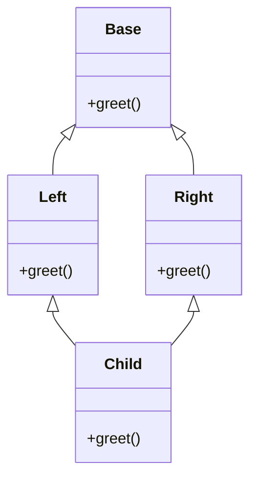

# Chapter 10 — Object-Oriented Programming in Python

> **What you will learn.** How Python builds objects: classes and instances, `__init__` and `self`, class vs instance attributes, the three kinds of method, and properties. Then the *data model* — the special "dunder" methods (`__repr__`, `__eq__`, `__hash__`, `__lt__`, `__len__`, `__iter__`, `__getitem__`, `__call__`, `__enter__` …) that let your own classes work with `len()`, `for`, `==`, `+`, `with` and `sorted()`. Then reuse: inheritance (a class reusing and extending another class) and `super()`, the method resolution order (MRO) and multiple inheritance, mixins, abstract base classes, duck typing and `Protocol`, and when composition beats inheritance. Finally the modern toolbox — `dataclasses`, `enum`, `__slots__` — encapsulation (keeping an object's internals behind its methods) conventions, and short Pythonic notes on design patterns (named, reusable solutions to common design problems).
>
> **Prerequisites.** Functions, basic types, exceptions. SOLID (five classic object-oriented design principles) and the Gang-of-Four patterns (the 23 design patterns catalogued in the 1994 book *Design Patterns*) are covered language-neutrally in the [LLD Handbook](../../../lld/README.md) (LLD = low-level design); this chapter focuses on *how Python does OOP*.
>
> **Code.** Every script is in `chapters/10-oop-in-python/code/` and runs on Python 3.12+ with no dependencies (no extra packages to install):
>
> ```bash
> python chapters/10-oop-in-python/code/data_model.py
> ```


---

## 10.1 Classes and instances, `__init__` and `self`

### What it is
A **class** is a blueprint: it bundles data (**attributes**) and behaviour (**methods**) under one name. An **instance** (or *object*) is one concrete thing built from that blueprint. Analogy: the class is a cookie cutter; each cookie is an instance — same shape, different sprinkles.

In Python *everything* is an object — ints, functions, modules, and classes themselves (a class is an instance of `type`).

### Why it matters
Classes let you keep related state and the code that changes it together, so invariants (rules that must always hold) ("balance never goes negative") are enforced in one place instead of scattered across the codebase.

### How it works
1. `class BankAccount: ...` executes the class body once and creates a class object.
2. Calling the class, `BankAccount("Asha", 100)`, does two steps: `__new__` allocates (reserves memory for) an empty instance, then `__init__` initialises it. You almost never write `__new__` (it is for immutable types and metaclass tricks — a *metaclass* is the class of a class, controlling how classes themselves are built).
3. `__init__(self, ...)` receives the new instance as its first argument. By convention it is named **`self`** — it is just a normal parameter, not a keyword.
4. `self.owner = owner` stores an **instance attribute** in the instance's own namespace (name → value table), the dict `obj.__dict__`.
5. `__init__` must return `None`; it *initialises*, it does not *construct*.

### Class attributes vs instance attributes
A **class attribute** is defined in the class body and shared by all instances. An **instance attribute** is set on `self` and belongs to one object.

**Attribute lookup** for `obj.name` (simplified): look in `obj.__dict__` first, then in the class, then in each parent class along the MRO (§10.5). Assigning `obj.name = ...` always writes to the *instance* — it never modifies the class attribute; it *shadows* (hides) it.

### The three kinds of method

| Kind | Decorator (the `@…` line above the `def`) | First parameter | Typical use |
|---|---|---|---|
| Instance method | none | `self` (the instance) | Read/modify one object's state |
| Class method | `@classmethod` | `cls` (the class) | Alternative constructors (other ways to build an instance; `from_csv`, `dict.fromkeys`, `datetime.fromtimestamp`); works correctly for subclasses because `cls` is the subclass |
| Static method | `@staticmethod` | none | Helper that logically belongs to the class but needs neither instance nor class |

When you write `a.deposit`, Python returns a **bound method**: the function with `self` already filled in. So `a.deposit(5)` is exactly `BankAccount.deposit(a, 5)`. ([Chapter 12](../12-decorators-context-managers-metaprogramming/README.md) explains the mechanism — functions are *descriptors*, objects that customise what happens when an attribute is looked up.)

### Properties
A **property** makes a method look like an attribute. You start with a plain public attribute; if you later need validation or a computed value, you turn it into a property and **no caller changes**. This is why Python code does not need Java-style `get_x()/set_x()` methods (getters/setters — methods whose only job is to read or write one attribute).

```python
class BankAccount:
    bank_name = "PyBank"          # class attribute: shared by every instance
    _next_id = 1                  # class attribute used as a counter

    def __init__(self, owner: str, balance: float = 0.0) -> None:
        self.owner = owner        # instance attributes: one copy per object
        self._balance = balance   # leading underscore = "internal, please don't touch"
        self.id = BankAccount._next_id
        BankAccount._next_id += 1

    def deposit(self, amount: float) -> None:          # instance method
        if amount <= 0:
            raise ValueError("amount must be positive")
        self._balance += amount

    @property
    def balance(self) -> float:                         # read like an attribute
        return self._balance

    @balance.setter
    def balance(self, value: float) -> None:            # validated assignment
        if value < 0:
            raise ValueError("balance cannot be negative")
        self._balance = value

    @classmethod
    def from_csv(cls, line: str) -> "BankAccount":      # alternative constructor
        owner, balance = line.split(",")
        return cls(owner, float(balance))

    @staticmethod
    def is_valid_amount(amount: float) -> bool:         # plain helper
        return amount > 0


class Buggy:
    items = []                    # MISTAKE: one list shared by all instances
    def add(self, x):
        self.items.append(x)
```

What the demo does: builds two accounts (one via the class method), shows that assigning `a.bank_name` creates an instance attribute that shadows the class one, shows the setter rejecting a negative value, proves `a.deposit` is bound to `a`, and shows the shared-mutable-class-attribute bug.

Output (`classes_basics.py`):
```
a: Asha 125 id 1
b: Ben 50.0 id 2
static check: False
a.bank_name: PyBank
after assignment -> a: Shadow | b: PyBank | class: PyBank
a.__dict__: {'owner': 'Asha', '_balance': 125, 'id': 1, 'bank_name': 'Shadow'}
setter refused: balance cannot be negative
a.deposit is bound: True
after unbound call: 130
Buggy y.items: [1]
Fixed q.items: []
```

### Trade-offs

| Choice | Good for | Watch out |
|---|---|---|
| Plain public attribute | Simple data, zero overhead | Can't validate — but you can switch to a property later without breaking callers |
| Property | Validation, computed/derived values, read-only views | Hides work behind attribute syntax; keep it cheap (no network calls) |
| Class attribute | Constants, defaults, counters shared by all | Mutable class attributes are shared — a classic bug |
| `@classmethod` vs `@staticmethod` | `cls` makes alternative constructors subclass-friendly | A static method that uses the class name directly breaks for subclasses |

### When not to use a class
If you have one function and no state, write a function. If you have data and no behaviour, use a `dataclass`, `NamedTuple` or `dict`. A class with only `__init__` and one other method is often a function in disguise (Jack Diederich's PyCon talk "Stop Writing Classes" makes this point).

### Common mistakes
- Forgetting `self` in a method signature → `TypeError: takes 0 positional arguments but 1 was given`.
- Mutable class attributes (`items = []`) shared by every instance — initialise in `__init__`.
- Mutable default arguments (`def __init__(self, items=[])`) — the default list is created once. Use `None` and create inside.
- Updating a counter via `self._next_id += 1` — that creates an instance attribute; update the class: `type(self)._next_id += 1` or `BankAccount._next_id += 1`.
- A property and an attribute with the same name (`self.balance = x` inside the `balance` setter) → infinite recursion. Store in `_balance`.

### Real-world examples
- `datetime.datetime.fromtimestamp`, `dict.fromkeys`, `int.from_bytes` are class-method alternative constructors.
- `pathlib.Path.name`, `.suffix`, `.parent` are properties computed from the path string.
- Django model fields are declared as class attributes; each instance holds its own values.

### In the interview
**30-second answer:** "A class is a blueprint; instances are built by `__new__` then initialised by `__init__`, which gets the instance as `self`. Class attributes live on the class and are shared; instance attributes live in each object's `__dict__`, and lookup checks the instance first, then the class and its parents. Instance methods take `self`, class methods take `cls` and are used for alternative constructors, static methods take neither. Properties let me add validation later without changing the public API (the part of a class other code is meant to use)."

- *Why is `self` explicit?* — "Explicit is better than implicit": a method is just a function stored on the class; `obj.m()` passes `obj` as the first argument. It also makes instance vs local variables obvious.
- *Class method or static method for a factory (a function whose job is to create objects)?* — Class method, so `SubClass.from_csv(...)` returns a `SubClass`.
- *What's `__new__` for?* — Controlling creation itself: subclassing immutables (`int`, `str`, `tuple`), caching instances, metaclasses.

### Self-check
1. After `a.bank_name = "X"`, what is `BankAccount.bank_name`? → Unchanged; `a` now has its own instance attribute that shadows it.
2. Why does `Buggy` leak items between instances? → `items` is one list on the class; `self.items.append` mutates it (no assignment, so no shadowing).
3. What does `a.deposit` evaluate to? → A bound method object whose `__self__` is `a`.
4. When would you convert an attribute into a property? → When you need validation, computation, or read-only access — callers don't change.

### TL;DR
Classes bundle state and behaviour; `__init__` initialises, `self` is the instance. Instance attributes are per object, class attributes are shared (beware mutable ones). Instance/class/static methods take `self`/`cls`/nothing. Start with public attributes; upgrade to properties when needed.

---

## 10.2 The data model: dunder methods

### What it is
The **Python data model** is the set of special methods — named with **d**ouble **under**scores, hence "dunder" (e.g. `__len__`) — that the interpreter calls behind the scenes. `len(x)` calls `x.__len__()`, `a + b` calls `a.__add__(b)`, `for` calls `__iter__`, `with` calls `__enter__/__exit__`. Implement them and your objects behave like built-ins. *Fluent Python* calls this Python's "metaobject protocol" (the rules by which objects plug into the language); it is why Python code reads consistently.

### Why it matters
Users of your class get a familiar interface for free: `len(playlist)`, `playlist[0]`, `sorted(vectors)`, `v1 + v2`, `print(v)`. You also plug into the entire standard library (`sorted`, `max`, `set`, `dict`, `random.choice`, `in`) without writing extra methods.

### How it works — the most important dunders

| You write | Python calls | Notes |
|---|---|---|
| `repr(x)`, REPL echo, inside containers | `__repr__` | Unambiguous, for developers; ideally looks like the constructor call |
| `str(x)`, `print(x)`, `f"{x}"` | `__str__` | Readable, for users; **falls back to `__repr__`** if missing |
| `x == y`, `x != y` | `__eq__`, `__ne__` | Default is identity (`is`); `__ne__` inverts `__eq__` automatically |
| `hash(x)`, dict key, set member | `__hash__` | Must agree with `__eq__` (see below) |
| `x < y` etc. | `__lt__`, `__le__`, `__gt__`, `__ge__` | `@functools.total_ordering` derives the rest from `__eq__` + one of them |
| `len(x)` | `__len__` | Must return an int ≥ 0 |
| `bool(x)`, `if x:` | `__bool__` | Falls back to `__len__() != 0`, else always `True` |
| `for i in x`, `iter(x)` | `__iter__` | Falls back to `__getitem__(0), (1), …` until `IndexError` |
| `x[k]`, `x[a:b]` | `__getitem__` | Receives an int, key, or a `slice` object |
| `x[k] = v`, `del x[k]` | `__setitem__`, `__delitem__` | |
| `v in x` | `__contains__` | Falls back to iterating |
| `x(args)` | `__call__` | Makes instances callable |
| `with x as y:` | `__enter__`, `__exit__` | Covered fully in [Chapter 12](../12-decorators-context-managers-metaprogramming/README.md) |
| `a + b`, `a * b`, `abs(a)`, `-a` | `__add__`, `__mul__`, `__abs__`, `__neg__` | Operator overloading (§10.3) |

### `__eq__` and `__hash__` — the contract
A **hash** is an integer that dicts and sets use to find a slot quickly. The rule: **if `a == b` then `hash(a) == hash(b)`** (the reverse need not hold — collisions, different values sharing a hash, are allowed).

1. By default objects compare and hash by identity — always consistent.
2. If you define `__eq__` but not `__hash__`, Python sets `__hash__ = None`, making instances **unhashable** (you can't put them in a set). This protects you from breaking the rule.
3. To make them hashable, define `__hash__` from the *same* fields `__eq__` uses — typically `hash((self.x, self.y))`.
4. Only hash **immutable** state. If a key's fields change after insertion into a dict, the dict looks in the wrong slot and "loses" it. That's why `frozen=True` dataclasses (§10.10) are the easy way to get safe hashing.

### `NotImplemented`
When a comparison or arithmetic method can't handle the other operand, **return** (don't raise) the singleton (the one-and-only object of its kind) `NotImplemented`. Python then tries the reflected (right-hand-side) method on the other object (`b.__radd__(a)`, or for `==` it tries `b.__eq__(a)`), and raises a clear `TypeError` only if both sides give up.

```python
@total_ordering
class Vector:
    __match_args__ = ("x", "y")

    def __init__(self, x: float, y: float) -> None:
        self.x, self.y = x, y

    def __repr__(self) -> str:
        return f"Vector({self.x!r}, {self.y!r})"

    def __str__(self) -> str:
        return f"({self.x}, {self.y})"

    def __eq__(self, other: object) -> bool:
        if not isinstance(other, Vector):
            return NotImplemented
        return (self.x, self.y) == (other.x, other.y)

    def __hash__(self) -> int:
        return hash((self.x, self.y))

    def __lt__(self, other: "Vector") -> bool:     # total_ordering adds <=, >, >=
        if not isinstance(other, Vector):
            return NotImplemented
        return abs(self) < abs(other)

    def __add__(self, other): ...                   # see §10.3
    def __abs__(self) -> float:
        return math.hypot(self.x, self.y)
    def __bool__(self) -> bool:
        return bool(self.x or self.y)
    def __iter__(self):                             # enables x, y = v
        yield self.x
        yield self.y


class Playlist:
    def __init__(self, *songs: str) -> None:
        self._songs = list(songs)
    def __len__(self) -> int:
        return len(self._songs)
    def __getitem__(self, index):                   # ints AND slices
        result = self._songs[index]
        return Playlist(*result) if isinstance(index, slice) else result
    def __contains__(self, song: str) -> bool:
        return song in self._songs


class Multiplier:
    def __init__(self, factor: int) -> None:
        self.factor, self.calls = factor, 0
    def __call__(self, x: int) -> int:              # instance used like a function
        self.calls += 1
        return x * self.factor


class Timer:
    def __enter__(self):
        print("  enter: start timer")
        return self                                  # bound to the `as` name
    def __exit__(self, exc_type, exc, tb) -> bool:
        print(f"  exit: stop timer (exception={exc_type.__name__ if exc_type else None})")
        return False                                 # don't swallow exceptions
```

Output (`data_model.py`):
```
repr: Vector(3, 4) | str: (3, 4) | f-string: (3, 4)
v + w = (4, 5) | v * 2 = (6, 8) | 2 * v = (6, 8)
abs(v) = 5.0 | bool(Vector(0,0)) = False
v == Vector(3,4): True | v is Vector(3,4): False
w < v: True | v >= w: True (>= from total_ordering)
set dedups equal vectors: {Vector(1, 2)}
sorted: [Vector(1, 1), Vector(0, 2), Vector(3, 4)]
unpacked: 3 4
pattern matched, y = 4
TypeError: unsupported operand type(s) for +: 'Vector' and 'int'
len: 4 | p[0]: intro | p[-1]: outro | p[1:3]: Playlist('verse', 'chorus')
'chorus' in p: True | iterate via __getitem__: ['INTRO', 'VERSE', 'CHORUS', 'OUTRO']
callable: 15 21 calls = 2 | callable(): True
  enter: start timer
  inside block, t is a Timer: True
  exit: stop timer (exception=None)
  enter: start timer
  exit: stop timer (exception=KeyError)
  KeyError still propagated
__hash__ of class defining only __eq__: None
```

Notice: `Playlist` has no `__iter__`, yet `for` works through the `__getitem__` fallback, and negative indexes and slices work because we delegate to the inner list. `__match_args__` lets `match v: case Vector(3, y)` destructure (pull apart into names) positionally. The last line proves the `__eq__`-without-`__hash__` rule.

Note: this teaching `Vector` is mutable *and* hashable — acceptable only if you never mutate a vector used as a dict key. In production, make it immutable (frozen dataclass or read-only properties).

### Trade-offs

| Approach | Pros | Cons |
|---|---|---|
| Implement dunders by hand | Full control, any semantics (behaviour) | Boilerplate (repetitive code), easy to get `__eq__`/`__hash__` inconsistent |
| `@dataclass` | Generates `__init__`, `__repr__`, `__eq__` (and optionally ordering/hash) | Field-by-field semantics only |
| Inherit from `collections.abc.Sequence`/`Mapping` | Implement 2–3 abstract methods, get the rest (`index`, `count`, `__contains__`, `__iter__`, `__reversed__`) as mixin methods | Ties you to that ABC |
| Subclass `list`/`dict` directly | Quick | Built-in C methods often bypass your overrides (your subclass's replacement methods) (e.g. `dict.update` does not call your `__setitem__`); prefer `collections.UserDict`/`UserList` |

### When not to use it
Don't overload operators with surprising meanings (`+` that deletes a file). Don't add `__call__` just to look clever — a named method is clearer unless the object genuinely *is* a function-like thing (a model, a strategy, a validator).

### Common mistakes
- Calling dunders directly (`x.__len__()`) instead of `len(x)` — the built-in is faster for built-in types and applies extra checks.
- `raise NotImplementedError` inside `__eq__`/`__add__` instead of `return NotImplemented`.
- Defining `__eq__` and being surprised that objects are no longer hashable.
- `__repr__` that returns something useless like `<object>`; include the key fields.
- Returning a non-bool/non-int from `__len__`/`__bool__` → `TypeError`.

### Real-world examples
- `pathlib.Path` overloads `/` (`__truediv__`) to join paths: `Path("a") / "b"`.
- NumPy arrays and pandas DataFrames overload arithmetic, comparison and `__getitem__` (boolean masks — arrays of True/False that select elements — slicing).
- `requests.Session`, `open()` files, `threading.Lock`, `sqlite3.Connection` implement `__enter__/__exit__`.
- PyTorch `nn.Module` implements `__call__`, which runs hooks (user-registered functions called at set points) and then your `forward()` — that's why you write `model(x)`, not `model.forward(x)`.
- SQLAlchemy (a library mapping Python classes to database tables) overloads `==`, `<` on columns to build SQL expressions (`User.age > 18`).

### In the interview
**30-second answer:** "The data model is Python's protocol of special methods: built-ins and syntax call dunders — `len` calls `__len__`, `+` calls `__add__`, `for` calls `__iter__`. Implementing them makes custom classes behave like built-ins and work with the standard library. Key rules: `__repr__` for developers, `__str__` falls back to it; `__eq__` and `__hash__` must agree and defining `__eq__` alone makes the class unhashable; return `NotImplemented` for unsupported operands."

- *Why must equal objects have equal hashes?* — Dicts/sets use the hash to pick a bucket (a slot in the hash table), then `==` to confirm. Equal objects with different hashes land in different buckets and duplicates appear.
- *Minimum to make a class iterable?* — `__iter__` returning an iterator, or `__getitem__` accepting 0, 1, 2… and raising `IndexError` at the end.
- *`__str__` vs `__repr__`?* — `repr` is unambiguous and used in debugging/containers; `str` is user-facing; `str` falls back to `repr`, not vice versa — so always write `__repr__` first.

### Self-check
1. What does `print([v])` use, `__str__` or `__repr__`? → `__repr__` (containers show their items' reprs).
2. You defined `__eq__` only. What happens with `{obj}`? → `TypeError: unhashable type`.
3. Which methods does `total_ordering` need? → `__eq__` plus one of `__lt__`, `__le__`, `__gt__`, `__ge__`.
4. Why did `for s in p` work without `__iter__`? → The legacy sequence protocol: Python calls `__getitem__` with 0, 1, 2 … until `IndexError`.

### TL;DR
Dunders are hooks the interpreter calls for syntax and built-ins. Always write `__repr__`. Keep `__eq__`/`__hash__` consistent and based on immutable fields. Return `NotImplemented` for unknown operands. Implement `__len__`/`__getitem__`/`__iter__`/`__contains__` to make containers, `__call__` for callables, `__enter__/__exit__` for `with`.

---

## 10.3 Operator overloading

### What it is
**Operator overloading** means giving `+`, `-`, `*`, `@`, `==`, `<`, `[]` etc. a meaning for your own types by implementing the matching dunder.

### How it works
For `a + b`, Python:
1. Calls `a.__add__(b)`. If it returns a value (not `NotImplemented`), done.
2. Otherwise calls the **reflected** method `b.__radd__(a)`. (Special case: if `type(b)` is a *subclass* of `type(a)` and overrides `__radd__`, Python tries `b.__radd__(a)` first.)
3. If both return `NotImplemented`, raises `TypeError: unsupported operand type(s)`.

For `a += b`, Python tries the **in-place** method `a.__iadd__(b)` first (which may mutate `a` and return `self`); if it's missing, it falls back to `a = a + b`. That's why `list += ...` mutates in place, while `tuple += ...` builds a new tuple.

| Operator | Method | Reflected | In-place |
|---|---|---|---|
| `+` | `__add__` | `__radd__` | `__iadd__` |
| `-` | `__sub__` | `__rsub__` | `__isub__` |
| `*` | `__mul__` | `__rmul__` | `__imul__` |
| `@` (matrix mult) | `__matmul__` | `__rmatmul__` | `__imatmul__` |
| `/`, `//`, `%`, `**` | `__truediv__`, `__floordiv__`, `__mod__`, `__pow__` | `__r…__` | `__i…__` |
| `&`, `\|`, `^` | `__and__`, `__or__`, `__xor__` | `__r…__` | `__i…__` |
| unary `-`, `+`, `~`, `abs()` | `__neg__`, `__pos__`, `__invert__`, `__abs__` | — | — |

Comparison operators have no `__r…__` versions; instead they are each other's reflections: if `a < b` gives `NotImplemented`, Python tries `b > a`.

```python
    def __add__(self, other: "Vector") -> "Vector":
        if not isinstance(other, Vector):
            return NotImplemented
        return Vector(self.x + other.x, self.y + other.y)

    def __mul__(self, k: float) -> "Vector":      # v * 3
        if not isinstance(k, (int, float)):
            return NotImplemented
        return Vector(self.x * k, self.y * k)

    __rmul__ = __mul__                             # 3 * v  (int.__mul__ returns NotImplemented)
```
In the output above, `2 * v` works only because of `__rmul__`: `int.__mul__(2, v)` returns `NotImplemented`, so Python calls `v.__rmul__(2)`.

### Common mistakes
- Forgetting `__rmul__`, so `v * 2` works but `2 * v` fails.
- Making `__iadd__` return `None` (forgetting `return self`) — the variable becomes `None`.
- Mutating operands inside `__add__` — binary operators should return a *new* object.

### Real-world examples
`Decimal`, `Fraction`, `datetime - timedelta`, `set | set`, `dict | dict` (3.9+), NumPy `@` for matrix multiply (PEP 465), `pathlib` `/`.

### In the interview
**30-second answer:** "Each operator maps to a dunder. For `a + b` Python calls `a.__add__(b)`; if that returns `NotImplemented` it tries `b.__radd__(a)`, then raises `TypeError`. `+=` tries `__iadd__` for in-place update and falls back to `+`. Return `NotImplemented` for unsupported types so the other operand gets a chance."
- *Why does `lst += (1,)` work but `lst = lst + (1,)` fail?* — `list.__iadd__` accepts any iterable (like `extend`); `list.__add__` only accepts lists.

### Self-check
1. `2 * v` with only `__mul__` defined? → `TypeError`; add `__rmul__`.
2. What does `x += y` do if `__iadd__` is missing? → `x = x + y` (rebinds to a new object).

### TL;DR
Operators are dunders. Return `NotImplemented` for unknown types, add `__r…__` for "number on the left", `__i…__` for efficient in-place updates.

---

## 10.4 Inheritance and `super()`

### What it is
**Inheritance** lets a **subclass** (child) reuse and specialise a **base class** (parent): `class Manager(Employee)`. The child gets all parent attributes and methods and can **override** them. It models an **is-a** relationship: a manager *is an* employee.

### How it works
1. Attribute lookup on a `Manager` instance searches `Manager`, then `Employee`, then `object` (every class ultimately inherits from `object`).
2. To extend (not replace) a parent method, call it through **`super()`**, which returns a proxy (a stand-in object that forwards lookups) that looks up the *next* class in the MRO.
3. If the child defines `__init__`, the parent's `__init__` is **not** called automatically — call `super().__init__(...)` yourself.
4. `isinstance(obj, Cls)` checks the object's class and its ancestors; `issubclass(A, B)` checks classes. Prefer `isinstance` to `type(x) == Cls`, which ignores subclasses.

```python
class Employee:
    def __init__(self, name: str, salary: int) -> None:
        self.name, self.salary = name, salary
    def pay(self) -> int:
        return self.salary
    def __repr__(self) -> str:
        return f"{type(self).__name__}({self.name!r})"   # type(self) -> works for subclasses


class Manager(Employee):
    def __init__(self, name: str, salary: int, bonus: int) -> None:
        super().__init__(name, salary)      # reuse the parent's initialiser
        self.bonus = bonus
    def pay(self) -> int:                    # override, then extend
        return super().pay() + self.bonus
```
Output: `Manager('Mia') pays 120 | isinstance Employee: True | issubclass: True`

### Common mistakes
- Forgetting `super().__init__()` → parent attributes are missing → `AttributeError` later.
- Hard-coding `Employee.__init__(self, ...)` instead of `super()` — breaks cooperative multiple inheritance (§10.5).
- Deep hierarchies (5+ levels) that nobody can follow — see composition (§10.8).
- Overriding a method with an incompatible signature — violates the Liskov Substitution Principle (a subclass must work anywhere its parent is expected) (see [LLD Handbook ch. 4](../../../lld/chapters/04-solid-principles/README.md)).

### TL;DR
Subclass for true is-a relationships; override to specialise; use `super()` to extend parent behaviour and always call `super().__init__`.

---

## 10.5 Multiple inheritance and the MRO (C3 linearization)

### What it is
Python allows a class to have several bases: `class Child(Left, Right)`. The **method resolution order (MRO)** is the single, ordered list of classes Python searches when looking up an attribute. You can see it with `Child.__mro__` or `Child.mro()`. Python computes it with the **C3 linearization** algorithm (since Python 2.3).

### The problem it solves — the diamond

If `Child` inherits from `Left` and `Right`, and both inherit from `Base`, which `greet` runs, and does `Base.greet` run once or twice? C3 gives one consistent answer, and `Base` appears exactly once.

### How it works — C3 in plain words
The MRO of a class = the class itself, followed by a **merge** of its parents' MROs and the list of parents, obeying three rules:
1. **Children before parents** — a class always comes before its bases.
2. **Local order is kept** — bases are searched in the order written (`Left` before `Right`).
3. **Monotonic** — the order in each parent's MRO is preserved.

Worked example for `Child(Left, Right)`:
- MRO(Left) = [Left, Base, object]; MRO(Right) = [Right, Base, object]; bases = [Left, Right].
- Merge: take the first head (first element) not appearing in the *tail* (everything after the first element) of any other list.
  - `Left` — not in any tail → take it. Remaining: [Base, object], [Right, Base, object], [Right].
  - `Base` — appears in the tail of [Right, Base, object] → skip. Try `Right` → OK, take it.
  - Now `Base` is free → take it, then `object`.
- Result: **Child → Left → Right → Base → object**.

If no consistent order exists, class creation fails with `TypeError: Cannot create a consistent method resolution order`.

### `super()` follows the MRO, not "the parent"
`super()` means "the next class after me **in the MRO of the actual instance's type**". Inside `Left.greet`, when the object is a `Child`, the next class is `Right` — a sibling, not `Base`! This is **cooperative multiple inheritance**: if every class calls `super()`, every implementation runs exactly once.

```python
class Base:
    def greet(self): return ["Base"]
class Left(Base):
    def greet(self): return ["Left"] + super().greet()
class Right(Base):
    def greet(self): return ["Right"] + super().greet()
class Child(Left, Right):
    def greet(self): return ["Child"] + super().greet()

class X: ...
class Y: ...
class A(X, Y): ...
class B(Y, X): ...
class C(A, B): ...        # A wants X before Y, B wants Y before X -> impossible
```
Output (`inheritance_mro.py`):
```
Child MRO: ['Child', 'Left', 'Right', 'Base', 'object']
Child().greet(): ['Child', 'Left', 'Right', 'Base']
C3 refuses: Cannot create a consistent method resolution order (MRO) for bases X, Y
```

**Cooperative `__init__` tip:** when classes in a hierarchy take different arguments, accept `**kwargs`, consume your own, and pass the rest on: `def __init__(self, *, color, **kw): super().__init__(**kw)`.

### Trade-offs

| Multiple inheritance | Pros | Cons |
|---|---|---|
| Mixins (small, stateless add-ons) | Reuse orthogonal (independent) behaviour cheaply | Name clashes, MRO surprises |
| Several "real" stateful bases | Rarely justified | Conflicting `__init__` signatures, fragile |

### Common mistakes
- Assuming `super()` calls the parent — it calls the next class in the MRO.
- Mixing `super()` and explicit `Parent.method(self)` calls → some methods run twice or not at all.
- Putting a mixin *after* the base class that already defines the method, so the mixin's version is never reached.

### Real-world examples
- Django class-based views (web request handlers written as classes): `class MyView(LoginRequiredMixin, ListView)` — the mixin comes first so its `dispatch` runs before `ListView`'s.
- `socketserver.ThreadingMixIn` + `TCPServer` (a server speaking TCP, the internet's reliable connection protocol — see [System Design Fundamentals](../../../system-design-patterns/modules/00-system-design-fundamentals/README.md)) → `ThreadingTCPServer` in the standard library.

### In the interview
**30-second answer:** "The MRO is the linear order Python searches for attributes; it's computed by C3 linearization, which keeps children before parents, preserves the order of bases, and is consistent with every parent's MRO — so in a diamond the shared base appears once, last. `super()` delegates to the next class in the MRO of the instance's type, which enables cooperative multiple inheritance where each method runs once."
- *What's the MRO of `D(B, C)` where `B, C` extend `A`?* — D, B, C, A, object.
- *When does class creation fail?* — When base orders conflict, e.g. one base needs X before Y and another Y before X.

### Self-check
1. Inside `Left.greet` for a `Child` instance, what does `super()` resolve to? → `Right`.
2. How to print the MRO? → `Cls.__mro__` or `Cls.mro()`.
3. Why does `Base` appear once? → C3 produces a linear list without duplicates; the shared base is placed after all its subclasses.

### TL;DR
MRO = C3 linearization: children first, bases in declared order, consistent with parents. `super()` = "next in the MRO", enabling every class in a diamond to run once if all cooperate.

---

## 10.6 Mixins

### What it is
A **mixin** is a small class that provides one focused capability (serialise — convert to a storable text/byte form — to JSON, nice `__repr__`, logging) and is meant to be *combined* with other classes, not used alone. It usually has no `__init__` and no state of its own.

```python
class JsonMixin:
    def to_json(self) -> str:
        return json.dumps(self.__dict__, sort_keys=True)

class ReprMixin:
    def __repr__(self) -> str:
        fields = ", ".join(f"{k}={v!r}" for k, v in self.__dict__.items())
        return f"{type(self).__name__}({fields})"

class Product(JsonMixin, ReprMixin):
    def __init__(self, sku: str, price: float) -> None:
        self.sku, self.price = sku, price
```
Output:
```
mixins: Product(sku='A-1', price=9.5) {"price": 9.5, "sku": "A-1"}
Product MRO: ['Product', 'JsonMixin', 'ReprMixin', 'object']
```

### Rules of thumb
1. Name them `…Mixin`. 2. Keep them stateless (or cooperative with `**kwargs`). 3. List mixins **before** the main base class. 4. One capability per mixin.

### When not to use it
If the behaviour needs lots of state or configuration, compose an object instead (§10.8). If a plain function `to_json(obj)` would do, use the function.

### Real-world examples
Django `LoginRequiredMixin`, `PermissionRequiredMixin`; `socketserver.ForkingMixIn`/`ThreadingMixIn`; `collections.abc` classes act as mixins by providing concrete (fully implemented) methods (e.g. `Sequence.index`).

### TL;DR
Mixins = small, stateless, single-purpose classes mixed in via multiple inheritance; place them left of the main base.

---

## 10.7 Abstract base classes, duck typing and Protocols

These are three ways to say "this object must be able to do X".

### Duck typing — what it is
"If it walks like a duck and quacks like a duck, it's a duck." Python code normally doesn't check an object's type; it just calls the method and lets it fail if absent. Any object with `.speak()` can be passed to `make_it_speak`. The related style **EAFP** ("easier to ask forgiveness than permission": try, then catch the exception) is preferred in Python over **LBYL** ("look before you leap": check first).

### Abstract base classes (ABCs) — what it is
An **ABC** (module `abc`) declares methods that subclasses **must** implement, marked `@abstractmethod`. Instantiating a class that still has abstract methods raises `TypeError` — the error appears at *creation*, not later at the call. ABCs can also carry shared concrete methods.

`collections.abc` defines the standard ones: `Iterable`, `Iterator`, `Sized`, `Container`, `Sequence`, `Mapping`, `MutableMapping`, `Callable`, `Hashable` … Several of them (`Sized`, `Iterable`, `Hashable`, `Callable`, `Container`, …) implement `__subclasshook__` (a hook that lets a class decide what counts as its subclass), so `isinstance(x, Sized)` is `True` for any class with `__len__`, even without inheriting. You can also `Shape.register(SomeClass)` to declare a *virtual subclass*.

### Protocols — what it is
`typing.Protocol` (PEP 544, Python 3.8) formalises duck typing for **static type checkers** (tools such as mypy and pyright that check types by reading code, without running it): a class matches a Protocol if it has the right methods/attributes — **structural typing** — no inheritance required. Add `@runtime_checkable` to allow `isinstance` checks, which only test that the methods *exist* (not their signatures — parameter lists and types).

```python
class Shape(ABC):
    @abstractmethod
    def area(self) -> float: ...
    def describe(self) -> str:                 # concrete, shared
        return f"{type(self).__name__} with area {self.area():.2f}"

class Square(Shape):
    def __init__(self, side): self.side = side
    def area(self): return self.side ** 2

class Broken(Shape): pass                      # forgot area()

class Duck:
    def speak(self): return "Quack"
class Robot:
    def speak(self): return "Beep"

@runtime_checkable
class Speaker(Protocol):
    def speak(self) -> str: ...

def announce(s: Speaker) -> str:               # checked structurally by mypy/pyright
    return s.speak().upper()

class Deck:                                    # never inherits from Sized
    def __len__(self): return 52
```
Output (`abc_protocols.py`):
```
Square with area 9.00
TypeError: Can't instantiate abstract class Shape without an implementation for abstract method 'area'
TypeError: Can't instantiate abstract class Broken without an implementation for abstract method 'area'
['Quack', 'Beep']
BEEP | isinstance(Duck(), Speaker): True | isinstance(42, Speaker): False
Deck is Sized: True | Deck is Iterable: False
```

Protocols, generics and type checking are covered in depth in [Chapter 13 §13.8](../13-type-hints/README.md).

### Comparison

| | Duck typing | ABC | Protocol |
|---|---|---|---|
| Needs inheritance? | No | Yes (or `register`) | No |
| Checked when? | At call time (AttributeError) | At instantiation (TypeError) | By the static type checker; optionally `isinstance` |
| Shares code? | No | Yes, concrete methods | Not intended for sharing implementation |
| Best for | Small scripts, flexible APIs | Frameworks/plugins you own, enforced contracts | Library APIs, accepting third-party types, typed codebases |

### When not to use them
Don't create an ABC for a single implementation "just in case" (YAGNI — "You Aren't Gonna Need It": don't build for imagined future needs). Don't rely on `@runtime_checkable` for correctness — it doesn't check signatures or return types.

### Common mistakes
- Forgetting to inherit from `ABC` (or use `metaclass=ABCMeta`) — `@abstractmethod` then has no effect.
- Using `type(x) is list` checks instead of `isinstance(x, collections.abc.Sequence)`.
- Expecting `isinstance(obj, SomeProtocol)` to work without `@runtime_checkable` → `TypeError`.

### Real-world examples
`collections.abc.Mapping` is used to write dict-like classes; `io.IOBase` is an ABC for file objects; `typing.SupportsInt`, `SupportsAbs`, `SupportsIndex` are Protocols in the standard library; `numbers.Number` ABC hierarchy.

### In the interview
**30-second answer:** "Python is duck-typed: we care what an object can do, not its class. ABCs make that contract explicit and enforced — you can't instantiate a subclass until it implements every `@abstractmethod`. Protocols describe the same contract structurally, so a type checker accepts any class with matching methods, no inheritance needed. I use ABCs when I own the hierarchy and want shared code, Protocols for flexible, typed interfaces."
- *What does `isinstance(x, Sized)` check?* — Whether `type(x)` has `__len__` (via `__subclasshook__`), or registered/inherited.
- *EAFP vs LBYL?* — Python favours EAFP: `try: d[k] except KeyError:`; it avoids race conditions between check and use.

### Self-check
1. When is the "forgot to implement" error raised for an ABC? → When you try to instantiate the subclass.
2. Does a class have to inherit from a Protocol to satisfy it? → No — structural matching.
3. What does `@runtime_checkable` actually check? → Only that the named members exist.

### TL;DR
Duck typing = behaviour over type. ABC = nominal (based on declared inheritance), enforced, can share code. Protocol = structural, for type checkers. `collections.abc` has the standard interfaces.

---

## 10.8 Composition vs inheritance

### What it is
**Composition** builds an object out of other objects it *has* (has-a): a `Car` *has an* `Engine`. **Inheritance** says a class *is a* kind of another. The classic advice (Gang of Four, and *Effective Python*) is **"favour composition over inheritance"**.

### Why it matters
Inheritance couples the child to the parent's internals (the "fragile base class" problem): a change in the parent can silently break children. Composition keeps parts behind small interfaces, so you can swap them (a fake engine in tests, an electric motor in production) at run time.

```python
class Engine:
    def __init__(self, hp: int) -> None: self.hp = hp
    def start(self) -> str: return f"{self.hp}hp engine started"

class ElectricMotor:
    def start(self) -> str: return "silent motor started"

class Car:
    def __init__(self, engine) -> None:
        self.engine = engine                 # injected part (dependency injection)
    def drive(self) -> str:
        return self.engine.start() + ", driving"
```
Output:
```
150hp engine started, driving
silent motor started, driving
```

| Question | Inheritance | Composition |
|---|---|---|
| Relationship | is-a | has-a / uses-a |
| Coupling | Tight (sees parent internals) | Loose (only the part's interface) |
| Change at run time? | No (class is fixed) | Yes (swap the part) |
| Code reuse | Automatic | Delegate explicitly (a few one-line methods) |
| Testing | Hard to replace parent behaviour | Inject a fake (pass it in from outside — *dependency injection*) |

### When inheritance is right
Genuine is-a with substitutability (Liskov); framework extension points (places where a framework expects you to plug in your own code) designed for it (`unittest.TestCase`, `Exception` subclasses, Django `Model`, `nn.Module`); mixins.

### Common mistakes
`class Stack(list)` — now callers can `insert(0, x)` and break the stack semantics; wrap a list instead. Inheriting only to reuse one helper method.

### In the interview
"I default to composition: it's looser coupling and easier to test and change at run time. I inherit when there's a real is-a relationship that satisfies Liskov, or when a framework is designed to be extended by subclassing."

### TL;DR
Has-a → composition (default). Is-a with substitutability → inheritance. Python's duck typing makes composition especially easy: any object with the right methods can be plugged in.

---

## 10.9 Encapsulation conventions: `_single` and `__double` underscores

### What it is
Python has **no private keyword**. Encapsulation is by convention ("we're all consenting adults"):

| Name | Meaning | Enforced? |
|---|---|---|
| `name` | Public API | — |
| `_name` | Internal; may change without notice. `from module import *` skips it | Only by convention (and linters — tools that flag likely bugs and style problems) |
| `__name` (no trailing `__`) | **Name mangling**: inside class `Account`, `self.__secret` is rewritten at compile time to `self._Account__secret` | Only to avoid *accidental* clashes in subclasses; still reachable |
| `__name__` | Dunder: reserved for the language | Don't invent your own |
| `name_` | Avoids clashing with a keyword (`class_`, `type_`) | — |

### Why name mangling exists
To stop a subclass from accidentally overwriting a parent's attribute that has the same name. It is **not** a security feature.

```python
class Account:
    def __init__(self) -> None:
        self._internal = "convention only"
        self.__secret = "mangled"            # stored as _Account__secret

class SubAccount(Account):
    def __init__(self) -> None:
        super().__init__()
        self.__secret = "child's own"         # stored as _SubAccount__secret
```
Output:
```
instance dict: {'_internal': 'convention only', '_Account__secret': 'mangled', '_SubAccount__secret': "child's own"}
AttributeError: 'SubAccount' object has no attribute '__secret'
```

### Common mistakes
Using `__x` everywhere to "make it private" — it complicates debugging, pickling (saving objects with the `pickle` module) and subclass access. *Effective Python* recommends preferring `_protected` and reserving `__private` for avoiding name clashes with subclasses you don't control.

### TL;DR
`_x` = internal by convention (use this). `__x` = name-mangled to `_Class__x` to avoid subclass clashes. Nothing is truly private. Use properties to control access.

---

## 10.10 dataclasses

### What it is
`@dataclass` (module `dataclasses`, Python 3.7, PEP 557) reads a class's **type-annotated** class attributes and generates `__init__`, `__repr__` and `__eq__` for you. Optional flags generate ordering, hashing, immutability and `__slots__`.

### Why it matters
Most classes are mostly data. Writing `__init__`/`__repr__`/`__eq__` by hand is repetitive and bug-prone (forget a field in `__eq__`, and equality is silently wrong).

### How it works
1. Each annotated class attribute becomes a **field**, in declaration order. Un-annotated attributes are ignored; `ClassVar[...]` (marks a true class-level variable) annotations are ignored too.
2. A default value becomes the `__init__` default. Fields without defaults can't follow fields with defaults (unless `kw_only`).
3. `field(...)` customises a field: `default_factory=list` (a fresh object per instance), `repr=False`, `compare=False`, `init=False`, `kw_only=True`.
4. `__post_init__` runs after the generated `__init__` — use it for validation or derived fields.

| `@dataclass(...)` flag | Effect |
|---|---|
| `eq=True` (default) | Generates `__eq__` comparing fields as a tuple. (Because `__eq__` is defined, the class becomes unhashable unless `frozen`/`unsafe_hash`.) |
| `order=True` | Generates `<`, `<=`, `>`, `>=` comparing fields as tuples, in declaration order |
| `frozen=True` | Assigning a field raises `FrozenInstanceError`; with `eq=True` also generates `__hash__` |
| `slots=True` (3.10) | Generates `__slots__` → less memory, no new attributes |
| `kw_only=True` (3.10) | All fields must be passed by keyword |
| `unsafe_hash=True` | Forces a `__hash__` even when mutable — rarely right |

Helpers: `asdict()`, `astuple()`, `replace(obj, **changes)` (copy with some fields changed — the idiomatic way to "modify" a frozen instance), `fields()`.

```python
@dataclass
class Item:
    name: str
    price: float
    qty: int = 1
    tags: list[str] = field(default_factory=list)          # never `tags: list = []`
    _cache: dict = field(default_factory=dict, repr=False, compare=False)

    def __post_init__(self) -> None:
        if self.price < 0:
            raise ValueError("price must be >= 0")

    @property
    def total(self) -> float:
        return self.price * self.qty


@dataclass(frozen=True, order=True)
class Version:
    major: int
    minor: int
    patch: int = 0


@dataclass(slots=True, kw_only=True)
class Config:
    host: str
    port: int = 8080
```
Output (dataclass part of `dataclasses_enums_slots.py`):
```
Item(name='pen', price=1.5, qty=4, tags=['office']) | total: 6.0
eq ignores _cache: True
asdict: {'name': 'pen', 'price': 1.5, 'qty': 4, 'tags': ['office'], '_cache': {}}
post_init: price must be >= 0
mutable default: mutable default <class 'list'> for field tags is not allowed: use default_factory
order compares field-by-field: True | sorted: [Version(major=0, minor=9, patch=0), Version(major=1, minor=4, patch=0), Version(major=1, minor=10, patch=0)]
frozen is hashable: stable
FrozenInstanceError: cannot assign to field 'major'
replace(): Version(major=1, minor=4, patch=7)
Config(host='localhost', port=8080) | has __dict__: False
```
Note `Version(1, 4) < Version(1, 10)` is `True` because it compares the tuples `(1, 4, 0) < (1, 10, 0)` numerically — unlike comparing the strings `"1.4" < "1.10"`.

### Trade-offs — data-holder options

| Option | Mutable | Validation | Speed/memory | Use when |
|---|---|---|---|---|
| `dict` | Yes | None | Fine | Truly dynamic keys, JSON |
| `typing.NamedTuple` | No | None | Tuple-light | Immutable records that should also behave like tuples (unpacking, indexing) |
| `@dataclass` | Configurable | `__post_init__` | Good; `slots=True` for lean | Default choice for internal data |
| `attrs` (3rd party) | Configurable | Validators/converters | Good | More features; dataclasses was inspired by it |
| Pydantic `BaseModel` (3rd party) | Configurable | Full parsing/validation from untrusted input | Heavier | API payloads (data sent to/from a web service), config files |

### Common mistakes
- `tags: list = []` → `ValueError`; use `field(default_factory=list)`.
- Forgetting the type annotation — `x = 5` in a dataclass is just a class attribute, not a field.
- Expecting dataclasses to validate types at run time — annotations are not enforced.
- `frozen=True` is shallow: a frozen dataclass holding a list can still have the list mutated.
- Inheritance with defaults: a base class field with a default followed by a subclass field without one → `TypeError` (fix with `kw_only=True`).

### Real-world examples
Widely used for configs, DTOs (data-transfer objects: plain records passed between parts of a system) and events; many ML libraries (e.g. Hugging Face `transformers` `TrainingArguments`) are dataclasses. FastAPI/Pydantic accept dataclasses too.

### In the interview
**30-second answer:** "`@dataclass` generates `__init__`, `__repr__` and `__eq__` from annotated fields. `order=True` adds comparisons by field tuple, `frozen=True` makes it immutable and hashable, `slots=True` saves memory. Use `field(default_factory=list)` for mutable defaults and `__post_init__` for validation. For untrusted input I'd use Pydantic instead because dataclasses don't validate types."

### Self-check
1. Why is a plain `@dataclass` unhashable? → It defines `__eq__`, so `__hash__` is set to `None`.
2. How do you "change" a frozen instance? → `dataclasses.replace(obj, field=new)` returns a new one.
3. What does `compare=False` do? → Excludes the field from `__eq__` and ordering.

### TL;DR
Dataclasses remove boilerplate for data classes. Know `field(default_factory=…)`, `__post_init__`, `frozen`, `order`, `slots`, `kw_only`, `replace`, `asdict`.

---

## 10.11 Enums

### What it is
An **enumeration** (`enum.Enum`) is a set of named, unique constant members: `Color.RED`. Members are singletons with a `.name` and `.value`, can be iterated, and compare by identity.

### Why it matters
Magic strings/ints (unexplained literal values scattered through code: `status == 3`, `"acitve"` typo) are bug magnets. Enums give you autocomplete, typo-proof names, a closed set of legal values, and readable reprs.

| Class | Behaves like | Use for |
|---|---|---|
| `Enum` | Its own type; `Color.RED == 1` is `False` | Default |
| `IntEnum` | Also an `int` | Interop (working together) with code expecting ints (`http.HTTPStatus`) |
| `StrEnum` (3.11) | Also a `str`; `auto()` gives the lower-case name | Values stored in JSON/DB as strings |
| `Flag` / `IntFlag` | Bit flags combinable with `\|`, test with `in` | Permissions, options (`re.RegexFlag`) |

`auto()` picks the value for you (1, 2, 3 … for `Enum`). `@enum.unique` forbids aliases (two names with the same value). Look up by value `Color(3)` or by name `Color["GREEN"]`.

```python
class Color(Enum):
    RED = auto(); GREEN = auto(); BLUE = auto()
class HttpStatus(IntEnum):
    OK = 200; NOT_FOUND = 404
class Env(StrEnum):
    DEV = auto(); PROD = auto()
class Perm(Flag):
    READ = auto(); WRITE = auto(); EXEC = auto()
```
Output:
```
Color.RED RED 1 Color.GREEN Color.BLUE
members: [<Color.RED: 1>, <Color.GREEN: 2>, <Color.BLUE: 3>] | identity compare: True
IntEnum == int: True | Enum == int: False
StrEnum: prod True
Flag: Perm.READ|WRITE | WRITE in rw: True | EXEC in rw: False
```

### Common mistakes
- Comparing `member == "red"` with a plain `Enum` → always `False`; compare to `Color.RED` or use `StrEnum`.
- Using `IntEnum` everywhere — it lets unrelated int comparisons succeed silently, losing type safety.
- Trying to modify or add members at run time — enums are fixed.

### Real-world examples
`http.HTTPStatus` (IntEnum), `re.RegexFlag` (flags like `re.IGNORECASE`), `signal.Signals`, Django `TextChoices`/`IntegerChoices` for model field choices.

### TL;DR
Use `Enum` for closed sets of constants, `StrEnum`/`IntEnum` when you need str/int interop, `Flag` for combinable options; `auto()` for values.

---

## 10.12 `__slots__`

### What it is
By default each instance stores its attributes in a per-instance dict (`__dict__`), which is flexible but costs memory. Declaring `__slots__ = ("x", "y")` tells Python to reserve fixed storage for exactly those attributes and **not create `__dict__`**.

### Why it matters
With millions of small objects (points, graph nodes, events), slots cut memory and make attribute access slightly faster, and they prevent typos from silently creating new attributes.

```python
class PointDict:
    def __init__(self, x, y): self.x, self.y = x, y

class PointSlots:
    __slots__ = ("x", "y")
    def __init__(self, x, y): self.x, self.y = x, y
```
Output (100 000 instances measured with `tracemalloc`, the standard module that tracks memory allocations, including the list that holds them):
```
100k objects: dict-based 12.8 MB vs slots 8.8 MB
slots block new attrs: 'PointSlots' object has no attribute 'z' and no __dict__ for setting new attributes
```
(Exact numbers depend on the Python version — recent CPythons already store instance dicts compactly, so the saving is smaller than on older versions.)

### Caveats
- No new attributes beyond those listed; no `__dict__`, so no `vars(obj)`.
- No weak references (references that don't keep an object alive) unless you add `"__weakref__"` to the slots.
- Every class in the hierarchy must declare `__slots__` (use `()` in a subclass with nothing new), otherwise the subclass gets a `__dict__` again and the saving is lost.
- A slot can't also have a class-attribute default of the same name; dataclasses handle this for you with `@dataclass(slots=True)`.
- `functools.cached_property` needs `__dict__`, so it doesn't work on slotted classes.

### TL;DR
`__slots__` = fixed attribute set, no per-instance dict → less memory, no accidental attributes. Use for many small objects; otherwise leave it.

---

## 10.13 Pythonic design patterns (brief)

The full SOLID principles and all 23 GoF patterns are in the LLD Handbook: [SOLID](../../../lld/chapters/04-solid-principles/README.md), [creational patterns incl. Singleton](../../../lld/chapters/08-patterns-creational/README.md), [structural incl. Decorator](../../../lld/chapters/09-patterns-structural/README.md), [behavioral incl. Strategy/Observer](../../../lld/chapters/11-patterns-behavioral-2/README.md). Python's first-class functions and modules make several of them much smaller:

| Pattern | Classic (Java-style) | Pythonic |
|---|---|---|
| Strategy (swap one algorithm for another) | Interface + one class per strategy | Pass a **function** (functions are objects) |
| Singleton (exactly one instance exists) | Private constructor + `getInstance()` | A **module** (imported once, cached in `sys.modules`) or a `@functools.cache` factory |
| Command (an action packaged as an object) | Command class with `execute()` | A function, `functools.partial`, or a callable object (`__call__`) |
| Iterator | Iterator class with `hasNext/next` | A generator function ([Chapter 11](../11-iterators-generators-functional/README.md)) |
| Decorator (wrap an object to add behaviour) | Wrapper class implementing the same interface | `@decorator` functions ([Chapter 12](../12-decorators-context-managers-metaprogramming/README.md)) — or a wrapper class for objects |
| Factory (an object that creates other objects) | Factory class | A `@classmethod` alternative constructor, or a dict mapping names to classes |
| Template method (base class fixes the steps, subclasses fill some in) | Abstract base with hook methods | Same (ABC), or pass hook functions |
| Observer (notify subscribers when something happens) | Listener interface | A list of callbacks (functions to call later) |

```python
def no_discount(total): return total
def ten_percent(total): return total * 0.9
def bulk(total): return total - 20 if total > 200 else total

def checkout(total: float, strategy=no_discount) -> float:
    return round(strategy(total), 2)

@functools.cache
def get_settings() -> _Settings:        # lazily created, then always the same object
    return _Settings()
```
Output (`pythonic_patterns.py`):
```
no_discount  -> 250
ten_percent  -> 225.0
bulk         -> 230
<lambda>     -> 125.0
same object: True | debug: True
module cached once: True | in sys.modules: True
```

Caveat: a Singleton is still global state — it makes testing harder. Prefer passing dependencies explicitly and keep singletons for truly process-wide things (config, logging — `logging.getLogger(name)` returns the same logger for the same name).

### In the interview
"In Python, a Strategy is usually just a function argument, like `sorted(key=...)`. A Singleton is usually a module-level object, because modules are imported once. I'd still use classes when the strategy needs its own state or several related methods."

### TL;DR
First-class functions and modules replace much pattern boilerplate: functions for Strategy/Command, modules for Singleton, generators for Iterator, `@decorators` for Decorator.

---

## 10.14 Chapter self-check

1. What two steps happen when you call `MyClass(...)`? → `__new__` creates, `__init__` initialises.
2. Why does `a.items.append(1)` affect `b` when `items = []` is a class attribute? → Both see the same shared list; no instance attribute is created by mutation.
3. `class D(B, C)`, both `B` and `C` subclass `A`. MRO? → D, B, C, A, object.
4. You define `__eq__` on a class. Can instances go in a set? → No, `__hash__` becomes `None` — define `__hash__` on the same (immutable) fields.
5. `v * 3` works, `3 * v` fails. Fix? → Implement `__rmul__`.
6. ABC vs Protocol? → ABC: nominal, enforced at instantiation, shares code. Protocol: structural, checked by type checkers.
7. How do you give a dataclass a list default? → `field(default_factory=list)`.
8. What does `self.__token` become inside class `Api`? → `self._Api__token`.
9. When do `__slots__` help? → Many small instances; they drop the per-instance `__dict__`.
10. Pythonic Strategy? → Pass a function.

## Chapter TL;DR
- **Classes** bundle state + behaviour; `__init__` initialises `self`. Instance attributes live in `obj.__dict__`; class attributes are shared (never use a mutable one as per-instance state).
- **Methods:** instance (`self`), `@classmethod` (`cls`, alternative constructors), `@staticmethod` (neither). **Properties** add validation without changing the API.
- **Data model:** dunders connect your class to syntax and built-ins. Always `__repr__`; keep `__eq__`/`__hash__` consistent; return `NotImplemented`; `__r…__` for reflected operators; `total_ordering` for comparisons.
- **Inheritance:** `super()` = next in the **MRO** (C3: children first, bases in order, consistent). Cooperative `super()` makes diamonds safe. **Mixins** add small capabilities.
- **Contracts:** duck typing by default, **ABCs** to enforce, **Protocols** for structural static typing. **Prefer composition** unless it's a real is-a.
- **Toolbox:** `@dataclass` (`field`, `frozen`, `order`, `slots`, `kw_only`), `enum` (`Enum`, `IntEnum`, `StrEnum`, `Flag`, `auto`), `__slots__` for memory.
- **Encapsulation:** `_x` by convention; `__x` is name-mangled, not private.
- **Patterns:** functions for Strategy, modules for Singleton; details in the LLD Handbook.
