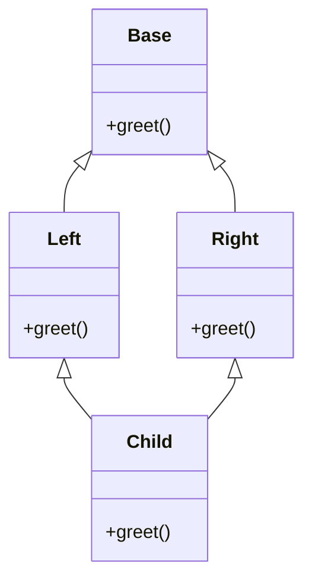

# Chapter 10 — Object-Oriented Programming in Python

> **What you will learn.** Classes and instances, `__init__` and `self`, class vs instance attributes, the three kinds of method, properties. The *data model* — "dunder" methods (`__repr__`, `__eq__`, `__hash__`, `__lt__`, `__len__`, `__iter__`, `__getitem__`, `__call__`, `__enter__` …) that make your classes work with `len()`, `for`, `==`, `+`, `with`, `sorted()`. Reuse: inheritance (a class reusing and extending another) and `super()`, the method resolution order (MRO), multiple inheritance, mixins, abstract base classes, duck typing and `Protocol`, composition vs inheritance. The modern toolbox — `dataclasses`, `enum`, `__slots__` — encapsulation (keeping internals behind methods) conventions, and Pythonic design patterns (named, reusable solutions to common design problems).
>
> **Prerequisites.** Functions, basic types, exceptions. SOLID (five classic OO design principles) and the Gang-of-Four patterns (23 patterns from the 1994 book *Design Patterns*) are covered language-neutrally in the [LLD Handbook](../../../lld/README.md) (LLD = low-level design); this chapter is about *how Python does OOP*.
>
> **Code.** Scripts are in `chapters/10-oop-in-python/code/` and run on Python 3.12+ with no dependencies:
>
> ```bash
> python chapters/10-oop-in-python/code/data_model.py
> ```


---

## 10.1 Classes and instances, `__init__` and `self`

### What it is
A **class** is a blueprint bundling data (**attributes**) and behaviour (**methods**). An **instance** (*object*) is one concrete thing built from it — cookie cutter vs cookies. In Python *everything* is an object — ints, functions, modules, and classes themselves (a class is an instance of `type`).

### Why it matters
State and the code that changes it live together, so invariants (rules that must always hold: "balance never negative") are enforced in one place.

### How it works
1. `class BankAccount: ...` runs the body once and creates a class object.
2. Calling it, `BankAccount("Asha", 100)`: `__new__` allocates an empty instance, then `__init__` initialises it. You rarely write `__new__` (immutable types, instance caching, metaclass tricks — a *metaclass* is the class of a class).
3. `__init__(self, ...)` receives the new instance first; **`self`** is a convention, not a keyword.
4. `self.owner = owner` stores an **instance attribute** in the instance's namespace dict, `obj.__dict__`.
5. `__init__` returns `None`; it *initialises*, not *constructs*.

### Class attributes vs instance attributes
A **class attribute** is defined in the class body and shared; an **instance attribute** is set on `self`, one per object.

**Attribute lookup** for `obj.name` (simplified): `obj.__dict__`, then the class, then parents along the MRO (§10.5). Assigning `obj.name = ...` always writes to the *instance*, *shadowing* (hiding) any class attribute.

### The three kinds of method

| Kind | Decorator | First parameter | Typical use |
|---|---|---|---|
| Instance method | none | `self` (the instance) | Read/modify one object's state |
| Class method | `@classmethod` | `cls` (the class) | Alternative constructors (`from_csv`, `dict.fromkeys`, `datetime.fromtimestamp`); subclass-friendly because `cls` is the subclass |
| Static method | `@staticmethod` | none | Helper belonging to the class, needing neither instance nor class |

`a.deposit` is a **bound method** — the function with `self` pre-filled — so `a.deposit(5)` ≡ `BankAccount.deposit(a, 5)`. (Mechanism: functions are *descriptors*, objects customising attribute lookup — [Chapter 12](../12-decorators-context-managers-metaprogramming/README.md).)

### Properties
A **property** makes a method look like an attribute. Start with a plain public attribute; when you later need validation or computation, turn it into a property and **no caller changes** — so Python needs no Java-style getters/setters (`get_x()`/`set_x()`).

```python
class BankAccount:
    bank_name = "PyBank"          # class attribute: shared by every instance
    _next_id = 1                  # class attribute used as a counter

    def __init__(self, owner: str, balance: float = 0.0) -> None:
        self.owner = owner        # instance attributes: one copy per object
        self._balance = balance   # leading underscore = "internal, please don't touch"
        self.id = BankAccount._next_id
        BankAccount._next_id += 1

    def deposit(self, amount: float) -> None:          # instance method
        if amount <= 0:
            raise ValueError("amount must be positive")
        self._balance += amount

    @property
    def balance(self) -> float:                         # read like an attribute
        return self._balance

    @balance.setter
    def balance(self, value: float) -> None:            # validated assignment
        if value < 0:
            raise ValueError("balance cannot be negative")
        self._balance = value

    @classmethod
    def from_csv(cls, line: str) -> "BankAccount":      # alternative constructor
        owner, balance = line.split(",")
        return cls(owner, float(balance))

    @staticmethod
    def is_valid_amount(amount: float) -> bool:         # plain helper
        return amount > 0


class Buggy:
    items = []                    # MISTAKE: one list shared by all instances
    def add(self, x):
        self.items.append(x)
```
The demo builds two accounts (one via the class method), shadows `bank_name` on `a`, has the setter reject a negative value, proves `a.deposit` is bound, and shows the shared-mutable-class-attribute bug (`self.items.append` mutates the one class list — no assignment, so no shadowing).

Output (`classes_basics.py`):
```
a: Asha 125 id 1
b: Ben 50.0 id 2
static check: False
a.bank_name: PyBank
after assignment -> a: Shadow | b: PyBank | class: PyBank
a.__dict__: {'owner': 'Asha', '_balance': 125, 'id': 1, 'bank_name': 'Shadow'}
setter refused: balance cannot be negative
a.deposit is bound: True
after unbound call: 130
Buggy y.items: [1]
Fixed q.items: []
```

### Trade-offs

| Choice | Good for | Watch out |
|---|---|---|
| Plain public attribute | Simple data, zero overhead | Can't validate — but can become a property later without breaking callers |
| Property | Validation, computed values, read-only views | Hides work behind attribute syntax; keep it cheap |
| Class attribute | Constants, defaults, shared counters | Mutable class attributes are shared — a classic bug |
| `@classmethod` vs `@staticmethod` | `cls` makes alternative constructors subclass-friendly | A static method naming the class directly breaks for subclasses |

### When not to use a class
One function, no state → a function. Data, no behaviour → `dataclass`, `NamedTuple` or `dict`. A class with only `__init__` and one method is often a function in disguise (Jack Diederich, "Stop Writing Classes", PyCon).

### Common mistakes
- Missing `self` → `TypeError: takes 0 positional arguments but 1 was given`.
- Mutable class attributes (`items = []`) — initialise in `__init__`.
- Mutable default arguments (`def __init__(self, items=[])`) — use `None` ([§7.2](../07-functions/README.md)).
- `self._next_id += 1` creates an instance attribute; update the class: `type(self)._next_id += 1`.
- Property and attribute with the same name (`self.balance = x` inside the `balance` setter) → infinite recursion; store in `_balance`.

### Real-world examples
- Class-method constructors: `datetime.datetime.fromtimestamp`, `dict.fromkeys`, `int.from_bytes`.
- Properties: `pathlib.Path.name`, `.suffix`, `.parent`.
- Django model fields are class attributes; instances hold their own values.

### In the interview
**30-second answer:** "A class is a blueprint; instances are built by `__new__` then initialised by `__init__`, which gets the instance as `self`. Class attributes live on the class and are shared; instance attributes live in each object's `__dict__`, and lookup checks the instance first, then the class and its parents. Instance methods take `self`, class methods take `cls` and are used for alternative constructors, static methods take neither. Properties let me add validation later without changing the public API."
- *Why is `self` explicit?* — "Explicit is better than implicit": a method is a function on the class; `obj.m()` passes `obj` first. It also makes instance vs local variables obvious.
- *Factory (object-creating function) as class or static method?* — Class method, so `SubClass.from_csv(...)` returns a `SubClass`.
- *`__new__` for?* — Controlling creation: subclassing immutables (`int`, `str`, `tuple`), caching instances, metaclasses.

### TL;DR
Classes bundle state and behaviour; `__init__` initialises `self`. Instance attributes per object, class attributes shared (beware mutable ones). Instance/class/static methods take `self`/`cls`/nothing. Public attributes first; properties when needed.

---

## 10.2 The data model: dunder methods

### What it is
The **Python data model** is the set of special methods — **d**ouble **under**score names like `__len__` — that the interpreter calls behind syntax and built-ins: `len(x)` → `x.__len__()`, `a + b` → `a.__add__(b)`, `for` → `__iter__`, `with` → `__enter__/__exit__`. *Fluent Python* calls it Python's "metaobject protocol" (the rules by which objects plug into the language).

### Why it matters
Your classes get the familiar interface — `len(playlist)`, `playlist[0]`, `sorted(vectors)`, `v1 + v2`, `print(v)` — and plug into the standard library (`sorted`, `max`, `set`, `dict`, `random.choice`, `in`) for free.

### How it works — the most important dunders

| You write | Python calls | Notes |
|---|---|---|
| `repr(x)`, REPL echo, inside containers | `__repr__` | Unambiguous, for developers; ideally like the constructor call |
| `str(x)`, `print(x)`, `f"{x}"` | `__str__` | Readable, for users; **falls back to `__repr__`** |
| `x == y`, `x != y` | `__eq__`, `__ne__` | Default is identity; `__ne__` inverts `__eq__` automatically |
| `hash(x)`, dict key, set member | `__hash__` | Must agree with `__eq__` |
| `x < y` etc. | `__lt__`, `__le__`, `__gt__`, `__ge__` | `@functools.total_ordering` derives the rest from `__eq__` + one of them |
| `len(x)` | `__len__` | Must return an int ≥ 0 |
| `bool(x)`, `if x:` | `__bool__` | Falls back to `__len__() != 0`, else `True` |
| `for i in x`, `iter(x)` | `__iter__` | Falls back to `__getitem__(0), (1), …` until `IndexError` |
| `x[k]`, `x[a:b]` | `__getitem__` | Receives an int, key, or `slice` object |
| `x[k] = v`, `del x[k]` | `__setitem__`, `__delitem__` | |
| `v in x` | `__contains__` | Falls back to iterating |
| `x(args)` | `__call__` | Makes instances callable |
| `with x as y:` | `__enter__`, `__exit__` | [Chapter 12](../12-decorators-context-managers-metaprogramming/README.md) |
| `a + b`, `a * b`, `abs(a)`, `-a` | `__add__`, `__mul__`, `__abs__`, `__neg__` | Operator overloading (§10.3) |

### `__eq__` and `__hash__` — the contract
A **hash** is the integer dicts and sets use to pick a slot ([§6.2](../06-dicts-sets-collections/README.md)). Rule: **if `a == b` then `hash(a) == hash(b)`** (collisions — different values sharing a hash — are allowed).
1. By default objects compare and hash by identity — consistent.
2. Defining `__eq__` without `__hash__` makes Python set `__hash__ = None` — instances become **unhashable**, protecting the rule.
3. To restore hashing, hash the *same* fields `__eq__` uses: `hash((self.x, self.y))`.
4. Hash only **immutable** state — a key mutated inside a dict sits in the wrong slot and is "lost". `frozen=True` dataclasses (§10.10) are the easy route.

### `NotImplemented`
When a comparison or arithmetic method can't handle the other operand, **return** (don't raise) the singleton `NotImplemented`. Python then tries the reflected method on the other operand (`b.__radd__(a)`, or `b.__eq__(a)`) and raises `TypeError` only if both give up.

```python
@total_ordering
class Vector:
    __match_args__ = ("x", "y")

    def __init__(self, x: float, y: float) -> None:
        self.x, self.y = x, y

    def __repr__(self) -> str:
        return f"Vector({self.x!r}, {self.y!r})"

    def __str__(self) -> str:
        return f"({self.x}, {self.y})"

    def __eq__(self, other: object) -> bool:
        if not isinstance(other, Vector):
            return NotImplemented
        return (self.x, self.y) == (other.x, other.y)

    def __hash__(self) -> int:
        return hash((self.x, self.y))

    def __lt__(self, other: "Vector") -> bool:     # total_ordering adds <=, >, >=
        if not isinstance(other, Vector):
            return NotImplemented
        return abs(self) < abs(other)

    def __add__(self, other): ...                   # see §10.3
    def __abs__(self) -> float:
        return math.hypot(self.x, self.y)
    def __bool__(self) -> bool:
        return bool(self.x or self.y)
    def __iter__(self):                             # enables x, y = v
        yield self.x
        yield self.y


class Playlist:
    def __init__(self, *songs: str) -> None:
        self._songs = list(songs)
    def __len__(self) -> int:
        return len(self._songs)
    def __getitem__(self, index):                   # ints AND slices
        result = self._songs[index]
        return Playlist(*result) if isinstance(index, slice) else result
    def __contains__(self, song: str) -> bool:
        return song in self._songs


class Multiplier:
    def __init__(self, factor: int) -> None:
        self.factor, self.calls = factor, 0
    def __call__(self, x: int) -> int:              # instance used like a function
        self.calls += 1
        return x * self.factor


class Timer:
    def __enter__(self):
        print("  enter: start timer")
        return self                                  # bound to the `as` name
    def __exit__(self, exc_type, exc, tb) -> bool:
        print(f"  exit: stop timer (exception={exc_type.__name__ if exc_type else None})")
        return False                                 # don't swallow exceptions
```

Output (`data_model.py`):
```
repr: Vector(3, 4) | str: (3, 4) | f-string: (3, 4)
v + w = (4, 5) | v * 2 = (6, 8) | 2 * v = (6, 8)
abs(v) = 5.0 | bool(Vector(0,0)) = False
v == Vector(3,4): True | v is Vector(3,4): False
w < v: True | v >= w: True (>= from total_ordering)
set dedups equal vectors: {Vector(1, 2)}
sorted: [Vector(1, 1), Vector(0, 2), Vector(3, 4)]
unpacked: 3 4
pattern matched, y = 4
TypeError: unsupported operand type(s) for +: 'Vector' and 'int'
len: 4 | p[0]: intro | p[-1]: outro | p[1:3]: Playlist('verse', 'chorus')
'chorus' in p: True | iterate via __getitem__: ['INTRO', 'VERSE', 'CHORUS', 'OUTRO']
callable: 15 21 calls = 2 | callable(): True
  enter: start timer
  inside block, t is a Timer: True
  exit: stop timer (exception=None)
  enter: start timer
  exit: stop timer (exception=KeyError)
  KeyError still propagated
__hash__ of class defining only __eq__: None
```
`Playlist` has no `__iter__`, yet `for` works via the legacy `__getitem__` fallback; negative indexes and slices work by delegating to the list. `__match_args__` lets `match v: case Vector(3, y)` destructure positionally. The last line proves the `__eq__`-without-`__hash__` rule. `print([v])` uses `__repr__` (containers show item reprs).

This teaching `Vector` is mutable *and* hashable — fine only if never mutated while used as a key; in production make it immutable (frozen dataclass or read-only properties).

### Trade-offs

| Approach | Pros | Cons |
|---|---|---|
| Dunders by hand | Full control, any semantics | Boilerplate; easy to make `__eq__`/`__hash__` inconsistent |
| `@dataclass` | Generates `__init__`, `__repr__`, `__eq__` (optionally ordering/hash) | Field-by-field semantics only |
| Inherit `collections.abc.Sequence`/`Mapping` | Implement 2–3 abstract methods, get `index`, `count`, `__contains__`, `__iter__`, `__reversed__` as mixin methods | Ties you to that ABC |
| Subclass `list`/`dict` directly | Quick | C methods often bypass your overrides (`dict.update` ignores your `__setitem__`); prefer `collections.UserDict`/`UserList` |

### When not to use it
No surprising operator meanings (`+` that deletes a file). No `__call__` for cleverness — only when the object genuinely *is* function-like (a model, strategy, validator).

### Common mistakes
- Calling `x.__len__()` instead of `len(x)` (the built-in is faster for built-ins and adds checks).
- `raise NotImplementedError` in `__eq__`/`__add__` instead of `return NotImplemented`.
- Surprise at unhashability after defining `__eq__`.
- Useless `__repr__` like `<object>` — include key fields.
- Non-int/non-bool from `__len__`/`__bool__` → `TypeError`.

### Real-world examples
- `pathlib.Path` overloads `/` (`__truediv__`): `Path("a") / "b"`.
- NumPy/pandas overload arithmetic, comparison and `__getitem__` (boolean masks — True/False arrays selecting elements — and slicing).
- `requests.Session`, files, `threading.Lock`, `sqlite3.Connection` implement `__enter__/__exit__`.
- PyTorch `nn.Module.__call__` runs hooks (user-registered callbacks) then `forward()` — hence `model(x)`.
- SQLAlchemy (maps classes to database tables) overloads `==`, `<` on columns to build SQL (`User.age > 18`).

### In the interview
**30-second answer:** "The data model is Python's protocol of special methods: built-ins and syntax call dunders — `len` calls `__len__`, `+` calls `__add__`, `for` calls `__iter__`. Implementing them makes custom classes behave like built-ins and work with the standard library. Key rules: `__repr__` for developers, `__str__` falls back to it; `__eq__` and `__hash__` must agree and defining `__eq__` alone makes the class unhashable; return `NotImplemented` for unsupported operands."
- *Why equal objects need equal hashes?* — The hash picks a bucket (hash-table slot), then `==` confirms; different hashes → different buckets → duplicates.
- *Minimum to be iterable?* — `__iter__` returning an iterator, or `__getitem__` for 0, 1, 2… raising `IndexError` at the end.
- *`__str__` vs `__repr__`?* — `str` falls back to `repr`, not vice versa — write `__repr__` first.

### TL;DR
Dunders are hooks for syntax and built-ins. Always `__repr__`. Keep `__eq__`/`__hash__` consistent on immutable fields. Return `NotImplemented`. `__len__`/`__getitem__`/`__iter__`/`__contains__` for containers, `__call__` for callables, `__enter__/__exit__` for `with`.

---

## 10.3 Operator overloading

### What it is
**Operator overloading** gives `+`, `-`, `*`, `@`, `==`, `<`, `[]` etc. meaning for your types via the matching dunder.

### How it works
For `a + b`:
1. `a.__add__(b)`; a non-`NotImplemented` result wins.
2. Else the **reflected** `b.__radd__(a)`. (If `type(b)` is a *subclass* of `type(a)` that overrides `__radd__`, it's tried first.)
3. Both `NotImplemented` → `TypeError: unsupported operand type(s)`.

For `a += b`, the **in-place** `a.__iadd__(b)` is tried first (may mutate and `return self`); if missing, `a = a + b`. Hence `list += ...` mutates while `tuple += ...` builds a new tuple, and `lst += (1,)` works (`__iadd__` accepts any iterable, like `extend`) while `lst = lst + (1,)` fails (`__add__` wants a list).

| Operator | Method | Reflected | In-place |
|---|---|---|---|
| `+` | `__add__` | `__radd__` | `__iadd__` |
| `-` | `__sub__` | `__rsub__` | `__isub__` |
| `*` | `__mul__` | `__rmul__` | `__imul__` |
| `@` (matrix mult) | `__matmul__` | `__rmatmul__` | `__imatmul__` |
| `/`, `//`, `%`, `**` | `__truediv__`, `__floordiv__`, `__mod__`, `__pow__` | `__r…__` | `__i…__` |
| `&`, `\|`, `^` | `__and__`, `__or__`, `__xor__` | `__r…__` | `__i…__` |
| unary `-`, `+`, `~`, `abs()` | `__neg__`, `__pos__`, `__invert__`, `__abs__` | — | — |

Comparisons have no `__r…__` versions; they reflect each other: if `a < b` is `NotImplemented`, Python tries `b > a`.

```python
    def __add__(self, other: "Vector") -> "Vector":
        if not isinstance(other, Vector):
            return NotImplemented
        return Vector(self.x + other.x, self.y + other.y)

    def __mul__(self, k: float) -> "Vector":      # v * 3
        if not isinstance(k, (int, float)):
            return NotImplemented
        return Vector(self.x * k, self.y * k)

    __rmul__ = __mul__                             # 3 * v  (int.__mul__ returns NotImplemented)
```
`2 * v` works only via `__rmul__`: `int.__mul__(2, v)` returns `NotImplemented`, so Python calls `v.__rmul__(2)`.

### Common mistakes
- No `__rmul__` → `v * 2` works, `2 * v` fails.
- `__iadd__` forgetting `return self` → the variable becomes `None`.
- Mutating operands inside `__add__` — return a *new* object.

### Real-world examples
`Decimal`, `Fraction`, `datetime - timedelta`, `set | set`, `dict | dict` (3.9+), NumPy `@` (PEP 465), `pathlib` `/`.

### In the interview
**30-second answer:** "Each operator maps to a dunder. For `a + b` Python calls `a.__add__(b)`; if that returns `NotImplemented` it tries `b.__radd__(a)`, then raises `TypeError`. `+=` tries `__iadd__` for in-place update and falls back to `+`. Return `NotImplemented` for unsupported types so the other operand gets a chance."

### TL;DR
Operators are dunders. Return `NotImplemented` for unknown types; `__r…__` for "other type on the left", `__i…__` for in-place updates.

---

## 10.4 Inheritance and `super()`

### What it is
**Inheritance** lets a **subclass** (child) reuse and specialise a **base class** (parent): `class Manager(Employee)` gets all parent attributes and methods and can **override** them. It models **is-a**.

### How it works
1. Lookup on a `Manager` searches `Manager`, `Employee`, then `object` (every class's ultimate base).
2. To extend a parent method, call **`super()`** — a proxy forwarding lookups to the *next* class in the MRO.
3. A child `__init__` does **not** auto-call the parent's; call `super().__init__(...)`.
4. `isinstance(obj, Cls)` checks the class and ancestors; `issubclass(A, B)` checks classes. Prefer `isinstance` over `type(x) == Cls`, which ignores subclasses.

```python
class Employee:
    def __init__(self, name: str, salary: int) -> None:
        self.name, self.salary = name, salary
    def pay(self) -> int:
        return self.salary
    def __repr__(self) -> str:
        return f"{type(self).__name__}({self.name!r})"   # type(self) -> works for subclasses


class Manager(Employee):
    def __init__(self, name: str, salary: int, bonus: int) -> None:
        super().__init__(name, salary)      # reuse the parent's initialiser
        self.bonus = bonus
    def pay(self) -> int:                    # override, then extend
        return super().pay() + self.bonus
```
Output: `Manager('Mia') pays 120 | isinstance Employee: True | issubclass: True`

### Common mistakes
- Forgetting `super().__init__()` → missing parent attributes → `AttributeError` later.
- Hard-coding `Employee.__init__(self, ...)` — breaks cooperative multiple inheritance (§10.5).
- Deep hierarchies (5+ levels) — prefer composition (§10.8).
- Overriding with an incompatible signature — violates the Liskov Substitution Principle (a subclass must work wherever its parent does; [LLD Handbook ch. 4](../../../lld/chapters/04-solid-principles/README.md)).

### TL;DR
Subclass for true is-a; override to specialise; `super()` to extend; always call `super().__init__`.

---

## 10.5 Multiple inheritance and the MRO (C3 linearization)

### What it is
`class Child(Left, Right)` has several bases. The **method resolution order (MRO)** is the single ordered list of classes searched for attributes (`Child.__mro__` / `Child.mro()`), computed by **C3 linearization** (since Python 2.3).

### The problem it solves — the diamond

Which `greet` runs, and does `Base.greet` run once or twice? C3 gives one consistent answer with `Base` exactly once.

### How it works — C3 in plain words
MRO(class) = the class + a **merge** of its parents' MROs and the parent list, obeying:
1. **Children before parents.**
2. **Local order kept** — bases in written order (`Left` before `Right`).
3. **Monotonic** — each parent's MRO order is preserved.

Worked example, `Child(Left, Right)`: lists [Left, Base, object], [Right, Base, object], [Left, Right]. Merge = repeatedly take the first head (first element) not in any other list's *tail* (everything after the head):
- `Left` — in no tail → take.
- `Base` — in the tail of [Right, Base, object] → skip; `Right` → take.
- `Base` now free → take; then `object`.
- Result: **Child → Left → Right → Base → object**.

No consistent order → `TypeError: Cannot create a consistent method resolution order`.

### `super()` follows the MRO, not "the parent"
`super()` = "the next class after me **in the MRO of the instance's actual type**". In `Left.greet` on a `Child`, that's `Right` — a sibling. If every class calls `super()`, each implementation runs exactly once: **cooperative multiple inheritance**.

```python
class Base:
    def greet(self): return ["Base"]
class Left(Base):
    def greet(self): return ["Left"] + super().greet()
class Right(Base):
    def greet(self): return ["Right"] + super().greet()
class Child(Left, Right):
    def greet(self): return ["Child"] + super().greet()

class X: ...
class Y: ...
class A(X, Y): ...
class B(Y, X): ...
class C(A, B): ...        # A wants X before Y, B wants Y before X -> impossible
```
Output (`inheritance_mro.py`):
```
Child MRO: ['Child', 'Left', 'Right', 'Base', 'object']
Child().greet(): ['Child', 'Left', 'Right', 'Base']
C3 refuses: Cannot create a consistent method resolution order (MRO) for bases X, Y
```
**Cooperative `__init__`:** with differing arguments, take `**kwargs`, consume yours, pass the rest: `def __init__(self, *, color, **kw): super().__init__(**kw)`.

### Trade-offs

| Multiple inheritance | Pros | Cons |
|---|---|---|
| Mixins (small, stateless add-ons) | Reuse orthogonal (independent) behaviour cheaply | Name clashes, MRO surprises |
| Several "real" stateful bases | Rarely justified | Conflicting `__init__` signatures, fragile |

### Common mistakes
- Assuming `super()` means "the parent".
- Mixing `super()` with explicit `Parent.method(self)` → methods run twice or not at all.
- Listing a mixin *after* a base that already defines the method — the mixin is never reached.

### Real-world examples
- Django class-based views: `class MyView(LoginRequiredMixin, ListView)` — mixin first so its `dispatch` runs before `ListView`'s.
- `socketserver.ThreadingMixIn` + `TCPServer` (TCP: the internet's reliable connection protocol — [System Design Fundamentals](../../../system-design-patterns/modules/00-system-design-fundamentals/README.md)) → `ThreadingTCPServer`.

### In the interview
**30-second answer:** "The MRO is the linear order Python searches for attributes; it's computed by C3 linearization, which keeps children before parents, preserves the order of bases, and is consistent with every parent's MRO — so in a diamond the shared base appears once, last. `super()` delegates to the next class in the MRO of the instance's type, which enables cooperative multiple inheritance where each method runs once."
- *MRO of `D(B, C)` with `B, C` extending `A`?* — D, B, C, A, object.
- *When does class creation fail?* — Conflicting base orders.

### TL;DR
MRO = C3: children first, bases in declared order, consistent with parents. `super()` = "next in the MRO", so cooperating classes in a diamond each run once.

---

## 10.6 Mixins

### What it is
A **mixin** is a small class providing one capability (serialise — convert to storable text/bytes — to JSON, a nice `__repr__`, logging), meant to be *combined*, not used alone; usually no `__init__` or state.

```python
class JsonMixin:
    def to_json(self) -> str:
        return json.dumps(self.__dict__, sort_keys=True)

class ReprMixin:
    def __repr__(self) -> str:
        fields = ", ".join(f"{k}={v!r}" for k, v in self.__dict__.items())
        return f"{type(self).__name__}({fields})"

class Product(JsonMixin, ReprMixin):
    def __init__(self, sku: str, price: float) -> None:
        self.sku, self.price = sku, price
```
Output:
```
mixins: Product(sku='A-1', price=9.5) {"price": 9.5, "sku": "A-1"}
Product MRO: ['Product', 'JsonMixin', 'ReprMixin', 'object']
```

### Rules of thumb
1. Name them `…Mixin`. 2. Stateless (or cooperative with `**kwargs`). 3. List **before** the main base. 4. One capability each.

### When not to use it
Lots of state/configuration → compose an object (§10.8). A plain function `to_json(obj)` would do → use it.

### Real-world examples
Django `LoginRequiredMixin`, `PermissionRequiredMixin`; `socketserver.ForkingMixIn`/`ThreadingMixIn`; `collections.abc` classes supply concrete (implemented) methods like `Sequence.index`.

### TL;DR
Small, stateless, single-purpose classes mixed in via multiple inheritance, left of the main base.

---

## 10.7 Abstract base classes, duck typing and Protocols

Three ways to say "this object must be able to do X".

### Duck typing — what it is
"If it walks and quacks like a duck, it's a duck": Python calls the method and lets it fail if absent — any object with `.speak()` works in `make_it_speak`. It pairs with **EAFP** (try, then catch) over **LBYL** (check first) — [§9.5](../09-errors-exceptions-files/README.md).

### Abstract base classes (ABCs) — what it is
An **ABC** (`abc` module) declares `@abstractmethod`s that subclasses **must** implement; instantiating a class with any left raises `TypeError` — at *creation*, not at the call. ABCs can also share concrete methods.

`collections.abc` has the standard ones: `Iterable`, `Iterator`, `Sized`, `Container`, `Sequence`, `Mapping`, `MutableMapping`, `Callable`, `Hashable` … Several (`Sized`, `Iterable`, `Hashable`, `Callable`, `Container`) implement `__subclasshook__` (lets a class decide what counts as its subclass), so `isinstance(x, Sized)` is `True` for any class with `__len__`, no inheritance needed. `Shape.register(SomeClass)` declares a *virtual subclass*.

### Protocols — what it is
`typing.Protocol` (PEP 544, 3.8) formalises duck typing for **static type checkers** (mypy, pyright): a class matches if it has the right methods/attributes — **structural typing**, no inheritance. `@runtime_checkable` enables `isinstance`, which only checks that the members *exist* (not signatures).

```python
class Shape(ABC):
    @abstractmethod
    def area(self) -> float: ...
    def describe(self) -> str:                 # concrete, shared
        return f"{type(self).__name__} with area {self.area():.2f}"

class Square(Shape):
    def __init__(self, side): self.side = side
    def area(self): return self.side ** 2

class Broken(Shape): pass                      # forgot area()

class Duck:
    def speak(self): return "Quack"
class Robot:
    def speak(self): return "Beep"

@runtime_checkable
class Speaker(Protocol):
    def speak(self) -> str: ...

def announce(s: Speaker) -> str:               # checked structurally by mypy/pyright
    return s.speak().upper()

class Deck:                                    # never inherits from Sized
    def __len__(self): return 52
```
Output (`abc_protocols.py`):
```
Square with area 9.00
TypeError: Can't instantiate abstract class Shape without an implementation for abstract method 'area'
TypeError: Can't instantiate abstract class Broken without an implementation for abstract method 'area'
['Quack', 'Beep']
BEEP | isinstance(Duck(), Speaker): True | isinstance(42, Speaker): False
Deck is Sized: True | Deck is Iterable: False
```
Protocols, generics and type checking in depth: [Chapter 13 §13.8](../13-type-hints/README.md).

### Comparison

| | Duck typing | ABC | Protocol |
|---|---|---|---|
| Needs inheritance? | No | Yes (or `register`) | No |
| Checked when? | At call time (AttributeError) | At instantiation (TypeError) | By the static type checker; optionally `isinstance` |
| Shares code? | No | Yes, concrete methods | Not intended for sharing implementation |
| Best for | Small scripts, flexible APIs | Frameworks/plugins you own, enforced contracts | Library APIs, third-party types, typed codebases |

### When not to use them
No ABC for a single implementation "just in case" (YAGNI — "You Aren't Gonna Need It"). Don't rely on `@runtime_checkable` for correctness.

### Common mistakes
- Not inheriting `ABC` (or `metaclass=ABCMeta`) — `@abstractmethod` has no effect.
- `type(x) is list` instead of `isinstance(x, collections.abc.Sequence)`.
- `isinstance(obj, SomeProtocol)` without `@runtime_checkable` → `TypeError`.

### Real-world examples
`collections.abc.Mapping` for dict-like classes; `io.IOBase` ABC for files; `typing.SupportsInt`, `SupportsAbs`, `SupportsIndex` Protocols; the `numbers.Number` ABC hierarchy.

### In the interview
**30-second answer:** "Python is duck-typed: we care what an object can do, not its class. ABCs make that contract explicit and enforced — you can't instantiate a subclass until it implements every `@abstractmethod`. Protocols describe the same contract structurally, so a type checker accepts any class with matching methods, no inheritance needed. I use ABCs when I own the hierarchy and want shared code, Protocols for flexible, typed interfaces."
- *`isinstance(x, Sized)` checks?* — `__len__` on the type (via `__subclasshook__`), or registration/inheritance.

### TL;DR
Duck typing = behaviour over type. ABC = nominal (declared inheritance), enforced at instantiation, shares code. Protocol = structural, for type checkers. `collections.abc` holds the standard interfaces.

---

## 10.8 Composition vs inheritance

### What it is
**Composition** builds an object from parts it *has* (has-a: a `Car` *has an* `Engine`); **inheritance** says *is a*. Classic advice (Gang of Four, *Effective Python*): **"favour composition over inheritance"**.

### Why it matters
Inheritance couples children to parent internals (the "fragile base class" problem: parent changes silently break children). Composition hides parts behind small interfaces, swappable at run time (a fake engine in tests, an electric motor in production).

```python
class Engine:
    def __init__(self, hp: int) -> None: self.hp = hp
    def start(self) -> str: return f"{self.hp}hp engine started"

class ElectricMotor:
    def start(self) -> str: return "silent motor started"

class Car:
    def __init__(self, engine) -> None:
        self.engine = engine                 # injected part (dependency injection)
    def drive(self) -> str:
        return self.engine.start() + ", driving"
```
Output:
```
150hp engine started, driving
silent motor started, driving
```

| Question | Inheritance | Composition |
|---|---|---|
| Relationship | is-a | has-a / uses-a |
| Coupling | Tight (sees parent internals) | Loose (only the part's interface) |
| Change at run time? | No | Yes (swap the part) |
| Code reuse | Automatic | Delegate explicitly (a few one-line methods) |
| Testing | Hard to replace parent behaviour | Inject a fake (passing parts in from outside = *dependency injection*) |

### When inheritance is right
Genuine is-a with substitutability (Liskov); framework extension points designed for subclassing (`unittest.TestCase`, `Exception` subclasses, Django `Model`, `nn.Module`); mixins.

### Common mistakes
`class Stack(list)` — callers can `insert(0, x)` and break stack semantics; wrap a list. Inheriting just to reuse one helper.

### In the interview
"I default to composition: it's looser coupling and easier to test and change at run time. I inherit when there's a real is-a relationship that satisfies Liskov, or when a framework is designed to be extended by subclassing."

### TL;DR
Has-a → composition (default); is-a with substitutability → inheritance. Duck typing makes plugging in parts easy.

---

## 10.9 Encapsulation conventions: `_single` and `__double` underscores

### What it is
No private keyword — encapsulation by convention ("we're all consenting adults"):

| Name | Meaning | Enforced? |
|---|---|---|
| `name` | Public API | — |
| `_name` | Internal; may change. `from module import *` skips it | Convention (and linters) |
| `__name` (no trailing `__`) | **Name mangling**: inside class `Account`, `self.__secret` becomes `self._Account__secret` at compile time | Only prevents *accidental* subclass clashes; still reachable |
| `__name__` | Dunder: reserved for the language | Don't invent your own |
| `name_` | Avoids clashing with a keyword (`class_`, `type_`) | — |

### Why name mangling exists
To stop a subclass from accidentally overwriting a same-named parent attribute — **not** a security feature.

```python
class Account:
    def __init__(self) -> None:
        self._internal = "convention only"
        self.__secret = "mangled"            # stored as _Account__secret

class SubAccount(Account):
    def __init__(self) -> None:
        super().__init__()
        self.__secret = "child's own"         # stored as _SubAccount__secret
```
Output:
```
instance dict: {'_internal': 'convention only', '_Account__secret': 'mangled', '_SubAccount__secret': "child's own"}
AttributeError: 'SubAccount' object has no attribute '__secret'
```

### Common mistakes
`__x` everywhere to "make it private" — complicates debugging, pickling and subclass access. *Effective Python*: prefer `_protected`; reserve `__private` for clashes with subclasses you don't control.

### TL;DR
`_x` = internal by convention (use this). `__x` = mangled to `_Class__x` against subclass clashes. Nothing is truly private; use properties to control access.

---

## 10.10 dataclasses

### What it is
`@dataclass` (`dataclasses`, Python 3.7, PEP 557) reads **type-annotated** class attributes and generates `__init__`, `__repr__`, `__eq__`; flags add ordering, hashing, immutability and `__slots__`. Hand-written versions are repetitive and bug-prone (forget a field in `__eq__` and equality is silently wrong).

### How it works
1. Each annotated class attribute becomes a **field**, in order. Un-annotated attributes (`x = 5`) and `ClassVar[...]` (true class-level variables) are ignored.
2. Defaults become `__init__` defaults; non-default fields can't follow default ones (unless `kw_only`).
3. `field(...)` customises: `default_factory=list` (fresh object per instance), `repr=False`, `compare=False` (excluded from `__eq__`/ordering), `init=False`, `kw_only=True`.
4. `__post_init__` runs after the generated `__init__` — validation, derived fields.

| `@dataclass(...)` flag | Effect |
|---|---|
| `eq=True` (default) | `__eq__` comparing fields as a tuple — so the class is unhashable unless `frozen`/`unsafe_hash` |
| `order=True` | `<`, `<=`, `>`, `>=` comparing field tuples in declaration order |
| `frozen=True` | Field assignment raises `FrozenInstanceError`; with `eq=True` also generates `__hash__` |
| `slots=True` (3.10) | Generates `__slots__` → less memory, no new attributes |
| `kw_only=True` (3.10) | All fields keyword-only |
| `unsafe_hash=True` | Forces `__hash__` even when mutable — rarely right |

Helpers: `asdict()`, `astuple()`, `replace(obj, **changes)` (copy with changes — how you "modify" a frozen instance), `fields()`.

```python
@dataclass
class Item:
    name: str
    price: float
    qty: int = 1
    tags: list[str] = field(default_factory=list)          # never `tags: list = []`
    _cache: dict = field(default_factory=dict, repr=False, compare=False)

    def __post_init__(self) -> None:
        if self.price < 0:
            raise ValueError("price must be >= 0")

    @property
    def total(self) -> float:
        return self.price * self.qty


@dataclass(frozen=True, order=True)
class Version:
    major: int
    minor: int
    patch: int = 0


@dataclass(slots=True, kw_only=True)
class Config:
    host: str
    port: int = 8080
```
Output (dataclass part of `dataclasses_enums_slots.py`):
```
Item(name='pen', price=1.5, qty=4, tags=['office']) | total: 6.0
eq ignores _cache: True
asdict: {'name': 'pen', 'price': 1.5, 'qty': 4, 'tags': ['office'], '_cache': {}}
post_init: price must be >= 0
mutable default: mutable default <class 'list'> for field tags is not allowed: use default_factory
order compares field-by-field: True | sorted: [Version(major=0, minor=9, patch=0), Version(major=1, minor=4, patch=0), Version(major=1, minor=10, patch=0)]
frozen is hashable: stable
FrozenInstanceError: cannot assign to field 'major'
replace(): Version(major=1, minor=4, patch=7)
Config(host='localhost', port=8080) | has __dict__: False
```
`Version(1, 4) < Version(1, 10)` because tuples `(1, 4, 0) < (1, 10, 0)` compare numerically — unlike strings `"1.4" < "1.10"`.

### Trade-offs — data-holder options

| Option | Mutable | Validation | Speed/memory | Use when |
|---|---|---|---|---|
| `dict` | Yes | None | Fine | Truly dynamic keys, JSON |
| `typing.NamedTuple` | No | None | Tuple-light | Immutable records that should also unpack/index like tuples |
| `@dataclass` | Configurable | `__post_init__` | Good; `slots=True` for lean | Default for internal data |
| `attrs` (3rd party) | Configurable | Validators/converters | Good | More features; inspired dataclasses |
| Pydantic `BaseModel` (3rd party) | Configurable | Full parsing/validation of untrusted input | Heavier | API payloads, config files |

### Common mistakes
- `tags: list = []` → `ValueError`; use `field(default_factory=list)`.
- Missing annotation — `x = 5` is a class attribute, not a field.
- Expecting runtime type validation — annotations aren't enforced.
- `frozen=True` is shallow: a contained list can still mutate.
- Base field with default + subclass field without → `TypeError` (fix with `kw_only=True`).

### Real-world examples
Configs, DTOs (data-transfer objects: plain records passed between system parts), events; Hugging Face `TrainingArguments` is a dataclass; FastAPI/Pydantic accept dataclasses.

### In the interview
**30-second answer:** "`@dataclass` generates `__init__`, `__repr__` and `__eq__` from annotated fields. `order=True` adds comparisons by field tuple, `frozen=True` makes it immutable and hashable, `slots=True` saves memory. Use `field(default_factory=list)` for mutable defaults and `__post_init__` for validation. For untrusted input I'd use Pydantic instead because dataclasses don't validate types."

### TL;DR
Dataclasses remove data-class boilerplate. Know `field(default_factory=…)`, `__post_init__`, `frozen`, `order`, `slots`, `kw_only`, `replace`, `asdict`.

---

## 10.11 Enums

### What it is
An **enumeration** (`enum.Enum`) is a set of named, unique constant members (`Color.RED`) — singletons with `.name` and `.value`, iterable, compared by identity. They replace magic strings/ints (unexplained literals: `status == 3`, the `"acitve"` typo) with autocomplete, typo-proof names, a closed set of legal values and readable reprs.

| Class | Behaves like | Use for |
|---|---|---|
| `Enum` | Its own type; `Color.RED == 1` is `False` | Default |
| `IntEnum` | Also an `int` | Interop with int-expecting code (`http.HTTPStatus`) |
| `StrEnum` (3.11) | Also a `str`; `auto()` gives the lower-case name | Values stored in JSON/DB as strings |
| `Flag` / `IntFlag` | Bit flags combinable with `\|`, tested with `in` | Permissions, options (`re.RegexFlag`) |

`auto()` assigns values (1, 2, 3 … for `Enum`); `@enum.unique` forbids aliases (two names, same value). Look up by value `Color(3)` or name `Color["GREEN"]`.

```python
class Color(Enum):
    RED = auto(); GREEN = auto(); BLUE = auto()
class HttpStatus(IntEnum):
    OK = 200; NOT_FOUND = 404
class Env(StrEnum):
    DEV = auto(); PROD = auto()
class Perm(Flag):
    READ = auto(); WRITE = auto(); EXEC = auto()
```
Output:
```
Color.RED RED 1 Color.GREEN Color.BLUE
members: [<Color.RED: 1>, <Color.GREEN: 2>, <Color.BLUE: 3>] | identity compare: True
IntEnum == int: True | Enum == int: False
StrEnum: prod True
Flag: Perm.READ|WRITE | WRITE in rw: True | EXEC in rw: False
```

### Common mistakes
- `member == "red"` with plain `Enum` → always `False`; compare to `Color.RED` or use `StrEnum`.
- `IntEnum` everywhere — unrelated int comparisons succeed silently.
- Modifying/adding members at run time — enums are fixed.

### Real-world examples
`http.HTTPStatus`, `re.RegexFlag` (`re.IGNORECASE`), `signal.Signals`, Django `TextChoices`/`IntegerChoices`.

### TL;DR
`Enum` for closed constant sets, `StrEnum`/`IntEnum` for str/int interop, `Flag` for combinable options; `auto()` for values.

---

## 10.12 `__slots__`

### What it is
Instances normally keep attributes in a per-instance `__dict__` — flexible but memory-hungry. `__slots__ = ("x", "y")` reserves fixed storage for exactly those attributes and creates **no `__dict__`**. With millions of small objects (points, graph nodes, events) this cuts memory, speeds attribute access slightly, and stops typos from silently creating attributes.

```python
class PointDict:
    def __init__(self, x, y): self.x, self.y = x, y

class PointSlots:
    __slots__ = ("x", "y")
    def __init__(self, x, y): self.x, self.y = x, y
```
Output (100 000 instances measured with `tracemalloc`, the stdlib allocation tracker, including the holding list):
```
100k objects: dict-based 12.8 MB vs slots 8.8 MB
slots block new attrs: 'PointSlots' object has no attribute 'z' and no __dict__ for setting new attributes
```
(Version-dependent — recent CPythons store instance dicts compactly, shrinking the saving.)

### Caveats
- Only listed attributes; no `__dict__`, so no `vars(obj)`.
- No weak references (references that don't keep an object alive) unless `"__weakref__"` is listed.
- Every class in the hierarchy must declare `__slots__` (`()` if nothing new), or the subclass regains a `__dict__`.
- A slot can't have a same-named class-attribute default; `@dataclass(slots=True)` handles this.
- `functools.cached_property` needs `__dict__`, so it fails on slotted classes.

### TL;DR
`__slots__` = fixed attribute set, no per-instance dict → less memory, no accidental attributes. Use for many small objects.

---

## 10.13 Pythonic design patterns (brief)

Full SOLID and all 23 GoF patterns are in the LLD Handbook: [SOLID](../../../lld/chapters/04-solid-principles/README.md), [creational incl. Singleton](../../../lld/chapters/08-patterns-creational/README.md), [structural incl. Decorator](../../../lld/chapters/09-patterns-structural/README.md), [behavioral incl. Strategy/Observer](../../../lld/chapters/11-patterns-behavioral-2/README.md). First-class functions and modules shrink several of them:

| Pattern | Classic (Java-style) | Pythonic |
|---|---|---|
| Strategy (swap algorithms) | Interface + one class per strategy | Pass a **function** |
| Singleton (exactly one instance) | Private constructor + `getInstance()` | A **module** (imported once, cached in `sys.modules`) or a `@functools.cache` factory |
| Command (action as an object) | Command class with `execute()` | A function, `functools.partial`, or a callable object (`__call__`) |
| Iterator | Class with `hasNext/next` | A generator function ([Chapter 11](../11-iterators-generators-functional/README.md)) |
| Decorator (wrap to add behaviour) | Wrapper class implementing the same interface | `@decorator` functions ([Chapter 12](../12-decorators-context-managers-metaprogramming/README.md)) — or a wrapper class for objects |
| Factory (creates other objects) | Factory class | `@classmethod` alternative constructor, or a dict mapping names to classes |
| Template method (base fixes steps, subclasses fill some) | Abstract base with hook methods | Same (ABC), or pass hook functions |
| Observer (notify subscribers) | Listener interface | A list of callbacks |

```python
def no_discount(total): return total
def ten_percent(total): return total * 0.9
def bulk(total): return total - 20 if total > 200 else total

def checkout(total: float, strategy=no_discount) -> float:
    return round(strategy(total), 2)

@functools.cache
def get_settings() -> _Settings:        # lazily created, then always the same object
    return _Settings()
```
Output (`pythonic_patterns.py`):
```
no_discount  -> 250
ten_percent  -> 225.0
bulk         -> 230
<lambda>     -> 125.0
same object: True | debug: True
module cached once: True | in sys.modules: True
```
A Singleton is still global state and hurts testing — prefer passing dependencies; keep singletons for truly process-wide things (config, logging — `logging.getLogger(name)` returns the same logger per name).

### In the interview
"In Python, a Strategy is usually just a function argument, like `sorted(key=...)`. A Singleton is usually a module-level object, because modules are imported once. I'd still use classes when the strategy needs its own state or several related methods."

### TL;DR
Functions for Strategy/Command, modules for Singleton, generators for Iterator, `@decorators` for Decorator.

---

## 10.14 Chapter self-check

1. Two steps when calling `MyClass(...)`? → `__new__` creates, `__init__` initialises.
2. Why does `a.items.append(1)` affect `b` with class attribute `items = []`? → One shared list; mutation creates no instance attribute.
3. `class D(B, C)`, both subclass `A` — MRO? → D, B, C, A, object.
4. `__eq__` defined — instances in a set? → No, `__hash__` is `None`; hash the same immutable fields.
5. `v * 3` works, `3 * v` fails? → Implement `__rmul__`.
6. ABC vs Protocol? → Nominal, enforced at instantiation, shares code vs structural, checked by type checkers.
7. List default in a dataclass? → `field(default_factory=list)`.
8. `self.__token` inside class `Api`? → `self._Api__token`.
9. When do `__slots__` help? → Many small instances (no per-instance `__dict__`).
10. Pythonic Strategy? → Pass a function.

## Chapter TL;DR
- **Classes** bundle state + behaviour; `__init__` initialises `self`. Instance attributes live in `obj.__dict__`; class attributes are shared (never a mutable one as per-instance state).
- **Methods:** instance (`self`), `@classmethod` (`cls`, alternative constructors), `@staticmethod` (neither). **Properties** add validation without changing the API.
- **Data model:** dunders connect your class to syntax and built-ins. Always `__repr__`; keep `__eq__`/`__hash__` consistent; return `NotImplemented`; `__r…__` for reflected operators; `total_ordering` for comparisons.
- **Inheritance:** `super()` = next in the **MRO** (C3: children first, bases in order, consistent). Cooperative `super()` makes diamonds safe. **Mixins** add small capabilities.
- **Contracts:** duck typing by default, **ABCs** to enforce, **Protocols** for structural static typing. **Prefer composition** unless it's a real is-a.
- **Toolbox:** `@dataclass` (`field`, `frozen`, `order`, `slots`, `kw_only`), `enum` (`Enum`, `IntEnum`, `StrEnum`, `Flag`, `auto`), `__slots__` for memory.
- **Encapsulation:** `_x` by convention; `__x` is name-mangled, not private.
- **Patterns:** functions for Strategy, modules for Singleton; details in the LLD Handbook.
