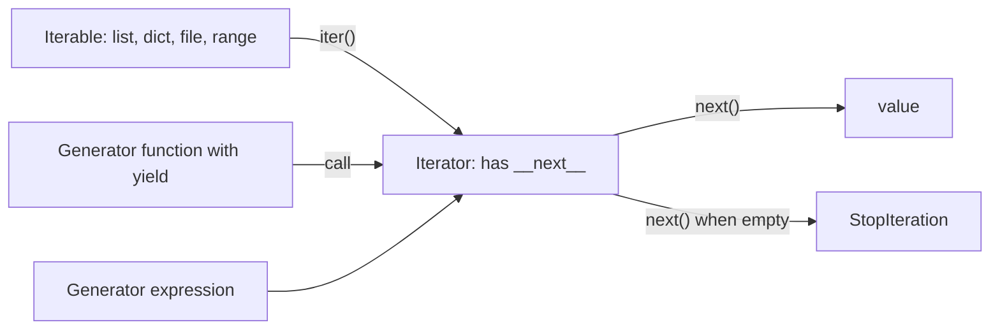
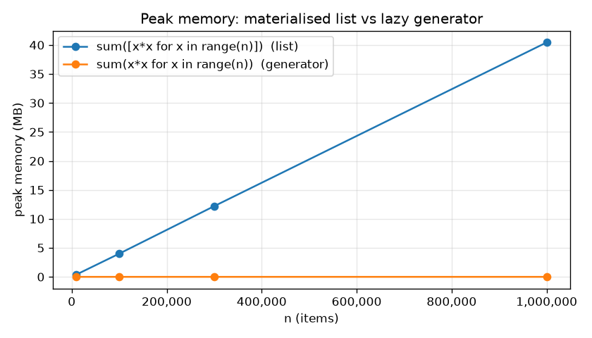

# Chapter 11 — Iterators, Generators and Functional Tools

> **What you will learn.** The protocol behind every `for` loop (iterable vs iterator, `iter()` and `next()`), how generator functions and generator expressions produce values lazily, `yield from`, the basics of `send()`/`close()`, why laziness saves memory and time, the `itertools` toolkit (`count`, `cycle`, `chain`, `islice`, `groupby`, `product`, `permutations`, `combinations`, `accumulate`, `pairwise`, `batched` and friends), comprehension best practices, `map`/`filter`/`reduce` vs comprehensions, `any`/`all`, and `zip(strict=True)`.
>
> **Prerequisites.** [Chapter 10](../10-oop-in-python/README.md)'s data-model idea: syntax calls dunder methods ("double underscore" methods such as `__iter__` and `__len__` that Python calls for you behind the scenes).
>
> **Code.** `chapters/11-iterators-generators-functional/code/` — `iter_protocol.py`, `generators.py`, `itertools_tour.py`, `comprehensions_functional.py`, `lazy_memory.py` (makes the plot in `img/`). Python 3.12+ (`itertools.batched`).



---

## 11.1 Iterable vs iterator: the iteration protocol

### What it is
- An **iterable** is anything you can loop over: it has `__iter__()` that returns an iterator (or, as a legacy fallback — an older mechanism still supported for backward compatibility — a `__getitem__` that accepts 0, 1, 2 …). Lists, tuples, strings, dicts, sets, `range`, files.
- An **iterator** is the object that actually walks through the items. It has `__next__()` (return the next item or raise `StopIteration`, a built-in exception that simply means "no more items") **and** `__iter__()` that returns **itself**.

Analogy: a book is an *iterable*; a bookmark is an *iterator*. Many readers can each have their own bookmark in the same book; a bookmark only moves forward and, once at the end, is used up.

### Why it matters
This one protocol powers `for`, comprehensions, unpacking (`a, b = x`), `sum`, `list()`, `sorted`, `zip`, `in` and more. Understanding it explains puzzles like "why is my generator empty the second time?".

### How it works — what `for x in obj:` really does
1. Call `it = iter(obj)` → `obj.__iter__()`.
2. Repeatedly call `x = next(it)` → `it.__next__()` and run the loop body.
3. When `__next__` raises `StopIteration`, stop quietly.

```python
class Countdown:                       # ITERABLE: returns a fresh iterator each time
    def __init__(self, start): self.start = start
    def __iter__(self): return CountdownIterator(self.start)

class CountdownIterator:               # ITERATOR: holds position, returns itself
    def __init__(self, current): self.current = current
    def __iter__(self): return self
    def __next__(self):
        if self.current <= 0:
            raise StopIteration        # "no more items"
        self.current -= 1
        return self.current + 1

def manual_for(iterable):              # what a for loop does
    out, it = [], iter(iterable)
    while True:
        try:
            x = next(it)
        except StopIteration:
            break
        out.append(x)
    return out
```
Output (`iter_protocol.py`):
```
for loop: [3, 2, 1] | again: [3, 2, 1]
manual_for: [3, 2, 1]
next: 10 20 30 | default: done
iter(it) is it: True
first pass: [0, 1, 4] | second pass: []
iter(callable, sentinel): ['a', 'b']
RuntimeError: dictionary changed size during iteration
```
What it shows: `Countdown` is re-iterable because each `for` gets a new iterator; `next(it, default)` returns the default instead of raising; an iterator's `iter()` is itself; a generator (an iterator) is **exhausted after one pass**; `iter(callable, sentinel)` keeps calling a function until it returns the sentinel (a special marker value that means "stop here") (handy for `iter(lambda: f.read(4096), b"")`); and changing a dict's size while iterating over it raises.

| | Iterable | Iterator |
|---|---|---|
| Required methods | `__iter__` | `__iter__` (returns self) + `__next__` |
| Can loop over it twice? | Yes (new iterator each time) | No — one pass, then empty |
| Remembers position? | No | Yes |
| `len()`? | Often (`list`, `range`) | Usually no |
| Examples | `list`, `str`, `dict`, `range`, `set` | generator, file object, `map`, `zip`, `enumerate`, `iter(list)` |

Note: `range` is a lazy **sequence** (iterable, supports `len` and indexing), not an iterator: `next(range(3))` is a `TypeError`.

### Common mistakes
- Looping twice over a generator/`map`/`zip`/file and getting nothing the second time. Materialise (turn the lazy stream into a real, stored collection) with `list()` if you need two passes, or make a re-iterable class.
- Writing a class whose `__iter__` returns `self` *and* expecting it to be re-iterable.
- Modifying a list/dict while iterating over it — iterate over a copy (`for k in list(d):`) or build a new collection.
- Raising `StopIteration` inside a **generator** to stop it: since Python 3.7 (PEP 479 — a PEP, *Python Enhancement Proposal*, is the numbered design document that introduces a language change) that becomes a `RuntimeError`. Use `return`.

### Real-world examples
File objects iterate line by line without loading the whole file; `csv.reader` and `os.scandir` return iterators; database cursors (a cursor is the object that walks through a query's result rows; DB-API is Python's standard interface for database drivers, PEP 249) are iterable over result rows; PyTorch's `DataLoader` (PyTorch is a deep-learning library) is an iterable that yields batches (small groups of training examples) each epoch (one full pass over the training data).

### In the interview
**30-second answer:** "An iterable has `__iter__` that returns an iterator; an iterator has `__next__`, which returns items or raises `StopIteration`, and its `__iter__` returns itself. A `for` loop calls `iter()` once then `next()` until `StopIteration`. Iterables like lists can be looped many times; iterators like generators are single-pass."
- *Why is a generator empty the second time?* — It's an iterator; its position is at the end.
- *How do you make a class iterable?* — Implement `__iter__` (often as a generator: `def __iter__(self): yield from self._items`).

### Self-check
1. Is a list an iterator? → No, an iterable; `iter(lst)` gives a `list_iterator`.
2. What does `next(it, None)` do at the end? → Returns `None` instead of raising.
3. Is `range(5)` an iterator? → No, a lazy sequence (iterable).

### TL;DR
Iterable → `iter()` → iterator → `next()` … `StopIteration`. Iterables can restart; iterators are one-shot.

---

## 11.2 Generators and `yield`

### What it is
A **generator function** is a function containing `yield`. Calling it does **not** run the body — it returns a **generator object** (an iterator). Each `next()` runs the body until the next `yield`, hands out that value, and **pauses**, keeping all local variables. When the function returns, `StopIteration` is raised (a `return value` becomes `StopIteration.value`).

Analogy: a normal function is a vending machine that dumps all items at once; a generator is a Pez dispenser — one item per click, and it remembers where it was.

### Why it matters
- **Memory:** values are produced one at a time — you can process a 50 GB log or an infinite stream in constant memory.
- **Simplicity:** writing an iterator as a generator takes a few lines instead of a class with `__iter__`/`__next__` and manual state.
- **Pipelines:** generators chain like Unix pipes (the shell's `cmd1 | cmd2` feature, where one program's output streams straight into the next program's input): read → filter → parse → aggregate, each stage lazy.

### How it works
1. `g = countdown(3)` — creates the generator; nothing in the body runs yet.
2. `next(g)` — runs from the top to the first `yield n`; returns 3 and freezes the frame (the frame is the function's live execution state: its local variables and the line it's on).
3. Next `next(g)` — resumes right after the `yield`, loops, yields 2.
4. When the body ends (or hits `return`), `StopIteration` is raised; `for`/`list()` handle it.

```python
def countdown(n: int):
    print("  (generator body starts)")
    while n > 0:
        yield n                      # pause here, hand n to the caller
        n -= 1
    return "liftoff"                 # becomes StopIteration.value

def read_lines(lines):               # pipeline stage 1: strip, skip blanks
    for line in lines:
        line = line.strip()
        if line:
            yield line

def parse(lines):                    # pipeline stage 2: parse
    for line in lines:
        name, score = line.split(",")
        yield name, int(score)

def fib():                           # infinite but lazy
    a, b = 0, 1
    while True:
        yield a
        a, b = b, a + b
```
Output (first part of `generators.py`):
```
created: generator (nothing printed yet -> lazy)
  (generator body starts)
next: 3
rest: [2, 1]
  (generator body starts)
return value via StopIteration.value: liftoff
pipeline: [('alice', 90), ('bob', 72), ('cara', 85)]
...
first 10 fib: [0, 1, 1, 2, 3, 5, 8, 13, 21, 34]
```
Notice "(generator body starts)" appears only at the first `next()`, not at creation. `fib()` never ends, yet `islice(fib(), 10)` takes just 10 values.

### Generator expressions
A **generator expression** is the lazy version of a list comprehension — parentheses instead of brackets: `(x * x for x in range(5))`. When it is the only argument to a function, the extra parentheses can be dropped: `sum(x * x for x in nums)`.

```
genexp sum: 30 | sum(x for x in ...) needs no extra parens: 10
```

### Trade-offs

| | List (comprehension) | Generator (function/expression) |
|---|---|---|
| Memory | Stores all n items | One item at a time (constant) |
| Multiple passes | Yes | No (one-shot) |
| `len()`, indexing, slicing | Yes | No (use `itertools.islice`) |
| First result available | After everything is computed | Immediately |
| Speed for small data you use fully | Slightly faster | Slight per-item overhead |
| Infinite sequences | Impossible | Natural |

### When not to use it
When you need the data more than once, need `len()`/random access, or the data is small and you'll use all of it anyway — a list is simpler. When debugging, a generator's laziness can hide *when* errors happen (the exception appears at consumption time, not creation time).

### Common mistakes
- Calling a generator function and expecting it to "do" something: `process(items)` with `yield` inside does nothing until iterated.
- Consuming a generator twice.
- `return some_list` inside a generator does *not* return the list to a `for` loop — it ends iteration (the value goes to `StopIteration.value`).
- Holding resources (open files) inside a generator that is never finished — wrap in `with` inside the generator, and/or close it (`gen.close()` or `contextlib.closing`).

### Real-world examples
`os.walk` is a generator; Scrapy (a web-scraping framework) spiders `yield` scraped items and requests; pytest fixtures (reusable test-preparation functions) use `yield` to separate setup (preparing resources before a test) from teardown (cleaning them up afterwards); web frameworks stream responses (send the reply to the browser piece by piece instead of all at once) from generators (Flask `Response(generator)`, FastAPI/Starlette `StreamingResponse`); `pandas.read_csv(..., chunksize=N)` returns an iterator over chunks for files too large for memory.

### In the interview
**30-second answer:** "A generator function uses `yield`; calling it returns a generator object — an iterator — without running the body. Each `next()` runs to the next `yield`, returns that value and suspends with its local state intact. That gives lazy, constant-memory iteration, infinite sequences, and composable pipelines. Generator expressions are the inline form with parentheses."
- *Generator vs list comprehension?* — Generator is lazy and one-shot; list is eager, reusable, indexable.
- *How do you get a generator's return value?* — `StopIteration.value`, or as the result of `yield from`.
- *What happens if you `raise StopIteration` inside a generator?* — `RuntimeError` since 3.7 (PEP 479); use `return`.

### Self-check
1. What does calling a generator function return? → A generator object; the body hasn't started.
2. Memory to `sum(x for x in range(10**9))`? → Constant — one value at a time.
3. How to take the first 5 items of an infinite generator? → `list(itertools.islice(gen, 5))`.

### TL;DR
`yield` turns a function into a lazy iterator factory. Generators pause and resume, use constant memory, and chain into pipelines — but they're single-pass.

---

## 11.3 `yield from`, `send()` and `close()` (brief)

### `yield from` — delegation
`yield from sub_iterable` (PEP 380, Python 3.3) yields every value of the sub-iterable, and — if the sub-iterable is a generator — evaluates to that generator's `return` value. It replaces `for x in sub: yield x` and is ideal for recursion.

```python
def flatten(nested):
    for item in nested:
        if isinstance(item, list):
            yield from flatten(item)   # delegate to a recursive sub-generator
        else:
            yield item

def inner():
    yield 1
    yield 2
    return "inner-done"

def outer():
    result = yield from inner()        # receives inner's return value
    yield f"got {result!r}"
```
Output:
```
flatten: [1, 2, 3, 4, 5]
outer: [1, 2, "got 'inner-done'"]
```
(`yield from` also forwards `send()`/`throw()`/`close()` to the sub-generator — that property made it the foundation of pre-`async` coroutines — a **coroutine** is a function that can pause in the middle and be resumed later, which lets one thread juggle many tasks.)

### `send()`, `throw()`, `close()` — two-way generators
A `yield` is also an **expression**: `value = yield out` hands `out` to the caller and receives whatever the caller passes with `gen.send(value)`.

1. **Prime** the generator first with `next(gen)` (or `gen.send(None)`) so it runs to the first `yield`. Sending a non-`None` value to a just-started generator is a `TypeError`.
2. `gen.send(v)` resumes it; the paused `yield` evaluates to `v`; runs to the next `yield` and returns that yielded value.
3. `gen.throw(exc)` raises an exception at the paused `yield`.
4. `gen.close()` raises `GeneratorExit` at the paused `yield` so the generator can clean up (`finally`/`except GeneratorExit` then re-raise or return). Generators are also closed when garbage-collected (automatically freed by Python once nothing refers to them any more).

```python
def running_average():
    total, count, avg = 0.0, 0, None
    try:
        while True:
            value = yield avg          # send avg out, receive next value
            total += value
            count += 1
            avg = total / count
    except GeneratorExit:
        print("  closing running_average (cleanup here)")
        raise
```
Output:
```
  send 10 -> 10.0
  send 20 -> 15.0
  send 60 -> 30.0
  closing running_average (cleanup here)
```
In modern code, **`async def`/`await` coroutines** (asyncio — the standard library's framework for running many waiting tasks concurrently on one thread, see [Chapter 16](../16-concurrency-and-async/README.md)) replace generator-based coroutines; `send` is mostly seen in libraries and interviews. `contextlib.contextmanager` ([Chapter 12](../12-decorators-context-managers-metaprogramming/README.md)) relies on the same generator machinery.

### TL;DR
`yield from` delegates to a sub-iterable and returns a sub-generator's return value. `send` pushes a value into a paused generator (prime with `next` first), `throw` raises inside it, `close` triggers `GeneratorExit` for cleanup.

---

## 11.4 Lazy evaluation and memory

### What it is
**Lazy evaluation** means computing a value only when it's actually requested; **eager** evaluation computes everything up front. In Python 3, many built-ins are lazy: `range`, `map`, `filter`, `zip`, `enumerate`, `reversed`, `dict.keys()/values()/items()` (views), file iteration, generators, and all of `itertools`.

### Why it matters — measured
`lazy_memory.py` measures the peak memory of `sum([x*x for x in range(n)])` (builds a list first) vs `sum(x*x for x in range(n))` (streams values):

```
getsizeof list of 1,000,000: 8.4 MB (pointers only)
getsizeof generator:      208 bytes
n=   10,000  sum(list comp) peak   0.40 MB | sum(gen expr) peak   0.4 KB
n=  100,000  sum(list comp) peak   4.00 MB | sum(gen expr) peak   0.4 KB
n=  300,000  sum(list comp) peak  12.20 MB | sum(gen expr) peak   0.4 KB
n=1,000,000  sum(list comp) peak  40.45 MB | sum(gen expr) peak   0.4 KB
any() list comp built all 1,000,000 items; gen stopped at item 12 -> gen faster: True
```


*Figure — Peak memory grows linearly with n for the list (≈40 bytes per item: an 8-byte pointer plus a ~32-byte int object) but stays flat for the generator.*

How to read the numbers: `sys.getsizeof(list)` counts only the list's array of 8-byte pointers (1,000,000 × 8 ≈ 8 MB); the int objects themselves add ~32 MB more, which `tracemalloc` (a standard-library module that records every memory allocation Python makes) sees. Exact sizes vary by Python version and platform.

Two benefits of laziness:
1. **Memory** — O(1) instead of O(n) for single-pass work. (Big-O notation describes how cost grows with input size *n*: O(1) means constant no matter how big *n* gets, O(n) means it grows in proportion to *n*.)
2. **Early exit** — `any`, `next`, `islice`, `takewhile` stop pulling as soon as they have the answer, so the rest is never computed.

### Common mistakes
- Wrapping everything in `list(...)` "to be safe" — loses both benefits.
- Assuming laziness in Python 2 tutorials (`map` returned lists there).
- Lazy code capturing a variable that changes before evaluation (closures — functions that remember variables from the code around them — bind late; see §11.7).

### TL;DR
Lazy = compute on demand. Use generators and iterator tools for big/streaming/infinite data and early-exit searches; use lists when you need reuse or random access.

---

## 11.5 `itertools` — the iterator toolkit

### What it is
`itertools` is a standard-library module of fast (C-implemented — written in the C language inside the interpreter, so far quicker than equivalent Python loops), memory-efficient building blocks that take iterables and return **lazy iterators**. Think of them as Lego for loops.

### Infinite iterators

| Function | Produces | Example → result |
|---|---|---|
| `count(start=0, step=1)` | start, start+step, … forever | `islice(count(10, 5), 4)` → 10, 15, 20, 25 |
| `cycle(it)` | Repeats `it` forever (saves a copy) | `islice(cycle("AB"), 5)` → A B A B A |
| `repeat(x, n=∞)` | x, n times (or forever) | `repeat("x", 3)` → x x x |

### Terminating / selecting

| Function | What it does | Output from the script |
|---|---|---|
| `chain(a, b, …)` | Concatenate iterables lazily | `[1, 2, 3, 'a', 'b']` |
| `chain.from_iterable(x)` | Flatten one level | `[1, 2, 3]` |
| `islice(it, start, stop, step)` | Slice any iterator (no negatives) | `islice(range(10), 2, 8, 2)` → `[2, 4, 6]` |
| `takewhile(pred, it)` | Yield while predicate (a function returning True/False) is true, then stop | `[1, 3]` |
| `dropwhile(pred, it)` | Skip while predicate is true, then yield the rest | `[6, 2]` |
| `filterfalse(pred, it)` | Items where predicate is false | `[1, 3, 5]` |
| `compress(data, selectors)` | Keep items whose selector is truthy (counts as true in an `if`) | `['A', 'C']` |
| `starmap(f, it)` | `f(*args)` for each args tuple | `[8, 9]` |
| `zip_longest(*its, fillvalue)` | Like `zip` but pads the shorter ones | `[('a', 1), ('b', 2), ('-', 3)]` |
| `tee(it, n=2)` | Split one iterator into n independent ones (buffers in memory) | `[1, 2, 3] [1, 2, 3]` |
| `accumulate(it, func=add, initial=None)` | Running totals (or running max, product …) | `[3, 4, 8, 9, 14]` |
| `pairwise(it)` (3.10) | Overlapping pairs (a,b), (b,c), … | `[(1, 4), (4, 9), (9, 16)]` |
| `batched(it, n)` (3.12) | Tuples of size n (last may be shorter; `strict=True` in 3.13+ raises instead) | `[(0, 1, 2), (3, 4, 5), (6,)]` |

### `groupby` — the one everybody gets wrong
`groupby(iterable, key)` groups **consecutive** items with the same key. It does **not** sort. If equal keys aren't adjacent, you get separate groups for them. So: **sort by the same key first**.

```python
words = ["apple", "avocado", "banana", "blueberry", "cherry", "apricot"]
{k: list(g) for k, g in groupby(words, key=lambda w: w[0])}
# 'a' appears twice as a group; the dict keeps only the last one -> 'apple', 'avocado' lost
{k: list(g) for k, g in groupby(sorted(words), key=lambda w: w[0])}
```
```
groupby UNSORTED (apricot lost/overwritten): {'a': ['apricot'], 'b': ['banana', 'blueberry'], 'c': ['cherry']}
groupby sorted: {'a': ['apple', 'apricot', 'avocado'], 'b': ['banana', 'blueberry'], 'c': ['cherry']}
```
Also: each group `g` is a lazy view that becomes invalid once you advance to the next group — convert it with `list(g)` immediately if you need to keep it. (For simple "group into a dict", `collections.defaultdict(list)` needs no sorting.)

### Combinatorics

| Function | Meaning | Count for n items, pick r | `"abc"`, r=2 |
|---|---|---|---|
| `product(A, B)` / `product(A, repeat=r)` | Cartesian product (every pairing; nested loops) | nʳ | `aa ab ac ba …` (9) |
| `permutations(it, r)` | Ordered arrangements, no repeats | n!/(n−r)! = 6 | `ab ac ba bc ca cb` |
| `combinations(it, r)` | Unordered selections, no repeats | n!/(r!(n−r)!) = 3 | `ab ac bc` |
| `combinations_with_replacement(it, r)` | Unordered, repeats allowed | (n+r−1)!/(r!(n−1)!) = 6 | `aa ab ac bb bc cc` |

Output from the script:
```
product: [('a', 1), ('a', 2), ('b', 1), ('b', 2)]
product repeat=2 of 01: ['00', '01', '10', '11']
permutations(abc, 2): ['ab', 'ac', 'ba', 'bc', 'ca', 'cb']
combinations(abc, 2): ['ab', 'ac', 'bc']
combinations_with_replacement(ab, 2): ['aa', 'ab', 'bb']
accumulate max: [3, 3, 4, 4, 5]
accumulate product, initial=1: [1, 2, 6, 24]
differences via pairwise: [3, 5, 7]
```
Combinatorial output grows explosively (`permutations(range(12))` is 479,001,600 items) — iterate lazily, never `list()` it blindly.

### Real-world examples
`product` for hyperparameter grids (hyperparameters are the settings you choose *before* training a machine-learning model, like learning rate; a grid tries every combination; scikit-learn's `ParameterGrid` iterates the Cartesian product of parameter lists); `batched` to send API (Application Programming Interface — the set of requests another program or service accepts) /database writes in chunks of 100; `pairwise` for deltas between consecutive timestamps; `accumulate` for running balances or cumulative sums; `chain.from_iterable` to flatten pages of API results; `islice` for "first N" of any stream. The `more-itertools` package adds many more recipes (`chunked`, `windowed`, …).

### In the interview
**30-second answer:** "itertools provides lazy, C-speed building blocks: infinite ones like `count` and `cycle`; selectors like `islice`, `takewhile`, `compress`; combiners like `chain` and `zip_longest`; aggregators like `accumulate`, `groupby`, `pairwise`, `batched`; and combinatorics — `product`, `permutations`, `combinations`. The classic trap is that `groupby` only groups consecutive equal keys, so you sort first."
- *Difference between permutations and combinations?* — Permutations care about order (ab ≠ ba); combinations don't.
- *How to chunk a list into batches of 100?* — `itertools.batched(items, 100)` (3.12+); earlier, `zip(*[iter(items)]*100)` drops the remainder, so use an `islice` loop.
- *Why can't I slice a generator with `[:5]`?* — Generators have no `__getitem__`; use `islice`.

### Self-check
1. `groupby([1,1,2,1])` gives how many groups? → Three: 1, 2, 1.
2. How many `combinations(range(5), 2)`? → 10.
3. What does `accumulate([1,2,3])` produce? → 1, 3, 6.
4. What does `pairwise("abc")` give? → ('a','b'), ('b','c').

### TL;DR
Reach for `itertools` before writing index-juggling loops. Remember: lazy results, `groupby` needs sorted input, combinatorics explode, `batched`/`pairwise` are modern (3.12/3.10).

---

## 11.6 Comprehensions — best practices

### What it is
A **comprehension** builds a collection from an iterable in one expression:

| Kind | Syntax | Result |
|---|---|---|
| List | `[expr for x in it if cond]` | `list` |
| Dict | `{k: v for x in it if cond}` | `dict` |
| Set | `{expr for x in it if cond}` | `set` |
| Generator expression | `(expr for x in it if cond)` | lazy iterator |

### How to read one
Read `[n * n for n in nums if n % 2 == 0]` as: "for each `n` in `nums`, if `n` is even, collect `n * n`." Multiple `for` clauses are nested loops **in the same left-to-right order** you'd write them.

```python
nums = [1, 2, 3, 4, 5, 6]
[n * n for n in nums if n % 2 == 0]                   # filter: `if` AFTER the for
["even" if n % 2 == 0 else "odd" for n in nums[:4]]   # choose: if-else BEFORE the for
[x for row in matrix for x in row]                    # flatten: outer loop first
[[row[i] for row in matrix] for i in range(3)]        # nested comprehension: transpose
[v for s in data if s.isdigit() and (v := int(s)) > 5]  # walrus: compute once
{v: k for k, v in prices.items()}                     # invert a dict
```
Output (`comprehensions_functional.py`):
```
list: [4, 16, 36]
dict: {4: 16, 5: 25, 6: 36}
set: {0, 1, 2}
gen : 91
labels: ['odd', 'even', 'odd', 'even']
flatten: [1, 2, 3, 4, 5, 6]
transpose: [[1, 4], [2, 5], [3, 6]]
walrus: [10, 7]
invert: {3: 'apple', 2: 'pear'}
```

### Best practices
1. **Keep it to one line of logic**: at most two `for` clauses or one `for` + one condition (*Effective Python*'s guideline). Beyond that, write a normal loop or a generator function with a name.
2. **Don't use comprehensions for side effects** (anything a piece of code does besides returning a value — printing, writing a file, changing a global) — `[print(x) for x in xs]` builds a useless list of `None`s. Use a `for` loop.
3. **Use a generator expression** when the result is consumed once by `sum`, `max`, `any`, `"".join`, etc.
4. **Loop variables don't leak**: in Python 3 each comprehension has its own scope (the region of code where a variable name is visible) (since 3.12, PEP 709 inlines them for speed without changing this).
5. **Use the walrus operator `:=`** (3.8) to avoid computing an expensive value twice (filter and output).
6. **Prefer `dict`/`set` comprehensions** over `dict([(k, v) for …])`.

### Common mistakes
- Putting `if-else` after the `for` (`[x for x in xs if c else y]`) → `SyntaxError`. Filter `if` goes after; choice `if-else` goes before.
- Mixing up the order of nested `for` clauses.
- Building a huge list only to take `[0]` — use `next(genexp, default)`.

### TL;DR
Comprehensions are the idiomatic way to map + filter into a new collection. Keep them short, side-effect free, and use the generator form when consumed once.

---

## 11.7 `map`/`filter`/`reduce`, `any`/`all`, `zip(strict=True)` — the functional toolbox

### What it is
**Functional programming** favours pure functions (no side effects) and passing functions as values. Python supports this partially with first-class functions (functions are ordinary values you can store in variables and pass to or return from other functions), `lambda`, and a few helpers:
- `map(f, it, ...)` — lazily applies `f` to every item (or to items from several iterables in parallel).
- `filter(pred, it)` — lazily keeps items where `pred(item)` is truthy; `filter(None, it)` keeps truthy items.
- `functools.reduce(f, it, initial)` — folds (repeatedly combines, left to right) a sequence into one value: `f(f(f(init, a), b), c)`. (Moved out of built-ins in Python 3.)
- `any(it)` / `all(it)` — short-circuiting (stop as soon as the answer is known) "is at least one / are all truthy".
- `zip(*its, strict=False)` — pairs items up; stops at the shortest. `strict=True` (3.10, PEP 618) raises `ValueError` on unequal lengths.

(`lambda` and higher-order functions are introduced in [Chapter 7 §7.5](../07-functions/README.md).)

### Comprehension or `map`/`filter`?

| Situation | Prefer | Why |
|---|---|---|
| Transform/filter with an expression | Comprehension | Readable; no `lambda` |
| Apply an existing named function | `map(str.upper, xs)` either is fine | No lambda needed |
| Need `lambda` to use `map`/`filter` | Comprehension | `[x*2 for x in xs]` beats `map(lambda x: x*2, xs)` |
| Reduce to one value | `sum`, `min`, `max`, `any`, `all`, `math.prod`, `"".join` | Clearer than `reduce` |
| Custom fold with no built-in | `reduce` or a loop | Loop is often more readable |

Guido van Rossum's own advice (and *Effective Python*'s) is to prefer comprehensions over `map`/`filter` with lambdas, and plain loops or built-ins over most `reduce` calls.

### `any` / `all` details
- Both short-circuit: `any` stops at the first truthy item, `all` at the first falsy one — pass a **generator expression**, not a list, so the unneeded items are never computed.
- Empty input: `all([])` is `True` (vacuous truth: "every item passes" is trivially true when there are no items), `any([])` is `False`.

### `zip` details
- Default `zip` silently truncates to the shortest input — a classic data bug when two lists are expected to align. Use `strict=True` for that case.
- `zip(*pairs)` "unzips" a list of pairs.
- `zip` is lazy; `dict(zip(keys, values))` builds a dict.

```python
print("map:", list(map(str.upper, ["a", "b"])))
print("filter:", list(filter(None, [0, 1, "", "hi", None])))
print("reduce product:", reduce(operator.mul, nums, 1))
result = any(check(x) for x in [1, 3, 5])           # stops at 3
list(zip(names, scores, strict=True))               # ValueError on mismatch
letters, numbers = zip(*pairs)                      # unzip
funcs = [lambda: i for i in range(3)]               # late binding trap
funcs = [lambda i=i: i for i in range(3)]           # fix: bind now via default
sorted(people, key=lambda p: (-p[1], p[0]))         # multi-key sort
```
Output:
```
map: ['A', 'B'] | comp: ['A', 'B']
filter: [1, 'hi'] (filter(None, ...) keeps truthy)
reduce sum: 21 | sum(): 21
reduce product: 720
map over two iterables: [11, 22]
  check(1)  check(3)
  any -> True (stopped after 3; 5 never checked)
all([]) = True | any([]) = False
zip truncates silently: [('a', 90), ('b', 80)]
strict=True: zip() argument 2 is shorter than argument 1
unzip: ('a', 'b') (1, 2)
late binding: [2, 2, 2]
fixed with default arg: [0, 1, 2]
sorted by age desc, then name: [('ann', 31), ('cy', 31), ('bob', 25)]
max by age (first wins on tie): ('ann', 31)
```

### Late binding — why `[2, 2, 2]`?
A closure (a function that uses a variable from an enclosing scope) looks the variable up **when it is called**, not when it's created. All three lambdas share the one variable `i`, which is 2 by the time they run. Binding it as a default argument (`lambda i=i: i`) captures the current value. `functools.partial(f, i)` is another fix.

### Other functional helpers worth knowing
- `operator.itemgetter(1)`, `attrgetter("age")`, `methodcaller("strip")` — fast, readable replacements for small lambdas used as `key=`.
- `functools.partial(f, x)` — pre-fill arguments.
- `sorted`/`min`/`max` accept `key=`; `sorted` is **stable** (equal keys keep their input order), so you can sort by several keys in passes or with a tuple key.
- `enumerate(it, start=1)` instead of `range(len(it))`.

### Common mistakes
- Forgetting that `map`/`filter`/`zip` return one-shot iterators in Python 3.
- `reduce` without an initial value on an empty sequence → `TypeError`.
- Using `zip` on lists you assume are equal length — use `strict=True`.
- `any([expensive(x) for x in xs])` — the list computes everything; drop the brackets.

### Real-world examples
`sorted(records, key=itemgetter("created_at"))` is everywhere in data code; `all(field in payload for field in REQUIRED)` for request validation; `dict(zip(header, row))` when reading CSVs; PySpark (Python interface to Apache Spark, a system for processing data spread across many machines) and pandas (the table-manipulation library, see [Chapter 18](../18-data-stack/README.md)) expose `map`/`filter`/`reduce`-style APIs (`rdd.map`, `Series.map`) that come straight from this functional vocabulary.

### In the interview
**30-second answer:** "`map` and `filter` are lazy in Python 3; I prefer comprehensions when I'd otherwise need a lambda, and built-ins like `sum`, `max`, `any`, `all` over `reduce`. `any`/`all` short-circuit, so I pass generator expressions. `zip` truncates silently, so for data that must align I use `strict=True`. And closures bind late — capture loop variables with a default argument or `partial`."
- *What's `all([])`?* — `True`.
- *Why prefer `itemgetter` to a lambda for `key=`?* — Slightly faster and self-describing.

### Self-check
1. `list(filter(None, [0, "", "a", 3]))`? → `['a', 3]`.
2. `reduce(lambda a, b: a * b, [2, 3, 4])`? → 24.
3. `zip([1, 2, 3], "ab", strict=True)` when consumed? → `ValueError`.
4. Why does `any(x > 10 for x in range(10**9))` return instantly? → It stops at 11.

### TL;DR
Comprehensions over `map`/`filter` + lambda; built-ins over `reduce`; generator expressions inside `any`/`all`; `zip(strict=True)` when lengths must match; watch late-binding closures.

---

## 11.8 Chapter self-check

1. What two methods make an object an iterator? → `__iter__` (returning self) and `__next__`.
2. Why is `list(gen)` empty the second time? → Generators are one-shot iterators.
3. When does the body of a generator function start running? → On the first `next()`.
4. How do you get a sub-generator's `return` value? → `result = yield from sub()`.
5. What must you do before `gen.send(value)`? → Prime it with `next(gen)`.
6. Why group words with `groupby` only after sorting? → It groups consecutive equal keys only.
7. `permutations("abc", 2)` vs `combinations("abc", 2)` counts? → 6 vs 3.
8. Memory of `sum(x*x for x in range(n))`? → Constant.
9. Filter vs choose in a comprehension — where does the `if` go? → Filter after `for`; `a if c else b` before `for`.
10. How do you make `zip` fail on mismatched lengths? → `strict=True`.

## Chapter TL;DR
- **Protocol:** iterable (`__iter__`) → iterator (`__next__` + `__iter__` returning self) → `StopIteration`. `for` = `iter()` + `next()` loop. Iterators are single-pass.
- **Generators:** `yield` makes a lazy iterator with paused state; generator expressions `( … )` are the inline form. `yield from` delegates; `send`/`throw`/`close` make two-way generators (mostly replaced by `async`).
- **Laziness:** constant memory and early exit; materialise with `list()` only when you need reuse or indexing.
- **itertools:** `count`/`cycle`/`repeat`, `chain`/`islice`/`takewhile`/`dropwhile`, `groupby` (sort first!), `product`/`permutations`/`combinations`, `accumulate`, `pairwise`, `batched`, `zip_longest`, `tee`.
- **Comprehensions:** short, no side effects, filter-if after / choose-if-else before; generator form when consumed once.
- **Functional:** comprehensions over `map`/`filter` + lambda; `sum`/`max`/`any`/`all` over `reduce`; `zip(strict=True)`; closures bind late.
