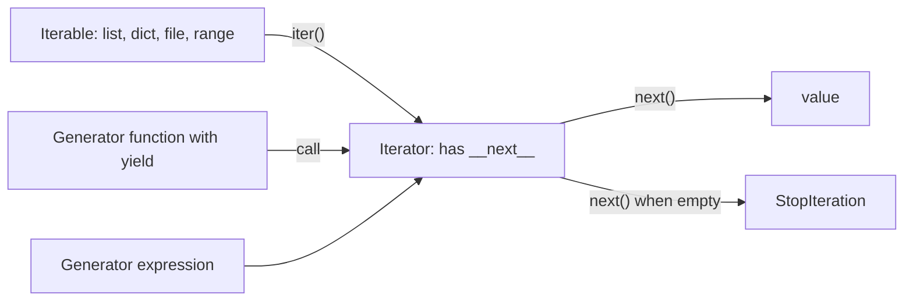

# Chapter 11 — Iterators, Generators and Functional Tools

> **What you will learn.** The protocol behind every `for` loop (iterable vs iterator, `iter()`, `next()`), generator functions and expressions that produce values lazily, `yield from`, `send()`/`close()` basics, why laziness saves memory and time, the `itertools` toolkit (`count`, `cycle`, `chain`, `islice`, `groupby`, `product`, `permutations`, `combinations`, `accumulate`, `pairwise`, `batched` …), comprehension best practices, `map`/`filter`/`reduce` vs comprehensions, `any`/`all`, `zip(strict=True)`.
>
> **Prerequisites.** [Chapter 10](../10-oop-in-python/README.md)'s data-model idea: syntax calls dunder ("double underscore") methods such as `__iter__` and `__len__` for you.
>
> **Code.** `chapters/11-iterators-generators-functional/code/` — `iter_protocol.py`, `generators.py`, `itertools_tour.py`, `comprehensions_functional.py`, `lazy_memory.py` (makes the plot in `img/`). Python 3.12+ (`itertools.batched`).



---

## 11.1 Iterable vs iterator: the iteration protocol

### What it is
- An **iterable** can be looped over: it has `__iter__()` returning an iterator (or, as a legacy fallback still supported, a `__getitem__` accepting 0, 1, 2 …). Lists, tuples, strings, dicts, sets, `range`, files.
- An **iterator** walks the items: `__next__()` returns the next item or raises `StopIteration` ("no more items"), **and** `__iter__()` returns **itself**.

A book is an *iterable*; a bookmark is an *iterator* — many readers can each have one, and a bookmark only moves forward until used up.

### Why it matters
This one protocol powers `for`, comprehensions, unpacking (`a, b = x`), `sum`, `list()`, `sorted`, `zip`, `in` — and explains "why is my generator empty the second time?". (Overview in [§3.5](../03-control-flow/README.md).)

### How it works — what `for x in obj:` really does
1. `it = iter(obj)` → `obj.__iter__()`.
2. Repeatedly `x = next(it)` → `it.__next__()`, run the body.
3. On `StopIteration`, stop quietly.

```python
class Countdown:                       # ITERABLE: returns a fresh iterator each time
    def __init__(self, start): self.start = start
    def __iter__(self): return CountdownIterator(self.start)

class CountdownIterator:               # ITERATOR: holds position, returns itself
    def __init__(self, current): self.current = current
    def __iter__(self): return self
    def __next__(self):
        if self.current <= 0:
            raise StopIteration        # "no more items"
        self.current -= 1
        return self.current + 1

def manual_for(iterable):              # what a for loop does
    out, it = [], iter(iterable)
    while True:
        try:
            x = next(it)
        except StopIteration:
            break
        out.append(x)
    return out
```
Output (`iter_protocol.py`):
```
for loop: [3, 2, 1] | again: [3, 2, 1]
manual_for: [3, 2, 1]
next: 10 20 30 | default: done
iter(it) is it: True
first pass: [0, 1, 4] | second pass: []
iter(callable, sentinel): ['a', 'b']
RuntimeError: dictionary changed size during iteration
```
`Countdown` is re-iterable (new iterator per `for`); `next(it, default)` returns the default instead of raising; an iterator's `iter()` is itself; a generator is **exhausted after one pass**; `iter(callable, sentinel)` calls a function until it returns the sentinel (a "stop here" marker — e.g. `iter(lambda: f.read(4096), b"")`); resizing a dict while iterating raises.

| | Iterable | Iterator |
|---|---|---|
| Required methods | `__iter__` | `__iter__` (returns self) + `__next__` |
| Can loop over it twice? | Yes (new iterator each time) | No — one pass, then empty |
| Remembers position? | No | Yes |
| `len()`? | Often (`list`, `range`) | Usually no |
| Examples | `list`, `str`, `dict`, `range`, `set` | generator, file object, `map`, `zip`, `enumerate`, `iter(list)` (a `list_iterator`) |

`range` is a lazy **sequence** (iterable, supports `len` and indexing), not an iterator: `next(range(3))` is a `TypeError`.

### Common mistakes
- Looping twice over a generator/`map`/`zip`/file — second pass empty. Materialise (store as a real collection) with `list()` or write a re-iterable class.
- A class whose `__iter__` returns `self`, expected to be re-iterable.
- Modifying a list/dict while iterating — iterate a copy (`for k in list(d):`) or rebuild.
- `raise StopIteration` inside a **generator**: since 3.7 (PEP 479 — PEPs, *Python Enhancement Proposals*, are the numbered design documents for language changes) it becomes `RuntimeError`. Use `return`.

### Real-world examples
Files iterate line by line without loading everything; `csv.reader` and `os.scandir` return iterators; database cursors (objects walking a query's result rows; DB-API, PEP 249, is Python's standard driver interface) are iterable; PyTorch's `DataLoader` yields batches (small groups of training examples) each epoch (one full pass over the data).

### In the interview
**30-second answer:** "An iterable has `__iter__` that returns an iterator; an iterator has `__next__`, which returns items or raises `StopIteration`, and its `__iter__` returns itself. A `for` loop calls `iter()` once then `next()` until `StopIteration`. Iterables like lists can be looped many times; iterators like generators are single-pass."
- *Generator empty the second time?* — It's an iterator positioned at the end.
- *Make a class iterable?* — `__iter__`, often as a generator: `def __iter__(self): yield from self._items`.

### TL;DR
Iterable → `iter()` → iterator → `next()` … `StopIteration`. Iterables restart; iterators are one-shot.

---

## 11.2 Generators and `yield`

### What it is
A **generator function** contains `yield`. Calling it does **not** run the body — it returns a **generator object** (an iterator). Each `next()` runs to the next `yield`, hands out the value and **pauses**, keeping local variables. When the function returns, `StopIteration` is raised (`return value` becomes `StopIteration.value`).

### Why it matters
- **Memory:** one value at a time — a 50 GB log or an infinite stream in constant memory.
- **Simplicity:** a few lines instead of a class with `__iter__`/`__next__` and manual state.
- **Pipelines:** chain like Unix pipes (`cmd1 | cmd2`, output streaming into the next program): read → filter → parse → aggregate, each stage lazy.

### How it works
1. `g = countdown(3)` creates the generator; the body hasn't started.
2. `next(g)` runs to the first `yield n`, returns 3, freezes the frame (the function's live state: locals and current line).
3. Next `next(g)` resumes after the `yield`, yields 2.
4. Body ends or `return` → `StopIteration`, handled by `for`/`list()`.

```python
def countdown(n: int):
    print("  (generator body starts)")
    while n > 0:
        yield n                      # pause here, hand n to the caller
        n -= 1
    return "liftoff"                 # becomes StopIteration.value

def read_lines(lines):               # pipeline stage 1: strip, skip blanks
    for line in lines:
        line = line.strip()
        if line:
            yield line

def parse(lines):                    # pipeline stage 2: parse
    for line in lines:
        name, score = line.split(",")
        yield name, int(score)

def fib():                           # infinite but lazy
    a, b = 0, 1
    while True:
        yield a
        a, b = b, a + b
```
Output (first part of `generators.py`):
```
created: generator (nothing printed yet -> lazy)
  (generator body starts)
next: 3
rest: [2, 1]
  (generator body starts)
return value via StopIteration.value: liftoff
pipeline: [('alice', 90), ('bob', 72), ('cara', 85)]
...
first 10 fib: [0, 1, 1, 2, 3, 5, 8, 13, 21, 34]
```
"(generator body starts)" appears only at the first `next()`. `fib()` never ends, yet `islice(fib(), 10)` (or `list(itertools.islice(gen, 5))` for the first five) takes only what's asked.

### Generator expressions
A **generator expression** is the lazy list comprehension — parentheses: `(x * x for x in range(5))`; as a sole argument the extra parentheses drop: `sum(x * x for x in nums)`.
```
genexp sum: 30 | sum(x for x in ...) needs no extra parens: 10
```

### Trade-offs

| | List (comprehension) | Generator (function/expression) |
|---|---|---|
| Memory | Stores all n items | One item at a time (constant) |
| Multiple passes | Yes | No (one-shot) |
| `len()`, indexing, slicing | Yes | No (use `itertools.islice`) |
| First result available | After everything is computed | Immediately |
| Speed for small data used fully | Slightly faster | Slight per-item overhead |
| Infinite sequences | Impossible | Natural |

### When not to use it
Data needed more than once, `len()`/random access, or small data you'll use fully — a list is simpler. Laziness also moves errors to consumption time, which can confuse debugging.

### Common mistakes
- Calling a generator function and expecting it to "do" something — nothing runs until iterated.
- Consuming a generator twice.
- `return some_list` inside a generator ends iteration (value → `StopIteration.value`), it isn't returned to the `for`.
- Holding resources (open files) in a never-finished generator — use `with` inside it and/or close it (`gen.close()`, `contextlib.closing`).

### Real-world examples
`os.walk` is a generator; Scrapy spiders `yield` items and requests; pytest fixtures use `yield` to separate setup from teardown; Flask `Response(generator)` and FastAPI/Starlette `StreamingResponse` stream replies piece by piece; `pandas.read_csv(..., chunksize=N)` iterates chunks of too-big files.

### In the interview
**30-second answer:** "A generator function uses `yield`; calling it returns a generator object — an iterator — without running the body. Each `next()` runs to the next `yield`, returns that value and suspends with its local state intact. That gives lazy, constant-memory iteration, infinite sequences, and composable pipelines. Generator expressions are the inline form with parentheses."
- *Generator vs list comprehension?* — Lazy, one-shot vs eager, reusable, indexable.
- *Get a generator's return value?* — `StopIteration.value`, or the result of `yield from`.
- *`raise StopIteration` inside a generator?* — `RuntimeError` since 3.7; use `return`.

### TL;DR
`yield` turns a function into a lazy iterator factory: pause/resume, constant memory, pipelines — but single-pass.

---

## 11.3 `yield from`, `send()` and `close()` (brief)

### `yield from` — delegation
`yield from sub_iterable` (PEP 380, 3.3) yields every value of the sub-iterable and — for a sub-generator — evaluates to its `return` value. Replaces `for x in sub: yield x`; ideal for recursion.

```python
def flatten(nested):
    for item in nested:
        if isinstance(item, list):
            yield from flatten(item)   # delegate to a recursive sub-generator
        else:
            yield item

def inner():
    yield 1
    yield 2
    return "inner-done"

def outer():
    result = yield from inner()        # receives inner's return value
    yield f"got {result!r}"
```
Output:
```
flatten: [1, 2, 3, 4, 5]
outer: [1, 2, "got 'inner-done'"]
```
`yield from` also forwards `send()`/`throw()`/`close()` — the foundation of pre-`async` **coroutines** (functions that pause midway and resume later, letting one thread juggle many tasks).

### `send()`, `throw()`, `close()` — two-way generators
`yield` is an **expression**: `value = yield out` hands `out` to the caller and receives what the caller passes via `gen.send(value)`.
1. **Prime** first with `next(gen)` (or `gen.send(None)`) to reach the first `yield`; sending non-`None` to a just-started generator is a `TypeError`.
2. `gen.send(v)` resumes; the paused `yield` evaluates to `v`; runs to the next `yield` and returns its value.
3. `gen.throw(exc)` raises at the paused `yield`.
4. `gen.close()` raises `GeneratorExit` there for cleanup (`finally`, or `except GeneratorExit` then re-raise/return). Generators also close when garbage-collected (freed once unreferenced).

```python
def running_average():
    total, count, avg = 0.0, 0, None
    try:
        while True:
            value = yield avg          # send avg out, receive next value
            total += value
            count += 1
            avg = total / count
    except GeneratorExit:
        print("  closing running_average (cleanup here)")
        raise
```
Output:
```
  send 10 -> 10.0
  send 20 -> 15.0
  send 60 -> 30.0
  closing running_average (cleanup here)
```
Modern code uses **`async def`/`await` coroutines** (asyncio — stdlib framework for many waiting tasks on one thread, [Chapter 16](../16-concurrency-and-async/README.md)); `send` appears mostly in libraries and interviews. `contextlib.contextmanager` ([Chapter 12](../12-decorators-context-managers-metaprogramming/README.md)) uses the same machinery.

### TL;DR
`yield from` delegates and returns a sub-generator's return value. `send` pushes into a paused generator (prime with `next`), `throw` raises inside, `close` triggers `GeneratorExit` cleanup.

---

## 11.4 Lazy evaluation and memory

### What it is
**Lazy evaluation** computes a value only when requested; **eager** computes everything up front. Lazy in Python 3: `range`, `map`, `filter`, `zip`, `enumerate`, `reversed`, dict views (`keys()/values()/items()`), file iteration, generators, all of `itertools`.

### Why it matters — measured
`lazy_memory.py` compares peak memory of `sum([x*x for x in range(n)])` (builds a list) and `sum(x*x for x in range(n))` (streams):
```
getsizeof list of 1,000,000: 8.4 MB (pointers only)
getsizeof generator:      208 bytes
n=   10,000  sum(list comp) peak   0.40 MB | sum(gen expr) peak   0.4 KB
n=  100,000  sum(list comp) peak   4.00 MB | sum(gen expr) peak   0.4 KB
n=  300,000  sum(list comp) peak  12.20 MB | sum(gen expr) peak   0.4 KB
n=1,000,000  sum(list comp) peak  40.45 MB | sum(gen expr) peak   0.4 KB
any() list comp built all 1,000,000 items; gen stopped at item 12 -> gen faster: True
```


*Figure — list peak memory grows linearly (≈40 bytes per item: 8-byte pointer + ~32-byte int) while the generator stays flat.*

`sys.getsizeof(list)` counts only the pointer array (1,000,000 × 8 ≈ 8 MB); the int objects add ~32 MB, which `tracemalloc` (stdlib allocation tracker) sees. Sizes vary by version/platform.

Two benefits:
1. **Memory** — O(1) instead of O(n) for single-pass work (Big-O: O(1) constant regardless of *n*; O(n) proportional to *n*).
2. **Early exit** — `any`, `next`, `islice`, `takewhile` stop pulling once they have the answer.

### Common mistakes
- `list(...)` everywhere "to be safe" — loses both benefits.
- Trusting Python 2 tutorials (`map` returned lists).
- Lazy code capturing a variable that changes before evaluation (closures bind late; §11.7).

### TL;DR
Lazy = compute on demand. Generators and iterator tools for big/streaming/infinite data and early-exit searches; lists for reuse or random access.

---

## 11.5 `itertools` — the iterator toolkit

### What it is
`itertools` is a stdlib module of fast (implemented in C), memory-efficient building blocks that take iterables and return **lazy iterators** — Lego for loops.

### Infinite iterators

| Function | Produces | Example → result |
|---|---|---|
| `count(start=0, step=1)` | start, start+step, … forever | `islice(count(10, 5), 4)` → 10, 15, 20, 25 |
| `cycle(it)` | Repeats `it` forever (saves a copy) | `islice(cycle("AB"), 5)` → A B A B A |
| `repeat(x, n=∞)` | x, n times (or forever) | `repeat("x", 3)` → x x x |

### Terminating / selecting

| Function | What it does | Output from the script |
|---|---|---|
| `chain(a, b, …)` | Concatenate iterables lazily | `[1, 2, 3, 'a', 'b']` |
| `chain.from_iterable(x)` | Flatten one level | `[1, 2, 3]` |
| `islice(it, start, stop, step)` | Slice any iterator (no negatives) | `islice(range(10), 2, 8, 2)` → `[2, 4, 6]` |
| `takewhile(pred, it)` | Yield while the predicate (True/False function) holds, then stop | `[1, 3]` |
| `dropwhile(pred, it)` | Skip while true, then yield the rest | `[6, 2]` |
| `filterfalse(pred, it)` | Items where the predicate is false | `[1, 3, 5]` |
| `compress(data, selectors)` | Keep items whose selector is truthy | `['A', 'C']` |
| `starmap(f, it)` | `f(*args)` for each args tuple | `[8, 9]` |
| `zip_longest(*its, fillvalue)` | `zip` padding the shorter ones | `[('a', 1), ('b', 2), ('-', 3)]` |
| `tee(it, n=2)` | n independent iterators from one (buffers in memory) | `[1, 2, 3] [1, 2, 3]` |
| `accumulate(it, func=add, initial=None)` | Running totals (or max, product …) | `[3, 4, 8, 9, 14]` |
| `pairwise(it)` (3.10) | Overlapping pairs (a,b), (b,c), … | `[(1, 4), (4, 9), (9, 16)]` |
| `batched(it, n)` (3.12) | Tuples of size n (last may be shorter; `strict=True` in 3.13+ raises instead) | `[(0, 1, 2), (3, 4, 5), (6,)]` |

### `groupby` — the one everybody gets wrong
`groupby(iterable, key)` groups **consecutive** equal-key items and does **not** sort — non-adjacent equal keys form separate groups (`groupby([1,1,2,1])` → three groups). **Sort by the same key first.**

```python
words = ["apple", "avocado", "banana", "blueberry", "cherry", "apricot"]
{k: list(g) for k, g in groupby(words, key=lambda w: w[0])}
# 'a' appears twice as a group; the dict keeps only the last one -> 'apple', 'avocado' lost
{k: list(g) for k, g in groupby(sorted(words), key=lambda w: w[0])}
```
```
groupby UNSORTED (apricot lost/overwritten): {'a': ['apricot'], 'b': ['banana', 'blueberry'], 'c': ['cherry']}
groupby sorted: {'a': ['apple', 'apricot', 'avocado'], 'b': ['banana', 'blueberry'], 'c': ['cherry']}
```
Each group `g` is a lazy view invalidated when you advance — `list(g)` immediately to keep it. For simple grouping into a dict, `collections.defaultdict(list)` needs no sorting.

### Combinatorics

| Function | Meaning | Count for n items, pick r | `"abc"`, r=2 |
|---|---|---|---|
| `product(A, B)` / `product(A, repeat=r)` | Cartesian product (every pairing; nested loops) | nʳ | `aa ab ac ba …` (9) |
| `permutations(it, r)` | Ordered arrangements, no repeats | n!/(n−r)! = 6 | `ab ac ba bc ca cb` |
| `combinations(it, r)` | Unordered selections, no repeats | n!/(r!(n−r)!) = 3 | `ab ac bc` |
| `combinations_with_replacement(it, r)` | Unordered, repeats allowed | (n+r−1)!/(r!(n−1)!) = 6 | `aa ab ac bb bc cc` |

```
product: [('a', 1), ('a', 2), ('b', 1), ('b', 2)]
product repeat=2 of 01: ['00', '01', '10', '11']
permutations(abc, 2): ['ab', 'ac', 'ba', 'bc', 'ca', 'cb']
combinations(abc, 2): ['ab', 'ac', 'bc']
combinations_with_replacement(ab, 2): ['aa', 'ab', 'bb']
accumulate max: [3, 3, 4, 4, 5]
accumulate product, initial=1: [1, 2, 6, 24]
differences via pairwise: [3, 5, 7]
```
Output explodes (`permutations(range(12))` = 479,001,600 items) — iterate lazily, never `list()` blindly.

### Real-world examples
`product` for hyperparameter grids (settings chosen before training an ML model; scikit-learn's `ParameterGrid` iterates the Cartesian product); `batched` for API/database writes in chunks of 100; `pairwise` for deltas between timestamps; `accumulate` for running balances; `chain.from_iterable` to flatten paged API results; `islice` for "first N" of a stream. `more-itertools` adds recipes (`chunked`, `windowed`, …).

### In the interview
**30-second answer:** "itertools provides lazy, C-speed building blocks: infinite ones like `count` and `cycle`; selectors like `islice`, `takewhile`, `compress`; combiners like `chain` and `zip_longest`; aggregators like `accumulate`, `groupby`, `pairwise`, `batched`; and combinatorics — `product`, `permutations`, `combinations`. The classic trap is that `groupby` only groups consecutive equal keys, so you sort first."
- *Permutations vs combinations?* — Order matters (ab ≠ ba) vs doesn't.
- *Batches of 100?* — `itertools.batched(items, 100)` (3.12+); earlier, `zip(*[iter(items)]*100)` drops the remainder, so loop with `islice`.
- *Why no `gen[:5]`?* — Generators lack `__getitem__`; use `islice`.

### TL;DR
Reach for `itertools` before index-juggling loops: lazy results, `groupby` needs sorted input, combinatorics explode, `pairwise` (3.10) and `batched` (3.12) are modern.

---

## 11.6 Comprehensions — best practices

### What it is
A **comprehension** builds a collection from an iterable in one expression (introduced in [§5.6](../05-lists-tuples-arrays/README.md) and [§6.5](../06-dicts-sets-collections/README.md)):

| Kind | Syntax | Result |
|---|---|---|
| List | `[expr for x in it if cond]` | `list` |
| Dict | `{k: v for x in it if cond}` | `dict` |
| Set | `{expr for x in it if cond}` | `set` |
| Generator expression | `(expr for x in it if cond)` | lazy iterator |

### How to read one
`[n * n for n in nums if n % 2 == 0]` = "for each `n` in `nums`, if even, collect `n * n`". Multiple `for`s nest **left to right** like written loops.

```python
nums = [1, 2, 3, 4, 5, 6]
[n * n for n in nums if n % 2 == 0]                   # filter: `if` AFTER the for
["even" if n % 2 == 0 else "odd" for n in nums[:4]]   # choose: if-else BEFORE the for
[x for row in matrix for x in row]                    # flatten: outer loop first
[[row[i] for row in matrix] for i in range(3)]        # nested comprehension: transpose
[v for s in data if s.isdigit() and (v := int(s)) > 5]  # walrus: compute once
{v: k for k, v in prices.items()}                     # invert a dict
```
Output (`comprehensions_functional.py`):
```
list: [4, 16, 36]
dict: {4: 16, 5: 25, 6: 36}
set: {0, 1, 2}
gen : 91
labels: ['odd', 'even', 'odd', 'even']
flatten: [1, 2, 3, 4, 5, 6]
transpose: [[1, 4], [2, 5], [3, 6]]
walrus: [10, 7]
invert: {3: 'apple', 2: 'pear'}
```

### Best practices
1. **One line of logic**: at most two `for`s, or one `for` + one condition (*Effective Python*); beyond that, a loop or named generator function.
2. **No side effects** (printing, writing files, changing globals) — `[print(x) for x in xs]` builds a list of `None`s.
3. **Generator expression** when consumed once by `sum`, `max`, `any`, `"".join`.
4. **Loop variables don't leak** — each comprehension has its own scope (3.12's PEP 709 inlines them for speed without changing that).
5. **Walrus `:=`** (3.8) to compute an expensive value once for filter and output.
6. **`dict`/`set` comprehensions** over `dict([(k, v) for …])`.

### Common mistakes
- `[x for x in xs if c else y]` → `SyntaxError`: filter `if` goes after, choice `if-else` before.
- Wrong order of nested `for`s.
- Building a huge list to take `[0]` — `next(genexp, default)`.

### TL;DR
Comprehensions map + filter into a new collection: short, side-effect free, generator form when consumed once.

---

## 11.7 `map`/`filter`/`reduce`, `any`/`all`, `zip(strict=True)` — the functional toolbox

### What it is
**Functional programming** favours pure functions (no side effects) and functions as values. Python supports it via first-class functions, `lambda` ([§7.5](../07-functions/README.md)) and helpers:
- `map(f, it, ...)` — lazily applies `f` to each item (or items from several iterables in parallel).
- `filter(pred, it)` — lazily keeps truthy `pred(item)`; `filter(None, it)` keeps truthy items.
- `functools.reduce(f, it, initial)` — folds left to right: `f(f(f(init, a), b), c)`. (Moved out of built-ins in Python 3; empty input without `initial` → `TypeError`.)
- `any(it)` / `all(it)` — short-circuiting (stop once the answer is known).
- `zip(*its, strict=False)` — pairs items, stops at the shortest; `strict=True` (3.10, PEP 618) raises `ValueError` on unequal lengths.

### Comprehension or `map`/`filter`?

| Situation | Prefer | Why |
|---|---|---|
| Transform/filter with an expression | Comprehension | Readable; no `lambda` |
| Apply an existing named function | `map(str.upper, xs)` either is fine | No lambda needed |
| Need `lambda` to use `map`/`filter` | Comprehension | `[x*2 for x in xs]` beats `map(lambda x: x*2, xs)` |
| Reduce to one value | `sum`, `min`, `max`, `any`, `all`, `math.prod`, `"".join` | Clearer than `reduce` |
| Custom fold with no built-in | `reduce` or a loop | Loop is often more readable |

Guido van Rossum (and *Effective Python*) advise comprehensions over `map`/`filter` with lambdas, and loops or built-ins over most `reduce` calls.

### `any` / `all` and `zip` details
- `any` stops at the first truthy item, `all` at the first falsy — pass a **generator expression**, not a list (`any([expensive(x) for x in xs])` computes everything).
- `all([])` is `True` (vacuous truth: "every item passes" holds with no items); `any([])` is `False`.
- Plain `zip` silently truncates — a classic data bug; use `strict=True` when lists must align. `zip(*pairs)` unzips; `dict(zip(keys, values))` builds a dict; `zip` is lazy.

```python
print("map:", list(map(str.upper, ["a", "b"])))
print("filter:", list(filter(None, [0, 1, "", "hi", None])))
print("reduce product:", reduce(operator.mul, nums, 1))
result = any(check(x) for x in [1, 3, 5])           # stops at 3
list(zip(names, scores, strict=True))               # ValueError on mismatch
letters, numbers = zip(*pairs)                      # unzip
funcs = [lambda: i for i in range(3)]               # late binding trap
funcs = [lambda i=i: i for i in range(3)]           # fix: bind now via default
sorted(people, key=lambda p: (-p[1], p[0]))         # multi-key sort
```
Output:
```
map: ['A', 'B'] | comp: ['A', 'B']
filter: [1, 'hi'] (filter(None, ...) keeps truthy)
reduce sum: 21 | sum(): 21
reduce product: 720
map over two iterables: [11, 22]
  check(1)  check(3)
  any -> True (stopped after 3; 5 never checked)
all([]) = True | any([]) = False
zip truncates silently: [('a', 90), ('b', 80)]
strict=True: zip() argument 2 is shorter than argument 1
unzip: ('a', 'b') (1, 2)
late binding: [2, 2, 2]
fixed with default arg: [0, 1, 2]
sorted by age desc, then name: [('ann', 31), ('cy', 31), ('bob', 25)]
max by age (first wins on tie): ('ann', 31)
```

### Late binding — why `[2, 2, 2]`?
A closure (function using a variable from an enclosing scope) looks the variable up **when called**; all three lambdas share `i`, which is 2 by then. `lambda i=i: i` or `functools.partial(f, i)` captures the current value ([§7.4](../07-functions/README.md)).

### Other functional helpers worth knowing
- `operator.itemgetter(1)`, `attrgetter("age")`, `methodcaller("strip")` — fast, self-describing replacements for small `key=` lambdas.
- `functools.partial(f, x)` — pre-fill arguments.
- `sorted`/`min`/`max` take `key=`; `sorted` is **stable**, enabling multi-pass or tuple-key sorts.
- `enumerate(it, start=1)` instead of `range(len(it))`.

### Common mistakes
- Forgetting `map`/`filter`/`zip` are one-shot iterators in Python 3.
- `reduce` with no initial value on empty input.
- `zip` on lists assumed equal length — `strict=True`.

### Real-world examples
`sorted(records, key=itemgetter("created_at"))`; `all(field in payload for field in REQUIRED)` for validation; `dict(zip(header, row))` for CSV rows; PySpark (Python API to Apache Spark, distributed data processing) and pandas ([Chapter 18](../18-data-stack/README.md)) expose `rdd.map`, `Series.map` from this vocabulary.

### In the interview
**30-second answer:** "`map` and `filter` are lazy in Python 3; I prefer comprehensions when I'd otherwise need a lambda, and built-ins like `sum`, `max`, `any`, `all` over `reduce`. `any`/`all` short-circuit, so I pass generator expressions. `zip` truncates silently, so for data that must align I use `strict=True`. And closures bind late — capture loop variables with a default argument or `partial`."
- *`all([])`?* — `True`.
- *Why `any(x > 10 for x in range(10**9))` is instant?* — Stops at 11.

### TL;DR
Comprehensions over `map`/`filter` + lambda; built-ins over `reduce`; generator expressions in `any`/`all`; `zip(strict=True)` when lengths must match; closures bind late.

---

## 11.8 Chapter self-check

1. Two methods making an iterator? → `__iter__` (returning self) and `__next__`.
2. Why is `list(gen)` empty the second time? → One-shot iterator.
3. When does a generator body start? → First `next()`.
4. Get a sub-generator's `return` value? → `result = yield from sub()`.
5. Before `gen.send(value)`? → Prime with `next(gen)`.
6. Why sort before `groupby`? → It groups only consecutive equal keys.
7. `permutations("abc", 2)` vs `combinations("abc", 2)` counts? → 6 vs 3.
8. Memory of `sum(x*x for x in range(n))`? → Constant.
9. Where does the `if` go in a comprehension? → Filter after `for`; `a if c else b` before.
10. Make `zip` fail on mismatched lengths? → `strict=True`.

## Chapter TL;DR
- **Protocol:** iterable (`__iter__`) → iterator (`__next__` + `__iter__` returning self) → `StopIteration`. `for` = `iter()` + `next()` loop. Iterators are single-pass.
- **Generators:** `yield` makes a lazy iterator with paused state; generator expressions `( … )` are the inline form. `yield from` delegates; `send`/`throw`/`close` make two-way generators (mostly replaced by `async`).
- **Laziness:** constant memory and early exit; materialise with `list()` only when you need reuse or indexing.
- **itertools:** `count`/`cycle`/`repeat`, `chain`/`islice`/`takewhile`/`dropwhile`, `groupby` (sort first!), `product`/`permutations`/`combinations`, `accumulate`, `pairwise`, `batched`, `zip_longest`, `tee`.
- **Comprehensions:** short, no side effects, filter-if after / choose-if-else before; generator form when consumed once.
- **Functional:** comprehensions over `map`/`filter` + lambda; `sum`/`max`/`any`/`all` over `reduce`; `zip(strict=True)`; closures bind late.
