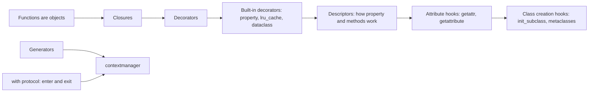
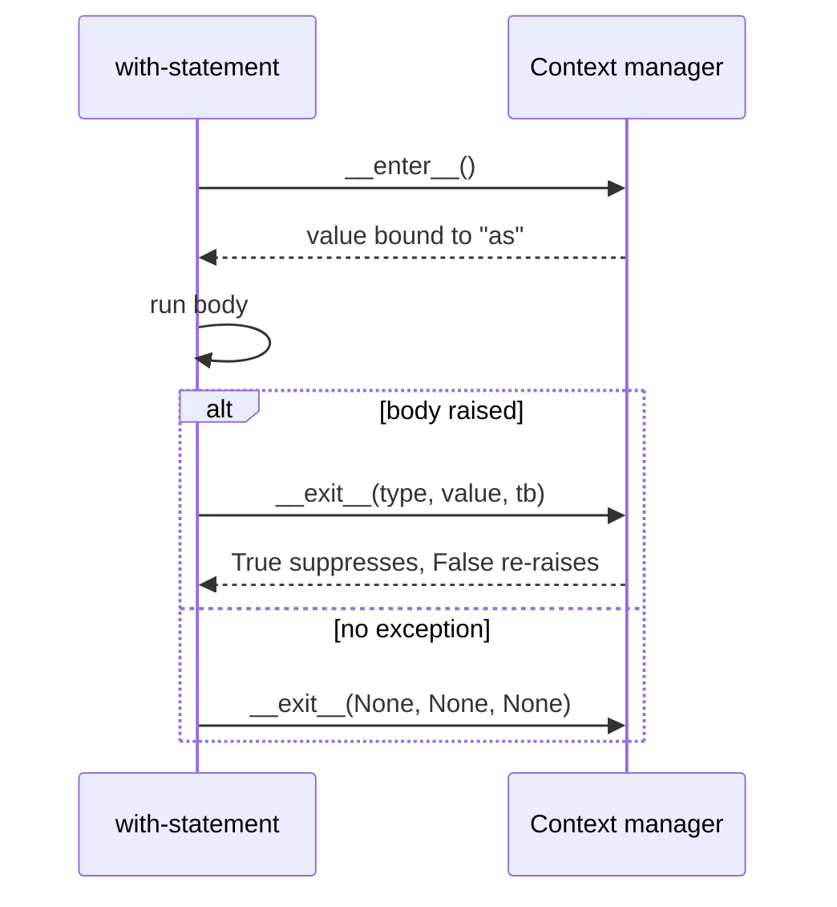

# Chapter 12 — Decorators, Context Managers and Metaprogramming

> **What you will learn.** How decorators work (plain, with arguments, stacked, class decorators, class-based decorators), why `functools.wraps` matters, and the decorators you use every day (`@property`, `@classmethod`, `@staticmethod`, `@lru_cache`/`@cache`, `@dataclass`). Then context managers: the `with` protocol, class-based managers, `@contextlib.contextmanager`, `suppress`, and `ExitStack`, plus async and reentrant managers. Finally metaprogramming — code that manipulates code: descriptors (the machinery behind properties and methods), `__getattr__` vs `__getattribute__`, metaclasses (what they are and why you rarely need them), `__init_subclass__`, the caveats of monkey patching, and everyday introspection (`getattr`, `inspect`, and why not `eval`).
>
> **Prerequisites.** [Chapter 10](../10-oop-in-python/README.md) (classes, dunders) and [Chapter 11](../11-iterators-generators-functional/README.md) (generators — `@contextmanager` is built on them). Key idea: **functions and classes are objects** you can pass around, wrap and create at run time.
>
> **Code.** `chapters/12-decorators-context-managers-metaprogramming/code/` — `decorators.py`, `context_managers.py`, `descriptors_attrs.py`, `metaprogramming.py`. Timings in outputs vary by machine.



---

## 12.1 Decorators

### What it is
A **decorator** is a callable (anything you can call with `()` — a function, a class, or an object with `__call__`) that takes a function (or class) and returns a replacement — usually a **wrapper** that adds behaviour before/after calling the original. The `@` syntax is shorthand:

```python
@timed
def slow_add(a, b): ...
# is exactly
def slow_add(a, b): ...
slow_add = timed(slow_add)
```
Analogy: gift-wrapping — the present (your function) is unchanged, but whoever receives it gets the wrapping first.

Two building blocks make this possible:
1. **First-class functions** — functions can be passed as arguments and returned.
2. **Closures** — an inner function remembers variables from the enclosing function (`func` inside `wrapper`) even after the outer function has returned.

(Closures and a first look at decorators are in [Chapter 7 §7.4–7.6](../07-functions/README.md); this chapter goes deeper.)

### Why it matters
Decorators separate **cross-cutting concerns** (needs that show up in many unrelated functions) — logging, timing, caching (keeping results so they can be reused), retries, authentication (checking who the caller is), registration — from business logic (the code that does the actual job the program exists for), and apply them with one line. This is Python's native form of the Decorator pattern (see [LLD Handbook ch. 9](../../../lld/chapters/09-patterns-structural/README.md)) and of aspect-oriented programming (a style where such shared concerns are written once and "woven" around many functions).

### How it works
1. At **definition time** (usually import time — the moment a module is first loaded by an `import` statement) Python creates the function, then calls `decorator(func)` and binds the name to the result.
2. At **call time**, callers actually call the wrapper, which calls the original via the closure.
3. The wrapper should accept `*args, **kwargs` and **return** the original's result, so it works for any signature (the list of parameters a function accepts).

```python
def timed(func):
    @functools.wraps(func)                        # copy name, docstring, etc.
    def wrapper(*args, **kwargs):
        start = time.perf_counter()
        try:
            return func(*args, **kwargs)          # call the original, return its result
        finally:
            elapsed = (time.perf_counter() - start) * 1000
            print(f"  [timed] {func.__name__} took {elapsed:.1f} ms")
    return wrapper

@timed
def slow_add(a, b):
    """Add slowly."""
    time.sleep(0.02)
    return a + b
```
Output:
```
by hand: HELLO ANN
without wraps, name is: wrapper
  [timed] slow_add took 21.3 ms
slow_add: 5 | name: slow_add | doc: Add slowly. | original: slow_add
```

### `functools.wraps`
Without it, the decorated function's `__name__` is `"wrapper"` and its docstring (the descriptive string literal written as the first line of a function body) is gone — which breaks debugging, logs, `help()`, documentation tools and frameworks that look up functions by name (e.g. Flask endpoints — Flask is a small web framework, and an endpoint is a URL path the server answers). `@functools.wraps(func)` copies `__module__`, `__name__`, `__qualname__`, `__doc__`, `__annotations__` (and more), merges `__dict__`, and sets `wrapper.__wrapped__ = func` so tools (and you) can reach the original. **Always use it.**

### Decorators with arguments — three levels
`@retry(times=3)` first *calls* `retry(times=3)`, which must *return* the real decorator. So there are three nested functions: factory → decorator → wrapper.

```python
def retry(times: int = 3, exceptions=(Exception,)):   # 1. factory: receives the options
    def decorator(func):                               # 2. decorator: receives the function
        @functools.wraps(func)
        def wrapper(*args, **kwargs):                  # 3. wrapper: runs on every call
            for attempt in range(1, times + 1):
                try:
                    return func(*args, **kwargs)
                except exceptions as e:
                    print(f"  [retry] attempt {attempt} failed: {e}")
                    if attempt == times:
                        raise
        return wrapper
    return decorator

@retry(times=3, exceptions=(ConnectionError,))
def flaky_fetch(): ...        # fails twice, then returns "data"
```
Output:
```
  [retry] attempt 1 failed: timeout
  [retry] attempt 2 failed: timeout
flaky_fetch -> data
```
(Real retry code should also wait between attempts with exponential backoff (doubling the wait after each failure: 1 s, 2 s, 4 s …) and jitter (a small random amount added so many clients don't all retry at the same instant) — libraries such as `tenacity` do this.)

### Stacking
```python
@tag("b")
@tag("i")
def text(): return "hi"
# == text = tag("b")(tag("i")(text))
```
Decorators are **applied bottom-up** (closest to `def` first) and their wrappers **run top-down** (outermost first). Output: `stacked: <b><i>hi</i></b>`. Order matters: e.g. put `@app.route` outermost and an auth check inside it, or the route registers the unprotected function.

### Stateful and registering decorators
A decorator doesn't have to wrap. It can **register** the function and return it unchanged — this is how many frameworks work:

```python
REGISTRY = {}
def register(func):
    REGISTRY[func.__name__] = func       # side effect at definition time
    return func

def count_calls(func):
    @functools.wraps(func)
    def wrapper(*args, **kwargs):
        wrapper.calls += 1               # state stored as a function attribute
        return func(*args, **kwargs)
    wrapper.calls = 0
    return wrapper
```
Output: `registry: ['export_csv', 'export_json']` and `ping.calls: 2`.

### Class decorators and classes as decorators
- A **class decorator** receives a *class* and returns a class (often the same one, modified). `@dataclass` is one.
- A **class used as a decorator** is callable because instances implement `__call__`; use `functools.update_wrapper(self, func)` in `__init__`.

```python
def add_repr(cls):
    def __repr__(self):
        fields = ", ".join(f"{k}={v!r}" for k, v in vars(self).items())
        return f"{cls.__name__}({fields})"
    cls.__repr__ = __repr__
    return cls

class CountCalls:
    def __init__(self, func):
        functools.update_wrapper(self, func)
        self.func, self.calls = func, 0
    def __call__(self, *args, **kwargs):
        self.calls += 1
        return self.func(*args, **kwargs)
```
Output: `class decorator: Point(x=1, y=2)` and `CountCalls: 2 | name: square`.

Caveat: a class-based decorator applied to a *method* won't bind `self` automatically (the instance isn't a descriptor unless you implement `__get__`, §12.4). Function-based decorators don't have this problem — prefer them.

### Trade-offs

| Approach | Pros | Cons |
|---|---|---|
| Function decorator | Simple, works on methods | State via closure/attributes |
| Decorator factory (with args) | Configurable | Three levels of nesting; easy to forget the call parentheses |
| Class-based decorator | Natural place for state | Needs `__get__` to work on methods |
| Class decorator | Modify/register whole classes | Can surprise readers; metaclass-like power |
| No decorator (call helper explicitly) | Obvious control flow | Repetition |

### When not to use it
When the "cross-cutting" logic is used once; when it changes the function's signature or return type in surprising ways; when stacking five decorators makes the call path impossible to follow.

### Common mistakes
- Forgetting `return` in the wrapper → the decorated function returns `None`.
- Forgetting `@functools.wraps`.
- Using a factory without calling it: `@retry` instead of `@retry()` → `retry` receives the function as `times`.
- Heavy work at decoration time (it runs on import).
- Wrong stacking order (e.g. caching outside an auth check caches responses across users).

### Real-world examples
Flask `@app.route("/")` and FastAPI `@app.get("/")` register view functions (the functions that handle a web request for a URL); pytest `@pytest.fixture` and `@pytest.mark.parametrize`; Click (a library for building CLIs — command-line interfaces) `@click.command()`/`@click.option()`; Celery (a background-job queue) `@app.task`; Django (a large web framework) `@login_required`; `@functools.singledispatch` (function overloading by argument type); `@contextlib.contextmanager`; `@unittest.mock.patch`.

### In the interview
**30-second answer:** "A decorator is a callable that takes a function and returns a replacement, usually a closure wrapper that runs code around the original; `@d` above `def f` is `f = d(f)` at definition time. I always use `functools.wraps` to keep the name, docstring and `__wrapped__`. A decorator with arguments is a factory returning a decorator — three levels. Stacked decorators apply bottom-up and run top-down."
- *When does a decorator run?* — Once, when the decorated function is defined (typically import); the wrapper runs on each call.
- *Write a decorator that times a function.* — See `timed` above (use `perf_counter`, `try/finally`, `wraps`).
- *How do you decorate a class?* — A function that takes and returns a class, e.g. `@dataclass`.

### Self-check
1. Rewrite `@a @b def f` without `@`. → `f = a(b(f))`.
2. What does `functools.wraps` set that lets you reach the original? → `__wrapped__`.
3. Why three functions in a decorator with arguments? → Outer takes options, middle takes the function, inner runs per call.
4. What happens if the wrapper doesn't `return func(...)`? → Callers get `None`.

### TL;DR
Decorator = function in, function out, applied at definition time. Use `*args, **kwargs`, return the result, `@functools.wraps`. Factories for arguments; stack with care.

---

## 12.2 Everyday built-in decorators

| Decorator | What it does | Where covered |
|---|---|---|
| `@property` (+ `.setter`, `.deleter`) | Method accessed like an attribute; implemented as a descriptor | [Ch. 10](../10-oop-in-python/README.md) §10.1, §12.4 |
| `@classmethod` | Passes the class as `cls` (alternative constructors) | [Ch. 10](../10-oop-in-python/README.md) §10.1 |
| `@staticmethod` | No implicit first argument | [Ch. 10](../10-oop-in-python/README.md) §10.1 |
| `@abstractmethod` | Marks methods an ABC (abstract base class — a class meant only to be inherited from) subclass must implement | [Ch. 10](../10-oop-in-python/README.md) §10.7 |
| `@dataclass` | Class decorator generating `__init__`/`__repr__`/`__eq__` … | [Ch. 10](../10-oop-in-python/README.md) §10.10 |
| `@functools.total_ordering` | Class decorator filling in comparison methods | [Ch. 10](../10-oop-in-python/README.md) §10.2 |
| `@functools.lru_cache(maxsize=128)` / `@functools.cache` | Memoisation (below) | here |
| `@functools.cached_property` | Compute once per instance, store in the instance | §12.4 |
| `@functools.wraps` | Copies metadata onto wrappers | §12.1 |
| `@contextlib.contextmanager` | Generator → context manager | §12.3 |
| `@typing.override` (3.12) | Marks a method as overriding a parent's, so type checkers (tools like mypy that verify type hints without running the code) can flag typos | — |

### `@lru_cache` and `@cache` — memoisation
**Memoisation** stores the result of a function call keyed by its arguments, so a repeated call returns instantly. `lru_cache(maxsize=N)` keeps the N most recently used results and evicts the **least recently used** (LRU) when full; `maxsize=None` or `@functools.cache` (3.9) is unbounded. Default `maxsize` is 128.

```python
@functools.lru_cache(maxsize=None)
def fib(n: int) -> int:
    return n if n < 2 else fib(n - 1) + fib(n - 2)
```
Output:
```
fib(25) plain 6 ms vs cached 0.01 ms -> cached faster: True
cache_info: CacheInfo(hits=23, misses=26, maxsize=None, currsize=26)
unhashable arg: unhashable type: 'list'
```
Worked numbers: plain recursive `fib(25)` makes 242,785 calls (exponential); cached, each `fib(k)` for k = 0…25 is computed once → **26 misses**, and each of `fib(3)…fib(25)` finds its second sub-call `fib(k−2)` already cached → **23 hits**.

Rules and caveats:
1. Arguments must be **hashable** (have a fixed hash value, which in practice means immutable — numbers, strings, tuples; the cache is a dict, and dict keys must be hashable) — no lists/dicts.
2. Only for **pure** functions (same input → same output, no side effects). Don't cache `now()` or database reads that must be fresh.
3. Returned objects are shared — mutating a cached list corrupts the cache.
4. On **methods**, the cache holds a reference to `self`, keeping instances alive (a memory leak — memory that is never freed because something still references it) and sharing one cache across instances; prefer `cached_property` or a per-instance cache.
5. `fib.cache_clear()` empties it; `typed=True` caches `f(3)` and `f(3.0)` separately.

**Real world:** caching parsed config, compiled regexes (regular expressions — text-matching patterns; `re` keeps its own internal cache), expensive pure computations, dynamic-programming solutions in interviews (dynamic programming solves a problem by reusing answers to smaller overlapping sub-problems).

---

## 12.3 Context managers

### What it is
A **context manager** is an object that sets something up at the start of a `with` block and **guarantees** tear-down at the end — even if the block raises or `return`s. It implements `__enter__` and `__exit__`.

Analogy: a hotel key card — you get it on check-in (`__enter__`), and checkout (`__exit__`) happens no matter how your stay ends.

### Why it matters
Resource leaks (files, sockets — open network connections, locks — objects that let only one thread into a section of code at a time, DB transactions — a group of database changes that must all succeed or all be undone, temporary state) are a top source of bugs. `with` replaces fragile `try/finally` boilerplate (repetitive code you have to write every time) and makes clean-up impossible to forget.

### How it works — `with EXPR as VAR: BODY`
1. Evaluate `EXPR` to get the manager `m`.
2. Call `m.__enter__()`; bind its **return value** to `VAR` (it doesn't have to be `m` — `open()` returns the file itself, a lock returns `True`).
3. Run `BODY`.
4. Always call `m.__exit__(exc_type, exc_value, traceback)` — all three `None` if no exception. (A traceback is the record of which function calls were active when the error happened.)
5. If `__exit__` returns a **truthy** value, the exception is **suppressed**; otherwise it propagates (keeps travelling up to the calling code). Return `False`/`None` unless suppressing is the whole point.



### Class-based
```python
class Timer:
    def __enter__(self):
        self.start = time.perf_counter()
        return self
    def __exit__(self, exc_type, exc, tb):
        self.elapsed = time.perf_counter() - self.start
        return False                     # propagate exceptions

class Suppress:                          # our own contextlib.suppress
    def __init__(self, *excs): self.excs = excs
    def __enter__(self): return self
    def __exit__(self, exc_type, exc, tb):
        return exc_type is not None and issubclass(exc_type, self.excs)
```

### Generator-based: `@contextlib.contextmanager`
Write a generator that **yields exactly once**: code before `yield` is `__enter__`, the yielded value goes to `as`, code after is `__exit__`. If the `with` body raises, the exception is **re-raised at the `yield`** — so wrap it in `try/finally` (or `except`) or your clean-up is skipped.

```python
@contextlib.contextmanager
def cd(path):                            # same idea as contextlib.chdir (3.11+)
    old = os.getcwd()
    os.chdir(path)
    try:
        yield path                       # the with-body runs here
    finally:
        os.chdir(old)                    # runs even if the body raises

@contextlib.contextmanager
def transaction(log):
    log.append("BEGIN")
    try:
        yield
    except Exception:
        log.append("ROLLBACK")
        raise                            # re-raise: don't hide the error
    else:
        log.append("COMMIT")
```

### `ExitStack` — a dynamic number of managers
`contextlib.ExitStack` lets you enter an unknown number of context managers (e.g. open N files from a list) and registers arbitrary clean-up callbacks (functions you hand over to be called later). On exit it unwinds them in **reverse (LIFO — last in, first out, like a stack of plates)** order, and if entering the k-th one fails, the k−1 already entered are still closed. `stack.pop_all()` transfers ownership out if setup succeeded (useful in constructors).

```python
with contextlib.ExitStack() as stack:
    files = [stack.enter_context(Resource(n, log)) for n in names]
    stack.callback(log.append, "callback ran")
    log.append(f"using {len(files)} resources")
```
Output (`context_managers.py`):
```
Timer: elapsed > 0: True
Suppress: survived ZeroDivisionError
contextlib.suppress: survived FileNotFoundError
cd restored: True | was inside tmp: True
transaction log: ['BEGIN', 'insert row', 'COMMIT', 'BEGIN', 'bad insert', 'ROLLBACK']
ExitStack: ['open a.txt', 'open b.txt', 'open c.txt', 'using 3 resources', 'callback ran', 'close c.txt', 'close b.txt', 'close a.txt']
ExitStack partial failure: ['open ok1', 'close ok1'] | cannot open
redirect_stdout captured: 'captured!\n'
nullcontext gives: x
two managers: ['open r1', 'open r2', 'close r2', 'close r1']
```

### The `contextlib` toolbox

| Tool | Use |
|---|---|
| `contextmanager` / `asynccontextmanager` | Generator (or async generator) → context manager |
| `suppress(*excs)` | Ignore specific exceptions (`with suppress(FileNotFoundError): os.remove(p)`) |
| `ExitStack` / `AsyncExitStack` | Dynamic number of managers + callbacks |
| `closing(obj)` | Call `obj.close()` on exit for objects without `__exit__` |
| `redirect_stdout` / `redirect_stderr` | Temporarily capture output |
| `nullcontext(x)` | A do-nothing manager, for "optional" context (`with lock if threaded else nullcontext():`) |
| `chdir(path)` (3.11) | Temporarily change the working directory |
| `AbstractContextManager` | ABC base giving a default `__enter__` that returns `self` |

Several managers in one statement: `with A() as a, B() as b:` — or, since 3.10, parenthesised across lines. They are exited in reverse order (see "two managers" above).

**Async context managers.** In `async def` code ([Chapter 16](../16-concurrency-and-async/README.md)) the statement is `async with`, and the protocol methods are the coroutines `__aenter__` / `__aexit__`, so setup and clean-up can `await` I/O (input/output — reading or writing files, network or databases; e.g. opening a network connection, releasing a pooled DB connection — one borrowed from a shared, reusable set of open connections). `@contextlib.asynccontextmanager` builds one from an `async def` generator exactly like `@contextmanager`. Examples: `async with aiohttp.ClientSession() as s:`, `async with asyncio.TaskGroup() as tg:`, `async with lock:` for an `asyncio.Lock`.

**Reusable and reentrant managers.** A *single-use* manager (a `@contextmanager` object, an open file) can be entered only once. A *reusable* one can be entered again after it exits. A *reentrant* one can even be entered again **while it is already active** (nested `with m:` inside `with m:`) — `threading.RLock` and `contextlib.redirect_stdout` are reentrant; a plain `threading.Lock` is not (re-acquiring it from the same thread deadlocks — the thread waits forever for a lock that it itself holds).

### Trade-offs

| | Class-based | `@contextmanager` |
|---|---|---|
| Code size | More | Less |
| Reusable object with state/methods | Yes | No (one-shot generator) |
| Can be re-entered / reused | If you design it so | No — each call makes a new one |
| Exception handling | Explicit `__exit__` args | `try/except/finally` around `yield` |
| Also usable as a decorator | Via `ContextDecorator` | Yes — `@contextmanager` objects work as decorators too |

### Common mistakes
- `@contextmanager` without `try/finally` around `yield` → clean-up skipped on error.
- Yielding more than once → `RuntimeError: generator didn't stop`.
- Returning `True` from `__exit__` accidentally → silently swallowing all exceptions.
- Using the resource after the block (`f.read()` after `with open(...)` → `ValueError: I/O operation on closed file`).

### Real-world examples
`open()`, `threading.Lock`, `sqlite3.connect()` (as a context manager it commits or rolls back the transaction — it does *not* close the connection), `requests.Session`, `tempfile.TemporaryDirectory`, `decimal.localcontext`, `unittest.mock.patch`, `pytest.raises`, PyTorch `torch.no_grad()`, `concurrent.futures.ThreadPoolExecutor` (waits for tasks on exit).

### In the interview
**30-second answer:** "A context manager implements `__enter__` and `__exit__`; `with` calls enter, binds its return value to `as`, runs the body, and always calls exit with the exception info, which can suppress it by returning true. For simple cases I write a generator with `@contextmanager` — setup, `yield`, clean-up in `finally`. For a variable number of resources I use `ExitStack`, which unwinds them in reverse order even if one fails to open."
- *How do you suppress an exception?* — Return a truthy value from `__exit__`, or use `contextlib.suppress`.
- *What happens to an exception inside a `@contextmanager` body?* — It's thrown into the generator at the `yield`.

### Self-check
1. What gets bound by `as`? → The return value of `__enter__`.
2. Three arguments of `__exit__`? → Exception type, value, traceback (all `None` if no error).
3. Order managers exit in `with A(), B():`? → B then A.
4. Why use `ExitStack`? → Unknown number of managers, or conditional ones, with guaranteed LIFO clean-up.

### TL;DR
`with` guarantees clean-up: `__enter__` → body → `__exit__` (truthy return suppresses). `@contextmanager` = setup / `yield` / `finally` clean-up. `ExitStack` for dynamic sets. Know `suppress`, `closing`, `nullcontext`, `redirect_stdout`, `chdir`.

---

## 12.4 Descriptors — how properties and methods really work

### What it is
A **descriptor** is any object, stored as a **class attribute**, that defines at least one of:
- `__get__(self, obj, objtype=None)` — runs on attribute read,
- `__set__(self, obj, value)` — runs on assignment,
- `__delete__(self, obj)` — runs on `del`.

Optionally `__set_name__(self, owner, name)` (3.6) is called at class creation so the descriptor learns the attribute name it was assigned to.

Two kinds:
- **Data descriptor** — defines `__set__` or `__delete__`. `property` is one.
- **Non-data descriptor** — only `__get__`. Plain functions and `functools.cached_property` are.

### Why it matters
Descriptors are the mechanism behind `property`, `classmethod`, `staticmethod`, bound methods, `__slots__`, and ORM fields (an ORM — object-relational mapper — maps database tables to Python classes; e.g. Django/SQLAlchemy model columns). Writing your own gives **reusable** attribute logic — one `Positive` validator used for many fields, instead of copy-pasted property pairs.

### How it works — attribute lookup precedence for `obj.attr`
1. Find `attr` on `type(obj)` along the MRO (method resolution order — the fixed order in which a class and its parents are searched). If it's a **data descriptor**, call its `__get__` — it **wins over the instance dict**.
2. Else, if `attr` is in `obj.__dict__`, return that.
3. Else, if the class attribute is a **non-data descriptor**, call its `__get__`; if it's a plain class attribute, return it.
4. Else call `__getattr__` if defined; otherwise raise `AttributeError`.

(All of this is implemented by `object.__getattribute__`.) Assignment `obj.attr = v` calls a data descriptor's `__set__` if there is one; otherwise it writes to `obj.__dict__`.

Consequences:
- **Methods:** a function is a non-data descriptor; `Greeter.__dict__["hello"].__get__(g)` returns the bound method — this is what `g.hello` does.
- **`property`** always defines `__set__` (raising `AttributeError` if there's no setter), so it's a data descriptor and an instance-dict entry can't shadow it.
- **`cached_property`** is non-data: the first access computes and stores the value in `obj.__dict__`; later accesses find it in step 2 and never call the descriptor again.

```python
class Positive:
    def __set_name__(self, owner, name):
        self.private = "_" + name                # e.g. "_qty"
    def __get__(self, obj, objtype=None):
        if obj is None:                           # accessed on the class
            return self
        return getattr(obj, self.private)
    def __set__(self, obj, value):
        if value <= 0:
            raise ValueError(f"{self.private[1:]} must be > 0, got {value}")
        setattr(obj, self.private, value)

class Order:
    qty = Positive()                              # one reusable validator...
    price = Positive()                            # ...for many fields
    def __init__(self, qty, price):
        self.qty = qty                            # runs Positive.__set__
        self.price = price

class my_property:                                # property, re-implemented
    def __init__(self, fget, fset=None):
        self.fget, self.fset = fget, fset
    def __get__(self, obj, objtype=None):
        return self if obj is None else self.fget(obj)
    def __set__(self, obj, value):
        if self.fset is None:
            raise AttributeError("read-only")
        self.fset(obj, value)
```
Output (`descriptors_attrs.py`, first part):
```
Order: 2 9.99 | instance dict: {'_qty': 2, '_price': 9.99}
descriptor refused: qty must be > 0, got 0
on the class: Positive object (the descriptor itself)
my_property: 212.0
AttributeError: read-only
  (computing data once)
first: [1, 2, 3]
second: [1, 2, 3] | stored in instance dict: True
function has __get__: True | f.__get__(g)(): hello
data descriptor? True | cached_property has __set__? False
```

### Common mistakes
- Storing the value on the descriptor itself (`self.value = v`) — the descriptor is shared by **all instances**, so every object would see the same value. Store per-instance data on `obj`.
- Putting a descriptor in `__init__` (`self.qty = Positive()`) — descriptors only work as **class** attributes.
- Forgetting the `obj is None` case (class access).

### In the interview
**30-second answer:** "A descriptor is a class attribute with `__get__`, and optionally `__set__`/`__delete__`. Data descriptors (with `__set__`) take priority over the instance dict; non-data ones don't. `property`, `classmethod`, `staticmethod` and even bound methods are built on this — a function's `__get__` returns a bound method (a method with its `self` already filled in). I'd write one for reusable validation across fields, like ORMs do for columns."
- *Why can `cached_property` be overwritten by the instance?* — It's a non-data descriptor, so the instance dict wins.

### TL;DR
Descriptors = class attributes that intercept get/set/delete. Data descriptors beat the instance dict; non-data don't. They power properties, methods, `cached_property`, `__slots__` and ORM fields.

---

## 12.5 `__getattr__` vs `__getattribute__`

### What it is
| Hook | Called when | Typical use |
|---|---|---|
| `__getattr__(self, name)` | Only when **normal lookup fails** (would raise `AttributeError`) | Delegation/proxies (objects that stand in for another and forward requests to it), lazy attributes, friendly defaults, deprecation shims (thin layers that keep old names working while warning they'll be removed) |
| `__getattribute__(self, name)` | On **every** attribute access (it *is* normal lookup) | Rare: tracing, access control, very special proxies |
| `__setattr__` / `__delattr__` | Every assignment / deletion | Validation, immutability, change tracking |
| Module-level `__getattr__(name)` (PEP 562, 3.7) | Missing attribute on a *module* | Lazy imports, deprecation warnings |

```python
class Proxy:
    def __init__(self, target):
        self._target = target
    def __getattr__(self, name):                  # only for names not found normally
        print(f"  __getattr__({name!r}) -> delegating")
        return getattr(self._target, name)

class Logged:
    def __init__(self):
        self.x = 1
    def __getattribute__(self, name):            # every access
        if not name.startswith("__"):
            print(f"  __getattribute__({name!r})")
        return super().__getattribute__(name)    # MUST delegate via super()/object
```
Output:
```
  __getattr__('upper') -> delegating
proxy.upper(): HELLO WORLD
proxy._target found normally (no __getattr__ call): hello world
  __getattribute__('x')
value: 1
```

### Common mistakes
- Inside `__getattribute__`, writing `self.anything` → calls `__getattribute__` again → infinite recursion. Use `super().__getattribute__(name)` or `object.__getattribute__(self, name)`.
- In `__getattr__`, accessing an attribute that may not exist yet (e.g. `self._target` before `__init__` has set it, as during unpickling — rebuilding an object from bytes saved with `pickle` — or copying) → infinite recursion. Guard or raise `AttributeError`.
- Returning `None` for unknown names instead of raising `AttributeError` → breaks `hasattr`, `getattr(obj, n, default)` and copy/pickle.
- Implicit special-method lookup (`len(p)`, `p + 1`) **bypasses** both hooks — Python looks up dunders on the type directly. A proxy must define those dunders explicitly.

### Real-world examples
`unittest.mock.Mock` uses `__getattr__` to create child mocks on the fly; RPC/SDK clients (RPC = remote procedure call, calling a function on another machine; SDK = software development kit, a ready-made library for a service) build dynamic endpoints (`client.users.list`); pandas lets you access columns as attributes (`df.price`) via `__getattr__`; lazy-loading packages use module `__getattr__`.

### TL;DR
`__getattr__` = fallback for missing attributes (safe, common). `__getattribute__` = intercepts everything (rare, recursion-prone). Dunders used by syntax skip both.

---

## 12.6 Metaclasses and `__init_subclass__`

### What it is
Classes are objects too, so something must create them: a **metaclass** is "the class of a class". The default metaclass is **`type`**: `type(42)` is `int`, `type(int)` is `type`, and even `type(type)` is `type`. A `class` statement is roughly `Name = type("Name", bases, namespace)`.

```python
def speak(self): return f"{self.name} speaks"
Dog = type("Dog", (object,), {"name": "Rex", "speak": speak})   # a class, built by a call
```

### How a class is created
1. Python collects the class body into a namespace dict (a mapping from names to the objects they refer to) by executing it.
2. It determines the metaclass (explicit `metaclass=`, or the most derived metaclass of the bases, default `type`).
3. It calls `Meta(name, bases, namespace)` → `Meta.__new__` builds the class object, `Meta.__init__` initialises it.
4. While the class object is being built (inside `type.__new__`, so before `Meta.__init__`), descriptors' `__set_name__` hooks run, then the parent's `__init_subclass__`.
5. Class decorators run last, on the finished class.

A custom metaclass subclasses `type` and overrides `__new__`/`__init__` (or `__call__`, to control **instance** creation — e.g. a Singleton metaclass, which ensures a class can only ever have one instance).

### `__init_subclass__` — the simpler hook
PEP 487 (Python 3.6) added `__init_subclass__(cls, **kwargs)`: a classmethod on a parent that runs **every time a subclass is created**, receiving any keyword arguments from the class line (`class Home(Handler, route="/")`). It covers the most common metaclass uses — registries, validation, configuration — with ordinary inheritance and no metaclass conflicts.

```python
class RegistryMeta(type):                         # metaclass version
    registry: dict[str, type] = {}
    def __new__(mcls, name, bases, namespace):
        cls = super().__new__(mcls, name, bases, namespace)
        if bases:
            mcls.registry[name.lower()] = cls
        return cls

class Plugin(metaclass=RegistryMeta): pass
class CsvExporter(Plugin): ...

class Handler:                                    # __init_subclass__ version (preferred)
    handlers: dict[str, type] = {}
    def __init_subclass__(cls, /, route: str, **kwargs):
        super().__init_subclass__(**kwargs)
        Handler.handlers[route] = cls

class Home(Handler, route="/"): ...

class RequiresRun:                                # enforce a rule at class-creation time
    def __init_subclass__(cls, **kwargs):
        super().__init_subclass__(**kwargs)
        if not callable(cls.__dict__.get("run")):
            raise TypeError(f"{cls.__name__} must define run()")
```
Output (`metaprogramming.py`):
```
Rex speaks | type(Dog): type | type(type): type
type(42): int | type(int): type
metaclass registry: {'csvexporter': <class '__main__.CsvExporter'>, 'jsonexporter': <class '__main__.JsonExporter'>}
type(CsvExporter): RegistryMeta
__init_subclass__ routes: {'/': 'Home', '/about': 'About'}
GoodJob: ran
TypeError: BadJob must define run()
```
Note `type(CsvExporter)` is `RegistryMeta` — the metaclass is inherited by every subclass.

### When to use what (least power first)

| Need | Use |
|---|---|
| Add/modify methods of one class | Class decorator |
| Reusable attribute behaviour | Descriptor |
| React to / register / validate every subclass | `__init_subclass__` |
| Control the class namespace itself, customise `isinstance`, change how instances are created, or build framework-level DSLs (domain-specific languages — mini-languages tailored to one job) | Metaclass |

Python core developer Tim Peters famously remarked that metaclasses are deeper magic than 99% of users should worry about — and since 3.6, `__init_subclass__` and `__set_name__` have removed most remaining reasons.

### Common mistakes
- **Metaclass conflict:** combining two base classes with unrelated metaclasses → `TypeError: metaclass conflict`. (One reason to avoid custom metaclasses in libraries.)
- Forgetting `super().__init_subclass__(**kwargs)` — breaks cooperative inheritance (every class in a hierarchy calling `super()` so that each parent gets its turn).
- Using a metaclass for something a decorator could do.

### Real-world examples
`abc.ABCMeta` (enforces abstract methods), `enum.EnumType` (formerly `EnumMeta`, makes members), Django's `ModelBase` (turns field declarations into a model with a manager and metadata), Pydantic's `ModelMetaclass` (collects fields and builds validators). Many plugin systems use `__init_subclass__` registries.

### In the interview
**30-second answer:** "A metaclass is the class of a class — `type` by default — and it runs when a class statement executes, so it can inspect or change the class being created. Frameworks like Django's ORM and `abc` use them. In application code I almost never need one: class decorators, descriptors and `__init_subclass__` cover registration and validation with less magic and no metaclass conflicts."
- *What's `type(type)`?* — `type`.
- *What is `__init_subclass__` for?* — A parent hook that runs for each new subclass (registries, validation, per-subclass config).

### TL;DR
Everything is an object; classes are made by metaclasses (`type`). Prefer class decorators → descriptors → `__init_subclass__` → metaclasses, in that order.

---

## 12.7 Monkey patching — caveats

### What it is
**Monkey patching** is replacing attributes (functions, methods, classes) of modules or classes **at run time**, from outside, e.g. `Greeter.hello = lambda self: "patched!"`. Because Python classes and modules are mutable objects, this always works — which is exactly the danger.

Output (`descriptors_attrs.py`, last part):
```
monkey patched: patched! | existing instance too: patched!
restored: hello
```
Patching a class affects **every existing instance** too, because methods are looked up on the class.

### Legitimate uses
- **Tests** — replacing slow or external dependencies (network, time, randomness). Use `unittest.mock.patch` or pytest's `monkeypatch` fixture, which **undo the change automatically**.
- **Hot-fixing a third-party bug** until an upstream fix (a fix made in the library's own source by its maintainers) ships (document it and pin the version — fix the dependency to one exact version).
- Framework-level instrumentation, e.g. gevent's `monkey.patch_all()` makes the standard library cooperative (blocking calls yield control to other tasks), and APM/tracing agents (APM = application performance monitoring; tracing records how long each step of a request takes; OpenTelemetry auto-instrumentation) wrap library functions.

### Caveats
1. **Global and invisible**: every user of the module/class sees the change, including other libraries and other threads.
2. **Patch where it's looked up, not where it's defined**: if `app.py` did `from utils import send_email`, you must patch `app.send_email`; patching `utils.send_email` doesn't affect the name already bound in `app`.
3. **Order-dependent**: code that imported or cached the original before the patch keeps it.
4. **Fragile across upgrades**: private internals you patch may change without notice.
5. **Always restore** (try/finally, or tools that do it for you), otherwise test pollution (one test leaving changed state behind that affects others) causes failures in unrelated tests.
6. Built-in types implemented in C (`str`, `int`, `list`) can't be patched: `str.upper = ...` raises `TypeError`.

### In the interview
"Monkey patching is modifying classes or modules at run time. It's fine in tests via `mock.patch` or pytest's `monkeypatch`, which restore automatically and must target the name where it's used. In production I avoid it — it's global, order-dependent and breaks on upgrades — and prefer dependency injection, subclassing or a wrapper." (**Dependency injection** means passing the collaborators a piece of code needs — a database client, a clock — in as arguments, instead of having the code reach out and create them itself, so they are easy to swap.)

### TL;DR
Monkey patching is powerful and global. Use it in tests with auto-restoring tools, patch where the name is looked up, and prefer dependency injection in production.

---

## 12.8 Introspection and dynamic code (brief)

**Introspection** means a program examining its own objects at run time. It is the everyday side of metaprogramming:

| Tool | Does | Example |
|---|---|---|
| `getattr(obj, name, default)`, `setattr`, `hasattr`, `delattr` | Read/write attributes whose names are strings | `getattr(handler, f"do_{verb}")` to dispatch by name |
| `vars(obj)`, `dir(obj)` | Instance `__dict__`; all attribute names | Debugging, generic `__repr__` |
| `type(x)`, `isinstance`, `issubclass`, `callable` | Types and capabilities | |
| `inspect.signature(f)` | Parameter names, defaults, annotations | FastAPI and pytest read signatures to inject arguments/fixtures |
| `inspect.getsource(f)`, `inspect.getmembers(obj)` | Source text; all members | Documentation tools |
| `eval(expr)`, `exec(code)` | Run a string as Python | Almost never needed; **never on untrusted input** (anything an outsider can influence) — it can run any code |
| `ast.literal_eval(s)` | Safely parse a literal (`"[1, 2, {'a': 3}]"`) | The safe replacement for `eval` on data |

Rule of thumb: `getattr`-style introspection is normal Python; `eval`/`exec` on anything a user can influence is a security hole (the same class of bug as unpickling untrusted data, [Chapter 9](../09-errors-exceptions-files/README.md)).

---

## 12.9 Chapter self-check

1. What does `@d` above `def f` do, and when? → `f = d(f)`, once at definition time.
2. Why `functools.wraps`? → Keeps `__name__`, `__doc__`, etc. and sets `__wrapped__`.
3. `@retry` vs `@retry()` for a factory decorator? → The factory needs to be called: `@retry()`.
4. Order of application/execution of stacked decorators? → Applied bottom-up, run top-down.
5. What's required of `lru_cache` arguments? → Hashable.
6. How does `__exit__` suppress an exception? → By returning a truthy value.
7. What must surround `yield` in a `@contextmanager`? → `try/finally` so clean-up runs on errors.
8. Data vs non-data descriptor precedence? → Data descriptor > instance dict > non-data descriptor.
9. When is `__getattr__` called? → Only when normal lookup fails.
10. Simplest way to register every subclass? → `__init_subclass__`.

## Chapter TL;DR
- **Decorators:** function in, function out, at definition time. `*args, **kwargs`, return the result, `@functools.wraps`. Factories (three levels) for arguments; stacking applies bottom-up, runs top-down; class decorators modify classes; decorators can simply register.
- **Built-ins:** `property`, `classmethod`, `staticmethod`, `dataclass`, `total_ordering`, `lru_cache`/`cache` (hashable args, pure functions, beware methods), `cached_property`.
- **Context managers:** `__enter__`/`__exit__` guarantee clean-up; truthy `__exit__` suppresses. `@contextmanager` = setup, `yield` in `try`, clean-up in `finally`. `ExitStack` for dynamic resources (LIFO). `suppress`, `closing`, `nullcontext`, `redirect_stdout`, `chdir`.
- **Descriptors:** `__get__`/`__set__`/`__delete__` on class attributes; they power properties and methods. Data descriptors beat the instance dict.
- **Attribute hooks:** `__getattr__` for missing names (delegation), `__getattribute__` for everything (rare, use `super()`).
- **Class creation:** metaclasses (`type` by default) are rarely needed; prefer decorators, descriptors, `__init_subclass__`.
- **Monkey patching:** tests only (auto-restore, patch where used); avoid in production.
