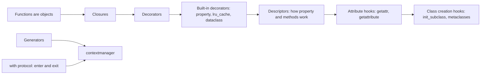
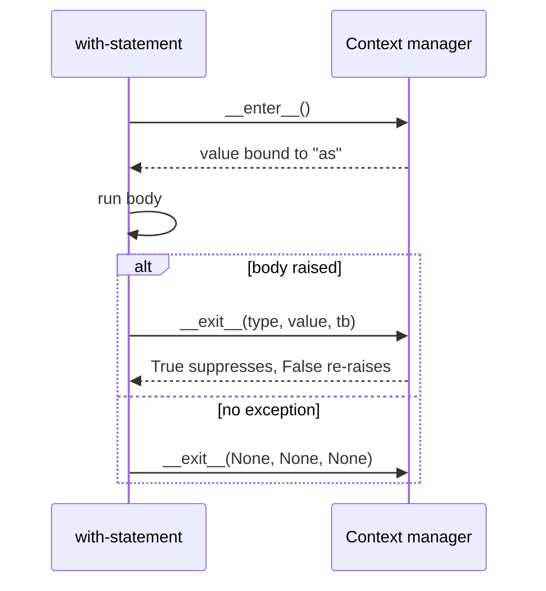

# Chapter 12 — Decorators, Context Managers and Metaprogramming

> **What you will learn.** Decorators (plain, with arguments, stacked, class decorators, class-based decorators, `functools.wraps`) and the built-in ones you use daily (`@property`, `@classmethod`, `@staticmethod`, `@lru_cache`/`@cache`, `@dataclass`). Context managers: the `with` protocol, class-based managers, `@contextlib.contextmanager`, `suppress`, `ExitStack`, async and reentrant managers. Metaprogramming — code that manipulates code: descriptors, `__getattr__` vs `__getattribute__`, metaclasses, `__init_subclass__`, monkey patching, introspection.
>
> **Prerequisites.** [Chapter 10](../10-oop-in-python/README.md) (classes, dunders) and [Chapter 11](../11-iterators-generators-functional/README.md) (generators — `@contextmanager` is built on them). Key idea: **functions and classes are objects** you can pass around, wrap and create at run time.
>
> **Code.** `chapters/12-decorators-context-managers-metaprogramming/code/` — `decorators.py`, `context_managers.py`, `descriptors_attrs.py`, `metaprogramming.py`. Timings vary by machine.



---

## 12.1 Decorators

### What it is
A **decorator** is a callable (a function, a class, or an object with `__call__`) that takes a function (or class) and returns a replacement — usually a **wrapper** that adds behaviour around the original. `@` is shorthand:

```python
@timed
def slow_add(a, b): ...
# is exactly
def slow_add(a, b): ...
slow_add = timed(slow_add)
```
It relies on **first-class functions** (functions can be passed and returned) and **closures** (the inner `wrapper` remembers `func` after the outer function returns). Basics are in [Chapter 7 §7.4–7.6](../07-functions/README.md).

### Why it matters
Decorators separate **cross-cutting concerns** (needs that recur across unrelated functions — logging, timing, caching, retries, authentication, registration) from business logic and apply them in one line. This is Python's native Decorator pattern ([LLD Handbook ch. 9](../../../lld/chapters/09-patterns-structural/README.md)) and a light form of aspect-oriented programming.

### How it works
1. At **definition time** (usually import time) Python creates the function, calls `decorator(func)`, and binds the name to the result.
2. At **call time**, callers call the wrapper, which calls the original via the closure.
3. The wrapper takes `*args, **kwargs` and **returns** the original's result, so it fits any signature.

```python
def timed(func):
    @functools.wraps(func)                        # copy name, docstring, etc.
    def wrapper(*args, **kwargs):
        start = time.perf_counter()
        try:
            return func(*args, **kwargs)          # call the original, return its result
        finally:
            elapsed = (time.perf_counter() - start) * 1000
            print(f"  [timed] {func.__name__} took {elapsed:.1f} ms")
    return wrapper

@timed
def slow_add(a, b):
    """Add slowly."""
    time.sleep(0.02)
    return a + b
```
Output:
```
by hand: HELLO ANN
without wraps, name is: wrapper
  [timed] slow_add took 21.3 ms
slow_add: 5 | name: slow_add | doc: Add slowly. | original: slow_add
```

### `functools.wraps`
Without it, the decorated function's `__name__` is `"wrapper"` and its docstring is gone — breaking debugging, logs, `help()`, doc tools and frameworks that look functions up by name (e.g. Flask endpoints). `@functools.wraps(func)` copies `__module__`, `__name__`, `__qualname__`, `__doc__`, `__annotations__` (and more), merges `__dict__`, and sets `wrapper.__wrapped__ = func` so the original stays reachable. **Always use it.**

### Decorators with arguments — three levels
`@retry(times=3)` first *calls* `retry(times=3)`, which must *return* the real decorator: factory → decorator → wrapper.

```python
def retry(times: int = 3, exceptions=(Exception,)):   # 1. factory: receives the options
    def decorator(func):                               # 2. decorator: receives the function
        @functools.wraps(func)
        def wrapper(*args, **kwargs):                  # 3. wrapper: runs on every call
            for attempt in range(1, times + 1):
                try:
                    return func(*args, **kwargs)
                except exceptions as e:
                    print(f"  [retry] attempt {attempt} failed: {e}")
                    if attempt == times:
                        raise
        return wrapper
    return decorator

@retry(times=3, exceptions=(ConnectionError,))
def flaky_fetch(): ...        # fails twice, then returns "data"
```
Output:
```
  [retry] attempt 1 failed: timeout
  [retry] attempt 2 failed: timeout
flaky_fetch -> data
```
Real retry code also waits between attempts with **exponential backoff** (1 s, 2 s, 4 s …) plus **jitter** (random extra delay so clients don't retry in lock-step) — libraries such as `tenacity` do this.

### Stacking
```python
@tag("b")
@tag("i")
def text(): return "hi"
# == text = tag("b")(tag("i")(text))
```
Decorators are **applied bottom-up** and their wrappers **run top-down**. Output: `stacked: <b><i>hi</i></b>`. Order matters: put `@app.route` outermost and the auth check inside it, or the route registers the unprotected function.

### Stateful and registering decorators
A decorator may simply **register** the function and return it unchanged — how many frameworks work:

```python
REGISTRY = {}
def register(func):
    REGISTRY[func.__name__] = func       # side effect at definition time
    return func

def count_calls(func):
    @functools.wraps(func)
    def wrapper(*args, **kwargs):
        wrapper.calls += 1               # state stored as a function attribute
        return func(*args, **kwargs)
    wrapper.calls = 0
    return wrapper
```
Output: `registry: ['export_csv', 'export_json']` and `ping.calls: 2`.

### Class decorators and classes as decorators
- A **class decorator** receives a *class* and returns a class (often the same one, modified). `@dataclass` is one.
- A **class used as a decorator** works because instances implement `__call__`; call `functools.update_wrapper(self, func)` in `__init__`.

```python
def add_repr(cls):
    def __repr__(self):
        fields = ", ".join(f"{k}={v!r}" for k, v in vars(self).items())
        return f"{cls.__name__}({fields})"
    cls.__repr__ = __repr__
    return cls

class CountCalls:
    def __init__(self, func):
        functools.update_wrapper(self, func)
        self.func, self.calls = func, 0
    def __call__(self, *args, **kwargs):
        self.calls += 1
        return self.func(*args, **kwargs)
```
Output: `class decorator: Point(x=1, y=2)` and `CountCalls: 2 | name: square`.

Caveat: a class-based decorator on a *method* doesn't bind `self` (the instance isn't a descriptor unless you implement `__get__`, §12.4). Prefer function-based decorators.

### Trade-offs

| Approach | Pros | Cons |
|---|---|---|
| Function decorator | Simple, works on methods | State via closure/attributes |
| Decorator factory (with args) | Configurable | Three levels of nesting; easy to forget the call parentheses |
| Class-based decorator | Natural place for state | Needs `__get__` to work on methods |
| Class decorator | Modify/register whole classes | Can surprise readers; metaclass-like power |

### Common mistakes
- Forgetting `return` in the wrapper → the decorated function returns `None`.
- Forgetting `@functools.wraps`.
- Factory without the call: `@retry` instead of `@retry()` → `retry` receives the function as `times`.
- Heavy work at decoration time (it runs on import).
- Overuse: logic used once, surprising signature/return changes, five stacked decorators nobody can follow.
- Wrong stacking order (e.g. caching outside an auth check caches responses across users).

### Real-world examples
Flask `@app.route("/")` / FastAPI `@app.get("/")` register view functions; pytest `@pytest.fixture`, `@pytest.mark.parametrize`; Click `@click.command()`/`@click.option()`; Celery (background-job queue) `@app.task`; Django `@login_required`; `@functools.singledispatch` (overloading by argument type); `@contextlib.contextmanager`; `@unittest.mock.patch`.

### In the interview
**30-second answer:** "A decorator is a callable that takes a function and returns a replacement, usually a closure wrapper that runs code around the original; `@d` above `def f` is `f = d(f)` at definition time. I always use `functools.wraps` to keep the name, docstring and `__wrapped__`. A decorator with arguments is a factory returning a decorator — three levels. Stacked decorators apply bottom-up and run top-down."
- *When does a decorator run?* — Once, at definition (typically import); the wrapper runs on each call.
- *Write a decorator that times a function.* — `timed` above (`perf_counter`, `try/finally`, `wraps`).
- *How do you decorate a class?* — A function that takes and returns a class, e.g. `@dataclass`.

---

## 12.2 Everyday built-in decorators

| Decorator | What it does | Where covered |
|---|---|---|
| `@property` (+ `.setter`, `.deleter`) | Method accessed like an attribute; a descriptor | [Ch. 10](../10-oop-in-python/README.md) §10.1, §12.4 |
| `@classmethod` | Passes the class as `cls` (alternative constructors) | [Ch. 10](../10-oop-in-python/README.md) §10.1 |
| `@staticmethod` | No implicit first argument | [Ch. 10](../10-oop-in-python/README.md) §10.1 |
| `@abstractmethod` | Marks methods an ABC subclass must implement | [Ch. 10](../10-oop-in-python/README.md) §10.7 |
| `@dataclass` | Class decorator generating `__init__`/`__repr__`/`__eq__` … | [Ch. 10](../10-oop-in-python/README.md) §10.10 |
| `@functools.total_ordering` | Class decorator filling in comparison methods | [Ch. 10](../10-oop-in-python/README.md) §10.2 |
| `@functools.lru_cache(maxsize=128)` / `@functools.cache` | Memoisation (below) | here |
| `@functools.cached_property` | Compute once per instance, store in the instance | §12.4 |
| `@functools.wraps` | Copies metadata onto wrappers | §12.1 |
| `@contextlib.contextmanager` | Generator → context manager | §12.3 |
| `@typing.override` (3.12) | Marks a method as overriding a parent's so type checkers flag typos | — |

### `@lru_cache` and `@cache` — memoisation
**Memoisation** stores a call's result keyed by its arguments so a repeat call returns instantly. `lru_cache(maxsize=N)` keeps the N most recent results and evicts the **least recently used** (LRU) when full; `maxsize=None` or `@functools.cache` (3.9) is unbounded. Default `maxsize` is 128.

```python
@functools.lru_cache(maxsize=None)
def fib(n: int) -> int:
    return n if n < 2 else fib(n - 1) + fib(n - 2)
```
Output:
```
fib(25) plain 6 ms vs cached 0.01 ms -> cached faster: True
cache_info: CacheInfo(hits=23, misses=26, maxsize=None, currsize=26)
unhashable arg: unhashable type: 'list'
```
Worked numbers: plain recursive `fib(25)` makes 242,785 calls; cached, each `fib(k)` for k = 0…25 is computed once → **26 misses**, and each of `fib(3)…fib(25)` finds its second sub-call `fib(k−2)` cached → **23 hits**.

Rules and caveats:
1. Arguments must be **hashable** (the cache is a dict) — no lists/dicts.
2. Only for **pure** functions (same input → same output, no side effects). Don't cache `now()` or reads that must be fresh.
3. Returned objects are shared — mutating a cached list corrupts the cache.
4. On **methods**, the cache holds a reference to `self`, keeping instances alive (a memory leak) and sharing one cache across instances; prefer `cached_property` or a per-instance cache.
5. `fib.cache_clear()` empties it; `typed=True` caches `f(3)` and `f(3.0)` separately.

**Real world:** parsed config, compiled regexes (`re` also has its own cache), expensive pure computations, dynamic-programming solutions in interviews.

---

## 12.3 Context managers

### What it is
A **context manager** sets something up at the start of a `with` block and **guarantees** tear-down at the end — even if the block raises or `return`s. It implements `__enter__` and `__exit__`.

### Why it matters
Leaked resources (files, sockets — network connections, locks, DB transactions, temporary state) are a top source of bugs. `with` replaces fragile `try/finally` boilerplate and makes clean-up impossible to forget.

### How it works — `with EXPR as VAR: BODY`
1. Evaluate `EXPR` to get the manager `m`.
2. Call `m.__enter__()`; bind its **return value** to `VAR` (not necessarily `m` — `open()` returns the file, a lock returns `True`).
3. Run `BODY`.
4. Always call `m.__exit__(exc_type, exc_value, traceback)` — all three `None` if no exception.
5. If `__exit__` returns a **truthy** value the exception is **suppressed**; otherwise it propagates. Return `False`/`None` unless suppressing is the point.



### Class-based
```python
class Timer:
    def __enter__(self):
        self.start = time.perf_counter()
        return self
    def __exit__(self, exc_type, exc, tb):
        self.elapsed = time.perf_counter() - self.start
        return False                     # propagate exceptions
```
`context_managers.py` also has `Suppress` — a home-made `contextlib.suppress` whose `__exit__` returns `exc_type is not None and issubclass(exc_type, self.excs)`.

### Generator-based: `@contextlib.contextmanager`
Write a generator that **yields exactly once**: code before `yield` is `__enter__`, the yielded value goes to `as`, code after is `__exit__`. If the body raises, the exception is **re-raised at the `yield`** — so wrap it in `try/finally` (or `except`) or clean-up is skipped.

```python
@contextlib.contextmanager
def cd(path):                            # same idea as contextlib.chdir (3.11+)
    old = os.getcwd()
    os.chdir(path)
    try:
        yield path                       # the with-body runs here
    finally:
        os.chdir(old)                    # runs even if the body raises

@contextlib.contextmanager
def transaction(log):
    log.append("BEGIN")
    try:
        yield
    except Exception:
        log.append("ROLLBACK")
        raise                            # re-raise: don't hide the error
    else:
        log.append("COMMIT")
```

### `ExitStack` — a dynamic number of managers
`contextlib.ExitStack` enters an unknown number of managers (e.g. N files from a list) and registers arbitrary clean-up callbacks. On exit it unwinds them in **reverse (LIFO)** order; if entering the k-th fails, the k−1 already entered are still closed. `stack.pop_all()` transfers ownership out once setup succeeded (useful in constructors).

```python
with contextlib.ExitStack() as stack:
    files = [stack.enter_context(Resource(n, log)) for n in names]
    stack.callback(log.append, "callback ran")
    log.append(f"using {len(files)} resources")
```
Output (`context_managers.py`):
```
Timer: elapsed > 0: True
Suppress: survived ZeroDivisionError
contextlib.suppress: survived FileNotFoundError
cd restored: True | was inside tmp: True
transaction log: ['BEGIN', 'insert row', 'COMMIT', 'BEGIN', 'bad insert', 'ROLLBACK']
ExitStack: ['open a.txt', 'open b.txt', 'open c.txt', 'using 3 resources', 'callback ran', 'close c.txt', 'close b.txt', 'close a.txt']
ExitStack partial failure: ['open ok1', 'close ok1'] | cannot open
redirect_stdout captured: 'captured!\n'
nullcontext gives: x
two managers: ['open r1', 'open r2', 'close r2', 'close r1']
```

### The `contextlib` toolbox

| Tool | Use |
|---|---|
| `contextmanager` / `asynccontextmanager` | Generator (or async generator) → context manager |
| `suppress(*excs)` | Ignore specific exceptions (`with suppress(FileNotFoundError): os.remove(p)`) |
| `ExitStack` / `AsyncExitStack` | Dynamic number of managers + callbacks |
| `closing(obj)` | Call `obj.close()` on exit for objects without `__exit__` |
| `redirect_stdout` / `redirect_stderr` | Temporarily capture output |
| `nullcontext(x)` | Do-nothing manager for "optional" context (`with lock if threaded else nullcontext():`) |
| `chdir(path)` (3.11) | Temporarily change the working directory |
| `AbstractContextManager` | ABC base giving a default `__enter__` that returns `self` |

Several managers: `with A() as a, B() as b:` (parenthesised across lines since 3.10); exited in reverse order ("two managers" above).

**Async context managers.** In `async def` code ([Chapter 16](../16-concurrency-and-async/README.md)) use `async with`; the protocol is the coroutines `__aenter__` / `__aexit__`, so setup and clean-up can `await` I/O (opening a connection, returning a pooled DB connection). `@contextlib.asynccontextmanager` builds one from an `async def` generator. Examples: `async with aiohttp.ClientSession() as s:`, `async with asyncio.TaskGroup() as tg:`, `async with lock:` for an `asyncio.Lock`.

**Reusable and reentrant managers.** A *single-use* manager (a `@contextmanager` object, an open file) can be entered once. A *reusable* one can be entered again after it exits. A *reentrant* one can be entered again **while already active** (`with m:` inside `with m:`) — `threading.RLock` and `contextlib.redirect_stdout` are; a plain `threading.Lock` is not (re-acquiring it from the same thread deadlocks).

### Trade-offs

| | Class-based | `@contextmanager` |
|---|---|---|
| Code size | More | Less |
| Reusable object with state/methods | Yes | No (one-shot generator) |
| Can be re-entered / reused | If you design it so | No — each call makes a new one |
| Exception handling | Explicit `__exit__` args | `try/except/finally` around `yield` |
| Also usable as a decorator | Via `ContextDecorator` | Yes |

### Common mistakes
- `@contextmanager` without `try/finally` around `yield` → clean-up skipped on error.
- Yielding more than once → `RuntimeError: generator didn't stop`.
- Accidentally returning `True` from `__exit__` → silently swallows all exceptions.
- Using the resource after the block (`f.read()` after `with open(...)` → `ValueError: I/O operation on closed file`).

### Real-world examples
`open()`, `threading.Lock`, `sqlite3.connect()` (commits or rolls back — it does *not* close the connection), `requests.Session`, `tempfile.TemporaryDirectory`, `decimal.localcontext`, `unittest.mock.patch`, `pytest.raises`, PyTorch `torch.no_grad()`, `ThreadPoolExecutor` (waits for tasks on exit).

### In the interview
**30-second answer:** "A context manager implements `__enter__` and `__exit__`; `with` calls enter, binds its return value to `as`, runs the body, and always calls exit with the exception info, which can suppress it by returning true. For simple cases I write a generator with `@contextmanager` — setup, `yield`, clean-up in `finally`. For a variable number of resources I use `ExitStack`, which unwinds in reverse order even if one fails to open."
- *How do you suppress an exception?* — Return a truthy value from `__exit__`, or use `contextlib.suppress`.
- *What happens to an exception inside a `@contextmanager` body?* — It's thrown into the generator at the `yield`.

---

## 12.4 Descriptors — how properties and methods really work

### What it is
A **descriptor** is an object stored as a **class attribute** that defines at least one of `__get__(self, obj, objtype=None)` (read), `__set__(self, obj, value)` (assign), `__delete__(self, obj)` (`del`). Optionally `__set_name__(self, owner, name)` (3.6) runs at class creation so it learns its attribute name.

- **Data descriptor** — defines `__set__` or `__delete__`. `property` is one.
- **Non-data descriptor** — only `__get__`. Plain functions and `functools.cached_property` are.

### Why it matters
Descriptors power `property`, `classmethod`, `staticmethod`, bound methods, `__slots__` and ORM fields (Django/SQLAlchemy columns). Your own give **reusable** attribute logic — one `Positive` validator for many fields instead of copy-pasted property pairs.

### How it works — attribute lookup precedence for `obj.attr`
1. Find `attr` on `type(obj)` along the MRO. If it's a **data descriptor**, call its `__get__` — it **wins over the instance dict**.
2. Else, if `attr` is in `obj.__dict__`, return that.
3. Else, if the class attribute is a **non-data descriptor**, call its `__get__`; if a plain class attribute, return it.
4. Else call `__getattr__` if defined; otherwise raise `AttributeError`.

(This is `object.__getattribute__`.) `obj.attr = v` calls a data descriptor's `__set__` if there is one; otherwise it writes `obj.__dict__`.

Consequences:
- **Methods:** a function is a non-data descriptor; `Greeter.__dict__["hello"].__get__(g)` returns the bound method — what `g.hello` does.
- **`property`** always defines `__set__` (raising `AttributeError` without a setter), so an instance-dict entry can't shadow it.
- **`cached_property`** is non-data: the first access stores the value in `obj.__dict__`; later accesses hit step 2 and never call the descriptor.

```python
class Positive:
    def __set_name__(self, owner, name):
        self.private = "_" + name                # e.g. "_qty"
    def __get__(self, obj, objtype=None):
        if obj is None:                           # accessed on the class
            return self
        return getattr(obj, self.private)
    def __set__(self, obj, value):
        if value <= 0:
            raise ValueError(f"{self.private[1:]} must be > 0, got {value}")
        setattr(obj, self.private, value)

class Order:
    qty = Positive()                              # one reusable validator...
    price = Positive()                            # ...for many fields
    def __init__(self, qty, price):
        self.qty = qty                            # runs Positive.__set__
        self.price = price
```
`descriptors_attrs.py` also re-implements `property` as `my_property`: `__get__` returns `self.fget(obj)` (or `self` on the class), `__set__` raises `AttributeError("read-only")` when there is no setter.
Output (`descriptors_attrs.py`, first part):
```
Order: 2 9.99 | instance dict: {'_qty': 2, '_price': 9.99}
descriptor refused: qty must be > 0, got 0
on the class: Positive object (the descriptor itself)
my_property: 212.0
AttributeError: read-only
  (computing data once)
first: [1, 2, 3]
second: [1, 2, 3] | stored in instance dict: True
function has __get__: True | f.__get__(g)(): hello
data descriptor? True | cached_property has __set__? False
```

### Common mistakes
- Storing the value on the descriptor (`self.value = v`) — one descriptor is shared by **all instances**. Store per-instance data on `obj`.
- Creating a descriptor in `__init__` (`self.qty = Positive()`) — descriptors only work as **class** attributes.
- Forgetting the `obj is None` case (class access).

### In the interview
**30-second answer:** "A descriptor is a class attribute with `__get__`, and optionally `__set__`/`__delete__`. Data descriptors take priority over the instance dict; non-data ones don't. `property`, `classmethod`, `staticmethod` and bound methods are built on this — a function's `__get__` returns a bound method. I'd write one for reusable validation across fields, like ORM columns."
- *Why can `cached_property` be overwritten by the instance?* — It's non-data, so the instance dict wins.

---

## 12.5 `__getattr__` vs `__getattribute__`

### What it is
| Hook | Called when | Typical use |
|---|---|---|
| `__getattr__(self, name)` | Only when **normal lookup fails** | Delegation/proxies (objects that forward requests to a wrapped target), lazy attributes, defaults, deprecation shims (keep old names working with a warning) |
| `__getattribute__(self, name)` | On **every** attribute access (it *is* normal lookup) | Rare: tracing, access control, special proxies |
| `__setattr__` / `__delattr__` | Every assignment / deletion | Validation, immutability, change tracking |
| Module-level `__getattr__(name)` (PEP 562, 3.7) | Missing attribute on a *module* | Lazy imports, deprecation warnings |

```python
class Proxy:
    def __init__(self, target):
        self._target = target
    def __getattr__(self, name):                  # only for names not found normally
        print(f"  __getattr__({name!r}) -> delegating")
        return getattr(self._target, name)

class Logged:
    def __init__(self):
        self.x = 1
    def __getattribute__(self, name):            # every access
        if not name.startswith("__"):
            print(f"  __getattribute__({name!r})")
        return super().__getattribute__(name)    # MUST delegate via super()/object
```
Output:
```
  __getattr__('upper') -> delegating
proxy.upper(): HELLO WORLD
proxy._target found normally (no __getattr__ call): hello world
  __getattribute__('x')
value: 1
```

### Common mistakes
- `self.anything` inside `__getattribute__` → infinite recursion. Use `super().__getattribute__(name)` or `object.__getattribute__(self, name)`.
- In `__getattr__`, touching an attribute that may not exist yet (`self._target` during unpickling or copying, before `__init__` ran) → infinite recursion. Guard or raise `AttributeError`.
- Returning `None` for unknown names instead of raising `AttributeError` → breaks `hasattr`, `getattr(obj, n, default)`, copy/pickle.
- Implicit special-method lookup (`len(p)`, `p + 1`) **bypasses** both hooks — dunders are looked up on the type. A proxy must define them explicitly.

### Real-world examples
`unittest.mock.Mock` creates child mocks in `__getattr__`; RPC/SDK clients (remote-procedure-call / service client libraries) build dynamic endpoints (`client.users.list`); pandas column access `df.price`; lazy-loading packages use module `__getattr__`.

---

## 12.6 Metaclasses and `__init_subclass__`

### What it is
A **metaclass** is "the class of a class". The default is **`type`**: `type(42)` is `int`, `type(int)` is `type`, `type(type)` is `type`. A `class` statement is roughly `Name = type("Name", bases, namespace)`.

```python
def speak(self): return f"{self.name} speaks"
Dog = type("Dog", (object,), {"name": "Rex", "speak": speak})   # a class, built by a call
```

### How a class is created
1. The class body executes into a namespace dict.
2. The metaclass is determined (explicit `metaclass=`, or the most derived metaclass of the bases, default `type`).
3. `Meta(name, bases, namespace)` → `Meta.__new__` builds the class, `Meta.__init__` initialises it.
4. Inside `type.__new__` (so before `Meta.__init__`), descriptors' `__set_name__` hooks run, then the parent's `__init_subclass__`.
5. Class decorators run last, on the finished class.

A custom metaclass subclasses `type` and overrides `__new__`/`__init__` (or `__call__`, to control **instance** creation — e.g. a Singleton metaclass, allowing only one instance).

### `__init_subclass__` — the simpler hook
PEP 487 (3.6) added `__init_subclass__(cls, **kwargs)`: an implicit classmethod on a parent that runs **every time a subclass is created**, receiving keyword arguments from the class line (`class Home(Handler, route="/")`). It covers the common metaclass uses — registries, validation, configuration — with no metaclass conflicts.

```python
class RegistryMeta(type):                         # metaclass version
    registry: dict[str, type] = {}
    def __new__(mcls, name, bases, namespace):
        cls = super().__new__(mcls, name, bases, namespace)
        if bases:
            mcls.registry[name.lower()] = cls
        return cls

class Plugin(metaclass=RegistryMeta): pass
class CsvExporter(Plugin): ...

class Handler:                                    # __init_subclass__ version (preferred)
    handlers: dict[str, type] = {}
    def __init_subclass__(cls, /, route: str, **kwargs):
        super().__init_subclass__(**kwargs)
        Handler.handlers[route] = cls

class Home(Handler, route="/"): ...

class RequiresRun:                                # enforce a rule at class-creation time
    def __init_subclass__(cls, **kwargs):
        super().__init_subclass__(**kwargs)
        if not callable(cls.__dict__.get("run")):
            raise TypeError(f"{cls.__name__} must define run()")
```
Output (`metaprogramming.py`):
```
Rex speaks | type(Dog): type | type(type): type
type(42): int | type(int): type
metaclass registry: {'csvexporter': <class '__main__.CsvExporter'>, 'jsonexporter': <class '__main__.JsonExporter'>}
type(CsvExporter): RegistryMeta
__init_subclass__ routes: {'/': 'Home', '/about': 'About'}
GoodJob: ran
TypeError: BadJob must define run()
```
`type(CsvExporter)` is `RegistryMeta` — the metaclass is inherited by every subclass.

### When to use what (least power first)

| Need | Use |
|---|---|
| Add/modify methods of one class | Class decorator |
| Reusable attribute behaviour | Descriptor |
| React to / register / validate every subclass | `__init_subclass__` |
| Control the class namespace, customise `isinstance`, change instance creation, framework-level DSLs (domain-specific mini-languages) | Metaclass |

Tim Peters: metaclasses are deeper magic than 99% of users should worry about — and since 3.6 `__init_subclass__` and `__set_name__` removed most remaining reasons.

### Common mistakes
- **Metaclass conflict:** two bases with unrelated metaclasses → `TypeError: metaclass conflict` (a reason libraries avoid custom metaclasses).
- Forgetting `super().__init_subclass__(**kwargs)` — breaks cooperative inheritance.
- A metaclass for something a decorator could do.

### Real-world examples
`abc.ABCMeta` (abstract methods), `enum.EnumType` (formerly `EnumMeta`), Django's `ModelBase` (fields → model with manager and metadata), Pydantic's `ModelMetaclass` (collects fields, builds validators). Plugin systems use `__init_subclass__` registries.

### In the interview
**30-second answer:** "A metaclass is the class of a class — `type` by default — and runs when a class statement executes, so it can inspect or change the new class. Django's ORM and `abc` use them. In application code I almost never need one: class decorators, descriptors and `__init_subclass__` cover registration and validation with less magic and no metaclass conflicts."
- *What's `type(type)`?* — `type`.
- *What is `__init_subclass__` for?* — A parent hook run for each new subclass (registries, validation, per-subclass config).

---

## 12.7 Monkey patching — caveats

### What it is
**Monkey patching** replaces attributes (functions, methods, classes) of modules or classes **at run time** from outside, e.g. `Greeter.hello = lambda self: "patched!"`. It always works because classes and modules are mutable — which is the danger.

Output (`descriptors_attrs.py`, last part):
```
monkey patched: patched! | existing instance too: patched!
restored: hello
```
Patching a class affects **every existing instance**, since methods are looked up on the class.

### Legitimate uses
- **Tests** — replace slow/external dependencies (network, time, randomness) with `unittest.mock.patch` or pytest's `monkeypatch`, which **undo the change automatically**.
- **Hot-fixing a third-party bug** until the upstream fix ships (document it, pin the version).
- Framework instrumentation: gevent's `monkey.patch_all()` makes the standard library cooperative; APM (application performance monitoring)/tracing agents (OpenTelemetry auto-instrumentation) that time each step of a request wrap library functions.

### Caveats
1. **Global and invisible** — every user of the module/class sees it, including other libraries and threads.
2. **Patch where it's looked up, not where it's defined** — if `app.py` did `from utils import send_email`, patch `app.send_email`; patching `utils.send_email` doesn't change the name already bound in `app`.
3. **Order-dependent** — code that imported or cached the original first keeps it.
4. **Fragile across upgrades** — patched private internals change without notice.
5. **Always restore** (try/finally or auto-restoring tools), or test pollution (state left behind by one test) breaks unrelated tests.
6. C-implemented built-ins (`str`, `int`, `list`) can't be patched: `str.upper = ...` raises `TypeError`.

### In the interview
"Monkey patching is modifying classes or modules at run time. It's fine in tests via `mock.patch` or pytest's `monkeypatch`, which restore automatically and must target the name where it's used. In production I avoid it — global, order-dependent, breaks on upgrades — and prefer dependency injection (passing collaborators such as a DB client or clock in as arguments), subclassing or a wrapper."

---

## 12.8 Introspection and dynamic code (brief)

**Introspection** — a program examining its own objects at run time — is the everyday side of metaprogramming:

| Tool | Does | Example |
|---|---|---|
| `getattr(obj, name, default)`, `setattr`, `hasattr`, `delattr` | Read/write attributes named by strings | `getattr(handler, f"do_{verb}")` to dispatch by name |
| `vars(obj)`, `dir(obj)` | Instance `__dict__`; all attribute names | Debugging, generic `__repr__` |
| `type(x)`, `isinstance`, `issubclass`, `callable` | Types and capabilities | |
| `inspect.signature(f)` | Parameter names, defaults, annotations | FastAPI and pytest read signatures to inject arguments/fixtures |
| `inspect.getsource(f)`, `inspect.getmembers(obj)` | Source text; all members | Documentation tools |
| `eval(expr)`, `exec(code)` | Run a string as Python | Almost never needed; **never on untrusted input** — it runs any code |
| `ast.literal_eval(s)` | Safely parse a literal (`"[1, 2, {'a': 3}]"`) | The safe replacement for `eval` on data |

`eval`/`exec` on user-influenced input is a security hole, like unpickling untrusted data ([Chapter 9](../09-errors-exceptions-files/README.md)).

---

## 12.9 Chapter self-check

1. What does `@d` above `def f` do, and when? → `f = d(f)`, once at definition time. And `@a @b def f`? → `f = a(b(f))`.
2. Why `functools.wraps`? → Keeps `__name__`, `__doc__`, etc. and sets `__wrapped__` (reach the original).
3. `@retry` vs `@retry()` for a factory decorator? → The factory must be called: `@retry()`. Three levels: options → function → per-call wrapper.
4. Order of stacked decorators? → Applied bottom-up, run top-down.
5. What if the wrapper doesn't `return func(...)`? → Callers get `None`.
6. What's required of `lru_cache` arguments? → Hashable.
7. What gets bound by `as`, and what are `__exit__`'s arguments? → `__enter__`'s return value; exception type, value, traceback (all `None` if no error).
8. How does `__exit__` suppress an exception? → By returning a truthy value.
9. What must surround `yield` in a `@contextmanager`? → `try/finally`, so clean-up runs on errors.
10. Exit order in `with A(), B():`, and why `ExitStack`? → B then A; for an unknown or conditional number of managers with guaranteed LIFO clean-up.
11. Descriptor precedence? → Data descriptor > instance dict > non-data descriptor.
12. When is `__getattr__` called? → Only when normal lookup fails.
13. Simplest way to register every subclass? → `__init_subclass__`.

## Chapter TL;DR
- **Decorators:** `f = d(f)` at definition time; `*args, **kwargs`, return the result, `@functools.wraps`. Factories for arguments; stacks apply bottom-up, run top-down; decorators may just register.
- **Built-ins:** `property`, `classmethod`, `staticmethod`, `dataclass`, `total_ordering`, `lru_cache`/`cache` (hashable args, pure functions, beware methods), `cached_property`.
- **Context managers:** `__enter__`/`__exit__` guarantee clean-up; truthy `__exit__` suppresses. `@contextmanager` = setup, `yield` in `try`, `finally`. `ExitStack` for dynamic resources (LIFO).
- **Descriptors** power properties and methods; data descriptor > instance dict > non-data.
- **Attribute hooks:** `__getattr__` for missing names, `__getattribute__` for everything (rare).
- **Class creation:** prefer decorators → descriptors → `__init_subclass__` → metaclasses.
- **Monkey patching:** tests only (auto-restore, patch where used).
