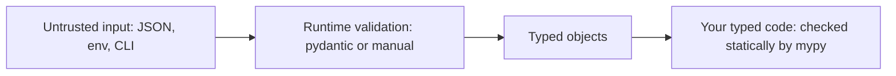

# Chapter 13 — Type Hints and Static Typing

> **What you will learn.** Why a dynamic language added optional types and how to write them: annotation syntax, built-in generics (`list[int]`), `Optional` / `Union` / `X | None`, `Any`, generics with `TypeVar` and the 3.12 bracket syntax, `Callable` and `ParamSpec`, `Protocol`, `TypedDict`, `Literal`, `Final`, `NewType`; dataclasses, aliases and the `type` statement; running **mypy**/**pyright** and reading their errors; what hints do (and don't do) at runtime; and how **pydantic** turns hints into runtime validation.
>
> **Prerequisites.** Functions ([Chapter 7](../07-functions/README.md)), classes and dataclasses ([Chapter 10](../10-oop-in-python/README.md)), decorators ([Chapter 12](../12-decorators-context-managers-metaprogramming/README.md)).
>
> **Code.** `chapters/13-type-hints/code/`, Python 3.12+. `04_run_mypy.py` needs `pip install mypy`:
>
> ```bash
> python chapters/13-type-hints/code/02_generics_protocols.py
> mypy --strict chapters/13-type-hints/code/03_special_forms.py
> ```


---

## 13.1 Why typing?

### What it is
A **type hint** (annotation) says what kind of value a variable, parameter or return should hold: `def area(w: float, h: float) -> float`. Python **does not enforce** it. **Static type checkers** (mypy, pyright) read the source *without running it* and report contradictions.

- **Dynamic typing** — types belong to *values* and are checked as the program runs (`"a" + 1` fails only when that line executes). Python is dynamic.
- **Static typing** — types are checked *before* running, from the source; Java, Go and Rust do it in the compiler.

Python offers **gradual typing**: annotate as much or as little as you like; un-annotated code is treated leniently.

### Why it matters
1. **Bugs found early** — `None` where a `str` is expected, misspelled attributes, wrong argument order — before tests or production.
2. **Documentation that can't go stale** — `def fetch(ids: list[int]) -> dict[int, User]` explains itself, and the checker complains if code drifts.
3. **Editor power** — autocomplete, go-to-definition, safe renames (VS Code's Pylance is built on pyright).
4. **Safer refactoring** at scale — change a signature and the checker lists every caller to fix.

### How it works
1. Annotations arrived in 3.0 (PEP 3107) as free-form metadata; PEP 484 (3.5) gave them standard meaning and created `typing`.
2. At runtime they're stored (`func.__annotations__`) and otherwise ignored.
3. A checker parses the code, infers the type of every expression, and compares it with the annotations.
4. Un-annotated code is `Any` (§13.5), so you can adopt typing one file at a time.

### Trade-offs

| Benefit | Cost |
|---|---|
| Catches whole classes of bugs before running | Extra syntax to learn and write |
| Self-documenting APIs, better IDE (integrated development environment — VS Code, PyCharm) support | Some dynamic patterns are awkward to type |
| Refactoring confidence at scale | False sense of safety if `Any` leaks everywhere |
| Zero runtime cost (hints are not checked) | …which also means no runtime protection |

### When not to use it
Throw-away scripts, exploratory notebooks and tiny programs gain little. Types pay off in long-lived, shared code and libraries.

### Real-world examples
Dropbox type-checked about 4 million lines with mypy (Guido van Rossum worked on mypy there). Meta built Pyre; Microsoft built pyright. **FastAPI** and **pydantic** read hints at runtime to validate requests and generate API docs. Standard-library and popular-package types live in **typeshed**, used by every checker.

### In the interview
"Python is dynamically typed, but since PEP 484 we can add optional type hints. They're ignored at runtime; a static checker like mypy or pyright verifies them before the code runs. It's gradual, so you can type a codebase incrementally. I use them on anything long-lived because they catch `None` bugs and make refactors safe."
- *Do hints make code faster?* No — CPython ignores them. (mypyc can compile typed code to C extensions, but that's a separate compiler.)
- *Does `x: int = "a"` raise?* No; only the checker complains.
- *Checkers?* mypy, pyright; also Pyre and newer Rust-based ones (Astral's ty, Meta's Pyrefly).

---

## 13.2 Annotation syntax

```python
def greet(name: str, times: int = 1) -> str:   # parameters and return
    return ", ".join([f"hi {name}"] * times)

port: int = 8080                                # variable with value
scores: dict[str, list[int]] = {"asha": [90]}   # nested types
total: int                                      # bare annotation: declares, creates nothing

class User:
    name: str            # class-level annotation (dataclasses use these as fields)
    def rename(self, new: str) -> None: ...     # self is not annotated
```

### How it works
1. `param: Type`, with a default `param: Type = default` (spaces around `=`, unlike un-annotated `param=default` — PEP 8).
2. `-> Type` for the return; returns nothing → `-> None`.
3. `name: Type = value` annotates a variable (PEP 526). A bare `name: Type` creates **no** variable — reading `total` raises `NameError`.
4. Stored in `__annotations__`; `typing.get_type_hints(obj)` returns them resolved (string forward references → real classes).
5. **Forward references** — a type not yet defined (a class referring to itself) is written as a string: `-> "Node"`. Since 3.11, `typing.Self` means "the current class".
6. **Evaluation time** — up to 3.13, annotations are evaluated when the `def` runs (unless `from __future__ import annotations` stores them as strings). **Python 3.14** (PEP 649/749) evaluates them *lazily*, only when requested, so forward references usually need no quotes; `annotationlib` exposes the details.

Script `01_annotations_basics.py`:

```python
print("greet annotations:", greet.__annotations__)
print("get_type_hints    :", get_type_hints(greet))
print("greet(123, 2)     :", greet(123, 2))   # int passed for str - runs fine
```

Output:
```
greet annotations: {'name': <class 'str'>, 'times': <class 'int'>, 'return': <class 'str'>}
get_type_hints    : {'name': <class 'str'>, 'times': <class 'int'>, 'return': <class 'str'>}
greet(123, 2)     : hi 123, hi 123
```

Python ran `greet(123, 2)`; mypy reports it:

```
01_annotations_basics.py:34: error: Argument 1 to "greet" has incompatible type "int"; expected "str"  [arg-type]
```

### What to annotate
- **Always:** parameters and return types of public functions.
- **Rarely:** locals — the checker **infers** `x = 5` as `int`. Annotate only when inference can't, e.g. an empty container: `seen: set[str] = set()`.

### Common mistakes
- Forgetting `-> None`: by default mypy doesn't check inside a function with *no* annotations — `-> None` opts it in.
- `def f(x: int=5)` — works, but style is `x: int = 5`.
- Expecting `total: int` to create `total`.

---

## 13.3 Built-in generics and the abstract collection types

### What it is
A **generic type** is a container type with a parameter for what it holds: `list[int]`. Since 3.9 (PEP 585) built-ins accept brackets directly; `typing.List`, `typing.Dict` etc. are deprecated aliases.

| Type | Meaning |
|---|---|
| `list[int]` | list of ints |
| `dict[str, float]` | keys `str`, values `float` |
| `set[str]`, `frozenset[str]` | set of strings |
| `tuple[int, str]` | **exactly** two items: an int then a str |
| `tuple[int, ...]` | any length, all ints |
| `tuple[()]` | the empty tuple |
| `type[User]` | the class `User` itself (or a subclass), not an instance |

### Accept abstract, return concrete
`collections.abc` has parameterisable *abstract* types describing what a collection supports:

| Abstract type | What it promises | Accepts |
|---|---|---|
| `Iterable[T]` | can be looped over | list, tuple, set, dict, generator, file… |
| `Sequence[T]` | indexable, has `len`, read-only | list, tuple, str, range |
| `Mapping[K, V]` | read-only dict-like | dict, `MappingProxyType`, custom |
| `MutableSequence[T]`, `MutableMapping[K, V]` | can be modified | list / dict |
| `Iterator[T]`, `Generator[Y, S, R]` | produced by generators | generator functions |

Rule: **parameters ask for the least they need; return values say exactly what they give.**

```python
from collections.abc import Iterable

def total(prices: Iterable[float]) -> float:   # works with list, tuple, generator
    return sum(prices)

def tokens(text: str) -> list[str]:            # caller knows they get a real list
    return text.split()
```

### Variance in one paragraph
Is `list[int]` a `list[float]`? **No** — a function taking `list[float]` could append `2.5`, corrupting your `list[int]`. Mutable containers are **invariant** (must match exactly). Read-only `Sequence` is **covariant**: `Sequence[int]` is accepted where `Sequence[float]` is expected. (Separately, a plain `int` may be passed where `float` is expected — "numeric promotion".) Another reason to prefer `Sequence`/`Iterable` parameters.

### Common mistakes
- `def f(xs: list)` — bare `list` is `list[Any]`; items go unchecked.
- `tuple[int]` is a one-element tuple; "tuple of ints" is `tuple[int, ...]`.
- `List`, `Dict` from `typing` in new code (works, old style).

---

## 13.4 `Optional`, `Union` and `X | None`

### What it is
- A **union** — "one of these": `int | str` (3.10+, PEP 604) or `Union[int, str]`.
- **`X | None`** — "an `X` or `None`". `Optional[X]` is identical; it does **not** mean "optional argument", it means "may be None".

```python
def find_user(user_id: int) -> str | None:
    users = {1: "asha", 2: "ben"}
    return users.get(user_id)
```

### Why it matters
`'NoneType' object has no attribute ...` is among the most common production errors (Tony Hoare called null references his "billion-dollar mistake"). Putting `None` in the type forces every caller to handle it.

### How it works — narrowing
After a check, the checker knows a more specific type in that branch (**narrowing**):

```python
def f(x: int | str | None) -> None:
    if x is None:
        return
    reveal_type(x)          # int | str
    if isinstance(x, int):
        reveal_type(x)      # int
    else:
        reveal_type(x)      # str
```

`reveal_type(...)` (importable from `typing` since 3.11) makes mypy print the inferred type:

```
note: Revealed type is "int | str"
note: Revealed type is "int"
note: Revealed type is "str"
```

Narrowing constructs: `is None` / `is not None`, `isinstance`, truthiness (`if x:` — also removes `""` and `0`), `==` against a literal, `match`, early `return`/`raise`, and your own functions returning `TypeGuard[T]` or (3.13+) `TypeIs[T]`. Unions work in `isinstance` at runtime: `isinstance(5, int | str)` → `True`.

### Common mistakes
- `def f(x: str = None)` — must be `str | None`; mypy rejects "implicit Optional" since 0.990.
- `if x:` when `0` or `""` are valid — use `if x is not None:`.
- `X | None` everywhere "just in case" — every caller must then check. Raise when absence is an error.

### In the interview
"`Optional[X]` is just `X | None`. The checker forces callers to narrow with `is not None` before use, which eliminates most `NoneType has no attribute` errors."
- *Is `Optional` about default arguments?* No — a parameter can have a default and not be Optional, and vice versa.

---

## 13.5 `Any` (and `object`)

`Any` is the escape hatch: compatible with **every** type in both directions, every operation allowed, checking off. Un-annotated parameters are implicitly `Any`. `object` is the opposite: the top of the hierarchy — **anything can be passed in**, but you can only do what every object supports (`print`, `==`, `hash`) until you narrow.

| | Accepts anything? | Can call any method on it? | Safety |
|---|---|---|---|
| `Any` | yes | yes | none |
| `object` | yes | no (must narrow with `isinstance`) | full |

```python
def load(raw: Any) -> None:
    raw.whatever()        # checker says nothing - could crash at runtime

def show(x: object) -> None:
    x.upper()             # error: "object" has no attribute "upper"
    if isinstance(x, str):
        x.upper()         # fine after narrowing
```

**When to use `Any`:** truly dynamic data at a boundary (parsed JSON before validation), untyped third-party libraries, temporarily during migration.

**Mistake:** `Any` is **contagious** — `y = raw.field` is `Any`, and so is everything derived. A few `Any`s at the edges silently disable checking deep inside. Prefer `object` for "I accept anything"; convert `Any` data into real types early (§13.14). `mypy --strict` warns about `Any` leaking from untyped code.

---

## 13.6 `TypeVar` and generics

### What it is
A **type variable** stands for "some type, the same one each time it appears", so one function works for many types *without* losing precision. `def first(items: list[Any]) -> Any` misses `first([1, 2]) + "x"`; with a type variable, the checker knows `first([1, 2])` is `int`.

### How it works
**Old style (3.5–3.11), still common:**

```python
from typing import TypeVar
T = TypeVar("T")

def first_old(items: Sequence[T]) -> T:
    return items[0]
```

**New style (3.12+, PEP 695)** — type parameters in square brackets:

```python
def first[T](items: Sequence[T]) -> T:
    return items[0]

def biggest[N: (int, float)](a: N, b: N) -> N:   # constrained: N is int or float
    return a if a > b else b

class Stack[T]:
    def __init__(self) -> None:
        self._items: list[T] = []
    def push(self, item: T) -> None:
        self._items.append(item)
    def pop(self) -> T:
        return self._items.pop()
```

1. At each call the checker **solves** `T`: `first("xyz")` → `T = str`.
2. **Bound** `[T: Hashable]` (old: `TypeVar("T", bound=Hashable)`) — any subtype of `Hashable` (a type usable wherever `Hashable` is expected, e.g. a subclass).
3. **Constraints** `[N: (int, float)]` — solved to exactly `int` or exactly `float`, never a subclass or mix: `biggest(2, 7)` → `int`, `biggest(2, 7.0)` → `float` (numeric promotion, §13.3). Classic: `AnyStr = (str, bytes)` rejects `concat("a", b"b")`.
4. **Generic class** — `Stack[int]()` or `s: Stack[int] = Stack()` fixes `T`; `s.push("a")` is then an error. Old style: `class Stack(Generic[T]): ...`.
5. Since 3.13 (PEP 696) type parameters can have **defaults**: `class Box[T = int]: ...`.

Output of `02_generics_protocols.py` (generic part):
```
first_old([3,4]) : 3
first('xyz')     : x
biggest(2, 7)    : 7
Stack pop        : 2 | len 1
type params      : (T,) (T,)
```
The 3.12 syntax records parameters at runtime in `__type_params__`.

### Trade-offs

| | Old `TypeVar` | 3.12 `[T]` syntax |
|---|---|---|
| Works on | 3.5+ | 3.12+ only |
| Scope | module-global name, easy to misuse | scoped to the function/class |
| Variance | declared manually (`covariant=True`) | inferred automatically |

### Common mistakes
- A type variable used once in a signature (`def f(x: T) -> None`) adds nothing — use `object`.
- Reusing one old-style `T` across unrelated functions and getting confused — each solves it independently; the 3.12 syntax makes that obvious.

### Real-world examples
`dict.get`, `list.__getitem__`, `max`, `sorted`, `lru_cache`, `asyncio.Queue[T]` are generic in typeshed; SQLAlchemy 2.0's `Mapped[int]` and Django-stubs give ORM columns precise types.

### In the interview
"A TypeVar ties input and output types together, so `first(list_of_ints)` returns `int` instead of `Any`. Since 3.12 I write `def first[T](xs: Sequence[T]) -> T` and `class Stack[T]`."
- *Bound vs constrained?* Bound: any subtype of X. Constrained: exactly one of the listed types.
- *Why is `list[int]` not a `list[float]`?* Invariance — the callee could insert a float.

---

## 13.7 `Callable` and `ParamSpec`

`Callable[[Arg1, Arg2], Return]` types "something callable with these arguments returning this". Import from `collections.abc` (the `typing` one is a deprecated alias).

```python
from collections.abc import Callable, Iterable

def apply_all(fn: Callable[[int], int], xs: Iterable[int]) -> list[int]:
    return [fn(x) for x in xs]
```

- `Callable[..., int]` — any arguments, returns int.
- `Callable[[], None]` — no-argument callback.
- Keyword arguments, overloads or defaults can't be expressed — use a `Protocol` with `__call__` (§13.8).

### ParamSpec — typing decorators (brief)
A decorator wrapping *any* function should keep its exact parameters. Before `ParamSpec` (3.10, PEP 612) people wrote `Callable[..., Any]` and lost all argument checking.

```python
P = ParamSpec("P")
R = TypeVar("R")

def timed(fn: Callable[P, R]) -> Callable[P, R]:
    @wraps(fn)
    def wrapper(*args: P.args, **kwargs: P.kwargs) -> R:
        start = time.perf_counter()
        try:
            return fn(*args, **kwargs)
        finally:
            print(f"  {fn.__name__} took {time.perf_counter() - start:.4f}s")
    return wrapper

@timed
def add(a: int, b: int) -> int:
    return a + b
```

1. `P` captures `fn`'s parameter list; `R` its return type.
2. `*args: P.args, **kwargs: P.kwargs` — "the wrapper takes exactly what `fn` takes", so `add("x", 1)` is still flagged after decoration.
3. 3.12 syntax: `def timed[**P, R](fn: Callable[P, R]) -> Callable[P, R]:`.
4. `Concatenate[Request, P]` types decorators that add or remove a leading argument.

Output:
```
apply_all        : [1, 4, 9]
add(2, 3) ->
  add took 0.0000s
  result 5
```

---

## 13.8 `Protocol` — structural typing

### What it is
**Nominal typing**: B is a subtype of A because it *inherits* from A. **Structural typing**: B is compatible with A because it *has the right methods*. A `Protocol` (PEP 544, 3.8) declares such a shape — duck typing made checkable.

### Why it matters
- Type code against classes you don't control (a third-party class can't inherit your ABC but may already have `close()`).
- Decoupling: the consumer defines the tiny interface it needs; producers needn't import it.

### How it works

```python
from typing import Protocol, runtime_checkable

@runtime_checkable
class SupportsClose(Protocol):
    def close(self) -> None: ...

class DbConnection:              # does NOT inherit from SupportsClose
    def close(self) -> None:
        print("  db closed")

def close_all(things: Iterable[SupportsClose]) -> None:
    for t in things:
        t.close()
```

1. The Protocol body lists required members with `...` bodies.
2. Any class whose members match (names **and** compatible signatures) satisfies it — checked statically.
3. `@runtime_checkable` also allows `isinstance(x, SupportsClose)`, which checks only that **names exist**, not signatures.
4. Protocols can be generic: `class SupportsLessThan[T](Protocol): def __lt__(self, other: T) -> bool: ...`.

Output:
```
close_all ->
  db closed
  temp file removed
isinstance(DbConnection(), SupportsClose): True
isinstance(42, SupportsClose)            : False
```

### Trade-offs — Protocol vs ABC

| | `Protocol` | `abc.ABC` |
|---|---|---|
| Relationship | structural (shape) | nominal (must inherit / register) |
| Checked | by the type checker | at instantiation (`TypeError` if abstract methods missing) |
| Shares implementation | not intended | yes, concrete helper methods |
| Works with third-party classes | yes | only with `register()` |

### Common mistakes
- Trusting runtime-checkable `isinstance` to verify signatures — it doesn't.
- Big protocols. Keep them to one to three methods, like `Iterable`, `Sized`, `Hashable`, `SupportsInt`, `SupportsAbs`.

### Real-world examples
`typing.SupportsIndex`, `collections.abc.Iterable`, typeshed's `SupportsRead[str]` ("anything with `.read()`", used by `json.load`).

### In the interview
"A Protocol is a statically checked duck type: any class with matching methods satisfies it, no inheritance. I use it for the minimal interface a function needs, like `SupportsClose`, which also makes testing with fakes (simple stand-in objects) easy."
- *Protocol or ABC?* ABC to share code and force subclasses to implement methods; Protocol to describe a shape only.

---

## 13.9 `TypedDict`

A **TypedDict** describes a dict with fixed string keys, each with its own value type — the shape of JSON objects and config.

```python
from typing import NotRequired, TypedDict

class Movie(TypedDict):
    title: str
    year: int
    rating: NotRequired[float]      # key may be absent (3.11+)

m: Movie = {"title": "Arrival", "year": 2016}
```

1. The checker verifies keys and value types: `m["yeer"]` and `m["year"] = "2016"` are errors.
2. Keys are required by default. `NotRequired[...]` per key, or `total=False` for all (then `Required[...]` for exceptions). `ReadOnly[...]` (3.13) forbids writes.
3. **At runtime it is a plain `dict`** — no validation; `isinstance(x, Movie)` raises `TypeError`.

Output:
```
TypedDict value  : {'title': 'Arrival', 'year': 2016} | type at runtime: dict
Movie keys       : frozenset({'title', 'year'}) frozenset({'rating'})
```

### TypedDict vs dataclass

| | TypedDict | dataclass |
|---|---|---|
| Runtime object | plain `dict` | instance of your class |
| Access | `m["title"]` | `m.title` |
| Methods | none | yes |
| Best for | JSON in/out, `**kwargs` typing (`Unpack[Opts]`) | domain objects (`Order`) in your code |

---

## 13.10 `Literal`, `Final`, `NewType`

### `Literal` — only these exact values
```python
Mode = Literal["r", "w", "a"]
def open_log(path: str, mode: Mode = "r") -> str: ...
open_log("app.log", "x")      # error: expected "Literal['r', 'w', 'a']"
```
For string/int flags when an `Enum` feels heavy. `typing.get_args(Mode)` → `('r', 'w', 'a')` at runtime (useful for validation); `match`/`==` narrows it. typeshed types `open()`'s `mode` with literals, so `open(p, "rb")` is known to return a binary file.

### `Final` — must not be reassigned
```python
MAX_RETRIES: Final = 3        # inferred as int, and constant
MAX_RETRIES = 4               # error: Cannot assign to final name "MAX_RETRIES"
```
`@final` on a method (no overriding) or class (no subclassing). Not enforced at runtime. `@typing.override` (3.12) marks a method that must override a parent's, catching name typos.

### `NewType` — a distinct name for the same runtime type
```python
UserId = NewType("UserId", int)
OrderId = NewType("OrderId", int)

def get_user(uid: UserId) -> str: ...
get_user(UserId(7))   # OK
get_user(42)          # error: expected "UserId"
```
1. For the checker `UserId` is a *subtype* of `int`: a `UserId` goes where an `int` is expected, not the reverse.
2. At runtime `UserId(7)` returns `7` — `type(UserId(7)) is int`. Zero cost.
3. Stops mixing up IDs, units (`Meters` vs `Feet`), raw vs sanitised strings (`SafeHtml`).

Output of `03_special_forms.py`:
```
Literal args     : ('r', 'w', 'a')
open app.log in 'a'
NewType          : user#7 | UserId(7) is int: True
```

### Common mistakes
- `UserId = int` is an alias (interchangeable, no protection); `NewType` is distinct.
- Expecting `Final` or `Literal` to raise at runtime.

### Other special forms you will meet

| Form | Meaning | Example |
|---|---|---|
| `Annotated[T, meta]` (3.9) | `T` plus metadata the checker ignores but libraries read | FastAPI/pydantic: `age: Annotated[int, Field(gt=0)]` |
| `Self` (3.11) | An instance of the current class — fluent (chainable) methods, alternative constructors | `def with_name(self, n: str) -> Self:` |
| `NoReturn` / `Never` (3.11) | Never returns normally (always raises or exits) | `def fail(msg: str) -> NoReturn: raise SystemExit(msg)` |
| `ClassVar[T]` | Class-level attribute, not a per-instance field | `count: ClassVar[int] = 0` |
| `@overload` | Several signatures when the return type depends on the arguments | `open(p, "rb")` → binary file, `open(p, "r")` → text file |
| `TypeGuard[T]` / `TypeIs[T]` (3.10 / 3.13) | User function that narrows its argument when it returns `True` | `def is_str_list(x: list[object]) -> TypeIs[list[str]]:` |
| `LiteralString` (3.11) | Only strings written in source, not user input | SQL builders defending against injection |
| `Unpack[TD]` (3.11/3.12) | Type `**kwargs` with a `TypedDict` | `def f(**kw: Unpack[Opts]):` |

---

## 13.11 dataclasses and typing

`@dataclass` ([Chapter 10](../10-oop-in-python/README.md)) reads the **class-level annotations** to decide which fields exist and their order, and generates `__init__`, `__repr__`, `__eq__`. It's the best-known place annotations change runtime behaviour (others: `typing.NamedTuple`, `TypedDict`, `functools.singledispatch`'s `register`, which can dispatch on an annotation) — but only as *field declarations*; no type validation.

```python
@dataclass(frozen=True, slots=True)
class Point:
    x: float
    y: float
    tags: tuple[str, ...] = ()

@dataclass
class Cart:
    owner: str
    items: list[str] = field(default_factory=list)
```

1. Each annotated class attribute becomes a field; the generated `__init__` is typed, so checkers verify `Point("a", 2)`.
2. `ClassVar[int]` attributes are **not** fields; `InitVar[str]` is an `__init__`-only parameter passed to `__post_init__`.
3. Mutable defaults need `field(default_factory=list)` — plain `= []` raises `ValueError` at class creation.
4. `frozen=True` → immutable (checkers flag `p.x = 5`; at runtime `FrozenInstanceError`).
5. `Point(x="oops", y=2)` **runs** — no type checks.

Output:
```
dataclass        : Point(x=1.0, y=2.0, tags=()) | fields: ['x', 'y', 'tags']
default_factory  : ['pen'] []
frozen           : FrozenInstanceError
```

### Related typed record types

| Tool | Mutable | Validates types | Notes |
|---|---|---|---|
| `@dataclass` | yes (or `frozen`) | no | the default choice |
| `typing.NamedTuple` | no | no | a real tuple (unpacks, indexes) |
| `TypedDict` | yes | no | plain dict |
| `attrs` (third-party) | configurable | optional validators | dataclasses' ancestor |
| `pydantic.BaseModel` | yes | **yes** | for untrusted input (§13.14) |

---

## 13.12 Type aliases and the `type` statement

A **type alias** is a short name for a long type.

```python
Vector = list[float]                                     # implicit alias (any version)
from typing import TypeAlias
Headers: TypeAlias = dict[str, str]                      # explicit (3.10+, now deprecated style)
type JSON = dict[str, JSON] | list[JSON] | str | int | float | bool | None   # 3.12+
```

1. The **`type` statement** (3.12, PEP 695) creates a `TypeAliasType`, evaluated **lazily** — so it can be recursive (`JSON`) or reference later names without quotes.
2. Aliases can be generic: `type Pair[T] = tuple[T, T]`, then `Pair[int]`.
3. An alias is interchangeable with what it names — unlike `NewType`, no extra safety.
4. A `type` alias is **not** a class: `isinstance(x, JSON)` fails, it can't be called. `JSON.__value__` shows the underlying type.

Output:
```
type alias       : JSON -> TypeAliasType
alias value      : dict[str, 'JSON'] | list['JSON'] | str | int | float | bool | None
scale            : [3.0, 6.0]
```
(The script quotes `"JSON"` only for display; with `type` quotes are optional.)

---

## 13.13 Running mypy and pyright; common errors

### What it is
**mypy** is the original checker (PEP 484's reference implementation, compiled with mypyc). **pyright** (Microsoft, TypeScript) is faster, powers Pylance, and infers more in un-annotated code. Both use the same annotations and typeshed stubs; they occasionally disagree on edge cases.

### How it works — using mypy
```bash
pip install mypy
mypy src/                         # check a package
mypy --strict src/                # turn on all optional strictness flags
```
Configure once in `pyproject.toml`:

```toml
[tool.mypy]
python_version = "3.12"
strict = true                     # new code: go strict
warn_unused_ignores = true

[[tool.mypy.overrides]]
module = ["legacy.*"]
ignore_errors = true              # old code: switch off per module while migrating
```

pyright: `pip install pyright` (or `npm i -g pyright`), `pyright src/`, configured in `[tool.pyright]` with `typeCheckingMode = "strict"`.

**Gradual adoption plan** (as Dropbox and others describe):
1. Run the checker in CI with defaults on everything; fix or silence the first errors.
2. Annotate the most-used modules and public functions first.
3. Turn on `strict` per module as it becomes fully typed.
4. Forbid new untyped functions (`disallow_untyped_defs`).
5. Install third-party stubs: `pip install types-requests` etc. (mypy suggests the name).

### Reading real errors
`bad_types.py` has seven deliberate mistakes; `04_run_mypy.py` runs mypy via `mypy.api.run`:

```python
if __name__ == "__main__":
    area("3", 4)                       # 1 wrong argument type
    name = find(1)                     # returns str | None
    print(name.upper())                # 2 Optional not narrowed
    get_user(42)                       # 3 plain int is not a UserId
    mode("x")                          # 4 not an allowed literal
    LIMIT = 11                         # 5 reassigning a Final
    count: int = "three"               # 6 wrong assignment
    shout(name)                        # 7 str | None passed where str needed
```

Output (real mypy 2.x):
```
bad_types.py:29: error: Argument 1 to "area" has incompatible type "str"; expected "float"  [arg-type]
bad_types.py:31: error: Item "None" of "str | None" has no attribute "upper"  [union-attr]
bad_types.py:32: error: Argument 1 to "get_user" has incompatible type "int"; expected "UserId"  [arg-type]
bad_types.py:33: error: Argument 1 to "mode" has incompatible type "Literal['x']"; expected "Literal['r', 'w']"  [arg-type]
bad_types.py:34: error: Cannot assign to final name "LIMIT"  [misc]
bad_types.py:35: error: Incompatible types in assignment (expression has type "str", variable has type "int")  [assignment]
bad_types.py:36: error: Argument 1 to "shout" has incompatible type "str | None"; expected "str"  [arg-type]
exit status: 1
```

Format: `file:line: error: message [error-code]`; the bracketed code is what a targeted ignore names.

### Common errors and fixes

| Error (code) | Usual cause | Fix |
|---|---|---|
| `Incompatible types in assignment` `[assignment]` | variable reused for a different type | new variable name, or a union type |
| `Argument 1 has incompatible type` `[arg-type]` | wrong type passed | convert (`float(s)`) or fix the signature |
| `Item "None" of "X \| None" has no attribute` `[union-attr]` | Optional not narrowed | `if x is not None:` / early return / raise |
| `Need type annotation for "d"` `[var-annotated]` | empty container `d = {}` | `d: dict[str, int] = {}` |
| `Missing return statement` `[return]` | a branch falls off the end | return or raise in every branch |
| `Function is missing a type annotation` `[no-untyped-def]` | strict mode, un-annotated def | annotate it |
| `Library stubs not installed for "requests"` `[import-untyped]` | no type info for a package | `pip install types-requests` |
| `Returning Any from function declared to return "int"` `[no-any-return]` | value came from untyped code | `cast(int, ...)` after validating, or validate |

### Escape hatches (use sparingly)
- `# type: ignore[arg-type]` — always with the code, so unrelated errors aren't hidden; `warn_unused_ignores` finds stale ones.
- `typing.cast(T, value)` — "trust me" for the checker; no-op at runtime.
- `if TYPE_CHECKING:` — imports only for the checker (avoids runtime import cycles).
- `.pyi` **stub files** — type info kept separate from code (how typeshed works).
- `@overload` — precise signatures when the return type depends on arguments.

### Common mistakes
- Blanket `# type: ignore` without a code.
- Assuming un-annotated functions are checked — mypy skips their bodies unless `check_untyped_defs = true` (in `--strict`).
- `cast` instead of real validation of external data.

### In the interview
"I run mypy or pyright in CI and pre-commit (git hooks run before each commit), strict for new code with per-module overrides for legacy code. Most errors are unhandled `None`, empty containers needing annotations, and missing stubs. I debug inference with `reveal_type` and always put an error code on `type: ignore`."

---

## 13.14 Runtime vs static — and pydantic

### What it is
- **Static** checking reasons about **code** before it runs; it knows nothing about real data.
- **Runtime validation** checks **data** as it arrives — essential for anything external: HTTP requests, files, environment variables, user input, LLM output.

A fully mypy-typed program still crashes on a JSON payload with `"age": "thirty"`, because `json.loads` returns `Any`.



### What Python does at runtime with hints
| Feature | Runtime effect |
|---|---|
| Parameter/variable annotations | stored only; never checked |
| `@dataclass` | fields from annotations; **no** type check |
| `NewType`, `cast`, `Final`, `Literal`, `TypedDict` | no checks (NewType returns its argument) |
| `isinstance(x, int \| str)` | works |
| `isinstance(x, list[int])` | `TypeError` — parameterised generics can't be checked with isinstance |
| `@runtime_checkable` Protocol | `isinstance` checks method names only |
| `get_type_hints`, `get_origin`, `get_args` | let libraries read hints and act on them |

### How runtime validation works — a tiny version
`05_runtime_validation.py` builds a mini validator from `get_type_hints` + `get_origin`/`get_args` — the idea behind pydantic:

```python
def check(value: object, tp: object) -> bool:
    origin = get_origin(tp)
    if tp is NoneType or tp is None:
        return value is None
    if origin is UnionType:                       # X | Y
        return any(check(value, arg) for arg in get_args(tp))
    if origin is list:                            # list[T]
        (item_tp,) = get_args(tp)
        return isinstance(value, list) and all(check(v, item_tp) for v in value)
    if isinstance(tp, type):                      # plain class
        return isinstance(value, tp) and not (tp is int and isinstance(value, bool))
    raise TypeError(f"unsupported type {tp!r}")
```

Output:
```
Signup(email='a@x.io', age=30, referrer=None, tags=['beta'])
rejected: age='30' is not <class 'int'>
rejected: tags=['ok', 5] is not list[str] | None
```
(`bool` is special-cased because it subclasses `int`: `isinstance(True, int)` is `True`.)

### pydantic (brief, real-world)
**pydantic** is the most widely used runtime-validation library; v2's core (`pydantic-core`) is written in Rust. Declare a model with ordinary hints; it validates, converts and serialises. (`pip install pydantic` — not run here.)

```python
from pydantic import BaseModel, ValidationError

class Signup(BaseModel):
    email: str
    age: int
    referrer: str | None = None

s = Signup(email="a@x.io", age="30")      # "lax" mode converts "30" -> 30
print(s.age + 1)                          # 31
print(s.model_dump())                     # {'email': 'a@x.io', 'age': 30, 'referrer': None}

try:
    Signup(email="b@x.io", age="thirty")
except ValidationError as e:
    print(e.error_count(), "error")       # 1 error: age is not a valid integer

s2 = Signup.model_validate_json('{"email": "c@x.io", "age": 41}')
```

1. **Lax** by default — converts compatible input (`"30"` → `30`); `strict=True` (model or field) rejects that.
2. All errors are collected in one `ValidationError`, each with its location.
3. `model_dump()` / `model_dump_json()` serialise; `model_json_schema()` emits JSON Schema (a standard machine-readable description of valid JSON).
4. Used by **FastAPI** (request validation, OpenAPI docs), `pydantic-settings` (typed config from env vars), LLM SDKs (Anthropic's, OpenAI's) for responses and "structured output" validation.
5. Alternatives: `attrs` + `cattrs`, `msgspec` (very fast), `marshmallow` (schemas separate from classes), `typeguard`/`beartype` (check hints at call time).

### When not to use it
Don't re-validate internal data already validated and covered by static types. Validate **once, at the boundary**, then trust the types ("parse, don't validate").

### In the interview
"Type hints are static; Python never enforces them. For untrusted data I validate at the boundary with pydantic, which uses the same annotations to parse JSON into typed objects; mypy then guarantees the rest of the code uses them correctly."
- *Would mypy catch a bad API payload?* No — it never sees runtime data.
- *Why is pydantic v2 fast?* Its validation core is Rust.

---

## 13.15 Chapter self-check

1. Does `def f(x: int)` stop `f("a")` from running? → No; only a checker flags it.
2. What does "gradual typing" mean? → Typed and untyped code coexist; un-annotated parts are `Any`.
3. `Optional[str]` equals? → `str | None`.
4. Parameter type for "anything I can loop over once"? → `Iterable[T]`.
5. Why is `list[int]` not a subtype of `list[float]`? → Lists are mutable, so invariant.
6. `Any` vs `object`? → `Any` disables checks; `object` accepts all but allows only universal operations.
7. 3.12 syntax for a generic function / class? → `def first[T](xs: Sequence[T]) -> T:` / `class Stack[T]:`.
8. When is a TypeVar pointless? → When it appears only once in the signature.
9. How do you keep a decorated function's signature? → `ParamSpec` (`Callable[P, R]`).
10. Class with `close()` but no inheritance — matches `SupportsClose`? → Yes, structurally.
11. What is a TypedDict at runtime? → A plain dict.
12. `UserId = int` vs `NewType("UserId", int)`? → Alias = interchangeable; NewType = distinct for the checker.
13. Recursive JSON type in 3.12? → `type JSON = dict[str, JSON] | list[JSON] | str | int | float | bool | None`.
14. How do you see what mypy inferred? → `reveal_type(expr)`.
15. `Need type annotation for "d"` — fix? → `d: dict[str, int] = {}`. `Library stubs not installed`? → install `types-…`.
16. What does `cast` do at runtime? Why a code in `# type: ignore[...]`? → Nothing; to suppress only that error and let `warn_unused_ignores` catch stale ones.
17. Does `@dataclass` check `x: int`? Can you `isinstance(x, list[int])`? → No; no (`TypeError`).
18. Where do you validate API data, and pydantic lax vs strict? → Once at the boundary; lax converts `"30"`→30, strict rejects.

## Chapter TL;DR
- **Hints are optional and unenforced.** Checkers (mypy, pyright) read them before runtime; typing is gradual.
- **Syntax:** `param: T`, `-> T`, `var: T = v`. Annotate signatures; let inference handle locals. 3.14 evaluates annotations lazily.
- **Generics:** `list[int]`, `dict[str, int]`, `tuple[int, ...]`; parameters take `Iterable`/`Sequence`/`Mapping`; mutable containers are invariant.
- **Unions:** `A | B`; `X | None` = `Optional[X]`; narrow with `is not None`/`isinstance`. **`Any`** switches checking off, **`object`** doesn't.
- **Type variables:** `def f[T](...)`, `class C[T]` (3.12), bounds and constraints. **`Callable`** for function values, **`ParamSpec`** for decorators.
- **`Protocol`** = structural interface. **`TypedDict`** = typed dict. **`Literal`** = fixed values. **`Final`** = constant. **`NewType`** = zero-cost distinct type.
- **dataclasses** use annotations as fields but never validate. **Aliases** via `type X = ...`.
- **Tooling:** `mypy --strict` / pyright in CI, config in `pyproject.toml`, `reveal_type`, `# type: ignore[code]`, stubs (`types-*`).
- **Runtime vs static:** validate untrusted data once at the boundary (pydantic), trust the types inside.
