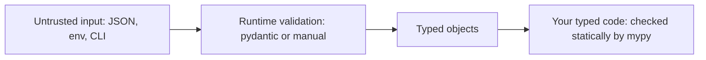

# Chapter 13 — Type Hints and Static Typing

> **What you will learn.** Why a dynamic language added optional types, and how to write them: annotation syntax, built-in generics such as `list[int]`, `Optional` / `Union` / `X | None`, `Any`, generics with `TypeVar` and the new 3.12 bracket syntax, `Callable` and `ParamSpec`, structural typing with `Protocol`, and the special forms `TypedDict`, `Literal`, `Final` and `NewType`. Then how types meet `dataclasses`, how to name types with aliases and the 3.12 `type` statement, how to run **mypy** and **pyright** and read their errors, what types do (and do not do) at runtime (while the program is actually executing, as opposed to when the source is being read or checked), and how **pydantic** turns hints into runtime validation.
>
> **Prerequisites.** Functions ([Chapter 7](../07-functions/README.md)), classes and dataclasses ([Chapter 10](../10-oop-in-python/README.md)), decorators ([Chapter 12](../12-decorators-context-managers-metaprogramming/README.md)).
>
> **Code.** Every script is in `chapters/13-type-hints/code/` and runs on Python 3.12+. Script `04_run_mypy.py` needs `pip install mypy` (`pip` is Python's package installer; it downloads third-party libraries from PyPI, the Python Package Index):
>
> ```bash
> python chapters/13-type-hints/code/02_generics_protocols.py
> mypy --strict chapters/13-type-hints/code/03_special_forms.py
> ```


---

## 13.1 Why typing?

### What it is
A **type hint** (or *annotation*) is a note attached to a variable, parameter or return value saying what kind of value it should hold: `def area(w: float, h: float) -> float`. Python itself **does not enforce** these notes. Separate programs called **static type checkers** (mypy, pyright) read your source code *without running it* and report places where the notes are contradicted.

Two words you will see everywhere:
- **Dynamic typing** — types belong to *values*, and are checked while the program runs (`"a" + 1` fails only when that line executes). Python is dynamically typed.
- **Static typing** — types are checked *before* the program runs, from the source text. Java, Go and Rust do this in the compiler (the program that translates source code into something the machine can run, rejecting it first if the types don't fit).

Python's type hints give you **gradual typing**: you can add types to as much or as little of the code as you like, and un-annotated code is treated leniently.

Analogy: hints are road signs. The car (the interpreter — the program that reads and runs your Python code line by line) does not stop you from ignoring them; the type checker is the driving instructor who reads the route beforehand and says "this turn is a dead end".

### Why it matters
1. **Bugs found early.** Passing `None` where a `str` is expected, misspelled attribute names, wrong argument order — caught before tests, before production (the live system real users depend on).
2. **Documentation that cannot go stale.** A signature like `def fetch(ids: list[int]) -> dict[int, User]` explains itself, and the checker complains if the code drifts from it.
3. **Editor power.** Autocomplete, go-to-definition and safe renames all work much better when the editor knows the types (VS Code's Pylance is built on pyright).
4. **Safer refactoring** (restructuring code without changing what it does) in large codebases (the whole body of source code for a project): change a function's signature and the checker lists every caller that must change.

### How it works
1. Annotations were added in Python 3.0 (PEP 3107) as free-form metadata (data that describes other data — here, extra information attached to a function); PEP 484 (Python 3.5) gave them standard meaning and created the `typing` module.
2. At runtime, annotations are stored on the object (`func.__annotations__`) and otherwise ignored.
3. A checker parses your code (reads the text and turns it into a structured tree), infers (works out on its own, without being told) the type of every expression, and compares it with what each annotation promises.
4. Un-annotated code is treated as `Any` (see §13.5), which is why you can adopt typing one file at a time.

### Trade-offs

| Benefit | Cost |
|---|---|
| Catches whole classes of bugs before running | Extra syntax to learn and write |
| Self-documenting APIs, better IDE (integrated development environment, e.g. VS Code or PyCharm) support | Some dynamic patterns are awkward to type |
| Refactoring confidence at scale | False sense of safety if `Any` leaks everywhere |
| Zero runtime cost (hints are not checked) | …which also means no runtime protection |

### When not to use it
Throw-away scripts, notebooks (interactive documents such as Jupyter that mix code cells, output and notes) exploring data, and tiny programs gain little. Types pay off in code that lives long, is shared by several people, or is a library others call.

### Real-world examples
Dropbox type-checked about 4 million lines of Python with mypy (Guido van Rossum worked on mypy there). Instagram and Meta built the Pyre checker; Microsoft built pyright. **FastAPI** (a web framework) and **pydantic** (a data-validation library) read type hints at runtime to validate requests and generate API docs (documentation of the URLs a service offers and the data each expects). The standard library's type information lives in the **typeshed** project (a shared collection of type descriptions for the standard library and popular packages), which every checker uses.

### In the interview
"Python is dynamically typed, but since PEP 484 we can add optional type hints. They're ignored at runtime; a static checker like mypy or pyright verifies them before the code runs. It's gradual, so you can type a codebase incrementally. I use them on anything long-lived because they catch `None` bugs and make refactors safe."
- *Do hints make code faster?* No. CPython (the standard Python interpreter, written in C — the one you get from python.org) ignores them. (Tools like mypyc can compile typed code to C extensions — compiled modules Python can import like normal ones — but that is a separate compiler.)
- *Does `x: int = "a"` raise?* No, it runs fine. Only the checker complains.

### Self-check
1. Are annotations enforced when the program runs? → No; they are metadata for tools.
2. What does "gradual typing" mean? → Typed and untyped code can coexist; un-annotated parts are treated as `Any`.
3. Name two static checkers. → mypy, pyright (also Pyre; newer Rust-based ones like Astral's ty and Meta's Pyrefly).

### TL;DR
Hints are optional, unenforced notes. A static checker reads them to find bugs before runtime. Adopt gradually; the biggest wins are in long-lived, shared code.

---

## 13.2 Annotation syntax

### What it is
The places you can write an annotation:

```python
def greet(name: str, times: int = 1) -> str:   # parameters and return
    return ", ".join([f"hi {name}"] * times)

port: int = 8080                                # variable with value
scores: dict[str, list[int]] = {"asha": [90]}   # nested types
total: int                                      # bare annotation: declares, creates nothing

class User:
    name: str            # class-level annotation (dataclasses use these as fields)
    def rename(self, new: str) -> None: ...     # self is not annotated
```

### How it works
1. `param: Type` annotates a parameter; with a default it is `param: Type = default` (spaces around `=`, unlike the un-annotated `param=default` — PEP 8, Python's official style guide).
2. `-> Type` annotates the return. A function that returns nothing is `-> None`.
3. `name: Type = value` annotates a variable (PEP 526). A bare `name: Type` creates **no** variable — reading `total` above raises `NameError`.
4. Annotations are stored in `__annotations__`; `typing.get_type_hints(obj)` returns them fully resolved (turning string forward references — names of types written before those types are defined — into real classes).
5. **Forward references.** If a type is not defined yet (a class referring to itself), write it as a string: `def clone(self) -> "Node":`. Since 3.11 you can also use `typing.Self` for "the current class".
6. **When are annotations evaluated?** Up to 3.13, annotations are evaluated when the `def` runs (unless the module has `from __future__ import annotations` — a `__future__` import switches on a newer language behaviour early — which stores them as strings). **Python 3.14** (PEP 649/749) makes evaluation *lazy* by default: annotations are computed only when someone asks for them, so forward references usually work without quotes. The new `annotationlib` module exposes the details.

Script `01_annotations_basics.py`:

```python
print("greet annotations:", greet.__annotations__)
print("get_type_hints    :", get_type_hints(greet))
print("greet(123, 2)     :", greet(123, 2))   # int passed for str - runs fine
```

Output:
```
greet annotations: {'name': <class 'str'>, 'times': <class 'int'>, 'return': <class 'str'>}
get_type_hints    : {'name': <class 'str'>, 'times': <class 'int'>, 'return': <class 'str'>}
greet(123, 2)     : hi 123, hi 123
```

The last line proves the point: Python happily ran `greet(123, 2)`. Running mypy on the same file reports it:

```
01_annotations_basics.py:34: error: Argument 1 to "greet" has incompatible type "int"; expected "str"  [arg-type]
```

### What to annotate
- **Always:** function parameters and return types of public functions. This is where types help most.
- **Rarely:** local variables. The checker **infers** `x = 5` as `int`. Annotate locals only when inference cannot work, e.g. an empty container: `seen: set[str] = set()`.

### Common mistakes
- Forgetting `-> None`. Under mypy's default settings a function with *no* annotations at all is not checked inside — adding `-> None` opts it in.
- Writing `def f(x: int=5)` — works, but style is `x: int = 5`.
- Expecting `total: int` to create `total`.

### TL;DR
`param: T`, `-> T`, `var: T = value`. Annotate signatures, let inference handle locals. Hints live in `__annotations__`; read them with `get_type_hints`.

---

## 13.3 Built-in generics and the abstract collection types

### What it is
A **generic type** is a container type with a *parameter* saying what it holds: `list[int]` is "a list of ints". Since Python 3.9 (PEP 585) the built-in classes accept brackets directly — you no longer need `typing.List`, `typing.Dict`, etc. (they still work but are deprecated — still supported but discouraged and may be removed later — aliases, i.e. alternative names for the same thing).

| Type | Meaning |
|---|---|
| `list[int]` | list of ints |
| `dict[str, float]` | keys `str`, values `float` |
| `set[str]`, `frozenset[str]` | set of strings |
| `tuple[int, str]` | **exactly** two items: an int then a str |
| `tuple[int, ...]` | any length, all ints |
| `tuple[()]` | the empty tuple |
| `type[User]` | the class `User` itself (or a subclass), not an instance |

### Accept abstract, return concrete
`collections.abc` defines *abstract* collection types (types that describe what operations a collection supports rather than how it is built) you can also parameterise:

| Abstract type | What it promises | Accepts |
|---|---|---|
| `Iterable[T]` | can be looped over | list, tuple, set, dict, generator, file… |
| `Sequence[T]` | indexable, has `len`, read-only | list, tuple, str, range |
| `Mapping[K, V]` | read-only dict-like | dict, `MappingProxyType`, custom |
| `MutableSequence[T]`, `MutableMapping[K, V]` | can be modified | list / dict |
| `Iterator[T]`, `Generator[Y, S, R]` | produced by generators | generator functions |

The rule (from *Robust Python* and *Fluent Python* alike): **parameters should ask for the least they need; return values should say exactly what they give.**

```python
from collections.abc import Iterable

def total(prices: Iterable[float]) -> float:   # works with list, tuple, generator
    return sum(prices)

def tokens(text: str) -> list[str]:            # caller knows they get a real list
    return text.split()
```

### Variance in one paragraph
Is `list[int]` a `list[float]`? **No.** A function taking `list[float]` could append `2.5` to it, which would corrupt your `list[int]`. Mutable containers are **invariant** — the parameter must match exactly. Read-only ones like `Sequence` are **covariant**: a `Sequence[int]` *is* accepted where `Sequence[float]` is expected, since nothing can be written into it. (Separately, the typing rules let a plain `int` be passed where a `float` is expected — a special "numeric promotion".) This is one more reason to prefer `Sequence`/`Iterable` for parameters.

### Common mistakes
- `def f(xs: list)` — a bare `list` means `list[Any]`; you lose checking of the items.
- `tuple[int]` when you meant "tuple of ints" — that is a one-element tuple. Use `tuple[int, ...]`.
- Importing `List`, `Dict` from `typing` in new code (fine, just old style).

### TL;DR
Use `list[int]`, `dict[str, int]`, `tuple[int, ...]` directly. For parameters prefer `Iterable`/`Sequence`/`Mapping` from `collections.abc`; mutable containers are invariant.

---

## 13.4 `Optional`, `Union` and `X | None`

### What it is
- A **union** means "one of these types": `int | str` (3.10+, PEP 604) or `Union[int, str]` (older).
- **`X | None`** means "an `X` or `None`". `Optional[X]` is exactly the same type — the name is misleading: it does **not** mean "optional argument", it means "may be None".

```python
def find_user(user_id: int) -> str | None:
    users = {1: "asha", 2: "ben"}
    return users.get(user_id)
```

### Why it matters
`None` bugs ("`'NoneType' object has no attribute 'upper'`") are among the most common production errors in Python. Tony Hoare (who invented null references — a "points to nothing" value, Python's `None`) called them his "billion-dollar mistake". Marking the possibility in the type forces every caller to handle it.

### How it works — narrowing
The checker tracks **narrowing**: after a check, it knows a more specific type in that branch.

```python
def f(x: int | str | None) -> None:
    if x is None:
        return
    reveal_type(x)          # int | str
    if isinstance(x, int):
        reveal_type(x)      # int
    else:
        reveal_type(x)      # str
```

`reveal_type(...)` is a checker built-in (also importable from `typing` since 3.11) that makes mypy print the inferred type. Real mypy output for this snippet:

```
note: Revealed type is "int | str"
note: Revealed type is "int"
note: Revealed type is "str"
```

Things that narrow: `is None` / `is not None`, `isinstance`, truthiness (`if x:` — careful, it also removes `""` and `0`), `==` against a literal (a value written directly in the code, like `"r"` or `3`), `match` patterns, early `return`/`raise`, and your own functions returning `TypeGuard[T]` or (3.13+) `TypeIs[T]`.

Unions also work at runtime in `isinstance`: `isinstance(5, int | str)` → `True`.

### Common mistakes
- `def f(x: str = None)` — the default is `None`, so the type must be `str | None`. mypy rejects the shorthand by default ("implicit Optional" is off since mypy 0.990).
- Using `if x:` to narrow when `0` or `""` are valid values — use `if x is not None:`.
- Returning `X | None` everywhere "just in case": every caller must then check. Raise an exception instead when absence is an error.

### In the interview
"`Optional[X]` is just `X | None`. The checker forces callers to narrow with `is not None` before using it, which eliminates most `NoneType has no attribute` errors."
- *Is `Optional` about default arguments?* No — a parameter can have a default and not be Optional, and vice versa.

### TL;DR
`A | B` = either. `X | None` = `Optional[X]` = may be None. Narrow with `is not None`, `isinstance`, or early return before use.

---

## 13.5 `Any` (and `object`)

### What it is
`Any` is the escape hatch: a value of type `Any` is compatible with **every** type in both directions, and every operation on it is allowed. Checking is switched off for it. Un-annotated parameters are implicitly `Any`.

`object` is the opposite: it is the top of the class hierarchy. **Anything can be passed in**, but you can only do things every object supports (`print`, `==`, `hash`) until you narrow it.

| | Accepts anything? | Can call any method on it? | Safety |
|---|---|---|---|
| `Any` | yes | yes | none |
| `object` | yes | no (must narrow with `isinstance`) | full |

```python
def load(raw: Any) -> None:
    raw.whatever()        # checker says nothing - could crash at runtime

def show(x: object) -> None:
    x.upper()             # error: "object" has no attribute "upper"
    if isinstance(x, str):
        x.upper()         # fine after narrowing
```

### When to use it
- Truly dynamic data at a boundary (the edge where data enters your program; e.g. a parsed JSON — JavaScript Object Notation, the common text format for structured data — blob before validation), or a third-party library without types.
- Temporarily during migration (moving an existing untyped codebase to typed code step by step).

### Common mistakes
`Any` is **contagious**: `y = raw.field` is also `Any`, and so is everything computed from it. A few `Any`s at the edges can silently disable checking deep inside. Prefer `object` when you just mean "I accept anything"; validate and convert `Any` data into real types as early as possible (§13.14). `mypy --strict` includes flags that warn about `Any` leaking from untyped code.

### TL;DR
`Any` turns checking off; `object` accepts everything but keeps checking. Contain `Any` at boundaries.

---

## 13.6 `TypeVar` and generics

### What it is
A **type variable** is a placeholder that stands for "some type, the same one each time it appears". It lets you write one function that works for many types *without* losing precision.

The problem it solves: `def first(items: list[Any]) -> Any` works, but `first([1, 2]) + "x"` is not caught — the result is `Any`. With a type variable, the checker knows `first([1, 2])` is an `int`.

### How it works
**Old style (3.5–3.11), still common:**

```python
from typing import TypeVar
T = TypeVar("T")

def first_old(items: Sequence[T]) -> T:
    return items[0]
```

**New style (3.12+, PEP 695)** — declare type parameters in square brackets; no separate `TypeVar` line:

```python
def first[T](items: Sequence[T]) -> T:
    return items[0]

def biggest[N: (int, float)](a: N, b: N) -> N:   # constrained: N is int or float
    return a if a > b else b

class Stack[T]:
    def __init__(self) -> None:
        self._items: list[T] = []
    def push(self, item: T) -> None:
        self._items.append(item)
    def pop(self) -> T:
        return self._items.pop()
```

1. At each call, the checker **solves** `T` from the arguments: `first("xyz")` → `T = str` → returns `str`.
2. **Bound**: `[T: Hashable]` (old: `TypeVar("T", bound=Hashable)`) means "T can be any subtype (a type that can be used wherever the parent type is expected, e.g. a subclass) of Hashable — i.e. usable as a dict key or set member".
3. **Constraints**: `[N: (int, float)]` means "`N` is solved to exactly `int` or exactly `float`, never a subclass or a mix". So `biggest(2, 7)` returns `int`, and `biggest(2, 7.0)` returns `float` (the `int` is accepted as a `float`, see *numeric promotion* in §13.3). The classic example is `AnyStr = (str, bytes)`: `concat("a", b"b")` is rejected because no single choice fits both.
4. **Generic class**: `Stack[int]()` or `s: Stack[int] = Stack()` fixes `T` for that instance; `s.push("a")` is then an error.
5. Old-style generic classes inherit `Generic[T]`: `class Stack(Generic[T]): ...`.
6. Since 3.13 (PEP 696), type parameters can have **defaults**: `class Box[T = int]: ...`.

Output of `02_generics_protocols.py` (generic part):
```
first_old([3,4]) : 3
first('xyz')     : x
biggest(2, 7)    : 7
Stack pop        : 2 | len 1
type params      : (T,) (T,)
```

The 3.12 syntax also records the parameters at runtime in `__type_params__`.

### Trade-offs

| | Old `TypeVar` | 3.12 `[T]` syntax |
|---|---|---|
| Works on | 3.5+ | 3.12+ only |
| Scope | module-global name, easy to misuse | scoped to the function/class |
| Variance | declared manually (`covariant=True`) | inferred automatically |

### Common mistakes
- Using a type variable only once in a signature (`def f(x: T) -> None`) — it adds nothing; use `object`.
- Reusing one old-style `T` across unrelated functions and being confused — each function solves it independently, which is fine, but the 3.12 syntax makes this clearer.

### Real-world examples
`dict.get`, `list.__getitem__`, `max`, `sorted`, `functools.lru_cache` and `asyncio.Queue[T]` are all generic in typeshed. SQLAlchemy 2.0's `Mapped[int]` and Django-stubs use generics so ORM columns have precise types.

### In the interview
"A TypeVar ties input and output types together, so `first(list_of_ints)` returns `int` instead of `Any`. Since 3.12 I write `def first[T](xs: Sequence[T]) -> T` and `class Stack[T]`."
- *Bound vs constrained?* Bound: any subtype of X. Constrained: exactly one of the listed types.
- *Why is `list[int]` not a `list[float]`?* Invariance — the callee could insert a float.

### Self-check
1. What does `first([1, 2])` return to the checker with `-> T`? → `int`.
2. How do you declare a generic class in 3.12? → `class Stack[T]: ...`.
3. When is a TypeVar pointless? → When it appears only once in the signature.

### TL;DR
Type variables connect types across a signature. Prefer `def f[T](...)` / `class C[T]` on 3.12+; use `bound=` or constraints to restrict them.

---

## 13.7 `Callable` and `ParamSpec`

### What it is
`Callable[[Arg1, Arg2], Return]` is the type of "something you can call with these arguments that returns this". Import it from `collections.abc` (the `typing` version is a deprecated alias).

```python
from collections.abc import Callable, Iterable

def apply_all(fn: Callable[[int], int], xs: Iterable[int]) -> list[int]:
    return [fn(x) for x in xs]
```

- `Callable[..., int]` — any arguments, returns int (loose).
- `Callable[[], None]` — no arguments, returns nothing (a callback — a function handed to other code to be called later).
- For keyword arguments, overloads (several alternative signatures for one function) or default values, `Callable` cannot express the signature; define a `Protocol` with a `__call__` method instead (§13.8).

### ParamSpec — typing decorators (brief)
A decorator that wraps *any* function should keep that function's exact parameters. Before `ParamSpec` (3.10, PEP 612) people wrote `Callable[..., Any]` and lost all checking of the decorated function's arguments.

```python
P = ParamSpec("P")
R = TypeVar("R")

def timed(fn: Callable[P, R]) -> Callable[P, R]:
    @wraps(fn)
    def wrapper(*args: P.args, **kwargs: P.kwargs) -> R:
        start = time.perf_counter()
        try:
            return fn(*args, **kwargs)
        finally:
            print(f"  {fn.__name__} took {time.perf_counter() - start:.4f}s")
    return wrapper

@timed
def add(a: int, b: int) -> int:
    return a + b
```

1. `P` captures the whole parameter list of `fn`; `R` captures its return type.
2. `*args: P.args, **kwargs: P.kwargs` says "the wrapper takes exactly what `fn` takes".
3. The result type `Callable[P, R]` means `add("x", 1)` is still flagged after decoration.
4. 3.12 syntax: `def timed[**P, R](fn: Callable[P, R]) -> Callable[P, R]:`.
5. `Concatenate[Request, P]` expresses decorators that add or remove a leading argument.

Output:
```
apply_all        : [1, 4, 9]
add(2, 3) ->
  add took 0.0000s
  result 5
```

### TL;DR
`Callable[[args], ret]` types function values. `ParamSpec` lets decorators preserve the wrapped signature.

---

## 13.8 `Protocol` — structural typing

### What it is
**Nominal typing** means "B is a subtype of A because B *inherits* from A". **Structural typing** means "B is compatible with A because it *has the right methods*", whatever its ancestry. A `Protocol` (PEP 544, 3.8) declares such a shape. It is duck typing — "if it walks like a duck…", i.e. judging an object by what it can do rather than what class it is — made checkable.

### Why it matters
- You can type code against objects you do not control (a third-party class cannot be made to inherit your ABC, but it may already have a `close()` method).
- It decouples modules (lets them change independently): the consumer defines the tiny interface (the set of methods a piece of code relies on) it needs; producers need not import it.

### How it works

```python
from typing import Protocol, runtime_checkable

@runtime_checkable
class SupportsClose(Protocol):
    def close(self) -> None: ...

class DbConnection:              # does NOT inherit from SupportsClose
    def close(self) -> None:
        print("  db closed")

def close_all(things: Iterable[SupportsClose]) -> None:
    for t in things:
        t.close()
```

1. A class body that inherits `Protocol` lists the required methods/attributes with `...` bodies.
2. Any class whose members match (names **and** compatible signatures) satisfies it — checked statically.
3. `@runtime_checkable` additionally allows `isinstance(x, SupportsClose)`; at runtime this checks only that the **names exist**, not their signatures.
4. Protocols can be generic: `class SupportsLessThan[T](Protocol): def __lt__(self, other: T) -> bool: ...`.

Output:
```
close_all ->
  db closed
  temp file removed
isinstance(DbConnection(), SupportsClose): True
isinstance(42, SupportsClose)            : False
```

### Trade-offs — Protocol vs ABC

| | `Protocol` | `abc.ABC` |
|---|---|---|
| Relationship | structural (shape) | nominal (must inherit / register) |
| Checked | by the type checker | at instantiation (creating an object; `TypeError` if abstract methods missing) |
| Shares implementation | not intended | yes, concrete helper methods |
| Works with third-party classes | yes | only with `register()` |

### Common mistakes
- Trusting `isinstance` with a runtime-checkable protocol to verify signatures — it doesn't.
- Big protocols. Keep them small (one to three methods), like the standard ones: `Iterable`, `Sized`, `Hashable`, `SupportsInt`, `SupportsAbs`.

### Real-world examples
`typing.SupportsIndex`, `collections.abc.Iterable` and typeshed's `SupportsRead[str]` (used for "anything with a `.read()` method", e.g. in `json.load`) are all structural.

### In the interview
"A Protocol is a statically checked duck type: any class with matching methods satisfies it, with no inheritance. I use it to define the minimal interface a function needs, for example `SupportsClose`, which also makes testing with fakes (simple stand-in objects used in tests instead of real databases or services) easy."
- *Protocol or ABC?* ABC when you want to share code and force subclasses to implement methods; Protocol when you only describe a shape.

### TL;DR
`Protocol` = interface by shape. Keep it small; `@runtime_checkable` only checks method names.

---

## 13.9 `TypedDict`

### What it is
A **TypedDict** describes a dict with a fixed set of string keys, each with its own value type — the typical shape of JSON objects and configuration.

```python
from typing import NotRequired, TypedDict

class Movie(TypedDict):
    title: str
    year: int
    rating: NotRequired[float]      # key may be absent (3.11+)

m: Movie = {"title": "Arrival", "year": 2016}
```

### How it works
1. The checker verifies keys and value types in literals and on access: `m["yeer"]` and `m["year"] = "2016"` are errors.
2. By default every key is required. Use `NotRequired[...]` per key, or `class Movie(TypedDict, total=False)` to make all optional (then `Required[...]` for exceptions). `ReadOnly[...]` (3.13) forbids writes.
3. **At runtime it is just a `dict`**: no validation, no class instance. `isinstance(x, Movie)` raises `TypeError`.

Output:
```
TypedDict value  : {'title': 'Arrival', 'year': 2016} | type at runtime: dict
Movie keys       : frozenset({'title', 'year'}) frozenset({'rating'})
```

### TypedDict vs dataclass

| | TypedDict | dataclass |
|---|---|---|
| Runtime object | plain `dict` | instance of your class |
| Access | `m["title"]` | `m.title` |
| Methods | none | yes |
| Best for | JSON in/out, `**kwargs` typing (`Unpack[Opts]`) | domain objects (objects modelling your problem's concepts, like `Order`) in your code |

### TL;DR
TypedDict types dict-shaped data (JSON). It's static only — a normal dict at runtime.

---

## 13.10 `Literal`, `Final`, `NewType`

### `Literal` — only these exact values
```python
Mode = Literal["r", "w", "a"]
def open_log(path: str, mode: Mode = "r") -> str: ...
open_log("app.log", "x")      # error: expected "Literal['r', 'w', 'a']"
```
Good for string/int "flags" when an `Enum` (a class defining a fixed set of named constants) feels heavy. `typing.get_args(Mode)` returns `('r', 'w', 'a')` at runtime, which you can use for validation. `match`/`==` against a literal narrows it. Standard library example: `open()`'s `mode` is typed with literals in typeshed so the checker knows `open(p, "rb")` returns a binary file.

### `Final` — must not be reassigned
```python
MAX_RETRIES: Final = 3        # inferred as int, and constant
MAX_RETRIES = 4               # error: Cannot assign to final name "MAX_RETRIES"
```
Also `@final` on a method (no overriding) or class (no subclassing). Not enforced at runtime. Related: `@typing.override` (3.12) marks a method that must override a parent method, catching typos in method names.

### `NewType` — a distinct name for the same runtime type
```python
UserId = NewType("UserId", int)
OrderId = NewType("OrderId", int)

def get_user(uid: UserId) -> str: ...
get_user(UserId(7))   # OK
get_user(42)          # error: expected "UserId"
```
1. For the checker, `UserId` is a *subtype* of `int`: you can pass a `UserId` where an `int` is expected, but not the reverse.
2. At runtime `UserId(7)` just returns `7` — `type(UserId(7)) is int` is `True`. Zero cost.
3. Use it to stop mixing up IDs, units (`Meters` vs `Feet`) or sanitised vs raw strings (`SafeHtml`).

Output of `03_special_forms.py`:
```
Literal args     : ('r', 'w', 'a')
open app.log in 'a'
NewType          : user#7 | UserId(7) is int: True
```

### Common mistakes
- `NewType` vs alias: `UserId = int` is an alias (interchangeable — no protection); `NewType` makes a distinct type.
- Expecting `Final` or `Literal` to raise at runtime.

### Other special forms you will meet

| Form | Meaning | Example |
|---|---|---|
| `Annotated[T, meta]` (3.9) | Type `T` plus extra metadata the checker ignores but libraries read | FastAPI/pydantic: `age: Annotated[int, Field(gt=0)]` |
| `Self` (3.11) | "An instance of the current class" — for fluent methods (methods that return the object so calls can be chained) and alternative constructors | `def with_name(self, n: str) -> Self:` |
| `NoReturn` / `Never` (3.11) | The function never returns normally (always raises or exits) | `def fail(msg: str) -> NoReturn: raise SystemExit(msg)` |
| `ClassVar[T]` | A class-level attribute, not a per-instance field | `count: ClassVar[int] = 0` |
| `@overload` | Several signatures for one function, when the return type depends on the arguments | `open(p, "rb")` → binary file, `open(p, "r")` → text file |
| `TypeGuard[T]` / `TypeIs[T]` (3.10 / 3.13) | A user function that narrows its argument when it returns `True` | `def is_str_list(x: list[object]) -> TypeIs[list[str]]:` |
| `LiteralString` (3.11) | Only strings written in the source code, not user input | SQL query builders defending against injection (an attack where user input is smuggled into a query as code) |
| `Unpack[TD]` (3.11/3.12) | Type `**kwargs` with a `TypedDict` | `def f(**kw: Unpack[Opts]):` |

### TL;DR
`Literal` = fixed values; `Final` = no reassignment; `NewType` = type-safe wrapper with no runtime cost. `Annotated`, `Self`, `Never`, `@overload`, `TypeIs` cover the remaining common cases.

---

## 13.11 dataclasses and typing

### What it is
`@dataclass` ([Chapter 10](../10-oop-in-python/README.md)) reads the **class-level annotations** to decide which fields exist and in what order, and generates `__init__`, `__repr__` and `__eq__`. It is the best-known place in the standard library where annotations change runtime behaviour (others: `typing.NamedTuple`, `TypedDict`, and `functools.singledispatch`'s `register`, which can dispatch on a parameter's annotation) — but it uses them only as *field declarations*; it does not validate types.

```python
@dataclass(frozen=True, slots=True)
class Point:
    x: float
    y: float
    tags: tuple[str, ...] = ()

@dataclass
class Cart:
    owner: str
    items: list[str] = field(default_factory=list)
```

### How it works
1. Each annotated class attribute becomes a field; the generated `__init__` has typed parameters, so checkers verify `Point("a", 2)`.
2. Attributes annotated `ClassVar[int]` are **not** fields; `InitVar[str]` is an `__init__`-only parameter passed to `__post_init__`.
3. Mutable defaults need `field(default_factory=list)` — a plain `= []` raises `ValueError` at class creation.
4. `frozen=True` makes instances immutable (unchangeable after creation) (checkers flag `p.x = 5`; at runtime it raises `FrozenInstanceError`).
5. `Point(x="oops", y=2)` **runs** — dataclasses do not check types.

Output:
```
dataclass        : Point(x=1.0, y=2.0, tags=()) | fields: ['x', 'y', 'tags']
default_factory  : ['pen'] []
frozen           : FrozenInstanceError
```

### Related typed record types

| Tool | Mutable | Validates types | Notes |
|---|---|---|---|
| `@dataclass` | yes (or `frozen`) | no | the default choice |
| `typing.NamedTuple` | no | no | a real tuple (unpacks, indexes) |
| `TypedDict` | yes | no | plain dict |
| `attrs` (third-party) | configurable | optional validators | dataclasses' ancestor |
| `pydantic.BaseModel` | yes | **yes** | for untrusted input (§13.14) |

### TL;DR
dataclasses turn annotations into fields but never validate. Use `field(default_factory=...)`, `ClassVar`, `frozen=True` as needed.

---

## 13.12 Type aliases and the `type` statement

### What it is
A **type alias** is a short name for a long type, to make signatures readable.

```python
Vector = list[float]                                     # implicit alias (any version)
from typing import TypeAlias
Headers: TypeAlias = dict[str, str]                      # explicit (3.10+, now deprecated style)
type JSON = dict[str, JSON] | list[JSON] | str | int | float | bool | None   # 3.12+
```

### How it works
1. The **`type` statement** (3.12, PEP 695) creates a `TypeAliasType` object. Its value is evaluated **lazily**, so the alias can refer to itself (recursive types like `JSON`) or to names defined later, without quotes.
2. Aliases can be generic: `type Pair[T] = tuple[T, T]`, then `Pair[int]`.
3. An alias is interchangeable with what it names — unlike `NewType`, it gives no extra safety.
4. A `type` alias is **not** a class: `isinstance(x, JSON)` fails; you cannot call it. Use `JSON.__value__` to see the underlying type.

Output:
```
type alias       : JSON -> TypeAliasType
alias value      : dict[str, 'JSON'] | list['JSON'] | str | int | float | bool | None
scale            : [3.0, 6.0]
```
(The script quotes `"JSON"` inside the alias only for display; with the `type` statement quotes are optional.)

### TL;DR
Name complicated types with `type Name = ...` (3.12+) or `Name = ...` (older). Aliases are for readability, not safety.

---

## 13.13 Running mypy and pyright; common errors

### What it is
**mypy** is the original checker (reference implementation of PEP 484, written in Python and compiled with mypyc). **pyright** (Microsoft, written in TypeScript — a typed version of JavaScript) is faster and powers VS Code's Pylance; it also infers more aggressively in un-annotated code. Both read the same annotations and typeshed stubs (type-only descriptions of a library, see the `.pyi` note below); they occasionally disagree on edge cases.

### How it works — using mypy
```bash
pip install mypy
mypy src/                         # check a package
mypy --strict src/                # turn on all optional strictness flags
```
Configure once in `pyproject.toml` (the standard project configuration file at the root of a Python project):

```toml
[tool.mypy]
python_version = "3.12"
strict = true                     # new code: go strict
warn_unused_ignores = true

[[tool.mypy.overrides]]
module = ["legacy.*"]
ignore_errors = true              # old code: switch off per module while migrating
```

pyright equivalent: `pip install pyright` (or `npm i -g pyright` — npm is the JavaScript package manager), then `pyright src/`, configured in `[tool.pyright]` with `typeCheckingMode = "strict"`.

**Gradual adoption plan** (what Dropbox and others describe):
1. Run the checker in CI (continuous integration — a server that automatically runs tests and checks on every code change) with default settings on everything; fix or silence the first errors.
2. Annotate the most-used modules and public functions first.
3. Turn on `strict` per module as it becomes fully typed.
4. Forbid new untyped functions (`disallow_untyped_defs`).
5. Install stubs for third-party libraries: `pip install types-requests` etc. (mypy suggests the package name when missing).

### Reading real errors
`bad_types.py` contains seven deliberate mistakes; `04_run_mypy.py` runs mypy through its Python API (`mypy.api.run`):

```python
if __name__ == "__main__":
    area("3", 4)                       # 1 wrong argument type
    name = find(1)                     # returns str | None
    print(name.upper())                # 2 Optional not narrowed
    get_user(42)                       # 3 plain int is not a UserId
    mode("x")                          # 4 not an allowed literal
    LIMIT = 11                         # 5 reassigning a Final
    count: int = "three"               # 6 wrong assignment
    shout(name)                        # 7 str | None passed where str needed
```

Output (real mypy 2.x):
```
bad_types.py:29: error: Argument 1 to "area" has incompatible type "str"; expected "float"  [arg-type]
bad_types.py:31: error: Item "None" of "str | None" has no attribute "upper"  [union-attr]
bad_types.py:32: error: Argument 1 to "get_user" has incompatible type "int"; expected "UserId"  [arg-type]
bad_types.py:33: error: Argument 1 to "mode" has incompatible type "Literal['x']"; expected "Literal['r', 'w']"  [arg-type]
bad_types.py:34: error: Cannot assign to final name "LIMIT"  [misc]
bad_types.py:35: error: Incompatible types in assignment (expression has type "str", variable has type "int")  [assignment]
bad_types.py:36: error: Argument 1 to "shout" has incompatible type "str | None"; expected "str"  [arg-type]
exit status: 1
```

Each line is `file:line: error: message [error-code]`. The code in brackets is what you name in a targeted ignore.

### Common errors and fixes

| Error (code) | Usual cause | Fix |
|---|---|---|
| `Incompatible types in assignment` `[assignment]` | variable reused for a different type | new variable name, or a union type |
| `Argument 1 has incompatible type` `[arg-type]` | wrong type passed | convert (`float(s)`) or fix the signature |
| `Item "None" of "X \| None" has no attribute` `[union-attr]` | Optional not narrowed | `if x is not None:` / early return / raise |
| `Need type annotation for "d"` `[var-annotated]` | empty container `d = {}` | `d: dict[str, int] = {}` |
| `Missing return statement` `[return]` | a branch falls off the end | return or raise in every branch |
| `Function is missing a type annotation` `[no-untyped-def]` | strict mode, un-annotated def | annotate it |
| `Library stubs not installed for "requests"` `[import-untyped]` | no type info for a package | `pip install types-requests` |
| `Returning Any from function declared to return "int"` `[no-any-return]` | value came from untyped code | `cast(int, ...)` after validating, or validate |

### Escape hatches (use sparingly)
- `# type: ignore[arg-type]` on one line — always include the code, so unrelated errors are not hidden; `warn_unused_ignores` finds stale ones.
- `typing.cast(T, value)` — tells the checker "trust me"; does nothing at runtime.
- `if TYPE_CHECKING:` — import only for the checker (avoids import cycles — two modules that import each other, which can fail at runtime).
- `.pyi` **stub files** — type information kept separate from code (how typeshed works).
- `@overload` — several precise signatures for one function whose return type depends on arguments.

### Common mistakes
- Blanket `# type: ignore` without a code.
- Assuming un-annotated functions are checked — mypy skips their bodies unless `check_untyped_defs = true` (included in `--strict`).
- Using `cast` instead of real validation on external data.

### In the interview
"I run mypy or pyright in CI and pre-commit (hooks that run checks automatically before each git commit), strict for new code and per-module overrides for legacy code (older existing code). Most errors are unhandled `None`, empty containers needing annotations, and missing stubs. I use `reveal_type` to debug inference and always put an error code on `type: ignore`."

### Self-check
1. How do you see what mypy inferred? → `reveal_type(expr)`.
2. What does `cast` do at runtime? → Nothing; it returns the value unchanged.
3. `Library stubs not installed` — fix? → install the `types-…` stub package or the library's own typed version.
4. Why include the code in `# type: ignore[...]`? → To suppress only that error and let `warn_unused_ignores` catch stale ones.

### TL;DR
`mypy --strict` / `pyright` in CI; configure in `pyproject.toml`; adopt gradually. Read `file:line: error: msg [code]`; fix the cause; ignore only with a code.

---

## 13.14 Runtime vs static — and pydantic

### What it is
- **Static** checking (mypy/pyright) reasons about your **code** before it runs. It knows nothing about the actual data that arrives at runtime.
- **Runtime validation** checks the **data** while the program runs — essential for anything from outside: HTTP requests (messages sent to a web server), files, environment variables (named settings the operating system passes to a program, like `PATH`), user input, LLM output (text produced by a large language model such as Claude).

A program fully typed with mypy can still crash if a JSON payload (the data body of a message) has `"age": "thirty"`, because `json.loads` returns `Any`.



### What Python does at runtime with hints
| Feature | Runtime effect |
|---|---|
| Parameter/variable annotations | stored only; never checked |
| `@dataclass` | fields from annotations; **no** type check |
| `NewType`, `cast`, `Final`, `Literal`, `TypedDict` | no checks (NewType returns its argument) |
| `isinstance(x, int \| str)` | works |
| `isinstance(x, list[int])` | `TypeError` — parameterised generics can't be checked with isinstance |
| `@runtime_checkable` Protocol | `isinstance` checks method names only |
| `get_type_hints`, `get_origin`, `get_args` | let libraries read hints and act on them |

### How runtime validation works — a tiny version
`05_runtime_validation.py` builds a mini validator with `get_type_hints` + `get_origin`/`get_args`, which is the idea behind pydantic:

```python
def check(value: object, tp: object) -> bool:
    origin = get_origin(tp)
    if tp is NoneType or tp is None:
        return value is None
    if origin is UnionType:                       # X | Y
        return any(check(value, arg) for arg in get_args(tp))
    if origin is list:                            # list[T]
        (item_tp,) = get_args(tp)
        return isinstance(value, list) and all(check(v, item_tp) for v in value)
    if isinstance(tp, type):                      # plain class
        return isinstance(value, tp) and not (tp is int and isinstance(value, bool))
    raise TypeError(f"unsupported type {tp!r}")
```

Output:
```
Signup(email='a@x.io', age=30, referrer=None, tags=['beta'])
rejected: age='30' is not <class 'int'>
rejected: tags=['ok', 5] is not list[str] | None
```
(The `bool` special case exists because `bool` is a subclass of `int` — `isinstance(True, int)` is `True`.)

### pydantic (brief, real-world)
**pydantic** is the most widely used runtime-validation library; version 2's core is written in Rust (a fast compiled systems language; `pydantic-core`). You declare a model with ordinary hints and it validates, converts and serialises (turns objects into a storable/sendable format such as JSON) data. (Needs `pip install pydantic` — not run here.)

```python
from pydantic import BaseModel, ValidationError

class Signup(BaseModel):
    email: str
    age: int
    referrer: str | None = None

s = Signup(email="a@x.io", age="30")      # "lax" mode converts "30" -> 30
print(s.age + 1)                          # 31
print(s.model_dump())                     # {'email': 'a@x.io', 'age': 30, 'referrer': None}

try:
    Signup(email="b@x.io", age="thirty")
except ValidationError as e:
    print(e.error_count(), "error")       # 1 error: age is not a valid integer

s2 = Signup.model_validate_json('{"email": "c@x.io", "age": 41}')
```

Key facts:
1. By default pydantic is **lax**: it converts compatible input (`"30"` → `30`). `strict=True` (per model or field) rejects such conversions.
2. Errors are collected together in one `ValidationError` with the location of each problem.
3. `model_dump()` / `model_dump_json()` serialise; `model_json_schema()` produces JSON Schema (a standard, machine-readable description of what valid JSON looks like).
4. Where it is used: **FastAPI** validates request bodies and generates OpenAPI docs (OpenAPI is a standard format for describing a web API) from pydantic models; `pydantic-settings` loads typed config from environment variables; LLM SDKs (software development kits — client libraries; including Anthropic's and OpenAI's Python SDKs) use pydantic models for responses, and "structured output" tools validate model output against pydantic schemas.
5. Alternatives: `attrs` + `cattrs`, `msgspec` (very fast), `marshmallow` (schema objects separate from classes), `typeguard`/`beartype` (check function hints at call time).

### When not to use it
Don't validate internal data that has already been validated and is covered by static types — it wastes time. Validate **once, at the boundary**, then trust the types inside ("parse, don't validate").

### In the interview
"Type hints are static; Python never enforces them. For untrusted data I validate at the boundary with pydantic, which uses the same annotations to parse JSON into typed objects, then mypy guarantees the rest of the code uses those objects correctly."
- *Would mypy catch a bad API payload?* No — it never sees runtime data.
- *Why is pydantic fast in v2?* Its validation core is written in Rust.

### Self-check
1. Does `@dataclass` check that `x: int` got an int? → No.
2. Can you `isinstance(x, list[int])`? → No, `TypeError`.
3. Where should runtime validation happen? → At system boundaries, once.
4. pydantic lax vs strict? → Lax converts compatible values (`"30"`→30); strict rejects them.

### TL;DR
Static checking verifies code; runtime validation verifies data. Use both: pydantic (or similar) at the edges, type hints everywhere else.

---

## 13.15 Chapter self-check

1. Does `def f(x: int)` stop `f("a")` from running? → No; only a checker flags it.
2. `Optional[str]` equals? → `str | None`.
3. Parameter type for "anything I can loop over once"? → `Iterable[T]`.
4. Why is `list[int]` not a subtype of `list[float]`? → Lists are mutable, so invariant.
5. `Any` vs `object`? → `Any` disables checks; `object` accepts all but allows only universal operations.
6. 3.12 syntax for a generic function? → `def first[T](xs: Sequence[T]) -> T:`.
7. How do you keep a decorated function's signature? → `ParamSpec` (`Callable[P, R]`).
8. Class with `close()` but no inheritance — matches `SupportsClose` Protocol? → Yes, structurally.
9. What is a TypedDict at runtime? → A plain dict.
10. `UserId = int` vs `NewType("UserId", int)`? → Alias = interchangeable; NewType = distinct for the checker.
11. How do you write a recursive JSON type in 3.12? → `type JSON = dict[str, JSON] | list[JSON] | str | int | float | bool | None`.
12. Mypy says `Need type annotation for "d"`. Fix? → `d: dict[str, int] = {}`.
13. Where do you validate data from an API? → At the boundary, e.g. with pydantic.

## Chapter TL;DR
- **Hints are optional and unenforced.** Checkers (mypy, pyright) read them before runtime; typing is gradual.
- **Syntax:** `param: T`, `-> T`, `var: T = v`. Annotate signatures; let inference handle locals. 3.14 evaluates annotations lazily.
- **Generics:** `list[int]`, `dict[str, int]`, `tuple[int, ...]`; parameters take `Iterable`/`Sequence`/`Mapping`; mutable containers are invariant.
- **Unions:** `A | B`; `X | None` = `Optional[X]`; narrow with `is not None`/`isinstance`. **`Any`** switches checking off, **`object`** doesn't.
- **Type variables:** `def f[T](...)`, `class C[T]` (3.12), bounds and constraints. **`Callable`** for function values, **`ParamSpec`** for decorators.
- **`Protocol`** = structural interface. **`TypedDict`** = typed dict. **`Literal`** = fixed values. **`Final`** = constant. **`NewType`** = zero-cost distinct type.
- **dataclasses** use annotations as fields but never validate. **Aliases** via `type X = ...`.
- **Tooling:** `mypy --strict` / pyright in CI, config in `pyproject.toml`, `reveal_type`, `# type: ignore[code]`, stubs (`types-*`).
- **Runtime vs static:** validate untrusted data once at the boundary (pydantic), trust the types inside.
